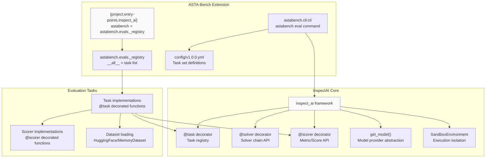
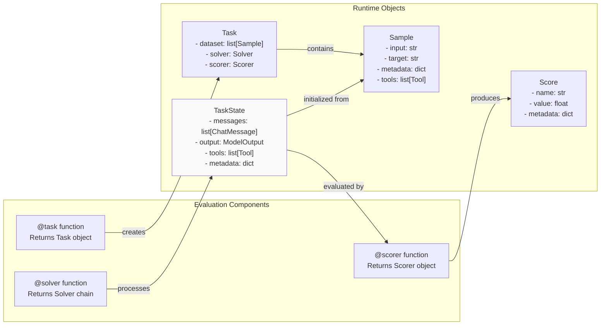
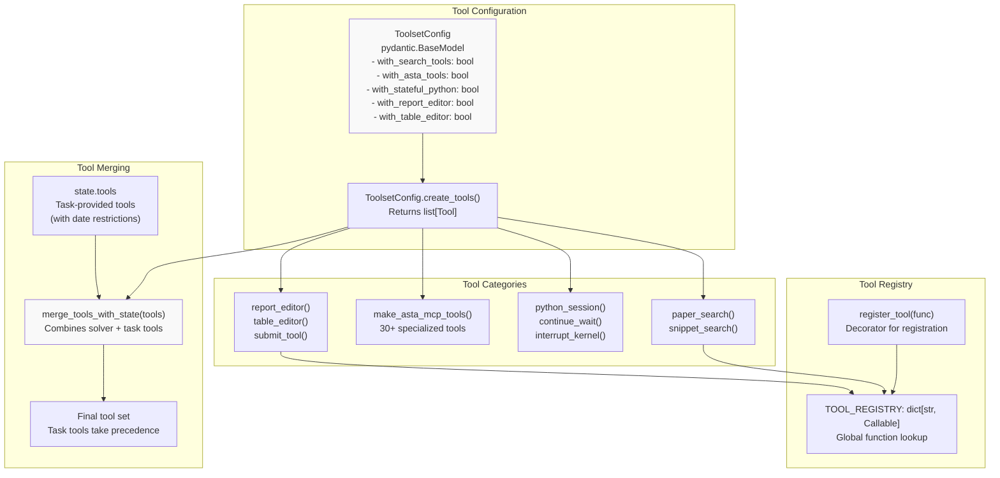
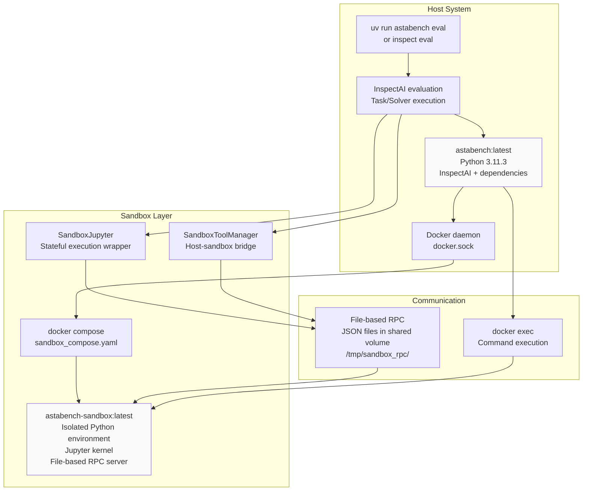
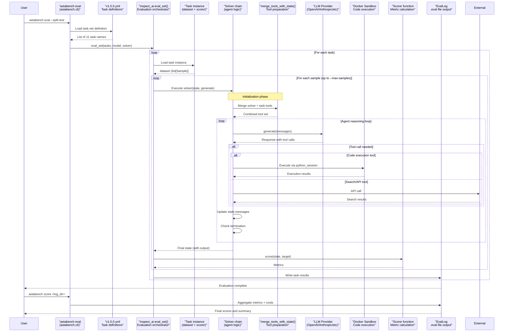

<!-- source: DeepWiki mcp.deepwiki.com · repo allenai/asta-bench · page 3.1 Architecture Overview · fetched 2026-10-26 -->

# Architecture Overview

<details>
<summary>Relevant source files</summary>

The following files were used as context for generating this wiki page:

- [Makefile](Makefile)
- [README.md](README.md)
- [astabench/evals/paper_finder/eval.py](astabench/evals/paper_finder/eval.py)
- [astabench/tools/__init__.py](astabench/tools/__init__.py)
- [docker/Dockerfile](docker/Dockerfile)
- [pyproject.toml](pyproject.toml)
- [tests/test_registry_evals.py](tests/test_registry_evals.py)

</details>


This page describes the fundamental architecture of ASTA-Bench and how its components work together to execute evaluations. It covers the InspectAI integration, the Task/Solver/Scorer pattern, the tool configuration system, and the overall data flow through evaluations.

For specific implementation details about individual components, see:
- Configuration files and constants: [Configuration System](#3.2)
- Task definition and registration: [Task System](#3.3)
- Docker sandboxing and execution: [Sandbox and Execution Environment](#3.4)
- Tool categories and APIs: [Tool System](#4)

## InspectAI Foundation

ASTA-Bench is built as an extension to the [InspectAI](https://inspect.ai-safety-institute.org.uk/) evaluation framework. InspectAI provides the core infrastructure for running AI agent evaluations, including model calling, logging, parallel execution, and result aggregation.



**Sources:** [pyproject.toml:54-55](), [pyproject.toml:11](), [README.md:7]()

### Entry Point Registration

ASTA-Bench registers itself as an InspectAI extension through the `pyproject.toml` entry point:

```toml
[project.entry-points.inspect_ai]
astabench = "astabench.evals._registry"
```

This allows InspectAI's CLI to discover and load ASTA-Bench tasks using the `astabench/` prefix (e.g., `astabench/sqa_dev`, `astabench/paper_finder_test`).

**Sources:** [pyproject.toml:54-55](), [README.md:133]()

## Core Evaluation Pattern

ASTA-Bench follows InspectAI's Task/Solver/Scorer pattern, where evaluations are structured as:
- **Task**: Defines the problem dataset and evaluation methodology
- **Solver**: The AI agent that attempts to solve problems
- **Scorer**: Evaluates the solver's output against expected answers



**Sources:** [README.md:362-367](), [tests/test_registry_evals.py:106-117]()

### Task Definition Pattern

Tasks are defined using the `@task` decorator and typically:
1. Load a dataset (from HuggingFace or in-memory data)
2. Convert dataset items to `Sample` objects
3. Attach task-specific tools to samples
4. Configure scoring functions

Example task structure:
```python
@task
def my_benchmark():
    dataset = load_dataset(...)  # Load from HuggingFace
    samples = [json_to_sample(item) for item in dataset]  # Convert to Sample objects
    
    return Task(
        dataset=samples,
        scorer=my_scorer(),
        tools=[task_specific_tool()],  # Tools with date/corpus restrictions
        ...
    )
```

**Sources:** [astabench/evals/paper_finder/eval.py:1-225](), [tests/test_registry_evals.py:78-118]()

### Solver Execution Flow

Solvers receive a `TaskState` containing:
- The problem input/instructions
- Available tools in `state.tools`
- Message history in `state.messages`
- Metadata for the problem

Solvers can:
- Call LLMs via `generate()` or `get_model().generate()`
- Execute tools from `state.tools`
- Update `state.output.completion` with the answer
- Maintain conversation history

**Sources:** [README.md:234-241]()

## Tool Architecture

ASTA-Bench provides a sophisticated tool system that supports both task-provided tools (with restrictions) and optional solver-configurable tools.



**Sources:** [astabench/tools/__init__.py:28-117](), [astabench/tools/__init__.py:120-136](), [README.md:272-296]()

### ToolsetConfig Pattern

The `ToolsetConfig` class provides a declarative way to configure optional tools via CLI flags:

```python
# In solver code
@solver
def my_agent(max_steps=10, **tool_options):
    config = ToolsetConfig.model_validate(tool_options)
    tools = config.create_tools()
    
    return chain(
        merge_tools_with_state(tools),  # Merge with task tools
        # ... rest of solver logic
    )
```

CLI usage:
```bash
uv run inspect eval --solver my_agent -S with_asta_tools=1 -S with_stateful_python=1
```

**Sources:** [astabench/tools/__init__.py:28-117](), [README.md:272-287]()

### Tool Registry System

The `TOOL_REGISTRY` provides a global dictionary mapping tool names to their factory functions. The `register_tool()` decorator adds functions to this registry:

```python
TOOL_REGISTRY = {}

def register_tool(func) -> Callable[[], Tool]:
    func_name = func.__name__
    TOOL_REGISTRY[func_name] = func
    return lambda: ToolDef(func).as_tool()

# Usage
paper_search = register_tool(make_paper_search())
snippet_search = register_tool(make_snippet_search())
```

**Sources:** [astabench/tools/__init__.py:120-148]()

### Tool Merging Strategy

The `merge_tools_with_state()` function combines solver-provided tools with task-provided tools, with task tools taking precedence. This is critical because task tools often have date restrictions or corpus constraints to maintain benchmark validity.

**Sources:** [astabench/tools/__init__.py:40-52](), [README.md:273-286]()

## Execution Environment

ASTA-Bench uses a multi-layered Docker-based architecture to provide isolated execution environments for code-running tasks.



**Sources:** [docker/Dockerfile:1-43](), [README.md:76-84](), [README.md:302-304]()

### Docker Environment Layers

1. **Host System**: The machine running evaluations
2. **Main Container** (`astabench:latest`): Contains the ASTA-Bench framework, InspectAI, and all evaluation code
3. **Sandbox Container** (`astabench-sandbox:latest`): Isolated environment for executing agent-generated code

The main container has access to the Docker socket, allowing it to spawn and manage sandbox containers.

**Sources:** [docker/Dockerfile:1-43](), [Makefile:6-69]()

### Concurrency Configuration

ASTA-Bench supports parallel execution with several concurrency parameters:

| Parameter | Purpose | Recommended Value |
|-----------|---------|------------------|
| `--max-samples` | Max problems in parallel | ≤ CPU cores |
| `--max-sandboxes` | Max concurrent sandboxes | = `--max-samples` |
| `--max-connections` | Max LLM connections | ≥ `--max-samples` |
| `INSPECT_DOCKER_CLI_CONCURRENCY` | Sandbox communication concurrency | ≥ 2 × `--max-samples` |

**Sources:** [README.md:193-209]()

## Complete Data Flow

The following diagram shows the complete evaluation execution flow, from CLI invocation to final scoring:



**Sources:** [README.md:112-124](), [README.md:154-157](), [tests/test_registry_evals.py:106-117]()

### Evaluation Phases

1. **Configuration Loading**: The `astabench eval` CLI loads task definitions from `v1.0.0.yml`
2. **Task Initialization**: For each task, the dataset is loaded and converted to `Sample` objects
3. **Solver Execution**: The solver runs for each sample, with tools merged via `merge_tools_with_state()`
4. **Tool Calling**: The solver can call tools (search, code execution, editors) to gather information
5. **Scoring**: After solver completion, the scorer evaluates the output against the target
6. **Logging**: Results are written to `.eval` log files with full metadata
7. **Aggregation**: The `astabench score` command aggregates metrics and calculates costs

**Sources:** [README.md:112-124](), [README.md:154-157]()

### State Management

Throughout execution, the `TaskState` object maintains:
- `state.messages`: Conversation history with the LLM
- `state.tools`: Available tool definitions
- `state.output.completion`: The solver's final answer
- `state.metadata`: Problem-specific metadata (dates, restrictions, etc.)
- `state.store`: Persistent key-value storage across solver steps

**Sources:** [README.md:234-243]()

### Model Usage Tracking

All LLM calls are automatically tracked for cost calculation. The framework supports:
- Native InspectAI model calls via `generate()` or `get_model().generate()`
- OpenAI client bridging via `bridge()`
- Manual logging via `record_model_usage_with_inspect()`

**Sources:** [README.md:246-266]()

---

This architecture enables ASTA-Bench to provide a flexible, extensible evaluation framework that can accommodate diverse benchmarks (literature search, code execution, data analysis) while maintaining reproducibility, isolation, and detailed cost tracking.

---

