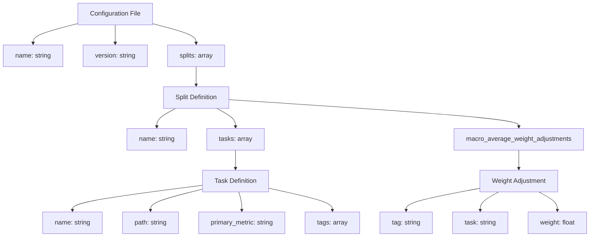
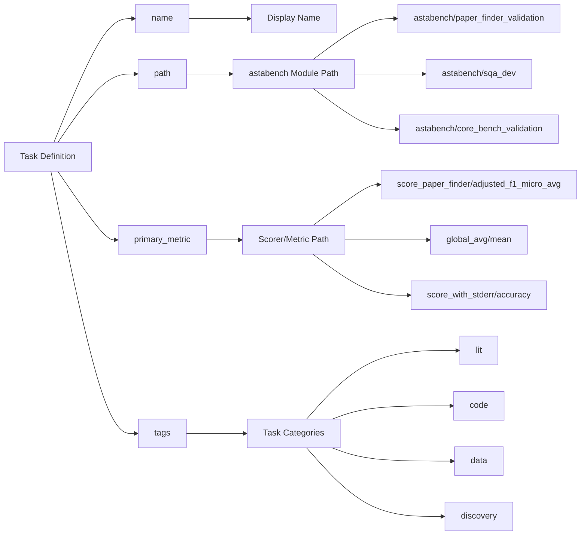
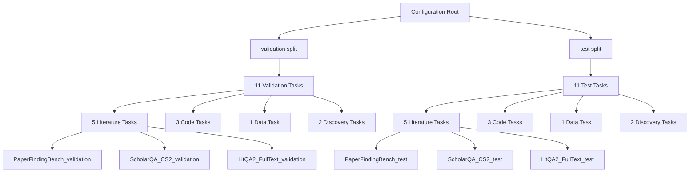
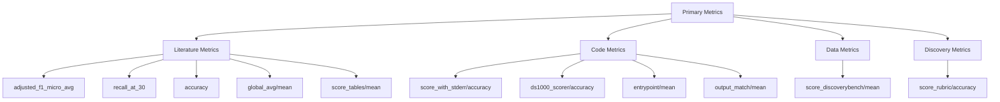
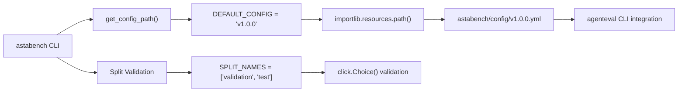

<!-- source: DeepWiki mcp.deepwiki.com · repo allenai/asta-bench · page 3.2 Configuration System · fetched 2026-10-26 -->

# Configuration System

<details>
<summary>Relevant source files</summary>

The following files were used as context for generating this wiki page:

- [astabench/cli.py](astabench/cli.py)
- [astabench/config/v1.0.0-dev1.yml](astabench/config/v1.0.0-dev1.yml)
- [astabench/config/v1.0.0.yml](astabench/config/v1.0.0.yml)
- [astabench/constants.py](astabench/constants.py)

</details>


This document explains the configuration system used in asta-bench to define evaluation suites, organize tasks, and specify metrics. The configuration system provides a declarative way to organize evaluation tasks into splits and define their scoring criteria.

For information about how tasks are implemented and executed, see [Task System](#3.3). For details about tool configuration within tasks, see [ToolsetConfig](#4.1).

## Configuration File Structure

The asta-bench configuration system uses YAML files located in [astabench/config/](). These files define complete evaluation suites with versioned task sets, splits, and metrics.

### Configuration Schema



*Sources: [astabench/config/v1.0.0.yml:1-134](), [astabench/config/v1.0.0-dev1.yml:1-134]()*

### Example Configuration Structure

The current production configuration demonstrates the schema:

| Field | Purpose | Example |
|-------|---------|---------|
| `name` | Suite identifier | `asta-bench` |
| `version` | Version string | `1.0.0` |
| `splits` | Evaluation splits | `validation`, `test` |

*Sources: [astabench/config/v1.0.0.yml:1-3]()*

## Task Definition System

Each task in the configuration system maps to a specific evaluation module and defines its scoring methodology.

### Task Properties



*Sources: [astabench/config/v1.0.0.yml:7-61](), [astabench/config/v1.0.0.yml:72-126]()*

### Task Categories

Tasks are organized by capability domains using tags:

| Tag | Purpose | Example Tasks |
|-----|---------|---------------|
| `lit` | Literature/Research Tasks | `PaperFindingBench`, `ScholarQA`, `LitQA2` |
| `code` | Programming Tasks | `CORE_Bench`, `DS_1000`, `SUPER` |
| `data` | Data Analysis Tasks | `DiscoveryBench` |
| `discovery` | End-to-End Research | `E2E_Bench` |

*Sources: [astabench/config/v1.0.0.yml:10-61]()*

## Split Organization

The configuration system organizes tasks into validation and test splits for proper evaluation methodology.

### Split Structure



*Sources: [astabench/config/v1.0.0.yml:4-133]()*

## Metric Configuration

Each task specifies a primary metric that determines its contribution to overall scores.

### Primary Metrics by Category



*Sources: [astabench/config/v1.0.0.yml:9-125]()*

### Weight Adjustments

The configuration supports macro-average weight adjustments for specific task combinations:

| Tag | Task | Weight | Purpose |
|-----|------|--------|---------|
| `lit` | `LitQA2_FullText_validation` | 0.5 | Balance with search variant |
| `lit` | `LitQA2_FullText_Search_validation` | 0.5 | Balance with full-text variant |

*Sources: [astabench/config/v1.0.0.yml:62-68](), [astabench/config/v1.0.0.yml:127-133]()*

## CLI Integration

The configuration system integrates with the command-line interface through the `astabench.cli` module.

### Configuration Resolution



*Sources: [astabench/cli.py:8-26]()*

### CLI Parameter Customization

The CLI system modifies the underlying `agenteval` CLI parameters to provide asta-bench specific defaults:

```python
# Configuration path is auto-resolved and hidden from users
param.default = get_config_path(DEFAULT_CONFIG)
param.hidden = True

# Split parameter restricted to valid options
param.type = click.Choice(SPLIT_NAMES, case_sensitive=False)
```

*Sources: [astabench/cli.py:18-25]()*

## Version Management

The configuration system supports multiple versions to enable evolution of the evaluation suite.

### Available Configurations

| Version | File | Status |
|---------|------|--------|
| `v1.0.0` | `astabench/config/v1.0.0.yml` | Production |
| `v1.0.0-dev1` | `astabench/config/v1.0.0-dev1.yml` | Development |

### Version Differences

The development version uses simplified task naming conventions:

| Production Name | Development Name |
|----------------|------------------|
| `PaperFindingBench_validation` | `paper_finder_validation` |
| `ScholarQA_CS2_validation` | `sqa_dev` |
| `ArxivDIGESTables_Clean_validation` | `arxivdigestables_validation` |

*Sources: [astabench/config/v1.0.0.yml:7-61](), [astabench/config/v1.0.0-dev1.yml:7-61]()*

### Configuration Selection

The default configuration is controlled by the `DEFAULT_CONFIG` constant in the CLI module, allowing easy switching between versions during development and deployment.

*Sources: [astabench/cli.py:8]()*

---

