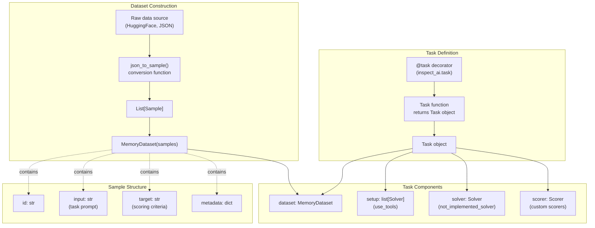
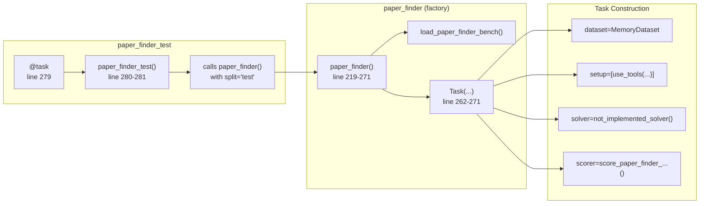
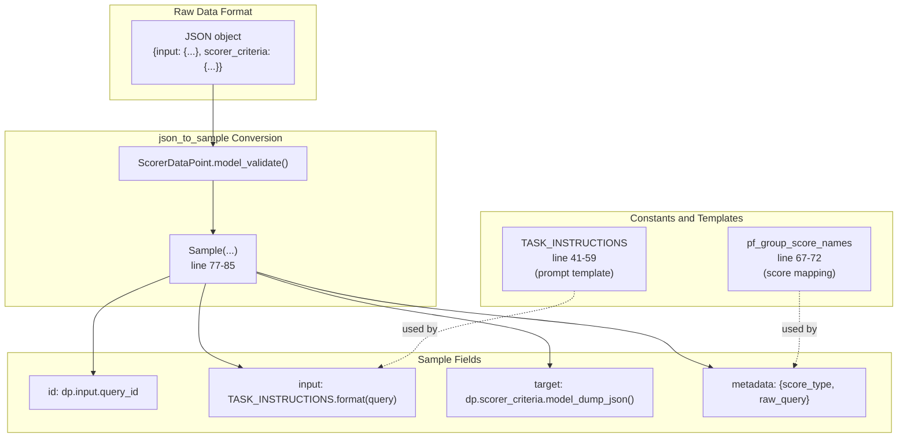
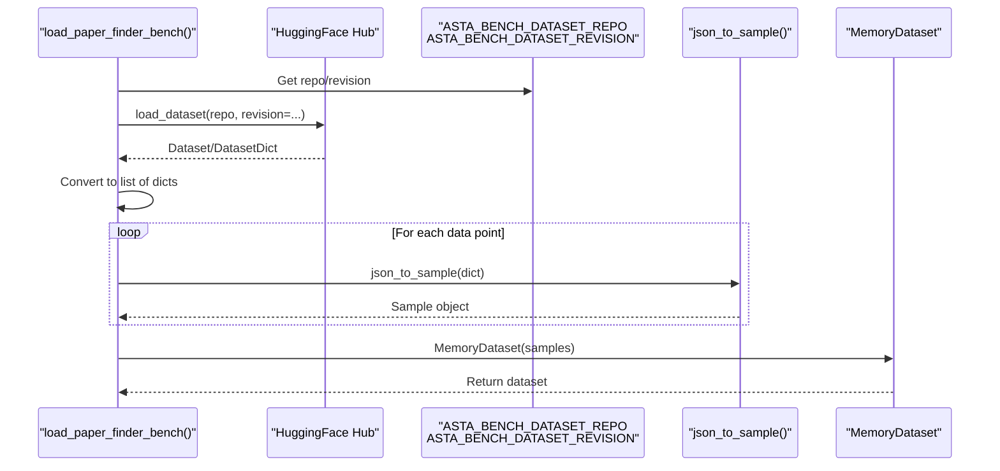
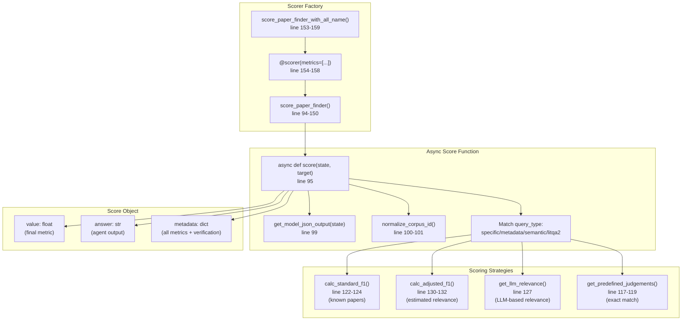
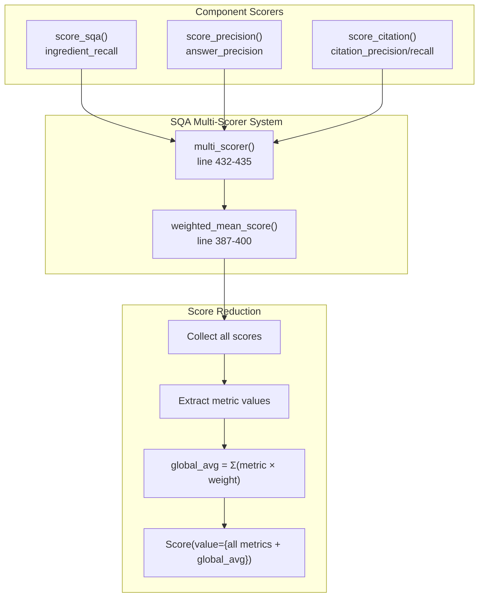
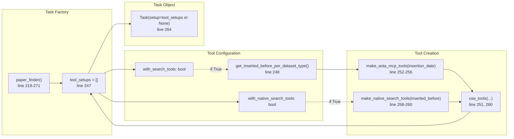
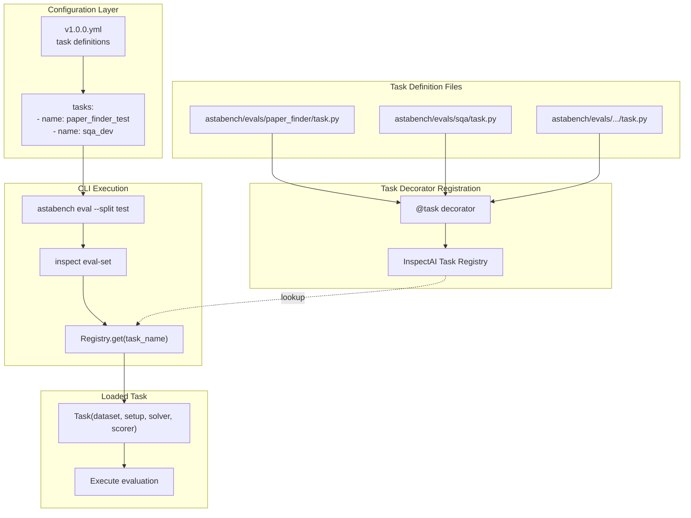
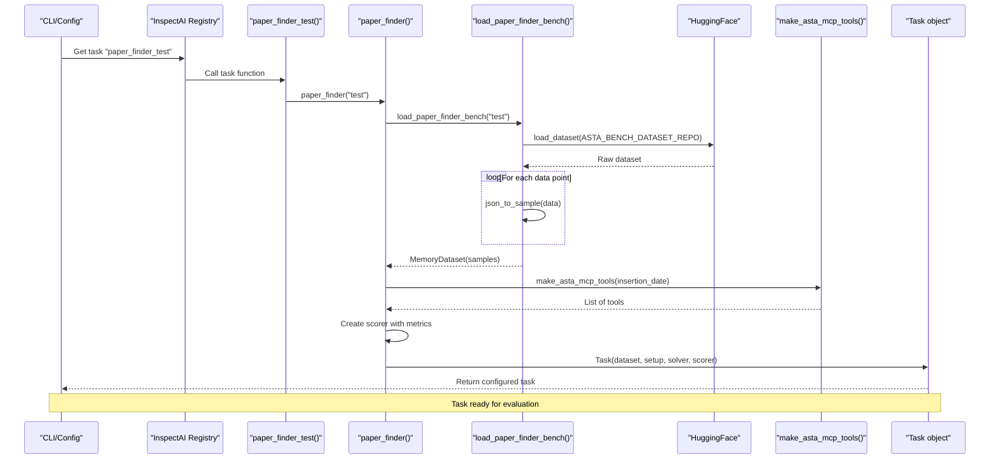
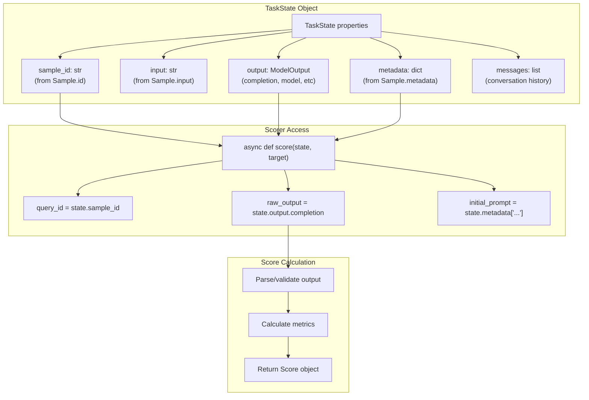

<!-- source: DeepWiki mcp.deepwiki.com · repo allenai/asta-bench · page 3.3 Task System · fetched 2026-10-26 -->

# Task System

<details>
<summary>Relevant source files</summary>

The following files were used as context for generating this wiki page:

- [astabench/evals/paper_finder/paper_finder_utils.py](astabench/evals/paper_finder/paper_finder_utils.py)
- [astabench/evals/paper_finder/task.py](astabench/evals/paper_finder/task.py)
- [astabench/evals/sqa/task.py](astabench/evals/sqa/task.py)
- [tests/conftest.py](tests/conftest.py)
- [tests/tools/test_search.py](tests/tools/test_search.py)

</details>


The Task System defines the core abstraction for creating evaluation benchmarks in ASTA-Bench. This page explains how tasks are structured using the InspectAI framework, including the `@task` decorator pattern, `Sample`/`MemoryDataset` objects, custom scoring mechanisms, and task registration.

For information about the specific benchmarks implemented in ASTA-Bench, see the Evaluation Tasks section ([#5](#5)). For details on how tasks are configured via YAML files, see [Configuration System](#3.2).

## Task Definition Architecture

Tasks in ASTA-Bench follow a declarative pattern built on InspectAI's `Task` abstraction. Each task defines four core components: a dataset of samples, optional setup steps (typically tool provisioning), a solver strategy, and one or more scorers for evaluation.



**Sources:** [astabench/evals/paper_finder/task.py:1-297](), [astabench/evals/sqa/task.py:1-547]()

## The @task Decorator Pattern

Tasks are registered with InspectAI using the `@task` decorator, which makes them discoverable via the CLI and configuration system. The decorator wraps a function that returns a `Task` object.

### Basic Task Structure



**Sources:** [astabench/evals/paper_finder/task.py:274-296]()

### Task Decorator Examples

| Task Function | Decorator Line | Purpose | Split/Variant |
|---------------|----------------|---------|---------------|
| `paper_finder_validation` | [task.py:274]() | Paper finding validation | validation |
| `paper_finder_test` | [task.py:279]() | Paper finding test | test |
| `paper_finder_litqa2` | [task.py:284]() | LitQA2 paper finding | litqa2 |
| `sqa_dev` | [sqa/task.py:539]() | ScholarQA development | dev |
| `sqa_test` | [sqa/task.py:544]() | ScholarQA test | test |

All task functions use the common pattern of delegating to a factory function that handles dataset loading and task construction with configurable parameters.

**Sources:** [astabench/evals/paper_finder/task.py:274-296](), [astabench/evals/sqa/task.py:539-546]()

## Sample and Dataset System

### Sample Construction

The `Sample` class (from `inspect_ai.dataset`) represents a single evaluation instance. Samples are created by conversion functions that transform raw data into the required structure.



**Sources:** [astabench/evals/paper_finder/task.py:75-85](), [astabench/evals/paper_finder/task.py:41-59]()

### Sample Fields

Each `Sample` object contains:

- **`id`**: Unique identifier for the sample (used in logging and scoring)
- **`input`**: The prompt/question text presented to the agent
- **`target`**: Scoring criteria or expected output (often JSON-serialized)
- **`metadata`**: Additional context for scoring and analysis

Example from paper finder task:

```python
# From json_to_sample() in paper_finder/task.py:75-85
Sample(
    id=dp.input.query_id,  # e.g., "semantic_42" or "litqa2_15"
    input=TASK_INSTRUCTIONS.format(query=dp.input.query),
    target=dp.scorer_criteria.model_dump_json(),
    metadata={
        "score_type": pf_group_score_names[dp.input.query_id.split("_")[0]],
        "raw_query": dp.input.query,
    },
)
```

**Sources:** [astabench/evals/paper_finder/task.py:75-85]()

### Dataset Loading

Datasets are loaded from HuggingFace repositories with version pinning, then converted to `MemoryDataset` objects containing lists of `Sample` objects.



**Sources:** [astabench/evals/paper_finder/task.py:162-217]()

### Dataset Split Handling

The paper finder task demonstrates split handling with multiple variants:

| Split Parameter | Dataset Source | Query IDs | Line Reference |
|-----------------|----------------|-----------|----------------|
| `"validation"` | PaperFindingBench | semantic/metadata/specific queries | [task.py:206-214]() |
| `"test"` | PaperFindingBench | semantic/metadata/specific queries | [task.py:206-214]() |
| `"litqa2"` | futurehouse/lab-bench | All LitQA2 queries (198 total) | [task.py:182-197]() |
| `"litqa2_test"` | futurehouse/lab-bench | Filtered to vespa fulltext test set | [task.py:199-203]() |
| `"litqa2_validation"` | futurehouse/lab-bench | Filtered to vespa fulltext validation set | [task.py:199-203]() |

**Sources:** [astabench/evals/paper_finder/task.py:162-217](), [astabench/evals/paper_finder/paper_finder_utils.py:242-332]()

## Scoring Mechanisms

### Scorer Definition Pattern

Scorers are defined using the `@scorer` decorator or returned directly as callable functions. They operate on `TaskState` (containing the agent's response) and `Target` (containing expected output/criteria).



**Sources:** [astabench/evals/paper_finder/task.py:94-160]()

### Scorer Types and Metrics

ASTA-Bench implements multiple scorer types for different evaluation needs:

| Scorer Function | Metrics | Aggregation | Use Case |
|----------------|---------|-------------|----------|
| `score_paper_finder` | F1, recall@k | `grouped(mean())` by score_type | Paper retrieval quality |
| `score_sqa` | ingredient_recall, score | `mean()`, `stderr()` | Rubric-based QA evaluation |
| `score_citation` | citation_precision, citation_recall, f1 | `mean()`, `stderr()` | Citation quality assessment |
| `score_precision` | answer_precision | `mean()`, `stderr()` | Answer relevance |
| `score_all` | Combined metrics | `weighted_mean_score()` | Multi-aspect evaluation |

**Sources:** [astabench/evals/paper_finder/task.py:94-160](), [astabench/evals/sqa/task.py:166-436]()

### Score Return Value

The `Score` object returned by scorers contains:

```python
Score(
    value=sample_scores[final_score_name],  # Primary metric (float or dict)
    answer=state.output.completion,         # Agent's raw output
    metadata={                              # Additional metrics and debug info
        **sample_scores,                    # All computed metrics
        **verified_results                  # Validation metadata
    },
    explanation="..."                       # Optional error/debug message
)
```

For multi-metric scorers, `value` can be a dictionary of metric names to values, which enables the metrics system to track and aggregate multiple metrics simultaneously.

**Sources:** [astabench/evals/paper_finder/task.py:144-148](), [astabench/evals/sqa/task.py:205]()

### Multi-Scorer Aggregation

Complex tasks use `multi_scorer` with custom reducers to combine multiple scoring aspects:



**Sources:** [astabench/evals/sqa/task.py:387-441]()

## Task Setup and Tool Integration

Tasks configure their execution environment through the `setup` parameter, which accepts a list of solvers. Most commonly, this is used to provision tools via `use_tools()`.



**Sources:** [astabench/evals/paper_finder/task.py:219-271]()

### Tool Setup Pattern

Tasks use boolean flags to conditionally enable tool categories:

```python
# From paper_finder() in task.py:247-264
tool_setups = []
inserted_before = get_inserted_before_per_dataset_type(chosen_split)

if with_search_tools:
    tool_setups.append(
        use_tools(make_asta_mcp_tools(insertion_date=inserted_before))
    )

if with_native_search_tools:
    native_search_tools = make_native_search_tools(inserted_before=inserted_before)
    if native_search_tools:
        tool_setups.append(use_tools(native_search_tools))

return Task(
    dataset=dataset,
    setup=tool_setups or None,  # None if empty list
    solver=not_implemented_solver(),
    scorer=scorer(),
)
```

This pattern allows tasks to be run with different tool configurations for testing or comparison purposes.

**Sources:** [astabench/evals/paper_finder/task.py:247-264](), [astabench/evals/sqa/task.py:490-508]()

## Task Registration and Discovery

### Registration Flow



**Sources:** [astabench/evals/paper_finder/task.py:274-296](), [astabench/evals/sqa/task.py:539-546]()

### Task Naming Convention

Tasks follow a consistent naming pattern:

- **Base name**: Descriptive task identifier (e.g., `paper_finder`, `sqa`)
- **Split suffix**: Evaluation split variant (e.g., `_test`, `_dev`, `_validation`)
- **Special variants**: Additional modifiers (e.g., `litqa2`, `litqa2_test`)

| Task Name | Task Function | Dataset Split | Purpose |
|-----------|---------------|---------------|---------|
| `paper_finder_validation` | `paper_finder_validation()` | validation | Paper finding development/tuning |
| `paper_finder_test` | `paper_finder_test()` | test | Paper finding final evaluation |
| `paper_finder_litqa2` | `paper_finder_litqa2()` | litqa2 (all) | LitQA2 full dataset |
| `paper_finder_litqa2_test` | `paper_finder_litqa2_test()` | litqa2 (test subset) | LitQA2 test split |
| `sqa_dev` | `sqa_dev()` | dev | ScholarQA development |
| `sqa_test` | `sqa_test()` | test | ScholarQA test |

**Sources:** [astabench/evals/paper_finder/task.py:274-296](), [astabench/evals/sqa/task.py:539-546]()

## Complete Task Example: Paper Finder

This section traces the complete lifecycle of the `paper_finder_test` task from definition to execution.



### Step-by-Step Breakdown

1. **Task Registration** ([task.py:279-281]()):
   ```python
   @task
   def paper_finder_test(with_search_tools: bool = True):
       return paper_finder("test", with_search_tools=with_search_tools)
   ```

2. **Factory Function** ([task.py:219-271]()):
   - Loads dataset via `load_paper_finder_bench("test")`
   - Configures tools based on flags
   - Creates scorer with appropriate metrics
   - Returns `Task` object

3. **Dataset Loading** ([task.py:205-214]()):
   - Fetches from HuggingFace with pinned revision
   - Converts to `Sample` objects via `json_to_sample`
   - Wraps in `MemoryDataset`

4. **Sample Structure** ([task.py:75-85]()):
   - `id`: Query ID (e.g., "specific_29")
   - `input`: Formatted prompt with instructions
   - `target`: JSON-serialized scoring criteria
   - `metadata`: Score type and raw query

5. **Scorer Creation** ([task.py:153-159]()):
   - Wraps base scorer with metrics configuration
   - Sets up grouped aggregation by score type
   - Configures final score name based on dataset type

6. **Tool Setup** ([task.py:247-260]()):
   - Conditionally creates Asta MCP tools
   - Applies temporal filtering (`inserted_before`)
   - Wraps with `use_tools()` for InspectAI integration

**Sources:** [astabench/evals/paper_finder/task.py:75-297]()

## Task State and Execution

During evaluation, InspectAI maintains a `TaskState` object that scorers can access:



**Sources:** [astabench/evals/paper_finder/task.py:95-148](), [astabench/evals/sqa/task.py:176-206]()

## Error Handling in Tasks

Tasks implement defensive error handling at multiple levels:

### Sample Level

```python
# From score_paper_finder() in task.py:98-107
try:
    pre_filter_output = await get_model_json_output(state)
    for res in pre_filter_output.results:
        res.paper_id = normalize_corpus_id(res.paper_id)
except (json.JSONDecodeError, ValidationError) as e:
    return Score(
        value=0,
        answer=state.output.completion,
        explanation=f"Agent output has an invalid format: {e}",
    )
```

### Task Level

The SQA task sets `fail_on_error=False` ([sqa/task.py:535]()) to continue evaluation even if individual samples fail, ensuring robust batch processing.

### Default Scoring

When output validation fails, scorers return zero scores with metadata explaining the failure:

```python
# From score_citation() in sqa/task.py:272-278
default_output = Score(
    value={"citation_recall": 0.0, "citation_precision": 0.0, "f1": 0.0},
    answer=raw_output,
)
if not json_output:
    return default_output
```

**Sources:** [astabench/evals/paper_finder/task.py:98-107](), [astabench/evals/sqa/task.py:272-278, 535]()

## Task Configuration Parameters

Tasks expose configuration parameters that control their behavior:

### Common Parameters

| Parameter | Type | Purpose | Example Tasks |
|-----------|------|---------|---------------|
| `scorer_model` | `str \| Model` | LLM for scoring | sqa, e2e-bench |
| `with_search_tools` | `bool` | Enable Asta MCP search tools | paper_finder, sqa |
| `with_native_search_tools` | `bool` | Enable native S2 search | paper_finder, sqa |
| `limit` | `int \| None` | Max samples to evaluate | sqa |
| `split` | `str` | Dataset split (dev/test/validation) | sqa, paper_finder |
| `temperature` | `float` | Scorer LLM temperature | sqa |
| `top_p` | `float` | Scorer LLM top_p | sqa |

### Evaluation Mode Parameters

| Parameter | Type | Default | Purpose |
|-----------|------|---------|---------|
| `simplified_eval` | `bool` | `True` | Use simplified SQA scoring |
| `assess_jointly` | `bool` | `True` | Assess all rubric items together |
| `sentence_wise_cit_eval` | `bool` | `False` | Evaluate citations per sentence |
| `all_at_once` | `bool` | `True` | Evaluate all citations in section |
| `aggregate` | `bool` | `True` | Aggregate multiple scorers |

**Sources:** [astabench/evals/sqa/task.py:465-536](), [astabench/evals/paper_finder/task.py:219-271]()

---

