<!-- source: DeepWiki mcp.deepwiki.com · repo allenai/asta-bench · page 4 Tool System · fetched 2026-10-26 -->

# Tool System

Relevant source files

The following files were used as context for generating this wiki page:

- [astabench/evals/paper_finder/eval.py](astabench/evals/paper_finder/eval.py)
- [astabench/tools/__init__.py](astabench/tools/__init__.py)
- [tests/test_registry_evals.py](tests/test_registry_evals.py)

The Tool System provides a standardized framework for configuring and managing AI agent tools within asta-bench evaluations. It enables flexible composition of capabilities including search, code execution, document editing, and external API integration through a unified configuration interface. The system handles tool registration, parameter validation, date filtering for reproducible evaluations, and integration with external services like Semantic Scholar.

For information about task-specific tool usage patterns, see [Task System](#3.3). For details on external API configurations, see [External API Integration](#4.3).

## ToolsetConfig

The `ToolsetConfig` class serves as the central configuration interface for standardized tool creation in asta-bench. It uses boolean flags to enable/disable different tool categories and provides validation to ensure compatible configurations.

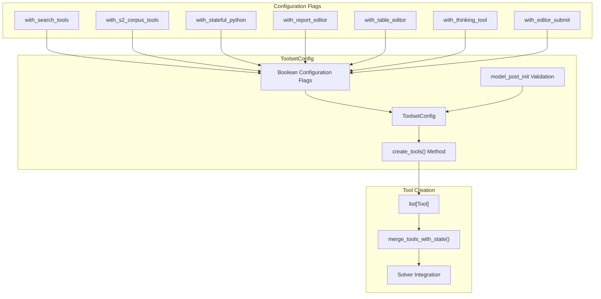

Sources: [astabench/tools/__init__.py:28-117]()

The configuration system enforces dependencies between tools. For example, `with_editor_submit=True` requires at least one editor tool to be enabled:

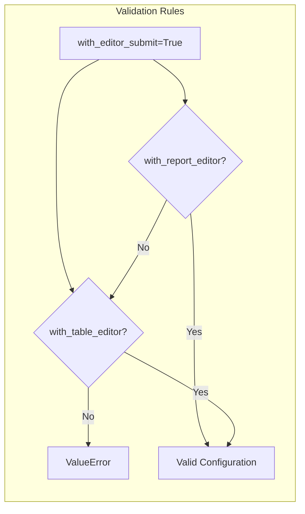

Sources: [astabench/tools/__init__.py:77-83]()

## Tool Categories and Registration

The tool system organizes tools into distinct categories, each serving specific agent capabilities:

| Category | Tools | Purpose |
|----------|--------|---------|
| Search | `paper_search`, `snippet_search` | Literature discovery and information retrieval |
| External APIs | S2 corpus tools, native search tools | Integration with Semantic Scholar and other APIs |
| Code Execution | `python_session`, `continue_wait`, `interrupt_kernel` | Stateful Python code execution |
| Document Editing | `report_editor`, `table_editor` | Document creation and modification |
| Utility | `calculator`, `think()` | Mathematical computation and reasoning |
| Submission | `submit_tool` | Result submission functionality |

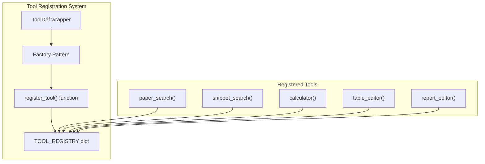

Sources: [astabench/tools/__init__.py:120-149]()

The registration system uses a factory pattern where tools are wrapped in lambda functions to ensure proper initialization:

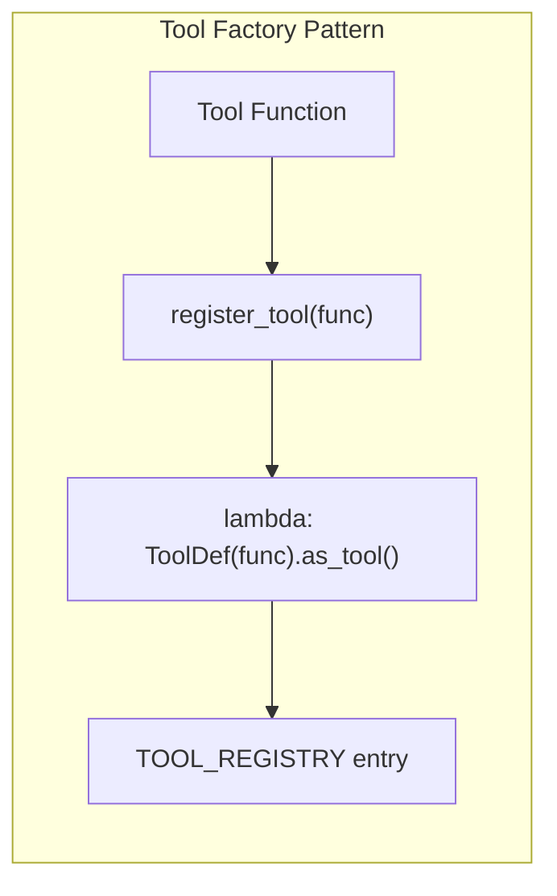

Sources: [astabench/tools/__init__.py:124-135]()

## Semantic Scholar API Integration

The S2 API tools provide comprehensive integration with Semantic Scholar's research corpus through MCP (Model Context Protocol) connections. The system includes sophisticated date filtering for reproducible evaluations.

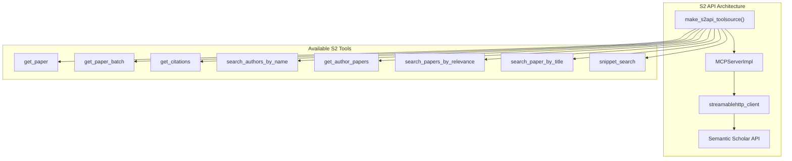

Sources: [astabench/tools/s2_api_tools.py:56-64](), [astabench/tools/s2_api_tools.py:604-632]()

### Date Filtering System

The S2 API tools implement comprehensive date filtering to ensure reproducible evaluations by limiting results to papers published before a specified insertion date:

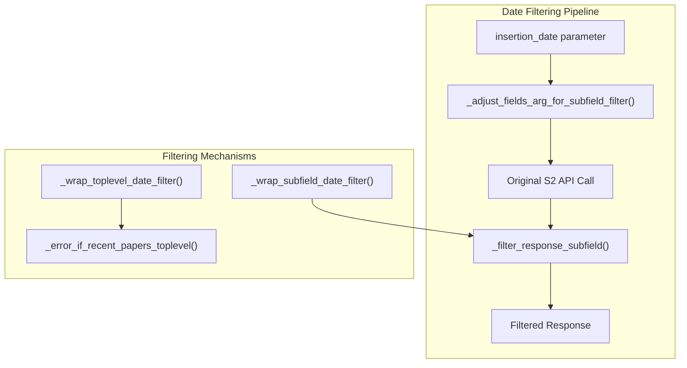

Sources: [astabench/tools/s2_api_tools.py:255-321](), [astabench/tools/s2_api_tools.py:323-365]()

The date filtering system automatically injects required date fields and removes them from responses to maintain clean tool interfaces:

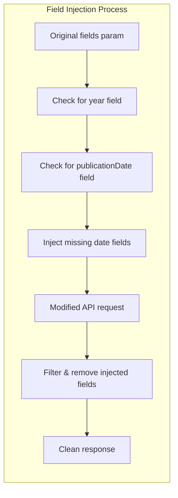

Sources: [astabench/tools/s2_api_tools.py:227-252]()

### Retry and Error Handling

The S2 API tools include sophisticated retry mechanisms for handling rate limiting and transient failures:

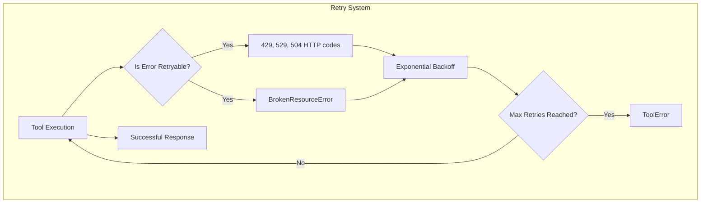

Sources: [astabench/tools/s2_api_tools.py:544-602](), [astabench/tools/s2_api_tools.py:454-485]()

## Tool Configuration Workflows

The tool system integrates with asta-bench evaluation workflows through standardized configuration patterns:

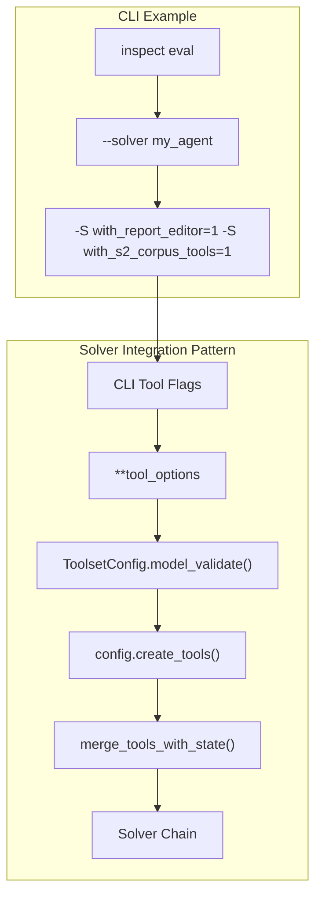

Sources: [astabench/tools/__init__.py:37-56]()

### Tool Override and Merging

The system supports tool merging where task-provided tools can override solver-provided tools, maintaining task-specific constraints like date restrictions:

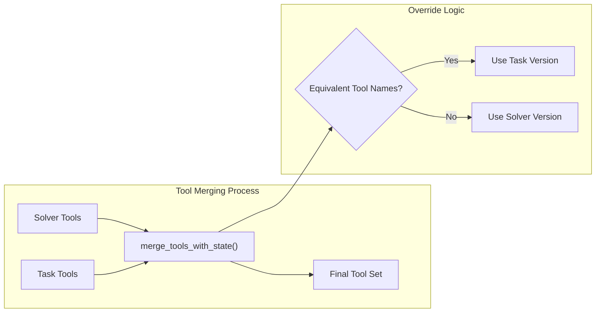

Sources: [astabench/tools/__init__.py:32-36]()

## Advanced Tool Customization

The tool system supports extensive customization through wrapper functions and parameter overrides:

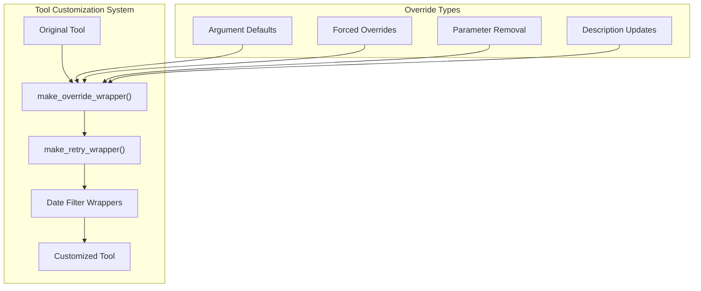

Sources: [astabench/tools/s2_api_tools.py:487-542]()

The customization system allows for:
- Setting default values for tool parameters
- Forcing specific parameter values that cannot be overridden
- Removing parameters from the tool interface
- Updating tool descriptions to reflect changes

Sources: [astabench/tools/s2_api_tools.py:487-542](), [astabench/tools/s2_api_tools.py:367-434]()

---

