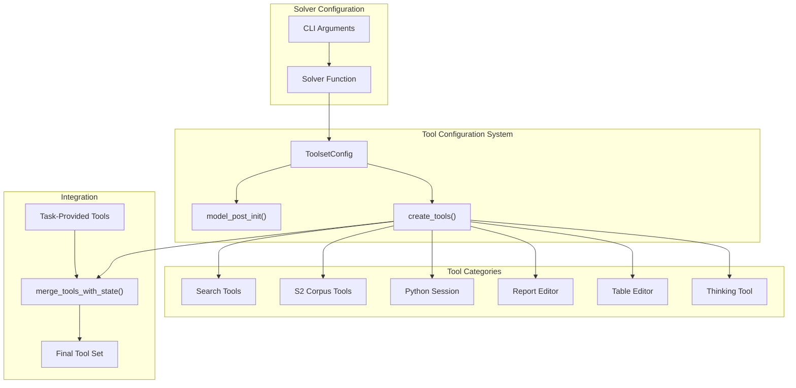
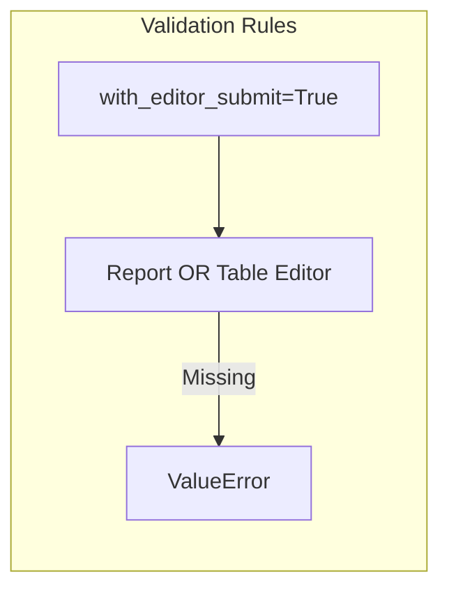
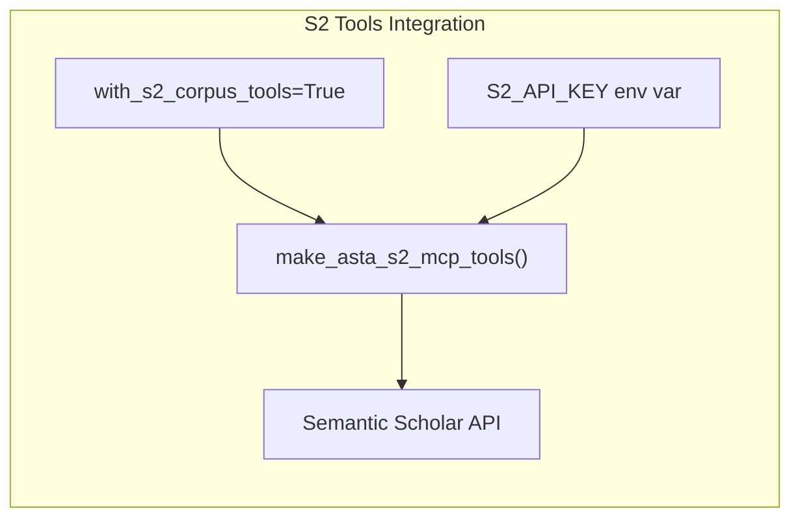
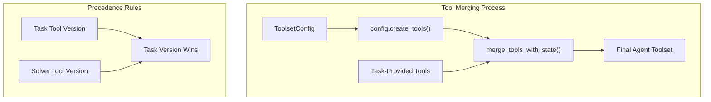

<!-- source: DeepWiki mcp.deepwiki.com · repo allenai/asta-bench · page 4.1 ToolsetConfig · fetched 2026-10-26 -->

# ToolsetConfig

<details>
<summary>Relevant source files</summary>

The following files were used as context for generating this wiki page:

- [astabench/evals/paper_finder/eval.py](astabench/evals/paper_finder/eval.py)
- [astabench/tools/__init__.py](astabench/tools/__init__.py)
- [tests/tasks/test_super.py](tests/tasks/test_super.py)
- [tests/test_registry_evals.py](tests/test_registry_evals.py)
- [tests/tools/test_toolset_config.py](tests/tools/test_toolset_config.py)

</details>


This document covers the `ToolsetConfig` class, which provides a standardized configuration system for creating tool sets in asta-bench. It serves as the primary interface for enabling and configuring different categories of tools that AI agents can use during evaluation tasks.

For information about specific tool implementations and external API integrations, see [External API Integration](#4.3). For details about the search tool implementations, see [Search Tools](#4.2).

## Purpose and Overview

The `ToolsetConfig` class is a Pydantic model that standardizes tool creation across asta-bench solvers. It provides boolean flags to enable different categories of tools and handles the instantiation of the corresponding tool objects. This configuration-driven approach allows solvers to declaratively specify their tool requirements and ensures consistent tool availability across different evaluation scenarios.



Sources: [astabench/tools/__init__.py:28-118]()

## Configuration Structure

The `ToolsetConfig` class uses boolean flags to control which tool categories are enabled. Each flag corresponds to a specific set of related tools that serve similar purposes.

| Flag | Default | Description |
|------|---------|-------------|
| `with_search_tools` | `False` | Enables `paper_search` and `snippet_search` tools |
| `with_s2_corpus_tools` | `False` | Enables Semantic Scholar MCP corpus tools |
| `with_stateful_python` | `False` | Enables persistent Python session tools |
| `with_report_editor` | `False` | Enables report editing and generation tools |
| `with_table_editor` | `False` | Enables table editing and manipulation tools |
| `with_thinking_tool` | `False` | Enables structured thinking/reasoning tools |
| `with_editor_submit` | `False` | Enables submission via editor tools |

The class includes validation logic to ensure configuration consistency:



Sources: [astabench/tools/__init__.py:77-83]()

## Tool Creation Process

The `create_tools()` method instantiates tool objects based on the enabled flags. The process follows a conditional pattern where each tool category is added only if its corresponding flag is enabled.

```mermaid
graph TD
    subgraph "Tool Creation Flow"
        START["create_tools()"]
        TOOLS_LIST["tools = []"]
        
        CHECK_SEARCH["with_search_tools?"]
        ADD_SEARCH["Add paper_search() + snippet_search()"]
        
        CHECK_S2["with_s2_corpus_tools?"]
        ADD_S2["Add make_asta_s2_mcp_tools()"]
        
        CHECK_PYTHON["with_stateful_python?"]
        ADD_PYTHON["Add python_session()"]
        
        CHECK_REPORT["with_report_editor?"]
        ADD_REPORT["Add report_editor()"]
        
        CHECK_TABLE["with_table_editor?"]
        ADD_TABLE["Add table_editor()"]
        
        CHECK_THINKING["with_thinking_tool?"]
        ADD_THINKING["Add think()"]
        
        RETURN["Return tools list"]
        
        START --> TOOLS_LIST
        TOOLS_LIST --> CHECK_SEARCH
        CHECK_SEARCH -->|"True"| ADD_SEARCH
        CHECK_SEARCH -->|"False"| CHECK_S2
        ADD_SEARCH --> CHECK_S2
        CHECK_S2 -->|"True"| ADD_S2
        CHECK_S2 -->|"False"| CHECK_PYTHON
        ADD_S2 --> CHECK_PYTHON
        CHECK_PYTHON -->|"True"| ADD_PYTHON
        CHECK_PYTHON -->|"False"| CHECK_REPORT
        ADD_PYTHON --> CHECK_REPORT
        CHECK_REPORT -->|"True"| ADD_REPORT
        CHECK_REPORT -->|"False"| CHECK_TABLE
        ADD_REPORT --> CHECK_TABLE
        CHECK_TABLE -->|"True"| ADD_TABLE
        CHECK_TABLE -->|"False"| CHECK_THINKING
        ADD_TABLE --> CHECK_THINKING
        CHECK_THINKING -->|"True"| ADD_THINKING
        CHECK_THINKING -->|"False"| RETURN
        ADD_THINKING --> RETURN
    end
```



Sources: [astabench/tools/__init__.py:94-117]()

## Usage Patterns

### Solver Integration

The typical usage pattern involves creating a `ToolsetConfig` instance from CLI arguments and using it to generate tools for a solver:

```python
@solver
def my_agent(max_steps=10, **tool_options):
    # Parse CLI flags into config
    config = ToolsetConfig.model_validate(tool_options)
    tools = config.create_tools()
    
    return chain(
        # Merge with task tools, preserving task versions by default
        merge_tools_with_state(tools),
        # ... rest of solver logic
    )
```

### CLI Integration

The configuration integrates with the inspect CLI through solver arguments:

```bash
inspect eval --solver my_agent -S with_report_editor=1 -S with_s2_corpus_tools=1
```

Sources: [astabench/tools/__init__.py:37-56]()

## Tool Categories and Integration

### Search Tools

When `with_search_tools=True`, the system adds `paper_search()` and `snippet_search()` tools that provide literature search capabilities without date restrictions.

### S2 Corpus Tools

The `with_s2_corpus_tools` flag enables Semantic Scholar MCP tools through `make_asta_s2_mcp_tools()`. These tools require the `S2_API_KEY` environment variable and provide access to the Semantic Scholar academic corpus.



### Editor Tools

Both `report_editor()` and `table_editor()` tools can be configured with submission capabilities when `with_editor_submit=True`. This creates a dependency where at least one editor tool must be enabled for submission to work.

Sources: [astabench/tools/__init__.py:97-116](), [astabench/tools/s2_api_tools.py:735-739]()

## Integration with Task System

The `ToolsetConfig` works in conjunction with the task system through the `merge_tools_with_state` function. This integration allows tasks to provide their own tool implementations that can override or supplement solver-provided tools.



This pattern ensures that task-specific tool implementations (which may have constraints like date restrictions) take precedence over generic solver tools while maintaining a consistent interface.

Sources: [astabench/tools/__init__.py:34-35](), [astabench/tools/__init__.py:49-52]()

## Configuration Utilities

### Pretty Formatting

The `pretty_format()` method provides a human-readable representation of the current configuration:

```python
def pretty_format(self) -> str:
    lines = []
    for field_name in sorted(self.model_dump().keys()):
        field_value = getattr(self, field_name)
        lines.append(f"    {field_name}={field_value}")
    return "\n" + "\n".join(lines)
```

### Model Validation

The class uses Pydantic's `ConfigDict(extra="forbid")` to prevent unexpected configuration parameters and includes post-initialization validation for configuration dependencies.

Sources: [astabench/tools/__init__.py:85-92](), [astabench/tools/__init__.py:59](), [astabench/tools/__init__.py:77-83]()

---

