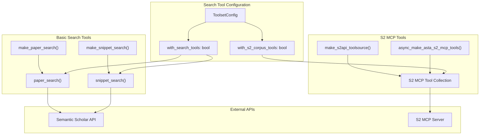
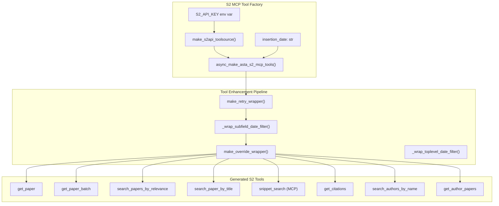
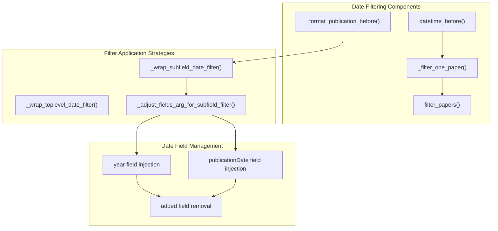

<!-- source: DeepWiki mcp.deepwiki.com · repo allenai/asta-bench · page 4.2 Search Tools · fetched 2026-10-26 -->

# Search Tools

<details>
<summary>Relevant source files</summary>

The following files were used as context for generating this wiki page:

- [astabench/tools/asta_tools.py](astabench/tools/asta_tools.py)
- [astabench/tools/search.py](astabench/tools/search.py)
- [setup.cfg](setup.cfg)
- [solvers/paper_finder/setup.sh](solvers/paper_finder/setup.sh)

</details>


This document covers the search tool capabilities within asta-bench that enable AI agents to search for and retrieve academic papers and text snippets. Search tools provide access to the Semantic Scholar corpus and API through both direct API calls and Model Context Protocol (MCP) tools.

For information about configuring search tools within solver workflows, see [ToolsetConfig](#4.1). For details about other external API integrations, see [External API Integration](#4.3).

## Search Tool Architecture

The search tool system is organized into two main categories: basic search tools that provide direct API access and S2 MCP tools that offer more sophisticated capabilities with built-in filtering and retry logic.



**Sources:** [astabench/tools/__init__.py:61-102](), [astabench/tools/search.py:24-78](), [astabench/tools/s2_api_tools.py:56-64]()

## Basic Search Tools

Basic search tools provide direct access to the Semantic Scholar API through two primary functions: `paper_search` and `snippet_search`. These tools are enabled via the `with_search_tools` flag in `ToolsetConfig`.

### Paper Search Implementation

The `make_paper_search()` function creates a paper search tool bound to an optional `inserted_before` date parameter:

| Function | Parameters | Returns | Description |
|----------|------------|---------|-------------|
| `paper_search` | `kquery: str`, `limit: int` | `list[dict[str, Any]]` | Search papers by keyword query |

The implementation uses the `/paper/search` endpoint and includes standard metadata fields defined in `METADATA_FIELDS`:

```
"title,abstract,corpusId,authors,year,venue,citationCount,referenceCount,influentialCitationCount"
```

**Sources:** [astabench/tools/search.py:24-49](), [astabench/tools/search.py:148-185](), [astabench/tools/search.py:20]()

### Snippet Search Implementation

The `make_snippet_search()` function creates a snippet search tool for finding text excerpts within papers:

| Function | Parameters | Returns | Description |
|----------|------------|---------|-------------|
| `snippet_search` | `query: str`, `limit: int`, `corpus_ids: list[str\|int]` | `list[dict[str, Any]]` | Search text snippets by query |

Snippet search uses the `/snippet/search` endpoint and supports filtering by specific corpus IDs to restrict results to particular papers.

**Sources:** [astabench/tools/search.py:51-78](), [astabench/tools/search.py:188-256]()

## S2 MCP Tools

S2 MCP tools provide more sophisticated search capabilities through the Model Context Protocol, offering enhanced features like automatic retry logic, date filtering, and field manipulation. These tools are enabled via the `with_s2_corpus_tools` flag.



**Sources:** [astabench/tools/s2_api_tools.py:604-732](), [astabench/tools/s2_api_tools.py:56-64]()

### Available S2 MCP Tools

| Tool Name | Purpose | Key Parameters |
|-----------|---------|----------------|
| `get_paper` | Retrieve single paper by ID | `paper_id`, `fields` |
| `get_paper_batch` | Retrieve multiple papers | `ids`, `fields` |
| `search_papers_by_relevance` | Search papers by keyword | `keyword`, `fields`, `limit` |
| `search_paper_by_title` | Search papers by title | `title`, `fields` |
| `snippet_search` | Search text snippets | `query`, `limit`, `venues` |
| `get_citations` | Get paper citations | `paper_id`, `fields`, `limit` |
| `search_authors_by_name` | Search authors | `name`, `fields`, `limit` |
| `get_author_papers` | Get author's papers | `author_id`, `paper_fields`, `limit` |

**Sources:** [astabench/tools/s2_api_tools.py:622-631]()

## Date Filtering System

The search tools implement sophisticated date filtering to support evaluation scenarios that require restricting results to papers available before a specific date. This simulates temporal constraints agents might face in real-world scenarios.



**Sources:** [astabench/tools/s2_api_tools.py:99-117](), [astabench/tools/s2_api_tools.py:126-142](), [astabench/tools/s2_api_tools.py:227-252]()

### Date Filtering Implementation

The `filter_papers()` function processes paper lists to remove entries published after a cutoff date:

- **Date Resolution**: When `publicationDate` is unavailable, uses December 31st of the publication year
- **Field Management**: Automatically injects required date fields (`year`, `publicationDate`) and removes them from final output
- **Subfield Filtering**: Applies filtering to nested paper arrays (e.g., citations, author papers)

**Sources:** [astabench/tools/s2_api_tools.py:99-117](), [astabench/tools/s2_api_tools.py:67-96]()

## Error Handling and Retry Logic

S2 MCP tools include comprehensive error handling with exponential backoff retry for transient failures:

### Retry Configuration

| Parameter | Default | Description |
|-----------|---------|-------------|
| `max_retries` | 10 | Maximum retry attempts |
| `backoff_multiplier` | 2.0 | Exponential backoff factor |
| `base_delay` | 1.0 | Initial delay in seconds |
| `max_delay` | 60.0 | Maximum delay cap |

### Retryable Error Codes

The system retries on HTTP status codes: `429` (rate limit), `529` (service unavailable), `504` (gateway timeout), and `anyio.BrokenResourceError` conditions.

**Sources:** [astabench/tools/s2_api_tools.py:544-601](), [astabench/tools/s2_api_tools.py:454-484]()

## Tool Registration and Configuration

Search tools are registered through the tool registry system and configured via `ToolsetConfig`:

```python
# Basic search tools registration
paper_search = register_tool(make_paper_search())
snippet_search = register_tool(make_snippet_search())

# S2 MCP tools creation in ToolsetConfig
if self.with_s2_corpus_tools:
    tools.extend(make_asta_s2_mcp_tools())
```

The configuration system supports both basic search tools and S2 MCP tools independently, allowing flexible composition based on evaluation requirements.

**Sources:** [astabench/tools/__init__.py:139-141](), [astabench/tools/__init__.py:100-101](), [astabench/tools/__init__.py:61-67]()

---

