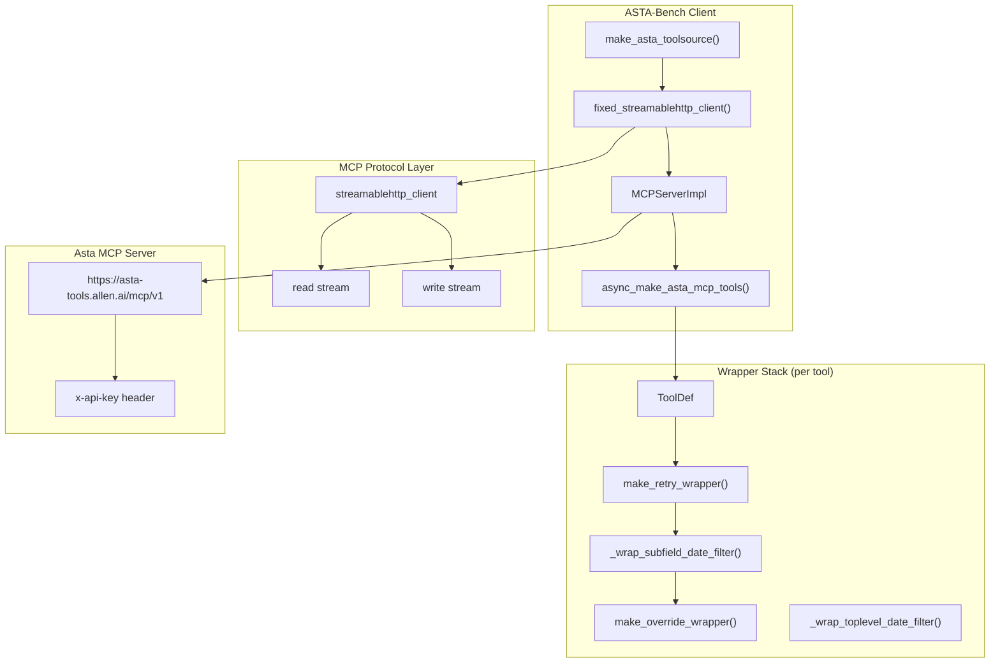
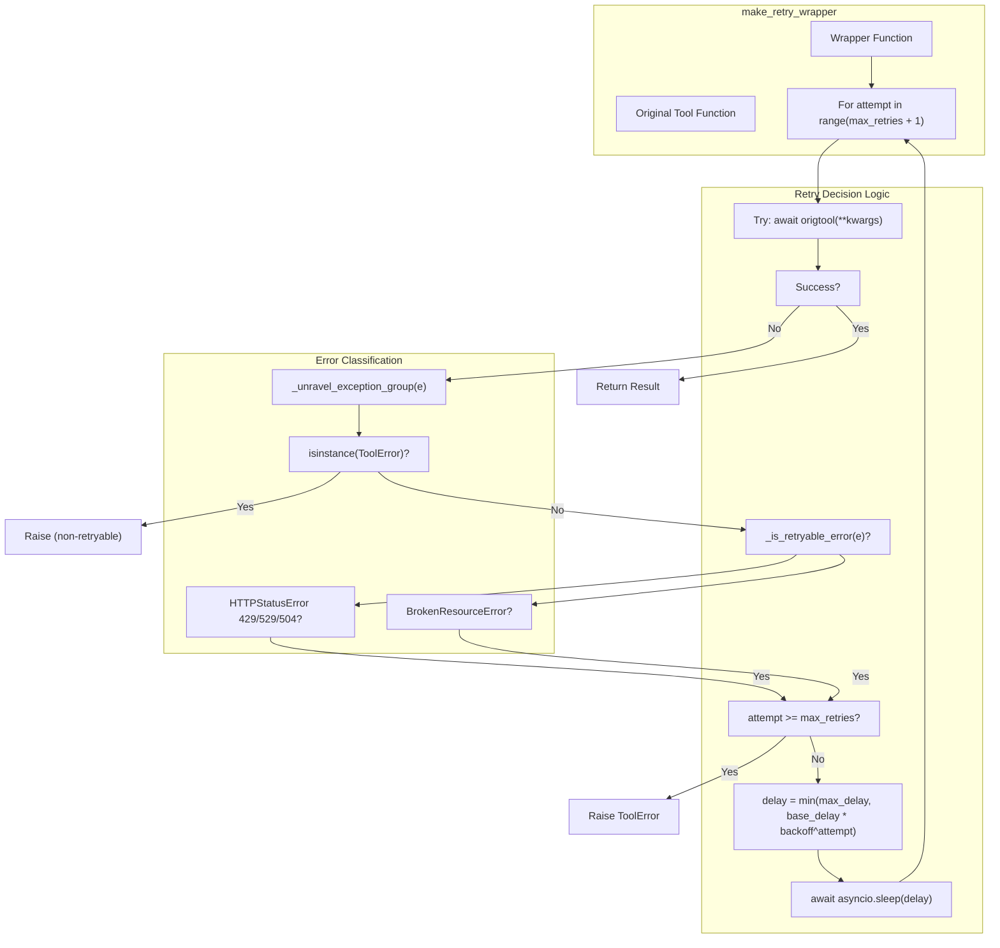
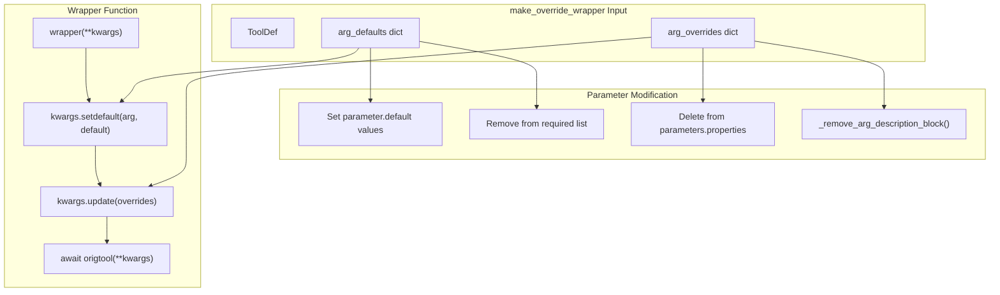
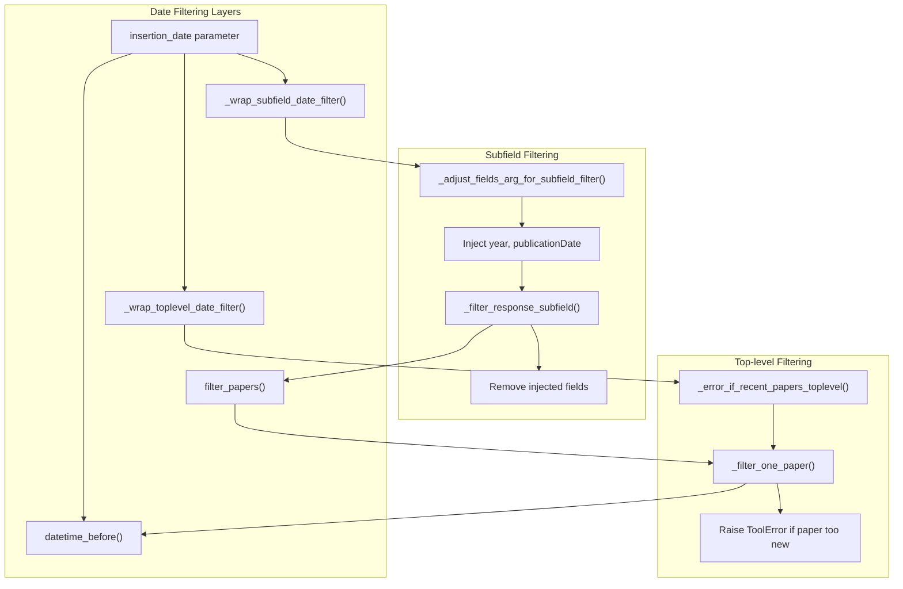
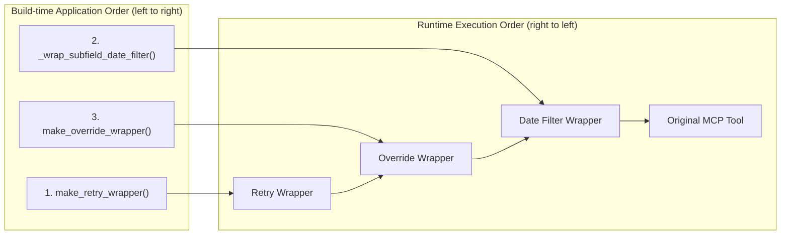

<!-- source: DeepWiki mcp.deepwiki.com · repo allenai/asta-bench · page 4.3 Asta MCP Tools · fetched 2026-10-26 -->

# Asta MCP Tools

<details>
<summary>Relevant source files</summary>

The following files were used as context for generating this wiki page:

- [astabench/evals/paper_finder/README.md](astabench/evals/paper_finder/README.md)
- [astabench/tools/asta_tools.py](astabench/tools/asta_tools.py)
- [astabench/tools/paper_finder_ai2i.py](astabench/tools/paper_finder_ai2i.py)
- [astabench/tools/search.py](astabench/tools/search.py)
- [solvers/paper_finder/setup.sh](solvers/paper_finder/setup.sh)

</details>


This page documents the Asta MCP (Model Context Protocol) tools provided by the Asta research platform. These specialized tools give AI agents access to paper search, citation networks, author information, and other academic research capabilities via a standardized MCP interface.

For information about configuring which tools are available to agents, see [ToolsetConfig](#4.1). For details about the Semantic Scholar-based search tools, see [Search Tools](#4.2).

## MCP Server Integration Architecture

Asta-bench connects to the Asta MCP server using the Model Context Protocol over HTTP streaming. The integration wraps MCP tools with retry logic, date filtering, and argument overrides to ensure reproducible and robust evaluations.

**Asta MCP Server Connection Architecture**



Sources: [astabench/tools/asta_tools.py:29-64](), [astabench/tools/asta_tools.py:604-739]()

## Available MCP Tools

The Asta MCP server provides 8 specialized tools for academic research. Each tool is wrapped with retry logic, date filtering, and argument defaults before being exposed to agents.

**MCP Tools Available in ASTA-Bench**

| Tool Name | Purpose | Key Parameters |
|-----------|---------|----------------|
| `snippet_search` | Search for text snippets within papers | `query`, `limit`, `corpus_ids` |
| `search_papers_by_relevance` | Search papers by semantic relevance | `query`, `limit`, `fields` |
| `get_paper` | Retrieve a single paper by ID | `paper_id`, `fields` |
| `get_paper_batch` | Retrieve multiple papers by IDs | `paper_ids`, `fields` |
| `get_citations` | Get citations for a paper | `paper_id`, `fields` |
| `search_authors_by_name` | Search for authors | `name`, `fields` |
| `get_author_papers` | Get papers by a specific author | `author_id`, `paper_fields` |
| `search_paper_by_title` | Search for papers by title | `title`, `fields` |

All tools support date filtering via `inserted_before` or `publication_date_range` parameters to ensure reproducible evaluations that don't include papers published after a specific cutoff date.

Sources: [astabench/tools/asta_tools.py:617-631](), [astabench/tools/asta_tools.py:633-725]()

## MCP Server Connection

The connection to the Asta MCP server uses the Model Context Protocol over HTTP with Server-Sent Events (SSE) for streaming.

### Connection Establishment

The `make_asta_toolsource()` function establishes the MCP connection:

```python
# Creates MCP ToolSource with authentication
make_asta_toolsource(api_key: str | None = None) -> ToolSource
```

The function:
1. Retrieves API key from parameter or `ASTA_TOOL_KEY` environment variable
2. Creates `MCPServerImpl` with streamable HTTP client
3. Configures timeout (5s connection, 300s SSE read timeout)
4. Adds `x-api-key` header for authentication

A wrapper fixes an unpacking issue in the upstream `streamablehttp_client`:

```python
# Fixed wrapper that handles session_id unpacking
async with fixed_streamablehttp_client(url, headers, timeout, sse_read_timeout) as (read, write):
    # Only yields read and write streams, ignores session_id
```

Sources: [astabench/tools/asta_tools.py:56-64](), [astabench/tools/asta_tools.py:29-53]()

### Tool Retrieval

The `async_make_asta_mcp_tools()` function retrieves and wraps all tools:

```python
# Main entry point for getting Asta MCP tools
async def async_make_asta_mcp_tools(
    api_key: str | None = None,
    insertion_date: str | None = None
) -> list[Tool]
```

The function:
1. Calls `make_asta_toolsource().tools()` to get raw MCP tools
2. Filters tools based on `include_tools` and `exclude_tools` sets
3. Wraps each tool with retry, date filtering, and override logic
4. Returns list of configured `Tool` objects

A synchronous wrapper `make_asta_mcp_tools()` is also provided that runs the async version in a thread pool.

Sources: [astabench/tools/asta_tools.py:604-739]()

## Retry Wrapper System

All Asta MCP tools are wrapped with exponential backoff retry logic to handle transient API errors. The `make_retry_wrapper()` function implements this behavior.

**Retry Logic Flow**



### Retry Configuration

| Parameter | Default | Description |
|-----------|---------|-------------|
| `max_retries` | 10 | Maximum retry attempts |
| `backoff_multiplier` | 2.0 | Exponential backoff multiplier |
| `base_delay` | 1.0 | Base delay in seconds |
| `max_delay` | 60.0 | Maximum delay cap in seconds |

### Retryable Error Codes

The wrapper retries on these HTTP status codes:
- **429**: Rate limit exceeded
- **529**: Service overloaded
- **504**: Gateway timeout

It also retries on `anyio.BrokenResourceError`, which can occur when the MCP client's internal async task dies from a 429 error.

Sources: [astabench/tools/asta_tools.py:544-601](), [astabench/tools/asta_tools.py:454-484](), [astabench/tools/asta_tools.py:436-451]()

## Override Wrapper System

The `make_override_wrapper()` function modifies tool parameters to set defaults or force specific values. This ensures consistent behavior across evaluations and hides certain parameters from the LLM.

**Override Wrapper Mechanism**



### Argument Defaults vs Overrides

- **`arg_defaults`**: Sets default values that the LLM can override
  - Updates `parameter.default` field
  - Removes from `required` list
  - Parameter remains visible to LLM

- **`arg_overrides`**: Forces values that the LLM cannot change
  - Deletes parameter from schema entirely
  - Removes description block from tool description
  - Removes from function signature
  - Always injected at runtime

### Common Override Patterns

```python
# Set default fields for paper search
make_override_wrapper(td, arg_defaults={"fields": METADATA_FIELDS})

# Force date cutoff (hide from LLM)
make_override_wrapper(td, arg_overrides={"inserted_before": "2024-01-01"})

# Set both defaults and overrides
make_override_wrapper(
    td,
    arg_defaults={"limit": 20},
    arg_overrides={"publication_date_range": ":2024-01-01"}
)
```

Sources: [astabench/tools/asta_tools.py:487-541](), [astabench/tools/asta_tools.py:367-433]()

## Date Filtering System

Asta MCP tools support date filtering to ensure evaluations only access papers published before a specific cutoff. This maintains reproducibility and prevents agents from accessing papers that weren't available at evaluation time.

### Date Filter Architecture

**Date Filtering Wrapper Stack**



### Subfield Date Filtering

Tools like `get_citations` and `search_authors_by_name` return papers in subfields (e.g., `citations`, `papers`). The `_wrap_subfield_date_filter()` wrapper filters these nested paper lists:

1. **Field Injection**: Adds `year` and `publicationDate` to requested fields if not present
2. **Response Filtering**: Calls `filter_papers()` on the subfield
3. **Field Removal**: Removes injected date fields from final response

Applied to tools with:
- `citations` subfield: `get_paper`, `get_paper_batch`, `get_citations`, `search_papers_by_relevance`
- `papers` subfield: `search_authors_by_name`, `get_author_papers`

Sources: [astabench/tools/asta_tools.py:255-321](), [astabench/tools/asta_tools.py:99-117]()

### Top-level Date Filtering

`get_paper` and `get_paper_batch` return papers directly (not in subfields). The `_wrap_toplevel_date_filter()` wrapper raises a `ToolError` if any requested paper is newer than the cutoff:

1. **Field Injection**: Ensures `year` and `publicationDate` are requested
2. **Date Checking**: Calls `_filter_one_paper()` on each returned paper
3. **Error Raising**: Raises `ToolError` listing invalid paper IDs if any are too recent

This prevents agents from accidentally requesting papers that shouldn't exist in their context.

Sources: [astabench/tools/asta_tools.py:323-364](), [astabench/tools/asta_tools.py:167-224]()

### Date Format Handling

The `datetime_before()` function converts partial date strings to cutoff datetimes:

```python
# Supported formats
"2025"       -> 2024-12-31 23:59:59
"2025-01"    -> 2024-12-31 23:59:59  
"2025-01-01" -> 2024-12-31 23:59:59
```

This ensures papers from year Y are included when filtering with year Y+1.

For `publication_date_range` parameters, `_format_publication_before()` converts to `:YYYY-MM-DD` format.

Sources: [astabench/tools/asta_tools.py:19-24](), [astabench/tools/asta_tools.py:67-96]()

## Tool Wrapper Composition

Each Asta MCP tool goes through multiple wrapper layers in a specific order. The composition ensures wrappers interact correctly:

**Wrapper Application Order (Innermost to Outermost)**



### Application Logic

The wrappers are applied in this order to ensure:

1. **Retry First**: Applied first so it's outermost at runtime, wrapping all other layers
2. **Date Filter Second**: Applied before override so it sees the injected date fields
3. **Override Last**: Applied last so it's innermost, setting final parameter values

Example for `get_citations`:

```python
td = ToolDef(raw_mcp_tool)

# 1. Add retry logic (outermost)
td.tool = make_retry_wrapper(td)

# 2. Add citations subfield filtering
if insertion_date:
    _wrap_subfield_date_filter(td, insertion_date, "citations", "fields")

# 3. Set default fields (innermost)
td.tool = make_override_wrapper(td, arg_defaults={"fields": PAPER_FIELDS})
```

At runtime, a tool call flows: retry → override → date filter → original tool.

Sources: [astabench/tools/asta_tools.py:646-724]()

## Field Defaults

All paper-returning tools have default `fields` parameters set to return comprehensive metadata:

```python
# Default paper metadata fields
PAPER_FIELDS = "title,abstract,corpusId,authors,year,venue,citationCount,referenceCount,influentialCitationCount"

# Default author fields
AUTHOR_FIELDS = "authorId,name,paperCount"
```

These defaults ensure agents receive useful information without having to specify field lists on every call. The LLM can still override these defaults if needed.

Sources: [astabench/tools/asta_tools.py:613-614](), [astabench/tools/asta_tools.py:686-700]()

## Integration Patterns for New APIs

When integrating new external APIs, follow these established patterns:

1. **Async HTTP Client**: Use `httpx.AsyncClient` with appropriate configuration
2. **Error Handling**: Implement retry logic with configurable attempts
3. **Usage Tracking**: Record model usage and costs where applicable
4. **Tool Wrapper**: Create inspect_ai compatible tools using `@tool` decorator
5. **Configuration**: Support configurable timeouts, URLs, and feature flags
6. **Logging**: Use structured logging for debugging and monitoring

The AI2I Paper Finder integration serves as a template for implementing additional external API integrations following the same architectural patterns.

Sources: [astabench/tools/paper_finder_ai2i.py:1-173]()

---

