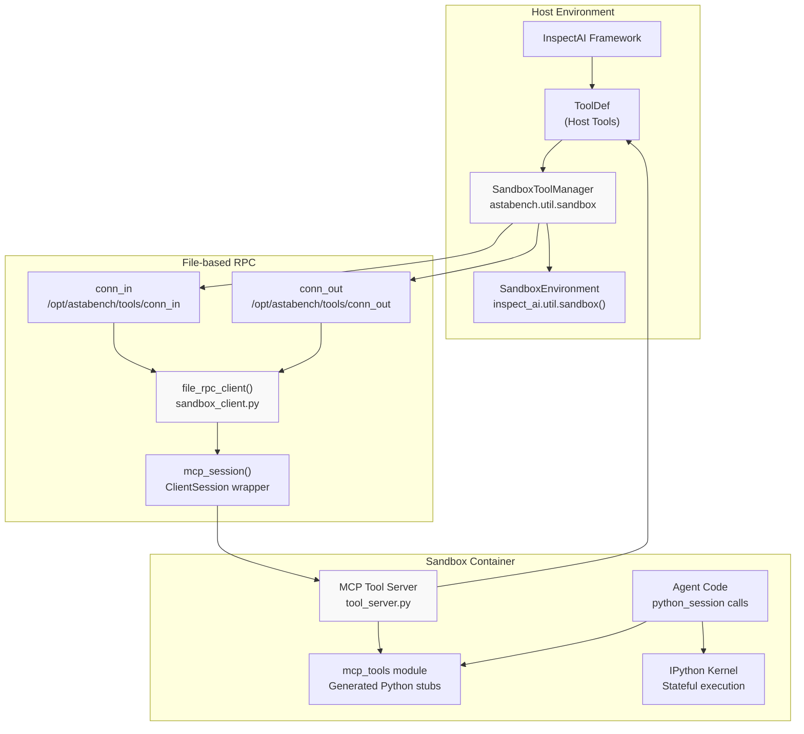
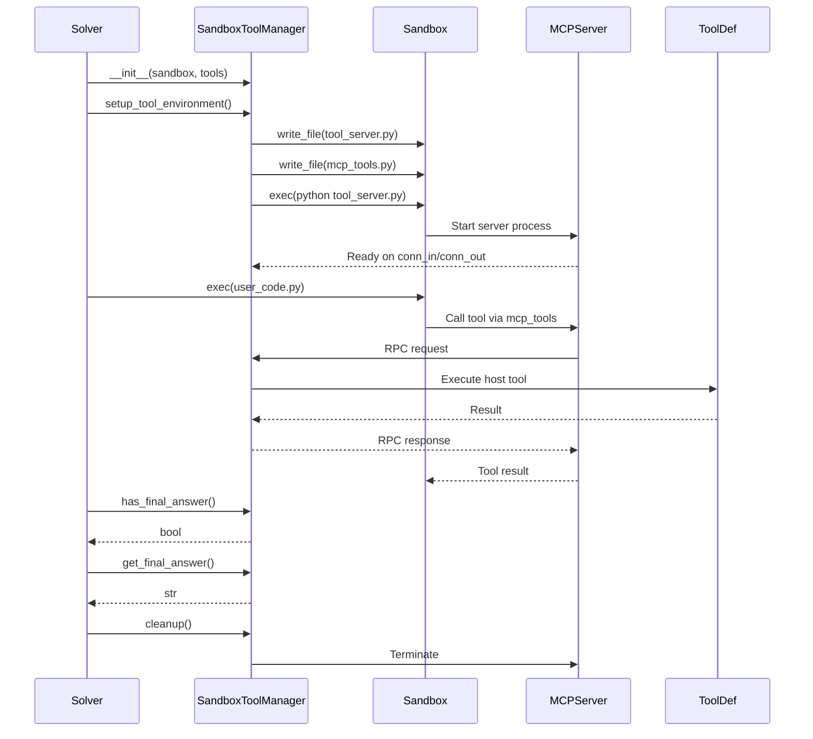
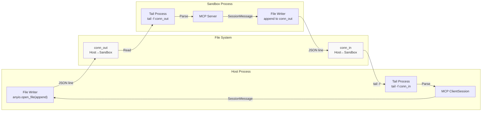

<!-- source: DeepWiki mcp.deepwiki.com · repo allenai/asta-bench · page 4.4 Sandbox Tools · fetched 2026-10-26 -->

# Sandbox Tools

<details>
<summary>Relevant source files</summary>

The following files were used as context for generating this wiki page:

- [.gitignore](.gitignore)
- [astabench/util/sandbox/static/sandbox_client.py](astabench/util/sandbox/static/sandbox_client.py)
- [tests/tasks/test_super.py](tests/tasks/test_super.py)
- [tests/tools/test_sandbox_tools.py](tests/tools/test_sandbox_tools.py)
- [tests/tools/test_toolset_config.py](tests/tools/test_toolset_config.py)

</details>


This document describes the sandbox tool execution system that enables AI agents to run code and tools in isolated Docker containers while maintaining communication with the host evaluation framework. For information about other tool categories, see [Search Tools](#4.2), [Asta MCP Tools](#4.3), and [Editor Tools](#4.5). For the broader sandbox execution environment, see [Sandbox and Execution Environment](#3.4).

## Purpose and Scope

Sandbox Tools provide the infrastructure for executing Python code and host-side InspectAI tools within isolated sandbox environments. The system enables:

- Stateful Jupyter kernel execution (`python_session`)
- Long-running operation management (`continue_wait`, `interrupt_kernel`)
- Execution history tracking (`get_cell_history`)
- Bidirectional host-sandbox communication via file-based RPC
- Exposure of arbitrary InspectAI tools to sandbox environments

The core abstraction is `SandboxToolManager`, which bridges InspectAI's tool system with sandboxed execution contexts using the Model Context Protocol (MCP).

Sources: [astabench/util/sandbox/static/sandbox_client.py](), [tests/tools/test_sandbox_tools.py]()

## System Architecture



Sources: [astabench/util/sandbox/static/sandbox_client.py:24-150](), [tests/tools/test_sandbox_tools.py:76-113]()

## SandboxToolManager

`SandboxToolManager` is the primary class for exposing host-side InspectAI tools to sandbox environments. It handles tool registration, code generation, MCP server lifecycle, and result retrieval.

### Initialization

```python
SandboxToolManager(
    sandbox: SandboxEnvironment,
    tools: list[ToolDef],
    include_final_answer_tool: bool = False,
    mcp_use_fifos: bool = False
)
```

| Parameter | Description |
|-----------|-------------|
| `sandbox` | InspectAI `SandboxEnvironment` instance (from `sandbox()`) |
| `tools` | List of `ToolDef` objects to expose to the sandbox |
| `include_final_answer_tool` | Whether to add a special `final_answer()` tool for result submission |
| `mcp_use_fifos` | Use FIFOs instead of regular files for RPC (performance optimization) |

Sources: [tests/tools/test_sandbox_tools.py:79-84]()

### Lifecycle Management

The manager follows a three-phase lifecycle:



**Phase 1: Setup** ([tests/tools/test_sandbox_tools.py:86]())
```python
await manager.setup_tool_environment()
```

- Generates Python stub file (`mcp_tools.py`) with function signatures matching host tools
- Writes MCP server script (`tool_server.py`) to sandbox
- Starts MCP server process in background
- Creates communication files at `/opt/astabench/tools/conn_in` and `/opt/astabench/tools/conn_out`

**Phase 2: Execution** ([tests/tools/test_sandbox_tools.py:89]())
```python
await sandbox().exec(["python", "-c", user_code])
```

User code imports and calls tools from generated `mcp_tools` module. Each call triggers RPC to host.

**Phase 3: Cleanup** ([tests/tools/test_sandbox_tools.py:107]())
```python
await manager.cleanup()
```

- Terminates MCP server process
- Removes communication files
- Clears final answer state

Sources: [tests/tools/test_sandbox_tools.py:76-113]()

### Tool Signature Construction

The manager introspects `ToolDef.parameters` to generate Python function signatures that sandbox code can import. This involves converting JSON Schema to Python type hints.

**Type Mapping:**

| JSON Schema | Python Type Hint |
|-------------|------------------|
| `"string"` | `str` |
| `"integer"` | `int` |
| `"number"` | `float` |
| `"boolean"` | `bool` |
| `"array"` | `list` |
| `"object"` | `dict` |
| `anyOf: [T, null]` | `T \| None` |
| `anyOf: [T1, T2, T3]` | `T1 \| T2 \| T3` |

**Example:**

Given a tool with JSON Schema:
```json
{
  "properties": {
    "query": {"type": "string"},
    "limit": {"type": "integer", "default": 20},
    "tags": {"type": "array", "default": ["tag1", "tag2"]}
  },
  "required": ["query"]
}
```

Generates Python signature:
```python
def tool_name(query: str, limit: int = 20, tags: list = ['tag1', 'tag2']) -> str
```

Sources: [tests/tools/test_sandbox_tools.py:200-360]()

### Final Answer Tool

When `include_final_answer_tool=True`, a special `final_answer(answer: str)` function is added to `mcp_tools`. This enables sandbox code to submit results:

```python
from mcp_tools import calculator, final_answer
result = calculator(op="+", num1=1, num2=2)
final_answer(json.dumps({"answer": result}))
```

The manager provides methods to check for and retrieve submitted answers:

```python
if await manager.has_final_answer():
    state.output.completion = await manager.get_final_answer()
```

Sources: [tests/tools/test_sandbox_tools.py:148-157]()

## File-based RPC Client

The `file_rpc_client` function provides bidirectional JSON-RPC communication between host and sandbox using file I/O or FIFOs.

### Communication Protocol



### Implementation Details

**File Reading** ([astabench/util/sandbox/static/sandbox_client.py:67-115]())

- Uses `tail -f` subprocess to follow file growth
- For regular files: `tail -f -n 0` skips existing content
- For FIFOs: `tail -f` reads from current position
- Reads in 64KB chunks (`READ_CHUNK_SIZE`)
- Processes complete newline-delimited JSON messages
- Validates messages with `types.JSONRPCMessage.model_validate_json()`

**File Writing** ([astabench/util/sandbox/static/sandbox_client.py:117-135]())

- Opens file in append mode for each message
- Serializes with `message.model_dump_json(by_alias=True, exclude_none=True)`
- Appends newline delimiter
- Flushes immediately to ensure delivery

**File vs FIFO Mode** ([astabench/util/sandbox/static/sandbox_client.py:48-63]())

Files are checked at initialization. Both must be FIFOs or both must be regular files. FIFOs provide lower latency but require explicit creation.

Sources: [astabench/util/sandbox/static/sandbox_client.py:24-150]()

### Session Initialization

The `mcp_session` context manager wraps the file-based transport with MCP protocol handling:

```python
async with mcp_session(
    input_file="/opt/astabench/tools/conn_in",
    output_file="/opt/astabench/tools/conn_out"
) as session:
    # Use session.call_tool(), session.list_tools(), etc.
    await session.initialize()  # 10 second timeout
```

The 10-second initialization timeout accommodates slow file polling on some systems; FIFOs typically complete in under 1 second.

Sources: [astabench/util/sandbox/static/sandbox_client.py:152-169]()

### Async-Sync Bridge

The `run_async_thread` utility enables calling async functions from synchronous contexts (e.g., Jupyter kernels):

```python
def run_async_thread(coro: Coroutine) -> Any:
    """Run async coroutine in dedicated thread with new event loop."""
    future: Future = Future()
    
    def run_in_thread():
        try:
            future.set_result(asyncio.run(coro))
        except Exception as e:
            future.set_exception(e)
    
    threading.Thread(target=run_in_thread, daemon=True).start()
    return future.result()
```

This is critical for Jupyter integration, where IPython may already have an event loop running.

Sources: [astabench/util/sandbox/static/sandbox_client.py:172-187]()

## SandboxJupyter

`SandboxJupyter` provides a high-level interface for executing Python code in a stateful Jupyter kernel within a sandbox. It's used primarily by code execution benchmarks like SUPER, CORE-Bench, and DS-1000.

### Basic Usage

```python
async with SandboxJupyter("default", cell_timeout=20) as jupyter:
    result = await jupyter.run_code("print('Hello'); 2 + 2")
    # result contains stdout, stderr, execution status, etc.
```

### Execution Tracking

For benchmarks that require trajectory tracking (e.g., SUPER landmarks), `SandboxJupyter` automatically captures:

- Cell execution order
- Output streams (stdout, stderr)
- Display data (plots, tables)
- Execution status and timing
- Error tracebacks

Example from SUPER benchmark:

```python
await jupy.run_code('print("The answer has been calculated successfully")')
state.output.completion = json.dumps({"answer_key": "answer_value"})
```

The scorer can then verify both the final answer and whether specific print statements (landmarks) appeared in the execution history.

Sources: [tests/tasks/test_super.py:35-68]()

## Large Output Handling

The file-based RPC system supports arbitrarily large tool outputs by reading in chunks and avoiding line-size limits:

```python
READ_CHUNK_SIZE = 65536  # 64KB chunks
buffer = b""
while True:
    chunk = await tail_process.stdout.read(READ_CHUNK_SIZE)
    if not chunk:
        break
    buffer += chunk
    # Process complete lines from buffer
```

Testing confirms reliable handling of 200KB+ responses without truncation or buffering issues.

Sources: [astabench/util/sandbox/static/sandbox_client.py:19-21, 82-98](), [tests/tools/test_sandbox_tools.py:368-459]()

## Docker Sandbox Specification

`SandboxToolManager` provides a standard Docker configuration for sandbox-based evaluations:

```python
sandbox_spec = SandboxToolManager.make_docker_sandbox_spec()
# Returns SandboxEnvironmentSpec with docker compose config
```

This specification references the `sandbox_compose.yaml` file that defines the container image, volume mounts, and environment variables required for tool execution.

Sources: [tests/tasks/test_super.py:132]()

## Usage Patterns

### Pattern 1: Tools with Custom Solver

```python
@solver
def custom_solver() -> Solver:
    async def solve(state: TaskState, generate: Generate) -> TaskState:
        manager = SandboxToolManager(
            sandbox(),
            tools=[calculator(), weather_tool()],
            include_final_answer_tool=True,
            mcp_use_fifos=False
        )
        await manager.setup_tool_environment()
        
        # Agent code imports and uses tools
        code = """
from mcp_tools import calculator, weather_tool, final_answer
temp = weather_tool(city="Seattle")
calc_result = calculator(op="+", num1=temp, num2=10)
final_answer(str(calc_result))
"""
        await sandbox().exec(["python", "-c", code])
        
        if await manager.has_final_answer():
            state.output.completion = await manager.get_final_answer()
        
        await manager.cleanup()
        return state
    return solve
```

Sources: [tests/tools/test_sandbox_tools.py:53-113]()

### Pattern 2: Stateful Jupyter Execution

```python
async def solve(state: TaskState, generate: Generate) -> TaskState:
    async with SandboxJupyter("default", cell_timeout=60) as jupy:
        # Execute multiple cells with shared state
        await jupy.run_code("import numpy as np")
        await jupy.run_code("data = np.array([1, 2, 3, 4, 5])")
        result = await jupy.run_code("data.mean()")
        
        # Extract answer from last execution
        state.output.completion = str(result)
    return state
```

Sources: [tests/tasks/test_super.py:35-41]()

### Pattern 3: Working Directory Independence

Tools remain functional regardless of working directory changes within the sandbox:

```python
code = """
import os
from mcp_tools import tool_name

os.makedirs("subdir", exist_ok=True)
os.chdir("subdir")  # Change working directory

# Tools still work because they use absolute paths
result = tool_name(arg="value")
"""
```

This is guaranteed because RPC communication files use absolute paths (`/opt/astabench/tools/conn_in`).

Sources: [tests/tools/test_sandbox_tools.py:64-67]()

## Error Handling

**Initialization Timeout**

If MCP session initialization exceeds 10 seconds:
```python
asyncio.TimeoutError: Session initialization timed out when connecting to tool server.
```

Common causes: file permissions, disk I/O saturation, or MCP server startup failure.

**Resource Cleanup**

The context manager pattern ensures cleanup even on exceptions:
- Tail processes are terminated with SIGTERM (1s grace period), then SIGKILL
- Background MCP server processes are killed
- Temporary files are removed

Sources: [astabench/util/sandbox/static/sandbox_client.py:143-149, 163-168]()

## Integration with Evaluation Framework

Sandbox tools integrate with InspectAI's evaluation pipeline:

1. Task defines required tools via `ToolsetConfig`
2. Solver merges task tools with solver-specific tools
3. For code execution tasks, `SandboxToolManager` exposes merged tool set to sandbox
4. Agent code executes within sandbox, calling tools via MCP
5. Results flow back through RPC for scoring

See [ToolsetConfig](#4.1) for declarative tool configuration and [Task System](#3.3) for integration points.

Sources: [tests/tools/test_sandbox_tools.py:168-198]()

---

