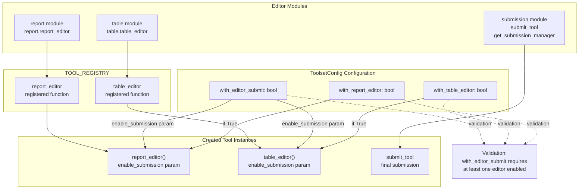
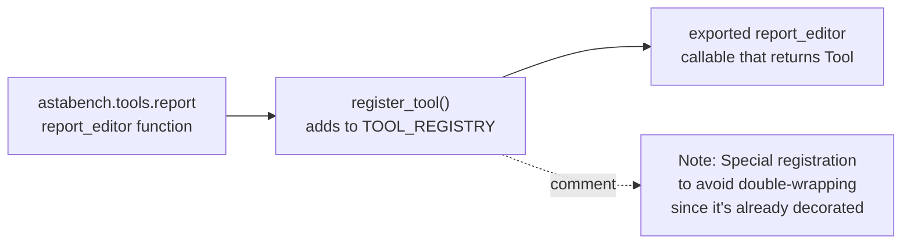
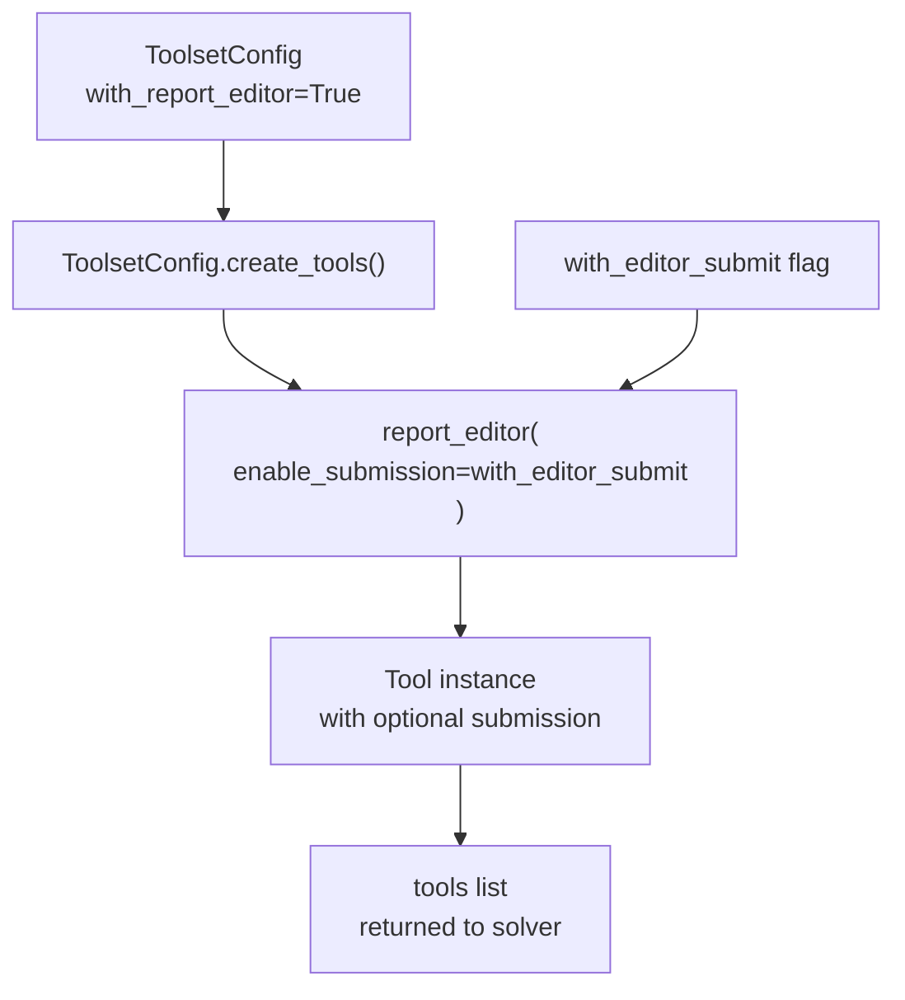
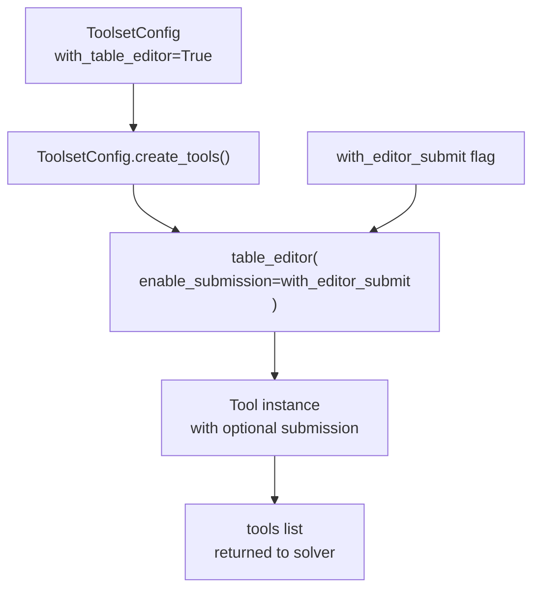
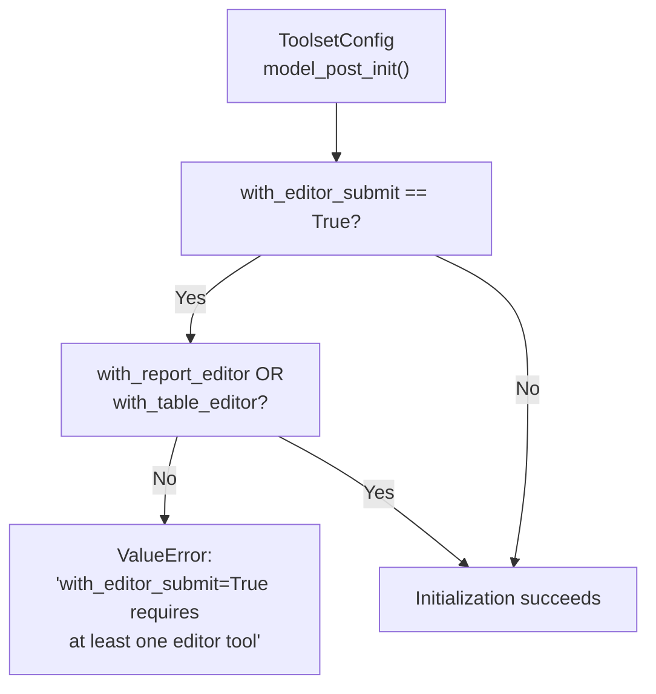
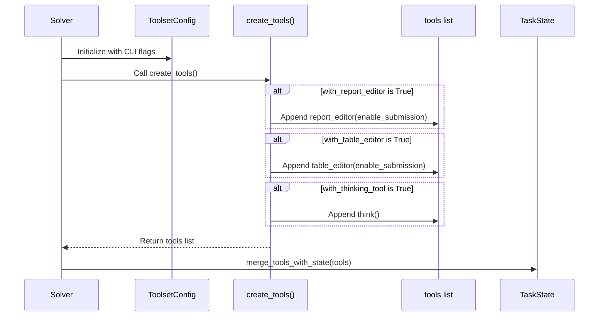
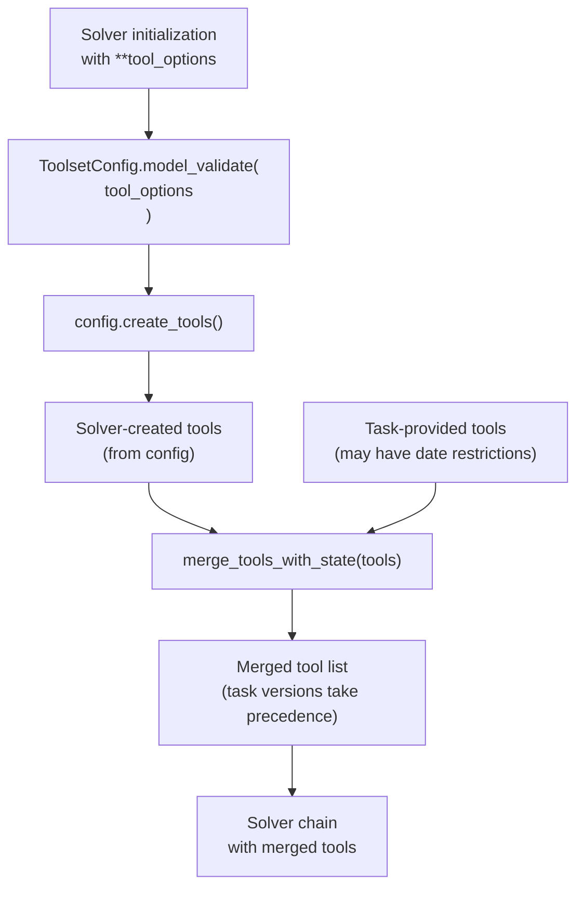
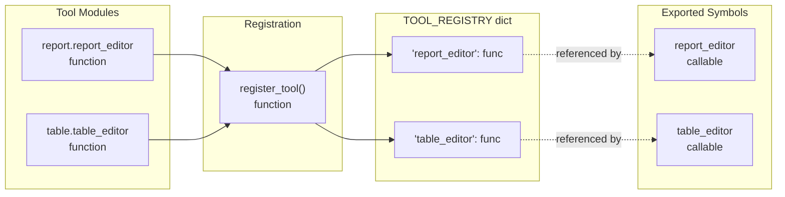

<!-- source: DeepWiki mcp.deepwiki.com · repo allenai/asta-bench · page 4.5 Editor Tools · fetched 2026-10-26 -->

# Editor Tools

<details>
<summary>Relevant source files</summary>

The following files were used as context for generating this wiki page:

- [astabench/evals/paper_finder/eval.py](astabench/evals/paper_finder/eval.py)
- [astabench/tools/__init__.py](astabench/tools/__init__.py)
- [tests/test_registry_evals.py](tests/test_registry_evals.py)

</details>


## Purpose and Scope

This document describes the Editor Tools subsystem in ASTA-Bench, which provides agents with capabilities to compose structured outputs during evaluations. Editor Tools enable agents to incrementally build reports and tables, and submit their final results through a submission system.

The Editor Tools subsystem consists of three primary components:
- **report_editor**: Tool for composing text-based reports
- **table_editor**: Tool for composing structured tabular data
- **submit_tool**: Tool for submitting final outputs

For information about other tool categories, see Search Tools ([4.2](#4.2)), Asta MCP Tools ([4.3](#4.3)), and Sandbox Tools ([4.4](#4.4)). For overall tool configuration, see ToolsetConfig ([4.1](#4.1)).

Sources: [astabench/tools/__init__.py:1-201]()

---

## Architecture Overview

The Editor Tools subsystem follows a modular architecture where each editor type is implemented in its own module but shares a common configuration and registration pattern. The submission system integrates with both editors to provide a unified output mechanism.



Sources: [astabench/tools/__init__.py:11-25](), [astabench/tools/__init__.py:69-83](), [astabench/tools/__init__.py:143-148]()

---

## Report Editor

### Overview

The `report_editor` tool enables agents to compose and edit text-based reports incrementally during evaluation tasks. This is particularly useful for tasks requiring structured written responses, literature reviews, or summarization.

### Registration and Configuration

The report editor is imported from the `report` module and registered in the tool registry with special handling to avoid double-wrapping:



The registration pattern differs from other tools because `report_editor` is already defined as a tool function in its module:

| Aspect | Implementation |
|--------|---------------|
| Module | `astabench.tools.report` |
| Registration | `register_tool(report.report_editor)` |
| Export | `report_editor = report.report_editor` |
| Special Handling | Registered without lambda wrapper to avoid double-wrapping |
| Tool Registry Key | `"report_editor"` |

Sources: [astabench/tools/__init__.py:11](), [astabench/tools/__init__.py:146-148]()

### Tool Creation and Parameters

When enabled through `ToolsetConfig`, the report editor is created with submission capabilities controlled by the `with_editor_submit` flag:



Sources: [astabench/tools/__init__.py:106-107]()

---

## Table Editor

### Overview

The `table_editor` tool enables agents to construct and manipulate structured tabular data during evaluations. This is critical for tasks like ArxivDIGESTables that require generating tables from scientific papers or other data sources.

### Registration and Configuration

Similar to the report editor, the table editor follows a special registration pattern:

| Aspect | Implementation |
|--------|---------------|
| Module | `astabench.tools.table` |
| Registration | `register_tool(table.table_editor)` |
| Export | `table_editor = table.table_editor` |
| Special Handling | Registered without lambda wrapper to avoid double-wrapping |
| Tool Registry Key | `"table_editor"` |

Sources: [astabench/tools/__init__.py:11](), [astabench/tools/__init__.py:143-145]()

### Tool Creation and Parameters

The table editor is created with the same submission configuration pattern as the report editor:



Sources: [astabench/tools/__init__.py:109-110]()

---

## Submission System

### Overview

The submission system provides a mechanism for agents to submit their final outputs. It is closely integrated with the editor tools through the `enable_submission` parameter, which allows editors to trigger submission directly.

### Components

The submission module provides two key components:

| Component | Purpose |
|-----------|---------|
| `submit_tool` | Tool function for submitting final outputs |
| `get_submission_manager` | Helper function for managing submission state |

### Configuration Validation

The `ToolsetConfig` enforces a validation rule that submission via editors requires at least one editor to be enabled:



This validation ensures that agents cannot enable editor-based submission without having an editor tool available:

Sources: [astabench/tools/__init__.py:77-83]()

---

## Integration with ToolsetConfig

### Configuration Fields

The `ToolsetConfig` class provides three boolean fields for controlling editor tools:

| Field | Default | Description |
|-------|---------|-------------|
| `with_report_editor` | `False` | Enable report composition tool |
| `with_table_editor` | `False` | Enable table composition tool |
| `with_editor_submit` | `False` | Enable submission via editor tools (requires at least one editor) |

### Tool Creation Flow

The `create_tools()` method conditionally adds editor tools based on configuration:



Sources: [astabench/tools/__init__.py:94-117]()

### CLI Usage Example

Editor tools can be enabled through CLI flags when running evaluations:

```bash
# Enable report editor
inspect eval --solver my_agent -S with_report_editor=1

# Enable both table editor and submission
inspect eval --solver my_agent -S with_table_editor=1 -S with_editor_submit=1

# Enable both editors with submission
inspect eval --solver my_agent \
  -S with_report_editor=1 \
  -S with_table_editor=1 \
  -S with_editor_submit=1
```

Sources: [astabench/tools/__init__.py:55-56]()

---

## Usage in Evaluation Tasks

### Task Integration Pattern

Editor tools are integrated into solvers through the standard tool merging pattern:



Sources: [astabench/tools/__init__.py:37-53]()

### Tasks Using Editor Tools

Based on the test configuration, certain tasks are expected to use editor tools:

| Task | Editor Type | Description |
|------|-------------|-------------|
| `arxivdigestables` | Table Editor | Generates tables from ArXiv papers |
| `arxivdigestables_test` | Table Editor | Test split for table generation |
| `arxivdigestables_validation` | Table Editor | Validation split for table generation |
| `sqa`, `sqa_test`, `sqa_dev` | Report Editor | Likely uses report composition for Q&A responses |

Sources: [tests/test_registry_evals.py:46-61]()

---

## Tool Registry

### Registration Mechanism

All editor tools are registered in the global `TOOL_REGISTRY` dictionary, which maps function names to their original implementations:



The `register_tool()` function adds tools to the registry and typically returns a lambda that wraps the tool. However, for editor tools, the original function is used directly to avoid double-wrapping:

| Tool | Registry Key | Wrapping |
|------|-------------|----------|
| `report_editor` | `"report_editor"` | No lambda wrapper (already decorated) |
| `table_editor` | `"table_editor"` | No lambda wrapper (already decorated) |
| `paper_search` | `"paper_search"` | Lambda wrapper: `lambda: ToolDef(func).as_tool()` |

Sources: [astabench/tools/__init__.py:120-135](), [astabench/tools/__init__.py:143-148]()

---

## Configuration Best Practices

### Validation Rules

When configuring editor tools, ensure the following constraints are met:

1. **Submission Requirement**: If `with_editor_submit=True`, at least one of `with_report_editor` or `with_table_editor` must also be `True`
2. **Extra Fields**: The `ToolsetConfig` uses `ConfigDict(extra="forbid")` to prevent typos in field names

### Example Configurations

Valid configurations:

```python
# Report editor only
config = ToolsetConfig(with_report_editor=True)

# Table editor with submission
config = ToolsetConfig(
    with_table_editor=True,
    with_editor_submit=True
)

# Both editors with submission
config = ToolsetConfig(
    with_report_editor=True,
    with_table_editor=True,
    with_editor_submit=True
)
```

Invalid configuration (raises `ValueError`):

```python
# ERROR: Submission enabled without any editor
config = ToolsetConfig(with_editor_submit=True)
# ValueError: with_editor_submit=True requires at least one editor tool to be enabled
```

Sources: [astabench/tools/__init__.py:59](), [astabench/tools/__init__.py:77-83]()

---

## Summary

The Editor Tools subsystem provides agents with structured output composition capabilities through:

- **report_editor**: Text-based report composition
- **table_editor**: Structured tabular data composition  
- **submit_tool**: Final output submission mechanism

These tools are configured through `ToolsetConfig` boolean flags and integrated into solvers via the `merge_tools_with_state` pattern. The submission system enforces that at least one editor must be enabled when using editor-based submission, ensuring a valid tool chain for output generation.

Sources: [astabench/tools/__init__.py:1-201]()

---

