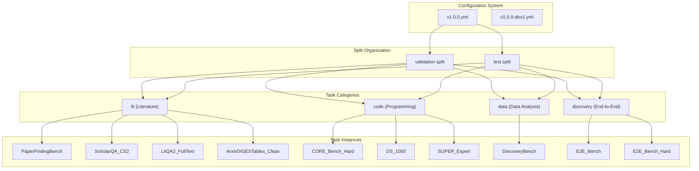
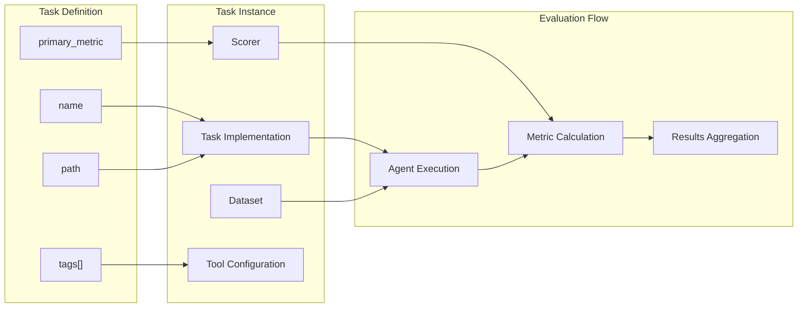
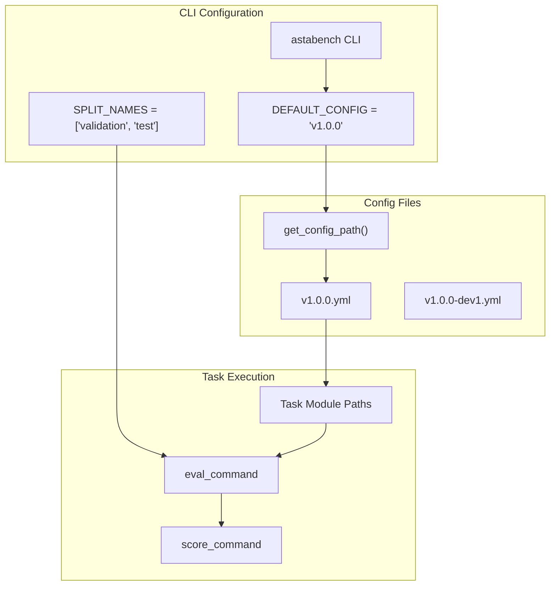

<!-- source: DeepWiki mcp.deepwiki.com · repo allenai/asta-bench · page 5 Evaluation Tasks · fetched 2026-10-26 -->

# Evaluation Tasks

<details>
<summary>Relevant source files</summary>

The following files were used as context for generating this wiki page:

- [astabench/cli.py](astabench/cli.py)
- [astabench/config/v1.0.0-dev1.yml](astabench/config/v1.0.0-dev1.yml)
- [astabench/config/v1.0.0.yml](astabench/config/v1.0.0.yml)

</details>


This document provides an overview of the evaluation task system in asta-bench, including task organization, categorization, and configuration. It covers the high-level structure of how tasks are defined and organized into evaluation splits and categories.

For detailed information about specific task types, see the following pages:
- Paper finding and literature search tasks: [Paper Finding Tasks](#5.1)
- Scientific question answering tasks: [Scientific QA Tasks](#5.2) 
- Programming and code analysis tasks: [Code Tasks](#5.3)
- End-to-end research discovery tasks: [Discovery Tasks](#5.4)
- Table generation and analysis tasks: [Table Generation Tasks](#5.5)

## Task Organization Structure

The asta-bench evaluation framework organizes tasks into a hierarchical structure based on splits, categories, and individual task definitions. Tasks are configured through YAML files that define evaluation splits, metrics, and task metadata.



Sources: [astabench/config/v1.0.0.yml:1-134]()

## Evaluation Splits

The framework defines two primary evaluation splits that serve different purposes in the evaluation lifecycle:

| Split | Purpose | Task Count | Usage |
|-------|---------|------------|--------|
| `validation` | Development and hyperparameter tuning | 11 tasks | Agent development and iterative improvement |
| `test` | Final evaluation and benchmarking | 11 tasks | Official scoring and leaderboard submission |

Each split contains the same task types but uses different data partitions to prevent overfitting during development.

Sources: [astabench/config/v1.0.0.yml:4-133]()

## Task Categories and Tags

Tasks are organized into four primary categories using a tagging system:

### Literature Tasks (`lit`)
Tasks that evaluate an agent's ability to find, analyze, and reason about scientific literature.

| Task Name | Primary Metric | Purpose |
|-----------|----------------|---------|
| `PaperFindingBench` | `adjusted_f1_micro_avg` | Paper retrieval and ranking |
| `ScholarQA_CS2` | `global_avg/mean` | Scientific question answering |
| `LitQA2_FullText` | `is_correct/accuracy` | Literature comprehension |
| `LitQA2_FullText_Search` | `recall_at_30` | Literature search and retrieval |
| `ArxivDIGESTables_Clean` | `score_tables/mean` | Table generation from papers |

### Code Tasks (`code`)
Tasks that evaluate programming, code analysis, and computational problem-solving capabilities.

| Task Name | Primary Metric | Purpose |
|-----------|----------------|---------|
| `CORE_Bench_Hard` | `accuracy` | Computational reasoning |
| `DS_1000` | `accuracy` | Data science programming |
| `SUPER_Expert` | `mean` (validation) / `output_match/mean` (test) | Code understanding and generation |

### Data Tasks (`data`)
Tasks focused on data analysis and statistical reasoning.

| Task Name | Primary Metric | Purpose |
|-----------|----------------|---------|
| `DiscoveryBench` | `score_discoverybench/mean` | Data-driven discovery |

### Discovery Tasks (`discovery`)
End-to-end research tasks that combine multiple capabilities.

| Task Name | Primary Metric | Purpose |
|-----------|----------------|---------|
| `E2E_Bench` | `score_rubric/accuracy` | End-to-end research workflow |
| `E2E_Bench_Hard` | `score_rubric/accuracy` | Advanced research challenges |

Sources: [astabench/config/v1.0.0.yml:10-126]()

## Task Configuration Schema

Each task in the configuration follows a standardized schema that defines its execution parameters and evaluation metrics:



Sources: [astabench/config/v1.0.0.yml:7-126]()

## Macro Average Weight Adjustments

The framework supports weighted averaging for tasks within the same category to handle cases where multiple related tasks should be treated as components of a single evaluation:

```yaml
macro_average_weight_adjustments:
  - tag: lit
    task: LitQA2_FullText_validation
    weight: 0.5
  - tag: lit
    task: LitQA2_FullText_Search_validation
    weight: 0.5
```

This configuration ensures that the two LitQA2 variants together contribute the same weight as a single task in the literature category average.

Sources: [astabench/config/v1.0.0.yml:62-68](), [astabench/config/v1.0.0.yml:127-133]()

## Configuration Management

The task configuration system is managed through the CLI and supports multiple configuration versions:



The `get_config_path()` function resolves configuration files from the package's `astabench.config` module, enabling versioned task definitions and reproducible evaluations.

Sources: [astabench/cli.py:8-26]()

## Task Module Resolution

Tasks are resolved through their configured paths, which correspond to Python modules within the `astabench` package. Each task path maps to a specific module that implements the task logic, dataset loading, and scoring functions.

For example:
- `astabench/paper_finder_validation` → Paper finding validation task
- `astabench/sqa_dev` → ScholarQA development task  
- `astabench/core_bench_validation` → CORE-Bench validation task

This modular structure allows for independent development and testing of individual evaluation tasks while maintaining a unified configuration interface.

Sources: [astabench/config/v1.0.0.yml:8-123]()

---

