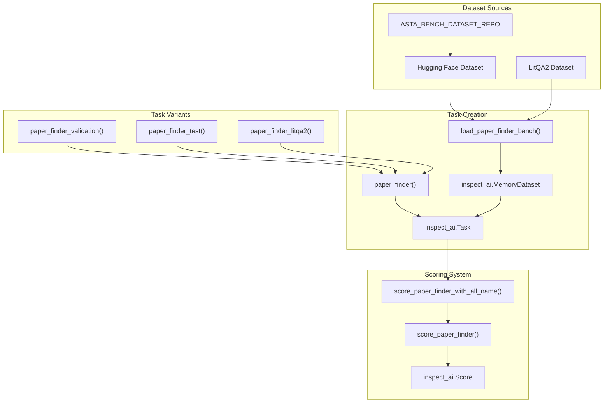
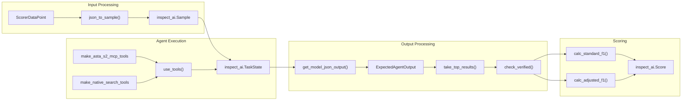
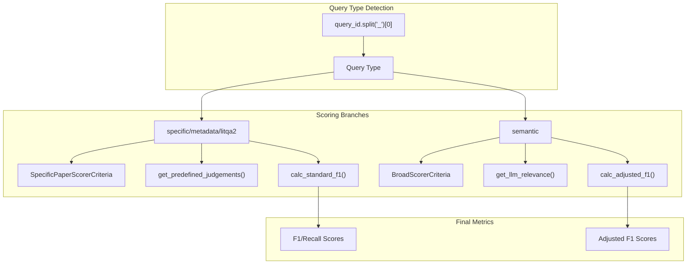
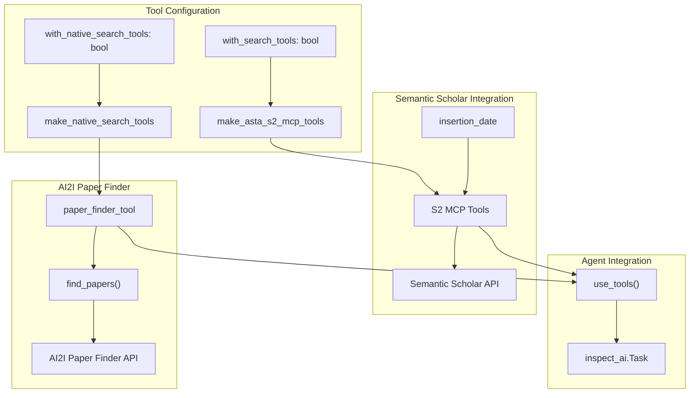
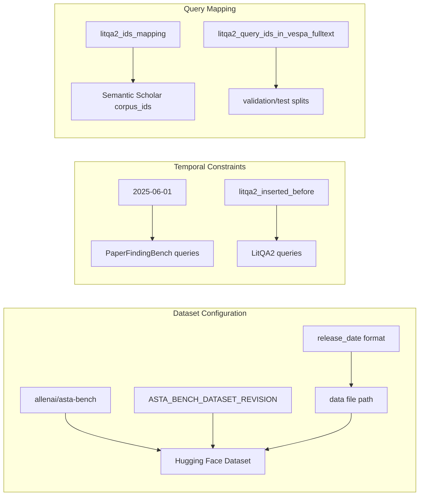

<!-- source: DeepWiki mcp.deepwiki.com · repo allenai/asta-bench · page 5.1 Paper Finding Tasks · fetched 2026-10-26 -->

# Paper Finding Tasks

<details>
<summary>Relevant source files</summary>

The following files were used as context for generating this wiki page:

- [astabench/evals/paper_finder/README.md](astabench/evals/paper_finder/README.md)
- [astabench/evals/paper_finder/paper_finder_utils.py](astabench/evals/paper_finder/paper_finder_utils.py)
- [astabench/evals/paper_finder/task.py](astabench/evals/paper_finder/task.py)
- [astabench/tools/paper_finder_ai2i.py](astabench/tools/paper_finder_ai2i.py)
- [solvers/paper_finder/README.md](solvers/paper_finder/README.md)
- [solvers/paper_finder/demo.sh](solvers/paper_finder/demo.sh)

</details>


Paper Finding Tasks evaluate an AI agent's ability to locate academic papers based on natural language queries. These tasks test both semantic understanding and metadata-based retrieval capabilities across different query types including navigational, metadata, and semantic searches.

For information about other evaluation task types, see [Scientific QA Tasks](#5.2), [Code Tasks](#5.3), and [Discovery Tasks](#5.4).

## Task Architecture

The paper finding evaluation system is built around the `paper_finder` function in the task module, which creates `Task` instances configured with different dataset splits and scoring mechanisms.



Sources: [astabench/evals/paper_finder/task.py:200-252](), [astabench/evals/paper_finder/task.py:255-277]()

## Data Flow and Processing

The paper finding tasks follow a structured data flow from input queries through agent execution to final scoring.



Sources: [astabench/evals/paper_finder/task.py:72-82](), [astabench/evals/paper_finder/task.py:85-131](), [astabench/evals/paper_finder/paper_finder_utils.py:37-53]()

## Task Variants and Dataset Splits

The system supports multiple task variants with different dataset configurations and evaluation splits.

| Task Function | Split Type | Dataset Source | Query Types |
|---------------|------------|----------------|-------------|
| `paper_finder_validation` | validation | PaperFindingBench | semantic, metadata, specific |
| `paper_finder_test` | test | PaperFindingBench | semantic, metadata, specific |
| `paper_finder_litqa2` | litqa2 | LitQA2 | litqa2 queries |
| `paper_finder_litqa2_test` | litqa2_test | LitQA2 subset | filtered litqa2 |
| `paper_finder_litqa2_validation` | litqa2_validation | LitQA2 subset | filtered litqa2 |

The dataset loading mechanism handles different temporal constraints based on the split type:

```python
# Different insertion dates for different datasets
PF_INSERTED_BEFORE = date(year=2025, month=6, day=1)  # PaperFindingBench
litqa2_inserted_before  # LitQA2 dataset
```

Sources: [astabench/evals/paper_finder/task.py:143-197](), [astabench/evals/paper_finder/paper_finder_utils.py:23](), [astabench/evals/paper_finder/paper_finder_utils.py:95-101]()

## Scoring System

The scoring system adapts to different query types with specialized evaluation metrics.



The scoring logic determines the appropriate metric based on query type:

- **specific/metadata/litqa2**: Uses predefined judgements with standard F1 calculation
- **semantic**: Uses LLM-based relevance judgement with adjusted F1 calculation

Sources: [astabench/evals/paper_finder/task.py:86-129](), [astabench/evals/paper_finder/task.py:59-69]()

## Tool Integration

Paper finding tasks integrate with external search APIs through a flexible tool system.



The `paper_finder_tool` provides comprehensive search capabilities:

```python
# Tool description includes search capabilities
"Paper Finding Agent: Searches academic papers based on user-specified criteria.
- Description/keywords
- Author name(s) 
- Paper title
- Similarity to anchor papers (optional)"
```

Sources: [astabench/evals/paper_finder/task.py:227-242](), [astabench/tools/paper_finder_ai2i.py:116-172](), [astabench/tools/paper_finder_ai2i.py:23-114]()

## Dataset Configuration and Constants

The system uses centralized configuration for dataset sources and temporal constraints.



The temporal constraints ensure papers are only retrieved from before specific cutoff dates to maintain evaluation integrity:

```python
MAX_RESULTS_TO_CONSIDER = 250  # Prevent brute force attacks
S2_TIMEOUT = 10  # Semantic Scholar API timeout
```

Sources: [astabench/constants.py:1-6](), [astabench/evals/paper_finder/paper_finder_utils.py:23-26](), [astabench/evals/paper_finder/paper_finder_utils.py:243-333](), [astabench/evals/paper_finder/paper_finder_utils.py:335-1132]()

## Task Instructions and Output Format

The system provides structured instructions to agents and expects standardized JSON output format.

The task instructions template specifies the expected output structure:

```json
{
    "output": {
        "results": [
            {
                "paper_id": "string; the semantic scholar corpus_id of the paper",
                "markdown_evidence": "string; a markdown-formatted snippet with verbatim text from the paper that supports the relevance of the paper to the query; the evidence should be concise and limited to the minimum needed to support the paper's relevance"
            }
        ]
    }
}
```

Results must be ordered by relevance (most relevant first), and the `markdown_evidence` must be verbatim text from the paper that supports its relevance to the query.

Sources: [astabench/evals/paper_finder/task.py:40-56](), [astabench/evals/paper_finder/README.md:20-46]()

---

