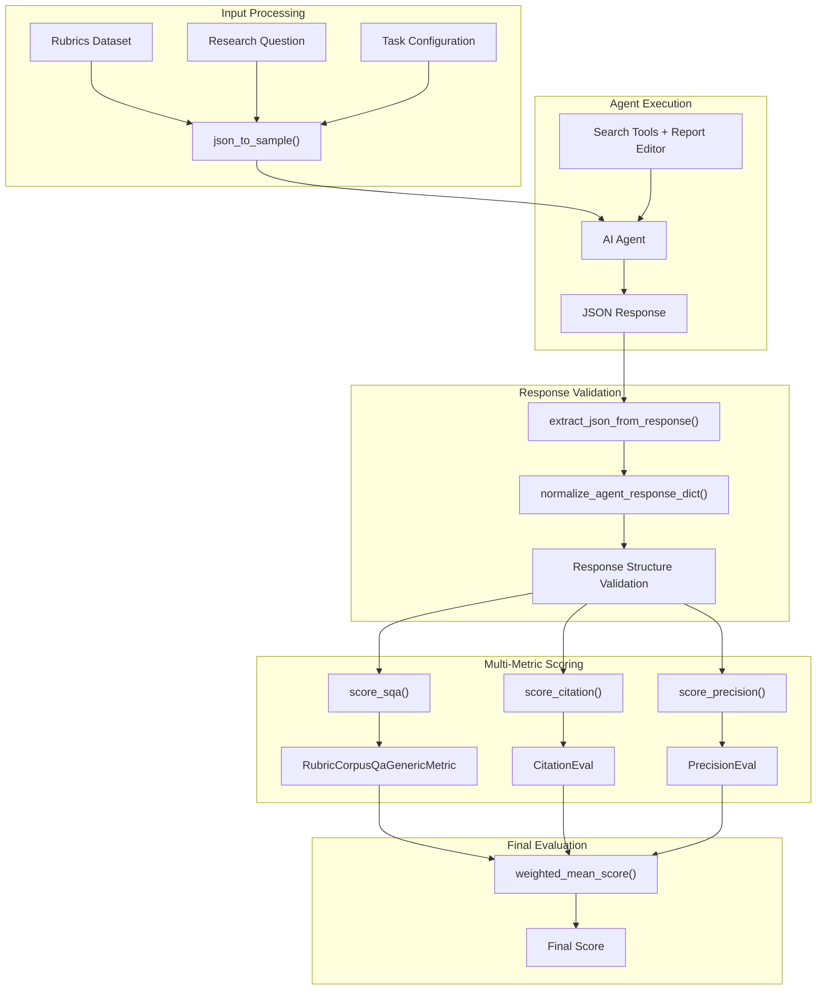
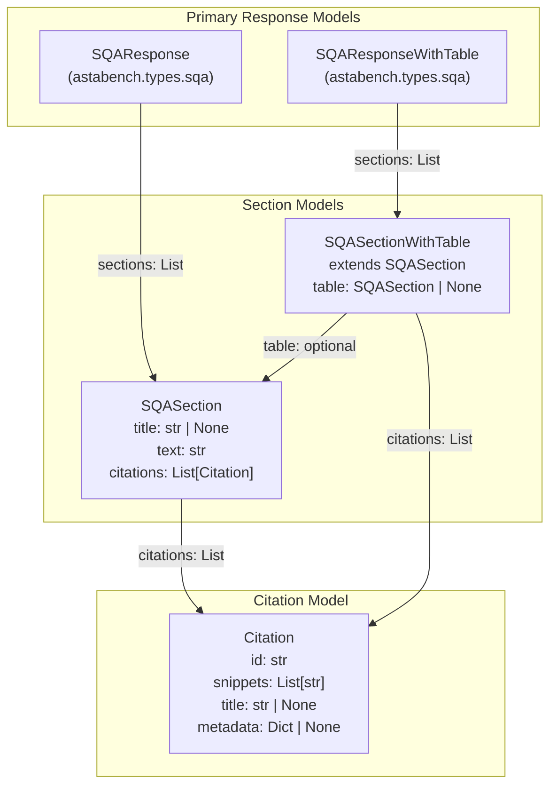
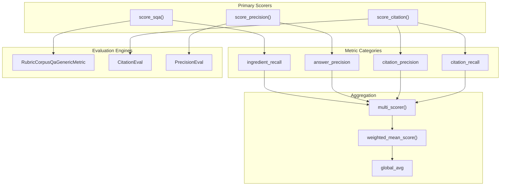
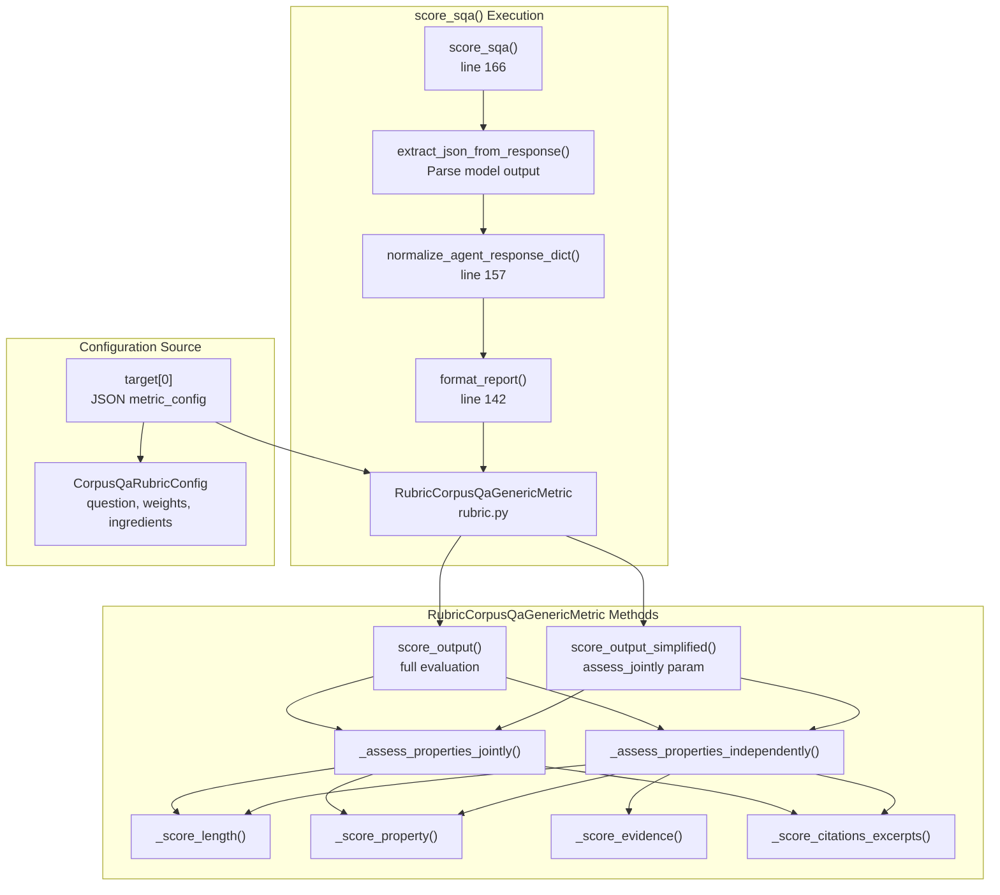
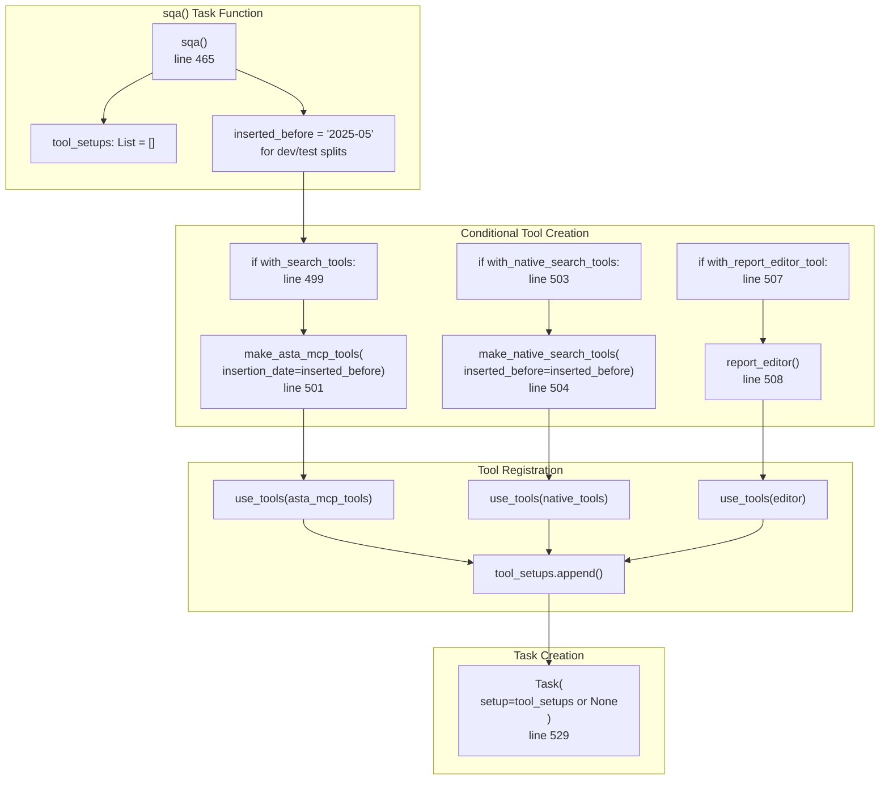

<!-- source: DeepWiki mcp.deepwiki.com · repo allenai/asta-bench · page 5.2 Scientific QA Tasks · fetched 2026-10-26 -->

# Scientific QA Tasks

<details>
<summary>Relevant source files</summary>

The following files were used as context for generating this wiki page:

- [astabench/evals/sqa/task.py](astabench/evals/sqa/task.py)
- [tests/conftest.py](tests/conftest.py)
- [tests/tools/test_search.py](tests/tools/test_search.py)

</details>


This document covers the Scientific Question Answering (SQA) evaluation framework within asta-bench. The SQA tasks evaluate AI agents on their ability to generate comprehensive research reports with proper citations in response to scientific research questions.

For information about other evaluation tasks such as paper finding, see [Paper Finding Tasks](#5.1). For code-related evaluations, see [Code Tasks](#5.3).

## Overview

The SQA evaluation system tests an AI agent's capability to produce well-structured scientific reports that include:
- Comprehensive answers to research questions
- Proper inline citations with supporting text excerpts
- Structured sections with appropriate academic formatting
- Evidence-based claims with source attribution

The evaluation uses a multi-dimensional scoring approach that assesses content quality, citation accuracy, and precision of claims.

Sources: [astabench/evals/sqa/task.py:1-72]()

## Task Structure and Workflow

The SQA evaluation follows a structured pipeline from question input to multi-metric scoring:



Sources: [astabench/evals/sqa/task.py:78-136](), [astabench/evals/sqa/task.py:469-541]()

## Response Format Requirements

The SQA task requires agents to return structured JSON responses. The framework validates responses through `extract_json_from_response()` and normalizes them via `normalize_agent_response_dict()` [astabench/evals/sqa/task.py:157-163]():

**Response Schema Hierarchy**



**Response Format Processing**

The `format_report()` function [astabench/evals/sqa/task.py:142-150]() converts the structured response into plain text for evaluation:

| Function | Input Type | Output | Purpose |
|----------|------------|--------|---------|
| `normalize_agent_response_dict()` | `dict[str, Any]` | `dict[str, Any]` | Handles `{"response": {"sections": ...}}` or `{"sections": ...}` variants |
| `format_report()` | `SQAResponseWithTable` | `str` | Extracts text and table content from sections |
| `format_citation()` | `Citation` | `str` | Formats citation snippets for display |

Sources: [astabench/types/sqa.py:1-77](), [astabench/evals/sqa/task.py:135-163]()

## Scoring System Architecture

The SQA evaluation employs a comprehensive multi-scorer system with four primary metric dimensions:



### Metric Definitions

The `METRIC_LABELS` constant [astabench/evals/sqa/task.py:66-71]() defines the four core metrics:

| Metric | Scorer Function | Implementation | Purpose |
|--------|-----------------|----------------|---------|
| `ingredient_recall` | `score_sqa()` | `RubricCorpusQaGenericMetric` | Measures content completeness against rubric criteria |
| `answer_precision` | `score_precision()` | `PrecisionEval` | Evaluates factual accuracy and relevance |
| `citation_precision` | `score_citation()` | `CitationEval` | Assesses citation quality and supporting evidence |
| `citation_recall` | `score_citation()` | `CitationEval` | Measures citation coverage and completeness |

**Aggregation Mechanism**

The `score_all()` function [astabench/evals/sqa/task.py:403-435]() combines individual scorers using `multi_scorer()` with a `weighted_mean_score()` reducer. The `aggregate_scorer()` function [astabench/evals/sqa/task.py:438-440]() provides configurable weighting.

Sources: [astabench/evals/sqa/task.py:66-71](), [astabench/evals/sqa/task.py:166-207](), [astabench/evals/sqa/task.py:217-355](), [astabench/evals/sqa/task.py:358-384](), [astabench/evals/sqa/task.py:403-440]()

## Rubric Evaluation System

The `RubricCorpusQaGenericMetric` class [astabench/evals/sqa/rubric.py]() implements LLM-based content evaluation. The `score_sqa()` scorer [astabench/evals/sqa/task.py:166-207]() instantiates this metric with configuration loaded from the task target.

### Scoring Components and Code Flow



### Assessment Strategies

The `simplified_eval` and `assess_jointly` parameters control evaluation mode:

| Parameter | Mode | Behavior |
|-----------|------|----------|
| `simplified_eval=True` | Simplified | Calls `score_output_simplified()`, returns only `ingredient_recall` |
| `simplified_eval=False` | Full | Calls `score_output()`, returns `score` and `ingredient_recall` |
| `assess_jointly=True` | Joint | Single LLM call evaluating all criteria together via `_assess_properties_jointly()` |
| `assess_jointly=False` | Independent | Separate LLM calls per criterion via `_assess_properties_independently()` |

Sources: [astabench/evals/sqa/task.py:166-207](), [astabench/evals/sqa/rubric.py:128-517]()

## Tool Integration

The `sqa()` task function [astabench/evals/sqa/task.py:465-536]() conditionally enables tool categories based on configuration flags:

| Tool Category | Configuration Flag | Function Call | Purpose |
|---------------|-------------------|---------------|---------|
| Asta MCP Tools | `with_search_tools=True` | `make_asta_mcp_tools()` | Corpus QA, paper search, citations |
| Native Search Tools | `with_native_search_tools=False` | `make_native_search_tools()` | Alternative search API |
| Report Editor | `with_report_editor_tool=False` | `report_editor()` | Structured report composition |

### Tool Setup Implementation



**Date Filtering for Reproducibility**

The `inserted_before` parameter ensures temporal consistency. For `dev` and `test` splits, it's set to `"2025-05"` [astabench/evals/sqa/task.py:492-498]() to exclude papers inserted after May 2025, ensuring reproducible evaluations.

Sources: [astabench/evals/sqa/task.py:36-36](), [astabench/evals/sqa/task.py:490-508]()

## Dataset and Configuration

### Data Loading

The SQA task loads rubric datasets from Hugging Face with version-specific configurations:

| Split | Version | Data File |
|-------|---------|-----------|
| `dev` | v1 | `rubrics_v1_recomputed.json` |
| `test` | v2 | `rubrics_v2_recomputed.json` |

The `load_rubrics_data()` function handles dataset retrieval and preprocessing:

```python
# Dataset loading configuration
ASTA_BENCH_DATASET_REPO = "allenai/asta-bench"
ASTA_BENCH_DATASET_REVISION = "main"
```

### Task Configuration Options

| Parameter | Type | Default | Purpose |
|-----------|------|---------|---------|
| `scorer_model` | str \| Model | "google/gemini-2.5-flash" | Model for evaluation |
| `simplified_eval` | bool | True | Use simplified rubric evaluation |
| `assess_jointly` | bool | True | Evaluate criteria together vs separately |
| `sentence_wise_cit_eval` | bool | False | Citation evaluation granularity |
| `excerpt_prompt` | bool | True | Include excerpt requirements in prompt |
| `weights` | List[float] | [0.25, 0.25, 0.25, 0.25] | Metric weights for aggregation |

Sources: [astabench/evals/sqa/task.py:447-466](), [astabench/evals/sqa/task.py:469-541]()

## Task Variants

The framework provides predefined task variants for different evaluation contexts:

### Standard Variants

| Function | Split | Purpose |
|----------|-------|---------|
| `sqa_dev()` | dev | Development/validation evaluation |
| `sqa_test()` | test | Final evaluation on held-out test set |

### Citation Evaluation Modes

The citation scoring supports multiple evaluation strategies:

1. **Sentence-wise Evaluation** (`sentence_wise_cit_eval=True`): Citations evaluated at sentence granularity
2. **Section-wise Evaluation** (`all_at_once=True`): Citations evaluated at section level
3. **Retrieverless Mode** (`is_retrieverless=True`): Adapted scoring for agents without search capabilities

Sources: [astabench/evals/sqa/task.py:543-551](), [astabench/evals/sqa/task.py:228-357]()

---

