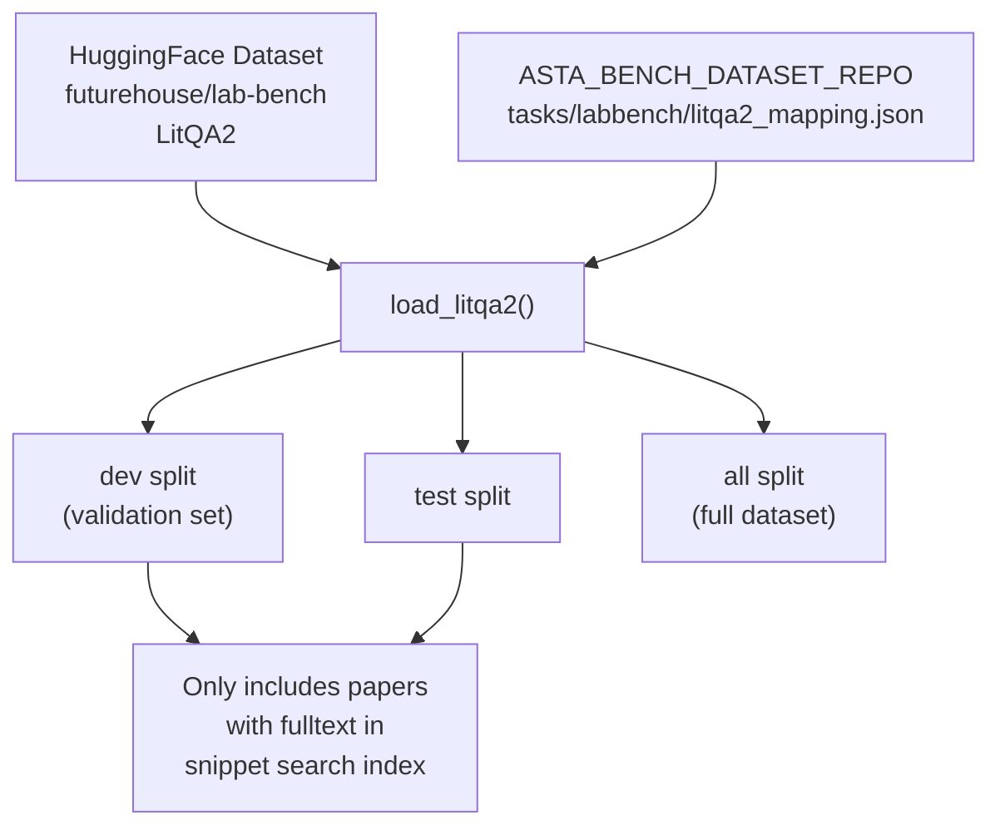
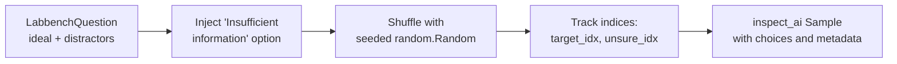
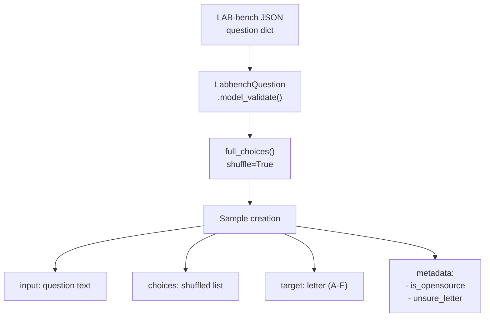
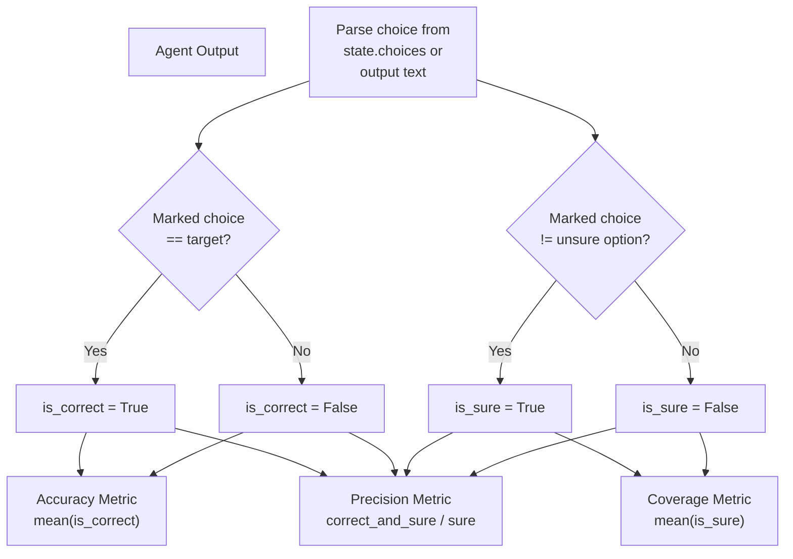
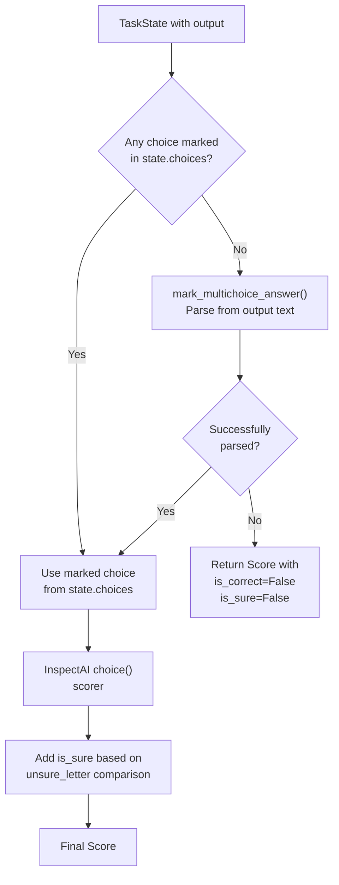
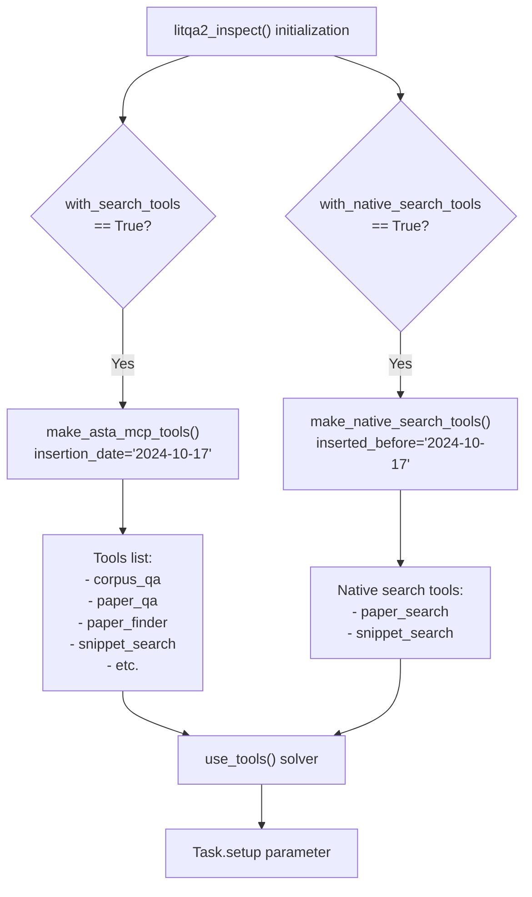
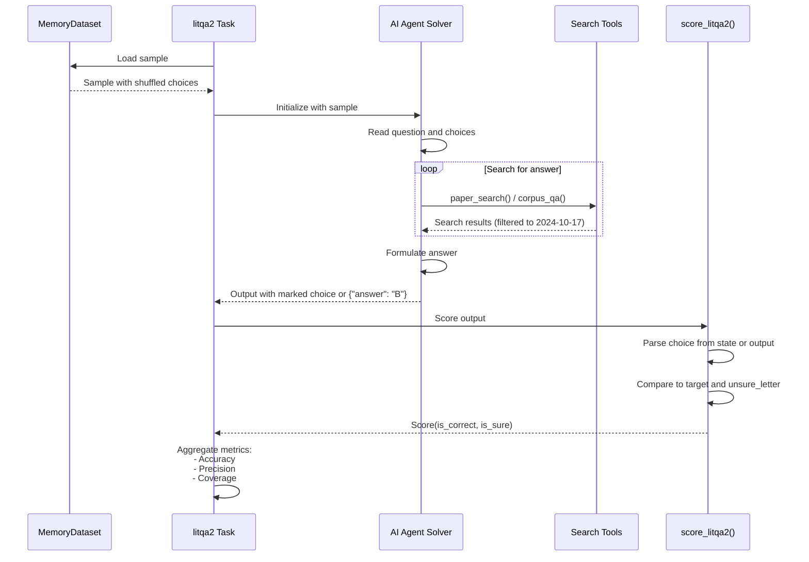

<!-- source: DeepWiki mcp.deepwiki.com · repo allenai/asta-bench · page 5.3 Literature QA Tasks · fetched 2026-10-26 -->

# Literature QA Tasks

<details>
<summary>Relevant source files</summary>

The following files were used as context for generating this wiki page:

- [astabench/evals/arxivdigestables/task.py](astabench/evals/arxivdigestables/task.py)
- [astabench/evals/labbench/litqa2/task.py](astabench/evals/labbench/litqa2/task.py)

</details>


This page documents the Literature QA evaluation tasks in ASTA-Bench, specifically the **LitQA2** task from LAB-bench. This task evaluates AI agents' ability to answer multiple-choice questions about scientific literature using search tools. For information about paper finding capabilities, see [Paper Finding Tasks](#5.1). For scientific QA with rubric-based evaluation, see [Scientific QA Tasks](#5.2).

## Overview

The LitQA2 task tests whether AI agents can correctly answer factual questions about scientific papers when given access to search tools. Questions are presented in multiple-choice format with several distractors and an "Insufficient information" option, allowing agents to abstain when they lack confidence.

**Key characteristics:**
- **Source**: LAB-bench's LitQA2 v2 dataset from HuggingFace (`futurehouse/lab-bench`)
- **Format**: Multiple-choice questions with 3-5 answer options plus "Insufficient information"
- **Evaluation**: Three metrics (accuracy, precision, coverage) that account for selective answering
- **Tool support**: Search tools with temporal filtering to ensure reproducibility

Sources: [astabench/evals/labbench/litqa2/task.py:1-309]()

## Dataset Structure

### Data Loading and Splits

LitQA2 data is loaded from two sources and merged to create evaluation splits:



**Split filtering**: The `dev` and `test` splits are filtered to only include questions about papers that have fulltext entries in AI2's snippet search index, ensuring agents can retrieve the necessary information. The `all` split returns the complete LAB-bench dataset without filtering.

Sources: [astabench/evals/labbench/litqa2/task.py:184-214]()

### Question Schema

Questions are represented by the `LabbenchQuestion` Pydantic model:

| Field | Type | Description |
|-------|------|-------------|
| `id` | `str` | Unique question identifier |
| `question` | `str` | The question text |
| `ideal` | `str` | The correct answer text |
| `distractors` | `list[str]` | Incorrect answer options (2-4 items) |
| `sources` | `list[str]` | Paper IDs that contain the answer |
| `canary` | `str` | Canary string for dataset contamination detection |
| `version` | `str` | Question version identifier |
| `is_opensource` | `bool` | Whether the source papers are open access |
| `key_passage` | `str \| None` | Optional key passage containing the answer |

Sources: [astabench/evals/labbench/litqa2/task.py:49-59]()

## Sample Creation and Choice Handling

### Choice Shuffling and Tracking

The task injects an "Insufficient information" option and shuffles all choices to prevent position bias:



The `full_choices()` method handles this process:
1. Combines the ideal answer with distractors
2. Appends "Insufficient information to answer the question" as the last option
3. Shuffles the choices using a seeded RNG (for reproducibility)
4. Returns a `LabbenchChoices` tuple containing the shuffled choices and the new indices of the target answer and unsure option

Sources: [astabench/evals/labbench/litqa2/task.py:60-92]()

### Sample Conversion

The `json_to_sample()` function converts LAB-bench format to InspectAI's `Sample` format:



The target is stored as an uppercase letter (A, B, C, etc.) corresponding to the position of the correct answer in the shuffled choices list. The `unsure_letter` is tracked in metadata to enable coverage calculation.

Sources: [astabench/evals/labbench/litqa2/task.py:95-110]()

## Task Variants

ASTA-Bench provides two variants of the LitQA2 task to support different solver patterns:

### litqa2_inspect: State-based Choice Marking

The `litqa2_inspect` task uses InspectAI's native choice handling where solvers mark choices in `state.choices`:

```python
@task
def litqa2_inspect(
    seed: int = 0,
    with_search_tools: bool = True,
    with_native_search_tools: bool = False,
    split: Literal["dev", "test", "all"] = "all",
):
```

This variant:
- Provides choices in `state.choices` for InspectAI's `multiple_choice` solver
- Expects solvers to mark the correct choice by setting `choice.correct = True`
- Falls back to parsing output text if choices aren't marked

Sources: [astabench/evals/labbench/litqa2/task.py:217-263]()

### litqa2: Text-based Format

The `litqa2` task converts choices to text format using the ASTA-Bench `{"answer": "<letter>"}` convention:

```python
@task
def litqa2(*litqa_args, **litqa_kwargs):
    base_task = litqa2_inspect(*litqa_args, **litqa_kwargs)
    
    dataset = []
    for sample in base_task.dataset:
        sample = format_multichoice_as_textin(sample, shuffle=False)
        dataset.append(sample)
    
    return task_with(
        base_task,
        dataset=MemoryDataset(dataset),
        scorer=score_litqa2(),
    )
```

This variant uses `format_multichoice_as_textin()` to embed choices in the input text and expects JSON-formatted answers. The choices are not shuffled again since `litqa2_inspect` already randomized them.

Sources: [astabench/evals/labbench/litqa2/task.py:266-284]()

### Split-specific Tasks

Two convenience tasks pin the split parameter:

| Task | Split | Usage |
|------|-------|-------|
| `litqa2_validation` | `dev` | Development/validation evaluations |
| `litqa2_test` | `test` | Final test evaluations |

Both validate that the `split` parameter matches their intended split and raise a `ValueError` if there's a mismatch.

Sources: [astabench/evals/labbench/litqa2/task.py:287-308]()

## Scoring System

### Multi-metric Evaluation

The `score_litqa2()` scorer computes three complementary metrics to evaluate both correctness and confidence calibration:



Sources: [astabench/evals/labbench/litqa2/task.py:141-181]()

### Metric Definitions

#### Accuracy (is_correct)

Standard accuracy over all samples, treating "Insufficient information" selections as incorrect:

```python
@scorer(
    metrics=[
        {"is_correct": [accuracy(), stderr()]},
        precision(),
        coverage(),
    ]
)
def score_litqa2() -> Scorer:
```

**Calculation**: `sum(is_correct) / len(samples)`

Sources: [astabench/evals/labbench/litqa2/task.py:141-147]()

#### Precision

Fraction of correct answers among non-abstaining answers (excludes "Insufficient information" selections):

```python
@metric
def precision() -> Metric:
    def metric_fn(scores: list[SampleScore]) -> float:
        score_vals: list[dict[str, bool]] = [
            cast(dict[str, bool], score.score.value) for score in scores
        ]
        
        return sum(v["is_correct"] and v["is_sure"] for v in score_vals) / max(
            1, sum(v["is_sure"] for v in score_vals)
        )
    
    return metric_fn
```

**Calculation**: `correct_and_sure / max(1, sure)` (avoids division by zero)

This metric measures answer quality when the agent commits to a choice, rewarding selective answering.

Sources: [astabench/evals/labbench/litqa2/task.py:124-138]()

#### Coverage

Fraction of questions where the agent provided a definitive answer (didn't select "Insufficient information"):

```python
@metric
def coverage() -> Metric:
    def metric_fn(scores: list[SampleScore]) -> float:
        return sum(score.score.value["is_sure"] for score in scores) / len(scores)
    
    return metric_fn
```

**Calculation**: `sum(is_sure) / len(samples)`

Sources: [astabench/evals/labbench/litqa2/task.py:113-121]()

### Answer Parsing Strategy

The scorer uses a two-tier approach to extract the agent's choice:



The `mark_multichoice_answer()` function supports both:
- ASTA-Bench format: `{"answer": "A"}`
- LAB-bench format: `[ANSWER]A[/ANSWER]`

Sources: [astabench/evals/labbench/litqa2/task.py:159-180]()

## Tool Integration

### Temporal Filtering for Reproducibility

LitQA2 uses date-based filtering to ensure evaluations are reproducible and don't depend on the search index state at evaluation time:

```python
# Set to one day later than the min insertion date of 2024-10-16
INSERTED_BEFORE = "2024-10-17"
```

This constant ensures that:
1. Only papers available before October 17, 2024 are searchable
2. Future index updates don't change evaluation results
3. The evaluation reflects knowledge cutoffs similar to LLM training data

Sources: [astabench/evals/labbench/litqa2/task.py:38-40]()

### Tool Setup

The task supports two categories of search tools, both with temporal filtering:



Sources: [astabench/evals/labbench/litqa2/task.py:248-262]()

### Asta MCP Tools

When `with_search_tools=True`, the task provides access to the full Asta MCP toolset (filtered by date):
- `corpus_qa`: Answer questions over document collections
- `paper_qa`: Answer questions about specific papers
- `paper_finder`: Search for papers matching criteria
- `snippet_search`: Search within paper full text
- `author_search_by_name`: Find papers by author
- And 25+ additional research tools

All tools respect the `insertion_date="2024-10-17"` parameter, filtering out papers published or indexed after this date.

Sources: [astabench/evals/labbench/litqa2/task.py:250-252]()

### Native Search Tools

When `with_native_search_tools=True`, provides alternative implementations of search tools:
- Direct Semantic Scholar API integration
- Snippet search with different backend
- Same temporal filtering via `inserted_before` parameter

These tools can be used alongside or instead of Asta MCP tools for comparison purposes.

Sources: [astabench/evals/labbench/litqa2/task.py:253-256]()

## Task Execution Flow

The complete evaluation flow for a single LitQA2 sample:



Sources: [astabench/evals/labbench/litqa2/task.py:217-309]()

## Code Entity Reference

Key classes and functions for LitQA2 task implementation:

| Entity | Type | Purpose | Location |
|--------|------|---------|----------|
| `LabbenchQuestion` | Pydantic Model | Question schema with ideal/distractors | [task.py:49-59]() |
| `LabbenchChoices` | NamedTuple | Shuffled choices with indices | [task.py:43-47]() |
| `json_to_sample()` | Function | Convert LAB-bench to InspectAI format | [task.py:95-110]() |
| `load_litqa2()` | Function | Load dataset from HuggingFace | [task.py:184-214]() |
| `score_litqa2()` | Scorer | Multi-metric evaluation | [task.py:141-181]() |
| `precision()` | Metric | Correctness among sure answers | [task.py:124-138]() |
| `coverage()` | Metric | Fraction of sure answers | [task.py:113-121]() |
| `litqa2_inspect` | Task | State-based choice variant | [task.py:217-263]() |
| `litqa2` | Task | Text-based format variant | [task.py:266-284]() |
| `litqa2_validation` | Task | Dev split task | [task.py:287-296]() |
| `litqa2_test` | Task | Test split task | [task.py:299-308]() |
| `INSERTED_BEFORE` | Constant | Temporal filter date | [task.py:40]() |

Sources: [astabench/evals/labbench/litqa2/task.py:1-309]()

---

