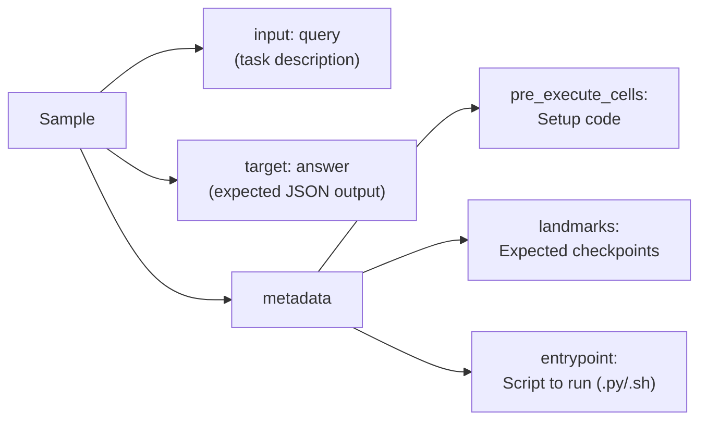
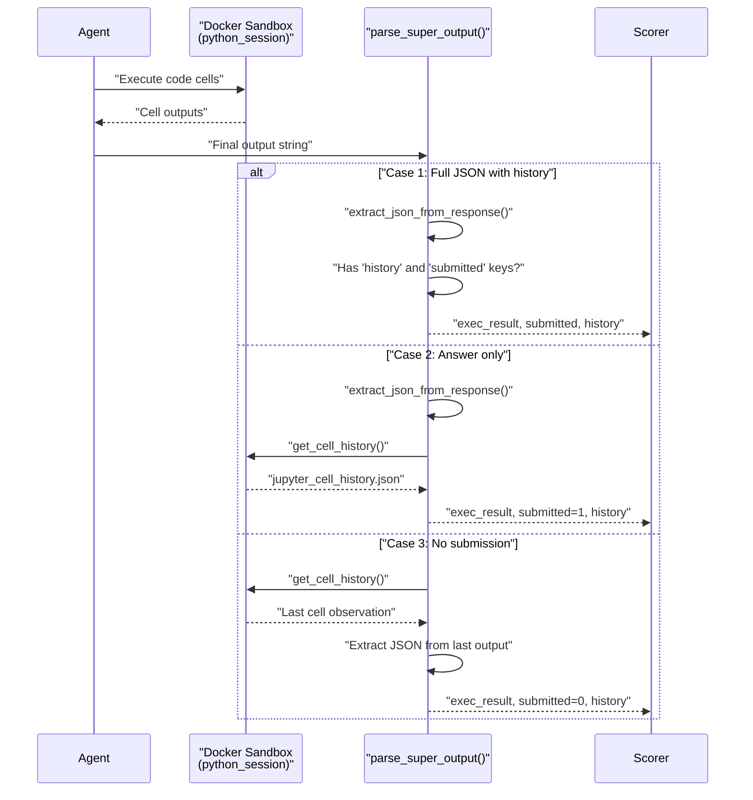
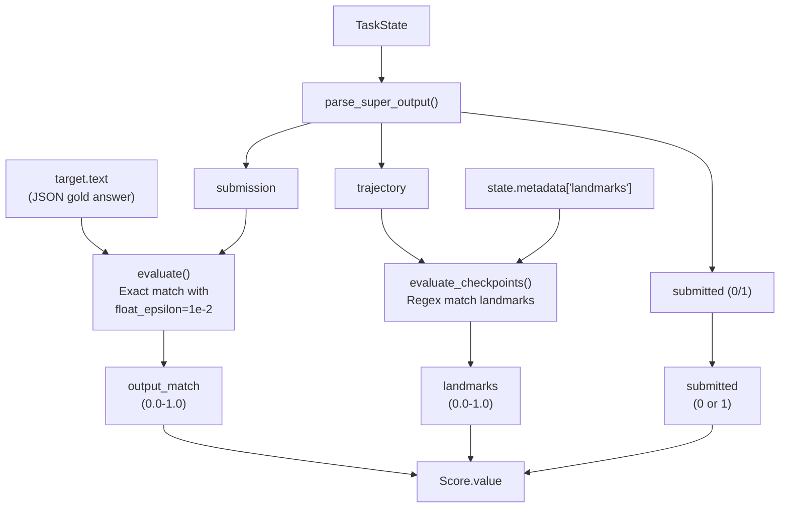
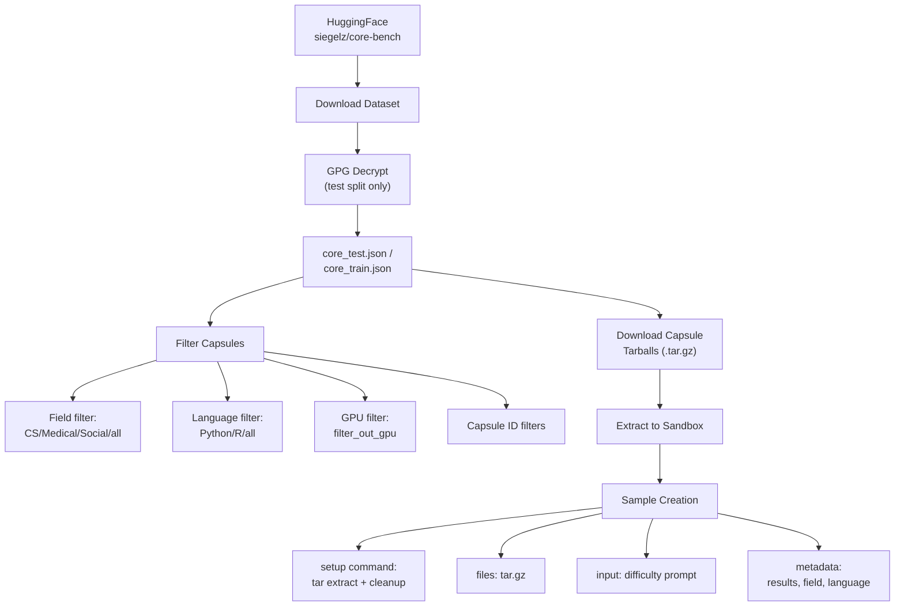
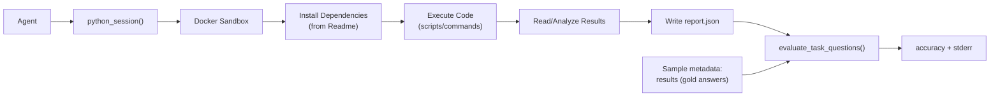
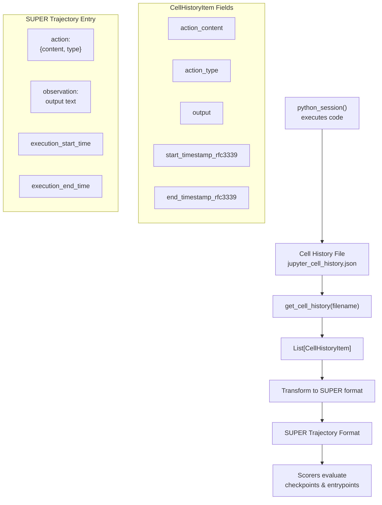

<!-- source: DeepWiki mcp.deepwiki.com · repo allenai/asta-bench · page 5.4 Code Execution Tasks · fetched 2026-10-26 -->

# Code Execution Tasks

<details>
<summary>Relevant source files</summary>

The following files were used as context for generating this wiki page:

- [astabench/evals/inspect_eval_wrappers/core_bench.py](astabench/evals/inspect_eval_wrappers/core_bench.py)
- [astabench/evals/super/task.py](astabench/evals/super/task.py)
- [tests/tasks/test_super.py](tests/tasks/test_super.py)
- [tests/tools/test_toolset_config.py](tests/tools/test_toolset_config.py)

</details>


This document covers the three code execution benchmarks in ASTA-Bench: SUPER, CORE-Bench, and DS-1000. These tasks evaluate AI agents' ability to write, execute, and debug code in sandboxed environments, with emphasis on computational reproducibility and multi-step code generation workflows.

For literature-focused tasks involving text analysis, see [Scientific QA Tasks](#5.2) and [Literature QA Tasks](#5.3). For data analysis tasks, see [Data Analysis Tasks](#5.5).

## Overview

Code execution tasks in ASTA-Bench require agents to interact with sandboxed Jupyter environments to solve computational problems. All three tasks use Docker-based sandboxing and the `python_session()` tool for stateful code execution. The tasks differ in their evaluation focus:

| Task | Focus | Primary Metrics | Dataset Source |
|------|-------|----------------|----------------|
| **SUPER** | Multi-step code generation with trajectory validation | `output_match`, `landmarks`, `submitted` | `allenai/super` |
| **CORE-Bench** | Computational reproducibility of scientific code | `accuracy` (task questions) | `siegelz/core-bench` |
| **DS-1000** | Data science code completion | `accuracy` | DS-1000 dataset |

Sources: [astabench/evals/super/task.py:1-442](), [astabench/evals/inspect_eval_wrappers/core_bench.py:1-307]()

## SUPER Task

The SUPER (Sandboxed Unified Process for Executable Research) task evaluates agents on multi-step code generation problems requiring interaction with Jupyter environments. Agents must execute code, observe outputs, and iteratively refine their approach to produce correct final answers.

### Dataset and Structure

SUPER samples are loaded from HuggingFace using `load_super_hf()` [astabench/evals/super/task.py:383-403](). Each sample contains:



The dataset includes two splits accessed via task variants:
- **Expert split** (`super_test()`): Main evaluation set with gold answers [astabench/evals/super/task.py:439-441]()
- **Auto split** (`super_validation()`): Validation set (50 samples) requiring trajectory data [astabench/evals/super/task.py:430-435]()

Sources: [astabench/evals/super/task.py:37-68](), [astabench/evals/super/task.py:383-403](), [astabench/evals/super/task.py:405-441]()

### Execution Model and Output Parsing

SUPER agents execute code using the `python_session()` tool in a Docker sandbox [astabench/evals/super/task.py:418](). The task expects agents to produce output in one of three formats, parsed by `parse_super_output()` [astabench/evals/super/task.py:101-165]():



The trajectory loading function `load_trajectory_from_sandbox()` [astabench/evals/super/task.py:71-98]() retrieves the cell history file and transforms it into the SUPER trajectory format with action/observation pairs and timestamps.

Sources: [astabench/evals/super/task.py:101-165](), [astabench/evals/super/task.py:71-98]()

### Scoring Metrics

SUPER uses two scorers depending on the split, both evaluating different aspects of agent performance:

#### Expert Split Scorer: `check_super_execution()`



The `evaluate()` function [astabench/evals/super/task.py:168-201]() performs recursive exact matching:
- **Floats/Ints**: Match within epsilon (1e-2)
- **Strings**: Exact string match after stripping whitespace
- **Lists**: Element-wise matching, averaged
- **Dicts**: Key-value matching, averaged

The `evaluate_checkpoints()` function [astabench/evals/super/task.py:204-218]() searches for regex patterns in trajectory observations to verify intermediate computation steps were performed.

Sources: [astabench/evals/super/task.py:309-344](), [astabench/evals/super/task.py:168-201](), [astabench/evals/super/task.py:204-218]()

#### Auto Split Scorer: `check_super_auto()`

The Auto split uses `check_super_auto()` [astabench/evals/super/task.py:347-380]() which evaluates:

- **`submitted`**: Same as Expert split
- **`entrypoint`**: Whether the specified entrypoint script was successfully executed

The `evaluate_entrypoints()` function [astabench/evals/super/task.py:221-266]() verifies:
1. Entrypoint filename appears in executed commands
2. No "Traceback" or error messages in output
3. Execution duration exceeded 10 seconds (indicates meaningful computation)
4. Timestamps are valid and parseable

Sources: [astabench/evals/super/task.py:347-380](), [astabench/evals/super/task.py:221-266]()

### Metrics Aggregation

The scorer defines metrics with both mean and standard error [astabench/evals/super/task.py:310-320]():

```python
@scorer(
    metrics={
        "output_match": [mean(), stderr()],
        "submitted": [mean(), stderr()],
        "landmarks": [mean(), stderr()],
    }
)
```

This produces aggregate statistics across all samples for each metric dimension.

Sources: [astabench/evals/super/task.py:310-320](), [astabench/evals/super/task.py:269-306]()

## CORE-Bench Task

CORE-Bench evaluates computational reproducibility by asking agents to work with real scientific code capsules from CodeOcean. Agents must install dependencies, execute code, and answer questions about outputs.

### Dataset and Capsule Structure

The dataset is loaded using `read_core_bench_dataset()` [astabench/evals/inspect_eval_wrappers/core_bench.py:44-226](), which:

1. Downloads encrypted dataset from HuggingFace `siegelz/core-bench`
2. Decrypts using GPG (test split only, train split is unencrypted)
3. Downloads capsule tarballs containing scientific code repositories
4. Filters by field, language, GPU requirements, and capsule IDs



Each sample's `setup` command [astabench/evals/inspect_eval_wrappers/core_bench.py:86-95]() extracts the tarball and performs difficulty-specific cleanup:
- **Easy**: Remove `REPRODUCING.md`, `environment/`, and run scripts
- **Medium**: Remove `results/` directory only
- **Hard**: Remove `REPRODUCING.md`, `environment/`, and run scripts

Sources: [astabench/evals/inspect_eval_wrappers/core_bench.py:44-226]()

### Difficulty Levels and Task Prompts

CORE-Bench defines three difficulty levels with distinct task instructions [astabench/evals/inspect_eval_wrappers/core_bench.py:27-41]():

| Difficulty | Task Description | Code Execution Required | Available Resources |
|------------|-----------------|------------------------|---------------------|
| **Easy** | Read `results/` directory to answer questions | No (but not prohibited) | Pre-computed results |
| **Medium** | Test reproducibility following `REPRODUCING.md` | Yes | `REPRODUCING.md` instructions |
| **Hard** | Install requirements and reproduce from scratch | Yes | `Readme` only |

The prompts are formatted with task-specific questions extracted from the metadata [astabench/evals/inspect_eval_wrappers/core_bench.py:97-100]():

```python
difficulty_prompt = DIFFICULTY_PROMPTS[difficulty].format(
    task_prompt=record["task_prompt"],
    json_fields=str(record["results"][0].keys()),
)
```

Agents must save their answers to `report.json` in the specified format.

Sources: [astabench/evals/inspect_eval_wrappers/core_bench.py:27-41](), [astabench/evals/inspect_eval_wrappers/core_bench.py:72-118]()

### Execution and Scoring

CORE-Bench tasks use the standard Docker sandbox with `python_session()` tool [astabench/evals/inspect_eval_wrappers/core_bench.py:276-283]():



The scorer `evaluate_task_questions()` is imported from `inspect_evals.core_bench.scorer` [astabench/evals/inspect_eval_wrappers/core_bench.py:248-254]() and compares the agent-generated `report.json` against the gold answers in sample metadata.

The main task function `core_bench()` [astabench/evals/inspect_eval_wrappers/core_bench.py:229-284]() provides extensive configuration options including difficulty, field, language, capsule filtering, GPU filtering, and retry parameters for robust capsule downloads.

Sources: [astabench/evals/inspect_eval_wrappers/core_bench.py:229-284](), [astabench/evals/inspect_eval_wrappers/core_bench.py:248-254]()

### Split Variants

CORE-Bench provides two task variants [astabench/evals/inspect_eval_wrappers/core_bench.py:287-299]():

- **`core_bench_test()`**: Uses test split (encrypted, production evaluation)
- **`core_bench_validation()`**: Uses train split (unencrypted, used as dev split)

Both default to `difficulty="hard"`, `filter_out_gpu=True`, and `split` parameter controls which dataset file to load.

Sources: [astabench/evals/inspect_eval_wrappers/core_bench.py:287-299]()

## DS-1000 Task

DS-1000 evaluates code completion capabilities on data science tasks. While not detailed in the provided source files, it follows similar patterns to SUPER and CORE-Bench:

- Uses sandbox-based execution
- Evaluates code correctness via execution and output comparison
- Focuses on data science libraries and workflows
- Scored using accuracy metrics

For implementation details, see the task definition in the evaluation registry.

## Common Infrastructure

All code execution tasks share common infrastructure components that enable sandboxed, stateful code execution.

### Sandbox Environment

All three tasks use Docker-based sandboxing specified via the `sandbox` parameter [astabench/evals/super/task.py:420-425]():

```python
sandbox=(
    "docker",
    (resources.files("astabench.util.sandbox") / "sandbox_compose.yaml").as_posix(),
)
```

This references the shared sandbox configuration in `astabench/util/sandbox/sandbox_compose.yaml` which defines the execution environment with Python, Jupyter, and necessary dependencies.

For CORE-Bench, individual samples override the sandbox configuration [astabench/evals/inspect_eval_wrappers/core_bench.py:112]() with capsule-specific settings, but the wrapper task resets these [astabench/evals/inspect_eval_wrappers/core_bench.py:269-271]() to use the global ASTA-Bench sandbox.

Sources: [astabench/evals/super/task.py:420-425](), [astabench/evals/inspect_eval_wrappers/core_bench.py:269-283]()

### Tool Configuration

Tasks enable code execution via the `python_session()` tool in their setup [astabench/evals/super/task.py:418]():

```python
setup=[use_tools(python_session())]
```

The `python_session()` tool is provided by the sandbox tool infrastructure (see [Sandbox Tools](#4.4)) and enables:
- Stateful Jupyter kernel execution
- Cell history tracking
- Long-running operation support
- Interrupt/cancellation capabilities

Sources: [astabench/evals/super/task.py:418](), [astabench/evals/inspect_eval_wrappers/core_bench.py:276]()

### Trajectory Tracking

SUPER implements sophisticated trajectory tracking for evaluating agent behavior [astabench/evals/super/task.py:71-98]():



The `get_cell_history()` function retrieves the complete execution log from the sandbox, enabling evaluation of intermediate computation steps beyond just final outputs.

Sources: [astabench/evals/super/task.py:71-98](), [astabench/evals/super/task.py:32]()

### Error Handling and Validation

Code execution tasks implement robust error handling:

**SUPER** [astabench/evals/super/task.py:325-335]():
- Catches parsing exceptions and returns zero scores with explanations
- Validates entrypoint file extensions (.py, .sh, .bash) [astabench/evals/super/task.py:48-55]()
- Requires gold answers for non-Auto splits [astabench/evals/super/task.py:46-47]()

**CORE-Bench** [astabench/evals/inspect_eval_wrappers/core_bench.py:126-134]():
- Retries capsule downloads with configurable backoff
- Cleans up directories on download failures
- Validates GPG decryption of test dataset

Sources: [astabench/evals/super/task.py:325-335](), [astabench/evals/super/task.py:46-55](), [astabench/evals/inspect_eval_wrappers/core_bench.py:126-156]()

---

