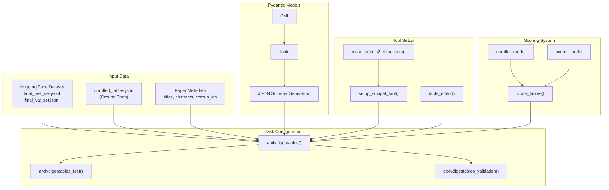
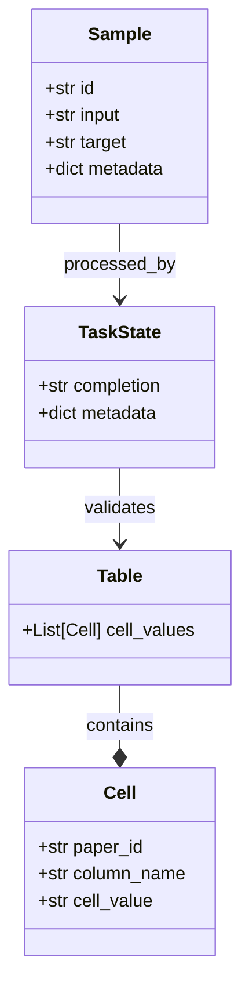
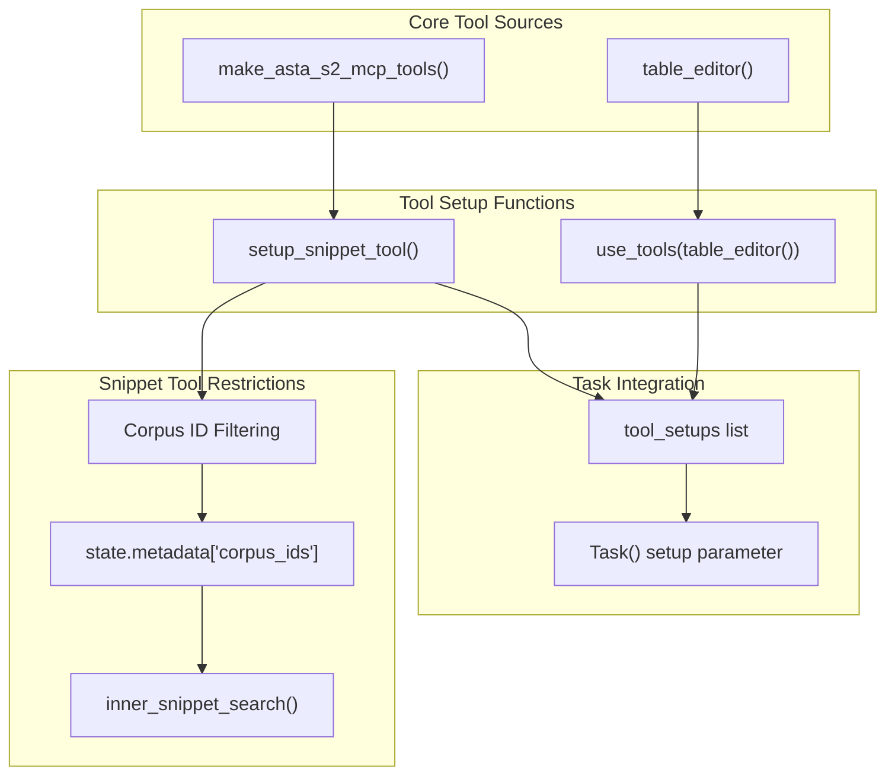
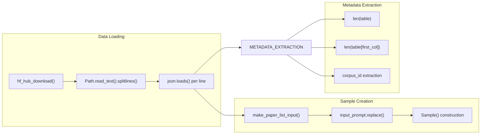

<!-- source: DeepWiki mcp.deepwiki.com · repo allenai/asta-bench · page 5.5 Data Analysis Tasks · fetched 2026-10-26 -->

# Table Generation Tasks

Relevant source files

The following files were used as context for generating this wiki page:

- [astabench/evals/arxivdigestables/task.py](astabench/evals/arxivdigestables/task.py)
- [astabench/evals/labbench/litqa2/task.py](astabench/evals/labbench/litqa2/task.py)

This document covers table generation evaluation tasks in asta-bench, specifically the ArxivDIGESTables task system. This task evaluates AI agents' ability to analyze scientific papers and generate structured comparison tables based on paper content and metadata.

For information about other types of evaluation tasks, see [Paper Finding Tasks](#5.1), [Scientific QA Tasks](#5.2), [Code Tasks](#5.3), and [Discovery Tasks](#5.4).

## Task Overview

The table generation tasks focus on evaluating agents' ability to synthesize information from multiple scientific papers into structured tabular formats. The primary implementation is the ArxivDIGESTables task, which provides paper titles, abstracts, and table specifications to generate comparison tables.

### ArxivDIGESTables Task Architecture

**Sources:** [astabench/evals/arxivdigestables/task.py:213-296](), [astabench/evals/arxivdigestables/task.py:299-324]()

## Output Format Specification

The ArxivDIGESTables task uses structured Pydantic models to define the expected output format for generated tables.

### Data Models

The `Cell` model represents individual table entries with three required fields:
- `paper_id`: Identifier for the source paper
- `column_name`: Name of the table column
- `cell_value`: The actual content for that cell

The `Table` model contains a list of `Cell` objects representing the complete table structure.

**Sources:** [astabench/evals/arxivdigestables/task.py:33-50](), [astabench/evals/arxivdigestables/task.py:52-62]()

## Scoring Methodology

The scoring system for table generation tasks uses a sophisticated multi-step evaluation process involving table unrolling and statement verification.

### Scoring Pipeline

```mermaid
graph LR
    subgraph "Input Validation"
        JSON_PARSE["JSON Extraction<br/>tjson[tjson.index('{'):tjson.rindex('}')+1]"]
        PYDANTIC_VAL["Pydantic Validation<br/>Table.model_validate_json()"]
    end
    
    subgraph "Table Processing"
        TABLE_CONVERT["convert_pydantic_table_to_json()"]
        MARKDOWN_GEN["pd.DataFrame().to_markdown()"]
        UNROLL_PROMPT["unroll_prompt.replace()"]
    end
    
    subgraph "Unrolling Phase"
        UNROLLER_MODEL["unroller_model.generate()"]
        STATEMENT_SPLIT["Split into statements"]
    end
    
    subgraph "Evaluation Phase"
        EVAL_PROMPT["eval_prompt.replace()"]
        SCORER_MODEL["scorer_model.generate()"]
        RECALL_CALC["Recall Calculation"]
    end
    
    JSON_PARSE --> PYDANTIC_VAL
    PYDANTIC_VAL --> TABLE_CONVERT
    TABLE_CONVERT --> MARKDOWN_GEN
    MARKDOWN_GEN --> UNROLL_PROMPT
    UNROLL_PROMPT --> UNROLLER_MODEL
    UNROLLER_MODEL --> STATEMENT_SPLIT
    STATEMENT_SPLIT --> EVAL_PROMPT
    EVAL_PROMPT --> SCORER_MODEL
    SCORER_MODEL --> RECALL_CALC
```

The scoring process involves:

1. **Validation**: Extract and validate JSON output against the `Table` schema
2. **Conversion**: Convert Pydantic model to JSON format and then to Markdown
3. **Unrolling**: Use an unroller model to convert the table into individual statements
4. **Evaluation**: Compare each unrolled statement against ground truth using a scorer model
5. **Scoring**: Calculate recall as the fraction of supported statements

**Sources:** [astabench/evals/arxivdigestables/task.py:65-134]()

## Tool Integration

Table generation tasks can be configured with various tools to assist agents in the generation process.

### Tool Configuration System

### Snippet Search Tool

The `setup_snippet_tool()` function creates a restricted version of the snippet search tool that only allows searching within papers specified in the task metadata:

| Parameter | Type | Description |
|-----------|------|-------------|
| `with_snippet_search_tool` | `bool` | Enable snippet search functionality |
| `with_table_editor_tool` | `bool` | Enable table editing capabilities |

The snippet tool is restricted to prevent agents from accessing papers outside the specified corpus IDs for the evaluation instance.

**Sources:** [astabench/evals/arxivdigestables/task.py:158-211](), [astabench/evals/arxivdigestables/task.py:286-290]()

## Configuration and Task Variants

The ArxivDIGESTables system provides multiple task configurations and parameters for different evaluation scenarios.

### Task Configuration Parameters

| Parameter | Type | Default | Description |
|-----------|------|---------|-------------|
| `unroller_model` | `str \| Model` | `"openai/gpt-4o"` | Model for unrolling tables into statements |
| `scorer_model` | `str \| Model` | `"openai/gpt-4o"` | Model for evaluating statement support |
| `with_snippet_search_tool` | `bool` | `True` | Enable snippet search tool |
| `with_table_editor_tool` | `bool` | `False` | Enable table editor tool |
| `split` | `Literal["test", "val"]` | `"test"` | Dataset split to use |

### Dataset Processing Pipeline

The task processes instances by:
1. Loading data from Hugging Face dataset repository
2. Formatting paper information (titles, abstracts, corpus IDs)
3. Building prompts with table specifications and JSON schema
4. Creating `Sample` objects with metadata for tool restrictions

**Sources:** [astabench/evals/arxivdigestables/task.py:213-296](), [astabench/evals/arxivdigestables/task.py:142-155](), [astabench/evals/arxivdigestables/task.py:225-285]()

## Testing and Registry Integration

Table generation tasks are integrated into the asta-bench testing and registry system with specific requirements and configurations.

### Test Configuration

The ArxivDIGESTables task requires specific test setup due to its dependencies:

- **S2 API Key Required**: Listed in `NEED_S2_API_KEY_TASKS` for semantic scholar integration
- **Mock Testing**: Uses `get_mock_s2api_toolsource()` when API key unavailable
- **Registry Integration**: Exported in `__all__` for automatic discovery

**Sources:** [tests/test_registry_evals.py:46-61](), [astabench/evals/arxivdigestables/task.py:327-331]()

---

