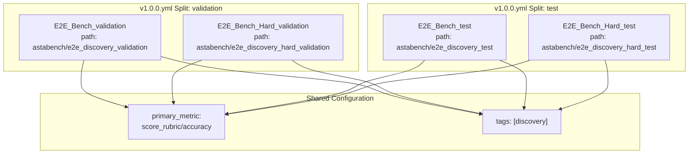
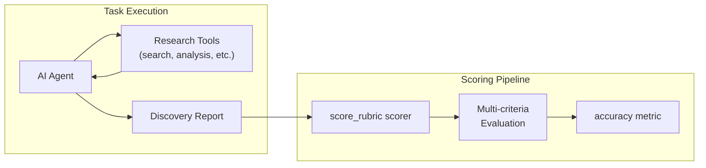
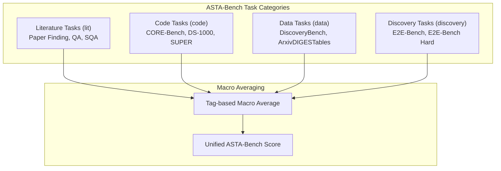
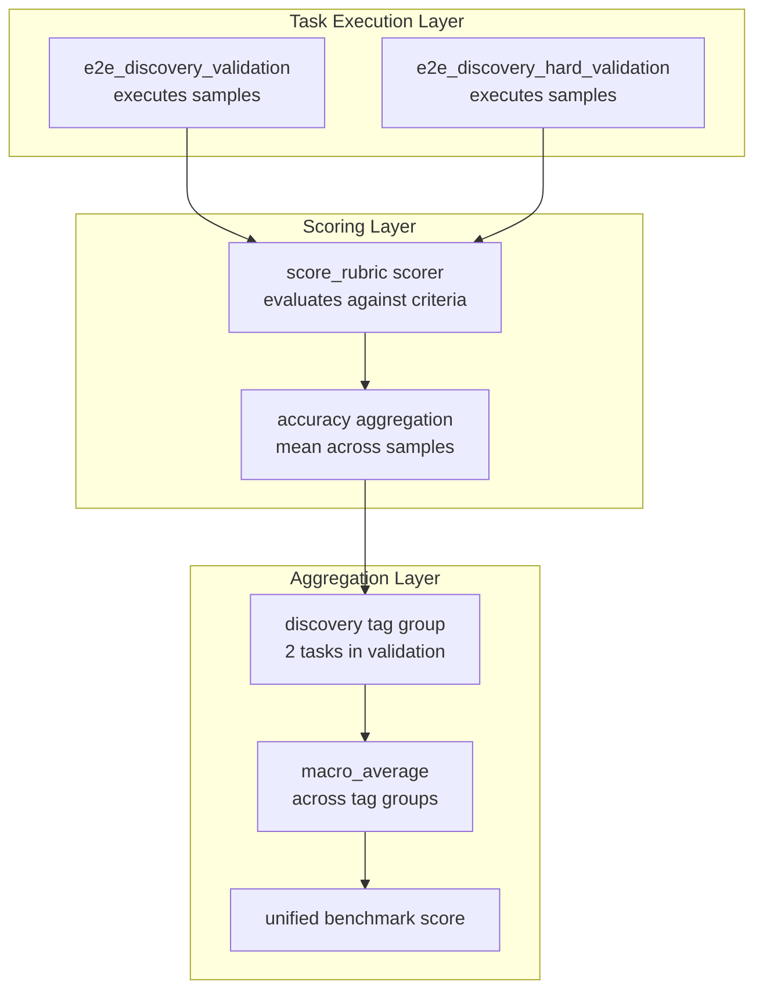

<!-- source: DeepWiki mcp.deepwiki.com · repo allenai/asta-bench · page 5.6 Discovery Tasks · fetched 2026-10-26 -->

# Discovery Tasks

<details>
<summary>Relevant source files</summary>

The following files were used as context for generating this wiki page:

- [astabench/cli.py](astabench/cli.py)
- [astabench/config/v1.0.0-dev1.yml](astabench/config/v1.0.0-dev1.yml)
- [astabench/config/v1.0.0.yml](astabench/config/v1.0.0.yml)

</details>


## Purpose and Scope

Discovery Tasks evaluate AI agents on end-to-end scientific discovery workflows. These tasks test an agent's ability to conduct comprehensive research processes from initial hypothesis formation through final conclusions. Discovery Tasks are distinct from Literature Tasks ([5.1-5.3](#5.1)), Code Execution Tasks ([5.4](#5.4)), and Data Analysis Tasks ([5.5](#5.5)) in that they assess holistic research capabilities rather than isolated skills.

The ASTA-Bench framework includes two discovery benchmarks:
- **E2E-Bench**: Standard difficulty end-to-end discovery tasks
- **E2E-Bench Hard**: More challenging variants requiring deeper reasoning

Both benchmarks are available in `validation` and `test` splits and use rubric-based evaluation with the primary metric `score_rubric/accuracy`.

**Sources:** [astabench/config/v1.0.0.yml:47-56](), [astabench/config/v1.0.0.yml:112-121]()

## Task Configuration

Discovery tasks are configured in the YAML configuration files with the `discovery` tag, distinguishing them from literature (`lit`), code (`code`), and data (`data`) tasks.

### Configuration Structure



**Discovery Task Configuration Table**

| Task Name | Split | Path | Primary Metric | Tags |
|-----------|-------|------|----------------|------|
| E2E_Bench_validation | validation | `astabench/e2e_discovery_validation` | `score_rubric/accuracy` | `discovery` |
| E2E_Bench_Hard_validation | validation | `astabench/e2e_discovery_hard_validation` | `score_rubric/accuracy` | `discovery` |
| E2E_Bench_test | test | `astabench/e2e_discovery_test` | `score_rubric/accuracy` | `discovery` |
| E2E_Bench_Hard_test | test | `astabench/e2e_discovery_hard_test` | `score_rubric/accuracy` | `discovery` |

**Sources:** [astabench/config/v1.0.0.yml:47-56](), [astabench/config/v1.0.0.yml:112-121]()

## E2E-Bench Tasks

### Standard E2E-Bench

The standard E2E-Bench tasks evaluate agents on complete scientific discovery workflows. These tasks require agents to:
- Formulate research questions
- Conduct literature searches
- Analyze findings
- Draw evidence-based conclusions

Task paths:
- Validation: `astabench/e2e_discovery_validation`
- Test: `astabench/e2e_discovery_test`

### E2E-Bench Hard

E2E-Bench Hard contains more challenging discovery scenarios that require:
- More complex reasoning chains
- Integration of multiple information sources
- Deeper domain understanding
- More sophisticated evidence synthesis

Task paths:
- Validation: `astabench/e2e_discovery_hard_validation`
- Test: `astabench/e2e_discovery_hard_test`

**Sources:** [astabench/config/v1.0.0.yml:47-56](), [astabench/config/v1.0.0.yml:112-121]()

## Evaluation Methodology

Discovery tasks use rubric-based scoring similar to the Scientific QA tasks (see [5.2](#5.2)), but adapted for end-to-end discovery workflows.

### Rubric-Based Scoring



The `score_rubric` scorer evaluates discovery outputs against predefined criteria, producing an `accuracy` metric that represents the proportion of rubric criteria successfully met.

**Primary Metric:**
- Metric path: `score_rubric/accuracy`
- Type: Accuracy score (0.0 to 1.0)
- Aggregation: Mean across samples

**Sources:** [astabench/config/v1.0.0.yml:49](), [astabench/config/v1.0.0.yml:54](), [astabench/config/v1.0.0.yml:114](), [astabench/config/v1.0.0.yml:119]()

## Task Category Integration

Discovery tasks fit into the broader ASTA-Bench taxonomy as one of four primary task categories:



Discovery tasks contribute to the overall ASTA-Bench score through tag-based macro averaging. Unlike literature tasks, which have weight adjustments (see [astabench/config/v1.0.0.yml:62-68]()), discovery tasks use equal weighting with the default weight of 1.0 for both standard and hard variants.

**Weight Configuration:**
- E2E-Bench validation: 1.0 (default, no adjustment specified)
- E2E-Bench Hard validation: 1.0 (default, no adjustment specified)
- E2E-Bench test: 1.0 (default, no adjustment specified)
- E2E-Bench Hard test: 1.0 (default, no adjustment specified)

**Sources:** [astabench/config/v1.0.0.yml:62-68](), [astabench/config/v1.0.0.yml:127-133]()

## Running Discovery Tasks

### Using the CLI

Discovery tasks can be executed through the `astabench` CLI as part of a full evaluation or individually:

```bash
# Run all validation tasks including discovery
astabench eval --split validation

# Run all test tasks including discovery  
astabench eval --split test

# Run specific discovery task
inspect eval astabench/e2e_discovery_validation

# Run with sample limit for testing
inspect eval astabench/e2e_discovery_hard_validation --max-samples 5
```

The CLI automatically loads task configurations from [astabench/config/v1.0.0.yml]() via the default configuration path set in [astabench/cli.py:8]().

### Task Registration

Discovery tasks are registered with InspectAI using the `@task` decorator and follow the standard task path convention:

```
astabench/e2e_discovery_validation
astabench/e2e_discovery_hard_validation  
astabench/e2e_discovery_test
astabench/e2e_discovery_hard_test
```

These paths resolve to task functions decorated with `@task` that return InspectAI `Task` objects containing dataset samples and scoring configuration.

**Sources:** [astabench/cli.py:8-22](), [astabench/config/v1.0.0.yml:48](), [astabench/config/v1.0.0.yml:53]()

## Comparison: Discovery vs. Other Task Categories

| Aspect | Discovery Tasks | Literature Tasks | Code Tasks | Data Tasks |
|--------|----------------|------------------|------------|------------|
| **Focus** | End-to-end research workflows | Literature search and comprehension | Code generation and execution | Data extraction and structuring |
| **Complexity** | Multi-step processes | Single-domain queries | Algorithm implementation | Table/figure extraction |
| **Primary Metric** | `score_rubric/accuracy` | Various (F1, accuracy, recall) | `accuracy`, `output_match` | `score_tables/mean` |
| **Tool Requirements** | Full research toolset | Search tools primarily | Sandbox execution | Mixed (search + analysis) |
| **Evaluation Method** | Rubric-based | Task-specific scorers | Execution validation | Structured output comparison |
| **Tag** | `discovery` | `lit` | `code` | `data` |

**Sources:** [astabench/config/v1.0.0.yml:1-134]()

## Integration with Scoring System

Discovery task results are aggregated through the standard ASTA-Bench scoring pipeline:



The scoring command aggregates discovery task results:

```bash
# Score all tasks including discovery
astabench score <log_directory>
```

This produces metrics at multiple levels:
1. Per-sample scores from `score_rubric`
2. Task-level `accuracy` (mean of per-sample scores)
3. Tag-level average across E2E-Bench and E2E-Bench Hard
4. Overall benchmark score incorporating discovery alongside lit, code, and data tasks

**Sources:** [astabench/config/v1.0.0.yml:47-56](), [astabench/cli.py:6]()

---

