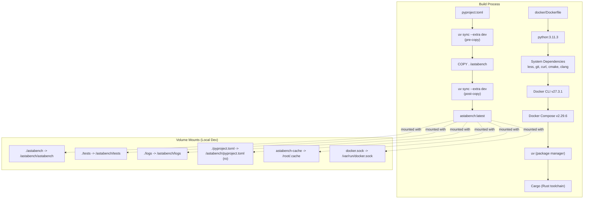
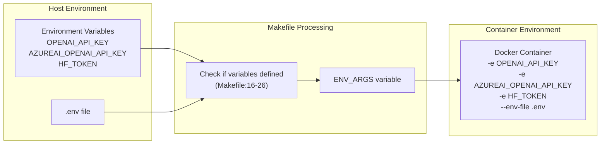
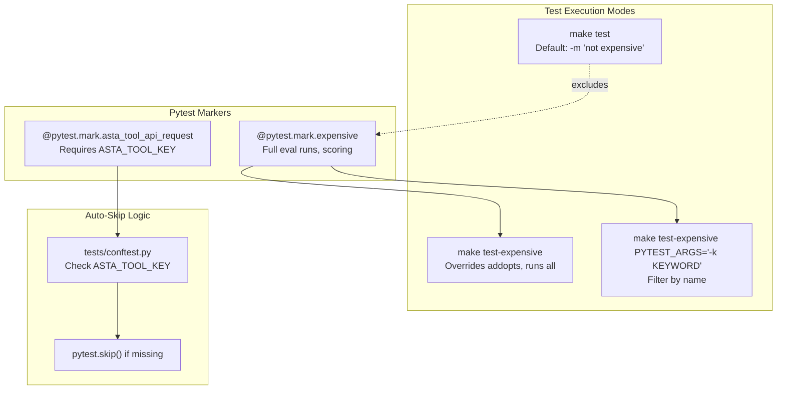
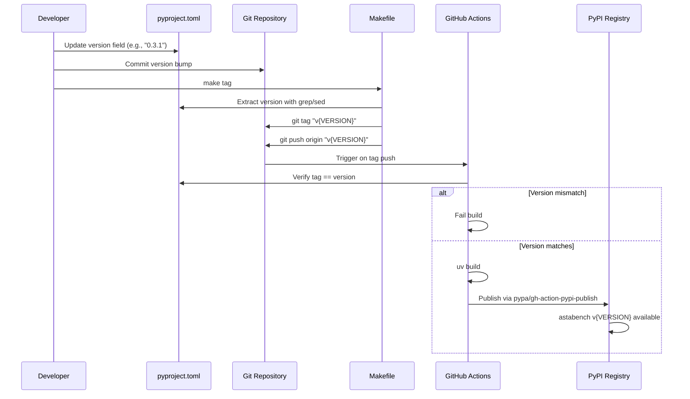

<!-- source: DeepWiki mcp.deepwiki.com · repo allenai/asta-bench · page 6 Development · fetched 2026-10-26 -->

# Development

<details>
<summary>Relevant source files</summary>

The following files were used as context for generating this wiki page:

- [Makefile](Makefile)
- [README.md](README.md)
- [docker/Dockerfile](docker/Dockerfile)
- [pyproject.toml](pyproject.toml)

</details>


This document covers the development workflow for contributing to ASTA-Bench, including environment setup, testing procedures, and the release process. For information about using ASTA-Bench to evaluate agents, see [Getting Started](#2). For details on creating custom solvers, see [Solver Development](#7.2).

## Development Environment

ASTA-Bench uses a Docker-based development workflow with `uv` for dependency management and `make` commands for common tasks. The primary development container is defined in [docker/Dockerfile:1-43]() and provides Python 3.11, Docker CLI, Docker Compose, and all project dependencies.

### Container Build Process

The Docker build follows a multi-stage approach with the `astabench-base` target serving as the primary development image:



**Sources:** [docker/Dockerfile:1-43](), [Makefile:42-49]()

The build performs two `uv sync` operations:
1. **Pre-copy sync** [docker/Dockerfile:36](): Caches dependency installation before source code is copied
2. **Post-copy sync** [docker/Dockerfile:42](): Registers the `astabench` and `inspect_evals` packages after source code is present

### Makefile Commands

The [Makefile:1-131]() provides standardized commands for development tasks:

| Command | Purpose | Docker Required | Key Flags |
|---------|---------|-----------------|-----------|
| `make shell` | Interactive development shell | Yes | Mounts source, tests, logs; exposes port 7575 |
| `make format` | Auto-format code with `black` | Yes | Excludes `inspect_evals` and `.venv` |
| `make flake` | Run `flake8` linting | Yes | Checks `astabench/` and `tests/` |
| `make mypy` | Type-check with `mypy` | Yes | Checks `astabench/` and `tests/` |
| `make test` | Run pytest (non-expensive) | Yes | Uses `--no-sync --extra dev` |
| `make test-expensive` | Run expensive tests | Yes | Overrides `addopts`, runs marked tests |
| `make tag` | Create and push git tag | No | Extracts version from `pyproject.toml` |

**Sources:** [Makefile:1-131](), [README.md:315-326]()

### Environment Variables

The Makefile automatically forwards environment variables to the container if they are set in the host environment or defined in a `.env` file [Makefile:16-31]():



**Sources:** [Makefile:16-31](), [README.md:86-103]()

### Local Development Workflow

The typical development iteration cycle:

```bash
# Start interactive shell
make shell

# Inside container, run evaluations
uv run inspect eval --solver generate --model openai/gpt-4.1 astabench/arithmetic_demo

# Run tests
make test

# Format and lint
make format flake
```

Local source code changes are immediately reflected in the container via volume mounts [Makefile:42-48](). The `pyproject.toml` is mounted read-only to prevent accidental modifications from inside the container.

**Sources:** [README.md:67-84](), [Makefile:62-69]()

## Testing Infrastructure

ASTA-Bench uses `pytest` with custom markers to categorize tests by expense and external dependencies. The test configuration is defined in [pyproject.toml:116-126]().

### Test Markers



**Sources:** [pyproject.toml:116-126](), [README.md:315-326]()

The marker configuration [pyproject.toml:123-126]():
- `expensive`: Tests that run full evaluations or take significant time
- `asta_tool_api_request`: Tests requiring the `ASTA_TOOL_KEY` environment variable

Default test runs exclude expensive tests via `addopts = "-m \"not expensive\""` [pyproject.toml:122](). The `test-expensive` target removes this restriction [Makefile:123-124]().

### CI Test Execution

In CI environments, the `IS_CI=true` environment variable triggers different behavior [Makefile:36-51]():

| Aspect | Local Development | CI Environment |
|--------|-------------------|----------------|
| Volume Mounts | Source code, tests, logs | None (baked into image) |
| Cache | Named volume `astabench-cache` | Ephemeral |
| Docker Build | Interactive output | `--quiet` flag |
| Test Execution | `docker run` with mounts | `docker run --rm` on built image |

**Sources:** [Makefile:36-51]()

### Running Tests

```bash
# Run non-expensive tests
make test

# Run all tests including expensive
make test-expensive

# Filter tests by keyword
make test-expensive PYTEST_ARGS="-k 'sqa or paper_finder'"

# Run with verbose output
make test PYTEST_ARGS="-vv"
```

The test runner uses `uv run --no-sync --extra dev` to execute pytest [Makefile:115-116](), ensuring dev dependencies are available without re-syncing the environment.

**Sources:** [Makefile:114-124](), [README.md:315-326]()

## Publishing and Release

The release process enforces version consistency between `pyproject.toml` and git tags before publishing to PyPI.

### Version Management Workflow



**Sources:** [Makefile:126-130](), [README.md:230-231]()

### Tag Creation

The `make tag` command [Makefile:126-130]() automates tag creation:

1. Extracts version from `pyproject.toml` line 7 using `grep` and `sed`
2. Creates annotated git tag with format `v{VERSION}` (e.g., `v0.3.1`)
3. Pushes tag to origin repository

```bash
# Example: Version 0.3.1 in pyproject.toml
make tag
# Creates and pushes tag: v0.3.1
```

**Sources:** [Makefile:126-130](), [pyproject.toml:7]()

### GitHub Actions Publishing

The PyPI publish workflow is triggered on tag push and performs version verification before building and publishing. The workflow uses:

- `uv build` to create source distributions and wheels
- `pypa/gh-action-pypi-publish` for authenticated publishing
- Tag-to-version verification to prevent mismatched releases

**Sources:** [README.md:230-231](), High-level Diagram 6

### Development Dependency Configuration

The [pyproject.toml:34-45]() defines optional dev dependencies:

```toml
[project.optional-dependencies]
dev = [
    "black==24.2.0",
    "isort",
    "autoflake",
    "pytest",
    "pytest-asyncio",
    "flake8==7.2.0",
    "flake8-pyproject==1.2.3",
    "mypy==1.15",
    "pandas-stubs",
]
```

These are installed via `uv sync --extra dev` [docker/Dockerfile:36,42]() during the Docker build process and when running tests [Makefile:115,123]().

**Sources:** [pyproject.toml:34-45](), [docker/Dockerfile:36-42](), [Makefile:115-124]()

### Async Test Configuration

Pytest async configuration [pyproject.toml:118-120]() ensures proper test isolation:

```toml
asyncio_mode = "strict"
asyncio_default_fixture_loop_scope = "function"
```

This gives each async test its own event loop, preventing interference between tests that use async operations (common in InspectAI-based evaluations).

**Sources:** [pyproject.toml:118-120]()

---

