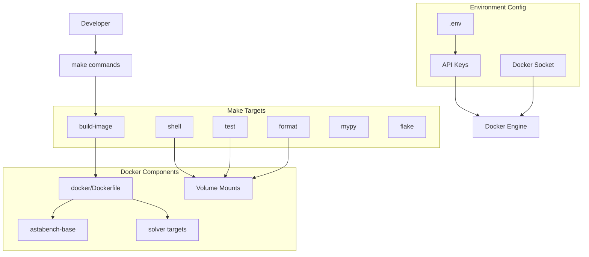
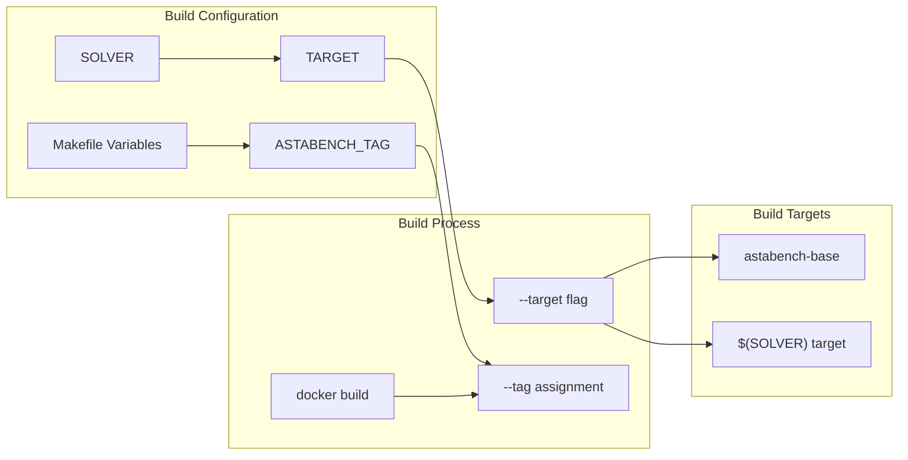
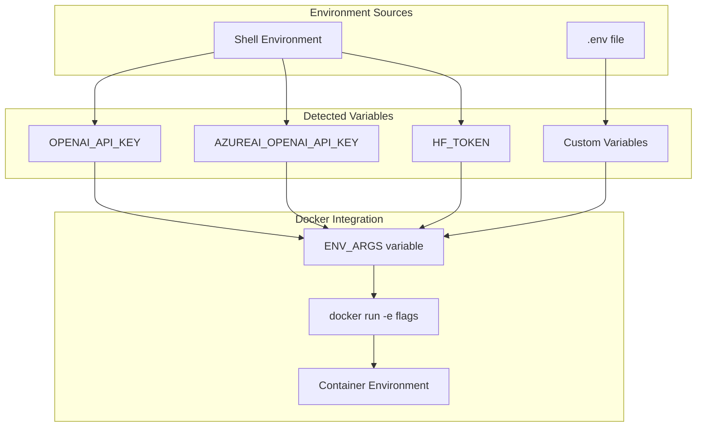
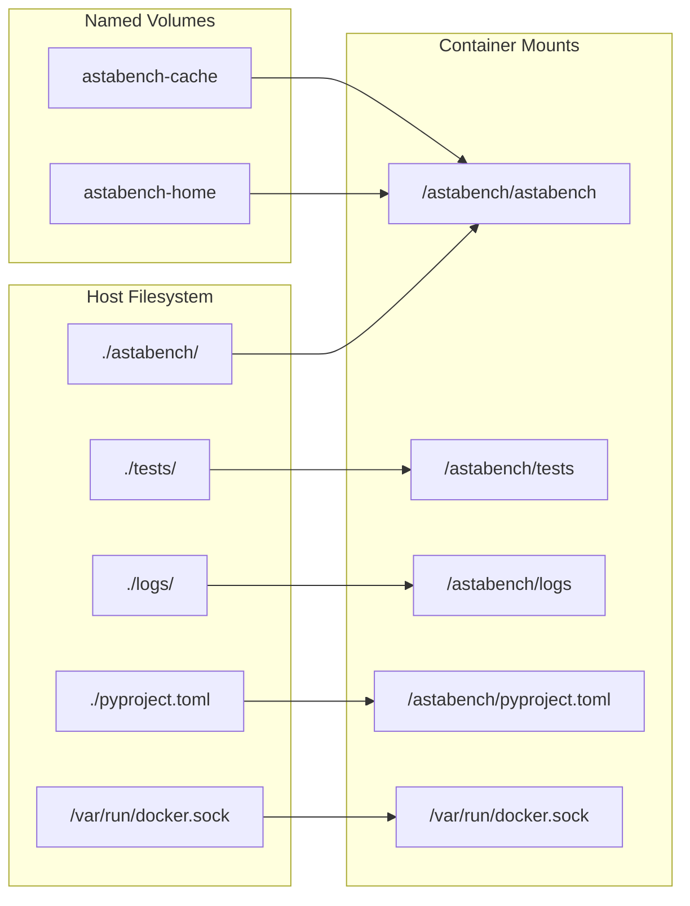
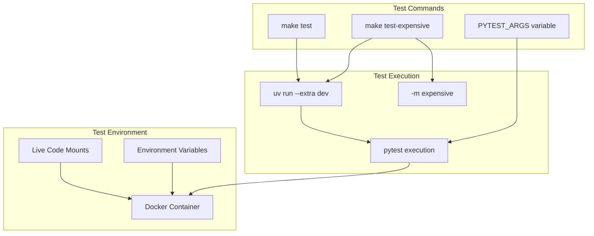
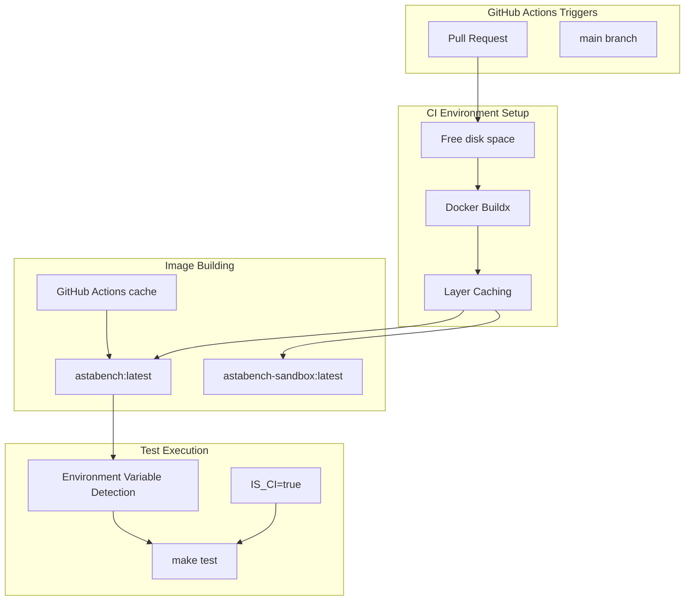
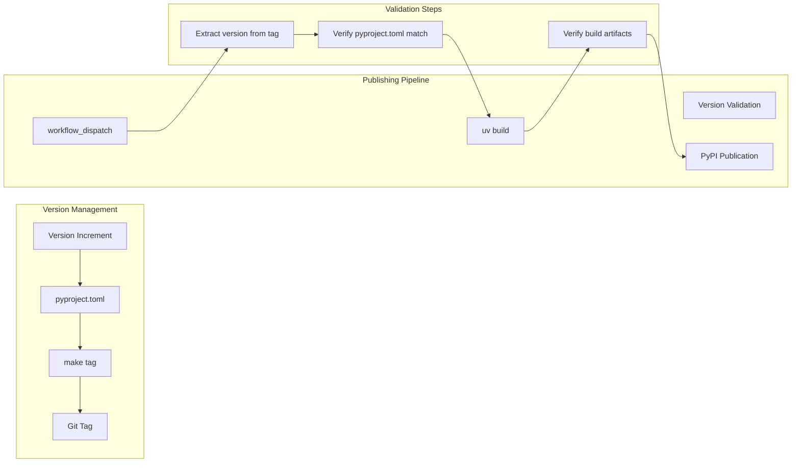

<!-- source: DeepWiki mcp.deepwiki.com · repo allenai/asta-bench · page 6.1 Development Environment · fetched 2026-10-26 -->

# Development Environment

Relevant source files

The following files were used as context for generating this wiki page:

- [.github/workflows/ci-test.yml](.github/workflows/ci-test.yml)
- [Makefile](Makefile)
- [README.md](README.md)
- [docker/Dockerfile](docker/Dockerfile)
- [pyproject.toml](pyproject.toml)

This document covers the development environment setup for asta-bench, including Docker containerization, Make-based workflows, testing procedures, and CI/CD pipelines. The development environment is designed to provide consistent, reproducible builds across local development and continuous integration environments.

For information about running evaluations and using the framework, see [Getting Started](#2). For details about the testing framework and procedures, see [Testing](#6.2). For publishing releases, see [Publishing and Release](#6.3).

## Docker-Based Development Architecture

The asta-bench development environment is built around Docker containers to ensure consistency across different development machines and CI environments. The primary interface for developers is through Make commands that orchestrate Docker builds and execution.

### Development Workflow

Sources: [Makefile:1-136](), [docker/Dockerfile](), [.env file support in Makefile:34-37]()

### Container Build Process

The build system supports multiple target configurations through the `TARGET` variable and optional `SOLVER` parameter. The base container includes all asta-bench dependencies, while solver-specific containers add additional tools and configurations.

Sources: [Makefile:6-19](), [Makefile:62-63]()

## Make Command Interface

The `Makefile` provides the primary interface for development tasks, with commands that automatically handle Docker image building and environment setup.

### Core Development Commands

| Command | Purpose | Dependencies |
|---------|---------|--------------|
| `make build-image` | Build the Docker container | Docker engine |
| `make shell` | Start interactive development shell | `build-image` |
| `make test` | Run test suite | `build-image` |
| `make test-expensive` | Run expensive/integration tests | `build-image` |
| `make format` | Format code with Black | `build-image` |
| `make mypy` | Run type checking | `build-image` |
| `make flake` | Run flake8 linting | `build-image` |
| `make tag` | Create and push git version tag | None |

### Environment Variable Handling

The development environment automatically detects and forwards relevant environment variables to Docker containers:

Sources: [Makefile:21-37](), [Makefile environment detection:22-33]()

### Local vs CI Environment Differences

The build system automatically detects CI environments and adjusts behavior accordingly:

**Local Development:**
- Enables volume mounts for live code editing: [Makefile:48-54]()
- Mounts Docker socket for container-in-container operations
- Provides cache persistence via named volumes
- Supports interactive debugging

**CI Environment:**
- Disables local volume mounts: [Makefile:42-46]()
- Uses quieter build output: [Makefile:46]()
- Sets `IS_CI` environment variable
- Optimizes for automated execution

Sources: [Makefile:42-57](), [CI environment detection:42-44]()

## Volume Mount Strategy

The development environment uses strategic volume mounting to enable efficient development workflows while maintaining container isolation.

### Development Volume Configuration

Sources: [Makefile:48-54](), [Makefile:71]()

## Testing and Quality Assurance Workflows

The development environment includes comprehensive testing and code quality tools that run within the Docker container environment.

### Test Execution Pipeline

Sources: [Makefile:119-129](), [Test execution:120-121](), [Expensive test configuration:128-129]()

### Code Quality Tools

The development environment includes automated code formatting, type checking, and linting:

- **Black formatting**: [Makefile:90-94]() - Formats code with exclusions for `inspect_evals` and `.venv`
- **MyPy type checking**: [Makefile:100-104]() - Validates type annotations
- **Flake8 linting**: [Makefile:110-113]() - Enforces code style guidelines

## CI/CD Integration

The development environment seamlessly integrates with GitHub Actions for continuous integration and deployment.

### CI Testing Workflow

Sources: [.github/workflows/ci-test.yml:1-92](), [CI disk cleanup:.github/workflows/ci-test.yml:15-51](), [Docker caching:.github/workflows/ci-test.yml:66-67]()

### Publishing Workflow

The publishing process is triggered manually through GitHub Actions and validates version consistency before deploying to PyPI:

Sources: [DEVELOPMENT.md:5-10](), [.github/workflows/publish-pypi.yml:1-63](), [Makefile tag command:131-135]()

## Solver-Specific Development

The development environment supports building containers for specific solvers through the `SOLVER` parameter, enabling development of solver-specific evaluation pipelines.

When `SOLVER` is specified, the build system:
- Changes the Docker target to `--target $(SOLVER)`: [Makefile:17]()
- Modifies the container tag to `astabench-$(SOLVER)`: [Makefile:18]()
- Enables solver-specific development workflows

Sources: [Makefile:14-19](), [Docker target selection:13-17]()

---

