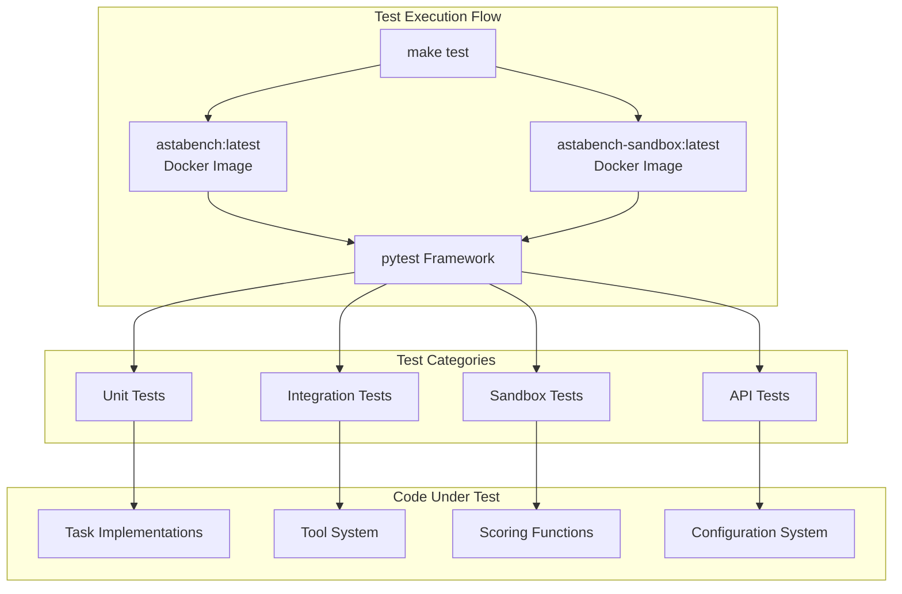
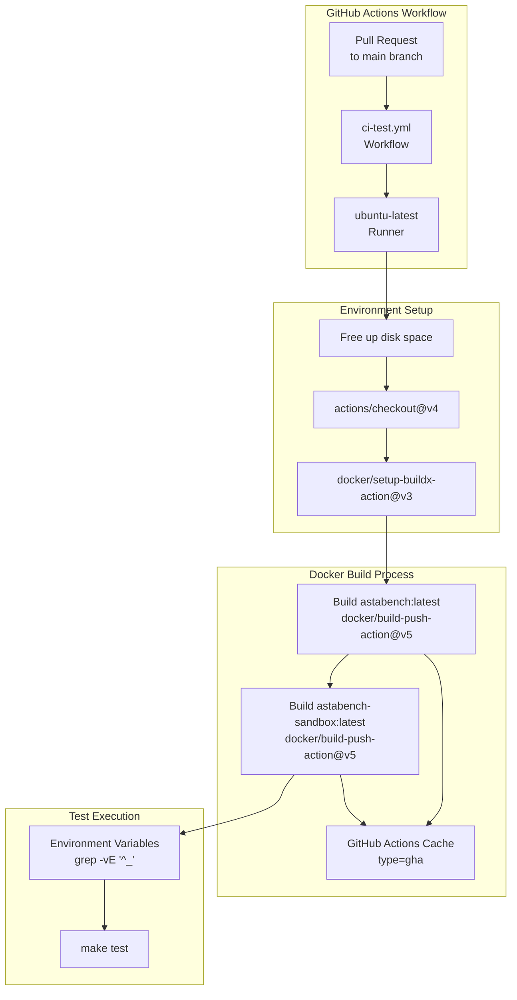
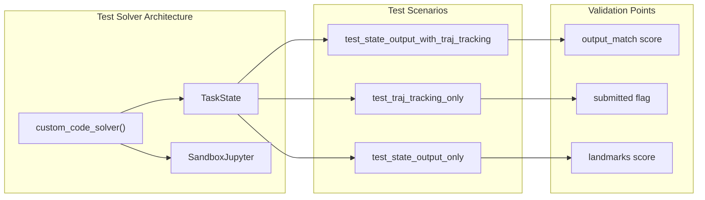

<!-- source: DeepWiki mcp.deepwiki.com · repo allenai/asta-bench · page 6.2 Testing · fetched 2026-10-26 -->

# Testing

<details>
<summary>Relevant source files</summary>

The following files were used as context for generating this wiki page:

- [.github/workflows/ci-test.yml](.github/workflows/ci-test.yml)
- [astabench/evals/paper_finder/eval.py](astabench/evals/paper_finder/eval.py)
- [astabench/tools/__init__.py](astabench/tools/__init__.py)
- [tests/test_registry_evals.py](tests/test_registry_evals.py)

</details>


This page covers the testing infrastructure and procedures for asta-bench, including local test execution, continuous integration workflows, and quality assurance practices. The testing system is designed to validate evaluation tasks, tool integrations, and scoring mechanisms across different environments including Docker containers.

For information about development environment setup, see [Development Environment](#6.1). For release procedures and publishing workflows, see [Publishing and Release](#6.3).

## Test Framework Overview

The asta-bench testing system is built around pytest and integrates closely with the Docker-based development environment. Tests validate core functionality including task execution, tool behavior, scoring mechanisms, and external API integrations.



Sources: [.github/workflows/ci-test.yml:87-91](), [tests/tasks/test_super.py:142-152]()

## Running Tests Locally

### Basic Test Execution

The primary method for running tests locally uses the make system, which handles Docker environment setup and test execution:

```bash
make test
```

This command builds the necessary Docker images and executes the test suite within the containerized environment, ensuring consistency with CI.

### Environment Configuration

Tests require specific environment variables to function properly. The system handles both real and mock configurations:

| Variable | Purpose | Test Value |
|----------|---------|------------|
| `IS_CI` | Identifies CI environment | `"true"` |
| `OPENAI_API_KEY` | API access (can be fake for tests) | `"Fake key..."` |
| `HF_TOKEN` | Hugging Face authentication | `${{ secrets.HF_TOKEN }}` |
| `IGNORE_DOCKER_TESTS` | Skip Docker-dependent tests | `"true"` |

Sources: [.github/workflows/ci-test.yml:10-13](), [tests/tasks/test_super.py:119-122]()

### Docker Test Dependencies

Tests that require Docker sandbox environments can be conditionally skipped:

```python
@pytest.mark.skipif(
    os.getenv("IGNORE_DOCKER_TESTS", "").lower() == "true",
    reason="Skipping Docker-dependent test due to IGNORE_DOCKER_TESTS=true",
)
def test_super_scoring():
    # Docker-dependent test implementation
```

Sources: [tests/tasks/test_super.py:119-123]()

## CI Pipeline Architecture

The continuous integration system uses GitHub Actions to automatically test pull requests and ensure code quality.



Sources: [.github/workflows/ci-test.yml:1-92]()

### Disk Space Management

The CI environment includes extensive disk cleanup procedures to accommodate Docker image builds:

```yaml
- name: Free up disk space
  run: |
    sudo rm -rf /usr/lib/llvm-*
    sudo rm -rf /usr/lib/dotnet
    sudo rm -rf /usr/local/share/chromium
    # Additional cleanup steps...
```

This cleanup is necessary because Docker image builds require substantial disk space that exceeds default GitHub Actions runner capacity.

Sources: [.github/workflows/ci-test.yml:15-51]()

### Docker Layer Caching

The CI pipeline uses GitHub Actions cache to optimize Docker build times:

```yaml
cache-from: type=gha,scope=astabench
cache-to: type=gha,mode=max,scope=astabench
```

This caching strategy significantly reduces build times for subsequent CI runs.

Sources: [.github/workflows/ci-test.yml:66-67](), [.github/workflows/ci-test.yml:76-77]()

## Test Types and Organization

### Integration Tests

Integration tests validate complete task execution workflows using the `inspect_ai.eval()` framework. These tests use custom solvers and mock data to verify scoring behavior:

```python
def test_super_scoring():
    result = inspect_ai.eval(
        super_test_task,
        model="mockllm/model",
        solver=custom_code_solver(),
        display="plain",
        sandbox=sandbox_spec,
        max_samples=max_samples,
    )
```

Sources: [tests/tasks/test_super.py:142-152]()

### Custom Test Solvers

Test implementations use custom solvers that execute predetermined code sequences instead of relying on LLM responses:



Sources: [tests/tasks/test_super.py:24-71](), [tests/tasks/test_super.py:74-116]()

### Scoring Validation

Tests verify specific scoring behaviors across different execution scenarios:

| Test Scenario | Output Match | Submitted | Landmarks |
|---------------|--------------|-----------|-----------|
| `test_state_output_with_traj_tracking` | 1.0 | 1 | 1.0 |
| `test_traj_tracking_only` | 1.0 | 0 | 1.0 |
| `test_state_output_only` | 1.0 | 1 | 0.5 |

Sources: [tests/tasks/test_super.py:163-197]()

## Docker Integration Testing

### Sandbox Configuration

Docker-dependent tests use different sandbox configurations for CI versus local development:

```python
sandbox_spec = SandboxToolManager.make_docker_sandbox_spec()

if os.getenv("IS_CI", "false") == "true":
    sandbox_spec = SandboxEnvironmentSpec(
        type="docker",
        config=(Path(__file__).parent / "ci_sandbox_compose.yaml").as_posix(),
    )
```

This dual configuration ensures tests can run in both environments while accommodating CI-specific constraints.

Sources: [tests/tasks/test_super.py:132-140]()

### Resource Constraints

CI environments use reduced resource limits to prevent timeouts and resource exhaustion:

```python
max_samples = 3
if os.getenv("IS_CI", "false") == "true":
    max_samples = 1
```

These constraints ensure tests complete within CI time limits while still validating core functionality.

Sources: [tests/tasks/test_super.py:134-136]()

## External API Testing

### Mock API Configurations

Tests handle external API dependencies through environment variable configuration and timeout management:

```python
async def _query_s2_api(
    end_pt: str = "paper/batch",
    params: dict[str, Any] | None = None,
    # ...
) -> dict[str, Any]:
    async with httpx.AsyncClient(
        timeout=Timeout(20.0, connect=5.0),
    ) as http_client:
        # API request implementation
```

The timeout configuration (20.0 seconds) was specifically tuned to resolve test timeout issues in CI environments.

Sources: [astabench/tools/search.py:81-123]()

### Error Handling Validation

API integration tests validate proper error handling for different failure scenarios:

```python
try:
    response.raise_for_status()
except HTTPStatusError:
    if response.status_code == 400:
        raise ToolError(f"API request failed...")
    raise
```

Sources: [astabench/tools/search.py:112-122]()

## Quality Assurance Procedures

### Test Environment Isolation

The testing system ensures environment isolation through:

1. **Docker Containerization**: All tests run within controlled Docker environments
2. **Environment Variable Management**: Consistent variable configuration across test and CI environments  
3. **Resource Limiting**: Controlled resource allocation prevents test interference

### Coverage and Validation

The testing framework validates:

- **Task Execution**: Complete evaluation workflows from input to scoring
- **Tool Integration**: External API interactions and error handling
- **Scoring Logic**: Metric calculations and result aggregation
- **Configuration Handling**: YAML parsing and environment setup

Sources: [.github/workflows/ci-test.yml:87-91](), [tests/tasks/test_super.py:154-197]()

---

