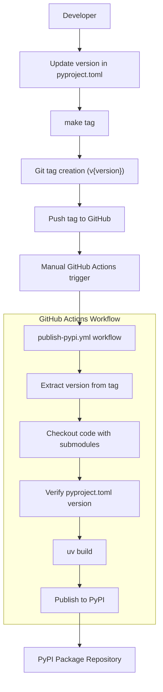
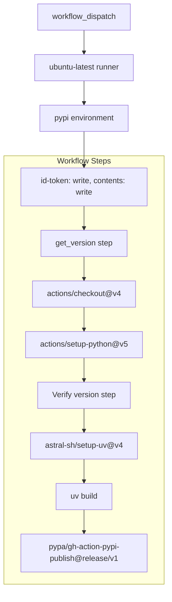
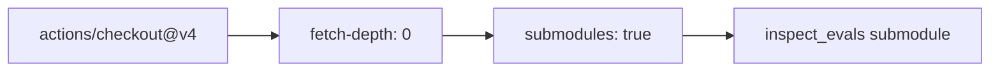

<!-- source: DeepWiki mcp.deepwiki.com · repo allenai/asta-bench · page 6.3 Publishing and Release · fetched 2026-10-26 -->

# Publishing and Release

<details>
<summary>Relevant source files</summary>

The following files were used as context for generating this wiki page:

- [.github/workflows/publish-pypi.yml](.github/workflows/publish-pypi.yml)
- [.gitmodules](.gitmodules)
- [DEVELOPMENT.md](DEVELOPMENT.md)

</details>


This document covers the process for creating, tagging, and publishing new releases of the asta-bench package to PyPI. It describes the automated workflow used to ensure version consistency, build validation, and secure publishing through GitHub Actions.

For information about setting up the development environment, see [Development Environment](#6.1). For testing procedures before release, see [Testing](#6.2).

## Release Process Overview

The asta-bench release process follows a three-step workflow that ensures version consistency and automated publishing to PyPI. The process leverages make targets, git tagging, and GitHub Actions to maintain a reliable release pipeline.



Sources: [DEVELOPMENT.md:5-10](), [Makefile:131-135](), [.github/workflows/publish-pypi.yml:1-63]()

## Version Management

Version information is centrally managed in the `pyproject.toml` file and serves as the single source of truth for all release operations. The make system extracts this version to create consistent git tags.

### Version Extraction Process

The `make tag` target uses shell commands to extract the version from `pyproject.toml` and create corresponding git tags:

```mermaid
graph LR
    PYPROJECT["pyproject.toml"] --> GREP["grep '^version = '"]
    GREP --> SED["sed 's/version = \"\\(.*\\)\"/\\1/'"]
    SED --> VERSION_VAR["$$VERSION variable"]
    VERSION_VAR --> GIT_TAG_CMD["git tag v$$VERSION"]
    GIT_TAG_CMD --> GIT_PUSH["git push origin v$$VERSION"]
```

The version extraction uses this specific pattern: `grep '^version = ' pyproject.toml | sed 's/version = "\(.*\)"/\1/'` to parse the TOML format and extract only the version string.

Sources: [Makefile:132-135]()

## Git Tagging Workflow

The git tagging process is handled by the `tag` make target, which automates version extraction, tag creation, and remote push operations.

### Make Tag Target Implementation

| Step | Command | Purpose |
|------|---------|---------|
| 1 | `grep '^version = ' pyproject.toml` | Extract version line from TOML |
| 2 | `sed 's/version = "\(.*\)"/\1/'` | Parse version string from quotes |
| 3 | `git tag "v$$VERSION"` | Create annotated git tag |
| 4 | `git push origin "v$$VERSION"` | Push tag to remote repository |

The tag format follows the pattern `v{version}` where `{version}` matches the version string from `pyproject.toml`.

Sources: [Makefile:131-135]()

## GitHub Actions Publishing Workflow

The PyPI publishing process is handled by the `publish-pypi.yml` GitHub Actions workflow, which must be manually triggered and operates on tagged releases.

### Workflow Configuration



### Workflow Authentication and Security

The workflow uses OpenID Connect (OIDC) authentication via the `id-token: write` permission, enabling secure publishing to PyPI without storing API keys. The `pypi` environment provides additional security controls.

Sources: [.github/workflows/publish-pypi.yml:8-12]()

## Version Verification Process

The publishing workflow includes multiple verification steps to ensure version consistency between the git tag and the package configuration.

### Version Validation Steps

```mermaid
graph TD
    TAG_REF["GITHUB_REF (refs/tags/v{version})"] --> EXTRACT_VERSION["Extract version from tag"]
    EXTRACT_VERSION --> TAG_VERSION["TAG_VERSION variable"]
    
    PYPROJECT_FILE["pyproject.toml"] --> GREP_VERSION["grep '^version = ' pyproject.toml"]
    GREP_VERSION --> SED_VERSION["sed 's/version = \"\\(.*\\)\"/\\1/'"]
    SED_VERSION --> PYPROJECT_VERSION["PYPROJECT_VERSION variable"]
    
    TAG_VERSION --> COMPARE["Compare versions"]
    PYPROJECT_VERSION --> COMPARE
    COMPARE --> MATCH["Versions match"] 
    COMPARE --> FAIL["Exit with error"]
    
    MATCH --> CONTINUE["Continue workflow"]
    FAIL --> ERROR_MSG["Version mismatch error"]
```

If versions don't match, the workflow fails with the message: "pyproject.toml has version '{pyproject_version}' at git tag v'{tag_version}'" and suggests using `make tag` to ensure consistency.

Sources: [.github/workflows/publish-pypi.yml:33-41]()

## Build and Package Process

The package build process uses `uv` as the build tool and includes verification steps before publishing.

### Build Workflow

| Step | Tool | Output |
|------|------|--------|
| Install uv | `astral-sh/setup-uv@v4` | UV package manager |
| Build package | `uv build` | `dist/` directory with wheel and sdist |
| Verify build | `ls dist/` | List built packages for confirmation |
| Publish | `pypa/gh-action-pypi-publish@release/v1` | Upload to PyPI with hash verification |

The build process creates both wheel (`.whl`) and source distribution (`.tar.gz`) packages in the `dist/` directory.

Sources: [.github/workflows/publish-pypi.yml:43-62]()

## Submodule Handling

The repository includes the `inspect_evals` submodule, which is properly handled during the checkout process to ensure complete package builds.



The checkout action uses `fetch-depth: 0` to retrieve full git history and `submodules: true` to initialize the `inspect_evals` submodule located at the repository root.

Sources: [.github/workflows/publish-pypi.yml:22-26](), [.gitmodules:1-4]()

## Release Checklist

When preparing a new release, follow this sequence:

1. **Update Version**: Modify the `version` field in `pyproject.toml`
2. **Create Tag**: Run `make tag` to extract version and create/push git tag
3. **Trigger Workflow**: Manually run "Publish to PyPI" workflow at https://github.com/allenai/asta-bench/actions
4. **Monitor Build**: Verify workflow completion and PyPI package availability
5. **Validate**: Check that the published package version matches expectations

The workflow provides hash verification output for security validation of the published package.

Sources: [DEVELOPMENT.md:5-10](), [.github/workflows/publish-pypi.yml:60-61]()

---

