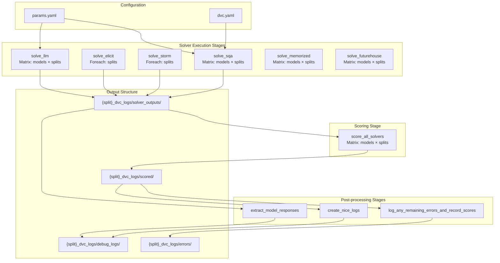
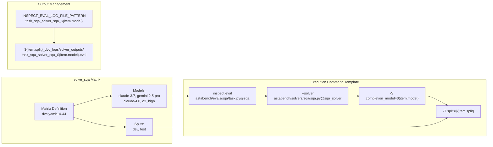
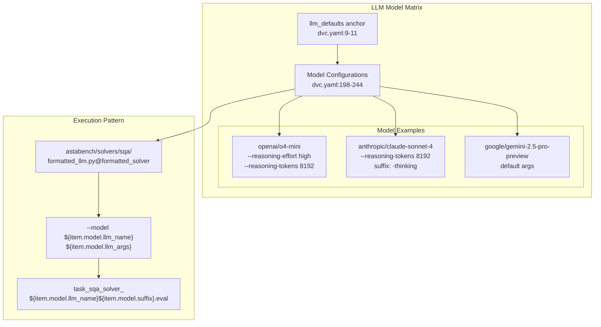
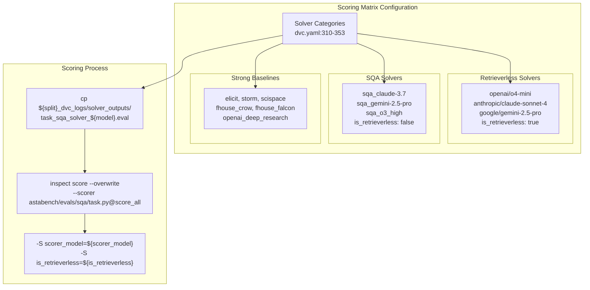
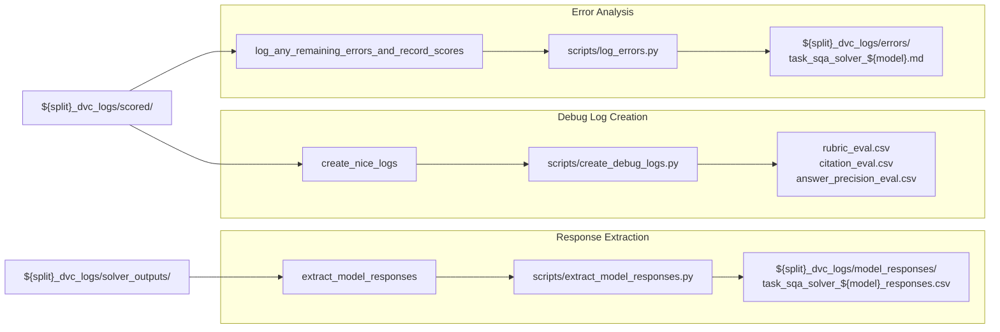
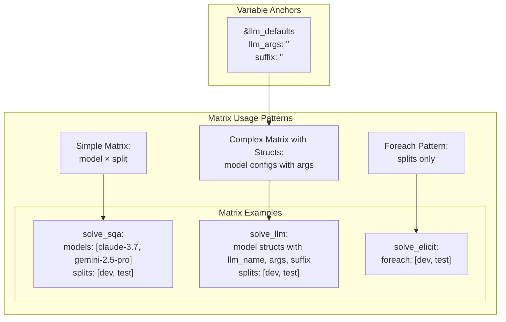
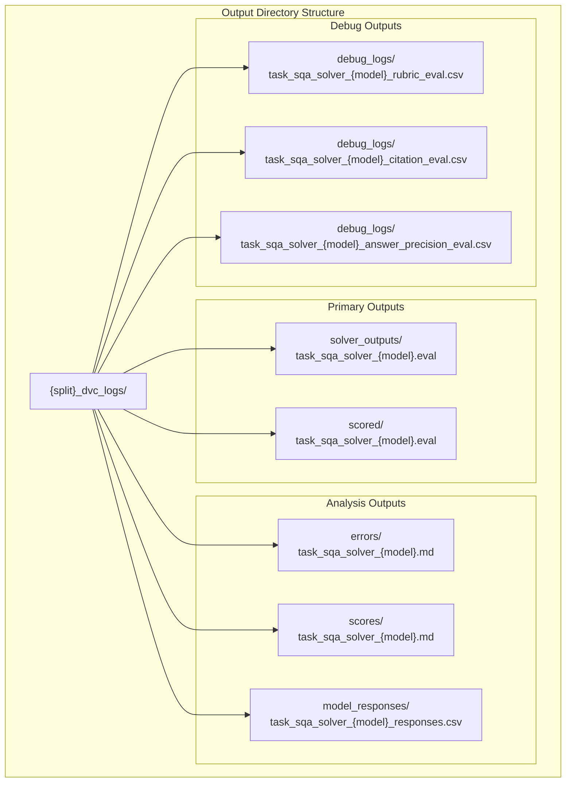

<!-- source: DeepWiki mcp.deepwiki.com · repo allenai/asta-bench · page 7 Evaluation Pipelines · fetched 2026-10-26 -->

# Evaluation Pipelines

<details>
<summary>Relevant source files</summary>

The following files were used as context for generating this wiki page:

- [dvc.lock](dvc.lock)
- [dvc.yaml](dvc.yaml)
- [params.yaml](params.yaml)
- [scripts/log_errors.py](scripts/log_errors.py)

</details>


This page covers the automated evaluation workflow system built on DVC (Data Version Control) and the patterns for developing custom solvers. The DVC pipeline orchestrates comprehensive solver evaluations across multiple models, splits, and task configurations, while solver development patterns enable integration of diverse AI systems into the benchmark. For information about individual evaluation tasks and their implementation, see [Evaluation Tasks](#5).

## Pipeline Architecture

The evaluation pipeline system is defined in [dvc.yaml:1-489]() and uses DVC's matrix and foreach constructs to systematically evaluate multiple AI systems across standardized benchmarks. The pipeline consists of three main phases: solver execution, scoring, and result processing.

### DVC Pipeline Overview



**Sources:** [dvc.yaml:1-489](), [params.yaml:1-4]()

## Solver Execution Stages

The pipeline defines specialized stages for different solver categories, each with tailored execution parameters and output handling.

### SQA Solver Matrix Configuration

The `solve_sqa` stage demonstrates the matrix-based approach for running multiple language models:



**Sources:** [dvc.yaml:14-44](), [dvc.yaml:25-38]()

### LLM Solver Configuration with Advanced Parameters

The `solve_llm` stage shows complex parameter handling for different model types:



**Sources:** [dvc.yaml:196-244](), [dvc.yaml:9-11](), [dvc.yaml:224-238]()

## Scoring and Post-processing

### Unified Scoring Stage

The `score_all_solvers` stage processes all solver outputs through a unified scoring framework:



**Sources:** [dvc.yaml:308-376](), [dvc.yaml:358-368]()

### Post-processing Pipeline



**Sources:** [dvc.yaml:378-414](), [dvc.yaml:415-448](), [dvc.yaml:450-489]()

## Configuration Management

### Parameter System

The pipeline uses a centralized parameter system defined in `params.yaml`:

| Parameter | Default Value | Purpose |
|-----------|---------------|---------|
| `scorer_model` | `google/gemini-2.5-flash` | Model used for scoring evaluations |
| `sqa_scorer_version` | `may-23-2025` | Version identifier for SQA scoring logic |
| `sqa_solver_version` | `may-23-2025` | Version identifier for SQA solver logic |
| `limit` | `1000` | Maximum number of samples to evaluate |

**Sources:** [params.yaml:1-4]()

### Variable and Matrix Definitions



**Sources:** [dvc.yaml:7-11](), [dvc.yaml:14-24](), [dvc.yaml:198-221](), [dvc.yaml:46-51]()

## Output Directory Structure

The pipeline generates a structured output hierarchy for each data split:



**Sources:** [dvc.yaml:43-44](), [dvc.yaml:374-376](), [dvc.yaml:411-413](), [dvc.yaml:447-448](), [dvc.yaml:485-488]()

## Error Handling and Retry Logic

The pipeline implements robust error handling through several mechanisms:

### Retry Configuration

Most solver stages include `--retry-on-error=10` parameters to handle transient failures. The error logging system captures and reports unresolved issues:

```python
# Error collection pattern from scripts/log_errors.py
error_samples = [
    {
        "id": sample.id,
        "question": sample.metadata["initial_prompt"],
        "error": json.loads(sample.error.model_dump_json())["traceback"],
    }
    for sample in log.samples
    if sample.error is not None
]
```

**Sources:** [dvc.yaml:35](), [scripts/log_errors.py:24-32]()

## Common Pipeline Workflows

### Running the Complete Pipeline

```bash
# Run all stages for development split
dvc repro

# Run specific solver stage
dvc repro solve_sqa@claude-3.7-dev

# Run scoring for specific model
dvc repro score_all_solvers@sqa_claude-3.7-dev
```

### Pipeline State Management

DVC tracks pipeline state through dependency graphs and checksums stored in [dvc.lock:1-1500](). Each stage defines:

- **Dependencies:** Input files and parameter values
- **Outputs:** Generated files with content hashes
- **Commands:** Exact command executed with resolved parameters

**Sources:** [dvc.lock:1-50](), [dvc.yaml:39-44](), [dvc.yaml:369-376]()

---

