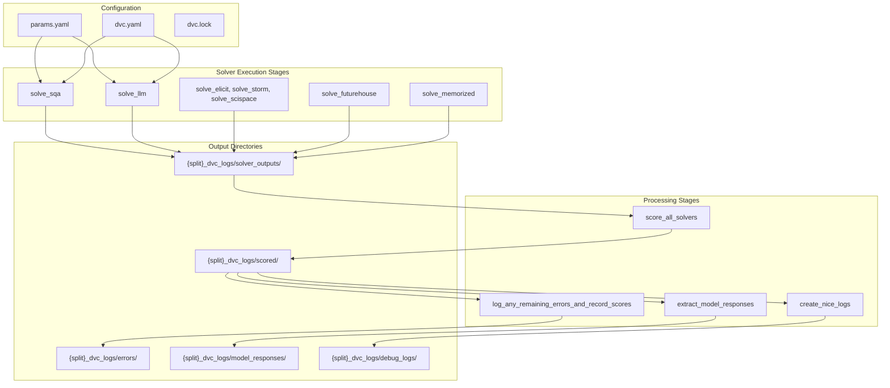
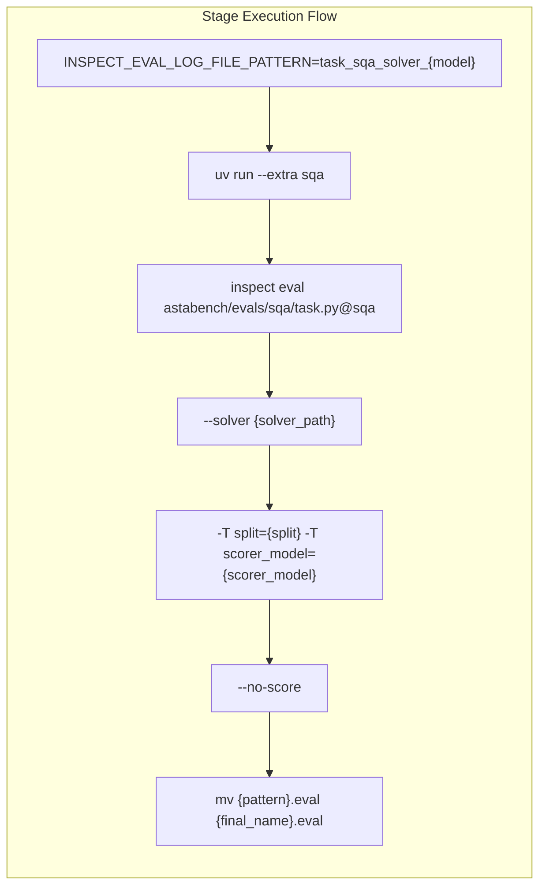
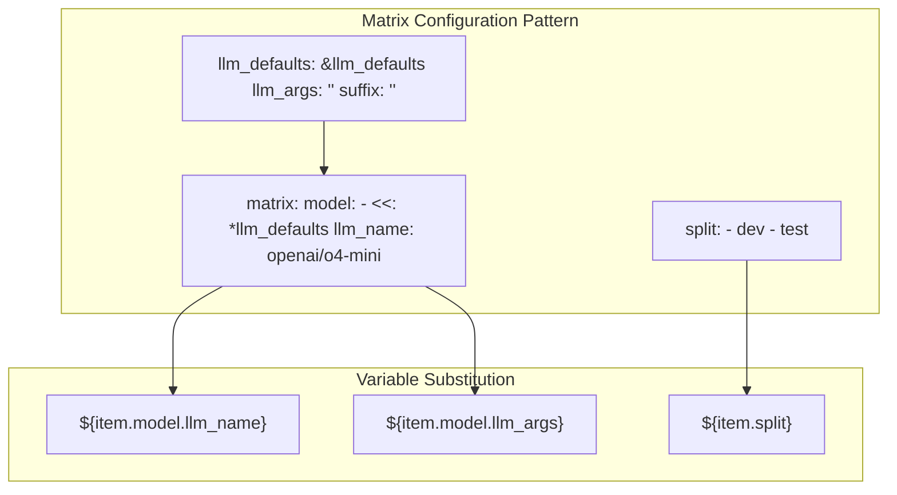
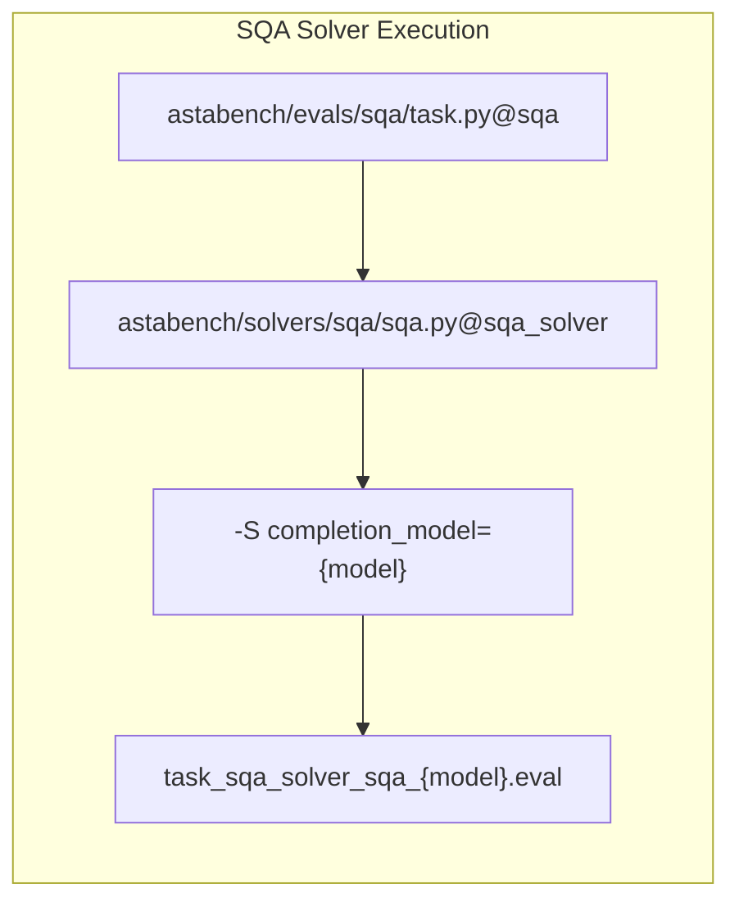
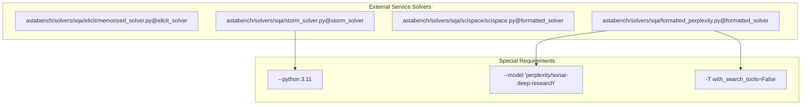
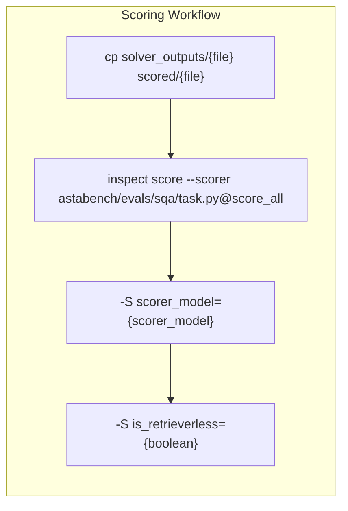
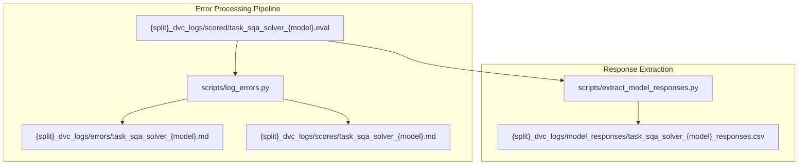

<!-- source: DeepWiki mcp.deepwiki.com · repo allenai/asta-bench · page 7.1 DVC Pipelines · fetched 2026-10-26 -->

# DVC Pipelines

<details>
<summary>Relevant source files</summary>

The following files were used as context for generating this wiki page:

- [dvc.lock](dvc.lock)
- [dvc.yaml](dvc.yaml)
- [params.yaml](params.yaml)
- [scripts/log_errors.py](scripts/log_errors.py)

</details>


DVC (Data Version Control) pipelines in asta-bench provide a reproducible workflow for running large-scale evaluations across multiple AI solvers on scientific question answering tasks. This system manages complex dependencies between solver execution, scoring, and result processing stages.

For information about individual solver implementations, see [Solver Development](#7.2). For details about the scoring and evaluation framework, see [Scientific QA Tasks](#5.2).

## Pipeline Overview

The DVC pipeline is primarily configured for Scientific Question Answering (SQA) evaluations, orchestrating runs across different solver categories and managing their outputs through a structured workflow.

### Pipeline Architecture



Sources: [dvc.yaml:1-489](), [params.yaml:1-5]()

## Pipeline Stages

### Solver Execution Stages

The pipeline defines multiple solver categories, each with distinct execution patterns:

| Stage Type | Models/Solvers | Configuration |
|------------|----------------|---------------|
| `solve_sqa` | claude-3.7, gemini-2.5-pro, claude-4.0, o3_high | `astabench/evals/sqa/task.py@sqa` with `astabench/solvers/sqa/sqa.py@sqa_solver` |
| `solve_llm` | anthropic/claude-sonnet-4-20250514, openai/o4-mini, google/gemini-2.5-pro-preview-03-25 | `astabench/solvers/sqa/formatted_llm.py@formatted_solver` |
| `solve_elicit` | elicit | `astabench/solvers/sqa/elicit/memorized_solver.py@elicit_solver` |
| `solve_storm` | storm | `astabench/solvers/sqa/storm_solver.py@storm_solver` |
| `solve_futurehouse` | fhouse_crow, fhouse_falcon | `astabench/solvers/futurehouse/futurehouse_solver.py` |

Sources: [dvc.yaml:14-307]()

### Stage Execution Pattern



Sources: [dvc.yaml:26-38](), [dvc.yaml:224-238]()

## Configuration and Parameters

### Parameter Management

The pipeline uses a centralized parameter system defined in `params.yaml`:

```yaml
scorer_model: "google/gemini-2.5-flash"
sqa_scorer_version: 'may-23-2025' 
sqa_solver_version: 'may-23-2025'
limit: 1000
```

### Matrix Configuration

Complex solver configurations use YAML matrix syntax for parameterization:



Sources: [dvc.yaml:7-11](), [dvc.yaml:198-244]()

## Solver Integration Patterns

### SQA Solver Pattern



Sources: [dvc.yaml:26-34]()

### External Service Integration



Sources: [dvc.yaml:46-118](), [dvc.yaml:120-142]()

## Scoring and Post-Processing

### Scoring Pipeline

All solvers follow a common scoring pattern managed by the `score_all_solvers` stage:



Sources: [dvc.yaml:358-368]()

### Error Logging and Analysis



Sources: [dvc.yaml:405-408](), [dvc.yaml:442-444](), [scripts/log_errors.py:1-75]()

## Output Directory Structure

The pipeline organizes outputs into a structured directory hierarchy:

```
{split}_dvc_logs/
├── solver_outputs/          # Raw solver evaluation logs
│   └── task_sqa_solver_{model}.eval
├── scored/                  # Scored evaluation logs  
│   └── task_sqa_solver_{model}.eval
├── errors/                  # Error reports and summaries
│   └── task_sqa_solver_{model}.md
├── scores/                  # Score summaries
│   └── task_sqa_solver_{model}.md
├── model_responses/         # Extracted model responses
│   └── task_sqa_solver_{model}_responses.csv
└── debug_logs/             # Detailed evaluation breakdowns
    ├── task_sqa_solver_{model}_rubric_eval.csv
    ├── task_sqa_solver_{model}_citation_eval.csv
    └── task_sqa_solver_{model}_answer_precision_eval.csv
```

Sources: [dvc.yaml:44](), [dvc.yaml:375](), [dvc.yaml:412](), [dvc.yaml:448](), [dvc.yaml:486-488]()

## Running the Pipeline

### Basic Execution

```bash
# Run entire pipeline
dvc repro

# Run specific stage
dvc repro solve_sqa

# Run with specific parameters
dvc repro -P limit=100
```

### Split-based Execution

The pipeline supports both development and test splits:

- `dev` split: Used for development and debugging
- `test` split: Used for final evaluation

### Dependency Management

DVC automatically manages dependencies through the lock file system, tracking:
- Parameter changes in `params.yaml`
- Code changes in solver files
- Input data modifications
- Output file checksums

Sources: [dvc.lock:1-1400](), [params.yaml:1-5]()

---

