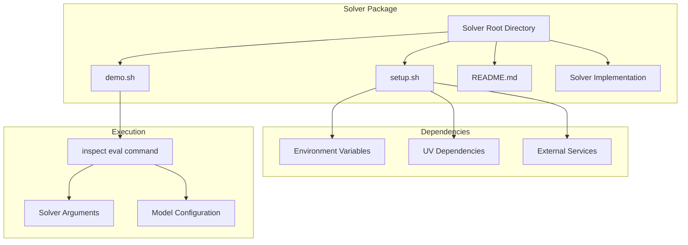
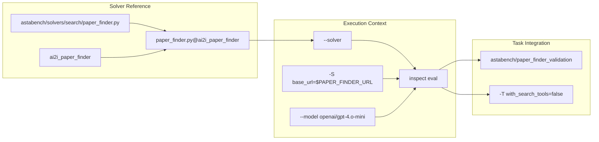
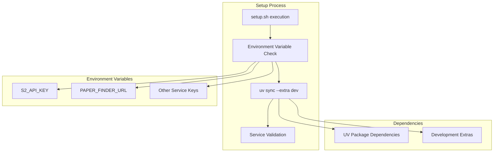
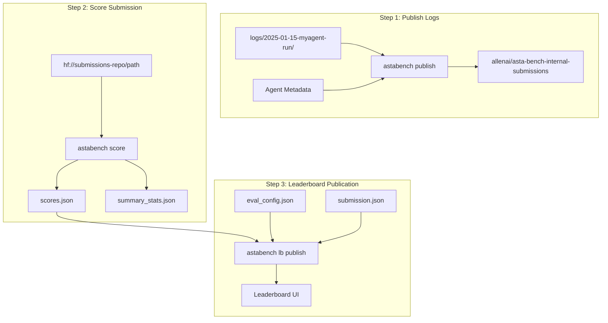

<!-- source: DeepWiki mcp.deepwiki.com · repo allenai/asta-bench · page 7.2 Solver Development · fetched 2026-10-26 -->

# Solver Development

<details>
<summary>Relevant source files</summary>

The following files were used as context for generating this wiki page:

- [dvc.lock](dvc.lock)
- [dvc.yaml](dvc.yaml)
- [params.yaml](params.yaml)
- [scripts/log_errors.py](scripts/log_errors.py)
- [solvers/paper_finder/README.md](solvers/paper_finder/README.md)
- [solvers/paper_finder/demo.sh](solvers/paper_finder/demo.sh)

</details>


This page covers the development, integration, and deployment of solvers within the asta-bench evaluation framework. Solvers are AI agents or automated systems that attempt to solve the evaluation tasks provided by asta-bench. This documentation focuses on the technical requirements, development workflow, and integration patterns for creating new solvers.

For information about the overall evaluation pipeline architecture, see [DVC Pipelines](#7.1). For details about specific evaluation tasks that solvers target, see [Evaluation Tasks](#5).

## Solver Architecture

Solvers in asta-bench follow a standardized structure that integrates with the `inspect_ai` framework. Each solver consists of several key components that enable reproducible evaluation and deployment.

### Solver Directory Structure



Sources: [solvers/paper_finder/setup.sh](), [solvers/paper_finder/demo.sh](), [solvers/paper_finder/README.md]()

### Solver Implementation Pattern

Solvers are implemented as Python modules that can be referenced using the `@` syntax in `inspect eval` commands. The solver path format follows the pattern `astabench/solvers/{category}/{solver_name}.py@{solver_function}`.



Sources: [solvers/paper_finder/demo.sh:7-13]()

## Development Workflow

### Environment Setup

The solver development process begins with environment configuration through the `setup.sh` script. This script handles dependency management and validates required environment variables.

Key setup requirements include:
- **Environment Variables**: API keys and service URLs (e.g., `S2_API_KEY`, `PAPER_FINDER_URL`)
- **Dependency Management**: Using `uv sync --extra dev` for Python dependencies
- **External Service Validation**: Checking availability of required APIs and services



Sources: [solvers/paper_finder/setup.sh:3-12]()

### Testing and Validation

Solvers include demonstration scripts that serve as both integration tests and usage examples. The `demo.sh` script provides a minimal test case for validating solver functionality.

Demo script components:
- **Evaluation Command**: Uses `inspect eval` with specific solver and model configurations
- **Task Targeting**: Runs against validation datasets for quick verification
- **Resource Limits**: Includes `--limit` flags for fast iteration during development
- **Tool Configuration**: Specifies tool availability through `-T` flags

Sources: [solvers/paper_finder/demo.sh:6-13]()

## Integration Requirements

### Solver Arguments and Configuration

Solvers accept configuration through the `-S` flag mechanism in `inspect eval`. This allows runtime customization without modifying solver code.

Common solver arguments include:
- **Service URLs**: Base URLs for external APIs (`base_url=$PAPER_FINDER_URL`)
- **Authentication**: API keys and credentials
- **Behavior Flags**: Feature toggles and configuration options

### Tool System Integration

Solvers integrate with the asta-bench tool system through task-level tool configuration. The `-T` flag controls which tools are available to the solver during execution.

Tool configuration options:
- `with_search_tools`: Controls availability of search and retrieval tools
- `with_code_tools`: Enables code execution and analysis capabilities
- `with_editor_tools`: Provides file editing and manipulation tools

Sources: [solvers/paper_finder/demo.sh:13]()

## Evaluation and Scoring Process

### Submission Workflow

The solver evaluation process follows a three-step submission workflow for integration with the asta-bench leaderboard system.



Sources: [INTERNAL.md:7-24]()

### Submission Metadata

Solver submissions require specific metadata for proper categorization and display:

| Metadata Field | Description | Example Values |
|---|---|---|
| `agent-name` | Human-readable solver name | "MyAgent" |
| `agent-description` | Version or variant information | "v1.0" |
| `openness` | Model accessibility category | "ow" (open-weight), "oc" (open-commercial) |
| `tool-usage` | Tool utilization category | "s" (standard), "e" (extended) |
| `submissions-repo-id` | Target repository for submission | "allenai/asta-bench-internal-submissions" |

Sources: [INTERNAL.md:8-13]()

### Bulk Operations

For large-scale solver evaluation, the system supports bulk submission processing through file-based batch operations:

```bash
cat filenames_to_publish.txt | xargs astabench lb publish
```

This approach enables centralized re-scoring and controlled leaderboard updates for multiple solver runs.

Sources: [INTERNAL.md:29-30]()

## External Service Dependencies

### API Integration Requirements

Solvers that integrate with external services must handle proper authentication and service availability validation. The Paper Finder solver demonstrates the pattern for API-dependent solvers.

Required service integrations:
- **Semantic Scholar API**: Requires `S2_API_KEY` environment variable
- **AI2I Paper Finder**: Requires `PAPER_FINDER_URL` base URL configuration
- **Model APIs**: OpenAI, Anthropic, or other LLM provider keys

### Service Deployment Patterns

Complex solvers may require separate service deployment before evaluation. The Paper Finder solver exemplifies this pattern by requiring a deployed API endpoint accessible via `PAPER_FINDER_URL`.

Service deployment considerations:
- **Reproducibility**: Public repositories for agent source code
- **API Compatibility**: Standardized request/response formats
- **Resource Management**: Proper service lifecycle and cleanup

Sources: [solvers/paper_finder/README.md:5-9](), [solvers/paper_finder/setup.sh:3-9]()

---

