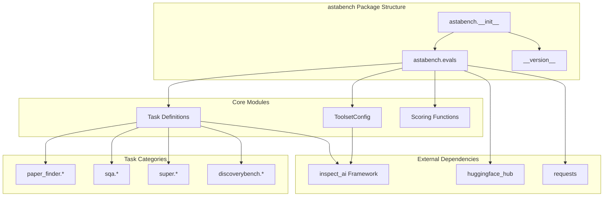
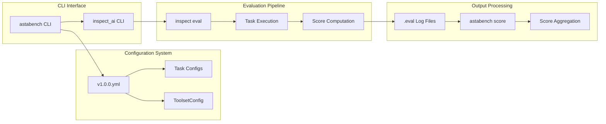
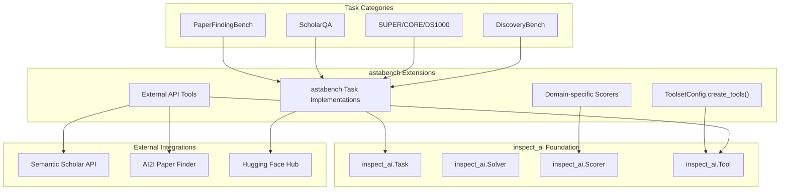
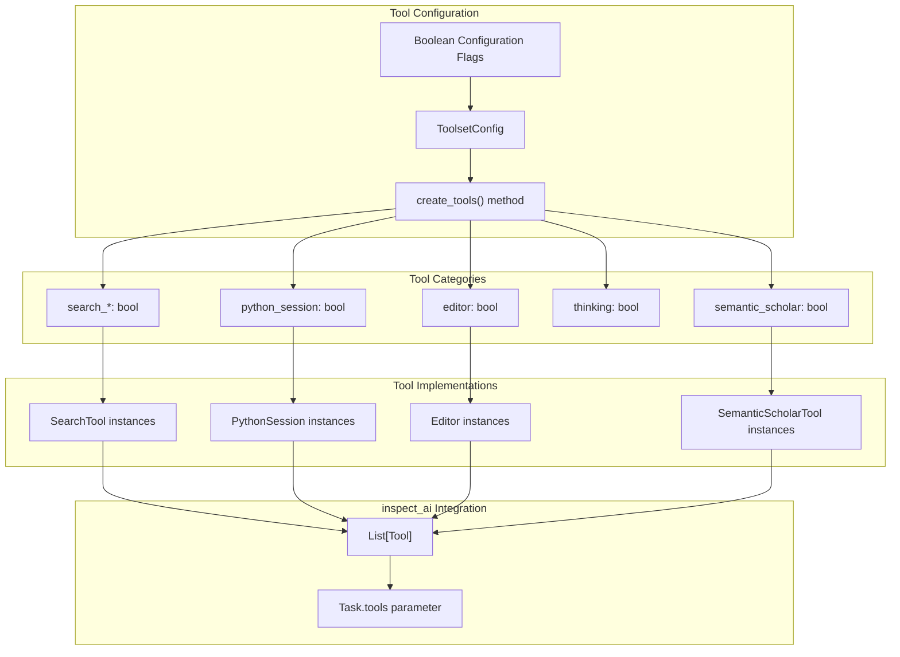
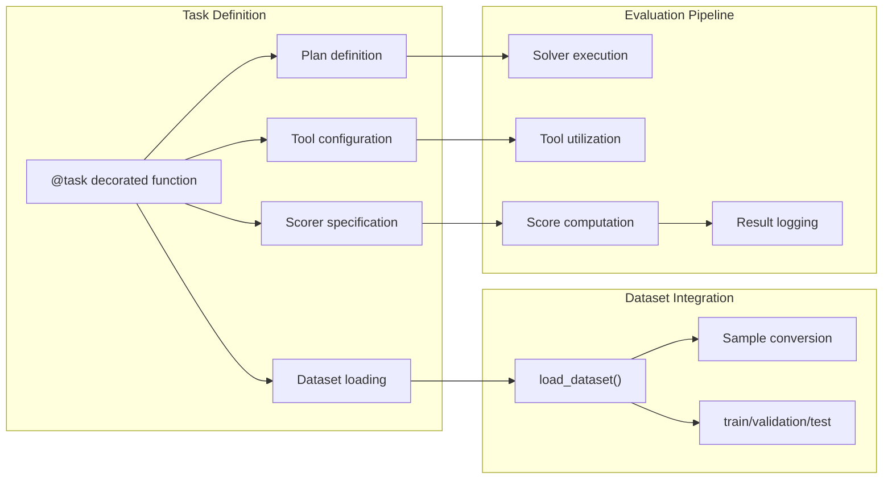

<!-- source: DeepWiki mcp.deepwiki.com · repo allenai/asta-bench · page 8 API Reference · fetched 2026-10-26 -->

# API Reference

Relevant source files

The following files were used as context for generating this wiki page:

- [astabench/__init__.py](astabench/__init__.py)

This section provides comprehensive API documentation for developers who want to extend asta-bench with custom tools, evaluation tasks, or integrate it into their own systems. It covers the main package APIs, extension points, and architectural components that form the foundation of the asta-bench framework.

For configuration options and file formats, see [Configuration Reference](#9). For task-specific implementation details, see [Evaluation Tasks](#5). For development environment setup, see [Development Environment](#6.1).

## Package Structure and Entry Points

The `astabench` package provides a minimal but extensible API surface built on top of the `inspect_ai` framework. The main package structure follows a modular design that separates evaluation tasks, tool configurations, and core framework components.

### Main Package API

**Sources:** [astabench/__init__.py:1-6]()

The core package API is intentionally minimal, exposing only essential components through the main `__init__.py` module. The primary entry point imports the `evals` module and provides version information through the standard `__version__` attribute.

### CLI and Configuration Integration

**Sources:** [astabench/__init__.py:1-6]()

## Core Framework Components

The asta-bench framework consists of several key components that work together to provide a comprehensive evaluation system for AI agents conducting scientific research tasks.

### Framework Architecture

**Sources:** [astabench/__init__.py:3]()

## Tool System Architecture

The tool system provides a flexible configuration mechanism for composing different capabilities that AI agents can access during evaluation tasks.

### ToolsetConfig API Pattern

**Sources:** [astabench/__init__.py:3]()

## Task Development Framework

The task development system extends `inspect_ai.Task` with domain-specific implementations for scientific research evaluation.

### Task Implementation Pattern

**Sources:** [astabench/__init__.py:3]()

## Extension Points

The asta-bench framework provides several well-defined extension points for developers to add new capabilities:

| Extension Point | Purpose | API Reference |
|----------------|---------|---------------|
| Custom Tasks | Add new evaluation scenarios | See [Task Development APIs](#8.3) |
| Custom Tools | Integrate new external services | See [Tool Development APIs](#8.2) |
| Custom Scorers | Implement domain-specific metrics | See [Task Development APIs](#8.3) |
| Configuration | Add new tool or task options | See [Configuration Reference](#9) |

### API Documentation Sections

The following sub-sections provide detailed API documentation for each major component:

- **[Core APIs](#8.1)**: Main astabench package APIs and entry points including the `evals` module structure and version management
- **[Tool Development APIs](#8.2)**: APIs for creating custom tools and integrating with the `ToolsetConfig` system  
- **[Task Development APIs](#8.3)**: APIs and patterns for creating new evaluation tasks that extend the `inspect_ai.Task` framework

Each section includes code examples, parameter specifications, and integration patterns for extending the framework.

**Sources:** [astabench/__init__.py:1-6]()

---

