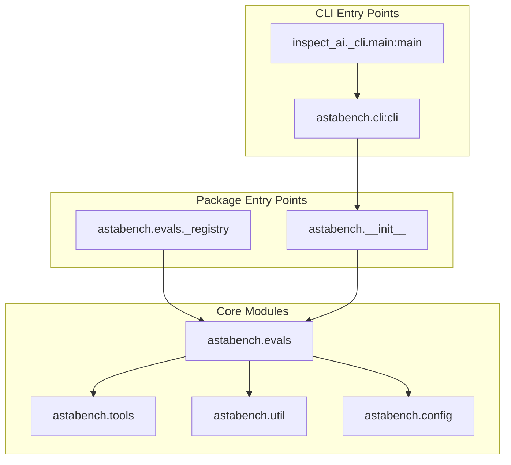
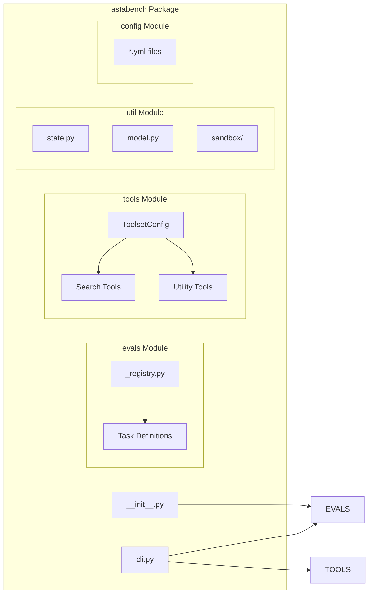
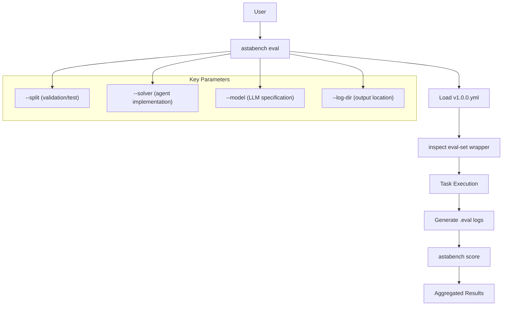
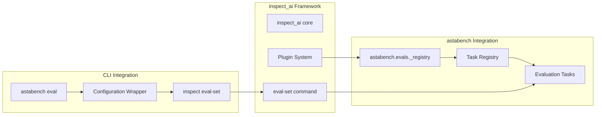
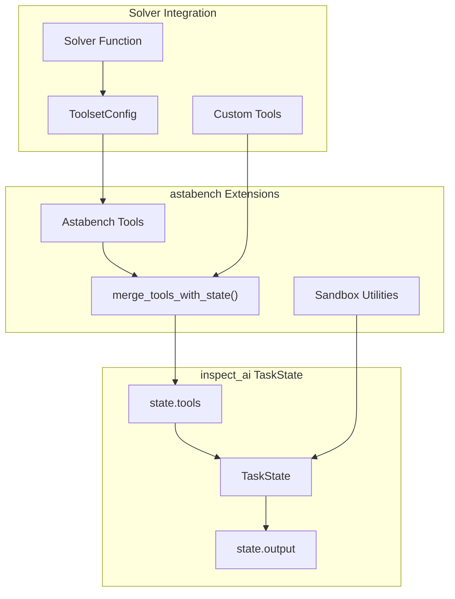

<!-- source: DeepWiki mcp.deepwiki.com · repo allenai/asta-bench · page 8.1 Core APIs · fetched 2026-10-26 -->

# Core APIs

<details>
<summary>Relevant source files</summary>

The following files were used as context for generating this wiki page:

- [astabench/evals/inspect_eval_wrappers/core_bench.py](astabench/evals/inspect_eval_wrappers/core_bench.py)
- [astabench/evals/sqa/task.py](astabench/evals/sqa/task.py)
- [astabench/evals/super/task.py](astabench/evals/super/task.py)
- [tests/conftest.py](tests/conftest.py)
- [tests/tools/test_search.py](tests/tools/test_search.py)

</details>


This document covers the main programmatic and command-line interfaces provided by the astabench package, including CLI entry points, core package structure, and key integration patterns. For information about developing custom tools, see [Tool Development APIs](#8.2). For creating new evaluation tasks, see [Task Development APIs](#8.3).

## Entry Points and Package Structure

The astabench package provides multiple entry points for different use cases, from command-line evaluation workflows to programmatic integration with inspect_ai.

### Main Entry Points



Sources: [pyproject.toml:49-54](), [astabench/__init__.py:1-6]()

### Package Structure

The astabench package is organized into several key modules that provide distinct functionality:



Sources: [astabench/__init__.py:3](), [pyproject.toml:104](), [README.md:272-296]()

## Command Line Interface

The primary user interface to astabench is through the `astabench` CLI command, which extends inspect_ai's evaluation capabilities with scientific research-specific workflows.

### Core CLI Commands

| Command | Purpose | Key Options |
|---------|---------|-------------|
| `astabench eval` | Run evaluation suites or individual tasks | `--split`, `--solver`, `--model`, `--log-dir` |
| `astabench score` | Aggregate scores and calculate usage costs | `<log_dir>` |

### CLI Command Flow



Sources: [README.md:114-127](), [README.md:154-158](), [pyproject.toml:49-51]()

## Programmatic APIs

### Core Package Imports

The astabench package provides several key APIs for programmatic use:

```python
# Main package entry point
from astabench import __version__
from astabench import evals

# Tool configuration and utilities
from astabench.tools import ToolsetConfig
from astabench.util.state import merge_tools_with_state
from astabench.util.model import record_model_usage_with_inspect
```

### Key API Classes and Functions

```mermaid
graph TB
    subgraph "Tool System APIs"
        TOOLSET_CONFIG["ToolsetConfig"]
        CREATE_TOOLS["create_tools()"]
        MERGE_TOOLS["merge_tools_with_state()"]
    end
    
    subgraph "Model Integration APIs"
        RECORD_USAGE["record_model_usage_with_inspect()"]
        MODEL_USAGE["ModelUsage"]
    end
    
    subgraph "Sandbox APIs"
        SANDBOX_MGR["SandboxToolManager"]
        SANDBOX_JUPYTER["SandboxJupyter"]
    end
    
    subgraph "State Management"
        TASK_STATE["TaskState"]
        TOOLS_MERGE["Tool Merging"]
    end
    
    TOOLSET_CONFIG --> CREATE_TOOLS
    CREATE_TOOLS --> MERGE_TOOLS
    MERGE_TOOLS --> TASK_STATE
    
    RECORD_USAGE --> MODEL_USAGE
    MODEL_USAGE --> TASK_STATE
    
    SANDBOX_MGR --> TASK_STATE
    SANDBOX_JUPYTER --> TASK_STATE
```



Sources: [README.md:272-296](), [README.md:254-266]()

### ToolsetConfig API Pattern

The `ToolsetConfig` class provides the standard pattern for integrating astabench tools with custom solvers:

```python
@solver
def my_agent(max_steps=10, **tool_options):
    config = ToolsetConfig.model_validate(tool_options)
    tools = config.create_tools()
    
    return chain(
        merge_tools_with_state(tools),
        # ... rest of solver logic
    )
```

Key CLI flags that map to `ToolsetConfig` options:

| CLI Flag | Tool Category | Purpose |
|----------|---------------|---------|
| `-S with_s2_corpus_tools=1` | Literature Search | Semantic Scholar MCP tools |
| `-S with_stateful_python=1` | Code Execution | Jupyter-like Python sessions |
| `-S with_report_editor=1` | Structured Editing | Scientific report editor |
| `-S with_table_editor=1` | Data Editing | Table creation tools |
| `-S with_thinking_tool=1` | Reasoning | Extended thinking capabilities |

Sources: [README.md:272-295]()

## Integration with inspect_ai

Astabench extends inspect_ai through a plugin system and standardized evaluation patterns.

### Plugin Registration



Sources: [pyproject.toml:53-54](), [README.md:7-8](), [README.md:114-115]()

### Task State Integration

Astabench follows inspect_ai's `TaskState` pattern while providing domain-specific tools and utilities:



Sources: [README.md:234-241](), [README.md:295-296]()

## Version and Metadata Management

The package provides version information and metadata through standard Python packaging mechanisms:

```python
# Version access
from astabench import __version__

# Package metadata from pyproject.toml
# - Dependencies: inspect_ai, agent-eval, openai, etc.
# - Entry points: CLI and plugin registration
# - Optional dependencies: dev, azure extras
```

The version is managed through `importlib.metadata` and follows semantic versioning patterns.

Sources: [astabench/__init__.py:1-5](), [pyproject.toml:5-7](), [pyproject.toml:10-31]()

---

