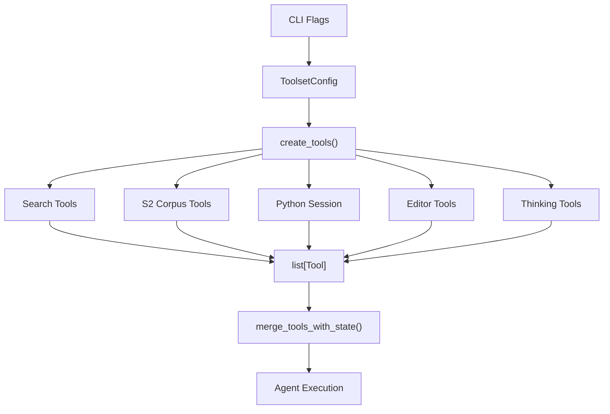
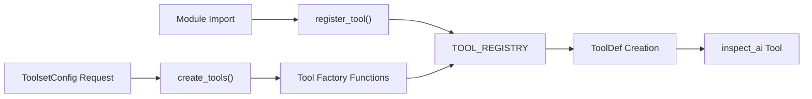
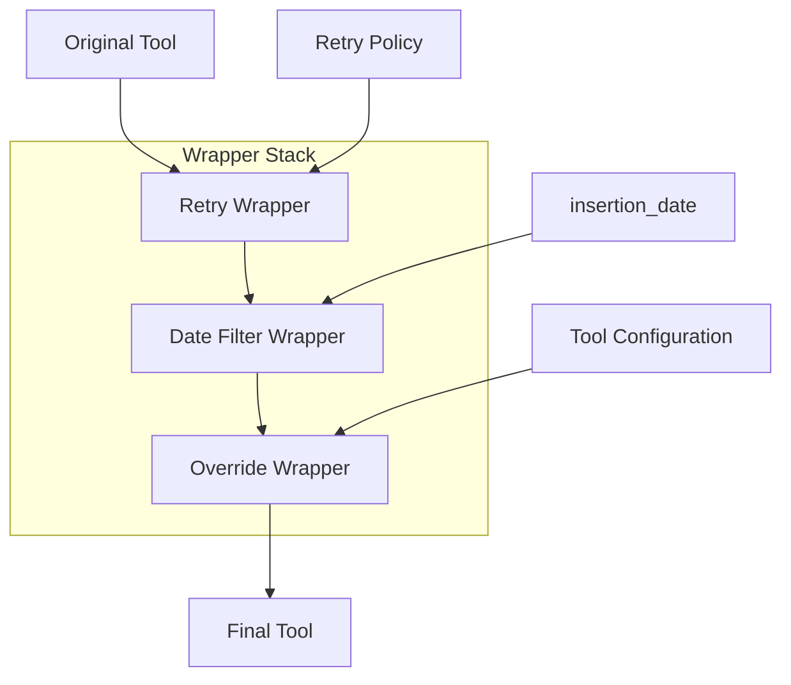
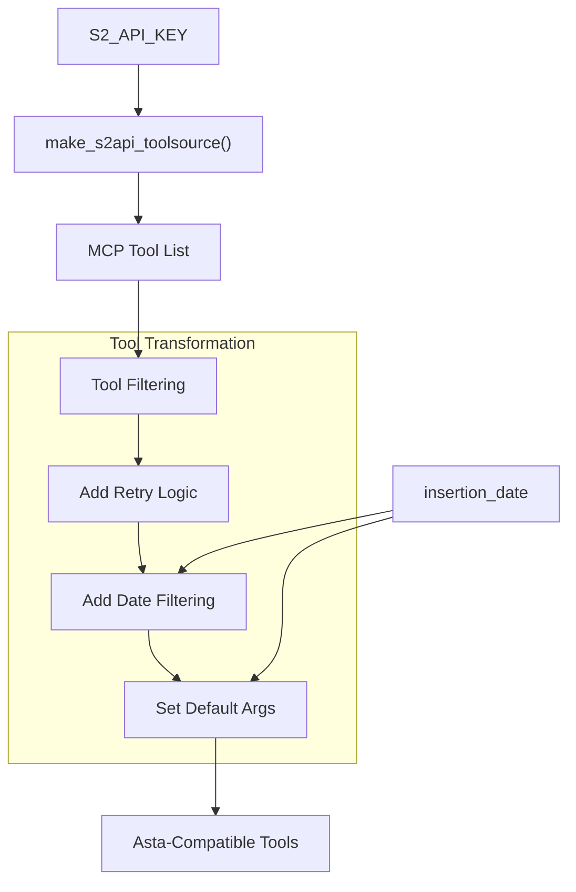
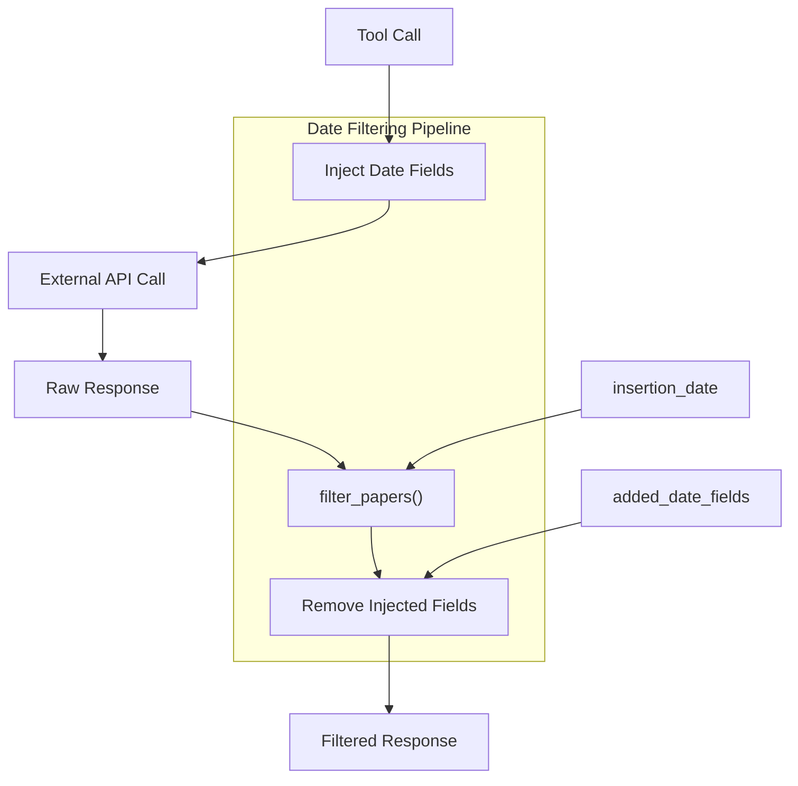

<!-- source: DeepWiki mcp.deepwiki.com · repo allenai/asta-bench · page 8.2 Tool Development APIs · fetched 2026-10-26 -->

# Tool Development APIs

<details>
<summary>Relevant source files</summary>

The following files were used as context for generating this wiki page:

- [.gitignore](.gitignore)
- [astabench/evals/paper_finder/eval.py](astabench/evals/paper_finder/eval.py)
- [astabench/tools/__init__.py](astabench/tools/__init__.py)
- [astabench/util/sandbox/static/sandbox_client.py](astabench/util/sandbox/static/sandbox_client.py)
- [tests/test_registry_evals.py](tests/test_registry_evals.py)
- [tests/tools/test_sandbox_tools.py](tests/tools/test_sandbox_tools.py)

</details>


This document covers the APIs and patterns for developing custom tools and integrating external services within the asta-bench framework. It focuses on the programmatic interfaces for creating, registering, and modifying tools that agents can use during evaluation tasks.

For information about using existing tools in evaluations, see [Tool System](#4). For creating evaluation tasks that use tools, see [Task Development APIs](#8.3).

## Core Tool Development Infrastructure

The asta-bench tool system is built around `inspect_ai`'s tool framework with additional abstractions for configuration management, external API integration, and tool modification. The core infrastructure provides standardized patterns for tool creation, registration, and deployment.

### Tool Configuration System

The `ToolsetConfig` class in [astabench/tools/__init__.py:28-118]() provides a declarative configuration system for tool sets:

```python
class ToolsetConfig(BaseModel):
    with_search_tools: bool = Field(default=False)
    with_s2_corpus_tools: bool = Field(default=False) 
    with_stateful_python: bool = False
    with_report_editor: bool = False
    with_table_editor: bool = False
    with_thinking_tool: bool = False
    with_editor_submit: bool = Field(default=False)
```

The `create_tools()` method [astabench/tools/__init__.py:94-117]() instantiates the configured tool set, allowing solvers to declaratively specify their tool requirements through CLI flags.

**Tool Configuration Flow**


Sources: [astabench/tools/__init__.py:28-118]()

### Tool Registration System

The tool registry system [astabench/tools/__init__.py:120-148]() provides a centralized mechanism for tool discovery and initialization:

```python
TOOL_REGISTRY = {}

def register_tool(func) -> Callable[[], Tool]:
    func_name = func.__name__
    TOOL_REGISTRY[func_name] = func
    return lambda: ToolDef(func).as_tool()
```

This pattern allows tools to be registered at module import time while deferring actual tool instantiation until needed. The registry maintains compatibility with `@tool` decorated functions that require initialization parameters.

**Tool Registration and Instantiation**


Sources: [astabench/tools/__init__.py:120-148]()

## Custom Tool Creation Patterns

### Basic Tool Development

Custom tools follow `inspect_ai`'s `@tool` decorator pattern. The registration system supports both simple functions and factory patterns:

```python
# Direct function registration
@tool
def custom_calculator(expression: str) -> str:
    """Evaluate mathematical expressions."""
    # Implementation
    
# Factory pattern registration  
def make_custom_search(api_key: str):
    @tool
    def custom_search(query: str) -> str:
        """Search using custom API."""
        # Implementation with api_key
    return custom_search

# Register the factory
custom_search = register_tool(make_custom_search("default_key"))
```

### Tool Modification Wrappers

The framework provides several wrapper patterns for modifying tool behavior without changing core implementations:

**Override Wrapper Pattern**
The `make_override_wrapper` function [astabench/tools/s2_api_tools.py:487-542]() allows setting default arguments and forcing specific parameter values:

```python
def make_override_wrapper(
    td: ToolDef,
    arg_defaults: dict[str, Any] | None = None,
    arg_overrides: dict[str, Any] | None = None,
):
```

**Retry Wrapper Pattern**
The `make_retry_wrapper` function [astabench/tools/s2_api_tools.py:544-602]() adds exponential backoff retry logic for handling transient failures:

```python
def make_retry_wrapper(
    td: ToolDef,
    max_retries: int = 10,
    backoff_multiplier: float = 2.0,
    base_delay: float = 1.0,
    max_delay: float = 60.0,
) -> Callable[..., Awaitable[Any]]:
```

**Tool Modification Pipeline**


Sources: [astabench/tools/s2_api_tools.py:487-602]()

## External API Integration

### MCP Tool Source Integration

The framework integrates with Model Context Protocol (MCP) servers through the `make_s2api_toolsource` function [astabench/tools/s2_api_tools.py:56-64]():

```python
def make_s2api_toolsource(api_key: str | None = None) -> ToolSource:
    api_key = api_key if api_key is not None else os.getenv("S2_API_KEY")
    if not api_key:
        raise ValueError("api_key not given and S2_API_KEY is not set")
    
    return create_server_streamable_http(
        "https://asta-tools.allen.ai/mcp/v1",
        headers={"x-api-key": api_key},
    )
```

### Tool Source to Tool Conversion

The `async_make_asta_s2_mcp_tools` function [astabench/tools/s2_api_tools.py:604-732]() demonstrates the pattern for converting external tool sources into asta-bench compatible tools:

**MCP Integration Flow**


Sources: [astabench/tools/s2_api_tools.py:56-64](), [astabench/tools/s2_api_tools.py:604-732]()

## Advanced Tool Modification

### Date Filtering System

The framework implements sophisticated date filtering for time-sensitive evaluations. This system modifies tool responses to exclude papers published after a specified cutoff date.

**Subfield Date Filtering**
The `_wrap_subfield_date_filter` function [astabench/tools/s2_api_tools.py:255-321]() filters nested paper collections (like citations) within tool responses:

```python
def _wrap_subfield_date_filter(
    tool: ToolDef,
    insertion_date: str,
    subfield_name: Literal["citations", "papers"],
    fields_arg_name: str = "fields",
) -> None:
```

**Top-level Date Filtering**  
The `_wrap_toplevel_date_filter` function [astabench/tools/s2_api_tools.py:323-365]() validates that requested papers don't exceed the date cutoff, raising `ToolError` for violations.

**Date Filtering Architecture**


Sources: [astabench/tools/s2_api_tools.py:255-365]()

### Error Handling and Retries

The retry system [astabench/tools/s2_api_tools.py:544-602]() handles transient failures from external APIs with intelligent retry logic:

```python
def _is_retryable_error(error: Exception) -> bool:
    """Check if an error is retryable (429, 529, or 504 HTTP status codes)."""
    retryable_codes = {429, 529, 504}
    
    for base_error in _unravel_exception_group(error):
        if isinstance(base_error, httpx.HTTPStatusError):
            return base_error.response.status_code in retryable_codes
        elif isinstance(base_error, anyio.BrokenResourceError):
            return True
    
    return False
```

The system distinguishes between retryable network errors and `ToolError` instances that should be immediately propagated to the agent.

Sources: [astabench/tools/s2_api_tools.py:436-485](), [astabench/tools/s2_api_tools.py:544-602]()

## Tool Testing Infrastructure

### Test Patterns

The test suite in [tests/tools/test_s2_api_tools.py]() demonstrates comprehensive testing patterns for tool development:

**Mock Tool Source Creation**
The `get_mock_s2api_toolsource` function [tests/tools/test_s2_api_tools.py:839-1073]() shows how to create mock tool sources for isolated testing:

```python
def get_mock_s2api_toolsource(override_fns: dict[str, Callable]) -> ToolSource:
    """Create a mock S2 API tool source with overridden tools."""
```

**Integration Testing**
Tests marked with `@pytest.mark.s2_api_request` [tests/tools/test_s2_api_tools.py:50-52]() perform live API integration testing when credentials are available.

**Response Parsing Utilities**
The `parse_tool_result` function [tests/tools/test_s2_api_tools.py:26-36]() provides utilities for parsing tool responses in test contexts.

Sources: [tests/tools/test_s2_api_tools.py:26-36](), [tests/tools/test_s2_api_tools.py:839-1073]()

## Code Entity Reference

| Entity | Location | Purpose |
|--------|----------|---------|
| `ToolsetConfig` | [astabench/tools/__init__.py:28]() | Declarative tool configuration |
| `register_tool` | [astabench/tools/__init__.py:124]() | Tool registration system |
| `TOOL_REGISTRY` | [astabench/tools/__init__.py:121]() | Global tool registry |
| `make_s2api_toolsource` | [astabench/tools/s2_api_tools.py:56]() | MCP tool source factory |
| `async_make_asta_s2_mcp_tools` | [astabench/tools/s2_api_tools.py:604]() | S2 tool integration |
| `make_override_wrapper` | [astabench/tools/s2_api_tools.py:487]() | Tool parameter modification |
| `make_retry_wrapper` | [astabench/tools/s2_api_tools.py:544]() | Retry logic injection |
| `_wrap_subfield_date_filter` | [astabench/tools/s2_api_tools.py:255]() | Response filtering wrapper |
| `filter_papers` | [astabench/tools/s2_api_tools.py:99]() | Date-based paper filtering |

Sources: [astabench/tools/__init__.py](), [astabench/tools/s2_api_tools.py]()

---

