<!-- source: DeepWiki mcp.deepwiki.com · repo allenai/asta-bench · page 8.3 Task Development APIs · fetched 2026-10-26 -->

# Task Development APIs

<details>
<summary>Relevant source files</summary>

The following files were used as context for generating this wiki page:

- [astabench/evals/paper_finder/paper_finder_utils.py](astabench/evals/paper_finder/paper_finder_utils.py)
- [astabench/evals/paper_finder/task.py](astabench/evals/paper_finder/task.py)
- [astabench/evals/sqa/task.py](astabench/evals/sqa/task.py)
- [tests/conftest.py](tests/conftest.py)
- [tests/tools/test_search.py](tests/tools/test_search.py)

</details>


This document provides a comprehensive reference for creating new evaluation tasks within the asta-bench framework. It covers the core APIs, patterns, and conventions used to define tasks, implement scoring logic, and integrate with the broader evaluation system.

For information about tool development and integration, see [Tool Development APIs](#8.2). For details about the core framework architecture, see [Core Framework](#3).

## Overview

Task development in asta-bench follows the `inspect_ai` framework patterns while adding domain-specific conventions for scientific research evaluation. Tasks are defined using decorators and follow a structured approach to dataset loading, scoring, and tool integration.

## Core Task Structure

### Task Definition Pattern

All tasks follow a consistent structure using the `@task` decorator and return a `Task` object:

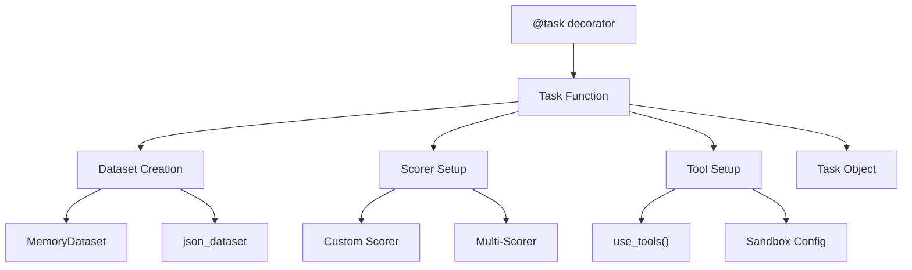

Sources: [astabench/evals/sqa/task.py:469-541](), [astabench/evals/discoverybench/task.py:168-199]()

### Sample Creation API

Tasks convert raw data into `Sample` objects with standardized fields:

| Field | Type | Purpose |
|-------|------|---------|
| `id` | `str` | Unique identifier for the sample |
| `input` | `str` | Prompt/question presented to the agent |
| `target` | `str \| list[str]` | Expected output or reference answer |
| `metadata` | `dict` | Additional context accessible to solvers |
| `files` | `dict[str, str]` | File paths for samples requiring external data |

Sources: [astabench/evals/sqa/task.py:78-136](), [astabench/evals/discoverybench/task.py:24-85]()

## Dataset Loading Patterns

### Memory Dataset Pattern

Most tasks use `MemoryDataset` for loading preprocessed data:

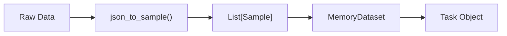

The `json_to_sample` function typically:
1. Extracts the question/prompt from raw data
2. Formats it with task-specific instructions
3. Sets target values for evaluation
4. Includes relevant metadata

Sources: [astabench/evals/sqa/task.py:490-493](), [astabench/evals/discoverybench/task.py:185-186]()

### External Dataset Integration

For wrapping existing `inspect_evals` tasks, use the `task_with` pattern:

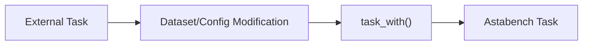

Sources: [astabench/evals/inspect_eval_wrappers/ds1000.py:79-91]()

## Scoring API

### Basic Scorer Implementation

Scorers use the `@scorer` decorator and implement async scoring functions:

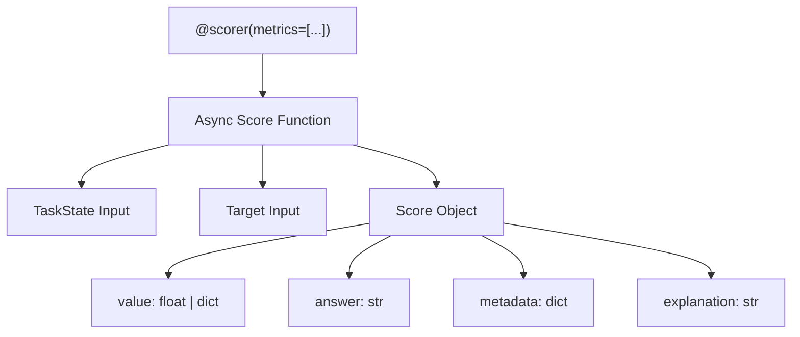

The scoring function signature is:
```python
async def score(state: TaskState, target: Target) -> Score
```

Sources: [astabench/evals/sqa/task.py:170-211](), [astabench/evals/discoverybench/task.py:103-147]()

### Multi-Dimensional Scoring

Complex tasks often use `multi_scorer` with custom reducers for combining multiple evaluation aspects:

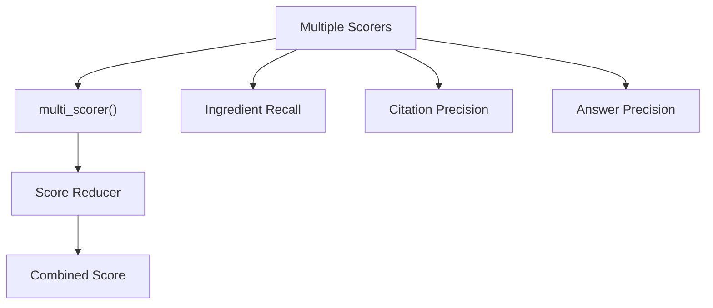

Sources: [astabench/evals/sqa/task.py:436-444](), [astabench/evals/sqa/task.py:391-404]()

### Custom Metrics

Advanced tasks define custom metrics using the `@metric` decorator:

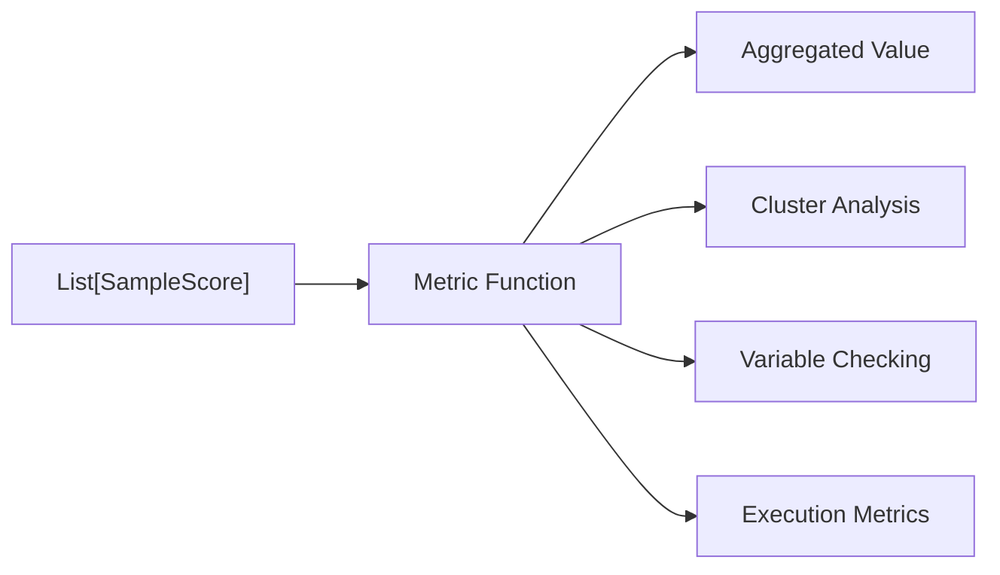

Sources: [astabench/evals/code_diagnostics/task.py:184-261]()

## Response Schema Definition

### Structured Output Validation

Tasks requiring structured responses define Pydantic models and response schemas:

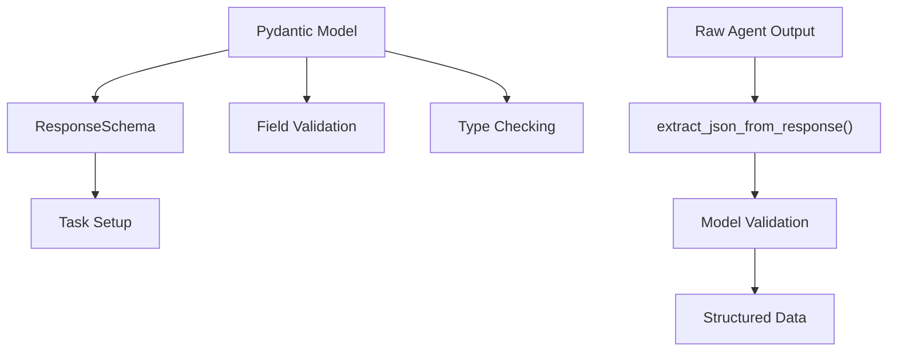

Common patterns include:
- `Citation` models for bibliography data
- `SQASection` models for report structure  
- `DiscoveryBenchOutput` for hypothesis generation

Sources: [astabench/types/sqa.py:6-77](), [astabench/evals/discoverybench/task.py:88-101]()

## Tool Integration

### Tool Setup Patterns

Tasks integrate tools through the `setup` parameter using `use_tools()`:

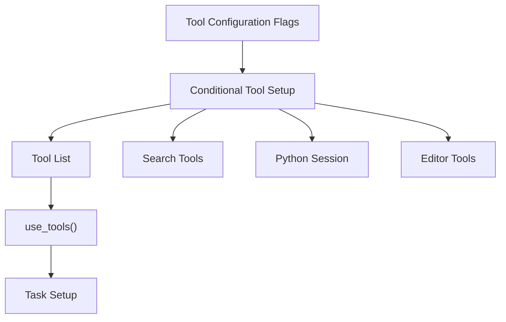

Common tool setup patterns:
- Search tools with date constraints
- Python execution environments
- File editing capabilities
- Domain-specific APIs

Sources: [astabench/evals/sqa/task.py:494-512](), [astabench/evals/discoverybench/task.py:191]()

## Sandbox Configuration

### Docker Sandbox Setup

Tasks requiring code execution configure Docker sandboxes:

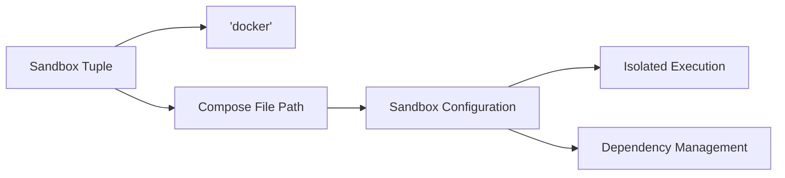

Standard sandbox configuration:
```python
sandbox=(
    "docker",
    (resources.files("astabench.util.sandbox") / "sandbox_compose.yaml").as_posix(),
)
```

Sources: [astabench/evals/discoverybench/task.py:193-198](), [astabench/evals/code_diagnostics/task.py:432-437]()

## Task Registration Patterns

### Split-Based Task Variants

Many tasks provide multiple variants for different evaluation splits:

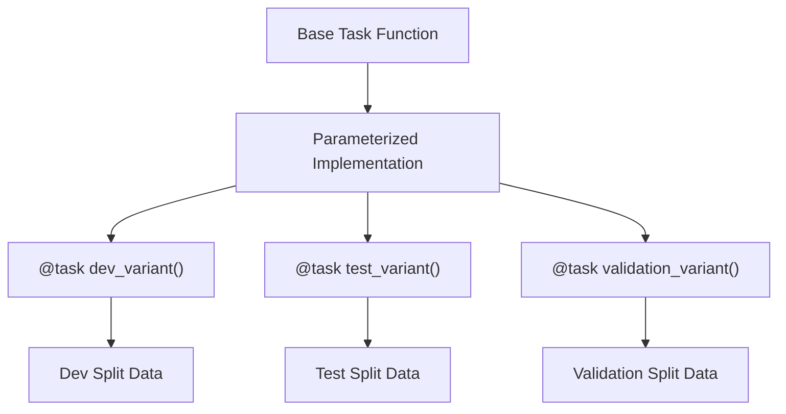

Common naming conventions:
- `task_name()` - Base configurable task
- `task_name_dev()` - Development split
- `task_name_test()` - Test split  
- `task_name_validation()` - Validation split

Sources: [astabench/evals/sqa/task.py:543-550](), [astabench/evals/discoverybench/task.py:202-216]()

## Error Handling and Validation

### Robust Output Processing

Tasks implement defensive parsing with fallback mechanisms:

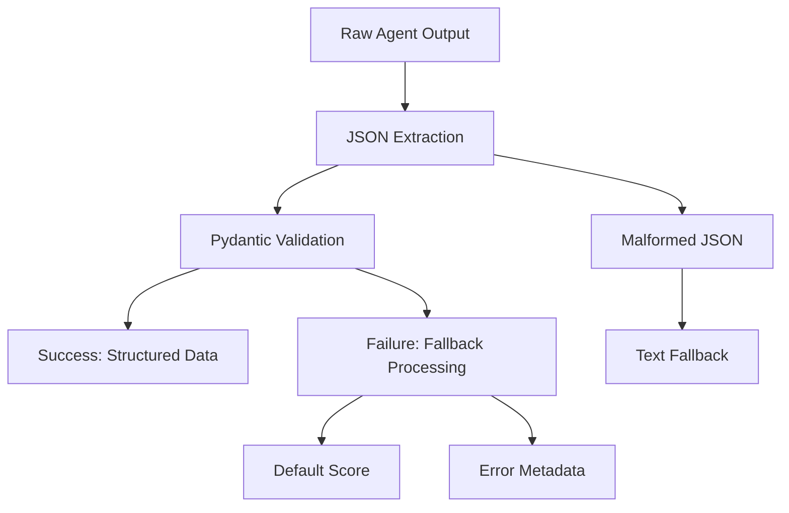

Tasks should handle:
- Malformed JSON responses
- Missing required fields
- Type validation errors
- Execution timeouts
- External API failures

Sources: [astabench/evals/sqa/task.py:188-193](), [astabench/evals/discoverybench/task.py:107-121]()

## Data Loading Conventions

### Hugging Face Dataset Integration

Most tasks load data from the centralized asta-bench dataset repository:

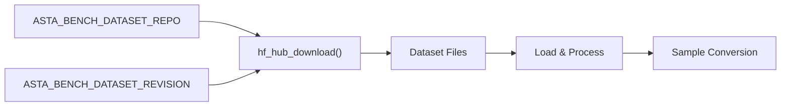

Standard data loading pattern uses:
- `ASTA_BENCH_DATASET_REPO` constant for repository ID
- `ASTA_BENCH_DATASET_REVISION` for version pinning
- `HF_TOKEN` environment variable for authentication

Sources: [astabench/evals/sqa/task.py:447-466](), [astabench/evals/discoverybench/task.py:150-165]()

---

