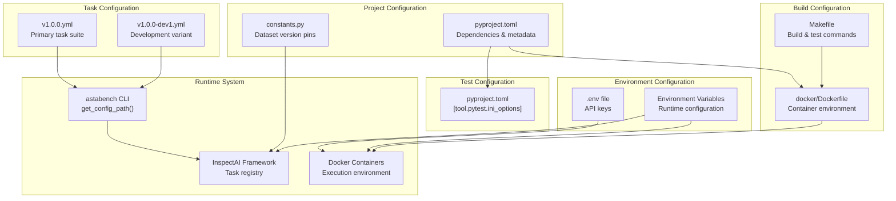
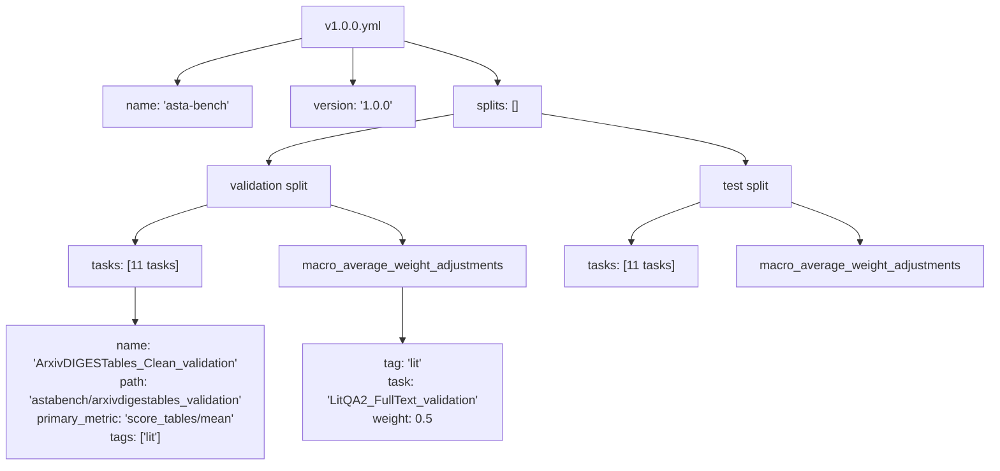
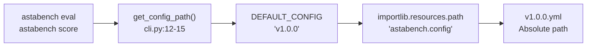
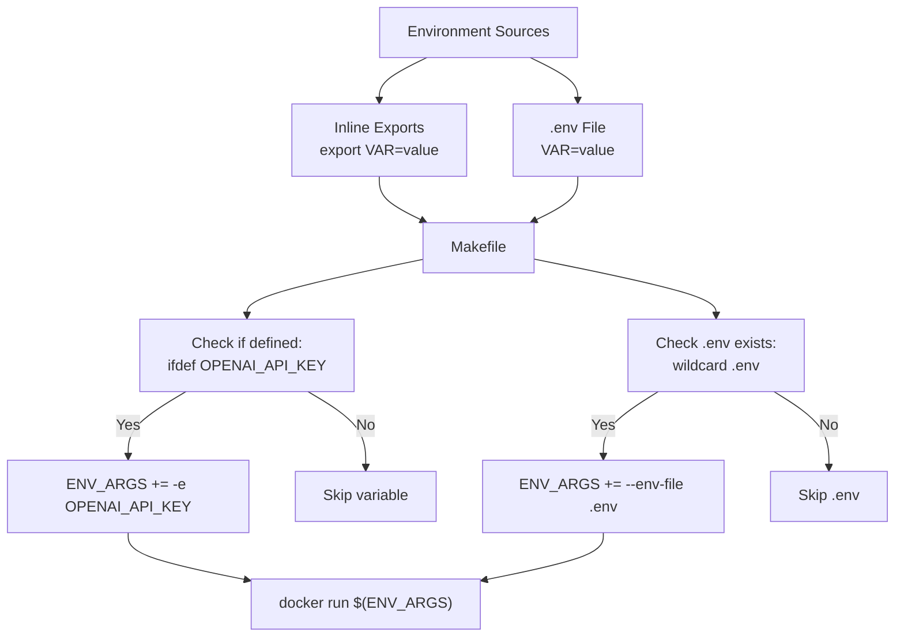
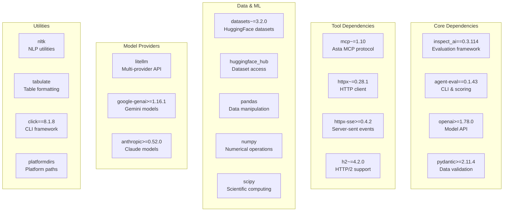
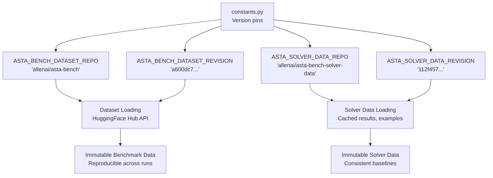
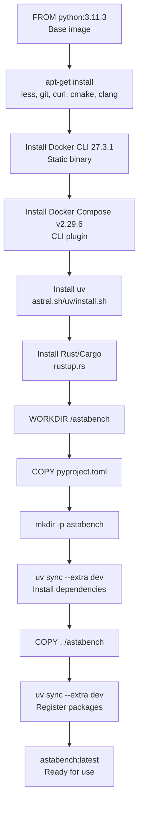
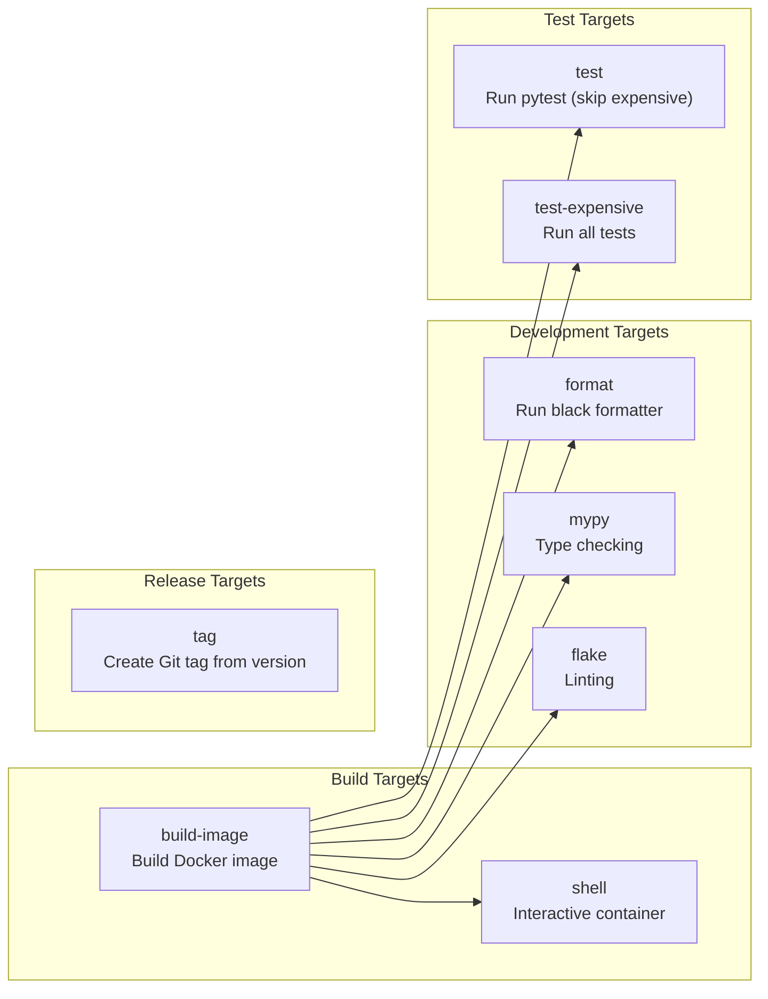

<!-- source: DeepWiki mcp.deepwiki.com · repo allenai/asta-bench · page 9 Configuration Reference · fetched 2026-10-26 -->

# Configuration Reference

<details>
<summary>Relevant source files</summary>

The following files were used as context for generating this wiki page:

- [Makefile](Makefile)
- [README.md](README.md)
- [astabench/cli.py](astabench/cli.py)
- [astabench/config/v1.0.0-dev1.yml](astabench/config/v1.0.0-dev1.yml)
- [astabench/config/v1.0.0.yml](astabench/config/v1.0.0.yml)
- [astabench/constants.py](astabench/constants.py)
- [docker/Dockerfile](docker/Dockerfile)
- [pyproject.toml](pyproject.toml)

</details>


This page provides a comprehensive reference for all configuration files, environment variables, and constants used in ASTA-Bench. This includes YAML task definitions, project dependencies, dataset versioning, environment setup, and build configurations. For information about the declarative tool configuration system, see [ToolsetConfig](#4.1). For information about DVC pipeline configuration, see [DVC Pipelines](#7.1).

## Configuration File Overview

ASTA-Bench uses multiple configuration systems that work together to provide reproducible evaluations across different environments and task suites.



**Sources:** [astabench/config/v1.0.0.yml:1-134](), [pyproject.toml:1-127](), [astabench/constants.py:1-7](), [astabench/cli.py:1-29](), [Makefile:1-131]()

## Task Suite Configuration

Task suite configurations are defined in YAML files that specify evaluation splits, task lists, metrics, and aggregation strategies.

### Configuration File Structure

The primary configuration is [astabench/config/v1.0.0.yml](), which follows this structure:



**Sources:** [astabench/config/v1.0.0.yml:1-134]()

### Configuration Fields

| Field | Type | Description |
|-------|------|-------------|
| `name` | string | Benchmark suite name (`"asta-bench"`) |
| `version` | string | Configuration version identifier |
| `splits` | list | Evaluation splits (validation/test) |
| `splits[].name` | string | Split identifier (`"validation"` or `"test"`) |
| `splits[].tasks` | list | Task definitions for this split |
| `splits[].macro_average_weight_adjustments` | list | Weight overrides for aggregation |

**Sources:** [astabench/config/v1.0.0.yml:1-4]()

### Task Definition Fields

Each task entry in the `tasks` list contains:

| Field | Type | Description | Example |
|-------|------|-------------|---------|
| `name` | string | Human-readable task name | `"PaperFindingBench_validation"` |
| `path` | string | InspectAI task path | `"astabench/paper_finder_validation"` |
| `primary_metric` | string | Metric for leaderboard scoring | `"score_paper_finder/adjusted_f1_micro_avg"` |
| `tags` | list[string] | Category tags for aggregation | `["lit"]`, `["code"]`, `["data"]`, `["discovery"]` |

**Sources:** [astabench/config/v1.0.0.yml:7-31]()

### Available Task Tags

| Tag | Description | Tasks in Suite |
|-----|-------------|----------------|
| `lit` | Literature tasks | 5 tasks (PaperFindingBench, ScholarQA, LitQA2, LitQA2-Search, ArxivDIGESTables) |
| `code` | Code execution tasks | 3 tasks (CORE-Bench, DS-1000, SUPER) |
| `data` | Data analysis tasks | 1 task (DiscoveryBench) |
| `discovery` | End-to-end discovery tasks | 2 tasks (E2E-Bench, E2E-Bench-Hard) |

**Sources:** [astabench/config/v1.0.0.yml:10-61]()

### Weight Adjustments

The `macro_average_weight_adjustments` section allows overriding default equal weighting within tag categories:

```yaml
macro_average_weight_adjustments:
  - tag: lit
    task: LitQA2_FullText_validation
    weight: 0.5
  - tag: lit
    task: LitQA2_FullText_Search_validation
    weight: 0.5
```

This example gives LitQA2 FullText and Search tasks each 0.5 weight (instead of 1.0) within the `lit` tag category, effectively treating them as a single task for aggregation purposes.

**Sources:** [astabench/config/v1.0.0.yml:62-68](), [astabench/config/v1.0.0.yml:127-133]()

### Configuration Loading

The CLI loads configurations through the `get_config_path()` function:



**Sources:** [astabench/cli.py:8-22]()

## Environment Variables

ASTA-Bench requires several environment variables for API access, authentication, and runtime configuration.

### Environment Variable Reference

```mermaid
graph TB
    subgraph "Required for Tools"
        ASTA_TOOL_KEY["ASTA_TOOL_KEY<br/>Asta MCP API authentication"]
        HF_TOKEN["HF_TOKEN<br/>HuggingFace dataset access"]
    end
    
    subgraph "Required for Model Providers"
        OPENAI["OPENAI_API_KEY<br/>OpenAI models & scoring"]
        ANTHROPIC["ANTHROPIC_API_KEY<br/>Anthropic models & scoring"]
        GOOGLE["GOOGLE_API_KEY<br/>Google models & scoring"]
    end
    
    subgraph "Optional Provider Keys"
        AZURE["AZUREAI_OPENAI_API_KEY<br/>Azure OpenAI"]
    end
    
    subgraph "Runtime Configuration"
        IS_CI["IS_CI<br/>CI environment detection"]
        INSPECT_DOCKER["INSPECT_DOCKER_CLI_CONCURRENCY<br/>Sandbox concurrency limit"]
        DOCKER_SOCKET["DOCKER_SOCKET_PATH<br/>Docker socket location"]
    end
    
    subgraph "Usage Points"
        SearchTools["Search Tools<br/>paper_search, snippet_search"]
        AstaTools["Asta MCP Tools<br/>30+ tools"]
        HFDatasets["Dataset Loading<br/>HuggingFace Hub"]
        Scorers["LLM Scorers<br/>Gemini 2.5 Flash/Pro"]
        Sandbox["Docker Sandbox<br/>Code execution"]
    end
    
    ASTA_TOOL_KEY --> SearchTools
    ASTA_TOOL_KEY --> AstaTools
    HF_TOKEN --> HFDatasets
    OPENAI --> Scorers
    ANTHROPIC --> Scorers
    GOOGLE --> Scorers
    INSPECT_DOCKER --> Sandbox
    DOCKER_SOCKET --> Sandbox
```



**Sources:** [README.md:86-103](), [Makefile:8-31]()

### Core Environment Variables

| Variable | Required | Purpose | Example |
|----------|----------|---------|---------|
| `ASTA_TOOL_KEY` | Yes (for lit tasks) | Authentication for Asta MCP tools | Obtain from [https://allenai-web-dev.allen.ai/asta/resources/mcp]() |
| `HF_TOKEN` | Yes (for datasets) | HuggingFace dataset access (requires license acceptance) | Generate from [https://huggingface.co/settings/tokens]() |
| `OPENAI_API_KEY` | Yes (for scoring) | OpenAI API access for models and LLM-based scorers | `sk-...` |
| `ANTHROPIC_API_KEY` | Yes (for scoring) | Anthropic API access for models and scoring | `sk-ant-...` |
| `GOOGLE_API_KEY` | Yes (for scoring) | Google Gemini API for LLM-based scoring | API key from Google AI Studio |

**Sources:** [README.md:91-96]()

### Optional Environment Variables

| Variable | Purpose | Default |
|----------|---------|---------|
| `AZUREAI_OPENAI_API_KEY` | Azure-hosted OpenAI models | Not set |
| `IS_CI` | Indicates CI environment (affects Docker mounts) | Not set (treated as false) |
| `INSPECT_DOCKER_CLI_CONCURRENCY` | Max concurrent docker compose operations | Not set (InspectAI default) |
| `DOCKER_SOCKET_PATH` | Docker socket location | `$XDG_RUNTIME_DIR/docker.sock` or `/var/run/docker.sock` |

**Sources:** [README.md:97-99](), [Makefile:8-38]()

### Environment Variable Loading

Environment variables can be provided via:

1. **`.env` file** in repository root (automatically loaded by Docker)
2. **Inline exports** before commands: `export OPENAI_API_KEY=...`
3. **Makefile passthrough** for defined variables

The Makefile conditionally passes environment variables to Docker:



**Sources:** [Makefile:10-31](), [README.md:88-89]()

### Testing Environment Variables

Tests use pytest markers to skip tests that require specific environment variables:

| Marker | Environment Variable | Behavior |
|--------|---------------------|----------|
| `asta_tool_api_request` | `ASTA_TOOL_KEY` | Auto-skipped when key not set |
| `expensive` | Any | Skipped by default (run with `-m expensive`) |

**Sources:** [pyproject.toml:116-126]()

## Project Configuration (`pyproject.toml`)

The `pyproject.toml` file defines project metadata, dependencies, build configuration, and tool settings.

### Project Metadata

```toml
[project]
name = "astabench"
version = "0.3.1"
readme = "README.md"
requires-python = ">=3.11"
```

| Field | Value | Description |
|-------|-------|-------------|
| `name` | `"astabench"` | Package name on PyPI |
| `version` | `"0.3.1"` | Current version (source of truth for releases) |
| `requires-python` | `">=3.11"` | Minimum Python version |

**Sources:** [pyproject.toml:5-9]()

### Dependency Configuration



**Sources:** [pyproject.toml:10-32]()

### Key Dependency Constraints

| Package | Version | Constraint Reason |
|---------|---------|------------------|
| `inspect_ai` | `==0.3.114` | Exact version for compatibility |
| `openai` | `>=1.78.0` | Minimum required by InspectAI (override in uv) |
| `datasets` | `~=3.2.0` | Compatible range (override for STORM) |
| `httpx-sse` | `>=0.4.2` | Minimum for SSE decoding fix |
| `click` | `==8.1.8` | Exact version for CLI stability |

**Sources:** [pyproject.toml:11-31](), [pyproject.toml:67-74]()

### Optional Dependencies

```toml
[project.optional-dependencies]
dev = [
    "black==24.2.0",
    "isort",
    "autoflake",
    "pytest",
    "pytest-asyncio",
    "flake8==7.2.0",
    "flake8-pyproject==1.2.3",
    "mypy==1.15",
    "pandas-stubs",
]
azure = [
    "azure-ai-inference"
]
```

Install with: `uv sync --extra dev` or `uv sync --extra azure`

**Sources:** [pyproject.toml:34-48]()

### Entry Points

```toml
[project.scripts]
astabench = "astabench.cli:cli"
inspect = "inspect_ai._cli.main:main"

[project.entry-points.inspect_ai]
astabench = "astabench.evals._registry"
```

| Entry Point Type | Name | Target | Purpose |
|-----------------|------|--------|---------|
| CLI script | `astabench` | `astabench.cli:cli` | Main CLI command |
| CLI script | `inspect` | `inspect_ai._cli.main:main` | InspectAI CLI |
| InspectAI plugin | `astabench` | `astabench.evals._registry` | Task registry auto-discovery |

**Sources:** [pyproject.toml:50-55]()

### Package Discovery

```toml
[tool.setuptools.packages.find]
where = [".", "inspect_evals/src"]
include = ["astabench*", "inspect_evals", "inspect_evals.core_bench", "inspect_evals.ds1000"]
```

Packages are discovered in:
- Root directory (`.`) for `astabench*` packages
- `inspect_evals/src` for InspectAI eval wrappers

**Sources:** [pyproject.toml:57-59]()

### Package Data

```toml
[tool.setuptools.package-data]
"astabench" = [
    "config/*.yml",
    "evals/inspect_eval_wrappers/ds1000_splits.json",
    "util/sandbox/sandbox_compose.yaml",
    "util/sandbox/Dockerfile",
    "util/sandbox/*.txt",
    "evals/demo/code_execution/*.yaml",
    "evals/demo/arithmetic/data.json"
]
"inspect_evals.core_bench" = [
    "*.json",
    "*.yaml",
    "Dockerfile",
    "*.md",
]
```

Non-Python files included in package distribution:
- YAML configuration files
- Sandbox Docker configuration and dependencies
- Demo task data files
- CORE-Bench assets

**Sources:** [pyproject.toml:104-112]()

### UV Configuration

```toml
[tool.uv]
conflicts = [
    [{extra = "sqa"}, {extra = "storm"}],
    [{extra = "sqa"}, {extra = "futurehouse"}],
    [{extra = "storm"}, {extra = "smolagents"}],
]
override-dependencies = [
    "openai==1.78.0",
    "datasets~=3.2.0",
]
```

UV-specific settings:
- **Conflicts**: Prevent incompatible optional dependency groups
- **Override dependencies**: Force specific versions despite solver constraints

**Sources:** [pyproject.toml:61-74]()

### Linting Configuration

```toml
[tool.flake8]
select = ["F", "E721", "E901", "E902", "E999"]
ignore = ["F401", "F541"]
```

| Setting | Value | Description |
|---------|-------|-------------|
| `select` | `["F", ...]` | Enable F category (logical errors) and serious E errors |
| `ignore` | `["F401", "F541"]` | Ignore unused imports and f-string placeholders |

**Sources:** [pyproject.toml:76-89]()

### Pytest Configuration

```toml
[tool.pytest.ini_options]
testpaths = ["tests"]
asyncio_mode = "strict"
asyncio_default_fixture_loop_scope = "function"
addopts = "-m \"not expensive\""
markers = [
  "expensive: mark test as expensive (skipped by default)",
  "asta_tool_api_request: mark test as requiring Asta tool key (auto-skipped when ASTA_TOOL_KEY not set)"
]
```

| Option | Value | Purpose |
|--------|-------|---------|
| `testpaths` | `["tests"]` | Test directory location |
| `asyncio_mode` | `"strict"` | Each async test gets own event loop |
| `addopts` | `"-m \"not expensive\""` | Skip expensive tests by default |
| `markers` | See above | Custom test markers for filtering |

**Sources:** [pyproject.toml:116-126]()

## Dataset Version Constants

The `constants.py` module pins exact dataset repository revisions for reproducibility.

### Dataset Repository Configuration

```python
ASTA_BENCH_DATASET_REPO = "allenai/asta-bench"
ASTA_BENCH_DATASET_REVISION = "a600dc767f850385f4664772e3ba7a7f8be17d5e"

ASTA_SOLVER_DATA_REPO = "allenai/asta-bench-solver-data"
ASTA_SOLVER_DATA_REVISION = "112f457ad94b05fd377234feae363ae794550049"
```

| Constant | Value | Purpose |
|----------|-------|---------|
| `ASTA_BENCH_DATASET_REPO` | `"allenai/asta-bench"` | HuggingFace dataset repository for benchmark data |
| `ASTA_BENCH_DATASET_REVISION` | `"a600dc7..."` | Exact commit hash for immutable benchmark data |
| `ASTA_SOLVER_DATA_REPO` | `"allenai/asta-bench-solver-data"` | Repository for solver-specific data (cached results, few-shot examples) |
| `ASTA_SOLVER_DATA_REVISION` | `"112f457..."` | Exact commit hash for solver data |

**Sources:** [astabench/constants.py:1-7]()

### Version Pinning Strategy



This ensures:
1. **Reproducibility**: Same data across all evaluation runs
2. **Immutability**: Dataset changes don't affect historical results
3. **Traceability**: Exact version can be inspected on HuggingFace

**Sources:** [astabench/constants.py:1-7]()

## Docker Configuration

Docker configuration defines the containerized execution environment for evaluations.

### Dockerfile Structure



**Sources:** [docker/Dockerfile:1-43]()

### Dockerfile Key Steps

| Line | Command | Purpose |
|------|---------|---------|
| [2]() | `FROM python:3.11.3` | Base Python image |
| [8]() | `apt-get install ...` | System dependencies (git, cmake, clang) |
| [10-16]() | Install Docker CLI + Compose | Enable sandbox container management |
| [18-24]() | Install `uv` | Python package manager |
| [26-28]() | Install Rust/Cargo | Required for some dependencies |
| [32]() | `COPY pyproject.toml` | Copy dependency specification |
| [36]() | `uv sync --extra dev` | Install dependencies (cached layer) |
| [39]() | `COPY . /astabench` | Copy source code |
| [42]() | `uv sync --extra dev` | Register local packages |

**Sources:** [docker/Dockerfile:1-43]()

### Docker Build Configuration

The Dockerfile uses a two-stage `uv sync` approach for layer caching:

1. **First sync** ([36]()): Install dependencies before copying source code (cacheable if dependencies unchanged)
2. **Second sync** ([42]()): Register local packages after source code copied (registers `astabench` and `inspect_evals` entry points)

**Sources:** [docker/Dockerfile:32-42]()

## Build Configuration (`Makefile`)

The Makefile provides commands for building, testing, and running the Docker environment.

### Make Targets



**Sources:** [Makefile:1-131]()

### Core Make Targets

| Target | Command | Purpose |
|--------|---------|---------|
| `build-image` | `docker build ... --tag astabench` | Build the astabench Docker image |
| `shell` | `docker run -it ... /bin/bash` | Start interactive shell in container |
| `format` | `black --exclude ... .` | Format code with Black |
| `mypy` | `uv run mypy astabench/ tests/` | Type check with mypy |
| `flake` | `uv run flake8 astabench/ tests/` | Lint with flake8 |
| `test` | `pytest -m "not expensive"` | Run fast tests only |
| `test-expensive` | `pytest -m expensive` | Run all tests including expensive ones |
| `tag` | Create Git tag from `pyproject.toml` version | Prepare for release |

**Sources:** [Makefile:1-131]()

### Environment Variable Passthrough

The Makefile conditionally passes environment variables to Docker containers:

```makefile
ENV_ARGS :=

ifdef OPENAI_API_KEY
  ENV_ARGS += -e OPENAI_API_KEY
endif

ifdef HF_TOKEN
  ENV_ARGS += -e HF_TOKEN
endif

ifneq ("$(wildcard .env)","")
  ENV_ARGS += --env-file .env
endif
```

Variables explicitly passed: `OPENAI_API_KEY`, `AZUREAI_OPENAI_API_KEY`, `HF_TOKEN`

If `.env` file exists, it's loaded with `--env-file .env`

**Sources:** [Makefile:10-31]()

### CI vs Local Configuration

The Makefile detects CI environments and adjusts behavior:

```makefile
ifeq ($(IS_CI),true)
  LOCAL_MOUNTS :=
  ENV_ARGS += -e IS_CI
  TEST_RUN := docker run --rm $(ENV_ARGS) -v /var/run/docker.sock:/var/run/docker.sock $(ASTABENCH_TAG)
  BUILD_QUIET := --quiet
else
  LOCAL_MOUNTS := \
    -v $(DOCKER_SOCKET_PATH):/var/run/docker.sock \
    -v $$(pwd)/pyproject.toml:/astabench/pyproject.toml:ro \
    -v $$(pwd)/astabench:/astabench/astabench \
    -v $$(pwd)/tests:/astabench/tests \
    -v $$(pwd)/logs:/astabench/logs \
    -v astabench-cache:/root/.cache
  TEST_RUN := docker run --rm $(ENV_ARGS) $(LOCAL_MOUNTS) $(ASTABENCH_TAG)
  BUILD_QUIET ?=
endif
```

| Condition | `IS_CI=true` | `IS_CI` not set |
|-----------|--------------|-----------------|
| Source mounts | None | Live mounts for development |
| Build output | Quiet | Verbose |
| Cache volume | Not used | `astabench-cache` volume |
| Logs | Not mounted | Mounted to `./logs` |

**Sources:** [Makefile:36-51]()

### Volume Mounts (Local Development)

When running locally (not in CI), the following volumes are mounted:

| Mount | Source | Target | Mode |
|-------|--------|--------|------|
| Docker socket | `$DOCKER_SOCKET_PATH` | `/var/run/docker.sock` | rw |
| Project config | `./pyproject.toml` | `/astabench/pyproject.toml` | ro (read-only) |
| Source code | `./astabench` | `/astabench/astabench` | rw |
| Tests | `./tests` | `/astabench/tests` | rw |
| Logs | `./logs` | `/astabench/logs` | rw |
| Cache | `astabench-cache` (volume) | `/root/.cache` | rw |
| Home | `astabench-home` (volume) | `/root/.astabench` | rw |

This enables:
- Live code editing without rebuilding
- Persistent cache across container restarts
- Log files accessible on host
- Sandbox management from within container

**Sources:** [Makefile:42-48](), [Makefile:62-69]()

### Tag Release Workflow

The `tag` target automates Git tag creation:

```makefile
tag:
	@VERSION=$$(grep '^version = ' pyproject.toml | sed 's/version = "\(.*\)"/\1/'); \
	echo "Creating and pushing tag v$$VERSION"; \
	git tag "v$$VERSION" && \
	git push origin "v$$VERSION"
```

Workflow:
1. Extract version from `pyproject.toml` (e.g., `"0.3.1"`)
2. Create Git tag `v0.3.1`
3. Push tag to origin

This triggers the PyPI publish workflow (see [Publishing and Release](#6.3)).

**Sources:** [Makefile:126-131]()

## Configuration Usage Patterns

### Loading Task Configuration in CLI

The CLI automatically loads the default configuration:

```python
DEFAULT_CONFIG = "v1.0.0"
SPLIT_NAMES = ["validation", "test"]

def get_config_path(config_name):
    """Get the path to a config file in the package's config directory."""
    with importlib.resources.path("astabench.config", f"{config_name}.yml") as path:
        return os.path.abspath(path)

# Modify eval_command and score_command defaults
for cmd in (eval_command, score_command):
    for param in cmd.params:
        if isinstance(param, click.Option) and param.name == "config_path":
            param.default = get_config_path(DEFAULT_CONFIG)
```

This sets `--config-path` default to the packaged `v1.0.0.yml` file.

**Sources:** [astabench/cli.py:8-26]()

### Accessing Constants in Code

Dataset repositories are referenced using constants:

```python
from astabench.constants import ASTA_BENCH_DATASET_REPO, ASTA_BENCH_DATASET_REVISION

# In task loading code
dataset = datasets.load_dataset(
    ASTA_BENCH_DATASET_REPO,
    split="validation",
    revision=ASTA_BENCH_DATASET_REVISION
)
```

This pattern ensures all dataset loads use the pinned revision.

**Sources:** [astabench/constants.py:1-7]()

### Running with Custom Configuration

Users can override the default configuration:

```bash
# Use custom config file
uv run astabench eval --config-path /path/to/custom.yml --split validation

# Use development variant
uv run astabench eval --config-path astabench/config/v1.0.0-dev1.yml --split validation
```

**Sources:** [astabench/cli.py:12-22]()

## Summary Table: All Configuration Files

| File | Type | Purpose | Key Fields |
|------|------|---------|------------|
| `v1.0.0.yml` | YAML | Task suite definition | `splits`, `tasks`, `macro_average_weight_adjustments` |
| `pyproject.toml` | TOML | Project metadata & dependencies | `version`, `dependencies`, `[tool.*]` sections |
| `constants.py` | Python | Dataset version pins | `ASTA_BENCH_DATASET_REVISION`, `ASTA_SOLVER_DATA_REVISION` |
| `.env` | Shell | Environment variables (user-created) | `ASTA_TOOL_KEY`, `HF_TOKEN`, API keys |
| `Dockerfile` | Docker | Container environment definition | Base image, dependencies, build steps |
| `Makefile` | Make | Build & test automation | Targets, environment passthrough, CI detection |

**Sources:** [astabench/config/v1.0.0.yml:1-134](), [pyproject.toml:1-127](), [astabench/constants.py:1-7](), [docker/Dockerfile:1-43](), [Makefile:1-131](), [README.md:88-103]()