# Page: Overview

# Overview

<details>
<summary>Relevant source files</summary>

The following files were used as context for generating this wiki page:

- [Makefile](Makefile)
- [README.md](README.md)
- [astabench/cli.py](astabench/cli.py)
- [astabench/config/v1.0.0-dev1.yml](astabench/config/v1.0.0-dev1.yml)
- [astabench/config/v1.0.0.yml](astabench/config/v1.0.0.yml)
- [astabench/constants.py](astabench/constants.py)
- [docker/Dockerfile](docker/Dockerfile)
- [pyproject.toml](pyproject.toml)

</details>


ASTA-Bench is an evaluation framework for measuring the scientific research capabilities of AI agents. Built on InspectAI, it provides 2,400+ evaluation samples across 11 standardized benchmarks that test agents on literature search, code execution, data analysis, and end-to-end scientific discovery workflows.

The framework provides:
- **11 benchmarks** organized into 4 categories (literature, code, data, discovery)
- **Standardized tool ecosystem** including search tools, code execution environments, and structured editors
- **Reproducible evaluation infrastructure** with Docker-based sandboxing and dataset versioning
- **Cost tracking and scoring** with unified metrics across heterogeneous task types

For installation and setup instructions, see [Getting Started](#2). For details on specific evaluation tasks, see [Evaluation Tasks](#5). For information about extending the framework, see [Development](#6).
</old_str>

<old_str>
## The 11 Benchmarks

ASTA-Bench contains 11 evaluation tasks organized into 4 thematic categories. Each task is available in both `validation` and `test` splits, defined in `astabench/config/v1.0.0.yml`.

**Task Registry and Implementation Mapping**

```mermaid
graph TB
    subgraph "Configuration"
        V1YML["v1.0.0.yml<br/>validation + test splits"]
    end
    
    subgraph "Literature Tasks (lit tag)"
        PF["PaperFindingBench<br/>astabench/paper_finder_{validation,test}<br/>Primary: adjusted_f1_micro_avg<br/>333 queries"]
        PFSEARCH["LitQA2 Search<br/>astabench/paper_finder_litqa2_{validation,test}<br/>Primary: recall_at_30"]
        SQA["ScholarQA CS2<br/>astabench/sqa_{dev,test}<br/>Primary: global_avg/mean"]
        LITQA["LitQA2 FullText<br/>astabench/litqa2_{validation,test}<br/>Primary: is_correct/accuracy"]
        ARXIV["ArxivDIGESTables Clean<br/>astabench/arxivdigestables_{validation,test}<br/>Primary: score_tables/mean"]
    end
    
    subgraph "Code Tasks (code tag)"
        CORE["CORE-Bench Hard<br/>astabench/core_bench_{validation,test}<br/>Primary: score_with_stderr/accuracy"]
        DS1000["DS-1000<br/>astabench/ds1000_{validation,test}<br/>Primary: ds1000_scorer/accuracy"]
        SUPER["SUPER Expert<br/>astabench/super_{validation,test}<br/>Primary: entrypoint/mean (val)<br/>output_match/mean (test)"]
    end
    
    subgraph "Data Tasks (data tag)"
        DISCO["DiscoveryBench<br/>astabench/discoverybench_{validation,test}<br/>Primary: score_discoverybench/mean"]
    end
    
    subgraph "Discovery Tasks (discovery tag)"
        E2E["E2E-Bench<br/>astabench/e2e_discovery_{validation,test}<br/>Primary: score_rubric/accuracy"]
        E2EHARD["E2E-Bench Hard<br/>astabench/e2e_discovery_hard_{validation,test}<br/>Primary: score_rubric/accuracy"]
    end
    
    V1YML --> PF
    V1YML --> PFSEARCH
    V1YML --> SQA
    V1YML --> LITQA
    V1YML --> ARXIV
    V1YML --> CORE
    V1YML --> DS1000
    V1YML --> SUPER
    V1YML --> DISCO
    V1YML --> E2E
    V1YML --> E2EHARD
```

Sources: [astabench/config/v1.0.0.yml:5-134](), [README.md:327-358]()

### Task Categories

| Category | Tag | # Tasks | Description |
|----------|-----|---------|-------------|
| Literature | `lit` | 5 | Paper search, literature QA, table extraction from papers |
| Code | `code` | 3 | Programming challenges, data science tasks, trajectory tracking |
| Data | `data` | 1 | Data-driven scientific discovery |
| Discovery | `discovery` | 2 | End-to-end discovery workflows |

Sources: [astabench/config/v1.0.0.yml:10-56,62-133]()

### Task Naming Convention

Tasks follow a consistent naming pattern:
- **InspectAI task name**: `astabench/{task_name}_{split}` (e.g., `astabench/paper_finder_validation`)
- **Display name**: Full task name as shown in configuration (e.g., `PaperFindingBench_validation`)
- **Primary metric**: The metric used for aggregation (e.g., `score_paper_finder/adjusted_f1_micro_avg`)

The validation split is used for development and hyperparameter tuning, while the test split is used for final leaderboard submission.

Sources: [astabench/config/v1.0.0.yml:5-134](), [README.md:358]()

### Macro-Averaging with Weight Adjustments

ASTA-Bench computes a unified score across all tasks using macro-averaging with tag-based grouping. Some tasks receive weight adjustments in the configuration:

- LitQA2 FullText: weight 0.5 (to balance with its paired search task)
- LitQA2 FullText Search: weight 0.5

This ensures that paired tasks (LitQA2 question answering + paper finding) don't dominate the literature category score.

Sources: [astabench/config/v1.0.0.yml:62-68,127-133]()
</old_str>
<new_str>
## System Architecture

ASTA-Bench is built as a Python package that extends InspectAI through its plugin system. The architecture follows a layered design with configuration-driven task execution.

**System Architecture and Code Structure**

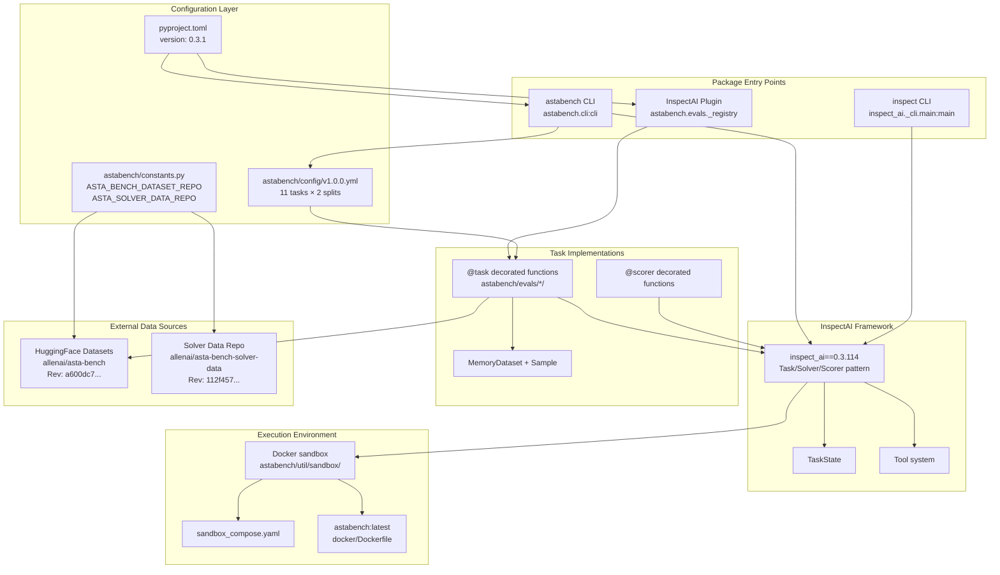

Sources: [pyproject.toml:5-7,50-55](), [astabench/constants.py:1-6](), [astabench/config/v1.0.0.yml:1-134](), [astabench/cli.py:1-28]()

### Package Structure

The system is structured as a Python package (`astabench`) with the following key components:

| Component | File Path | Purpose |
|-----------|-----------|---------|
| CLI Entry Point | `astabench.cli:cli` | Main command-line interface wrapping `inspect eval-set` |
| InspectAI Plugin | `astabench.evals._registry` | Registers all 11 evaluation tasks with InspectAI |
| Task Configuration | `astabench/config/v1.0.0.yml` | Defines validation and test splits with 11 tasks each |
| Dataset Versioning | `astabench/constants.py` | Pins HuggingFace dataset revisions for reproducibility |
| Sandbox Environment | `astabench/util/sandbox/` | Docker-based code execution isolation |

Sources: [pyproject.toml:50-55](), [astabench/constants.py:1-6]()

### InspectAI Integration

ASTA-Bench extends InspectAI by implementing the Task/Solver/Scorer pattern:

- **Tasks**: Defined using the `@task` decorator, each task loads a dataset and specifies scoring methods
- **Solvers**: Provided by the user (e.g., ReAct, custom agents), process `TaskState` and use tools from `state.tools`
- **Scorers**: Defined using the `@scorer` decorator, evaluate solver outputs against targets and return metrics

All task implementations are registered through the `[project.entry-points.inspect_ai]` section in `pyproject.toml`, making them discoverable via the `astabench/` namespace.

Sources: [pyproject.toml:54-55](), [README.md:7,234-241]()

## System Purpose and Architecture

AstaBench serves as a comprehensive evaluation suite built on top of the `inspect_ai` framework. The system provides over 2,400 evaluation examples across 11 benchmarks, testing AI agents' ability to perform scientific research tasks including literature search, code execution, data analysis, and discovery workflows.

**Core Architecture Diagram**

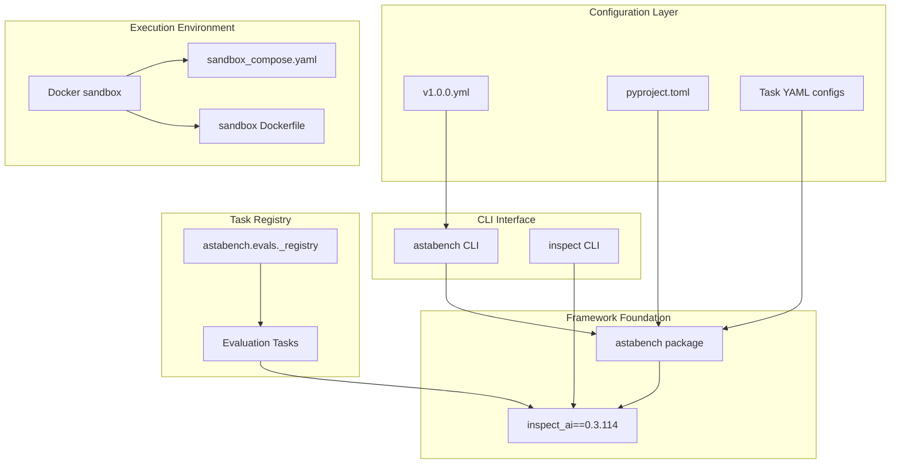

Sources: [pyproject.toml:1-126](), [README.md:1-369](), [docker/Dockerfile:1-66]()

The system is structured as a Python package with entry points defined in `pyproject.toml`. The main CLI entry point `astabench = "astabench.cli:cli"` provides the primary interface, while the evaluation tasks are registered through the InspectAI plugin system via `astabench = "astabench.evals._registry"`.

## Tool Ecosystem

ASTA-Bench provides a comprehensive tool ecosystem that agents can use during evaluation. Tools are configured via `ToolsetConfig` and merged with task-provided tools using `merge_tools_with_state()`.

**Tool Configuration and Implementation**

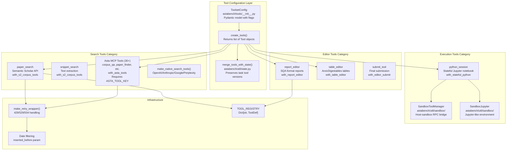

Sources: [README.md:271-301](), [astabench/config/v1.0.0.yml:104]()

### Tool Categories

| Category | CLI Flag | Description | Key Classes |
|----------|----------|-------------|-------------|
| Search | `-S with_s2_corpus_tools=1` | Semantic Scholar paper/snippet search | `paper_search`, `snippet_search` |
| Search | `-S with_asta_tools=1` | 30+ Asta MCP research tools | Requires `ASTA_TOOL_KEY` |
| Execution | `-S with_stateful_python=1` | Jupyter-like code execution | `SandboxToolManager`, `SandboxJupyter` |
| Editor | `-S with_report_editor=1` | Scientific report composition | `report_editor` for SQA tasks |
| Editor | `-S with_table_editor=1` | Data table creation | `table_editor` for ArxivDigestables |
| Thinking | `-S with_thinking_tool=1` | Extended reasoning | For chain-of-thought |

Sources: [README.md:288-295]()

### Task-Provided Tools vs. Optional Tools

Tasks may provide their own tools in `state.tools` with specific constraints (e.g., date restrictions on search tools for reproducibility). When using `merge_tools_with_state()`, task-provided tools take precedence over optional tools with the same name, ensuring that task-specific constraints are preserved.

**Example workflow:**
1. Solver creates optional tools via `ToolsetConfig(**kwargs).create_tools()`
2. Solver merges with task tools via `merge_tools_with_state(optional_tools)`
3. Task-provided search tools (with date restrictions) override optional search tools
4. Agent uses final merged toolset from `state.tools`

Sources: [README.md:273-287,295]()

### Sandbox Communication

Sandbox tools use a file-based RPC mechanism defined in `sandbox_compose.yaml` to enable communication between host and sandbox processes. This allows:
- Code execution in isolated Docker containers
- Tool calling from sandboxed Python code back to host tools
- Persistent state across multiple code executions

Sources: [README.md:296-297](), [pyproject.toml:104]()

## Configuration System

ASTA-Bench uses a layered configuration system with version pinning for reproducibility.

**Configuration File Hierarchy**

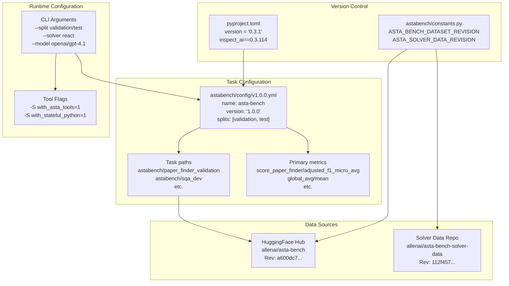

Sources: [pyproject.toml:5-7](), [astabench/constants.py:1-6](), [astabench/config/v1.0.0.yml:1-134]()

### Configuration Files

| File | Purpose | Key Fields |
|------|---------|------------|
| `pyproject.toml` | Package metadata and dependencies | `version`, `dependencies`, `project.scripts`, `project.entry-points.inspect_ai` |
| `astabench/constants.py` | Dataset version pinning | `ASTA_BENCH_DATASET_REPO`, `ASTA_BENCH_DATASET_REVISION`, `ASTA_SOLVER_DATA_REPO`, `ASTA_SOLVER_DATA_REVISION` |
| `astabench/config/v1.0.0.yml` | Task suite definition | `splits`, `tasks`, `primary_metric`, `tags`, `macro_average_weight_adjustments` |
| `.env` | Environment variables | `ASTA_TOOL_KEY`, `HF_TOKEN`, `OPENAI_API_KEY`, etc. |

Sources: [pyproject.toml:5-7,50-55](), [astabench/constants.py:1-6](), [astabench/config/v1.0.0.yml:1-134](), [README.md:86-103]()

### CLI Interface

The `astabench` CLI (defined in `astabench/cli.py`) wraps InspectAI's `eval-set` command with additional features:

**CLI Command Structure:**
- `astabench eval`: Execute evaluation suite with metadata tracking
  - `--split {validation,test}`: Choose evaluation split
  - `--log-dir`: Directory for evaluation logs
  - `--ignore-git`: Skip git status check for reproducibility
  - Standard InspectAI options: `--solver`, `--model`, `--max-samples`, etc.
  
- `astabench score <log_dir>`: Aggregate scores and calculate costs
  - Processes `.eval` files in the directory
  - Computes macro-averaged scores by tag
  - Calculates total model usage costs

- `inspect eval`: Direct evaluation of individual tasks
  - Format: `inspect eval --solver <solver> --model <model> astabench/<task_name>`
  - Example: `inspect eval --solver react --model openai/gpt-4.1 astabench/sqa_dev`

Sources: [astabench/cli.py:1-28](), [README.md:114-157]()

### Reproducibility Mechanisms

ASTA-Bench enforces reproducibility through:

1. **Dataset version pinning**: Commit hashes in `constants.py` ensure identical datasets
2. **Git status tracking**: `astabench eval` records git SHA and fails on uncommitted changes (unless `--ignore-git`)
3. **Configuration versioning**: YAML config includes version field (`1.0.0`)
4. **Dependency pinning**: `pyproject.toml` pins `inspect_ai==0.3.114`
5. **Evaluation metadata**: All runs record model, solver, and configuration details

Sources: [astabench/constants.py:1-6](), [README.md:119]()

## Configuration and CLI Interface

AstaBench uses a YAML-based configuration system with the primary configuration defined in `astabench/config/v1.0.0.yml`. The CLI provides wrapper functionality around InspectAI's `eval-set` command with additional metadata and task management.

### Key CLI Commands
- `astabench eval`: Execute evaluation suites with enhanced logging and reproducibility metadata
- `astabench score`: Aggregate results and calculate model usage costs  
- `inspect eval`: Direct task execution for individual benchmarks
- `inspect view`: Result visualization and analysis

### Configuration Files
- **Task definitions**: Individual YAML configurations for each benchmark
- **Suite configuration**: `v1.0.0.yml` defining validation and test splits
- **Package data**: Embedded configurations via `setuptools.package-data` in `pyproject.toml`

Sources: [README.md:114-148](), [pyproject.toml:103-111]()

## Development Environment and Containerization

The system uses Docker for consistent evaluation environments across development, testing, and production. Multiple solver-specific images are built from a common base, with each solver having its own setup requirements.

### Docker Structure
- **Base image**: `astabench-base` with Python 3.11.3 and core dependencies
- **Solver images**: `react`, `smolagents`, `storm`, `sqa`, `super`, `datavoyager`, `futurehouse`
- **Sandbox environment**: Separate sandbox container with `sandbox_compose.yaml` and `Dockerfile`

### Build System
- **Makefile**: Development workflows including `make shell`, `make format`, `make test`
- **UV package manager**: Dependency management and virtual environment handling
- **PyPI publishing**: Automated release pipeline through GitHub Actions

Sources: [docker/Dockerfile:1-66](), [pyproject.toml:1-126]()

The framework provides comprehensive evaluation capabilities for AI agents performing scientific research tasks, with standardized tools, reproducible environments, and detailed cost tracking to enable fair comparison of different agent approaches.

---

# Page: Getting Started

# Getting Started

<details>
<summary>Relevant source files</summary>

The following files were used as context for generating this wiki page:

- [Makefile](Makefile)
- [README.md](README.md)
- [docker/Dockerfile](docker/Dockerfile)
- [pyproject.toml](pyproject.toml)

</details>


This guide covers the essential steps to install AstaBench, configure your environment, and run your first evaluation. AstaBench is an evaluation framework for measuring the scientific research abilities of AI agents, built on top of the InspectAI framework.

For detailed installation instructions, see [Installation and Setup](#2.1). For step-by-step examples of running evaluations, see [Quick Start Guide](#2.2). For comprehensive framework architecture details, see [Core Framework](#3).

## Installation Overview

AstaBench provides two installation paths: Docker-based (recommended) for consistent environments, or native installation using `uv`. The framework requires Python 3.11+ and integrates with external APIs for literature search and model access.

**Installation Architecture**

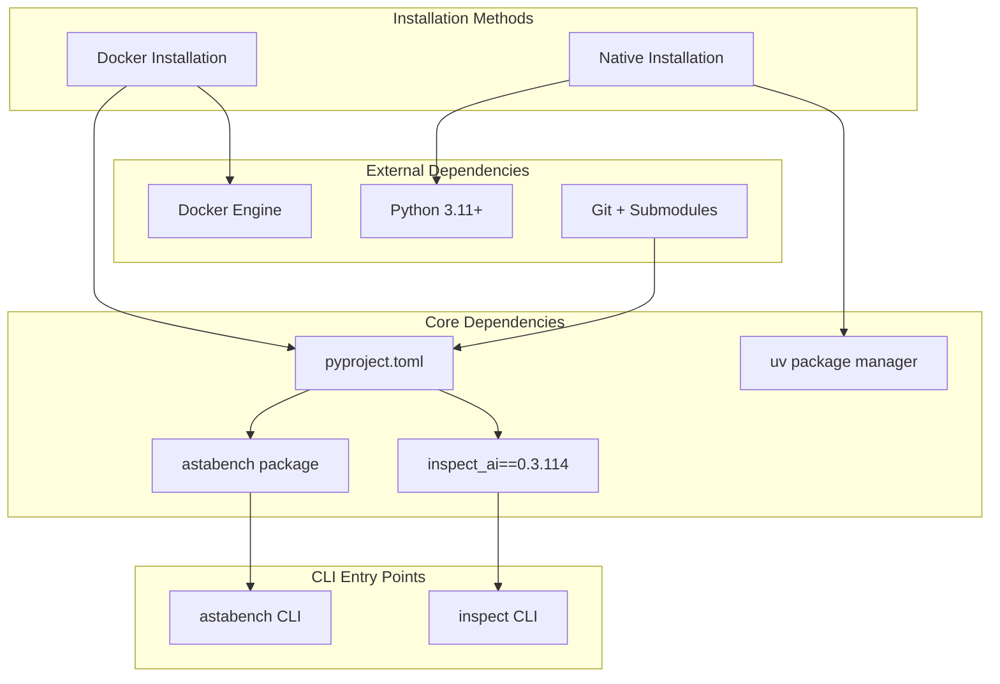

Sources: [pyproject.toml:1-126](), [README.md:66-83](), [Makefile:62-63](), [docker/Dockerfile:1-66]()

## Environment Configuration

AstaBench requires several API keys for full functionality. These are configured via environment variables or a `.env` file at the project root.

| Variable | Purpose | Required For |
|----------|---------|--------------|
| `S2_API_KEY` | Semantic Scholar API access | Literature search tools |
| `OPENAI_API_KEY` | OpenAI model access | Model inference and scoring |
| `ANTHROPIC_API_KEY` | Anthropic model access | Alternative model providers |
| `GOOGLE_API_KEY` | Google AI model access | Alternative model providers |
| `HF_TOKEN` | Hugging Face dataset access | Dataset downloading |

Sources: [README.md:85-103](), [Makefile:21-37]()

## Basic Installation Commands

**Docker Installation (Recommended):**
```bash
git clone https://github.com/allenai/asta-bench.git
cd asta-bench
make shell SOLVER=react
```

**Native Installation:**
```bash
git clone https://github.com/allenai/asta-bench.git
cd asta-bench
curl -LsSf https://astral.sh/uv/install.sh | sh
uv sync
```

Sources: [README.md:36-42](), [README.md:68-82]()

## First Evaluation Workflow

The basic evaluation workflow involves configuring API keys, running a test evaluation, and examining results through the CLI tools.

**Evaluation Command Flow**

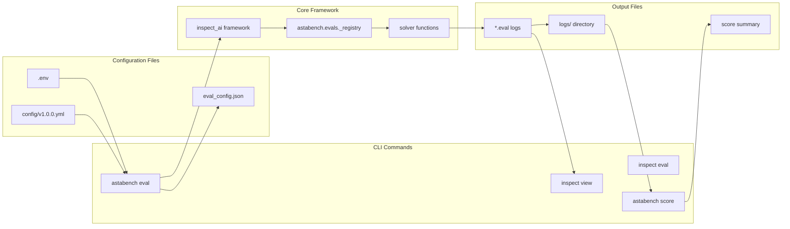

Sources: [README.md:51-64](), [README.md:114-127](), [README.md:154-158](), [pyproject.toml:49-54]()

## Demo Task Execution

Test your installation with the built-in arithmetic demo task:

```bash
# Test basic inspect functionality
uv run inspect eval --solver generate --model openai/gpt-4o-mini astabench/arithmetic_demo

# Run limited AstaBench suite for testing
uv run astabench eval --solver react --model openai/gpt-4o-mini --split validation --limit 1 --log-dir=logs/test-run/

# Score the results
uv run astabench score logs/test-run/
```

The `--limit 1` flag runs only one problem per task to minimize API costs during testing. Remove this flag for full evaluation runs.

Sources: [README.md:51-60]()

## System Requirements and Considerations

AstaBench evaluations can be resource-intensive, particularly for coding tasks that use sandboxed execution environments.

**Resource Requirements:**
- **Memory**: 10+ GB for framework, 20-30 GB for complex coding tasks
- **CPU**: 8+ physical cores recommended for parallel execution  
- **Storage**: Several GB for datasets and Docker images
- **Network**: Stable connection for API calls and dataset downloads

**Parallelism Configuration:**
- `--max-samples`: Number of problems to run in parallel (≤ CPU cores)
- `--max-connections`: Concurrent model API connections
- `INSPECT_DOCKER_CLI_CONCURRENCY`: Docker operation concurrency (≥ 2× max-samples)

Sources: [README.md:105-109](), [README.md:193-210]()

## Next Steps

After completing basic installation and testing:

1. **Configure your solver**: See [Tool System](#4) for configuring agent capabilities
2. **Run full evaluations**: Remove `--limit` flags and configure parallelism for your system
3. **Explore specific tasks**: See [Evaluation Tasks](#5) for detailed task documentation
4. **View detailed results**: Use `inspect view` web interface for result analysis
5. **Submit to leaderboard**: See submission guidelines in [README.md:159-191]()

For development workflows and advanced usage, see [Development](#6) and [Evaluation Pipelines](#7).

Sources: [README.md:110-227]()

---

# Page: Installation and Setup

# Installation and Setup

<details>
<summary>Relevant source files</summary>

The following files were used as context for generating this wiki page:

- [Makefile](Makefile)
- [README.md](README.md)
- [astabench/tools/asta_tools.py](astabench/tools/asta_tools.py)
- [astabench/tools/search.py](astabench/tools/search.py)
- [docker/Dockerfile](docker/Dockerfile)
- [pyproject.toml](pyproject.toml)
- [solvers/paper_finder/setup.sh](solvers/paper_finder/setup.sh)

</details>


This page provides comprehensive instructions for installing AstaBench and configuring your environment for AI agent evaluation. It covers dependency installation, environment variable configuration, Docker setup, and system requirements verification.

For running evaluations after installation, see [Quick Start Guide](#2.2). For development environment setup, see [Development Environment](#6.1).

## Prerequisites and System Requirements

AstaBench requires Python 3.11+ and has significant memory requirements for full evaluation suites. The framework can consume up to 10 GB of memory internally, with individual coding tasks potentially requiring 20-30 GB for sandbox execution.

### Recommended System Specifications

| Component | Minimum | Recommended |
|-----------|---------|-------------|
| Memory | 16 GB | 128 GB |
| CPU Cores | 4 physical cores | 8 physical cores (16 vCPU) |
| Python Version | 3.11 | 3.11+ |
| Docker | Optional for core framework | Required for sandboxed tasks |

**Docker Requirements**: Most tasks require Docker for sandboxed code execution. Even non-Docker installations need Docker available for tasks like SUPER, CORE-Bench, and DiscoveryBench.

Sources: [README.md:105-108](), [pyproject.toml:9]()

## Installation Methods

### Docker Installation (Recommended)

The Docker approach provides a consistent environment with all dependencies pre-configured. This method uses the `Makefile` to manage Docker operations and supports multiple solver configurations.

#### Installation Flow Diagram

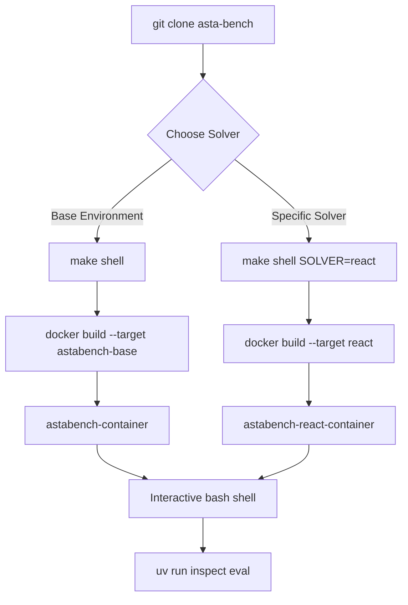

#### Step-by-Step Docker Setup

1. **Clone the repository with submodules**:
   ```bash
   git clone --recursive https://github.com/allenai/asta-bench.git
   cd asta-bench
   ```

2. **Configure environment variables** (create `.env` file as shown above or export variables)

3. **Launch Docker environment**:
   ```bash
   make shell
   ```
   
   This command (`Makefile:62-69`):
   - Updates git submodules
   - Builds the `astabench:latest` Docker image (`docker/Dockerfile:1-43`)
   - Starts an interactive container with mounted volumes
   - Exposes port 7575 for the Inspect UI

4. **Verify installation inside the container**:
   ```bash
   uv run inspect eval --solver generate --model openai/gpt-4.1 astabench/arithmetic_demo
   ```

**What `make shell` sets up**:
- Docker socket mount for sandbox execution (`Makefile:43,65`)
- Code volume mounts for live development (`Makefile:44-47`)
- Cache volumes for dependencies (`Makefile:48,66`)
- Environment variable forwarding (`Makefile:15-31`)

Sources: [README.md:36-41](), [README.md:69-74](), [Makefile:62-69](), [docker/Dockerfile:1-43]()

### Non-Docker Installation

For users who prefer local installation or have Docker limitations, AstaBench can be installed directly using `uv`.

#### Installation Process Diagram

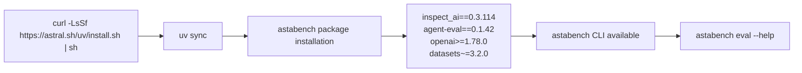

#### Installation Commands

1. **Install uv package manager**:
   ```bash
   curl -LsSf https://astral.sh/uv/install.sh | sh
   ```

2. **Clone the repository**:
   ```bash
   git clone --recursive https://github.com/allenai/asta-bench.git
   cd asta-bench
   ```

3. **Install AstaBench and dependencies**:
   ```bash
   uv sync
   ```
   
   This installs all dependencies from `pyproject.toml` and registers the `astabench` package.

4. **Verify CLI availability**:
   ```bash
   uv run astabench --help
   uv run inspect --help
   ```

**Important**: Docker is still required for sandboxed task execution (SUPER, CORE-Bench, DS-1000, DiscoveryBench, E2E-Bench) even with local installation. The sandbox uses `astabench/util/sandbox/sandbox_compose.yaml` to start execution containers.

Sources: [README.md:81-82](), [pyproject.toml:10-31](), [README.md:69-74]()

## Environment Variable Configuration

AstaBench requires multiple API keys for external services. These can be configured via `.env` file or environment variables.

### Required Environment Variables

| Variable | Purpose | Required For |
|----------|---------|--------------|
| `ASTA_TOOL_KEY` | Asta MCP API access | Literature search tasks (paper_search, snippet_search, Asta MCP tools) |
| `HF_TOKEN` | Hugging Face dataset access | All tasks (dataset loading from allenai/asta-bench) |

### Model Provider API Keys

At least one of these is required depending on your solver and scoring configuration:

| Variable | Purpose | Required For |
|----------|---------|-------------|
| `OPENAI_API_KEY` | OpenAI model access | Most evaluations, GPT models |
| `ANTHROPIC_API_KEY` | Anthropic model access | Claude models, some scoring tasks |
| `GOOGLE_API_KEY` | Google model access | Gemini models, some scoring tasks |

### Optional Environment Variables

| Variable | Purpose | When Needed |
|----------|---------|-------------|
| `AZUREAI_OPENAI_API_KEY` | Azure OpenAI access | Azure-hosted models |

### Configuration Methods

#### Using .env File (Recommended)

Create a `.env` file in the repository root:

```bash
# Required: Asta MCP API key for literature search tools
# Get from: https://allenai-web-dev.allen.ai/asta/resources/mcp
ASTA_TOOL_KEY=your-asta-tool-key

# Required: Hugging Face token for dataset access
# Accept license at https://huggingface.co/datasets/allenai/asta-bench
# Then get token from https://huggingface.co/settings/tokens
HF_TOKEN=your-huggingface-token

# Model provider API keys (at least one required)
OPENAI_API_KEY=your-openai-key
ANTHROPIC_API_KEY=your-anthropic-key
GOOGLE_API_KEY=your-google-key

# Optional: Azure OpenAI access
AZUREAI_OPENAI_API_KEY=your-azure-key
```

#### Environment Variable Loading

**Environment Variable Loading Flow**

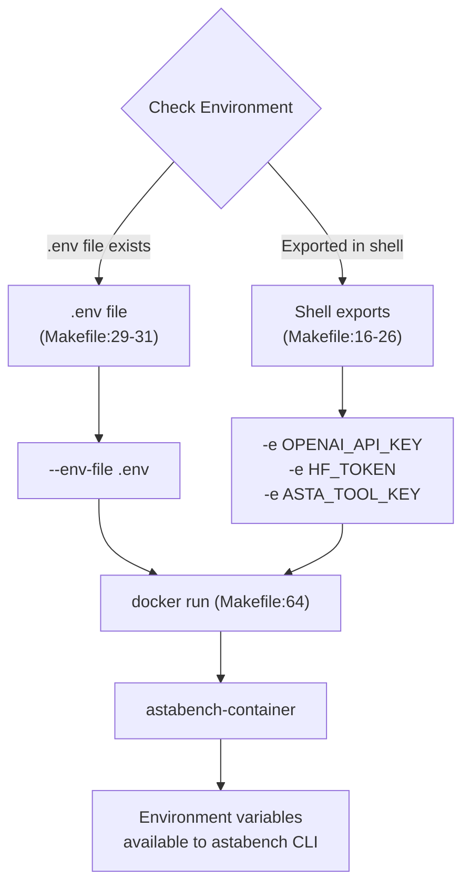

The `Makefile` automatically detects `.env` files and individual environment variables, passing them to Docker containers via `--env-file` or `-e` flags.

Sources: [README.md:87-103](), [Makefile:15-31](), [Makefile:64]()

## Docker Image Build Process

Understanding how the Docker image is built helps with troubleshooting and customization.

### Docker Build Flow

**Docker Image Build Process**

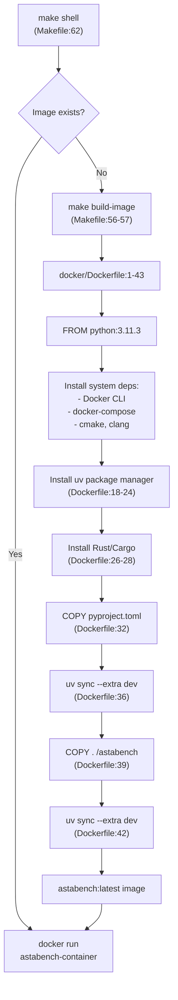

### Build Stages

The Dockerfile performs two `uv sync` operations:

1. **First sync** (line 36): Installs dependencies based on `pyproject.toml` alone, enabling Docker layer caching
2. **Second sync** (line 42): Registers the `astabench` and `inspect_evals` packages after code is copied

This two-stage approach optimizes build caching—dependency installation is cached separately from code changes.

Sources: [docker/Dockerfile:1-43](), [Makefile:56-57]()

## Package Dependencies and Entry Points

AstaBench extends the `inspect_ai` framework with specialized evaluation tasks and tools.

### Core Dependencies Structure

**Package Dependency Graph**

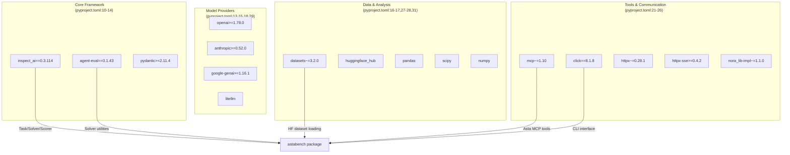

### CLI Entry Points

The package registers two CLI commands via `pyproject.toml:50-52`:

| Command | Target | Purpose |
|---------|--------|---------|
| `astabench` | `astabench.cli:cli` | Main AstaBench CLI with `eval` and `score` commands |
| `inspect` | `inspect_ai._cli.main:main` | Direct InspectAI CLI access for low-level operations |

### Task Registration

Tasks are automatically discovered via the InspectAI plugin system (`pyproject.toml:54-55`):

```
[project.entry-points.inspect_ai]
astabench = "astabench.evals._registry"
```

This enables InspectAI to find all `@task` decorated functions in the `astabench.evals._registry` module.

Sources: [pyproject.toml:10-32](), [pyproject.toml:50-55](), [pyproject.toml:57-59]()

## Installation Verification

### Basic Functionality Test

Verify core installation with the arithmetic demo task:

```bash
uv run inspect eval --solver generate --model openai/gpt-4.1 astabench/arithmetic_demo
```

### Full Suite Test

Test the complete evaluation pipeline with minimal samples:

```bash
uv run astabench eval --solver react --model openai/gpt-4.1 --split validation --limit 1 --log-dir=logs/verification/
```

### Docker Environment Test

Verify Docker integration and sandbox functionality:

```bash
# Test Docker compose functionality
docker compose --version

# Test sandbox creation (requires Docker socket access)
uv run inspect eval --solver python_session --model openai/gpt-4.1 astabench/arithmetic_demo
```

## Common Setup Issues

### Docker Socket Access

**Issue**: `permission denied while trying to connect to the Docker daemon socket`

**Solution**: Ensure Docker socket is properly mounted and accessible:
```bash
# Check Docker socket path (Makefile:8 sets default)
echo $DOCKER_SOCKET_PATH

# Verify socket accessibility (should show srw-rw----)
ls -la /var/run/docker.sock

# Ensure your user is in the docker group
groups | grep docker
```

The `Makefile` uses `DOCKER_SOCKET_PATH` to support both standard Docker (`/var/run/docker.sock`) and rootless Docker (`$XDG_RUNTIME_DIR/docker.sock`) setups (see `Makefile:8`).

Sources: [Makefile:8](), [Makefile:43](), [Makefile:65]()

### Memory Limitations

**Issue**: Out-of-memory errors during evaluation

**Solution**: Reduce parallelism or increase system memory:
```bash
# Reduce parallel execution
uv run astabench eval --max-samples 1 --max-sandboxes 1 [other args]
```

### API Key Validation

**Issue**: Authentication failures for external services

**Solution**: Verify API key configuration:
```bash
# Test ASTA_TOOL_KEY (used by astabench/tools/search.py:18)
curl -H "x-api-key: $ASTA_TOOL_KEY" https://api.semanticscholar.org/graph/v1/paper/search?query=test&limit=1

# Test HF_TOKEN
curl -H "Authorization: Bearer $HF_TOKEN" https://huggingface.co/api/whoami-v2

# Test OpenAI key
curl -H "Authorization: Bearer $OPENAI_API_KEY" https://api.openai.com/v1/models
```

### UV Installation Issues

**Issue**: `uv` command not found or installation fails

**Solution**: Manual UV installation:
```bash
# Alternative installation method
curl -fsSL https://astral.sh/uv/install.sh | sh
export PATH="$HOME/.local/bin:$PATH"
```

Sources: [README.md:212-227]()

---

# Page: Quick Start Guide

# Quick Start Guide

<details>
<summary>Relevant source files</summary>

The following files were used as context for generating this wiki page:

- [Makefile](Makefile)
- [README.md](README.md)
- [astabench/cli.py](astabench/cli.py)
- [astabench/config/v1.0.0-dev1.yml](astabench/config/v1.0.0-dev1.yml)
- [astabench/config/v1.0.0.yml](astabench/config/v1.0.0.yml)
- [docker/Dockerfile](docker/Dockerfile)
- [pyproject.toml](pyproject.toml)

</details>


This guide provides step-by-step instructions for running your first ASTA-Bench evaluation, understanding the output logs, and scoring results. It assumes you have completed the installation and setup steps outlined in [Installation and Setup](#2.1).

For detailed information about the evaluation framework architecture, see [Architecture Overview](#3.1). For comprehensive documentation on individual benchmarks, see [Evaluation Tasks](#5). For solver development, see [Solver Development](#7.2).

## Prerequisites

Before proceeding, ensure you have:
- Completed installation per [Installation and Setup](#2.1)
- Set required environment variables (`OPENAI_API_KEY`, `ASTA_TOOL_KEY`, `HF_TOKEN`, etc.)
- Docker running (if using the containerized environment)

Sources: [README.md:32-66]()

## Testing Your Installation

First, verify your setup by running a minimal demo task. The `arithmetic_demo` task uses InspectAI's built-in `generate` solver, which directly queries the LLM without tool usage:

```bash
uv run inspect eval --solver generate --model openai/gpt-4.1 astabench/arithmetic_demo
```

This command should complete quickly and output basic evaluation metrics. If you encounter errors, verify your API keys and Docker setup.

Sources: [README.md:52-55]()

## Running Your First Evaluation

### Command Structure

The `astabench eval` command is a wrapper around InspectAI's `inspect eval-set` that provides task configuration and enhanced logging:

```bash
uv run astabench eval --solver <solver> --model <model> --split <split> --log-dir <directory>
```

**Key Parameters:**

| Parameter | Description | Required | Example |
|-----------|-------------|----------|---------|
| `--solver` | Solver/agent to use | Yes | `react`, `generate` |
| `--model` | LLM model identifier | Yes | `openai/gpt-4.1` |
| `--split` | Evaluation split | Yes | `validation` or `test` |
| `--log-dir` | Output directory for logs | Recommended | `logs/my-experiment/` |
| `--limit` | Max samples per task | No | `1` (useful for testing) |
| `--max-samples` | Parallel sample limit | No | `8` (default varies) |

Sources: [README.md:114-124](), [astabench/cli.py:1-28]()

### Running a Test Evaluation

Execute a lightweight evaluation with one sample per task to verify the full pipeline:

```bash
uv run astabench eval \
  --solver react \
  --model openai/gpt-4.1 \
  --split validation \
  --limit 1 \
  --log-dir logs/my-first-astabench-experiment/
```

This command:
1. Loads all 11 validation tasks from [astabench/config/v1.0.0.yml:5-68]()
2. Runs the ReAct solver on one sample per task
3. Scores the outputs
4. Saves results to the specified log directory

**Expected Runtime:** 5-15 minutes depending on model latency and task complexity.

Sources: [README.md:57-61](), [astabench/config/v1.0.0.yml:1-68]()

### Evaluation Execution Flow

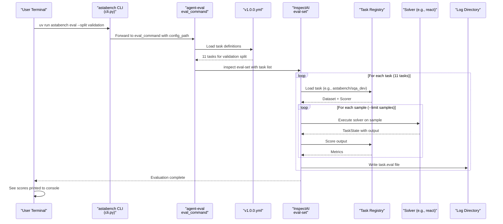

Sources: [astabench/cli.py:1-28](), [astabench/config/v1.0.0.yml:5-68]()

## Understanding Output Files

### Log Directory Structure

After running `astabench eval`, your log directory contains:

```
logs/my-first-astabench-experiment/
├── eval_config.json                          # Run metadata and configuration
├── astabench_sqa_dev_<timestamp>.eval        # ScholarQA results
├── astabench_paper_finder_validation_<timestamp>.eval
├── astabench_litqa2_validation_<timestamp>.eval
├── astabench_arxivdigestables_validation_<timestamp>.eval
├── astabench_core_bench_validation_<timestamp>.eval
├── astabench_ds1000_validation_<timestamp>.eval
├── astabench_super_validation_<timestamp>.eval
├── astabench_discoverybench_validation_<timestamp>.eval
├── astabench_e2e_discovery_validation_<timestamp>.eval
├── astabench_e2e_discovery_hard_validation_<timestamp>.eval
└── astabench_paper_finder_litqa2_validation_<timestamp>.eval
```

### Log File Contents

Each `.eval` file is a JSON Lines file containing:

| Section | Content |
|---------|---------|
| **Header** | Task metadata, model info, timestamps |
| **Samples** | Per-sample input, output, scoring results, model usage |
| **Stats** | Aggregate metrics, token usage, costs |

**Key Fields in Sample Records:**

- `input`: Original task prompt
- `messages`: Full conversation history with the LLM
- `output.completion`: Agent's final answer
- `output.model_usage`: Token counts and API calls
- `scores`: Metric values for this sample
- `metadata`: Task-specific data (e.g., paper IDs, code outputs)

### Configuration File

The `eval_config.json` file stores reproducibility metadata:

```json
{
  "config_name": "asta-bench",
  "config_version": "1.0.0",
  "split_name": "validation",
  "git_sha": "abc123...",
  "git_dirty": false,
  "timestamp": "2024-01-15T10:30:00Z",
  "tasks": [...],
  "solver_args": {...}
}
```

This file is required for scoring and leaderboard submission.

Sources: [README.md:136-147](), [README.md:149-161]()

## Scoring Results

### Running the Score Command

Generate aggregate scores and cost summaries:

```bash
uv run astabench score logs/my-first-astabench-experiment/
```

**Output includes:**

1. **Per-task scores** - Primary metric for each benchmark
2. **Tag-based aggregates** - Macro-averages by category (lit, code, data, discovery)
3. **Overall ASTA-Bench score** - Weighted average across all tasks
4. **Cost breakdown** - API costs by model provider and task

### Understanding Score Output

```
Task Scores:
  ScholarQA_CS2_validation: global_avg/mean = 0.45
  PaperFindingBench_validation: adjusted_f1_micro_avg = 0.62
  CORE_Bench_Hard_validation: accuracy = 0.33
  ...

Tag Aggregates:
  lit (5 tasks): 0.54
  code (3 tasks): 0.38
  data (1 task): 0.41
  discovery (2 tasks): 0.29

Overall ASTA-Bench Score: 0.46

Total Cost: $12.34
  OpenAI: $8.50
  Anthropic: $2.84
  Google: $1.00
```

The overall score uses macro-averaging with weight adjustments defined in [astabench/config/v1.0.0.yml:62-68]() for tasks that share data sources.

Sources: [README.md:154-158](), [astabench/config/v1.0.0.yml:62-68]()

### Score Calculation Flow

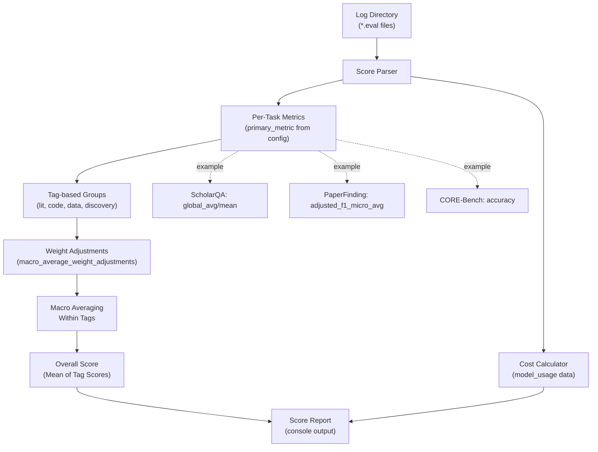

Sources: [astabench/config/v1.0.0.yml:9-68]()

## Viewing Detailed Results

### InspectAI Log Viewer

Launch the interactive web UI to explore results:

```bash
inspect view --host 0.0.0.0
```

Navigate to `http://localhost:7575` to view:
- Per-sample conversations
- Tool call traces
- Scoring details
- Model usage statistics

### Command-Line Dump

For quick inspection without the web UI:

```bash
inspect log dump logs/my-first-astabench-experiment/astabench_sqa_dev_*.eval
```

This outputs JSON-formatted log contents to the terminal.

Sources: [README.md:149-151]()

## CLI Command Mapping

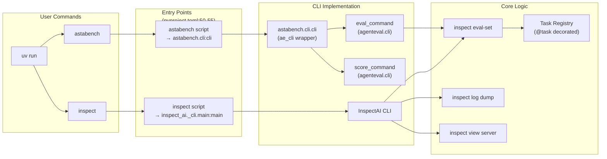

Sources: [pyproject.toml:50-55](), [astabench/cli.py:1-28]()

## Single Task Execution

To run a single benchmark task without the full suite wrapper:

```bash
uv run inspect eval --solver generate --model openai/gpt-4.1 astabench/sqa_dev
```

**Note:** When running single tasks, you must manually create `eval_config.json` for scoring:

```bash
# 1. Create log directory and move .eval file
mkdir logs/your-solver-name/
mv your_submission_log.eval logs/your-solver-name/

# 2. Generate configuration file
astabench eval --config-only --log-dir logs/your-solver-name/ \
  --config-path astabench/config/v1.0.0.yml \
  --split validation --ignore-git
```

This creates the required `eval_config.json` file for subsequent scoring.

Sources: [README.md:129-147]()

## Parallelism Considerations

For testing with `--limit 1`, default parallelism settings are usually fine. For full evaluations, carefully configure:

| Parameter | Recommended | Purpose |
|-----------|-------------|---------|
| `--max-samples` | ≤ CPU cores, ≤ 8 for lit tasks | Parallel samples |
| `--max-connections` | ≥ max-samples | LLM API connections |
| `INSPECT_DOCKER_CLI_CONCURRENCY` | 2× max-samples | Docker communication |

**Example for 8-core system:**
```bash
export INSPECT_DOCKER_CLI_CONCURRENCY=16
uv run astabench eval --solver react --model openai/gpt-4.1 \
  --split validation --max-samples 8 --max-connections 8 \
  --log-dir logs/full-eval/
```

For detailed parallelism guidance, see the [Parallelism section in the README](README.md:193-210)().

Sources: [README.md:193-210]()

## Next Steps

Once you've successfully run your first evaluation:

- **Explore individual benchmarks:** See [Evaluation Tasks](#5) for detailed task documentation
- **Develop custom solvers:** See [Solver Development](#7.2) for building agents
- **Use advanced tools:** See [Tool System](#4) for search, code execution, and editing tools
- **Configure execution environment:** See [Sandbox and Execution Environment](#3.4) for sandboxing details
- **Submit to leaderboard:** See [Submitting to the Leaderboard](README.md:159-172)() in the README

Sources: [README.md:1-368]()

---

# Page: Core Framework

# Core Framework

<details>
<summary>Relevant source files</summary>

The following files were used as context for generating this wiki page:

- [Makefile](Makefile)
- [README.md](README.md)
- [docker/Dockerfile](docker/Dockerfile)
- [pyproject.toml](pyproject.toml)

</details>


This page describes the fundamental architecture and core systems that ASTA-Bench is built upon. It covers the InspectAI integration layer, configuration-driven task execution, the Task/Solver/Scorer evaluation pattern, tool management, and the Docker-based sandbox environment. For detailed information about specific benchmarks and their implementations, see [Evaluation Tasks](#5). For guidance on developing custom solvers, see [Solver Development](#7.2).

## Overview

ASTA-Bench is a configuration-driven evaluation framework built on top of [InspectAI](https://inspect.ai-safety-institute.org.uk/). The framework uses InspectAI's Task/Solver/Scorer pattern to orchestrate evaluations, where tasks define problems and scoring metrics, solvers implement agent logic, and the framework handles execution, logging, and aggregation.

The core framework consists of five primary systems:

1. **InspectAI Integration Layer** - Plugin registration and CLI extensions
2. **Configuration System** - YAML-based task definitions and dataset versioning
3. **Task System** - Problem definition, sampling, and scoring mechanisms
4. **Tool Management** - Declarative tool configuration and state merging
5. **Sandbox Environment** - Docker-based isolated execution for code tasks

## Framework Architecture

The following diagram shows how the core framework components map to concrete code entities in the codebase:

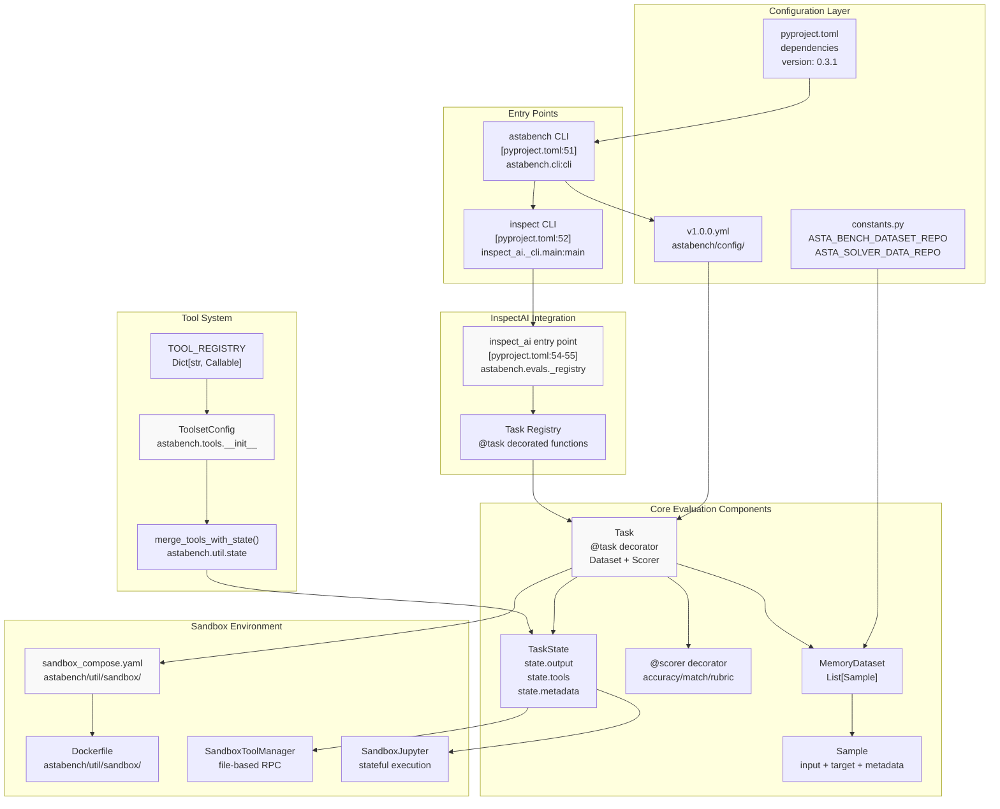

**Sources:** [pyproject.toml:1-127](), [README.md:1-369]()

## InspectAI Integration

ASTA-Bench registers itself as an InspectAI plugin through the `[project.entry-points.inspect_ai]` section in `pyproject.toml`:

```toml
[project.entry-points.inspect_ai]
astabench = "astabench.evals._registry"
```

This entry point allows InspectAI to discover and load all tasks decorated with `@task` in the `astabench.evals` module hierarchy. The framework provides two CLI commands:

| Command | Source | Purpose |
|---------|--------|---------|
| `astabench` | [pyproject.toml:51]() | Wrapper around `inspect eval-set` with metadata tracking |
| `inspect` | [pyproject.toml:52]() | Native InspectAI CLI for direct task evaluation |

The `astabench` CLI command extends InspectAI's functionality by:
- Loading task configurations from YAML files
- Recording git SHA and environment metadata for reproducibility
- Enforcing clean git state (unless `--ignore-git` is specified)
- Providing `astabench score` for cost and metric aggregation

**Sources:** [pyproject.toml:50-55](), [README.md:113-127]()

## Configuration-Driven Execution

The framework uses a multi-layered configuration system to ensure reproducibility and version control:

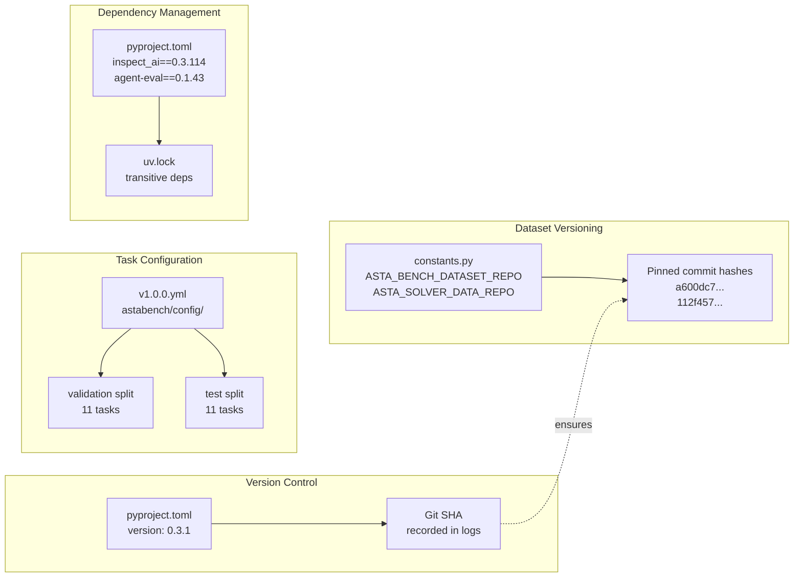

The constants module pins exact repository revisions to ensure identical datasets across evaluation runs. Tasks reference these constants when loading data from HuggingFace Hub, creating a fully deterministic evaluation environment.

**Sources:** [README.md:113-120](), [pyproject.toml:5-32]()

## Task/Solver/Scorer Pattern

ASTA-Bench implements InspectAI's evaluation pattern with the following core abstractions:

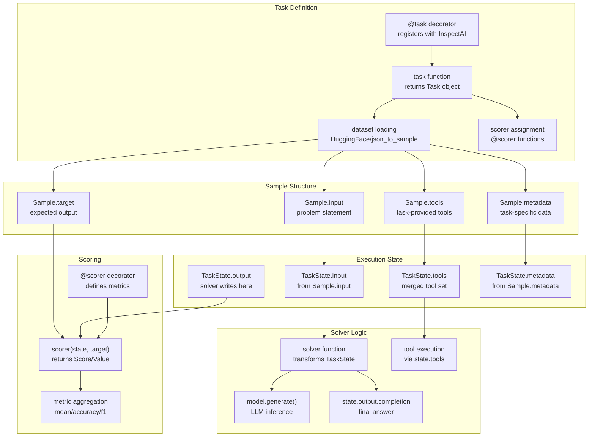

A typical task implementation follows this structure:

1. Load dataset samples from HuggingFace or local JSON
2. Define scoring function(s) using `@scorer` decorator
3. Create `Task` object with dataset and scorer
4. Register with `@task` decorator for InspectAI discovery

The solver receives a `TaskState` object for each sample, executes its logic (potentially using tools and models), and writes the answer to `state.output.completion`. The scorer then compares this output against the `target` to produce metrics.

**Sources:** [README.md:232-241](), [README.md:362-367]()

## Tool Management and State Merging

The framework provides a two-tier tool system:

1. **Task-provided tools** in `Sample.tools` - Often include constraints like date restrictions for reproducibility
2. **Optional solver tools** via `ToolsetConfig` - Can be enabled/disabled via CLI flags

The `merge_tools_with_state()` function combines these tool sets, with task tools taking precedence to preserve task-specific constraints:

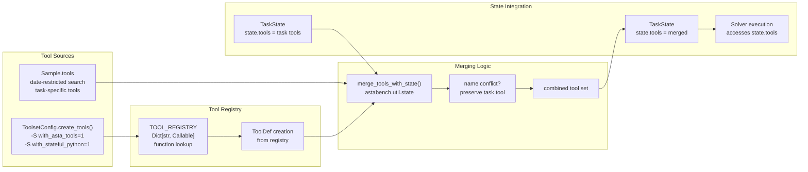

The `ToolsetConfig` class provides declarative configuration for optional tools:

| Tool Category | CLI Flag | Purpose |
|---------------|----------|---------|
| Asta MCP Tools | `-S with_asta_tools=1` | Literature search via Semantic Scholar |
| Stateful Python | `-S with_stateful_python=1` | Jupyter-like code execution |
| Report Editor | `-S with_report_editor=1` | Structured report composition (SQA) |
| Table Editor | `-S with_table_editor=1` | Table composition (ArxivDigestables) |
| Thinking Tool | `-S with_thinking_tool=1` | Extended reasoning tool |

**Sources:** [README.md:269-299]()

## Execution Flow

The complete evaluation pipeline orchestrates multiple systems:

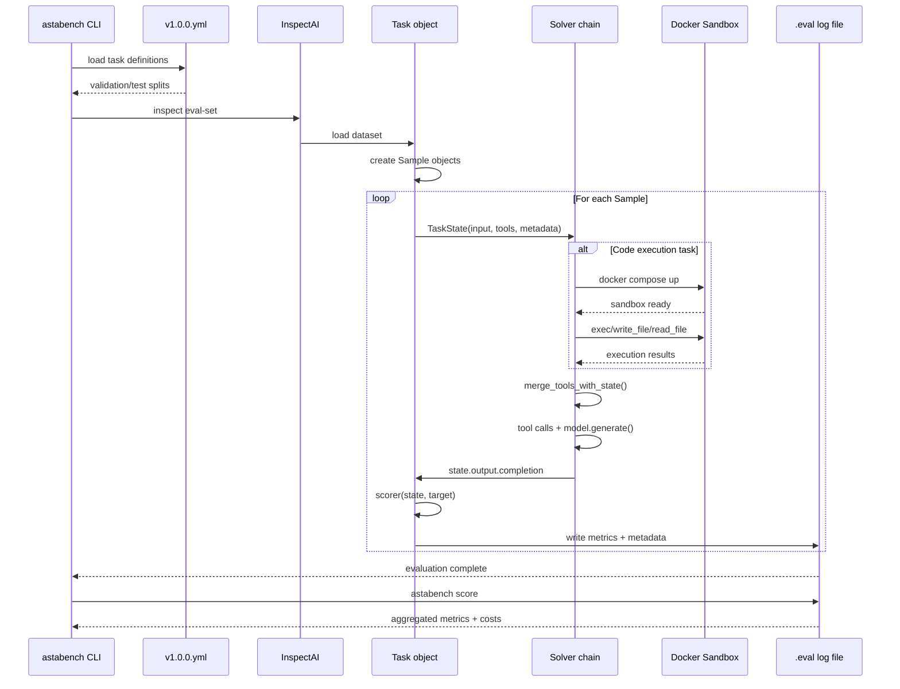

Each evaluation run produces `.eval` files containing:
- Per-sample inputs, outputs, and scores
- Model usage statistics (tokens, costs)
- Tool call traces
- Task metadata and configuration
- Git SHA and environment information

**Sources:** [README.md:110-158](), [README.md:193-210]()

## Sandbox Environment

Tasks requiring code execution use Docker-based sandboxing to ensure isolation and reproducibility. The sandbox system consists of:

| Component | Location | Purpose |
|-----------|----------|---------|
| `sandbox_compose.yaml` | `astabench/util/sandbox/` | Docker Compose configuration |
| `Dockerfile` | `astabench/util/sandbox/` | Sandbox image definition |
| `SandboxToolManager` | `astabench/util/sandbox/sandbox_tool_manager.py` | File-based RPC for host-sandbox tool calls |
| `SandboxJupyter` | `astabench/util/sandbox/sandbox_jupyter.py` | Stateful Jupyter-like environment |

The sandbox provides:
- Isolated network and process namespaces per problem
- Pre-installed dependencies for all tasks (pandas, numpy, scipy, etc.)
- File-based RPC allowing sandboxed code to invoke host-side tools
- Stateful execution tracking for trajectory-based scoring

Concurrency is controlled via environment variables:

| Parameter | Purpose | Recommended Value |
|-----------|---------|-------------------|
| `--max-samples` | Parallel problems | ≤ CPU cores |
| `--max-sandboxes` | Concurrent sandboxes | Same as `--max-samples` |
| `INSPECT_DOCKER_CLI_CONCURRENCY` | Docker operation limit | 2 × `--max-samples` |

**Sources:** [README.md:193-210](), [README.md:302-304](), [pyproject.toml:104-111]()

## Dependency Management

The framework uses `uv` for deterministic dependency resolution with override capabilities to resolve conflicts between evaluation tasks:

```python
# pyproject.toml override-dependencies example
[tool.uv]
override-dependencies = [
    # sqa pins openai to a lower version than inspect requires
    "openai==1.78.0",
    
    # STORM pretends to require a lower version, but doesn't actually need it
    "datasets~=3.2.0",
]
```

Core dependencies include:

| Dependency | Version Constraint | Purpose |
|------------|-------------------|---------|
| `inspect_ai` | `==0.3.114` | Evaluation framework foundation |
| `agent-eval` | `==0.1.43` | Agent evaluation utilities |
| `datasets` | `~=3.2.0` | HuggingFace dataset loading |
| `google-genai` | `>=1.16.1` | LLM-based scoring (Gemini) |
| `mcp` | `~=1.10` | Model Context Protocol for Asta tools |

**Sources:** [pyproject.toml:10-32](), [pyproject.toml:67-74]()

## Build and Development Environment

The framework provides a Docker-based development environment defined in `docker/Dockerfile`:

```dockerfile
FROM python:3.11.3 AS astabench-base
# Installs: Docker CLI, Docker Compose, uv, cargo
# Syncs dependencies: uv sync --extra dev
# Copies codebase and re-syncs to register entry points
```

The `Makefile` provides standardized commands:

| Command | Purpose |
|---------|---------|
| `make shell` | Launch interactive Docker environment |
| `make format` | Run black formatter |
| `make flake` | Run flake8 linter |
| `make test` | Run pytest suite |
| `make test-expensive` | Run full evaluation smoke tests |

Testing uses pytest markers to categorize tests:

```python
# pyproject.toml markers
markers = [
  "expensive: mark test as expensive (skipped by default)",
  "asta_tool_api_request: mark test as requiring Asta tool key"
]
```

**Sources:** [docker/Dockerfile:1-43](), [Makefile:1-131](), [pyproject.toml:116-126]()

---

# Page: Architecture Overview

# Architecture Overview

<details>
<summary>Relevant source files</summary>

The following files were used as context for generating this wiki page:

- [Makefile](Makefile)
- [README.md](README.md)
- [astabench/evals/paper_finder/eval.py](astabench/evals/paper_finder/eval.py)
- [astabench/tools/__init__.py](astabench/tools/__init__.py)
- [docker/Dockerfile](docker/Dockerfile)
- [pyproject.toml](pyproject.toml)
- [tests/test_registry_evals.py](tests/test_registry_evals.py)

</details>


This page describes the fundamental architecture of ASTA-Bench and how its components work together to execute evaluations. It covers the InspectAI integration, the Task/Solver/Scorer pattern, the tool configuration system, and the overall data flow through evaluations.

For specific implementation details about individual components, see:
- Configuration files and constants: [Configuration System](#3.2)
- Task definition and registration: [Task System](#3.3)
- Docker sandboxing and execution: [Sandbox and Execution Environment](#3.4)
- Tool categories and APIs: [Tool System](#4)

## InspectAI Foundation

ASTA-Bench is built as an extension to the [InspectAI](https://inspect.ai-safety-institute.org.uk/) evaluation framework. InspectAI provides the core infrastructure for running AI agent evaluations, including model calling, logging, parallel execution, and result aggregation.

```mermaid
graph TB
    subgraph "InspectAI Core"
        InspectFramework["inspect_ai framework"]
        TaskRegistry["@task decorator<br/>Task registry"]
        SolverAPI["@solver decorator<br/>Solver chain API"]
        ScorerAPI["@scorer decorator<br/>Metric/Score API"]
        ModelAPI["get_model()<br/>Model provider abstraction"]
        SandboxAPI["SandboxEnvironment<br/>Execution isolation"]
    end
    
    subgraph "ASTA-Bench Extension"
        AstaBenchEntry["[project.entry-points.inspect_ai]<br/>astabench = astabench.evals._registry"]
        RegistryModule["astabench.evals._registry<br/>__all__ = task list"]
        CLIWrapper["astabench.cli:cli<br/>astabench eval command"]
        ConfigYAML["config/v1.0.0.yml<br/>Task set definitions"]
    end
    
    subgraph "Evaluation Tasks"
        TaskImpl["Task implementations<br/>@task decorated functions"]
        ScorerImpl["Scorer implementations<br/>@scorer decorated functions"]
        DatasetLoader["Dataset loading<br/>HuggingFace/MemoryDataset"]
    end
    
    InspectFramework --> TaskRegistry
    InspectFramework --> SolverAPI
    InspectFramework --> ScorerAPI
    InspectFramework --> ModelAPI
    InspectFramework --> SandboxAPI
    
    AstaBenchEntry --> RegistryModule
    CLIWrapper --> ConfigYAML
    CLIWrapper --> InspectFramework
    
    RegistryModule --> TaskImpl
    TaskImpl --> TaskRegistry
    TaskImpl --> ScorerImpl
    TaskImpl --> ScorerAPI
    TaskImpl --> DatasetLoader
    
    style InspectFramework fill:#f9f9f9
    style AstaBenchEntry fill:#f9f9f9
```

**Sources:** [pyproject.toml:54-55](), [pyproject.toml:11](), [README.md:7]()

### Entry Point Registration

ASTA-Bench registers itself as an InspectAI extension through the `pyproject.toml` entry point:

```toml
[project.entry-points.inspect_ai]
astabench = "astabench.evals._registry"
```

This allows InspectAI's CLI to discover and load ASTA-Bench tasks using the `astabench/` prefix (e.g., `astabench/sqa_dev`, `astabench/paper_finder_test`).

**Sources:** [pyproject.toml:54-55](), [README.md:133]()

## Core Evaluation Pattern

ASTA-Bench follows InspectAI's Task/Solver/Scorer pattern, where evaluations are structured as:
- **Task**: Defines the problem dataset and evaluation methodology
- **Solver**: The AI agent that attempts to solve problems
- **Scorer**: Evaluates the solver's output against expected answers

```mermaid
graph LR
    subgraph "Evaluation Components"
        Task["@task function<br/>Returns Task object"]
        Solver["@solver function<br/>Returns Solver chain"]
        Scorer["@scorer function<br/>Returns Scorer object"]
    end
    
    subgraph "Runtime Objects"
        TaskObj["Task<br/>- dataset: list[Sample]<br/>- solver: Solver<br/>- scorer: Scorer"]
        Sample["Sample<br/>- input: str<br/>- target: str<br/>- metadata: dict<br/>- tools: list[Tool]"]
        TaskState["TaskState<br/>- messages: list[ChatMessage]<br/>- output: ModelOutput<br/>- tools: list[Tool]<br/>- metadata: dict"]
        Score["Score<br/>- name: str<br/>- value: float<br/>- metadata: dict"]
    end
    
    Task -->|"creates"| TaskObj
    TaskObj -->|"contains"| Sample
    Solver -->|"processes"| TaskState
    TaskState -->|"initialized from"| Sample
    Scorer -->|"produces"| Score
    TaskState -->|"evaluated by"| Scorer
    
    style TaskState fill:#f9f9f9
```

**Sources:** [README.md:362-367](), [tests/test_registry_evals.py:106-117]()

### Task Definition Pattern

Tasks are defined using the `@task` decorator and typically:
1. Load a dataset (from HuggingFace or in-memory data)
2. Convert dataset items to `Sample` objects
3. Attach task-specific tools to samples
4. Configure scoring functions

Example task structure:
```python
@task
def my_benchmark():
    dataset = load_dataset(...)  # Load from HuggingFace
    samples = [json_to_sample(item) for item in dataset]  # Convert to Sample objects
    
    return Task(
        dataset=samples,
        scorer=my_scorer(),
        tools=[task_specific_tool()],  # Tools with date/corpus restrictions
        ...
    )
```

**Sources:** [astabench/evals/paper_finder/eval.py:1-225](), [tests/test_registry_evals.py:78-118]()

### Solver Execution Flow

Solvers receive a `TaskState` containing:
- The problem input/instructions
- Available tools in `state.tools`
- Message history in `state.messages`
- Metadata for the problem

Solvers can:
- Call LLMs via `generate()` or `get_model().generate()`
- Execute tools from `state.tools`
- Update `state.output.completion` with the answer
- Maintain conversation history

**Sources:** [README.md:234-241]()

## Tool Architecture

ASTA-Bench provides a sophisticated tool system that supports both task-provided tools (with restrictions) and optional solver-configurable tools.

```mermaid
graph TB
    subgraph "Tool Configuration"
        ToolsetConfig["ToolsetConfig<br/>pydantic.BaseModel<br/>- with_search_tools: bool<br/>- with_asta_tools: bool<br/>- with_stateful_python: bool<br/>- with_report_editor: bool<br/>- with_table_editor: bool"]
        
        CreateTools["ToolsetConfig.create_tools()<br/>Returns list[Tool]"]
    end
    
    subgraph "Tool Registry"
        TOOL_REGISTRY["TOOL_REGISTRY: dict[str, Callable]<br/>Global function lookup"]
        RegisterTool["register_tool(func)<br/>Decorator for registration"]
    end
    
    subgraph "Tool Categories"
        SearchTools["paper_search()<br/>snippet_search()"]
        AstaMCP["make_asta_mcp_tools()<br/>30+ specialized tools"]
        SandboxTools["python_session()<br/>continue_wait()<br/>interrupt_kernel()"]
        EditorTools["report_editor()<br/>table_editor()<br/>submit_tool()"]
    end
    
    subgraph "Tool Merging"
        MergeTools["merge_tools_with_state(tools)<br/>Combines solver + task tools"]
        TaskTools["state.tools<br/>Task-provided tools<br/>(with date restrictions)"]
        FinalTools["Final tool set<br/>Task tools take precedence"]
    end
    
    ToolsetConfig --> CreateTools
    CreateTools --> SearchTools
    CreateTools --> AstaMCP
    CreateTools --> SandboxTools
    CreateTools --> EditorTools
    
    RegisterTool --> TOOL_REGISTRY
    SearchTools --> TOOL_REGISTRY
    EditorTools --> TOOL_REGISTRY
    
    CreateTools --> MergeTools
    TaskTools --> MergeTools
    MergeTools --> FinalTools
    
    style ToolsetConfig fill:#f9f9f9
    style MergeTools fill:#f9f9f9
```

**Sources:** [astabench/tools/__init__.py:28-117](), [astabench/tools/__init__.py:120-136](), [README.md:272-296]()

### ToolsetConfig Pattern

The `ToolsetConfig` class provides a declarative way to configure optional tools via CLI flags:

```python
# In solver code
@solver
def my_agent(max_steps=10, **tool_options):
    config = ToolsetConfig.model_validate(tool_options)
    tools = config.create_tools()
    
    return chain(
        merge_tools_with_state(tools),  # Merge with task tools
        # ... rest of solver logic
    )
```

CLI usage:
```bash
uv run inspect eval --solver my_agent -S with_asta_tools=1 -S with_stateful_python=1
```

**Sources:** [astabench/tools/__init__.py:28-117](), [README.md:272-287]()

### Tool Registry System

The `TOOL_REGISTRY` provides a global dictionary mapping tool names to their factory functions. The `register_tool()` decorator adds functions to this registry:

```python
TOOL_REGISTRY = {}

def register_tool(func) -> Callable[[], Tool]:
    func_name = func.__name__
    TOOL_REGISTRY[func_name] = func
    return lambda: ToolDef(func).as_tool()

# Usage
paper_search = register_tool(make_paper_search())
snippet_search = register_tool(make_snippet_search())
```

**Sources:** [astabench/tools/__init__.py:120-148]()

### Tool Merging Strategy

The `merge_tools_with_state()` function combines solver-provided tools with task-provided tools, with task tools taking precedence. This is critical because task tools often have date restrictions or corpus constraints to maintain benchmark validity.

**Sources:** [astabench/tools/__init__.py:40-52](), [README.md:273-286]()

## Execution Environment

ASTA-Bench uses a multi-layered Docker-based architecture to provide isolated execution environments for code-running tasks.

```mermaid
graph TB
    subgraph "Host System"
        HostDocker["Docker daemon<br/>docker.sock"]
        MainContainer["astabench:latest<br/>Python 3.11.3<br/>InspectAI + dependencies"]
        
        CLIProcess["uv run astabench eval<br/>or inspect eval"]
        InspectProcess["InspectAI evaluation<br/>Task/Solver execution"]
    end
    
    subgraph "Sandbox Layer"
        DockerCompose["docker compose<br/>sandbox_compose.yaml"]
        SandboxContainer["astabench-sandbox:latest<br/>Isolated Python environment<br/>Jupyter kernel<br/>File-based RPC server"]
        
        SandboxJupyter["SandboxJupyter<br/>Stateful execution wrapper"]
        SandboxToolMgr["SandboxToolManager<br/>Host-sandbox bridge"]
    end
    
    subgraph "Communication"
        FileRPC["File-based RPC<br/>JSON files in shared volume<br/>/tmp/sandbox_rpc/"]
        DockerExec["docker exec<br/>Command execution"]
    end
    
    CLIProcess --> InspectProcess
    InspectProcess --> MainContainer
    MainContainer --> HostDocker
    
    HostDocker --> DockerCompose
    DockerCompose --> SandboxContainer
    
    InspectProcess --> SandboxJupyter
    InspectProcess --> SandboxToolMgr
    
    SandboxJupyter --> FileRPC
    SandboxToolMgr --> FileRPC
    FileRPC --> SandboxContainer
    
    MainContainer --> DockerExec
    DockerExec --> SandboxContainer
    
    style MainContainer fill:#f9f9f9
    style SandboxContainer fill:#f9f9f9
```

**Sources:** [docker/Dockerfile:1-43](), [README.md:76-84](), [README.md:302-304]()

### Docker Environment Layers

1. **Host System**: The machine running evaluations
2. **Main Container** (`astabench:latest`): Contains the ASTA-Bench framework, InspectAI, and all evaluation code
3. **Sandbox Container** (`astabench-sandbox:latest`): Isolated environment for executing agent-generated code

The main container has access to the Docker socket, allowing it to spawn and manage sandbox containers.

**Sources:** [docker/Dockerfile:1-43](), [Makefile:6-69]()

### Concurrency Configuration

ASTA-Bench supports parallel execution with several concurrency parameters:

| Parameter | Purpose | Recommended Value |
|-----------|---------|------------------|
| `--max-samples` | Max problems in parallel | ≤ CPU cores |
| `--max-sandboxes` | Max concurrent sandboxes | = `--max-samples` |
| `--max-connections` | Max LLM connections | ≥ `--max-samples` |
| `INSPECT_DOCKER_CLI_CONCURRENCY` | Sandbox communication concurrency | ≥ 2 × `--max-samples` |

**Sources:** [README.md:193-209]()

## Complete Data Flow

The following diagram shows the complete evaluation execution flow, from CLI invocation to final scoring:

```mermaid
sequenceDiagram
    participant User
    participant CLI as "astabench eval<br/>(astabench.cli)"
    participant Config as "v1.0.0.yml<br/>Task definitions"
    participant InspectAI as "inspect_ai.eval_set()<br/>Evaluation orchestrator"
    participant Task as "Task instance<br/>(dataset + scorer)"
    participant Solver as "Solver chain<br/>(agent logic)"
    participant ToolMerge as "merge_tools_with_state()<br/>Tool preparation"
    participant Model as "LLM Provider<br/>(OpenAI/Anthropic/etc)"
    participant Sandbox as "Docker Sandbox<br/>Code execution"
    participant Scorer as "Scorer function<br/>Metric calculation"
    participant Log as "EvalLog<br/>.eval file output"
    
    User->>CLI: astabench eval --split test
    CLI->>Config: Load task set definition
    Config-->>CLI: List of 11 task names
    
    CLI->>InspectAI: eval_set(tasks, model, solver)
    
    loop For each task
        InspectAI->>Task: Load task instance
        Task-->>InspectAI: dataset (list[Sample])
        
        loop For each sample (up to --max-samples)
            InspectAI->>Solver: Execute solver(state, generate)
            
            Note over Solver,ToolMerge: Initialization phase
            Solver->>ToolMerge: Merge solver + task tools
            ToolMerge-->>Solver: Combined tool set
            
            loop Agent reasoning loop
                Solver->>Model: generate(messages)
                Model-->>Solver: Response with tool calls
                
                alt Tool call needed
                    alt Code execution tool
                        Solver->>Sandbox: Execute via python_session
                        Sandbox-->>Solver: Execution results
                    else Search/API tool
                        Solver->>External: API call
                        External-->>Solver: Search results
                    end
                end
                
                Solver->>Solver: Update state.messages
                Solver->>Solver: Check termination
            end
            
            Solver-->>InspectAI: Final state (with output)
            InspectAI->>Scorer: score(state, target)
            Scorer-->>InspectAI: Metrics
        end
        
        InspectAI->>Log: Write task results
    end
    
    Log-->>User: Evaluation complete
    User->>CLI: astabench score <log_dir>
    CLI->>Log: Aggregate metrics + costs
    Log-->>User: Final scores and summary
```

**Sources:** [README.md:112-124](), [README.md:154-157](), [tests/test_registry_evals.py:106-117]()

### Evaluation Phases

1. **Configuration Loading**: The `astabench eval` CLI loads task definitions from `v1.0.0.yml`
2. **Task Initialization**: For each task, the dataset is loaded and converted to `Sample` objects
3. **Solver Execution**: The solver runs for each sample, with tools merged via `merge_tools_with_state()`
4. **Tool Calling**: The solver can call tools (search, code execution, editors) to gather information
5. **Scoring**: After solver completion, the scorer evaluates the output against the target
6. **Logging**: Results are written to `.eval` log files with full metadata
7. **Aggregation**: The `astabench score` command aggregates metrics and calculates costs

**Sources:** [README.md:112-124](), [README.md:154-157]()

### State Management

Throughout execution, the `TaskState` object maintains:
- `state.messages`: Conversation history with the LLM
- `state.tools`: Available tool definitions
- `state.output.completion`: The solver's final answer
- `state.metadata`: Problem-specific metadata (dates, restrictions, etc.)
- `state.store`: Persistent key-value storage across solver steps

**Sources:** [README.md:234-243]()

### Model Usage Tracking

All LLM calls are automatically tracked for cost calculation. The framework supports:
- Native InspectAI model calls via `generate()` or `get_model().generate()`
- OpenAI client bridging via `bridge()`
- Manual logging via `record_model_usage_with_inspect()`

**Sources:** [README.md:246-266]()

---

This architecture enables ASTA-Bench to provide a flexible, extensible evaluation framework that can accommodate diverse benchmarks (literature search, code execution, data analysis) while maintaining reproducibility, isolation, and detailed cost tracking.

---

# Page: Configuration System

# Configuration System

<details>
<summary>Relevant source files</summary>

The following files were used as context for generating this wiki page:

- [astabench/cli.py](astabench/cli.py)
- [astabench/config/v1.0.0-dev1.yml](astabench/config/v1.0.0-dev1.yml)
- [astabench/config/v1.0.0.yml](astabench/config/v1.0.0.yml)
- [astabench/constants.py](astabench/constants.py)

</details>


This document explains the configuration system used in asta-bench to define evaluation suites, organize tasks, and specify metrics. The configuration system provides a declarative way to organize evaluation tasks into splits and define their scoring criteria.

For information about how tasks are implemented and executed, see [Task System](#3.3). For details about tool configuration within tasks, see [ToolsetConfig](#4.1).

## Configuration File Structure

The asta-bench configuration system uses YAML files located in [astabench/config/](). These files define complete evaluation suites with versioned task sets, splits, and metrics.

### Configuration Schema

```mermaid
graph TB
    CONFIG["Configuration File"] --> NAME["name: string"]
    CONFIG --> VERSION["version: string"] 
    CONFIG --> SPLITS["splits: array"]
    
    SPLITS --> SPLIT_ITEM["Split Definition"]
    SPLIT_ITEM --> SPLIT_NAME["name: string"]
    SPLIT_ITEM --> TASKS["tasks: array"]
    SPLIT_ITEM --> WEIGHTS["macro_average_weight_adjustments"]
    
    TASKS --> TASK_ITEM["Task Definition"]
    TASK_ITEM --> TASK_NAME["name: string"]
    TASK_ITEM --> TASK_PATH["path: string"]
    TASK_ITEM --> PRIMARY_METRIC["primary_metric: string"]
    TASK_ITEM --> TAGS["tags: array"]
    
    WEIGHTS --> WEIGHT_ITEM["Weight Adjustment"]
    WEIGHT_ITEM --> WEIGHT_TAG["tag: string"]
    WEIGHT_ITEM --> WEIGHT_TASK["task: string"]
    WEIGHT_ITEM --> WEIGHT_VALUE["weight: float"]
```

*Sources: [astabench/config/v1.0.0.yml:1-134](), [astabench/config/v1.0.0-dev1.yml:1-134]()*

### Example Configuration Structure

The current production configuration demonstrates the schema:

| Field | Purpose | Example |
|-------|---------|---------|
| `name` | Suite identifier | `asta-bench` |
| `version` | Version string | `1.0.0` |
| `splits` | Evaluation splits | `validation`, `test` |

*Sources: [astabench/config/v1.0.0.yml:1-3]()*

## Task Definition System

Each task in the configuration system maps to a specific evaluation module and defines its scoring methodology.

### Task Properties

```mermaid
graph LR
    TASK_DEF["Task Definition"] --> NAME_PROP["name"]
    TASK_DEF --> PATH_PROP["path"]
    TASK_DEF --> METRIC_PROP["primary_metric"]
    TASK_DEF --> TAGS_PROP["tags"]
    
    NAME_PROP --> DISPLAY["Display Name"]
    PATH_PROP --> MODULE["astabench Module Path"]
    METRIC_PROP --> SCORER["Scorer/Metric Path"]
    TAGS_PROP --> CATEGORY["Task Categories"]
    
    MODULE --> PAPER_FINDER["astabench/paper_finder_validation"]
    MODULE --> SQA_DEV["astabench/sqa_dev"]
    MODULE --> CORE_BENCH["astabench/core_bench_validation"]
    
    SCORER --> F1_METRIC["score_paper_finder/adjusted_f1_micro_avg"]
    SCORER --> ACCURACY["global_avg/mean"]
    SCORER --> CODE_ACCURACY["score_with_stderr/accuracy"]
    
    CATEGORY --> LIT_TAG["lit"]
    CATEGORY --> CODE_TAG["code"] 
    CATEGORY --> DATA_TAG["data"]
    CATEGORY --> DISCOVERY_TAG["discovery"]
```

*Sources: [astabench/config/v1.0.0.yml:7-61](), [astabench/config/v1.0.0.yml:72-126]()*

### Task Categories

Tasks are organized by capability domains using tags:

| Tag | Purpose | Example Tasks |
|-----|---------|---------------|
| `lit` | Literature/Research Tasks | `PaperFindingBench`, `ScholarQA`, `LitQA2` |
| `code` | Programming Tasks | `CORE_Bench`, `DS_1000`, `SUPER` |
| `data` | Data Analysis Tasks | `DiscoveryBench` |
| `discovery` | End-to-End Research | `E2E_Bench` |

*Sources: [astabench/config/v1.0.0.yml:10-61]()*

## Split Organization

The configuration system organizes tasks into validation and test splits for proper evaluation methodology.

### Split Structure

```mermaid
graph TB
    CONFIG_ROOT["Configuration Root"] --> VALIDATION["validation split"]
    CONFIG_ROOT --> TEST["test split"]
    
    VALIDATION --> VAL_TASKS["11 Validation Tasks"]
    TEST --> TEST_TASKS["11 Test Tasks"]
    
    VAL_TASKS --> VAL_LIT["5 Literature Tasks"]
    VAL_TASKS --> VAL_CODE["3 Code Tasks"] 
    VAL_TASKS --> VAL_DATA["1 Data Task"]
    VAL_TASKS --> VAL_DISCOVERY["2 Discovery Tasks"]
    
    TEST_TASKS --> TEST_LIT["5 Literature Tasks"]
    TEST_TASKS --> TEST_CODE["3 Code Tasks"]
    TEST_TASKS --> TEST_DATA["1 Data Task"] 
    TEST_TASKS --> TEST_DISCOVERY["2 Discovery Tasks"]
    
    VAL_LIT --> PAPER_FINDER_VAL["PaperFindingBench_validation"]
    VAL_LIT --> SQA_VAL["ScholarQA_CS2_validation"]
    VAL_LIT --> LITQA2_VAL["LitQA2_FullText_validation"]
    
    TEST_LIT --> PAPER_FINDER_TEST["PaperFindingBench_test"]
    TEST_LIT --> SQA_TEST["ScholarQA_CS2_test"]
    TEST_LIT --> LITQA2_TEST["LitQA2_FullText_test"]
```

*Sources: [astabench/config/v1.0.0.yml:4-133]()*

## Metric Configuration

Each task specifies a primary metric that determines its contribution to overall scores.

### Primary Metrics by Category

```mermaid
graph TB
    METRICS["Primary Metrics"] --> LIT_METRICS["Literature Metrics"]
    METRICS --> CODE_METRICS["Code Metrics"]
    METRICS --> DATA_METRICS["Data Metrics"]
    METRICS --> DISCOVERY_METRICS["Discovery Metrics"]
    
    LIT_METRICS --> F1_SCORE["adjusted_f1_micro_avg"]
    LIT_METRICS --> RECALL_SCORE["recall_at_30"]
    LIT_METRICS --> ACCURACY_SCORE["accuracy"]
    LIT_METRICS --> GLOBAL_AVG["global_avg/mean"]
    LIT_METRICS --> TABLE_SCORE["score_tables/mean"]
    
    CODE_METRICS --> STDERR_ACC["score_with_stderr/accuracy"]
    CODE_METRICS --> DS1000_ACC["ds1000_scorer/accuracy"] 
    CODE_METRICS --> ENTRYPOINT["entrypoint/mean"]
    CODE_METRICS --> OUTPUT_MATCH["output_match/mean"]
    
    DATA_METRICS --> DISCOVERY_MEAN["score_discoverybench/mean"]
    
    DISCOVERY_METRICS --> RUBRIC_ACC["score_rubric/accuracy"]
```

*Sources: [astabench/config/v1.0.0.yml:9-125]()*

### Weight Adjustments

The configuration supports macro-average weight adjustments for specific task combinations:

| Tag | Task | Weight | Purpose |
|-----|------|--------|---------|
| `lit` | `LitQA2_FullText_validation` | 0.5 | Balance with search variant |
| `lit` | `LitQA2_FullText_Search_validation` | 0.5 | Balance with full-text variant |

*Sources: [astabench/config/v1.0.0.yml:62-68](), [astabench/config/v1.0.0.yml:127-133]()*

## CLI Integration

The configuration system integrates with the command-line interface through the `astabench.cli` module.

### Configuration Resolution

```mermaid
graph LR
    CLI_ENTRY["astabench CLI"] --> GET_CONFIG["get_config_path()"]
    GET_CONFIG --> DEFAULT_CONFIG["DEFAULT_CONFIG = 'v1.0.0'"]
    DEFAULT_CONFIG --> RESOLVE_PATH["importlib.resources.path()"]
    RESOLVE_PATH --> CONFIG_FILE["astabench/config/v1.0.0.yml"]
    
    CLI_ENTRY --> SPLIT_VALIDATION["Split Validation"]
    SPLIT_VALIDATION --> SPLIT_NAMES["SPLIT_NAMES = ['validation', 'test']"]
    
    CONFIG_FILE --> AGENTEVAL_CLI["agenteval CLI integration"]
    SPLIT_NAMES --> CLICK_CHOICE["click.Choice() validation"]
```

*Sources: [astabench/cli.py:8-26]()*

### CLI Parameter Customization

The CLI system modifies the underlying `agenteval` CLI parameters to provide asta-bench specific defaults:

```python
# Configuration path is auto-resolved and hidden from users
param.default = get_config_path(DEFAULT_CONFIG)
param.hidden = True

# Split parameter restricted to valid options
param.type = click.Choice(SPLIT_NAMES, case_sensitive=False)
```

*Sources: [astabench/cli.py:18-25]()*

## Version Management

The configuration system supports multiple versions to enable evolution of the evaluation suite.

### Available Configurations

| Version | File | Status |
|---------|------|--------|
| `v1.0.0` | `astabench/config/v1.0.0.yml` | Production |
| `v1.0.0-dev1` | `astabench/config/v1.0.0-dev1.yml` | Development |

### Version Differences

The development version uses simplified task naming conventions:

| Production Name | Development Name |
|----------------|------------------|
| `PaperFindingBench_validation` | `paper_finder_validation` |
| `ScholarQA_CS2_validation` | `sqa_dev` |
| `ArxivDIGESTables_Clean_validation` | `arxivdigestables_validation` |

*Sources: [astabench/config/v1.0.0.yml:7-61](), [astabench/config/v1.0.0-dev1.yml:7-61]()*

### Configuration Selection

The default configuration is controlled by the `DEFAULT_CONFIG` constant in the CLI module, allowing easy switching between versions during development and deployment.

*Sources: [astabench/cli.py:8]()*

---

# Page: Task System

# Task System

<details>
<summary>Relevant source files</summary>

The following files were used as context for generating this wiki page:

- [astabench/evals/paper_finder/paper_finder_utils.py](astabench/evals/paper_finder/paper_finder_utils.py)
- [astabench/evals/paper_finder/task.py](astabench/evals/paper_finder/task.py)
- [astabench/evals/sqa/task.py](astabench/evals/sqa/task.py)
- [tests/conftest.py](tests/conftest.py)
- [tests/tools/test_search.py](tests/tools/test_search.py)

</details>


The Task System defines the core abstraction for creating evaluation benchmarks in ASTA-Bench. This page explains how tasks are structured using the InspectAI framework, including the `@task` decorator pattern, `Sample`/`MemoryDataset` objects, custom scoring mechanisms, and task registration.

For information about the specific benchmarks implemented in ASTA-Bench, see the Evaluation Tasks section ([#5](#5)). For details on how tasks are configured via YAML files, see [Configuration System](#3.2).

## Task Definition Architecture

Tasks in ASTA-Bench follow a declarative pattern built on InspectAI's `Task` abstraction. Each task defines four core components: a dataset of samples, optional setup steps (typically tool provisioning), a solver strategy, and one or more scorers for evaluation.

```mermaid
graph TB
    subgraph "Task Definition"
        TaskDecorator["@task decorator<br/>(inspect_ai.task)"]
        TaskFunction["Task function<br/>returns Task object"]
        TaskObject["Task object"]
    end
    
    subgraph "Task Components"
        Dataset["dataset: MemoryDataset"]
        Setup["setup: list[Solver]<br/>(use_tools)"]
        Solver["solver: Solver<br/>(not_implemented_solver)"]
        Scorer["scorer: Scorer<br/>(custom scorers)"]
    end
    
    subgraph "Dataset Construction"
        RawData["Raw data source<br/>(HuggingFace, JSON)"]
        JsonToSample["json_to_sample()<br/>conversion function"]
        SampleList["List[Sample]"]
        MemoryDataset["MemoryDataset(samples)"]
    end
    
    subgraph "Sample Structure"
        SampleID["id: str"]
        SampleInput["input: str<br/>(task prompt)"]
        SampleTarget["target: str<br/>(scoring criteria)"]
        SampleMetadata["metadata: dict"]
    end
    
    TaskDecorator --> TaskFunction
    TaskFunction --> TaskObject
    
    TaskObject --> Dataset
    TaskObject --> Setup
    TaskObject --> Solver
    TaskObject --> Scorer
    
    RawData --> JsonToSample
    JsonToSample --> SampleList
    SampleList --> MemoryDataset
    MemoryDataset --> Dataset
    
    MemoryDataset -.contains.-> SampleID
    MemoryDataset -.contains.-> SampleInput
    MemoryDataset -.contains.-> SampleTarget
    MemoryDataset -.contains.-> SampleMetadata
```

**Sources:** [astabench/evals/paper_finder/task.py:1-297](), [astabench/evals/sqa/task.py:1-547]()

## The @task Decorator Pattern

Tasks are registered with InspectAI using the `@task` decorator, which makes them discoverable via the CLI and configuration system. The decorator wraps a function that returns a `Task` object.

### Basic Task Structure

```mermaid
graph LR
    subgraph "paper_finder_test"
        Decorator1["@task<br/>line 279"]
        Function1["paper_finder_test()<br/>line 280-281"]
        Delegate1["calls paper_finder()<br/>with split='test'"]
    end
    
    subgraph "paper_finder (factory)"
        FactoryFunc["paper_finder()<br/>line 219-271"]
        LoadDataset["load_paper_finder_bench()"]
        CreateTask["Task(...)<br/>line 262-271"]
    end
    
    subgraph "Task Construction"
        DatasetParam["dataset=MemoryDataset"]
        SetupParam["setup=[use_tools(...)]"]
        SolverParam["solver=not_implemented_solver()"]
        ScorerParam["scorer=score_paper_finder_...()"]
    end
    
    Decorator1 --> Function1
    Function1 --> Delegate1
    Delegate1 --> FactoryFunc
    
    FactoryFunc --> LoadDataset
    FactoryFunc --> CreateTask
    
    CreateTask --> DatasetParam
    CreateTask --> SetupParam
    CreateTask --> SolverParam
    CreateTask --> ScorerParam
```

**Sources:** [astabench/evals/paper_finder/task.py:274-296]()

### Task Decorator Examples

| Task Function | Decorator Line | Purpose | Split/Variant |
|---------------|----------------|---------|---------------|
| `paper_finder_validation` | [task.py:274]() | Paper finding validation | validation |
| `paper_finder_test` | [task.py:279]() | Paper finding test | test |
| `paper_finder_litqa2` | [task.py:284]() | LitQA2 paper finding | litqa2 |
| `sqa_dev` | [sqa/task.py:539]() | ScholarQA development | dev |
| `sqa_test` | [sqa/task.py:544]() | ScholarQA test | test |

All task functions use the common pattern of delegating to a factory function that handles dataset loading and task construction with configurable parameters.

**Sources:** [astabench/evals/paper_finder/task.py:274-296](), [astabench/evals/sqa/task.py:539-546]()

## Sample and Dataset System

### Sample Construction

The `Sample` class (from `inspect_ai.dataset`) represents a single evaluation instance. Samples are created by conversion functions that transform raw data into the required structure.

```mermaid
graph TB
    subgraph "Raw Data Format"
        RawJSON["JSON object<br/>{input: {...}, scorer_criteria: {...}}"]
    end
    
    subgraph "json_to_sample Conversion"
        Validate["ScorerDataPoint.model_validate()"]
        CreateSample["Sample(...)<br/>line 77-85"]
    end
    
    subgraph "Sample Fields"
        ID["id: dp.input.query_id"]
        Input["input: TASK_INSTRUCTIONS.format(query)"]
        Target["target: dp.scorer_criteria.model_dump_json()"]
        Meta["metadata: {score_type, raw_query}"]
    end
    
    subgraph "Constants and Templates"
        TaskInstructions["TASK_INSTRUCTIONS<br/>line 41-59<br/>(prompt template)"]
        ScoreType["pf_group_score_names<br/>line 67-72<br/>(score mapping)"]
    end
    
    RawJSON --> Validate
    Validate --> CreateSample
    
    CreateSample --> ID
    CreateSample --> Input
    CreateSample --> Target
    CreateSample --> Meta
    
    TaskInstructions -.used by.-> Input
    ScoreType -.used by.-> Meta
```

**Sources:** [astabench/evals/paper_finder/task.py:75-85](), [astabench/evals/paper_finder/task.py:41-59]()

### Sample Fields

Each `Sample` object contains:

- **`id`**: Unique identifier for the sample (used in logging and scoring)
- **`input`**: The prompt/question text presented to the agent
- **`target`**: Scoring criteria or expected output (often JSON-serialized)
- **`metadata`**: Additional context for scoring and analysis

Example from paper finder task:

```python
# From json_to_sample() in paper_finder/task.py:75-85
Sample(
    id=dp.input.query_id,  # e.g., "semantic_42" or "litqa2_15"
    input=TASK_INSTRUCTIONS.format(query=dp.input.query),
    target=dp.scorer_criteria.model_dump_json(),
    metadata={
        "score_type": pf_group_score_names[dp.input.query_id.split("_")[0]],
        "raw_query": dp.input.query,
    },
)
```

**Sources:** [astabench/evals/paper_finder/task.py:75-85]()

### Dataset Loading

Datasets are loaded from HuggingFace repositories with version pinning, then converted to `MemoryDataset` objects containing lists of `Sample` objects.

```mermaid
sequenceDiagram
    participant LoadFunc as "load_paper_finder_bench()"
    participant HF as "HuggingFace Hub"
    participant Constants as "ASTA_BENCH_DATASET_REPO<br/>ASTA_BENCH_DATASET_REVISION"
    participant Converter as "json_to_sample()"
    participant Memory as "MemoryDataset"
    
    LoadFunc->>Constants: Get repo/revision
    LoadFunc->>HF: load_dataset(repo, revision=...)
    HF-->>LoadFunc: Dataset/DatasetDict
    LoadFunc->>LoadFunc: Convert to list of dicts
    
    loop For each data point
        LoadFunc->>Converter: json_to_sample(dict)
        Converter-->>LoadFunc: Sample object
    end
    
    LoadFunc->>Memory: MemoryDataset(samples)
    Memory-->>LoadFunc: Return dataset
```

**Sources:** [astabench/evals/paper_finder/task.py:162-217]()

### Dataset Split Handling

The paper finder task demonstrates split handling with multiple variants:

| Split Parameter | Dataset Source | Query IDs | Line Reference |
|-----------------|----------------|-----------|----------------|
| `"validation"` | PaperFindingBench | semantic/metadata/specific queries | [task.py:206-214]() |
| `"test"` | PaperFindingBench | semantic/metadata/specific queries | [task.py:206-214]() |
| `"litqa2"` | futurehouse/lab-bench | All LitQA2 queries (198 total) | [task.py:182-197]() |
| `"litqa2_test"` | futurehouse/lab-bench | Filtered to vespa fulltext test set | [task.py:199-203]() |
| `"litqa2_validation"` | futurehouse/lab-bench | Filtered to vespa fulltext validation set | [task.py:199-203]() |

**Sources:** [astabench/evals/paper_finder/task.py:162-217](), [astabench/evals/paper_finder/paper_finder_utils.py:242-332]()

## Scoring Mechanisms

### Scorer Definition Pattern

Scorers are defined using the `@scorer` decorator or returned directly as callable functions. They operate on `TaskState` (containing the agent's response) and `Target` (containing expected output/criteria).

```mermaid
graph TB
    subgraph "Scorer Factory"
        ScorerFunc["score_paper_finder()<br/>line 94-150"]
        ScorerDecorator["score_paper_finder_with_all_name()<br/>line 153-159"]
        DecoratorCall["@scorer(metrics=[...])<br/>line 154-158"]
    end
    
    subgraph "Async Score Function"
        ScoreFunc["async def score(state, target)<br/>line 95"]
        ExtractOutput["get_model_json_output(state)<br/>line 99"]
        NormalizeIDs["normalize_corpus_id()<br/>line 100-101"]
        ScoreByType["Match query_type:<br/>specific/metadata/semantic/litqa2"]
    end
    
    subgraph "Scoring Strategies"
        SpecificScoring["calc_standard_f1()<br/>line 122-124<br/>(known papers)"]
        SemanticScoring["calc_adjusted_f1()<br/>line 130-132<br/>(estimated relevance)"]
        LLMJudgements["get_llm_relevance()<br/>line 127<br/>(LLM-based relevance)"]
        PredefinedJudgements["get_predefined_judgements()<br/>line 117-119<br/>(exact match)"]
    end
    
    subgraph "Score Object"
        ScoreValue["value: float<br/>(final metric)"]
        ScoreAnswer["answer: str<br/>(agent output)"]
        ScoreMeta["metadata: dict<br/>(all metrics + verification)"]
    end
    
    ScorerFunc --> ScoreFunc
    ScorerDecorator --> DecoratorCall
    DecoratorCall --> ScorerFunc
    
    ScoreFunc --> ExtractOutput
    ScoreFunc --> NormalizeIDs
    ScoreFunc --> ScoreByType
    
    ScoreByType --> SpecificScoring
    ScoreByType --> SemanticScoring
    ScoreByType --> LLMJudgements
    ScoreByType --> PredefinedJudgements
    
    ScoreFunc --> ScoreValue
    ScoreFunc --> ScoreAnswer
    ScoreFunc --> ScoreMeta
```

**Sources:** [astabench/evals/paper_finder/task.py:94-160]()

### Scorer Types and Metrics

ASTA-Bench implements multiple scorer types for different evaluation needs:

| Scorer Function | Metrics | Aggregation | Use Case |
|----------------|---------|-------------|----------|
| `score_paper_finder` | F1, recall@k | `grouped(mean())` by score_type | Paper retrieval quality |
| `score_sqa` | ingredient_recall, score | `mean()`, `stderr()` | Rubric-based QA evaluation |
| `score_citation` | citation_precision, citation_recall, f1 | `mean()`, `stderr()` | Citation quality assessment |
| `score_precision` | answer_precision | `mean()`, `stderr()` | Answer relevance |
| `score_all` | Combined metrics | `weighted_mean_score()` | Multi-aspect evaluation |

**Sources:** [astabench/evals/paper_finder/task.py:94-160](), [astabench/evals/sqa/task.py:166-436]()

### Score Return Value

The `Score` object returned by scorers contains:

```python
Score(
    value=sample_scores[final_score_name],  # Primary metric (float or dict)
    answer=state.output.completion,         # Agent's raw output
    metadata={                              # Additional metrics and debug info
        **sample_scores,                    # All computed metrics
        **verified_results                  # Validation metadata
    },
    explanation="..."                       # Optional error/debug message
)
```

For multi-metric scorers, `value` can be a dictionary of metric names to values, which enables the metrics system to track and aggregate multiple metrics simultaneously.

**Sources:** [astabench/evals/paper_finder/task.py:144-148](), [astabench/evals/sqa/task.py:205]()

### Multi-Scorer Aggregation

Complex tasks use `multi_scorer` with custom reducers to combine multiple scoring aspects:

```mermaid
graph TB
    subgraph "SQA Multi-Scorer System"
        MultiScorer["multi_scorer()<br/>line 432-435"]
        Reducer["weighted_mean_score()<br/>line 387-400"]
    end
    
    subgraph "Component Scorers"
        SQAScorer["score_sqa()<br/>ingredient_recall"]
        PrecisionScorer["score_precision()<br/>answer_precision"]
        CitationScorer["score_citation()<br/>citation_precision/recall"]
    end
    
    subgraph "Score Reduction"
        CollectScores["Collect all scores"]
        ExtractMetrics["Extract metric values"]
        WeightedAvg["global_avg = Σ(metric × weight)"]
        CombinedScore["Score(value={all metrics + global_avg})"]
    end
    
    SQAScorer --> MultiScorer
    PrecisionScorer --> MultiScorer
    CitationScorer --> MultiScorer
    
    MultiScorer --> Reducer
    
    Reducer --> CollectScores
    CollectScores --> ExtractMetrics
    ExtractMetrics --> WeightedAvg
    WeightedAvg --> CombinedScore
```

**Sources:** [astabench/evals/sqa/task.py:387-441]()

## Task Setup and Tool Integration

Tasks configure their execution environment through the `setup` parameter, which accepts a list of solvers. Most commonly, this is used to provision tools via `use_tools()`.

```mermaid
graph LR
    subgraph "Task Factory"
        PaperFinderFunc["paper_finder()<br/>line 219-271"]
        ToolSetups["tool_setups = []<br/>line 247"]
    end
    
    subgraph "Tool Configuration"
        SearchToolsFlag["with_search_tools: bool"]
        NativeSearchFlag["with_native_search_tools: bool"]
        InsertedBefore["get_inserted_before_per_dataset_type()<br/>line 248"]
    end
    
    subgraph "Tool Creation"
        MakeAstaMCP["make_asta_mcp_tools(insertion_date)<br/>line 252-256"]
        MakeNativeSearch["make_native_search_tools(inserted_before)<br/>line 258-260"]
        UseTools["use_tools(...)<br/>line 251, 260"]
    end
    
    subgraph "Task Object"
        TaskSetup["Task(setup=tool_setups or None)<br/>line 264"]
    end
    
    PaperFinderFunc --> ToolSetups
    ToolSetups --> SearchToolsFlag
    ToolSetups --> NativeSearchFlag
    
    SearchToolsFlag -.if True.-> InsertedBefore
    InsertedBefore --> MakeAstaMCP
    MakeAstaMCP --> UseTools
    UseTools --> ToolSetups
    
    NativeSearchFlag -.if True.-> MakeNativeSearch
    MakeNativeSearch --> UseTools
    
    ToolSetups --> TaskSetup
```

**Sources:** [astabench/evals/paper_finder/task.py:219-271]()

### Tool Setup Pattern

Tasks use boolean flags to conditionally enable tool categories:

```python
# From paper_finder() in task.py:247-264
tool_setups = []
inserted_before = get_inserted_before_per_dataset_type(chosen_split)

if with_search_tools:
    tool_setups.append(
        use_tools(make_asta_mcp_tools(insertion_date=inserted_before))
    )

if with_native_search_tools:
    native_search_tools = make_native_search_tools(inserted_before=inserted_before)
    if native_search_tools:
        tool_setups.append(use_tools(native_search_tools))

return Task(
    dataset=dataset,
    setup=tool_setups or None,  # None if empty list
    solver=not_implemented_solver(),
    scorer=scorer(),
)
```

This pattern allows tasks to be run with different tool configurations for testing or comparison purposes.

**Sources:** [astabench/evals/paper_finder/task.py:247-264](), [astabench/evals/sqa/task.py:490-508]()

## Task Registration and Discovery

### Registration Flow

```mermaid
graph TB
    subgraph "Task Definition Files"
        TaskFile1["astabench/evals/paper_finder/task.py"]
        TaskFile2["astabench/evals/sqa/task.py"]
        OtherTasks["astabench/evals/.../task.py"]
    end
    
    subgraph "Task Decorator Registration"
        Decorator["@task decorator"]
        InspectRegistry["InspectAI Task Registry"]
    end
    
    subgraph "Configuration Layer"
        YAMLConfig["v1.0.0.yml<br/>task definitions"]
        TaskList["tasks:<br/>- name: paper_finder_test<br/>- name: sqa_dev"]
    end
    
    subgraph "CLI Execution"
        CLICommand["astabench eval --split test"]
        InspectEval["inspect eval-set"]
        TaskLookup["Registry.get(task_name)"]
    end
    
    subgraph "Loaded Task"
        TaskInstance["Task(dataset, setup, solver, scorer)"]
        Execution["Execute evaluation"]
    end
    
    TaskFile1 --> Decorator
    TaskFile2 --> Decorator
    OtherTasks --> Decorator
    
    Decorator --> InspectRegistry
    
    YAMLConfig --> TaskList
    TaskList --> CLICommand
    CLICommand --> InspectEval
    InspectEval --> TaskLookup
    
    InspectRegistry -.lookup.-> TaskLookup
    TaskLookup --> TaskInstance
    TaskInstance --> Execution
```

**Sources:** [astabench/evals/paper_finder/task.py:274-296](), [astabench/evals/sqa/task.py:539-546]()

### Task Naming Convention

Tasks follow a consistent naming pattern:

- **Base name**: Descriptive task identifier (e.g., `paper_finder`, `sqa`)
- **Split suffix**: Evaluation split variant (e.g., `_test`, `_dev`, `_validation`)
- **Special variants**: Additional modifiers (e.g., `litqa2`, `litqa2_test`)

| Task Name | Task Function | Dataset Split | Purpose |
|-----------|---------------|---------------|---------|
| `paper_finder_validation` | `paper_finder_validation()` | validation | Paper finding development/tuning |
| `paper_finder_test` | `paper_finder_test()` | test | Paper finding final evaluation |
| `paper_finder_litqa2` | `paper_finder_litqa2()` | litqa2 (all) | LitQA2 full dataset |
| `paper_finder_litqa2_test` | `paper_finder_litqa2_test()` | litqa2 (test subset) | LitQA2 test split |
| `sqa_dev` | `sqa_dev()` | dev | ScholarQA development |
| `sqa_test` | `sqa_test()` | test | ScholarQA test |

**Sources:** [astabench/evals/paper_finder/task.py:274-296](), [astabench/evals/sqa/task.py:539-546]()

## Complete Task Example: Paper Finder

This section traces the complete lifecycle of the `paper_finder_test` task from definition to execution.

```mermaid
sequenceDiagram
    participant CLI as "CLI/Config"
    participant Registry as "InspectAI Registry"
    participant TaskFunc as "paper_finder_test()"
    participant Factory as "paper_finder()"
    participant Loader as "load_paper_finder_bench()"
    participant HF as "HuggingFace"
    participant Tools as "make_asta_mcp_tools()"
    participant Task as "Task object"
    
    CLI->>Registry: Get task "paper_finder_test"
    Registry->>TaskFunc: Call task function
    TaskFunc->>Factory: paper_finder("test")
    
    Factory->>Loader: load_paper_finder_bench("test")
    Loader->>HF: load_dataset(ASTA_BENCH_DATASET_REPO)
    HF-->>Loader: Raw dataset
    
    loop For each data point
        Loader->>Loader: json_to_sample(data)
    end
    
    Loader-->>Factory: MemoryDataset(samples)
    
    Factory->>Tools: make_asta_mcp_tools(insertion_date)
    Tools-->>Factory: List of tools
    
    Factory->>Factory: Create scorer with metrics
    
    Factory->>Task: Task(dataset, setup, solver, scorer)
    Task-->>CLI: Return configured task
    
    Note over CLI,Task: Task ready for evaluation
```

### Step-by-Step Breakdown

1. **Task Registration** ([task.py:279-281]()):
   ```python
   @task
   def paper_finder_test(with_search_tools: bool = True):
       return paper_finder("test", with_search_tools=with_search_tools)
   ```

2. **Factory Function** ([task.py:219-271]()):
   - Loads dataset via `load_paper_finder_bench("test")`
   - Configures tools based on flags
   - Creates scorer with appropriate metrics
   - Returns `Task` object

3. **Dataset Loading** ([task.py:205-214]()):
   - Fetches from HuggingFace with pinned revision
   - Converts to `Sample` objects via `json_to_sample`
   - Wraps in `MemoryDataset`

4. **Sample Structure** ([task.py:75-85]()):
   - `id`: Query ID (e.g., "specific_29")
   - `input`: Formatted prompt with instructions
   - `target`: JSON-serialized scoring criteria
   - `metadata`: Score type and raw query

5. **Scorer Creation** ([task.py:153-159]()):
   - Wraps base scorer with metrics configuration
   - Sets up grouped aggregation by score type
   - Configures final score name based on dataset type

6. **Tool Setup** ([task.py:247-260]()):
   - Conditionally creates Asta MCP tools
   - Applies temporal filtering (`inserted_before`)
   - Wraps with `use_tools()` for InspectAI integration

**Sources:** [astabench/evals/paper_finder/task.py:75-297]()

## Task State and Execution

During evaluation, InspectAI maintains a `TaskState` object that scorers can access:

```mermaid
graph TB
    subgraph "TaskState Object"
        StateFields["TaskState properties"]
        SampleID["sample_id: str<br/>(from Sample.id)"]
        Input["input: str<br/>(from Sample.input)"]
        Output["output: ModelOutput<br/>(completion, model, etc)"]
        Metadata["metadata: dict<br/>(from Sample.metadata)"]
        Messages["messages: list<br/>(conversation history)"]
    end
    
    subgraph "Scorer Access"
        ScoreFunc["async def score(state, target)"]
        ExtractID["query_id = state.sample_id"]
        ExtractOutput["raw_output = state.output.completion"]
        ExtractMeta["initial_prompt = state.metadata['...']"]
    end
    
    subgraph "Score Calculation"
        ParseOutput["Parse/validate output"]
        ComputeMetrics["Calculate metrics"]
        ReturnScore["Return Score object"]
    end
    
    StateFields --> SampleID
    StateFields --> Input
    StateFields --> Output
    StateFields --> Metadata
    StateFields --> Messages
    
    SampleID --> ScoreFunc
    Output --> ScoreFunc
    Metadata --> ScoreFunc
    
    ScoreFunc --> ExtractID
    ScoreFunc --> ExtractOutput
    ScoreFunc --> ExtractMeta
    
    ExtractOutput --> ParseOutput
    ParseOutput --> ComputeMetrics
    ComputeMetrics --> ReturnScore
```

**Sources:** [astabench/evals/paper_finder/task.py:95-148](), [astabench/evals/sqa/task.py:176-206]()

## Error Handling in Tasks

Tasks implement defensive error handling at multiple levels:

### Sample Level

```python
# From score_paper_finder() in task.py:98-107
try:
    pre_filter_output = await get_model_json_output(state)
    for res in pre_filter_output.results:
        res.paper_id = normalize_corpus_id(res.paper_id)
except (json.JSONDecodeError, ValidationError) as e:
    return Score(
        value=0,
        answer=state.output.completion,
        explanation=f"Agent output has an invalid format: {e}",
    )
```

### Task Level

The SQA task sets `fail_on_error=False` ([sqa/task.py:535]()) to continue evaluation even if individual samples fail, ensuring robust batch processing.

### Default Scoring

When output validation fails, scorers return zero scores with metadata explaining the failure:

```python
# From score_citation() in sqa/task.py:272-278
default_output = Score(
    value={"citation_recall": 0.0, "citation_precision": 0.0, "f1": 0.0},
    answer=raw_output,
)
if not json_output:
    return default_output
```

**Sources:** [astabench/evals/paper_finder/task.py:98-107](), [astabench/evals/sqa/task.py:272-278, 535]()

## Task Configuration Parameters

Tasks expose configuration parameters that control their behavior:

### Common Parameters

| Parameter | Type | Purpose | Example Tasks |
|-----------|------|---------|---------------|
| `scorer_model` | `str \| Model` | LLM for scoring | sqa, e2e-bench |
| `with_search_tools` | `bool` | Enable Asta MCP search tools | paper_finder, sqa |
| `with_native_search_tools` | `bool` | Enable native S2 search | paper_finder, sqa |
| `limit` | `int \| None` | Max samples to evaluate | sqa |
| `split` | `str` | Dataset split (dev/test/validation) | sqa, paper_finder |
| `temperature` | `float` | Scorer LLM temperature | sqa |
| `top_p` | `float` | Scorer LLM top_p | sqa |

### Evaluation Mode Parameters

| Parameter | Type | Default | Purpose |
|-----------|------|---------|---------|
| `simplified_eval` | `bool` | `True` | Use simplified SQA scoring |
| `assess_jointly` | `bool` | `True` | Assess all rubric items together |
| `sentence_wise_cit_eval` | `bool` | `False` | Evaluate citations per sentence |
| `all_at_once` | `bool` | `True` | Evaluate all citations in section |
| `aggregate` | `bool` | `True` | Aggregate multiple scorers |

**Sources:** [astabench/evals/sqa/task.py:465-536](), [astabench/evals/paper_finder/task.py:219-271]()

---

# Page: Sandbox and Execution Environment

# Sandbox and Execution Environment

<details>
<summary>Relevant source files</summary>

The following files were used as context for generating this wiki page:

- [.gitignore](.gitignore)
- [astabench/util/sandbox/static/sandbox_client.py](astabench/util/sandbox/static/sandbox_client.py)
- [tests/tasks/test_super.py](tests/tasks/test_super.py)
- [tests/tools/test_sandbox_tools.py](tests/tools/test_sandbox_tools.py)
- [tests/tools/test_toolset_config.py](tests/tools/test_toolset_config.py)

</details>


This document describes the Docker-based sandboxing infrastructure that provides isolated execution environments for code and tool execution in ASTA-Bench evaluations. The sandbox system ensures secure execution of agent-generated code while maintaining communication with the host environment through a file-based RPC mechanism.

For information about sandbox tools that agents can use (like `python_session`), see [Sandbox Tools](#4.4). For general tool configuration, see [ToolsetConfig](#4.1).

---

## Purpose and Architecture

ASTA-Bench uses Docker containers to isolate code execution from the host environment. This isolation is critical for:

- **Security**: Preventing agent-generated code from accessing the host filesystem or network
- **Reproducibility**: Ensuring consistent execution environments across different machines
- **Resource Control**: Managing memory and CPU usage through container constraints

The sandbox architecture consists of three main components:

1. **Docker Containers**: Isolated execution environments running the `astabench-sandbox` image
2. **File-Based RPC**: Communication channel between host and sandbox using file I/O
3. **Bridge Components**: `SandboxJupyter` and `SandboxToolManager` that manage sandbox lifecycle and tool execution

```mermaid
graph TB
    subgraph "Host Environment"
        TaskRunner["Task Runner<br/>(InspectAI)"]
        SandboxToolMgr["SandboxToolManager"]
        HostTools["Host Tools<br/>(paper_search, etc)"]
        FileRPCHost["file_rpc_client<br/>(Host Side)"]
    end
    
    subgraph "Docker Container (astabench-sandbox)"
        MCPServer["MCP Server<br/>(Tool Server)"]
        FileRPCContainer["File Watcher<br/>(tail -f)"]
        JupyterKernel["Jupyter Kernel<br/>(IPython)"]
        AgentCode["Agent-Generated<br/>Code"]
    end
    
    subgraph "Shared Volume"
        ConnIn["/opt/astabench/tools/conn_in<br/>(Host → Sandbox)"]
        ConnOut["/opt/astabench/tools/conn_out<br/>(Sandbox → Host)"]
    end
    
    TaskRunner --> SandboxToolMgr
    SandboxToolMgr --> HostTools
    SandboxToolMgr --> FileRPCHost
    
    FileRPCHost -->|"Write JSON-RPC"| ConnOut
    ConnIn -->|"Read JSON-RPC"| FileRPCHost
    
    FileRPCContainer -->|"tail -f reads"| ConnIn
    FileRPCContainer --> MCPServer
    MCPServer --> FileRPCContainer
    FileRPCContainer -->|"Writes responses"| ConnOut
    
    MCPServer --> HostTools
    
    AgentCode --> JupyterKernel
    JupyterKernel -->|"Import mcp_tools"| MCPServer
    
    style FileRPCHost fill:#f0f0f0
    style FileRPCContainer fill:#f0f0f0
    style ConnIn fill:#fff4e1
    style ConnOut fill:#fff4e1
```

**Sources**: [astabench/util/sandbox/static/sandbox_client.py:1-188](), [tests/tools/test_sandbox_tools.py:1-460]()

---

## File-Based RPC Communication

The communication protocol between host and sandbox uses file-based RPC following the [Model Context Protocol (MCP)](https://modelcontextprotocol.io/) specification. This approach works reliably across different Docker networking configurations.

### Communication Protocol

Messages are exchanged through two files mounted as a shared volume:

| File Path | Direction | Purpose |
|-----------|-----------|---------|
| `/opt/astabench/tools/conn_in` | Host → Sandbox | Tool requests from host to sandbox |
| `/opt/astabench/tools/conn_out` | Sandbox → Host | Tool responses from sandbox to host |

Each message is a JSON-RPC message on a single line, terminated by `\n`.

### File Transport Modes

The file-based RPC client supports two modes:

**FIFO Mode** (Named Pipes):
- Files are created as FIFOs using `mkfifo`
- Provides blocking read/write semantics
- More efficient for real-time communication
- Both input and output files must be FIFOs

**Regular File Mode**:
- Standard files with `tail -f` for watching
- Uses `-n 0` flag to skip existing content on startup
- More compatible but slightly higher latency
- Both input and output files must be regular files

The mode is automatically detected by checking file types with `stat.S_ISFIFO()`:

[astabench/util/sandbox/static/sandbox_client.py:48-63]()

### `file_rpc_client` Implementation

The `file_rpc_client` context manager creates the communication channel:

```mermaid
sequenceDiagram
    participant Host as "Host Code"
    participant FileRPC as "file_rpc_client"
    participant TailProc as "tail -f Process"
    participant Files as "Shared Files"
    participant Sandbox as "Sandbox MCP Server"
    
    Host->>FileRPC: Enter context manager
    FileRPC->>FileRPC: Detect FIFO vs file mode
    FileRPC->>TailProc: spawn tail -f conn_in
    TailProc->>Files: Start reading
    
    Host->>FileRPC: Send tool request
    FileRPC->>Files: Write JSON to conn_out
    Files->>Sandbox: MCP Server reads
    
    Sandbox->>Files: Write response to conn_in
    TailProc->>Files: Read new data
    TailProc->>FileRPC: Stream to read_stream
    FileRPC->>Host: Return response
    
    Host->>FileRPC: Exit context
    FileRPC->>TailProc: Terminate process
```

**Key implementation details**:

1. **Chunked Reading**: Reads in 65536-byte chunks to handle large outputs without hitting pipe limits [astabench/util/sandbox/static/sandbox_client.py:21-22]()

2. **Line Buffering**: Accumulates chunks until complete lines are found [astabench/util/sandbox/static/sandbox_client.py:83-98]()

3. **Async I/O**: Uses `anyio` for concurrent reading and writing [astabench/util/sandbox/static/sandbox_client.py:137-141]()

4. **Process Cleanup**: Ensures `tail` subprocess is terminated on exit [astabench/util/sandbox/static/sandbox_client.py:143-149]()

**Sources**: [astabench/util/sandbox/static/sandbox_client.py:24-150]()

### `mcp_session` Helper

The `mcp_session` context manager wraps `file_rpc_client` with MCP session initialization:

[astabench/util/sandbox/static/sandbox_client.py:152-169]()

It handles:
- Creating the file transport
- Initializing the MCP ClientSession
- Waiting up to 10 seconds for session initialization (with FIFO mode typically completing in <1 second)
- Providing the initialized session for tool calls

**Sources**: [astabench/util/sandbox/static/sandbox_client.py:152-169]()

---

## SandboxJupyter

`SandboxJupyter` provides a stateful Jupyter kernel environment within the sandbox for executing agent-generated Python code. This is used by code execution tasks like SUPER, CORE-Bench, and DS-1000.

### Architecture

```mermaid
graph TB
    subgraph "Host Context"
        Agent["AI Agent"]
        SandboxJup["SandboxJupyter<br/>Context Manager"]
        InspectSandbox["inspect_ai.util.sandbox()"]
    end
    
    subgraph "Docker Sandbox"
        JupyterKernel["IPython Kernel"]
        ExecutionEngine["Code Execution"]
        CellHistory["Cell History<br/>Store"]
        Tools["mcp_tools module"]
    end
    
    Agent -->|"Generate code"| SandboxJup
    SandboxJup --> InspectSandbox
    InspectSandbox -->|"exec() commands"| JupyterKernel
    
    SandboxJup -->|"run_code()"| JupyterKernel
    JupyterKernel --> ExecutionEngine
    ExecutionEngine -->|"Records results"| CellHistory
    ExecutionEngine -->|"Can import"| Tools
    
    SandboxJup -->|"get_history()"| CellHistory
    SandboxJup -->|"interrupt()"| JupyterKernel
```

### Usage Pattern

The typical usage pattern with async context manager:

```python
async with SandboxJupyter("default", cell_timeout=30) as jupy:
    result = await jupy.run_code("x = 5\nprint(x)")
    history = await jupy.get_history()
```

[tests/tasks/test_super.py:35-41]()

### Key Features

**Stateful Execution**: Each cell execution maintains kernel state, so variables persist across calls:

[tests/tasks/test_super.py:36-44]()

**Timeout Control**: Cell execution can be bounded by timeout to prevent infinite loops:

[tests/tasks/test_super.py:31-35]()

**History Tracking**: All executed cells and their outputs are tracked and retrievable:

[tests/tasks/test_super.py:41-44]()

**Interrupt Support**: Long-running cells can be interrupted via kernel interrupt mechanism

**Tool Integration**: Code executed in the Jupyter kernel can import and use `mcp_tools` to call host tools:

[tests/tools/test_sandbox_tools.py:62]()

**Sources**: [tests/tasks/test_super.py:23-72](), [tests/tools/test_sandbox_tools.py:56-76]()

---

## SandboxToolManager

`SandboxToolManager` bridges InspectAI tools (running on the host) to make them callable from within the sandbox. This allows agent code running in the sandbox to access tools like `paper_search`, `snippet_search`, and custom tools.

### Tool Bridging Architecture

```mermaid
graph LR
    subgraph "Host Process"
        HostTool["Host Tool Definition<br/>calculator(op, num1, num2)"]
        ToolMgr["SandboxToolManager"]
        MCPClient["MCP Client"]
    end
    
    subgraph "Sandbox Process"
        MCPServer["MCP Server"]
        ProxyFunc["Proxy Function<br/>calculator(op, num1, num2)"]
        AgentCode["Agent Code:<br/>from mcp_tools import calculator<br/>calculator('+', 1, 2)"]
    end
    
    subgraph "Communication Channel"
        ConnFiles["conn_in / conn_out"]
    end
    
    HostTool --> ToolMgr
    ToolMgr -->|"Generate signature"| ProxyFunc
    ToolMgr -->|"Setup RPC"| MCPClient
    MCPClient <-->|"JSON-RPC"| ConnFiles
    ConnFiles <--> MCPServer
    MCPServer --> HostTool
    
    AgentCode -->|"Import"| ProxyFunc
    ProxyFunc -->|"Call via MCP"| MCPServer
```

### Initialization and Setup

The manager is initialized with a list of tools to expose:

[tests/tools/test_sandbox_tools.py:79-84]()

The `setup_tool_environment()` method:

1. Generates Python wrapper functions for each tool
2. Constructs proper function signatures from tool schemas
3. Writes the `mcp_tools.py` module to the sandbox
4. Starts the MCP server for handling tool calls

[tests/tools/test_sandbox_tools.py:86]()

### Tool Signature Construction

The manager converts InspectAI `ToolDef` JSON schemas into valid Python function signatures. This is critical for making tools feel like native Python functions.

**Signature Construction Process**:

```mermaid
graph TD
    ToolDef["ToolDef with<br/>JSON Schema"] --> Extract["Extract properties<br/>and types"]
    Extract --> TypeMap["Map JSON types<br/>to Python types"]
    TypeMap --> Required["Separate required<br/>and optional params"]
    Required --> Defaults["Apply default<br/>values"]
    Defaults --> Signature["Generate Python<br/>signature string"]
    
    Signature --> Example["calculator(op: str,<br/>num1: int,<br/>num2: int)"]
```

**Type Mapping**:

| JSON Schema Type | Python Type | Notes |
|-----------------|-------------|-------|
| `"string"` | `str` | Basic string type |
| `"integer"` | `int` | Integer numbers |
| `"number"` | `float` | Floating point |
| `"boolean"` | `bool` | Boolean values |
| `"array"` | `list` | Lists/arrays |
| `"object"` | `dict` | Dictionaries |
| `anyOf` with null | `type \| None` | Nullable types |
| `anyOf` without null | `type1 \| type2` | Union types |

**Example Transformations**:

Simple required parameter:
[tests/tools/test_sandbox_tools.py:204-221]()

Optional parameters with defaults:
[tests/tools/test_sandbox_tools.py:223-247]()

Union types:
[tests/tools/test_sandbox_tools.py:273-295]()

Complex defaults (lists, dicts):
[tests/tools/test_sandbox_tools.py:297-316]()

**Sources**: [tests/tools/test_sandbox_tools.py:200-361]()

### Final Answer Mechanism

The manager provides a special `final_answer()` tool for agents to submit their results:

[tests/tools/test_sandbox_tools.py:82]()

This tool writes the answer to a special location that can be retrieved after execution:

[tests/tools/test_sandbox_tools.py:102-103]()

### Cleanup

The `cleanup()` method should be called to properly shut down the MCP server and clean up resources:

[tests/tools/test_sandbox_tools.py:107]()

**Sources**: [tests/tools/test_sandbox_tools.py:52-113](), [tests/tools/test_sandbox_tools.py:200-361]()

---

## Handling Large Outputs

The file-based RPC system is designed to handle large tool outputs efficiently. The chunked reading approach prevents issues with:

- **Pipe Buffer Limits**: Reading in 64KB chunks avoids blocking on full pipe buffers
- **Memory Efficiency**: Streaming approach doesn't load entire responses into memory at once
- **Line Buffering**: Ensures complete JSON-RPC messages are processed atomically

**Test Case**: The system successfully handles tool responses of 200KB+:

[tests/tools/test_sandbox_tools.py:368-460]()

The test verifies that a tool returning 200,000 bytes can be called from the sandbox and the result properly retrieved through the file transport.

**Sources**: [tests/tools/test_sandbox_tools.py:368-460](), [astabench/util/sandbox/static/sandbox_client.py:19-22]()

---

## Docker Configuration

### Sandbox Compose Configuration

The sandbox is configured via `sandbox_compose.yaml`, which defines:

- **Container Image**: `astabench-sandbox:latest` or custom image
- **Volume Mappings**: Mounting shared directories for file-based RPC
- **Environment Variables**: Passing configuration to the container
- **Resource Limits**: Memory and CPU constraints
- **Network Configuration**: Isolation settings

### Environment Variables

Key environment variables used by the sandbox:

| Variable | Purpose | Example |
|----------|---------|---------|
| `ASTA_TOOL_KEY` | API key for Asta MCP tools | Set in host environment |
| `HF_TOKEN` | HuggingFace authentication | For dataset access |
| `SANDBOX_TYPE` | Type of sandbox environment | `docker`, `local` |

### Sandbox Specification

Tasks can specify custom sandbox configurations using `SandboxEnvironmentSpec`:

[tests/tasks/test_super.py:132-140]()

This allows tasks to override:
- Sandbox type (docker, local, etc.)
- Configuration file path
- Resource limits
- Timeout settings

**Sources**: [tests/tasks/test_super.py:119-152]()

---

## Thread-Safe Async Execution

The `run_async_thread` utility enables running async operations from both sync and async contexts:

[astabench/util/sandbox/static/sandbox_client.py:172-187]()

This is particularly useful for:
- Calling sandbox operations from Jupyter notebooks (which run in async event loops)
- Bridging sync tool APIs to async sandbox operations
- Ensuring clean event loop isolation

The implementation:
1. Creates a new thread with a new event loop
2. Runs the coroutine in that loop
3. Returns the result synchronously via `Future`
4. Properly propagates exceptions

**Sources**: [astabench/util/sandbox/static/sandbox_client.py:172-187]()

---

## Testing Considerations

### Local vs Docker Sandboxes

Tests can run with different sandbox types:

**Local Sandbox**:
- Faster execution
- Shares host filesystem/network
- Good for development iteration
- Less realistic security isolation

[tests/tools/test_sandbox_tools.py:168-184]()

**Docker Sandbox**:
- Full isolation
- Realistic production environment
- Slower startup time
- Requires Docker daemon

[tests/tasks/test_super.py:119-152]()

### Test Markers

Docker-dependent tests use pytest markers:

```python
@pytest.mark.skipif(
    os.getenv("IGNORE_DOCKER_TESTS", "").lower() == "true",
    reason="Skipping Docker-dependent test due to IGNORE_DOCKER_TESTS=true",
)
```

[tests/tasks/test_super.py:119-122]()

This allows CI environments to selectively skip Docker tests if the Docker daemon is unavailable.

**Sources**: [tests/tools/test_sandbox_tools.py:168-198](), [tests/tasks/test_super.py:119-152]()

---

# Page: Tool System

# Tool System

<details>
<summary>Relevant source files</summary>

The following files were used as context for generating this wiki page:

- [astabench/evals/paper_finder/eval.py](astabench/evals/paper_finder/eval.py)
- [astabench/tools/__init__.py](astabench/tools/__init__.py)
- [tests/test_registry_evals.py](tests/test_registry_evals.py)

</details>


The Tool System provides a standardized framework for configuring and managing AI agent tools within asta-bench evaluations. It enables flexible composition of capabilities including search, code execution, document editing, and external API integration through a unified configuration interface. The system handles tool registration, parameter validation, date filtering for reproducible evaluations, and integration with external services like Semantic Scholar.

For information about task-specific tool usage patterns, see [Task System](#3.3). For details on external API configurations, see [External API Integration](#4.3).

## ToolsetConfig

The `ToolsetConfig` class serves as the central configuration interface for standardized tool creation in asta-bench. It uses boolean flags to enable/disable different tool categories and provides validation to ensure compatible configurations.

```mermaid
graph TD
    subgraph "ToolsetConfig"
        TC[ToolsetConfig]
        FLAGS["Boolean Configuration Flags"]
        VALIDATION["model_post_init Validation"]
        CREATE["create_tools() Method"]
        
        FLAGS --> TC
        VALIDATION --> TC
        TC --> CREATE
    end
    
    subgraph "Configuration Flags"
        SEARCH["with_search_tools"]
        S2["with_s2_corpus_tools"]
        PYTHON["with_stateful_python"]
        REPORT["with_report_editor"]
        TABLE["with_table_editor"]
        THINKING["with_thinking_tool"]
        SUBMIT["with_editor_submit"]
        
        SEARCH --> FLAGS
        S2 --> FLAGS
        PYTHON --> FLAGS
        REPORT --> FLAGS
        TABLE --> FLAGS
        THINKING --> FLAGS
        SUBMIT --> FLAGS
    end
    
    subgraph "Tool Creation"
        TOOLS_LIST["list[Tool]"]
        MERGE["merge_tools_with_state()"]
        SOLVER["Solver Integration"]
        
        CREATE --> TOOLS_LIST
        TOOLS_LIST --> MERGE
        MERGE --> SOLVER
    end
```

Sources: [astabench/tools/__init__.py:28-117]()

The configuration system enforces dependencies between tools. For example, `with_editor_submit=True` requires at least one editor tool to be enabled:

```mermaid
graph LR
    subgraph "Validation Rules"
        EDITOR_SUBMIT["with_editor_submit=True"]
        REPORT_CHECK{"with_report_editor?"}
        TABLE_CHECK{"with_table_editor?"}
        ERROR["ValueError"]
        VALID["Valid Configuration"]
        
        EDITOR_SUBMIT --> REPORT_CHECK
        EDITOR_SUBMIT --> TABLE_CHECK
        REPORT_CHECK -->|No| TABLE_CHECK
        TABLE_CHECK -->|No| ERROR
        REPORT_CHECK -->|Yes| VALID
        TABLE_CHECK -->|Yes| VALID
    end
```

Sources: [astabench/tools/__init__.py:77-83]()

## Tool Categories and Registration

The tool system organizes tools into distinct categories, each serving specific agent capabilities:

| Category | Tools | Purpose |
|----------|--------|---------|
| Search | `paper_search`, `snippet_search` | Literature discovery and information retrieval |
| External APIs | S2 corpus tools, native search tools | Integration with Semantic Scholar and other APIs |
| Code Execution | `python_session`, `continue_wait`, `interrupt_kernel` | Stateful Python code execution |
| Document Editing | `report_editor`, `table_editor` | Document creation and modification |
| Utility | `calculator`, `think()` | Mathematical computation and reasoning |
| Submission | `submit_tool` | Result submission functionality |

```mermaid
graph TD
    subgraph "Tool Registration System"
        REGISTRY["TOOL_REGISTRY dict"]
        REGISTER_FUNC["register_tool() function"]
        FACTORY_PATTERN["Factory Pattern"]
        TOOL_DEF["ToolDef wrapper"]
        
        REGISTER_FUNC --> REGISTRY
        FACTORY_PATTERN --> REGISTER_FUNC
        TOOL_DEF --> FACTORY_PATTERN
    end
    
    subgraph "Registered Tools"
        PAPER_SEARCH["paper_search()"]
        SNIPPET_SEARCH["snippet_search()"]
        CALCULATOR["calculator()"]
        TABLE_EDITOR["table_editor()"]
        REPORT_EDITOR["report_editor()"]
        
        PAPER_SEARCH --> REGISTRY
        SNIPPET_SEARCH --> REGISTRY
        CALCULATOR --> REGISTRY
        TABLE_EDITOR --> REGISTRY
        REPORT_EDITOR --> REGISTRY
    end
```

Sources: [astabench/tools/__init__.py:120-149]()

The registration system uses a factory pattern where tools are wrapped in lambda functions to ensure proper initialization:

```mermaid
graph LR
    subgraph "Tool Factory Pattern"
        FUNC["Tool Function"]
        REGISTER["register_tool(func)"]
        LAMBDA["lambda: ToolDef(func).as_tool()"]
        REGISTRY_ENTRY["TOOL_REGISTRY entry"]
        
        FUNC --> REGISTER
        REGISTER --> LAMBDA
        LAMBDA --> REGISTRY_ENTRY
    end
```

Sources: [astabench/tools/__init__.py:124-135]()

## Semantic Scholar API Integration

The S2 API tools provide comprehensive integration with Semantic Scholar's research corpus through MCP (Model Context Protocol) connections. The system includes sophisticated date filtering for reproducible evaluations.

```mermaid
graph TD
    subgraph "S2 API Architecture"
        TOOLSOURCE["make_s2api_toolsource()"]
        MCP_CLIENT["MCPServerImpl"]
        HTTP_CLIENT["streamablehttp_client"]
        S2_API["Semantic Scholar API"]
        
        TOOLSOURCE --> MCP_CLIENT
        MCP_CLIENT --> HTTP_CLIENT
        HTTP_CLIENT --> S2_API
    end
    
    subgraph "Available S2 Tools"
        GET_PAPER["get_paper"]
        GET_BATCH["get_paper_batch"]
        GET_CITATIONS["get_citations"]
        SEARCH_AUTHORS["search_authors_by_name"]
        GET_AUTHOR_PAPERS["get_author_papers"]
        SEARCH_RELEVANCE["search_papers_by_relevance"]
        SEARCH_TITLE["search_paper_by_title"]
        SNIPPET_SEARCH_S2["snippet_search"]
        
        TOOLSOURCE --> GET_PAPER
        TOOLSOURCE --> GET_BATCH
        TOOLSOURCE --> GET_CITATIONS
        TOOLSOURCE --> SEARCH_AUTHORS
        TOOLSOURCE --> GET_AUTHOR_PAPERS
        TOOLSOURCE --> SEARCH_RELEVANCE
        TOOLSOURCE --> SEARCH_TITLE
        TOOLSOURCE --> SNIPPET_SEARCH_S2
    end
```

Sources: [astabench/tools/s2_api_tools.py:56-64](), [astabench/tools/s2_api_tools.py:604-632]()

### Date Filtering System

The S2 API tools implement comprehensive date filtering to ensure reproducible evaluations by limiting results to papers published before a specified insertion date:

```mermaid
graph TD
    subgraph "Date Filtering Pipeline"
        INSERTION_DATE["insertion_date parameter"]
        FIELD_INJECTION["_adjust_fields_arg_for_subfield_filter()"]
        API_CALL["Original S2 API Call"]
        RESPONSE_FILTER["_filter_response_subfield()"]
        FILTERED_RESPONSE["Filtered Response"]
        
        INSERTION_DATE --> FIELD_INJECTION
        FIELD_INJECTION --> API_CALL
        API_CALL --> RESPONSE_FILTER
        RESPONSE_FILTER --> FILTERED_RESPONSE
    end
    
    subgraph "Filtering Mechanisms"
        SUBFIELD_FILTER["_wrap_subfield_date_filter()"]
        TOPLEVEL_FILTER["_wrap_toplevel_date_filter()"]
        ERROR_CHECK["_error_if_recent_papers_toplevel()"]
        
        SUBFIELD_FILTER --> RESPONSE_FILTER
        TOPLEVEL_FILTER --> ERROR_CHECK
    end
```

Sources: [astabench/tools/s2_api_tools.py:255-321](), [astabench/tools/s2_api_tools.py:323-365]()

The date filtering system automatically injects required date fields and removes them from responses to maintain clean tool interfaces:

```mermaid
graph LR
    subgraph "Field Injection Process"
        ORIGINAL_FIELDS["Original fields param"]
        CHECK_YEAR["Check for year field"]
        CHECK_DATE["Check for publicationDate field"]
        INJECT_FIELDS["Inject missing date fields"]
        API_REQUEST["Modified API request"]
        FILTER_RESPONSE["Filter & remove injected fields"]
        CLEAN_RESPONSE["Clean response"]
        
        ORIGINAL_FIELDS --> CHECK_YEAR
        CHECK_YEAR --> CHECK_DATE
        CHECK_DATE --> INJECT_FIELDS
        INJECT_FIELDS --> API_REQUEST
        API_REQUEST --> FILTER_RESPONSE
        FILTER_RESPONSE --> CLEAN_RESPONSE
    end
```

Sources: [astabench/tools/s2_api_tools.py:227-252]()

### Retry and Error Handling

The S2 API tools include sophisticated retry mechanisms for handling rate limiting and transient failures:

```mermaid
graph TD
    subgraph "Retry System"
        TOOL_CALL["Tool Execution"]
        ERROR_CHECK{"Is Error Retryable?"}
        RETRY_CODES["429, 529, 504 HTTP codes"]
        BROKEN_RESOURCE["BrokenResourceError"]
        EXPONENTIAL_BACKOFF["Exponential Backoff"]
        MAX_RETRIES{"Max Retries Reached?"}
        TOOL_ERROR["ToolError"]
        SUCCESS["Successful Response"]
        
        TOOL_CALL --> ERROR_CHECK
        ERROR_CHECK -->|Yes| RETRY_CODES
        ERROR_CHECK -->|Yes| BROKEN_RESOURCE
        RETRY_CODES --> EXPONENTIAL_BACKOFF
        BROKEN_RESOURCE --> EXPONENTIAL_BACKOFF
        EXPONENTIAL_BACKOFF --> MAX_RETRIES
        MAX_RETRIES -->|No| TOOL_CALL
        MAX_RETRIES -->|Yes| TOOL_ERROR
        TOOL_CALL --> SUCCESS
    end
```

Sources: [astabench/tools/s2_api_tools.py:544-602](), [astabench/tools/s2_api_tools.py:454-485]()

## Tool Configuration Workflows

The tool system integrates with asta-bench evaluation workflows through standardized configuration patterns:

```mermaid
graph TD
    subgraph "Solver Integration Pattern"
        CLI_FLAGS["CLI Tool Flags"]
        TOOL_OPTIONS["**tool_options"]
        CONFIG_VALIDATE["ToolsetConfig.model_validate()"]
        CREATE_TOOLS["config.create_tools()"]
        MERGE_STATE["merge_tools_with_state()"]
        SOLVER_CHAIN["Solver Chain"]
        
        CLI_FLAGS --> TOOL_OPTIONS
        TOOL_OPTIONS --> CONFIG_VALIDATE
        CONFIG_VALIDATE --> CREATE_TOOLS
        CREATE_TOOLS --> MERGE_STATE
        MERGE_STATE --> SOLVER_CHAIN
    end
    
    subgraph "CLI Example"
        INSPECT_EVAL["inspect eval"]
        SOLVER_FLAG["--solver my_agent"]
        S_FLAGS["-S with_report_editor=1 -S with_s2_corpus_tools=1"]
        
        INSPECT_EVAL --> SOLVER_FLAG
        SOLVER_FLAG --> S_FLAGS
        S_FLAGS --> CLI_FLAGS
    end
```

Sources: [astabench/tools/__init__.py:37-56]()

### Tool Override and Merging

The system supports tool merging where task-provided tools can override solver-provided tools, maintaining task-specific constraints like date restrictions:

```mermaid
graph LR
    subgraph "Tool Merging Process"
        SOLVER_TOOLS["Solver Tools"]
        TASK_TOOLS["Task Tools"]
        MERGE_FUNC["merge_tools_with_state()"]
        FINAL_TOOLS["Final Tool Set"]
        
        SOLVER_TOOLS --> MERGE_FUNC
        TASK_TOOLS --> MERGE_FUNC
        MERGE_FUNC --> FINAL_TOOLS
    end
    
    subgraph "Override Logic"
        EQUIVALENT_CHECK{"Equivalent Tool Names?"}
        USE_TASK["Use Task Version"]
        USE_SOLVER["Use Solver Version"]
        
        MERGE_FUNC --> EQUIVALENT_CHECK
        EQUIVALENT_CHECK -->|Yes| USE_TASK
        EQUIVALENT_CHECK -->|No| USE_SOLVER
    end
```

Sources: [astabench/tools/__init__.py:32-36]()

## Advanced Tool Customization

The tool system supports extensive customization through wrapper functions and parameter overrides:

```mermaid
graph TD
    subgraph "Tool Customization System"
        ORIGINAL_TOOL["Original Tool"]
        OVERRIDE_WRAPPER["make_override_wrapper()"]
        RETRY_WRAPPER["make_retry_wrapper()"]
        DATE_FILTER_WRAPPER["Date Filter Wrappers"]
        FINAL_TOOL["Customized Tool"]
        
        ORIGINAL_TOOL --> OVERRIDE_WRAPPER
        OVERRIDE_WRAPPER --> RETRY_WRAPPER
        RETRY_WRAPPER --> DATE_FILTER_WRAPPER
        DATE_FILTER_WRAPPER --> FINAL_TOOL
    end
    
    subgraph "Override Types"
        ARG_DEFAULTS["Argument Defaults"]
        ARG_OVERRIDES["Forced Overrides"]
        PARAM_REMOVAL["Parameter Removal"]
        DESC_MODIFICATION["Description Updates"]
        
        ARG_DEFAULTS --> OVERRIDE_WRAPPER
        ARG_OVERRIDES --> OVERRIDE_WRAPPER
        PARAM_REMOVAL --> OVERRIDE_WRAPPER
        DESC_MODIFICATION --> OVERRIDE_WRAPPER
    end
```

Sources: [astabench/tools/s2_api_tools.py:487-542]()

The customization system allows for:
- Setting default values for tool parameters
- Forcing specific parameter values that cannot be overridden
- Removing parameters from the tool interface
- Updating tool descriptions to reflect changes

Sources: [astabench/tools/s2_api_tools.py:487-542](), [astabench/tools/s2_api_tools.py:367-434]()

---

# Page: ToolsetConfig

# ToolsetConfig

<details>
<summary>Relevant source files</summary>

The following files were used as context for generating this wiki page:

- [astabench/evals/paper_finder/eval.py](astabench/evals/paper_finder/eval.py)
- [astabench/tools/__init__.py](astabench/tools/__init__.py)
- [tests/tasks/test_super.py](tests/tasks/test_super.py)
- [tests/test_registry_evals.py](tests/test_registry_evals.py)
- [tests/tools/test_toolset_config.py](tests/tools/test_toolset_config.py)

</details>


This document covers the `ToolsetConfig` class, which provides a standardized configuration system for creating tool sets in asta-bench. It serves as the primary interface for enabling and configuring different categories of tools that AI agents can use during evaluation tasks.

For information about specific tool implementations and external API integrations, see [External API Integration](#4.3). For details about the search tool implementations, see [Search Tools](#4.2).

## Purpose and Overview

The `ToolsetConfig` class is a Pydantic model that standardizes tool creation across asta-bench solvers. It provides boolean flags to enable different categories of tools and handles the instantiation of the corresponding tool objects. This configuration-driven approach allows solvers to declaratively specify their tool requirements and ensures consistent tool availability across different evaluation scenarios.

```mermaid
graph TB
    subgraph "Solver Configuration"
        CLI["CLI Arguments"]
        SOLVER["Solver Function"]
        CLI --> SOLVER
    end
    
    subgraph "Tool Configuration System"
        TC["ToolsetConfig"]
        VALIDATE["model_post_init()"]
        CREATE["create_tools()"]
        
        TC --> VALIDATE
        TC --> CREATE
    end
    
    subgraph "Tool Categories"
        SEARCH["Search Tools"]
        S2["S2 Corpus Tools"] 
        PYTHON["Python Session"]
        REPORT["Report Editor"]
        TABLE["Table Editor"]
        THINKING["Thinking Tool"]
        
        CREATE --> SEARCH
        CREATE --> S2
        CREATE --> PYTHON
        CREATE --> REPORT
        CREATE --> TABLE
        CREATE --> THINKING
    end
    
    subgraph "Integration"
        MERGE["merge_tools_with_state()"]
        TASK_TOOLS["Task-Provided Tools"]
        FINAL_TOOLS["Final Tool Set"]
        
        CREATE --> MERGE
        TASK_TOOLS --> MERGE
        MERGE --> FINAL_TOOLS
    end
    
    SOLVER --> TC
```

Sources: [astabench/tools/__init__.py:28-118]()

## Configuration Structure

The `ToolsetConfig` class uses boolean flags to control which tool categories are enabled. Each flag corresponds to a specific set of related tools that serve similar purposes.

| Flag | Default | Description |
|------|---------|-------------|
| `with_search_tools` | `False` | Enables `paper_search` and `snippet_search` tools |
| `with_s2_corpus_tools` | `False` | Enables Semantic Scholar MCP corpus tools |
| `with_stateful_python` | `False` | Enables persistent Python session tools |
| `with_report_editor` | `False` | Enables report editing and generation tools |
| `with_table_editor` | `False` | Enables table editing and manipulation tools |
| `with_thinking_tool` | `False` | Enables structured thinking/reasoning tools |
| `with_editor_submit` | `False` | Enables submission via editor tools |

The class includes validation logic to ensure configuration consistency:

```mermaid
graph LR
    subgraph "Validation Rules"
        SUBMIT["with_editor_submit=True"]
        EDITORS["Report OR Table Editor"]
        ERROR["ValueError"]
        
        SUBMIT --> EDITORS
        EDITORS -->|"Missing"| ERROR
    end
```

Sources: [astabench/tools/__init__.py:77-83]()

## Tool Creation Process

The `create_tools()` method instantiates tool objects based on the enabled flags. The process follows a conditional pattern where each tool category is added only if its corresponding flag is enabled.

```mermaid
graph TD
    subgraph "Tool Creation Flow"
        START["create_tools()"]
        TOOLS_LIST["tools = []"]
        
        CHECK_SEARCH["with_search_tools?"]
        ADD_SEARCH["Add paper_search() + snippet_search()"]
        
        CHECK_S2["with_s2_corpus_tools?"]
        ADD_S2["Add make_asta_s2_mcp_tools()"]
        
        CHECK_PYTHON["with_stateful_python?"]
        ADD_PYTHON["Add python_session()"]
        
        CHECK_REPORT["with_report_editor?"]
        ADD_REPORT["Add report_editor()"]
        
        CHECK_TABLE["with_table_editor?"]
        ADD_TABLE["Add table_editor()"]
        
        CHECK_THINKING["with_thinking_tool?"]
        ADD_THINKING["Add think()"]
        
        RETURN["Return tools list"]
        
        START --> TOOLS_LIST
        TOOLS_LIST --> CHECK_SEARCH
        CHECK_SEARCH -->|"True"| ADD_SEARCH
        CHECK_SEARCH -->|"False"| CHECK_S2
        ADD_SEARCH --> CHECK_S2
        CHECK_S2 -->|"True"| ADD_S2
        CHECK_S2 -->|"False"| CHECK_PYTHON
        ADD_S2 --> CHECK_PYTHON
        CHECK_PYTHON -->|"True"| ADD_PYTHON
        CHECK_PYTHON -->|"False"| CHECK_REPORT
        ADD_PYTHON --> CHECK_REPORT
        CHECK_REPORT -->|"True"| ADD_REPORT
        CHECK_REPORT -->|"False"| CHECK_TABLE
        ADD_REPORT --> CHECK_TABLE
        CHECK_TABLE -->|"True"| ADD_TABLE
        CHECK_TABLE -->|"False"| CHECK_THINKING
        ADD_TABLE --> CHECK_THINKING
        CHECK_THINKING -->|"True"| ADD_THINKING
        CHECK_THINKING -->|"False"| RETURN
        ADD_THINKING --> RETURN
    end
```

Sources: [astabench/tools/__init__.py:94-117]()

## Usage Patterns

### Solver Integration

The typical usage pattern involves creating a `ToolsetConfig` instance from CLI arguments and using it to generate tools for a solver:

```python
@solver
def my_agent(max_steps=10, **tool_options):
    # Parse CLI flags into config
    config = ToolsetConfig.model_validate(tool_options)
    tools = config.create_tools()
    
    return chain(
        # Merge with task tools, preserving task versions by default
        merge_tools_with_state(tools),
        # ... rest of solver logic
    )
```

### CLI Integration

The configuration integrates with the inspect CLI through solver arguments:

```bash
inspect eval --solver my_agent -S with_report_editor=1 -S with_s2_corpus_tools=1
```

Sources: [astabench/tools/__init__.py:37-56]()

## Tool Categories and Integration

### Search Tools

When `with_search_tools=True`, the system adds `paper_search()` and `snippet_search()` tools that provide literature search capabilities without date restrictions.

### S2 Corpus Tools

The `with_s2_corpus_tools` flag enables Semantic Scholar MCP tools through `make_asta_s2_mcp_tools()`. These tools require the `S2_API_KEY` environment variable and provide access to the Semantic Scholar academic corpus.

```mermaid
graph LR
    subgraph "S2 Tools Integration"
        CONFIG["with_s2_corpus_tools=True"]
        S2_KEY["S2_API_KEY env var"]
        MCP_TOOLS["make_asta_s2_mcp_tools()"]
        S2_API["Semantic Scholar API"]
        
        CONFIG --> MCP_TOOLS
        S2_KEY --> MCP_TOOLS
        MCP_TOOLS --> S2_API
    end
```

### Editor Tools

Both `report_editor()` and `table_editor()` tools can be configured with submission capabilities when `with_editor_submit=True`. This creates a dependency where at least one editor tool must be enabled for submission to work.

Sources: [astabench/tools/__init__.py:97-116](), [astabench/tools/s2_api_tools.py:735-739]()

## Integration with Task System

The `ToolsetConfig` works in conjunction with the task system through the `merge_tools_with_state` function. This integration allows tasks to provide their own tool implementations that can override or supplement solver-provided tools.

```mermaid
graph TB
    subgraph "Tool Merging Process"
        SOLVER_CONFIG["ToolsetConfig"]
        SOLVER_TOOLS["config.create_tools()"]
        TASK_TOOLS["Task-Provided Tools"]
        MERGE_FUNC["merge_tools_with_state()"]
        FINAL_TOOLSET["Final Agent Toolset"]
        
        SOLVER_CONFIG --> SOLVER_TOOLS
        SOLVER_TOOLS --> MERGE_FUNC
        TASK_TOOLS --> MERGE_FUNC
        MERGE_FUNC --> FINAL_TOOLSET
    end
    
    subgraph "Precedence Rules"
        TASK_VERSION["Task Tool Version"]
        SOLVER_VERSION["Solver Tool Version"]
        RESULT["Task Version Wins"]
        
        TASK_VERSION --> RESULT
        SOLVER_VERSION --> RESULT
    end
```

This pattern ensures that task-specific tool implementations (which may have constraints like date restrictions) take precedence over generic solver tools while maintaining a consistent interface.

Sources: [astabench/tools/__init__.py:34-35](), [astabench/tools/__init__.py:49-52]()

## Configuration Utilities

### Pretty Formatting

The `pretty_format()` method provides a human-readable representation of the current configuration:

```python
def pretty_format(self) -> str:
    lines = []
    for field_name in sorted(self.model_dump().keys()):
        field_value = getattr(self, field_name)
        lines.append(f"    {field_name}={field_value}")
    return "\n" + "\n".join(lines)
```

### Model Validation

The class uses Pydantic's `ConfigDict(extra="forbid")` to prevent unexpected configuration parameters and includes post-initialization validation for configuration dependencies.

Sources: [astabench/tools/__init__.py:85-92](), [astabench/tools/__init__.py:59](), [astabench/tools/__init__.py:77-83]()

---

# Page: Search Tools

# Search Tools

<details>
<summary>Relevant source files</summary>

The following files were used as context for generating this wiki page:

- [astabench/tools/asta_tools.py](astabench/tools/asta_tools.py)
- [astabench/tools/search.py](astabench/tools/search.py)
- [setup.cfg](setup.cfg)
- [solvers/paper_finder/setup.sh](solvers/paper_finder/setup.sh)

</details>


This document covers the search tool capabilities within asta-bench that enable AI agents to search for and retrieve academic papers and text snippets. Search tools provide access to the Semantic Scholar corpus and API through both direct API calls and Model Context Protocol (MCP) tools.

For information about configuring search tools within solver workflows, see [ToolsetConfig](#4.1). For details about other external API integrations, see [External API Integration](#4.3).

## Search Tool Architecture

The search tool system is organized into two main categories: basic search tools that provide direct API access and S2 MCP tools that offer more sophisticated capabilities with built-in filtering and retry logic.

```mermaid
graph TB
    subgraph "Search Tool Configuration"
        ToolsetConfig["ToolsetConfig"]
        with_search_tools["with_search_tools: bool"]
        with_s2_corpus_tools["with_s2_corpus_tools: bool"]
        
        ToolsetConfig --> with_search_tools
        ToolsetConfig --> with_s2_corpus_tools
    end
    
    subgraph "Basic Search Tools"
        make_paper_search["make_paper_search()"]
        make_snippet_search["make_snippet_search()"] 
        paper_search["paper_search()"]
        snippet_search["snippet_search()"]
        
        make_paper_search --> paper_search
        make_snippet_search --> snippet_search
    end
    
    subgraph "S2 MCP Tools"
        make_s2api_toolsource["make_s2api_toolsource()"]
        async_make_asta_s2_mcp_tools["async_make_asta_s2_mcp_tools()"]
        s2_tools["S2 MCP Tool Collection"]
        
        make_s2api_toolsource --> s2_tools
        async_make_asta_s2_mcp_tools --> s2_tools
    end
    
    subgraph "External APIs"
        S2_API["Semantic Scholar API"]
        S2_MCP_SERVER["S2 MCP Server"]
        
        paper_search --> S2_API
        snippet_search --> S2_API
        s2_tools --> S2_MCP_SERVER
    end
    
    with_search_tools --> paper_search
    with_search_tools --> snippet_search
    with_s2_corpus_tools --> s2_tools
```

**Sources:** [astabench/tools/__init__.py:61-102](), [astabench/tools/search.py:24-78](), [astabench/tools/s2_api_tools.py:56-64]()

## Basic Search Tools

Basic search tools provide direct access to the Semantic Scholar API through two primary functions: `paper_search` and `snippet_search`. These tools are enabled via the `with_search_tools` flag in `ToolsetConfig`.

### Paper Search Implementation

The `make_paper_search()` function creates a paper search tool bound to an optional `inserted_before` date parameter:

| Function | Parameters | Returns | Description |
|----------|------------|---------|-------------|
| `paper_search` | `kquery: str`, `limit: int` | `list[dict[str, Any]]` | Search papers by keyword query |

The implementation uses the `/paper/search` endpoint and includes standard metadata fields defined in `METADATA_FIELDS`:

```
"title,abstract,corpusId,authors,year,venue,citationCount,referenceCount,influentialCitationCount"
```

**Sources:** [astabench/tools/search.py:24-49](), [astabench/tools/search.py:148-185](), [astabench/tools/search.py:20]()

### Snippet Search Implementation

The `make_snippet_search()` function creates a snippet search tool for finding text excerpts within papers:

| Function | Parameters | Returns | Description |
|----------|------------|---------|-------------|
| `snippet_search` | `query: str`, `limit: int`, `corpus_ids: list[str\|int]` | `list[dict[str, Any]]` | Search text snippets by query |

Snippet search uses the `/snippet/search` endpoint and supports filtering by specific corpus IDs to restrict results to particular papers.

**Sources:** [astabench/tools/search.py:51-78](), [astabench/tools/search.py:188-256]()

## S2 MCP Tools

S2 MCP tools provide more sophisticated search capabilities through the Model Context Protocol, offering enhanced features like automatic retry logic, date filtering, and field manipulation. These tools are enabled via the `with_s2_corpus_tools` flag.

```mermaid
graph TB
    subgraph "S2 MCP Tool Factory"
        async_make_asta_s2_mcp_tools["async_make_asta_s2_mcp_tools()"]
        make_s2api_toolsource["make_s2api_toolsource()"]
        api_key["S2_API_KEY env var"]
        insertion_date["insertion_date: str"]
        
        api_key --> make_s2api_toolsource
        make_s2api_toolsource --> async_make_asta_s2_mcp_tools
        insertion_date --> async_make_asta_s2_mcp_tools
    end
    
    subgraph "Tool Enhancement Pipeline"
        make_retry_wrapper["make_retry_wrapper()"]
        make_override_wrapper["make_override_wrapper()"]
        wrap_subfield_date_filter["_wrap_subfield_date_filter()"]
        wrap_toplevel_date_filter["_wrap_toplevel_date_filter()"]
        
        async_make_asta_s2_mcp_tools --> make_retry_wrapper
        make_retry_wrapper --> wrap_subfield_date_filter
        wrap_subfield_date_filter --> make_override_wrapper
    end
    
    subgraph "Generated S2 Tools"
        get_paper["get_paper"]
        get_paper_batch["get_paper_batch"]
        search_papers_by_relevance["search_papers_by_relevance"]
        search_paper_by_title["search_paper_by_title"]
        snippet_search_mcp["snippet_search (MCP)"]
        get_citations["get_citations"]
        search_authors_by_name["search_authors_by_name"]
        get_author_papers["get_author_papers"]
    end
    
    make_override_wrapper --> get_paper
    make_override_wrapper --> get_paper_batch
    make_override_wrapper --> search_papers_by_relevance
    make_override_wrapper --> search_paper_by_title
    make_override_wrapper --> snippet_search_mcp
    make_override_wrapper --> get_citations
    make_override_wrapper --> search_authors_by_name
    make_override_wrapper --> get_author_papers
```

**Sources:** [astabench/tools/s2_api_tools.py:604-732](), [astabench/tools/s2_api_tools.py:56-64]()

### Available S2 MCP Tools

| Tool Name | Purpose | Key Parameters |
|-----------|---------|----------------|
| `get_paper` | Retrieve single paper by ID | `paper_id`, `fields` |
| `get_paper_batch` | Retrieve multiple papers | `ids`, `fields` |
| `search_papers_by_relevance` | Search papers by keyword | `keyword`, `fields`, `limit` |
| `search_paper_by_title` | Search papers by title | `title`, `fields` |
| `snippet_search` | Search text snippets | `query`, `limit`, `venues` |
| `get_citations` | Get paper citations | `paper_id`, `fields`, `limit` |
| `search_authors_by_name` | Search authors | `name`, `fields`, `limit` |
| `get_author_papers` | Get author's papers | `author_id`, `paper_fields`, `limit` |

**Sources:** [astabench/tools/s2_api_tools.py:622-631]()

## Date Filtering System

The search tools implement sophisticated date filtering to support evaluation scenarios that require restricting results to papers available before a specific date. This simulates temporal constraints agents might face in real-world scenarios.

```mermaid
graph TB
    subgraph "Date Filtering Components"
        datetime_before["datetime_before()"]
        format_publication_before["_format_publication_before()"]
        filter_papers["filter_papers()"]
        filter_one_paper["_filter_one_paper()"]
    end
    
    subgraph "Filter Application Strategies"
        subfield_filter["_wrap_subfield_date_filter()"]
        toplevel_filter["_wrap_toplevel_date_filter()"]
        adjust_fields["_adjust_fields_arg_for_subfield_filter()"]
    end
    
    subgraph "Date Field Management"
        year_field["year field injection"]
        publication_date_field["publicationDate field injection"]
        field_removal["added field removal"]
    end
    
    datetime_before --> filter_one_paper
    filter_one_paper --> filter_papers
    format_publication_before --> subfield_filter
    
    subfield_filter --> adjust_fields
    adjust_fields --> year_field
    adjust_fields --> publication_date_field
    year_field --> field_removal
    publication_date_field --> field_removal
```

**Sources:** [astabench/tools/s2_api_tools.py:99-117](), [astabench/tools/s2_api_tools.py:126-142](), [astabench/tools/s2_api_tools.py:227-252]()

### Date Filtering Implementation

The `filter_papers()` function processes paper lists to remove entries published after a cutoff date:

- **Date Resolution**: When `publicationDate` is unavailable, uses December 31st of the publication year
- **Field Management**: Automatically injects required date fields (`year`, `publicationDate`) and removes them from final output
- **Subfield Filtering**: Applies filtering to nested paper arrays (e.g., citations, author papers)

**Sources:** [astabench/tools/s2_api_tools.py:99-117](), [astabench/tools/s2_api_tools.py:67-96]()

## Error Handling and Retry Logic

S2 MCP tools include comprehensive error handling with exponential backoff retry for transient failures:

### Retry Configuration

| Parameter | Default | Description |
|-----------|---------|-------------|
| `max_retries` | 10 | Maximum retry attempts |
| `backoff_multiplier` | 2.0 | Exponential backoff factor |
| `base_delay` | 1.0 | Initial delay in seconds |
| `max_delay` | 60.0 | Maximum delay cap |

### Retryable Error Codes

The system retries on HTTP status codes: `429` (rate limit), `529` (service unavailable), `504` (gateway timeout), and `anyio.BrokenResourceError` conditions.

**Sources:** [astabench/tools/s2_api_tools.py:544-601](), [astabench/tools/s2_api_tools.py:454-484]()

## Tool Registration and Configuration

Search tools are registered through the tool registry system and configured via `ToolsetConfig`:

```python
# Basic search tools registration
paper_search = register_tool(make_paper_search())
snippet_search = register_tool(make_snippet_search())

# S2 MCP tools creation in ToolsetConfig
if self.with_s2_corpus_tools:
    tools.extend(make_asta_s2_mcp_tools())
```

The configuration system supports both basic search tools and S2 MCP tools independently, allowing flexible composition based on evaluation requirements.

**Sources:** [astabench/tools/__init__.py:139-141](), [astabench/tools/__init__.py:100-101](), [astabench/tools/__init__.py:61-67]()

---

# Page: Asta MCP Tools

# Asta MCP Tools

<details>
<summary>Relevant source files</summary>

The following files were used as context for generating this wiki page:

- [astabench/evals/paper_finder/README.md](astabench/evals/paper_finder/README.md)
- [astabench/tools/asta_tools.py](astabench/tools/asta_tools.py)
- [astabench/tools/paper_finder_ai2i.py](astabench/tools/paper_finder_ai2i.py)
- [astabench/tools/search.py](astabench/tools/search.py)
- [solvers/paper_finder/setup.sh](solvers/paper_finder/setup.sh)

</details>


This page documents the Asta MCP (Model Context Protocol) tools provided by the Asta research platform. These specialized tools give AI agents access to paper search, citation networks, author information, and other academic research capabilities via a standardized MCP interface.

For information about configuring which tools are available to agents, see [ToolsetConfig](#4.1). For details about the Semantic Scholar-based search tools, see [Search Tools](#4.2).

## MCP Server Integration Architecture

Asta-bench connects to the Asta MCP server using the Model Context Protocol over HTTP streaming. The integration wraps MCP tools with retry logic, date filtering, and argument overrides to ensure reproducible and robust evaluations.

**Asta MCP Server Connection Architecture**

```mermaid
graph TB
    subgraph "ASTA-Bench Client"
        make_asta_toolsource["make_asta_toolsource()"]
        fixed_streamablehttp["fixed_streamablehttp_client()"]
        MCPServerImpl["MCPServerImpl"]
        async_make_tools["async_make_asta_mcp_tools()"]
    end
    
    subgraph "Wrapper Stack (per tool)"
        ToolDef["ToolDef"]
        make_retry_wrapper["make_retry_wrapper()"]
        make_override_wrapper["make_override_wrapper()"]
        wrap_subfield["_wrap_subfield_date_filter()"]
        wrap_toplevel["_wrap_toplevel_date_filter()"]
    end
    
    subgraph "MCP Protocol Layer"
        streamablehttp_client["streamablehttp_client"]
        read_stream["read stream"]
        write_stream["write stream"]
    end
    
    subgraph "Asta MCP Server"
        endpoint["https://asta-tools.allen.ai/mcp/v1"]
        api_key["x-api-key header"]
    end
    
    make_asta_toolsource --> fixed_streamablehttp
    fixed_streamablehttp --> streamablehttp_client
    streamablehttp_client --> read_stream
    streamablehttp_client --> write_stream
    fixed_streamablehttp --> MCPServerImpl
    MCPServerImpl --> async_make_tools
    
    async_make_tools --> ToolDef
    ToolDef --> make_retry_wrapper
    make_retry_wrapper --> wrap_subfield
    wrap_subfield --> make_override_wrapper
    
    MCPServerImpl --> endpoint
    endpoint --> api_key
```

Sources: [astabench/tools/asta_tools.py:29-64](), [astabench/tools/asta_tools.py:604-739]()

## Available MCP Tools

The Asta MCP server provides 8 specialized tools for academic research. Each tool is wrapped with retry logic, date filtering, and argument defaults before being exposed to agents.

**MCP Tools Available in ASTA-Bench**

| Tool Name | Purpose | Key Parameters |
|-----------|---------|----------------|
| `snippet_search` | Search for text snippets within papers | `query`, `limit`, `corpus_ids` |
| `search_papers_by_relevance` | Search papers by semantic relevance | `query`, `limit`, `fields` |
| `get_paper` | Retrieve a single paper by ID | `paper_id`, `fields` |
| `get_paper_batch` | Retrieve multiple papers by IDs | `paper_ids`, `fields` |
| `get_citations` | Get citations for a paper | `paper_id`, `fields` |
| `search_authors_by_name` | Search for authors | `name`, `fields` |
| `get_author_papers` | Get papers by a specific author | `author_id`, `paper_fields` |
| `search_paper_by_title` | Search for papers by title | `title`, `fields` |

All tools support date filtering via `inserted_before` or `publication_date_range` parameters to ensure reproducible evaluations that don't include papers published after a specific cutoff date.

Sources: [astabench/tools/asta_tools.py:617-631](), [astabench/tools/asta_tools.py:633-725]()

## MCP Server Connection

The connection to the Asta MCP server uses the Model Context Protocol over HTTP with Server-Sent Events (SSE) for streaming.

### Connection Establishment

The `make_asta_toolsource()` function establishes the MCP connection:

```python
# Creates MCP ToolSource with authentication
make_asta_toolsource(api_key: str | None = None) -> ToolSource
```

The function:
1. Retrieves API key from parameter or `ASTA_TOOL_KEY` environment variable
2. Creates `MCPServerImpl` with streamable HTTP client
3. Configures timeout (5s connection, 300s SSE read timeout)
4. Adds `x-api-key` header for authentication

A wrapper fixes an unpacking issue in the upstream `streamablehttp_client`:

```python
# Fixed wrapper that handles session_id unpacking
async with fixed_streamablehttp_client(url, headers, timeout, sse_read_timeout) as (read, write):
    # Only yields read and write streams, ignores session_id
```

Sources: [astabench/tools/asta_tools.py:56-64](), [astabench/tools/asta_tools.py:29-53]()

### Tool Retrieval

The `async_make_asta_mcp_tools()` function retrieves and wraps all tools:

```python
# Main entry point for getting Asta MCP tools
async def async_make_asta_mcp_tools(
    api_key: str | None = None,
    insertion_date: str | None = None
) -> list[Tool]
```

The function:
1. Calls `make_asta_toolsource().tools()` to get raw MCP tools
2. Filters tools based on `include_tools` and `exclude_tools` sets
3. Wraps each tool with retry, date filtering, and override logic
4. Returns list of configured `Tool` objects

A synchronous wrapper `make_asta_mcp_tools()` is also provided that runs the async version in a thread pool.

Sources: [astabench/tools/asta_tools.py:604-739]()

## Retry Wrapper System

All Asta MCP tools are wrapped with exponential backoff retry logic to handle transient API errors. The `make_retry_wrapper()` function implements this behavior.

**Retry Logic Flow**

```mermaid
graph TB
    subgraph "make_retry_wrapper"
        origtool["Original Tool Function"]
        wrapper["Wrapper Function"]
        attempt_loop["For attempt in range(max_retries + 1)"]
    end
    
    subgraph "Retry Decision Logic"
        try_call["Try: await origtool(**kwargs)"]
        success["Success?"]
        check_retryable["_is_retryable_error(e)?"]
        check_attempts["attempt >= max_retries?"]
        calculate_delay["delay = min(max_delay, base_delay * backoff^attempt)"]
        sleep["await asyncio.sleep(delay)"]
    end
    
    subgraph "Error Classification"
        unravel["_unravel_exception_group(e)"]
        check_tool_error["isinstance(ToolError)?"]
        check_http_429["HTTPStatusError 429/529/504?"]
        check_broken_resource["BrokenResourceError?"]
    end
    
    wrapper --> attempt_loop
    attempt_loop --> try_call
    try_call --> success
    success -->|"No"| unravel
    unravel --> check_tool_error
    check_tool_error -->|"Yes"| raise_immediate["Raise (non-retryable)"]
    check_tool_error -->|"No"| check_retryable
    check_retryable --> check_http_429
    check_retryable --> check_broken_resource
    check_http_429 -->|"Yes"| check_attempts
    check_broken_resource -->|"Yes"| check_attempts
    check_attempts -->|"Yes"| raise_toolerror["Raise ToolError"]
    check_attempts -->|"No"| calculate_delay
    calculate_delay --> sleep
    sleep --> attempt_loop
    success -->|"Yes"| return_result["Return Result"]
```

### Retry Configuration

| Parameter | Default | Description |
|-----------|---------|-------------|
| `max_retries` | 10 | Maximum retry attempts |
| `backoff_multiplier` | 2.0 | Exponential backoff multiplier |
| `base_delay` | 1.0 | Base delay in seconds |
| `max_delay` | 60.0 | Maximum delay cap in seconds |

### Retryable Error Codes

The wrapper retries on these HTTP status codes:
- **429**: Rate limit exceeded
- **529**: Service overloaded
- **504**: Gateway timeout

It also retries on `anyio.BrokenResourceError`, which can occur when the MCP client's internal async task dies from a 429 error.

Sources: [astabench/tools/asta_tools.py:544-601](), [astabench/tools/asta_tools.py:454-484](), [astabench/tools/asta_tools.py:436-451]()

## Override Wrapper System

The `make_override_wrapper()` function modifies tool parameters to set defaults or force specific values. This ensures consistent behavior across evaluations and hides certain parameters from the LLM.

**Override Wrapper Mechanism**

```mermaid
graph TB
    subgraph "make_override_wrapper Input"
        td["ToolDef"]
        arg_defaults["arg_defaults dict"]
        arg_overrides["arg_overrides dict"]
    end
    
    subgraph "Parameter Modification"
        set_defaults["Set parameter.default values"]
        remove_required["Remove from required list"]
        delete_override["Delete from parameters.properties"]
        remove_description["_remove_arg_description_block()"]
    end
    
    subgraph "Wrapper Function"
        wrapper_func["wrapper(**kwargs)"]
        setdefault["kwargs.setdefault(arg, default)"]
        update_overrides["kwargs.update(overrides)"]
        call_origtool["await origtool(**kwargs)"]
    end
    
    arg_defaults --> set_defaults
    arg_defaults --> remove_required
    arg_defaults --> setdefault
    
    arg_overrides --> delete_override
    arg_overrides --> remove_description
    arg_overrides --> update_overrides
    
    wrapper_func --> setdefault
    setdefault --> update_overrides
    update_overrides --> call_origtool
```

### Argument Defaults vs Overrides

- **`arg_defaults`**: Sets default values that the LLM can override
  - Updates `parameter.default` field
  - Removes from `required` list
  - Parameter remains visible to LLM

- **`arg_overrides`**: Forces values that the LLM cannot change
  - Deletes parameter from schema entirely
  - Removes description block from tool description
  - Removes from function signature
  - Always injected at runtime

### Common Override Patterns

```python
# Set default fields for paper search
make_override_wrapper(td, arg_defaults={"fields": METADATA_FIELDS})

# Force date cutoff (hide from LLM)
make_override_wrapper(td, arg_overrides={"inserted_before": "2024-01-01"})

# Set both defaults and overrides
make_override_wrapper(
    td,
    arg_defaults={"limit": 20},
    arg_overrides={"publication_date_range": ":2024-01-01"}
)
```

Sources: [astabench/tools/asta_tools.py:487-541](), [astabench/tools/asta_tools.py:367-433]()

## Date Filtering System

Asta MCP tools support date filtering to ensure evaluations only access papers published before a specific cutoff. This maintains reproducibility and prevents agents from accessing papers that weren't available at evaluation time.

### Date Filter Architecture

**Date Filtering Wrapper Stack**

```mermaid
graph TB
    subgraph "Date Filtering Layers"
        insertion_date["insertion_date parameter"]
        wrap_subfield["_wrap_subfield_date_filter()"]
        wrap_toplevel["_wrap_toplevel_date_filter()"]
        filter_papers["filter_papers()"]
        datetime_before["datetime_before()"]
    end
    
    subgraph "Subfield Filtering"
        adjust_fields["_adjust_fields_arg_for_subfield_filter()"]
        inject_date_fields["Inject year, publicationDate"]
        filter_response["_filter_response_subfield()"]
        remove_injected["Remove injected fields"]
    end
    
    subgraph "Top-level Filtering"
        error_if_recent["_error_if_recent_papers_toplevel()"]
        filter_one_paper["_filter_one_paper()"]
        raise_tool_error["Raise ToolError if paper too new"]
    end
    
    insertion_date --> datetime_before
    insertion_date --> wrap_subfield
    insertion_date --> wrap_toplevel
    
    wrap_subfield --> adjust_fields
    adjust_fields --> inject_date_fields
    inject_date_fields --> filter_response
    filter_response --> filter_papers
    filter_response --> remove_injected
    
    wrap_toplevel --> error_if_recent
    error_if_recent --> filter_one_paper
    filter_one_paper --> raise_tool_error
    
    filter_papers --> filter_one_paper
    filter_one_paper --> datetime_before
```

### Subfield Date Filtering

Tools like `get_citations` and `search_authors_by_name` return papers in subfields (e.g., `citations`, `papers`). The `_wrap_subfield_date_filter()` wrapper filters these nested paper lists:

1. **Field Injection**: Adds `year` and `publicationDate` to requested fields if not present
2. **Response Filtering**: Calls `filter_papers()` on the subfield
3. **Field Removal**: Removes injected date fields from final response

Applied to tools with:
- `citations` subfield: `get_paper`, `get_paper_batch`, `get_citations`, `search_papers_by_relevance`
- `papers` subfield: `search_authors_by_name`, `get_author_papers`

Sources: [astabench/tools/asta_tools.py:255-321](), [astabench/tools/asta_tools.py:99-117]()

### Top-level Date Filtering

`get_paper` and `get_paper_batch` return papers directly (not in subfields). The `_wrap_toplevel_date_filter()` wrapper raises a `ToolError` if any requested paper is newer than the cutoff:

1. **Field Injection**: Ensures `year` and `publicationDate` are requested
2. **Date Checking**: Calls `_filter_one_paper()` on each returned paper
3. **Error Raising**: Raises `ToolError` listing invalid paper IDs if any are too recent

This prevents agents from accidentally requesting papers that shouldn't exist in their context.

Sources: [astabench/tools/asta_tools.py:323-364](), [astabench/tools/asta_tools.py:167-224]()

### Date Format Handling

The `datetime_before()` function converts partial date strings to cutoff datetimes:

```python
# Supported formats
"2025"       -> 2024-12-31 23:59:59
"2025-01"    -> 2024-12-31 23:59:59  
"2025-01-01" -> 2024-12-31 23:59:59
```

This ensures papers from year Y are included when filtering with year Y+1.

For `publication_date_range` parameters, `_format_publication_before()` converts to `:YYYY-MM-DD` format.

Sources: [astabench/tools/asta_tools.py:19-24](), [astabench/tools/asta_tools.py:67-96]()

## Tool Wrapper Composition

Each Asta MCP tool goes through multiple wrapper layers in a specific order. The composition ensures wrappers interact correctly:

**Wrapper Application Order (Innermost to Outermost)**

```mermaid
graph LR
    subgraph "Runtime Execution Order (right to left)"
        orig_tool["Original MCP Tool"]
        date_filter["Date Filter Wrapper"]
        override["Override Wrapper"]
        retry["Retry Wrapper"]
    end
    
    subgraph "Build-time Application Order (left to right)"
        build_retry["1. make_retry_wrapper()"]
        build_subfield["2. _wrap_subfield_date_filter()"]
        build_override["3. make_override_wrapper()"]
    end
    
    build_retry --> retry
    build_subfield --> date_filter
    build_override --> override
    
    retry --> override
    override --> date_filter
    date_filter --> orig_tool
```

### Application Logic

The wrappers are applied in this order to ensure:

1. **Retry First**: Applied first so it's outermost at runtime, wrapping all other layers
2. **Date Filter Second**: Applied before override so it sees the injected date fields
3. **Override Last**: Applied last so it's innermost, setting final parameter values

Example for `get_citations`:

```python
td = ToolDef(raw_mcp_tool)

# 1. Add retry logic (outermost)
td.tool = make_retry_wrapper(td)

# 2. Add citations subfield filtering
if insertion_date:
    _wrap_subfield_date_filter(td, insertion_date, "citations", "fields")

# 3. Set default fields (innermost)
td.tool = make_override_wrapper(td, arg_defaults={"fields": PAPER_FIELDS})
```

At runtime, a tool call flows: retry → override → date filter → original tool.

Sources: [astabench/tools/asta_tools.py:646-724]()

## Field Defaults

All paper-returning tools have default `fields` parameters set to return comprehensive metadata:

```python
# Default paper metadata fields
PAPER_FIELDS = "title,abstract,corpusId,authors,year,venue,citationCount,referenceCount,influentialCitationCount"

# Default author fields
AUTHOR_FIELDS = "authorId,name,paperCount"
```

These defaults ensure agents receive useful information without having to specify field lists on every call. The LLM can still override these defaults if needed.

Sources: [astabench/tools/asta_tools.py:613-614](), [astabench/tools/asta_tools.py:686-700]()

## Integration Patterns for New APIs

When integrating new external APIs, follow these established patterns:

1. **Async HTTP Client**: Use `httpx.AsyncClient` with appropriate configuration
2. **Error Handling**: Implement retry logic with configurable attempts
3. **Usage Tracking**: Record model usage and costs where applicable
4. **Tool Wrapper**: Create inspect_ai compatible tools using `@tool` decorator
5. **Configuration**: Support configurable timeouts, URLs, and feature flags
6. **Logging**: Use structured logging for debugging and monitoring

The AI2I Paper Finder integration serves as a template for implementing additional external API integrations following the same architectural patterns.

Sources: [astabench/tools/paper_finder_ai2i.py:1-173]()

---

# Page: Sandbox Tools

# Sandbox Tools

<details>
<summary>Relevant source files</summary>

The following files were used as context for generating this wiki page:

- [.gitignore](.gitignore)
- [astabench/util/sandbox/static/sandbox_client.py](astabench/util/sandbox/static/sandbox_client.py)
- [tests/tasks/test_super.py](tests/tasks/test_super.py)
- [tests/tools/test_sandbox_tools.py](tests/tools/test_sandbox_tools.py)
- [tests/tools/test_toolset_config.py](tests/tools/test_toolset_config.py)

</details>


This document describes the sandbox tool execution system that enables AI agents to run code and tools in isolated Docker containers while maintaining communication with the host evaluation framework. For information about other tool categories, see [Search Tools](#4.2), [Asta MCP Tools](#4.3), and [Editor Tools](#4.5). For the broader sandbox execution environment, see [Sandbox and Execution Environment](#3.4).

## Purpose and Scope

Sandbox Tools provide the infrastructure for executing Python code and host-side InspectAI tools within isolated sandbox environments. The system enables:

- Stateful Jupyter kernel execution (`python_session`)
- Long-running operation management (`continue_wait`, `interrupt_kernel`)
- Execution history tracking (`get_cell_history`)
- Bidirectional host-sandbox communication via file-based RPC
- Exposure of arbitrary InspectAI tools to sandbox environments

The core abstraction is `SandboxToolManager`, which bridges InspectAI's tool system with sandboxed execution contexts using the Model Context Protocol (MCP).

Sources: [astabench/util/sandbox/static/sandbox_client.py](), [tests/tools/test_sandbox_tools.py]()

## System Architecture

```mermaid
graph TB
    subgraph "Host Environment"
        InspectAI["InspectAI Framework"]
        ToolDef["ToolDef<br/>(Host Tools)"]
        SandboxToolManager["SandboxToolManager<br/>astabench.util.sandbox"]
        SandboxEnv["SandboxEnvironment<br/>inspect_ai.util.sandbox()"]
    end
    
    subgraph "File-based RPC"
        ConnIn["conn_in<br/>/opt/astabench/tools/conn_in"]
        ConnOut["conn_out<br/>/opt/astabench/tools/conn_out"]
        FileRPCClient["file_rpc_client()<br/>sandbox_client.py"]
        MCPSession["mcp_session()<br/>ClientSession wrapper"]
    end
    
    subgraph "Sandbox Container"
        MCPServer["MCP Tool Server<br/>tool_server.py"]
        MCPTools["mcp_tools module<br/>Generated Python stubs"]
        JupyterKernel["IPython Kernel<br/>Stateful execution"]
        UserCode["Agent Code<br/>python_session calls"]
    end
    
    InspectAI --> ToolDef
    ToolDef --> SandboxToolManager
    SandboxToolManager --> SandboxEnv
    SandboxToolManager --> ConnIn
    SandboxToolManager --> ConnOut
    
    ConnIn --> FileRPCClient
    ConnOut --> FileRPCClient
    FileRPCClient --> MCPSession
    
    MCPSession --> MCPServer
    MCPServer --> ToolDef
    
    MCPServer --> MCPTools
    UserCode --> MCPTools
    UserCode --> JupyterKernel
    
    style SandboxToolManager fill:#f9f9f9
    style FileRPCClient fill:#f9f9f9
    style MCPServer fill:#f9f9f9
```

Sources: [astabench/util/sandbox/static/sandbox_client.py:24-150](), [tests/tools/test_sandbox_tools.py:76-113]()

## SandboxToolManager

`SandboxToolManager` is the primary class for exposing host-side InspectAI tools to sandbox environments. It handles tool registration, code generation, MCP server lifecycle, and result retrieval.

### Initialization

```python
SandboxToolManager(
    sandbox: SandboxEnvironment,
    tools: list[ToolDef],
    include_final_answer_tool: bool = False,
    mcp_use_fifos: bool = False
)
```

| Parameter | Description |
|-----------|-------------|
| `sandbox` | InspectAI `SandboxEnvironment` instance (from `sandbox()`) |
| `tools` | List of `ToolDef` objects to expose to the sandbox |
| `include_final_answer_tool` | Whether to add a special `final_answer()` tool for result submission |
| `mcp_use_fifos` | Use FIFOs instead of regular files for RPC (performance optimization) |

Sources: [tests/tools/test_sandbox_tools.py:79-84]()

### Lifecycle Management

The manager follows a three-phase lifecycle:

```mermaid
sequenceDiagram
    participant Solver
    participant SandboxToolManager
    participant Sandbox
    participant MCPServer
    
    Solver->>SandboxToolManager: __init__(sandbox, tools)
    Solver->>SandboxToolManager: setup_tool_environment()
    SandboxToolManager->>Sandbox: write_file(tool_server.py)
    SandboxToolManager->>Sandbox: write_file(mcp_tools.py)
    SandboxToolManager->>Sandbox: exec(python tool_server.py)
    Sandbox->>MCPServer: Start server process
    MCPServer-->>SandboxToolManager: Ready on conn_in/conn_out
    
    Solver->>Sandbox: exec(user_code.py)
    Sandbox->>MCPServer: Call tool via mcp_tools
    MCPServer->>SandboxToolManager: RPC request
    SandboxToolManager->>ToolDef: Execute host tool
    ToolDef-->>SandboxToolManager: Result
    SandboxToolManager-->>MCPServer: RPC response
    MCPServer-->>Sandbox: Tool result
    
    Solver->>SandboxToolManager: has_final_answer()
    SandboxToolManager-->>Solver: bool
    Solver->>SandboxToolManager: get_final_answer()
    SandboxToolManager-->>Solver: str
    Solver->>SandboxToolManager: cleanup()
    SandboxToolManager->>MCPServer: Terminate
```

**Phase 1: Setup** ([tests/tools/test_sandbox_tools.py:86]())
```python
await manager.setup_tool_environment()
```

- Generates Python stub file (`mcp_tools.py`) with function signatures matching host tools
- Writes MCP server script (`tool_server.py`) to sandbox
- Starts MCP server process in background
- Creates communication files at `/opt/astabench/tools/conn_in` and `/opt/astabench/tools/conn_out`

**Phase 2: Execution** ([tests/tools/test_sandbox_tools.py:89]())
```python
await sandbox().exec(["python", "-c", user_code])
```

User code imports and calls tools from generated `mcp_tools` module. Each call triggers RPC to host.

**Phase 3: Cleanup** ([tests/tools/test_sandbox_tools.py:107]())
```python
await manager.cleanup()
```

- Terminates MCP server process
- Removes communication files
- Clears final answer state

Sources: [tests/tools/test_sandbox_tools.py:76-113]()

### Tool Signature Construction

The manager introspects `ToolDef.parameters` to generate Python function signatures that sandbox code can import. This involves converting JSON Schema to Python type hints.

**Type Mapping:**

| JSON Schema | Python Type Hint |
|-------------|------------------|
| `"string"` | `str` |
| `"integer"` | `int` |
| `"number"` | `float` |
| `"boolean"` | `bool` |
| `"array"` | `list` |
| `"object"` | `dict` |
| `anyOf: [T, null]` | `T \| None` |
| `anyOf: [T1, T2, T3]` | `T1 \| T2 \| T3` |

**Example:**

Given a tool with JSON Schema:
```json
{
  "properties": {
    "query": {"type": "string"},
    "limit": {"type": "integer", "default": 20},
    "tags": {"type": "array", "default": ["tag1", "tag2"]}
  },
  "required": ["query"]
}
```

Generates Python signature:
```python
def tool_name(query: str, limit: int = 20, tags: list = ['tag1', 'tag2']) -> str
```

Sources: [tests/tools/test_sandbox_tools.py:200-360]()

### Final Answer Tool

When `include_final_answer_tool=True`, a special `final_answer(answer: str)` function is added to `mcp_tools`. This enables sandbox code to submit results:

```python
from mcp_tools import calculator, final_answer
result = calculator(op="+", num1=1, num2=2)
final_answer(json.dumps({"answer": result}))
```

The manager provides methods to check for and retrieve submitted answers:

```python
if await manager.has_final_answer():
    state.output.completion = await manager.get_final_answer()
```

Sources: [tests/tools/test_sandbox_tools.py:148-157]()

## File-based RPC Client

The `file_rpc_client` function provides bidirectional JSON-RPC communication between host and sandbox using file I/O or FIFOs.

### Communication Protocol

```mermaid
graph LR
    subgraph "Host Process"
        Writer["File Writer<br/>anyio.open_file(append)"]
        Reader["Tail Process<br/>tail -f conn_in"]
        MCPClient["MCP ClientSession"]
    end
    
    subgraph "File System"
        ConnIn["conn_in<br/>Host←Sandbox"]
        ConnOut["conn_out<br/>Host→Sandbox"]
    end
    
    subgraph "Sandbox Process"
        SandboxWriter["File Writer<br/>append to conn_out"]
        SandboxReader["Tail Process<br/>tail -f conn_out"]
        MCPSandboxServer["MCP Server"]
    end
    
    MCPClient -->|"SessionMessage"| Writer
    Writer -->|"JSON line"| ConnOut
    ConnOut -->|"Read"| SandboxReader
    SandboxReader -->|"Parse"| MCPSandboxServer
    
    MCPSandboxServer -->|"SessionMessage"| SandboxWriter
    SandboxWriter -->|"JSON line"| ConnIn
    ConnIn -->|"tail -f"| Reader
    Reader -->|"Parse"| MCPClient
    
    style ConnIn fill:#f9f9f9
    style ConnOut fill:#f9f9f9
```

### Implementation Details

**File Reading** ([astabench/util/sandbox/static/sandbox_client.py:67-115]())

- Uses `tail -f` subprocess to follow file growth
- For regular files: `tail -f -n 0` skips existing content
- For FIFOs: `tail -f` reads from current position
- Reads in 64KB chunks (`READ_CHUNK_SIZE`)
- Processes complete newline-delimited JSON messages
- Validates messages with `types.JSONRPCMessage.model_validate_json()`

**File Writing** ([astabench/util/sandbox/static/sandbox_client.py:117-135]())

- Opens file in append mode for each message
- Serializes with `message.model_dump_json(by_alias=True, exclude_none=True)`
- Appends newline delimiter
- Flushes immediately to ensure delivery

**File vs FIFO Mode** ([astabench/util/sandbox/static/sandbox_client.py:48-63]())

Files are checked at initialization. Both must be FIFOs or both must be regular files. FIFOs provide lower latency but require explicit creation.

Sources: [astabench/util/sandbox/static/sandbox_client.py:24-150]()

### Session Initialization

The `mcp_session` context manager wraps the file-based transport with MCP protocol handling:

```python
async with mcp_session(
    input_file="/opt/astabench/tools/conn_in",
    output_file="/opt/astabench/tools/conn_out"
) as session:
    # Use session.call_tool(), session.list_tools(), etc.
    await session.initialize()  # 10 second timeout
```

The 10-second initialization timeout accommodates slow file polling on some systems; FIFOs typically complete in under 1 second.

Sources: [astabench/util/sandbox/static/sandbox_client.py:152-169]()

### Async-Sync Bridge

The `run_async_thread` utility enables calling async functions from synchronous contexts (e.g., Jupyter kernels):

```python
def run_async_thread(coro: Coroutine) -> Any:
    """Run async coroutine in dedicated thread with new event loop."""
    future: Future = Future()
    
    def run_in_thread():
        try:
            future.set_result(asyncio.run(coro))
        except Exception as e:
            future.set_exception(e)
    
    threading.Thread(target=run_in_thread, daemon=True).start()
    return future.result()
```

This is critical for Jupyter integration, where IPython may already have an event loop running.

Sources: [astabench/util/sandbox/static/sandbox_client.py:172-187]()

## SandboxJupyter

`SandboxJupyter` provides a high-level interface for executing Python code in a stateful Jupyter kernel within a sandbox. It's used primarily by code execution benchmarks like SUPER, CORE-Bench, and DS-1000.

### Basic Usage

```python
async with SandboxJupyter("default", cell_timeout=20) as jupyter:
    result = await jupyter.run_code("print('Hello'); 2 + 2")
    # result contains stdout, stderr, execution status, etc.
```

### Execution Tracking

For benchmarks that require trajectory tracking (e.g., SUPER landmarks), `SandboxJupyter` automatically captures:

- Cell execution order
- Output streams (stdout, stderr)
- Display data (plots, tables)
- Execution status and timing
- Error tracebacks

Example from SUPER benchmark:

```python
await jupy.run_code('print("The answer has been calculated successfully")')
state.output.completion = json.dumps({"answer_key": "answer_value"})
```

The scorer can then verify both the final answer and whether specific print statements (landmarks) appeared in the execution history.

Sources: [tests/tasks/test_super.py:35-68]()

## Large Output Handling

The file-based RPC system supports arbitrarily large tool outputs by reading in chunks and avoiding line-size limits:

```python
READ_CHUNK_SIZE = 65536  # 64KB chunks
buffer = b""
while True:
    chunk = await tail_process.stdout.read(READ_CHUNK_SIZE)
    if not chunk:
        break
    buffer += chunk
    # Process complete lines from buffer
```

Testing confirms reliable handling of 200KB+ responses without truncation or buffering issues.

Sources: [astabench/util/sandbox/static/sandbox_client.py:19-21, 82-98](), [tests/tools/test_sandbox_tools.py:368-459]()

## Docker Sandbox Specification

`SandboxToolManager` provides a standard Docker configuration for sandbox-based evaluations:

```python
sandbox_spec = SandboxToolManager.make_docker_sandbox_spec()
# Returns SandboxEnvironmentSpec with docker compose config
```

This specification references the `sandbox_compose.yaml` file that defines the container image, volume mounts, and environment variables required for tool execution.

Sources: [tests/tasks/test_super.py:132]()

## Usage Patterns

### Pattern 1: Tools with Custom Solver

```python
@solver
def custom_solver() -> Solver:
    async def solve(state: TaskState, generate: Generate) -> TaskState:
        manager = SandboxToolManager(
            sandbox(),
            tools=[calculator(), weather_tool()],
            include_final_answer_tool=True,
            mcp_use_fifos=False
        )
        await manager.setup_tool_environment()
        
        # Agent code imports and uses tools
        code = """
from mcp_tools import calculator, weather_tool, final_answer
temp = weather_tool(city="Seattle")
calc_result = calculator(op="+", num1=temp, num2=10)
final_answer(str(calc_result))
"""
        await sandbox().exec(["python", "-c", code])
        
        if await manager.has_final_answer():
            state.output.completion = await manager.get_final_answer()
        
        await manager.cleanup()
        return state
    return solve
```

Sources: [tests/tools/test_sandbox_tools.py:53-113]()

### Pattern 2: Stateful Jupyter Execution

```python
async def solve(state: TaskState, generate: Generate) -> TaskState:
    async with SandboxJupyter("default", cell_timeout=60) as jupy:
        # Execute multiple cells with shared state
        await jupy.run_code("import numpy as np")
        await jupy.run_code("data = np.array([1, 2, 3, 4, 5])")
        result = await jupy.run_code("data.mean()")
        
        # Extract answer from last execution
        state.output.completion = str(result)
    return state
```

Sources: [tests/tasks/test_super.py:35-41]()

### Pattern 3: Working Directory Independence

Tools remain functional regardless of working directory changes within the sandbox:

```python
code = """
import os
from mcp_tools import tool_name

os.makedirs("subdir", exist_ok=True)
os.chdir("subdir")  # Change working directory

# Tools still work because they use absolute paths
result = tool_name(arg="value")
"""
```

This is guaranteed because RPC communication files use absolute paths (`/opt/astabench/tools/conn_in`).

Sources: [tests/tools/test_sandbox_tools.py:64-67]()

## Error Handling

**Initialization Timeout**

If MCP session initialization exceeds 10 seconds:
```python
asyncio.TimeoutError: Session initialization timed out when connecting to tool server.
```

Common causes: file permissions, disk I/O saturation, or MCP server startup failure.

**Resource Cleanup**

The context manager pattern ensures cleanup even on exceptions:
- Tail processes are terminated with SIGTERM (1s grace period), then SIGKILL
- Background MCP server processes are killed
- Temporary files are removed

Sources: [astabench/util/sandbox/static/sandbox_client.py:143-149, 163-168]()

## Integration with Evaluation Framework

Sandbox tools integrate with InspectAI's evaluation pipeline:

1. Task defines required tools via `ToolsetConfig`
2. Solver merges task tools with solver-specific tools
3. For code execution tasks, `SandboxToolManager` exposes merged tool set to sandbox
4. Agent code executes within sandbox, calling tools via MCP
5. Results flow back through RPC for scoring

See [ToolsetConfig](#4.1) for declarative tool configuration and [Task System](#3.3) for integration points.

Sources: [tests/tools/test_sandbox_tools.py:168-198]()

---

# Page: Editor Tools

# Editor Tools

<details>
<summary>Relevant source files</summary>

The following files were used as context for generating this wiki page:

- [astabench/evals/paper_finder/eval.py](astabench/evals/paper_finder/eval.py)
- [astabench/tools/__init__.py](astabench/tools/__init__.py)
- [tests/test_registry_evals.py](tests/test_registry_evals.py)

</details>


## Purpose and Scope

This document describes the Editor Tools subsystem in ASTA-Bench, which provides agents with capabilities to compose structured outputs during evaluations. Editor Tools enable agents to incrementally build reports and tables, and submit their final results through a submission system.

The Editor Tools subsystem consists of three primary components:
- **report_editor**: Tool for composing text-based reports
- **table_editor**: Tool for composing structured tabular data
- **submit_tool**: Tool for submitting final outputs

For information about other tool categories, see Search Tools ([4.2](#4.2)), Asta MCP Tools ([4.3](#4.3)), and Sandbox Tools ([4.4](#4.4)). For overall tool configuration, see ToolsetConfig ([4.1](#4.1)).

Sources: [astabench/tools/__init__.py:1-201]()

---

## Architecture Overview

The Editor Tools subsystem follows a modular architecture where each editor type is implemented in its own module but shares a common configuration and registration pattern. The submission system integrates with both editors to provide a unified output mechanism.

```mermaid
graph TB
    subgraph ToolsetConfig["ToolsetConfig Configuration"]
        WithReportEditor["with_report_editor: bool"]
        WithTableEditor["with_table_editor: bool"]
        WithEditorSubmit["with_editor_submit: bool"]
    end
    
    subgraph EditorModules["Editor Modules"]
        ReportModule["report module<br/>report.report_editor"]
        TableModule["table module<br/>table.table_editor"]
        SubmissionModule["submission module<br/>submit_tool<br/>get_submission_manager"]
    end
    
    subgraph ToolRegistry["TOOL_REGISTRY"]
        ReportEditorReg["report_editor<br/>registered function"]
        TableEditorReg["table_editor<br/>registered function"]
    end
    
    subgraph CreatedTools["Created Tool Instances"]
        ReportEditorTool["report_editor()<br/>enable_submission param"]
        TableEditorTool["table_editor()<br/>enable_submission param"]
        SubmitToolInst["submit_tool<br/>final submission"]
    end
    
    WithReportEditor -->|"if True"| ReportEditorTool
    WithTableEditor -->|"if True"| TableEditorTool
    WithEditorSubmit -->|"enable_submission param"| ReportEditorTool
    WithEditorSubmit -->|"enable_submission param"| TableEditorTool
    
    ReportModule --> ReportEditorReg
    TableModule --> TableEditorReg
    
    ReportEditorReg --> ReportEditorTool
    TableEditorReg --> TableEditorTool
    SubmissionModule --> SubmitToolInst
    
    WithReportEditor -.validation.-> ValidationLogic["Validation:<br/>with_editor_submit requires<br/>at least one editor enabled"]
    WithTableEditor -.validation.-> ValidationLogic
    WithEditorSubmit -.validation.-> ValidationLogic
```

Sources: [astabench/tools/__init__.py:11-25](), [astabench/tools/__init__.py:69-83](), [astabench/tools/__init__.py:143-148]()

---

## Report Editor

### Overview

The `report_editor` tool enables agents to compose and edit text-based reports incrementally during evaluation tasks. This is particularly useful for tasks requiring structured written responses, literature reviews, or summarization.

### Registration and Configuration

The report editor is imported from the `report` module and registered in the tool registry with special handling to avoid double-wrapping:

```mermaid
graph LR
    ReportModule["astabench.tools.report<br/>report_editor function"]
    RegisterTool["register_tool()<br/>adds to TOOL_REGISTRY"]
    ExportedFunc["exported report_editor<br/>callable that returns Tool"]
    
    ReportModule --> RegisterTool
    RegisterTool --> ExportedFunc
    
    Note["Note: Special registration<br/>to avoid double-wrapping<br/>since it's already decorated"]
    
    RegisterTool -.comment.-> Note
```

The registration pattern differs from other tools because `report_editor` is already defined as a tool function in its module:

| Aspect | Implementation |
|--------|---------------|
| Module | `astabench.tools.report` |
| Registration | `register_tool(report.report_editor)` |
| Export | `report_editor = report.report_editor` |
| Special Handling | Registered without lambda wrapper to avoid double-wrapping |
| Tool Registry Key | `"report_editor"` |

Sources: [astabench/tools/__init__.py:11](), [astabench/tools/__init__.py:146-148]()

### Tool Creation and Parameters

When enabled through `ToolsetConfig`, the report editor is created with submission capabilities controlled by the `with_editor_submit` flag:

```mermaid
graph TB
    ConfigFlag["ToolsetConfig<br/>with_report_editor=True"]
    CreateMethod["ToolsetConfig.create_tools()"]
    EnableSubmit["with_editor_submit flag"]
    
    ReportEditorCall["report_editor(<br/>enable_submission=with_editor_submit<br/>)"]
    ToolInstance["Tool instance<br/>with optional submission"]
    ToolsList["tools list<br/>returned to solver"]
    
    ConfigFlag --> CreateMethod
    CreateMethod --> ReportEditorCall
    EnableSubmit --> ReportEditorCall
    ReportEditorCall --> ToolInstance
    ToolInstance --> ToolsList
```

Sources: [astabench/tools/__init__.py:106-107]()

---

## Table Editor

### Overview

The `table_editor` tool enables agents to construct and manipulate structured tabular data during evaluations. This is critical for tasks like ArxivDIGESTables that require generating tables from scientific papers or other data sources.

### Registration and Configuration

Similar to the report editor, the table editor follows a special registration pattern:

| Aspect | Implementation |
|--------|---------------|
| Module | `astabench.tools.table` |
| Registration | `register_tool(table.table_editor)` |
| Export | `table_editor = table.table_editor` |
| Special Handling | Registered without lambda wrapper to avoid double-wrapping |
| Tool Registry Key | `"table_editor"` |

Sources: [astabench/tools/__init__.py:11](), [astabench/tools/__init__.py:143-145]()

### Tool Creation and Parameters

The table editor is created with the same submission configuration pattern as the report editor:

```mermaid
graph TB
    ConfigFlag["ToolsetConfig<br/>with_table_editor=True"]
    CreateMethod["ToolsetConfig.create_tools()"]
    EnableSubmit["with_editor_submit flag"]
    
    TableEditorCall["table_editor(<br/>enable_submission=with_editor_submit<br/>)"]
    ToolInstance["Tool instance<br/>with optional submission"]
    ToolsList["tools list<br/>returned to solver"]
    
    ConfigFlag --> CreateMethod
    CreateMethod --> TableEditorCall
    EnableSubmit --> TableEditorCall
    TableEditorCall --> ToolInstance
    ToolInstance --> ToolsList
```

Sources: [astabench/tools/__init__.py:109-110]()

---

## Submission System

### Overview

The submission system provides a mechanism for agents to submit their final outputs. It is closely integrated with the editor tools through the `enable_submission` parameter, which allows editors to trigger submission directly.

### Components

The submission module provides two key components:

| Component | Purpose |
|-----------|---------|
| `submit_tool` | Tool function for submitting final outputs |
| `get_submission_manager` | Helper function for managing submission state |

### Configuration Validation

The `ToolsetConfig` enforces a validation rule that submission via editors requires at least one editor to be enabled:

```mermaid
graph TB
    ConfigInit["ToolsetConfig<br/>model_post_init()"]
    CheckSubmit["with_editor_submit == True?"]
    CheckEditors["with_report_editor OR<br/>with_table_editor?"]
    
    RaiseError["ValueError:<br/>'with_editor_submit=True requires<br/>at least one editor tool'"]
    AllowInit["Initialization succeeds"]
    
    ConfigInit --> CheckSubmit
    CheckSubmit -->|Yes| CheckEditors
    CheckSubmit -->|No| AllowInit
    CheckEditors -->|No| RaiseError
    CheckEditors -->|Yes| AllowInit
```

This validation ensures that agents cannot enable editor-based submission without having an editor tool available:

Sources: [astabench/tools/__init__.py:77-83]()

---

## Integration with ToolsetConfig

### Configuration Fields

The `ToolsetConfig` class provides three boolean fields for controlling editor tools:

| Field | Default | Description |
|-------|---------|-------------|
| `with_report_editor` | `False` | Enable report composition tool |
| `with_table_editor` | `False` | Enable table composition tool |
| `with_editor_submit` | `False` | Enable submission via editor tools (requires at least one editor) |

### Tool Creation Flow

The `create_tools()` method conditionally adds editor tools based on configuration:

```mermaid
sequenceDiagram
    participant Solver
    participant Config as ToolsetConfig
    participant CreateTools as create_tools()
    participant ToolsList as tools list
    
    Solver->>Config: Initialize with CLI flags
    Solver->>CreateTools: Call create_tools()
    
    alt with_report_editor is True
        CreateTools->>ToolsList: Append report_editor(enable_submission)
    end
    
    alt with_table_editor is True
        CreateTools->>ToolsList: Append table_editor(enable_submission)
    end
    
    alt with_thinking_tool is True
        CreateTools->>ToolsList: Append think()
    end
    
    CreateTools-->>Solver: Return tools list
    Solver->>TaskState: merge_tools_with_state(tools)
```

Sources: [astabench/tools/__init__.py:94-117]()

### CLI Usage Example

Editor tools can be enabled through CLI flags when running evaluations:

```bash
# Enable report editor
inspect eval --solver my_agent -S with_report_editor=1

# Enable both table editor and submission
inspect eval --solver my_agent -S with_table_editor=1 -S with_editor_submit=1

# Enable both editors with submission
inspect eval --solver my_agent \
  -S with_report_editor=1 \
  -S with_table_editor=1 \
  -S with_editor_submit=1
```

Sources: [astabench/tools/__init__.py:55-56]()

---

## Usage in Evaluation Tasks

### Task Integration Pattern

Editor tools are integrated into solvers through the standard tool merging pattern:

```mermaid
graph TB
    SolverInit["Solver initialization<br/>with **tool_options"]
    ParseConfig["ToolsetConfig.model_validate(<br/>tool_options<br/>)"]
    CreateTools["config.create_tools()"]
    MergeTools["merge_tools_with_state(tools)"]
    
    SolverChain["Solver chain<br/>with merged tools"]
    
    TaskTools["Task-provided tools<br/>(may have date restrictions)"]
    SolverTools["Solver-created tools<br/>(from config)"]
    
    MergedTools["Merged tool list<br/>(task versions take precedence)"]
    
    SolverInit --> ParseConfig
    ParseConfig --> CreateTools
    CreateTools --> SolverTools
    SolverTools --> MergeTools
    TaskTools --> MergeTools
    MergeTools --> MergedTools
    MergedTools --> SolverChain
```

Sources: [astabench/tools/__init__.py:37-53]()

### Tasks Using Editor Tools

Based on the test configuration, certain tasks are expected to use editor tools:

| Task | Editor Type | Description |
|------|-------------|-------------|
| `arxivdigestables` | Table Editor | Generates tables from ArXiv papers |
| `arxivdigestables_test` | Table Editor | Test split for table generation |
| `arxivdigestables_validation` | Table Editor | Validation split for table generation |
| `sqa`, `sqa_test`, `sqa_dev` | Report Editor | Likely uses report composition for Q&A responses |

Sources: [tests/test_registry_evals.py:46-61]()

---

## Tool Registry

### Registration Mechanism

All editor tools are registered in the global `TOOL_REGISTRY` dictionary, which maps function names to their original implementations:

```mermaid
graph LR
    subgraph "Tool Modules"
        ReportFunc["report.report_editor<br/>function"]
        TableFunc["table.table_editor<br/>function"]
    end
    
    subgraph "Registration"
        RegisterFunc["register_tool()<br/>function"]
    end
    
    subgraph "TOOL_REGISTRY dict"
        ReportEntry["'report_editor': func"]
        TableEntry["'table_editor': func"]
    end
    
    subgraph "Exported Symbols"
        ReportExport["report_editor<br/>callable"]
        TableExport["table_editor<br/>callable"]
    end
    
    ReportFunc --> RegisterFunc
    TableFunc --> RegisterFunc
    
    RegisterFunc --> ReportEntry
    RegisterFunc --> TableEntry
    
    ReportEntry -.referenced by.-> ReportExport
    TableEntry -.referenced by.-> TableExport
```

The `register_tool()` function adds tools to the registry and typically returns a lambda that wraps the tool. However, for editor tools, the original function is used directly to avoid double-wrapping:

| Tool | Registry Key | Wrapping |
|------|-------------|----------|
| `report_editor` | `"report_editor"` | No lambda wrapper (already decorated) |
| `table_editor` | `"table_editor"` | No lambda wrapper (already decorated) |
| `paper_search` | `"paper_search"` | Lambda wrapper: `lambda: ToolDef(func).as_tool()` |

Sources: [astabench/tools/__init__.py:120-135](), [astabench/tools/__init__.py:143-148]()

---

## Configuration Best Practices

### Validation Rules

When configuring editor tools, ensure the following constraints are met:

1. **Submission Requirement**: If `with_editor_submit=True`, at least one of `with_report_editor` or `with_table_editor` must also be `True`
2. **Extra Fields**: The `ToolsetConfig` uses `ConfigDict(extra="forbid")` to prevent typos in field names

### Example Configurations

Valid configurations:

```python
# Report editor only
config = ToolsetConfig(with_report_editor=True)

# Table editor with submission
config = ToolsetConfig(
    with_table_editor=True,
    with_editor_submit=True
)

# Both editors with submission
config = ToolsetConfig(
    with_report_editor=True,
    with_table_editor=True,
    with_editor_submit=True
)
```

Invalid configuration (raises `ValueError`):

```python
# ERROR: Submission enabled without any editor
config = ToolsetConfig(with_editor_submit=True)
# ValueError: with_editor_submit=True requires at least one editor tool to be enabled
```

Sources: [astabench/tools/__init__.py:59](), [astabench/tools/__init__.py:77-83]()

---

## Summary

The Editor Tools subsystem provides agents with structured output composition capabilities through:

- **report_editor**: Text-based report composition
- **table_editor**: Structured tabular data composition  
- **submit_tool**: Final output submission mechanism

These tools are configured through `ToolsetConfig` boolean flags and integrated into solvers via the `merge_tools_with_state` pattern. The submission system enforces that at least one editor must be enabled when using editor-based submission, ensuring a valid tool chain for output generation.

Sources: [astabench/tools/__init__.py:1-201]()

---

# Page: Evaluation Tasks

# Evaluation Tasks

<details>
<summary>Relevant source files</summary>

The following files were used as context for generating this wiki page:

- [astabench/cli.py](astabench/cli.py)
- [astabench/config/v1.0.0-dev1.yml](astabench/config/v1.0.0-dev1.yml)
- [astabench/config/v1.0.0.yml](astabench/config/v1.0.0.yml)

</details>


This document provides an overview of the evaluation task system in asta-bench, including task organization, categorization, and configuration. It covers the high-level structure of how tasks are defined and organized into evaluation splits and categories.

For detailed information about specific task types, see the following pages:
- Paper finding and literature search tasks: [Paper Finding Tasks](#5.1)
- Scientific question answering tasks: [Scientific QA Tasks](#5.2) 
- Programming and code analysis tasks: [Code Tasks](#5.3)
- End-to-end research discovery tasks: [Discovery Tasks](#5.4)
- Table generation and analysis tasks: [Table Generation Tasks](#5.5)

## Task Organization Structure

The asta-bench evaluation framework organizes tasks into a hierarchical structure based on splits, categories, and individual task definitions. Tasks are configured through YAML files that define evaluation splits, metrics, and task metadata.

```mermaid
graph TD
    subgraph "Configuration System"
        CONFIG["v1.0.0.yml"]
        DEV_CONFIG["v1.0.0-dev1.yml"]
    end
    
    subgraph "Split Organization"
        VALIDATION["validation split"]
        TEST["test split"]
        
        CONFIG --> VALIDATION
        CONFIG --> TEST
    end
    
    subgraph "Task Categories"
        LIT["lit (Literature)"]
        CODE["code (Programming)"]
        DATA["data (Data Analysis)"]
        DISCOVERY["discovery (End-to-End)"]
        
        VALIDATION --> LIT
        VALIDATION --> CODE
        VALIDATION --> DATA
        VALIDATION --> DISCOVERY
        
        TEST --> LIT
        TEST --> CODE
        TEST --> DATA
        TEST --> DISCOVERY
    end
    
    subgraph "Task Instances"
        PF["PaperFindingBench"]
        SQA["ScholarQA_CS2"]
        LITQA["LitQA2_FullText"]
        ARXIV["ArxivDIGESTables_Clean"]
        CORE["CORE_Bench_Hard"]
        DS1000["DS_1000"]
        SUPER["SUPER_Expert"]
        DISCO["DiscoveryBench"]
        E2E["E2E_Bench"]
        E2E_HARD["E2E_Bench_Hard"]
        
        LIT --> PF
        LIT --> SQA
        LIT --> LITQA
        LIT --> ARXIV
        CODE --> CORE
        CODE --> DS1000
        CODE --> SUPER
        DATA --> DISCO
        DISCOVERY --> E2E
        DISCOVERY --> E2E_HARD
    end
```

Sources: [astabench/config/v1.0.0.yml:1-134]()

## Evaluation Splits

The framework defines two primary evaluation splits that serve different purposes in the evaluation lifecycle:

| Split | Purpose | Task Count | Usage |
|-------|---------|------------|--------|
| `validation` | Development and hyperparameter tuning | 11 tasks | Agent development and iterative improvement |
| `test` | Final evaluation and benchmarking | 11 tasks | Official scoring and leaderboard submission |

Each split contains the same task types but uses different data partitions to prevent overfitting during development.

Sources: [astabench/config/v1.0.0.yml:4-133]()

## Task Categories and Tags

Tasks are organized into four primary categories using a tagging system:

### Literature Tasks (`lit`)
Tasks that evaluate an agent's ability to find, analyze, and reason about scientific literature.

| Task Name | Primary Metric | Purpose |
|-----------|----------------|---------|
| `PaperFindingBench` | `adjusted_f1_micro_avg` | Paper retrieval and ranking |
| `ScholarQA_CS2` | `global_avg/mean` | Scientific question answering |
| `LitQA2_FullText` | `is_correct/accuracy` | Literature comprehension |
| `LitQA2_FullText_Search` | `recall_at_30` | Literature search and retrieval |
| `ArxivDIGESTables_Clean` | `score_tables/mean` | Table generation from papers |

### Code Tasks (`code`)
Tasks that evaluate programming, code analysis, and computational problem-solving capabilities.

| Task Name | Primary Metric | Purpose |
|-----------|----------------|---------|
| `CORE_Bench_Hard` | `accuracy` | Computational reasoning |
| `DS_1000` | `accuracy` | Data science programming |
| `SUPER_Expert` | `mean` (validation) / `output_match/mean` (test) | Code understanding and generation |

### Data Tasks (`data`)
Tasks focused on data analysis and statistical reasoning.

| Task Name | Primary Metric | Purpose |
|-----------|----------------|---------|
| `DiscoveryBench` | `score_discoverybench/mean` | Data-driven discovery |

### Discovery Tasks (`discovery`)
End-to-end research tasks that combine multiple capabilities.

| Task Name | Primary Metric | Purpose |
|-----------|----------------|---------|
| `E2E_Bench` | `score_rubric/accuracy` | End-to-end research workflow |
| `E2E_Bench_Hard` | `score_rubric/accuracy` | Advanced research challenges |

Sources: [astabench/config/v1.0.0.yml:10-126]()

## Task Configuration Schema

Each task in the configuration follows a standardized schema that defines its execution parameters and evaluation metrics:

```mermaid
graph LR
    subgraph "Task Definition"
        NAME["name"]
        PATH["path"]
        METRIC["primary_metric"]
        TAGS["tags[]"]
    end
    
    subgraph "Task Instance"
        TASK_IMPL["Task Implementation"]
        DATASET["Dataset"]
        SCORER["Scorer"]
        TOOLS["Tool Configuration"]
    end
    
    subgraph "Evaluation Flow"
        AGENT["Agent Execution"]
        SCORING["Metric Calculation"]
        RESULTS["Results Aggregation"]
    end
    
    NAME --> TASK_IMPL
    PATH --> TASK_IMPL
    METRIC --> SCORER
    TAGS --> TOOLS
    
    TASK_IMPL --> AGENT
    DATASET --> AGENT
    SCORER --> SCORING
    AGENT --> SCORING
    SCORING --> RESULTS
```

Sources: [astabench/config/v1.0.0.yml:7-126]()

## Macro Average Weight Adjustments

The framework supports weighted averaging for tasks within the same category to handle cases where multiple related tasks should be treated as components of a single evaluation:

```yaml
macro_average_weight_adjustments:
  - tag: lit
    task: LitQA2_FullText_validation
    weight: 0.5
  - tag: lit
    task: LitQA2_FullText_Search_validation
    weight: 0.5
```

This configuration ensures that the two LitQA2 variants together contribute the same weight as a single task in the literature category average.

Sources: [astabench/config/v1.0.0.yml:62-68](), [astabench/config/v1.0.0.yml:127-133]()

## Configuration Management

The task configuration system is managed through the CLI and supports multiple configuration versions:

```mermaid
graph TD
    subgraph "CLI Configuration"
        CLI["astabench CLI"]
        DEFAULT["DEFAULT_CONFIG = 'v1.0.0'"]
        SPLITS["SPLIT_NAMES = ['validation', 'test']"]
    end
    
    subgraph "Config Files"
        V1["v1.0.0.yml"]
        V1_DEV["v1.0.0-dev1.yml"]
        CONFIG_PATH["get_config_path()"]
    end
    
    subgraph "Task Execution"
        EVAL_CMD["eval_command"]
        SCORE_CMD["score_command"]
        TASK_PATHS["Task Module Paths"]
    end
    
    CLI --> DEFAULT
    DEFAULT --> CONFIG_PATH
    CONFIG_PATH --> V1
    SPLITS --> EVAL_CMD
    V1 --> TASK_PATHS
    TASK_PATHS --> EVAL_CMD
    EVAL_CMD --> SCORE_CMD
```

The `get_config_path()` function resolves configuration files from the package's `astabench.config` module, enabling versioned task definitions and reproducible evaluations.

Sources: [astabench/cli.py:8-26]()

## Task Module Resolution

Tasks are resolved through their configured paths, which correspond to Python modules within the `astabench` package. Each task path maps to a specific module that implements the task logic, dataset loading, and scoring functions.

For example:
- `astabench/paper_finder_validation` → Paper finding validation task
- `astabench/sqa_dev` → ScholarQA development task  
- `astabench/core_bench_validation` → CORE-Bench validation task

This modular structure allows for independent development and testing of individual evaluation tasks while maintaining a unified configuration interface.

Sources: [astabench/config/v1.0.0.yml:8-123]()

---

# Page: Paper Finding Tasks

# Paper Finding Tasks

<details>
<summary>Relevant source files</summary>

The following files were used as context for generating this wiki page:

- [astabench/evals/paper_finder/README.md](astabench/evals/paper_finder/README.md)
- [astabench/evals/paper_finder/paper_finder_utils.py](astabench/evals/paper_finder/paper_finder_utils.py)
- [astabench/evals/paper_finder/task.py](astabench/evals/paper_finder/task.py)
- [astabench/tools/paper_finder_ai2i.py](astabench/tools/paper_finder_ai2i.py)
- [solvers/paper_finder/README.md](solvers/paper_finder/README.md)
- [solvers/paper_finder/demo.sh](solvers/paper_finder/demo.sh)

</details>


Paper Finding Tasks evaluate an AI agent's ability to locate academic papers based on natural language queries. These tasks test both semantic understanding and metadata-based retrieval capabilities across different query types including navigational, metadata, and semantic searches.

For information about other evaluation task types, see [Scientific QA Tasks](#5.2), [Code Tasks](#5.3), and [Discovery Tasks](#5.4).

## Task Architecture

The paper finding evaluation system is built around the `paper_finder` function in the task module, which creates `Task` instances configured with different dataset splits and scoring mechanisms.

```mermaid
graph TB
    subgraph "Task Creation"
        pf["paper_finder()"] --> Task["inspect_ai.Task"]
        lpfb["load_paper_finder_bench()"] --> MemoryDataset["inspect_ai.MemoryDataset"]
        MemoryDataset --> Task
    end
    
    subgraph "Task Variants"
        pf_val["paper_finder_validation()"] --> pf
        pf_test["paper_finder_test()"] --> pf
        pf_litqa2["paper_finder_litqa2()"] --> pf
    end
    
    subgraph "Dataset Sources"
        hf_ds["Hugging Face Dataset"] --> lpfb
        litqa2_ds["LitQA2 Dataset"] --> lpfb
        ASTA_BENCH_DATASET_REPO --> hf_ds
    end
    
    subgraph "Scoring System"
        spf["score_paper_finder()"] --> Score["inspect_ai.Score"]
        spf_all["score_paper_finder_with_all_name()"] --> spf
        Task --> spf_all
    end
```

Sources: [astabench/evals/paper_finder/task.py:200-252](), [astabench/evals/paper_finder/task.py:255-277]()

## Data Flow and Processing

The paper finding tasks follow a structured data flow from input queries through agent execution to final scoring.

```mermaid
graph LR
    subgraph "Input Processing"
        ScorerDataPoint["ScorerDataPoint"] --> json_to_sample["json_to_sample()"]
        json_to_sample --> Sample["inspect_ai.Sample"]
    end
    
    subgraph "Agent Execution"
        Sample --> TaskState["inspect_ai.TaskState"]
        make_asta_s2_mcp_tools --> use_tools["use_tools()"]
        make_native_search_tools --> use_tools
        use_tools --> TaskState
    end
    
    subgraph "Output Processing"
        TaskState --> get_model_json_output["get_model_json_output()"]
        get_model_json_output --> ExpectedAgentOutput["ExpectedAgentOutput"]
        ExpectedAgentOutput --> take_top_results["take_top_results()"]
        take_top_results --> check_verified["check_verified()"]
    end
    
    subgraph "Scoring"
        check_verified --> calc_standard_f1["calc_standard_f1()"]
        check_verified --> calc_adjusted_f1["calc_adjusted_f1()"]
        calc_standard_f1 --> Score["inspect_ai.Score"]
        calc_adjusted_f1 --> Score
    end
```

Sources: [astabench/evals/paper_finder/task.py:72-82](), [astabench/evals/paper_finder/task.py:85-131](), [astabench/evals/paper_finder/paper_finder_utils.py:37-53]()

## Task Variants and Dataset Splits

The system supports multiple task variants with different dataset configurations and evaluation splits.

| Task Function | Split Type | Dataset Source | Query Types |
|---------------|------------|----------------|-------------|
| `paper_finder_validation` | validation | PaperFindingBench | semantic, metadata, specific |
| `paper_finder_test` | test | PaperFindingBench | semantic, metadata, specific |
| `paper_finder_litqa2` | litqa2 | LitQA2 | litqa2 queries |
| `paper_finder_litqa2_test` | litqa2_test | LitQA2 subset | filtered litqa2 |
| `paper_finder_litqa2_validation` | litqa2_validation | LitQA2 subset | filtered litqa2 |

The dataset loading mechanism handles different temporal constraints based on the split type:

```python
# Different insertion dates for different datasets
PF_INSERTED_BEFORE = date(year=2025, month=6, day=1)  # PaperFindingBench
litqa2_inserted_before  # LitQA2 dataset
```

Sources: [astabench/evals/paper_finder/task.py:143-197](), [astabench/evals/paper_finder/paper_finder_utils.py:23](), [astabench/evals/paper_finder/paper_finder_utils.py:95-101]()

## Scoring System

The scoring system adapts to different query types with specialized evaluation metrics.

```mermaid
graph TD
    subgraph "Query Type Detection"
        query_id["query_id.split('_')[0]"] --> query_type["Query Type"]
    end
    
    subgraph "Scoring Branches"
        query_type --> specific["specific/metadata/litqa2"]
        query_type --> semantic["semantic"]
        
        specific --> SpecificPaperScorerCriteria
        specific --> get_predefined_judgements["get_predefined_judgements()"]
        specific --> calc_standard_f1["calc_standard_f1()"]
        
        semantic --> BroadScorerCriteria
        semantic --> get_llm_relevance["get_llm_relevance()"]
        semantic --> calc_adjusted_f1["calc_adjusted_f1()"]
    end
    
    subgraph "Final Metrics"
        calc_standard_f1 --> f1_scores["F1/Recall Scores"]
        calc_adjusted_f1 --> adjusted_f1["Adjusted F1 Scores"]
    end
```

The scoring logic determines the appropriate metric based on query type:

- **specific/metadata/litqa2**: Uses predefined judgements with standard F1 calculation
- **semantic**: Uses LLM-based relevance judgement with adjusted F1 calculation

Sources: [astabench/evals/paper_finder/task.py:86-129](), [astabench/evals/paper_finder/task.py:59-69]()

## Tool Integration

Paper finding tasks integrate with external search APIs through a flexible tool system.

```mermaid
graph TB
    subgraph "Tool Configuration"
        with_search_tools["with_search_tools: bool"] --> make_asta_s2_mcp_tools
        with_native_search_tools["with_native_search_tools: bool"] --> make_native_search_tools
    end
    
    subgraph "Semantic Scholar Integration"
        make_asta_s2_mcp_tools --> s2_tools["S2 MCP Tools"]
        insertion_date["insertion_date"] --> s2_tools
        s2_tools --> semantic_scholar_api["Semantic Scholar API"]
    end
    
    subgraph "AI2I Paper Finder"
        make_native_search_tools --> paper_finder_tool
        paper_finder_tool --> find_papers["find_papers()"]
        find_papers --> ai2i_api["AI2I Paper Finder API"]
    end
    
    subgraph "Agent Integration"
        s2_tools --> use_tools["use_tools()"]
        paper_finder_tool --> use_tools
        use_tools --> Task["inspect_ai.Task"]
    end
```

The `paper_finder_tool` provides comprehensive search capabilities:

```python
# Tool description includes search capabilities
"Paper Finding Agent: Searches academic papers based on user-specified criteria.
- Description/keywords
- Author name(s) 
- Paper title
- Similarity to anchor papers (optional)"
```

Sources: [astabench/evals/paper_finder/task.py:227-242](), [astabench/tools/paper_finder_ai2i.py:116-172](), [astabench/tools/paper_finder_ai2i.py:23-114]()

## Dataset Configuration and Constants

The system uses centralized configuration for dataset sources and temporal constraints.

```mermaid
graph LR
    subgraph "Dataset Configuration"
        ASTA_BENCH_DATASET_REPO["allenai/asta-bench"] --> hf_dataset["Hugging Face Dataset"]
        ASTA_BENCH_DATASET_REVISION --> hf_dataset
        
        release_date["release_date format"] --> filename["data file path"]
        filename --> hf_dataset
    end
    
    subgraph "Temporal Constraints"
        PF_INSERTED_BEFORE["2025-06-01"] --> pf_queries["PaperFindingBench queries"]
        litqa2_inserted_before --> litqa2_queries["LitQA2 queries"]
    end
    
    subgraph "Query Mapping"
        litqa2_ids_mapping["litqa2_ids_mapping"] --> corpus_ids["Semantic Scholar corpus_ids"]
        litqa2_query_ids_in_vespa_fulltext --> filtered_splits["validation/test splits"]
    end
```

The temporal constraints ensure papers are only retrieved from before specific cutoff dates to maintain evaluation integrity:

```python
MAX_RESULTS_TO_CONSIDER = 250  # Prevent brute force attacks
S2_TIMEOUT = 10  # Semantic Scholar API timeout
```

Sources: [astabench/constants.py:1-6](), [astabench/evals/paper_finder/paper_finder_utils.py:23-26](), [astabench/evals/paper_finder/paper_finder_utils.py:243-333](), [astabench/evals/paper_finder/paper_finder_utils.py:335-1132]()

## Task Instructions and Output Format

The system provides structured instructions to agents and expects standardized JSON output format.

The task instructions template specifies the expected output structure:

```json
{
    "output": {
        "results": [
            {
                "paper_id": "string; the semantic scholar corpus_id of the paper",
                "markdown_evidence": "string; a markdown-formatted snippet with verbatim text from the paper that supports the relevance of the paper to the query; the evidence should be concise and limited to the minimum needed to support the paper's relevance"
            }
        ]
    }
}
```

Results must be ordered by relevance (most relevant first), and the `markdown_evidence` must be verbatim text from the paper that supports its relevance to the query.

Sources: [astabench/evals/paper_finder/task.py:40-56](), [astabench/evals/paper_finder/README.md:20-46]()

---

# Page: Scientific QA Tasks

# Scientific QA Tasks

<details>
<summary>Relevant source files</summary>

The following files were used as context for generating this wiki page:

- [astabench/evals/sqa/task.py](astabench/evals/sqa/task.py)
- [tests/conftest.py](tests/conftest.py)
- [tests/tools/test_search.py](tests/tools/test_search.py)

</details>


This document covers the Scientific Question Answering (SQA) evaluation framework within asta-bench. The SQA tasks evaluate AI agents on their ability to generate comprehensive research reports with proper citations in response to scientific research questions.

For information about other evaluation tasks such as paper finding, see [Paper Finding Tasks](#5.1). For code-related evaluations, see [Code Tasks](#5.3).

## Overview

The SQA evaluation system tests an AI agent's capability to produce well-structured scientific reports that include:
- Comprehensive answers to research questions
- Proper inline citations with supporting text excerpts
- Structured sections with appropriate academic formatting
- Evidence-based claims with source attribution

The evaluation uses a multi-dimensional scoring approach that assesses content quality, citation accuracy, and precision of claims.

Sources: [astabench/evals/sqa/task.py:1-72]()

## Task Structure and Workflow

The SQA evaluation follows a structured pipeline from question input to multi-metric scoring:

```mermaid
graph TB
    subgraph "Input Processing"
        Q["Research Question"]
        DS["Rubrics Dataset"]
        CONFIG["Task Configuration"]
        
        DS --> SAMPLE["json_to_sample()"]
        Q --> SAMPLE
        CONFIG --> SAMPLE
    end
    
    subgraph "Agent Execution"
        SAMPLE --> AGENT["AI Agent"]
        TOOLS["Search Tools + Report Editor"] --> AGENT
        AGENT --> JSON_RESP["JSON Response"]
    end
    
    subgraph "Response Validation"
        JSON_RESP --> EXTRACT["extract_json_from_response()"]
        EXTRACT --> NORMALIZE["normalize_agent_response_dict()"]
        NORMALIZE --> VALIDATE["Response Structure Validation"]
    end
    
    subgraph "Multi-Metric Scoring"
        VALIDATE --> SQA_SCORE["score_sqa()"]
        VALIDATE --> CIT_SCORE["score_citation()"]
        VALIDATE --> PREC_SCORE["score_precision()"]
        
        SQA_SCORE --> RUBRIC["RubricCorpusQaGenericMetric"]
        CIT_SCORE --> CIT_EVAL["CitationEval"]
        PREC_SCORE --> PREC_EVAL["PrecisionEval"]
    end
    
    subgraph "Final Evaluation"
        RUBRIC --> WEIGHTED["weighted_mean_score()"]
        CIT_EVAL --> WEIGHTED
        PREC_EVAL --> WEIGHTED
        WEIGHTED --> FINAL["Final Score"]
    end
```

Sources: [astabench/evals/sqa/task.py:78-136](), [astabench/evals/sqa/task.py:469-541]()

## Response Format Requirements

The SQA task requires agents to return structured JSON responses. The framework validates responses through `extract_json_from_response()` and normalizes them via `normalize_agent_response_dict()` [astabench/evals/sqa/task.py:157-163]():

**Response Schema Hierarchy**

```mermaid
graph TB
    subgraph "Primary Response Models"
        SQAResponse["SQAResponse<br/>(astabench.types.sqa)"]
        SQAResponseWithTable["SQAResponseWithTable<br/>(astabench.types.sqa)"]
    end
    
    subgraph "Section Models"
        SQASection["SQASection<br/>title: str | None<br/>text: str<br/>citations: List[Citation]"]
        SQASectionWithTable["SQASectionWithTable<br/>extends SQASection<br/>table: SQASection | None"]
    end
    
    subgraph "Citation Model"
        Citation["Citation<br/>id: str<br/>snippets: List[str]<br/>title: str | None<br/>metadata: Dict | None"]
    end
    
    SQAResponse -->|"sections: List"| SQASection
    SQAResponseWithTable -->|"sections: List"| SQASectionWithTable
    SQASection -->|"citations: List"| Citation
    SQASectionWithTable -->|"citations: List"| Citation
    SQASectionWithTable -->|"table: optional"| SQASection
```

**Response Format Processing**

The `format_report()` function [astabench/evals/sqa/task.py:142-150]() converts the structured response into plain text for evaluation:

| Function | Input Type | Output | Purpose |
|----------|------------|--------|---------|
| `normalize_agent_response_dict()` | `dict[str, Any]` | `dict[str, Any]` | Handles `{"response": {"sections": ...}}` or `{"sections": ...}` variants |
| `format_report()` | `SQAResponseWithTable` | `str` | Extracts text and table content from sections |
| `format_citation()` | `Citation` | `str` | Formats citation snippets for display |

Sources: [astabench/types/sqa.py:1-77](), [astabench/evals/sqa/task.py:135-163]()

## Scoring System Architecture

The SQA evaluation employs a comprehensive multi-scorer system with four primary metric dimensions:

```mermaid
graph TB
    subgraph "Primary Scorers"
        SQA_SCORER["score_sqa()"]
        CIT_SCORER["score_citation()"]
        PREC_SCORER["score_precision()"]
    end
    
    subgraph "Metric Categories"
        ING_RECALL["ingredient_recall"]
        ANS_PREC["answer_precision"] 
        CIT_PREC["citation_precision"]
        CIT_RECALL["citation_recall"]
    end
    
    subgraph "Evaluation Engines"
        RUBRIC_ENGINE["RubricCorpusQaGenericMetric"]
        CIT_ENGINE["CitationEval"]
        PREC_ENGINE["PrecisionEval"]
    end
    
    subgraph "Aggregation"
        MULTI["multi_scorer()"]
        WEIGHTS["weighted_mean_score()"]
        GLOBAL["global_avg"]
    end
    
    SQA_SCORER --> ING_RECALL
    SQA_SCORER --> RUBRIC_ENGINE
    
    CIT_SCORER --> CIT_PREC
    CIT_SCORER --> CIT_RECALL
    CIT_SCORER --> CIT_ENGINE
    
    PREC_SCORER --> ANS_PREC
    PREC_SCORER --> PREC_ENGINE
    
    ING_RECALL --> MULTI
    ANS_PREC --> MULTI
    CIT_PREC --> MULTI
    CIT_RECALL --> MULTI
    
    MULTI --> WEIGHTS
    WEIGHTS --> GLOBAL
```

### Metric Definitions

The `METRIC_LABELS` constant [astabench/evals/sqa/task.py:66-71]() defines the four core metrics:

| Metric | Scorer Function | Implementation | Purpose |
|--------|-----------------|----------------|---------|
| `ingredient_recall` | `score_sqa()` | `RubricCorpusQaGenericMetric` | Measures content completeness against rubric criteria |
| `answer_precision` | `score_precision()` | `PrecisionEval` | Evaluates factual accuracy and relevance |
| `citation_precision` | `score_citation()` | `CitationEval` | Assesses citation quality and supporting evidence |
| `citation_recall` | `score_citation()` | `CitationEval` | Measures citation coverage and completeness |

**Aggregation Mechanism**

The `score_all()` function [astabench/evals/sqa/task.py:403-435]() combines individual scorers using `multi_scorer()` with a `weighted_mean_score()` reducer. The `aggregate_scorer()` function [astabench/evals/sqa/task.py:438-440]() provides configurable weighting.

Sources: [astabench/evals/sqa/task.py:66-71](), [astabench/evals/sqa/task.py:166-207](), [astabench/evals/sqa/task.py:217-355](), [astabench/evals/sqa/task.py:358-384](), [astabench/evals/sqa/task.py:403-440]()

## Rubric Evaluation System

The `RubricCorpusQaGenericMetric` class [astabench/evals/sqa/rubric.py]() implements LLM-based content evaluation. The `score_sqa()` scorer [astabench/evals/sqa/task.py:166-207]() instantiates this metric with configuration loaded from the task target.

### Scoring Components and Code Flow

```mermaid
graph TB
    subgraph "score_sqa() Execution"
        score_sqa["score_sqa()<br/>line 166"]
        extract_json["extract_json_from_response()<br/>Parse model output"]
        normalize["normalize_agent_response_dict()<br/>line 157"]
        format_report["format_report()<br/>line 142"]
        RubricMetric["RubricCorpusQaGenericMetric<br/>rubric.py"]
    end
    
    subgraph "RubricCorpusQaGenericMetric Methods"
        score_output_simplified["score_output_simplified()<br/>assess_jointly param"]
        score_output["score_output()<br/>full evaluation"]
        assess_independently["_assess_properties_independently()"]
        assess_jointly["_assess_properties_jointly()"]
        score_length["_score_length()"]
        score_property["_score_property()"]
        score_evidence["_score_evidence()"]
        score_citations_excerpts["_score_citations_excerpts()"]
    end
    
    subgraph "Configuration Source"
        target["target[0]<br/>JSON metric_config"]
        CorpusQaRubricConfig["CorpusQaRubricConfig<br/>question, weights, ingredients"]
    end
    
    score_sqa --> extract_json
    extract_json --> normalize
    normalize --> format_report
    format_report --> RubricMetric
    target --> RubricMetric
    target --> CorpusQaRubricConfig
    
    RubricMetric --> score_output_simplified
    RubricMetric --> score_output
    score_output_simplified --> assess_independently
    score_output_simplified --> assess_jointly
    score_output --> assess_independently
    score_output --> assess_jointly
    
    assess_independently --> score_property
    assess_independently --> score_evidence
    assess_independently --> score_length
    assess_independently --> score_citations_excerpts
    
    assess_jointly --> score_property
    assess_jointly --> score_length
    assess_jointly --> score_citations_excerpts
```

### Assessment Strategies

The `simplified_eval` and `assess_jointly` parameters control evaluation mode:

| Parameter | Mode | Behavior |
|-----------|------|----------|
| `simplified_eval=True` | Simplified | Calls `score_output_simplified()`, returns only `ingredient_recall` |
| `simplified_eval=False` | Full | Calls `score_output()`, returns `score` and `ingredient_recall` |
| `assess_jointly=True` | Joint | Single LLM call evaluating all criteria together via `_assess_properties_jointly()` |
| `assess_jointly=False` | Independent | Separate LLM calls per criterion via `_assess_properties_independently()` |

Sources: [astabench/evals/sqa/task.py:166-207](), [astabench/evals/sqa/rubric.py:128-517]()

## Tool Integration

The `sqa()` task function [astabench/evals/sqa/task.py:465-536]() conditionally enables tool categories based on configuration flags:

| Tool Category | Configuration Flag | Function Call | Purpose |
|---------------|-------------------|---------------|---------|
| Asta MCP Tools | `with_search_tools=True` | `make_asta_mcp_tools()` | Corpus QA, paper search, citations |
| Native Search Tools | `with_native_search_tools=False` | `make_native_search_tools()` | Alternative search API |
| Report Editor | `with_report_editor_tool=False` | `report_editor()` | Structured report composition |

### Tool Setup Implementation

```mermaid
graph TB
    subgraph "sqa() Task Function"
        sqa_fn["sqa()<br/>line 465"]
        tool_setups["tool_setups: List = []"]
        inserted_before["inserted_before = '2025-05'<br/>for dev/test splits"]
    end
    
    subgraph "Conditional Tool Creation"
        check_search["if with_search_tools:<br/>line 499"]
        make_asta["make_asta_mcp_tools(<br/>insertion_date=inserted_before)<br/>line 501"]
        
        check_native["if with_native_search_tools:<br/>line 503"]
        make_native["make_native_search_tools(<br/>inserted_before=inserted_before)<br/>line 504"]
        
        check_editor["if with_report_editor_tool:<br/>line 507"]
        make_editor["report_editor()<br/>line 508"]
    end
    
    subgraph "Tool Registration"
        use_tools1["use_tools(asta_mcp_tools)"]
        use_tools2["use_tools(native_tools)"]
        use_tools3["use_tools(editor)"]
        append_setup["tool_setups.append()"]
    end
    
    subgraph "Task Creation"
        Task_init["Task(<br/>setup=tool_setups or None<br/>)<br/>line 529"]
    end
    
    sqa_fn --> tool_setups
    sqa_fn --> inserted_before
    inserted_before --> check_search
    check_search --> make_asta
    make_asta --> use_tools1
    use_tools1 --> append_setup
    
    check_native --> make_native
    make_native --> use_tools2
    use_tools2 --> append_setup
    
    check_editor --> make_editor
    make_editor --> use_tools3
    use_tools3 --> append_setup
    
    append_setup --> Task_init
```

**Date Filtering for Reproducibility**

The `inserted_before` parameter ensures temporal consistency. For `dev` and `test` splits, it's set to `"2025-05"` [astabench/evals/sqa/task.py:492-498]() to exclude papers inserted after May 2025, ensuring reproducible evaluations.

Sources: [astabench/evals/sqa/task.py:36-36](), [astabench/evals/sqa/task.py:490-508]()

## Dataset and Configuration

### Data Loading

The SQA task loads rubric datasets from Hugging Face with version-specific configurations:

| Split | Version | Data File |
|-------|---------|-----------|
| `dev` | v1 | `rubrics_v1_recomputed.json` |
| `test` | v2 | `rubrics_v2_recomputed.json` |

The `load_rubrics_data()` function handles dataset retrieval and preprocessing:

```python
# Dataset loading configuration
ASTA_BENCH_DATASET_REPO = "allenai/asta-bench"
ASTA_BENCH_DATASET_REVISION = "main"
```

### Task Configuration Options

| Parameter | Type | Default | Purpose |
|-----------|------|---------|---------|
| `scorer_model` | str \| Model | "google/gemini-2.5-flash" | Model for evaluation |
| `simplified_eval` | bool | True | Use simplified rubric evaluation |
| `assess_jointly` | bool | True | Evaluate criteria together vs separately |
| `sentence_wise_cit_eval` | bool | False | Citation evaluation granularity |
| `excerpt_prompt` | bool | True | Include excerpt requirements in prompt |
| `weights` | List[float] | [0.25, 0.25, 0.25, 0.25] | Metric weights for aggregation |

Sources: [astabench/evals/sqa/task.py:447-466](), [astabench/evals/sqa/task.py:469-541]()

## Task Variants

The framework provides predefined task variants for different evaluation contexts:

### Standard Variants

| Function | Split | Purpose |
|----------|-------|---------|
| `sqa_dev()` | dev | Development/validation evaluation |
| `sqa_test()` | test | Final evaluation on held-out test set |

### Citation Evaluation Modes

The citation scoring supports multiple evaluation strategies:

1. **Sentence-wise Evaluation** (`sentence_wise_cit_eval=True`): Citations evaluated at sentence granularity
2. **Section-wise Evaluation** (`all_at_once=True`): Citations evaluated at section level
3. **Retrieverless Mode** (`is_retrieverless=True`): Adapted scoring for agents without search capabilities

Sources: [astabench/evals/sqa/task.py:543-551](), [astabench/evals/sqa/task.py:228-357]()

---

# Page: Literature QA Tasks

# Literature QA Tasks

<details>
<summary>Relevant source files</summary>

The following files were used as context for generating this wiki page:

- [astabench/evals/arxivdigestables/task.py](astabench/evals/arxivdigestables/task.py)
- [astabench/evals/labbench/litqa2/task.py](astabench/evals/labbench/litqa2/task.py)

</details>


This page documents the Literature QA evaluation tasks in ASTA-Bench, specifically the **LitQA2** task from LAB-bench. This task evaluates AI agents' ability to answer multiple-choice questions about scientific literature using search tools. For information about paper finding capabilities, see [Paper Finding Tasks](#5.1). For scientific QA with rubric-based evaluation, see [Scientific QA Tasks](#5.2).

## Overview

The LitQA2 task tests whether AI agents can correctly answer factual questions about scientific papers when given access to search tools. Questions are presented in multiple-choice format with several distractors and an "Insufficient information" option, allowing agents to abstain when they lack confidence.

**Key characteristics:**
- **Source**: LAB-bench's LitQA2 v2 dataset from HuggingFace (`futurehouse/lab-bench`)
- **Format**: Multiple-choice questions with 3-5 answer options plus "Insufficient information"
- **Evaluation**: Three metrics (accuracy, precision, coverage) that account for selective answering
- **Tool support**: Search tools with temporal filtering to ensure reproducibility

Sources: [astabench/evals/labbench/litqa2/task.py:1-309]()

## Dataset Structure

### Data Loading and Splits

LitQA2 data is loaded from two sources and merged to create evaluation splits:

```mermaid
graph TB
    HF["HuggingFace Dataset<br/>futurehouse/lab-bench<br/>LitQA2"]
    Mapping["ASTA_BENCH_DATASET_REPO<br/>tasks/labbench/litqa2_mapping.json"]
    LoadFunc["load_litqa2()"]
    
    HF --> LoadFunc
    Mapping --> LoadFunc
    
    LoadFunc --> DevSplit["dev split<br/>(validation set)"]
    LoadFunc --> TestSplit["test split"]
    LoadFunc --> AllSplit["all split<br/>(full dataset)"]
    
    DevSplit --> FilterNote["Only includes papers<br/>with fulltext in<br/>snippet search index"]
    TestSplit --> FilterNote
```

**Split filtering**: The `dev` and `test` splits are filtered to only include questions about papers that have fulltext entries in AI2's snippet search index, ensuring agents can retrieve the necessary information. The `all` split returns the complete LAB-bench dataset without filtering.

Sources: [astabench/evals/labbench/litqa2/task.py:184-214]()

### Question Schema

Questions are represented by the `LabbenchQuestion` Pydantic model:

| Field | Type | Description |
|-------|------|-------------|
| `id` | `str` | Unique question identifier |
| `question` | `str` | The question text |
| `ideal` | `str` | The correct answer text |
| `distractors` | `list[str]` | Incorrect answer options (2-4 items) |
| `sources` | `list[str]` | Paper IDs that contain the answer |
| `canary` | `str` | Canary string for dataset contamination detection |
| `version` | `str` | Question version identifier |
| `is_opensource` | `bool` | Whether the source papers are open access |
| `key_passage` | `str \| None` | Optional key passage containing the answer |

Sources: [astabench/evals/labbench/litqa2/task.py:49-59]()

## Sample Creation and Choice Handling

### Choice Shuffling and Tracking

The task injects an "Insufficient information" option and shuffles all choices to prevent position bias:

```mermaid
graph LR
    Question["LabbenchQuestion<br/>ideal + distractors"]
    Inject["Inject 'Insufficient<br/>information' option"]
    Shuffle["Shuffle with<br/>seeded random.Random"]
    Track["Track indices:<br/>target_idx, unsure_idx"]
    Sample["inspect_ai Sample<br/>with choices and metadata"]
    
    Question --> Inject
    Inject --> Shuffle
    Shuffle --> Track
    Track --> Sample
```

The `full_choices()` method handles this process:
1. Combines the ideal answer with distractors
2. Appends "Insufficient information to answer the question" as the last option
3. Shuffles the choices using a seeded RNG (for reproducibility)
4. Returns a `LabbenchChoices` tuple containing the shuffled choices and the new indices of the target answer and unsure option

Sources: [astabench/evals/labbench/litqa2/task.py:60-92]()

### Sample Conversion

The `json_to_sample()` function converts LAB-bench format to InspectAI's `Sample` format:

```mermaid
graph TB
    JSON["LAB-bench JSON<br/>question dict"]
    Validate["LabbenchQuestion<br/>.model_validate()"]
    Choices["full_choices()<br/>shuffle=True"]
    CreateSample["Sample creation"]
    
    JSON --> Validate
    Validate --> Choices
    Choices --> CreateSample
    
    CreateSample --> Input["input: question text"]
    CreateSample --> ChoicesList["choices: shuffled list"]
    CreateSample --> Target["target: letter (A-E)"]
    CreateSample --> Meta["metadata:<br/>- is_opensource<br/>- unsure_letter"]
```

The target is stored as an uppercase letter (A, B, C, etc.) corresponding to the position of the correct answer in the shuffled choices list. The `unsure_letter` is tracked in metadata to enable coverage calculation.

Sources: [astabench/evals/labbench/litqa2/task.py:95-110]()

## Task Variants

ASTA-Bench provides two variants of the LitQA2 task to support different solver patterns:

### litqa2_inspect: State-based Choice Marking

The `litqa2_inspect` task uses InspectAI's native choice handling where solvers mark choices in `state.choices`:

```python
@task
def litqa2_inspect(
    seed: int = 0,
    with_search_tools: bool = True,
    with_native_search_tools: bool = False,
    split: Literal["dev", "test", "all"] = "all",
):
```

This variant:
- Provides choices in `state.choices` for InspectAI's `multiple_choice` solver
- Expects solvers to mark the correct choice by setting `choice.correct = True`
- Falls back to parsing output text if choices aren't marked

Sources: [astabench/evals/labbench/litqa2/task.py:217-263]()

### litqa2: Text-based Format

The `litqa2` task converts choices to text format using the ASTA-Bench `{"answer": "<letter>"}` convention:

```python
@task
def litqa2(*litqa_args, **litqa_kwargs):
    base_task = litqa2_inspect(*litqa_args, **litqa_kwargs)
    
    dataset = []
    for sample in base_task.dataset:
        sample = format_multichoice_as_textin(sample, shuffle=False)
        dataset.append(sample)
    
    return task_with(
        base_task,
        dataset=MemoryDataset(dataset),
        scorer=score_litqa2(),
    )
```

This variant uses `format_multichoice_as_textin()` to embed choices in the input text and expects JSON-formatted answers. The choices are not shuffled again since `litqa2_inspect` already randomized them.

Sources: [astabench/evals/labbench/litqa2/task.py:266-284]()

### Split-specific Tasks

Two convenience tasks pin the split parameter:

| Task | Split | Usage |
|------|-------|-------|
| `litqa2_validation` | `dev` | Development/validation evaluations |
| `litqa2_test` | `test` | Final test evaluations |

Both validate that the `split` parameter matches their intended split and raise a `ValueError` if there's a mismatch.

Sources: [astabench/evals/labbench/litqa2/task.py:287-308]()

## Scoring System

### Multi-metric Evaluation

The `score_litqa2()` scorer computes three complementary metrics to evaluate both correctness and confidence calibration:

```mermaid
graph TB
    Output["Agent Output"]
    Parse["Parse choice from<br/>state.choices or<br/>output text"]
    
    Parse --> IsCorrect{"Marked choice<br/>== target?"}
    Parse --> IsSure{"Marked choice<br/>!= unsure option?"}
    
    IsCorrect -->|Yes| CorrectTrue["is_correct = True"]
    IsCorrect -->|No| CorrectFalse["is_correct = False"]
    
    IsSure -->|Yes| SureTrue["is_sure = True"]
    IsSure -->|No| SureFalse["is_sure = False"]
    
    CorrectTrue --> Accuracy["Accuracy Metric<br/>mean(is_correct)"]
    CorrectFalse --> Accuracy
    
    CorrectTrue --> Precision["Precision Metric<br/>correct_and_sure / sure"]
    CorrectFalse --> Precision
    SureTrue --> Precision
    SureFalse --> Precision
    
    SureTrue --> Coverage["Coverage Metric<br/>mean(is_sure)"]
    SureFalse --> Coverage
```

Sources: [astabench/evals/labbench/litqa2/task.py:141-181]()

### Metric Definitions

#### Accuracy (is_correct)

Standard accuracy over all samples, treating "Insufficient information" selections as incorrect:

```python
@scorer(
    metrics=[
        {"is_correct": [accuracy(), stderr()]},
        precision(),
        coverage(),
    ]
)
def score_litqa2() -> Scorer:
```

**Calculation**: `sum(is_correct) / len(samples)`

Sources: [astabench/evals/labbench/litqa2/task.py:141-147]()

#### Precision

Fraction of correct answers among non-abstaining answers (excludes "Insufficient information" selections):

```python
@metric
def precision() -> Metric:
    def metric_fn(scores: list[SampleScore]) -> float:
        score_vals: list[dict[str, bool]] = [
            cast(dict[str, bool], score.score.value) for score in scores
        ]
        
        return sum(v["is_correct"] and v["is_sure"] for v in score_vals) / max(
            1, sum(v["is_sure"] for v in score_vals)
        )
    
    return metric_fn
```

**Calculation**: `correct_and_sure / max(1, sure)` (avoids division by zero)

This metric measures answer quality when the agent commits to a choice, rewarding selective answering.

Sources: [astabench/evals/labbench/litqa2/task.py:124-138]()

#### Coverage

Fraction of questions where the agent provided a definitive answer (didn't select "Insufficient information"):

```python
@metric
def coverage() -> Metric:
    def metric_fn(scores: list[SampleScore]) -> float:
        return sum(score.score.value["is_sure"] for score in scores) / len(scores)
    
    return metric_fn
```

**Calculation**: `sum(is_sure) / len(samples)`

Sources: [astabench/evals/labbench/litqa2/task.py:113-121]()

### Answer Parsing Strategy

The scorer uses a two-tier approach to extract the agent's choice:

```mermaid
graph TD
    State["TaskState with output"]
    CheckMarked{"Any choice marked<br/>in state.choices?"}
    
    State --> CheckMarked
    
    CheckMarked -->|Yes| UseMarked["Use marked choice<br/>from state.choices"]
    CheckMarked -->|No| ParseText["mark_multichoice_answer()<br/>Parse from output text"]
    
    ParseText --> CheckParsed{"Successfully<br/>parsed?"}
    CheckParsed -->|Yes| UseMarked
    CheckParsed -->|No| ReturnZero["Return Score with<br/>is_correct=False<br/>is_sure=False"]
    
    UseMarked --> ChoiceScorer["InspectAI choice()<br/>scorer"]
    ChoiceScorer --> AddMetadata["Add is_sure based on<br/>unsure_letter comparison"]
    AddMetadata --> FinalScore["Final Score"]
```

The `mark_multichoice_answer()` function supports both:
- ASTA-Bench format: `{"answer": "A"}`
- LAB-bench format: `[ANSWER]A[/ANSWER]`

Sources: [astabench/evals/labbench/litqa2/task.py:159-180]()

## Tool Integration

### Temporal Filtering for Reproducibility

LitQA2 uses date-based filtering to ensure evaluations are reproducible and don't depend on the search index state at evaluation time:

```python
# Set to one day later than the min insertion date of 2024-10-16
INSERTED_BEFORE = "2024-10-17"
```

This constant ensures that:
1. Only papers available before October 17, 2024 are searchable
2. Future index updates don't change evaluation results
3. The evaluation reflects knowledge cutoffs similar to LLM training data

Sources: [astabench/evals/labbench/litqa2/task.py:38-40]()

### Tool Setup

The task supports two categories of search tools, both with temporal filtering:

```mermaid
graph TB
    TaskInit["litqa2_inspect() initialization"]
    
    TaskInit --> SearchFlag{"with_search_tools<br/>== True?"}
    TaskInit --> NativeFlag{"with_native_search_tools<br/>== True?"}
    
    SearchFlag -->|Yes| AstaMCP["make_asta_mcp_tools()<br/>insertion_date='2024-10-17'"]
    NativeFlag -->|Yes| NativeSearch["make_native_search_tools()<br/>inserted_before='2024-10-17'"]
    
    AstaMCP --> ToolList["Tools list:<br/>- corpus_qa<br/>- paper_qa<br/>- paper_finder<br/>- snippet_search<br/>- etc."]
    NativeSearch --> NativeList["Native search tools:<br/>- paper_search<br/>- snippet_search"]
    
    ToolList --> UseTools["use_tools() solver"]
    NativeList --> UseTools
    
    UseTools --> TaskSetup["Task.setup parameter"]
```

Sources: [astabench/evals/labbench/litqa2/task.py:248-262]()

### Asta MCP Tools

When `with_search_tools=True`, the task provides access to the full Asta MCP toolset (filtered by date):
- `corpus_qa`: Answer questions over document collections
- `paper_qa`: Answer questions about specific papers
- `paper_finder`: Search for papers matching criteria
- `snippet_search`: Search within paper full text
- `author_search_by_name`: Find papers by author
- And 25+ additional research tools

All tools respect the `insertion_date="2024-10-17"` parameter, filtering out papers published or indexed after this date.

Sources: [astabench/evals/labbench/litqa2/task.py:250-252]()

### Native Search Tools

When `with_native_search_tools=True`, provides alternative implementations of search tools:
- Direct Semantic Scholar API integration
- Snippet search with different backend
- Same temporal filtering via `inserted_before` parameter

These tools can be used alongside or instead of Asta MCP tools for comparison purposes.

Sources: [astabench/evals/labbench/litqa2/task.py:253-256]()

## Task Execution Flow

The complete evaluation flow for a single LitQA2 sample:

```mermaid
sequenceDiagram
    participant Dataset as MemoryDataset
    participant Task as litqa2 Task
    participant Solver as AI Agent Solver
    participant Tools as Search Tools
    participant Scorer as score_litqa2()
    
    Task->>Dataset: Load sample
    Dataset-->>Task: Sample with shuffled choices
    
    Task->>Solver: Initialize with sample
    Solver->>Solver: Read question and choices
    
    loop Search for answer
        Solver->>Tools: paper_search() / corpus_qa()
        Tools-->>Solver: Search results (filtered to 2024-10-17)
    end
    
    Solver->>Solver: Formulate answer
    Solver-->>Task: Output with marked choice or {"answer": "B"}
    
    Task->>Scorer: Score output
    Scorer->>Scorer: Parse choice from state or output
    Scorer->>Scorer: Compare to target and unsure_letter
    Scorer-->>Task: Score(is_correct, is_sure)
    
    Task->>Task: Aggregate metrics:<br/>- Accuracy<br/>- Precision<br/>- Coverage
```

Sources: [astabench/evals/labbench/litqa2/task.py:217-309]()

## Code Entity Reference

Key classes and functions for LitQA2 task implementation:

| Entity | Type | Purpose | Location |
|--------|------|---------|----------|
| `LabbenchQuestion` | Pydantic Model | Question schema with ideal/distractors | [task.py:49-59]() |
| `LabbenchChoices` | NamedTuple | Shuffled choices with indices | [task.py:43-47]() |
| `json_to_sample()` | Function | Convert LAB-bench to InspectAI format | [task.py:95-110]() |
| `load_litqa2()` | Function | Load dataset from HuggingFace | [task.py:184-214]() |
| `score_litqa2()` | Scorer | Multi-metric evaluation | [task.py:141-181]() |
| `precision()` | Metric | Correctness among sure answers | [task.py:124-138]() |
| `coverage()` | Metric | Fraction of sure answers | [task.py:113-121]() |
| `litqa2_inspect` | Task | State-based choice variant | [task.py:217-263]() |
| `litqa2` | Task | Text-based format variant | [task.py:266-284]() |
| `litqa2_validation` | Task | Dev split task | [task.py:287-296]() |
| `litqa2_test` | Task | Test split task | [task.py:299-308]() |
| `INSERTED_BEFORE` | Constant | Temporal filter date | [task.py:40]() |

Sources: [astabench/evals/labbench/litqa2/task.py:1-309]()

---

# Page: Code Execution Tasks

# Code Execution Tasks

<details>
<summary>Relevant source files</summary>

The following files were used as context for generating this wiki page:

- [astabench/evals/inspect_eval_wrappers/core_bench.py](astabench/evals/inspect_eval_wrappers/core_bench.py)
- [astabench/evals/super/task.py](astabench/evals/super/task.py)
- [tests/tasks/test_super.py](tests/tasks/test_super.py)
- [tests/tools/test_toolset_config.py](tests/tools/test_toolset_config.py)

</details>


This document covers the three code execution benchmarks in ASTA-Bench: SUPER, CORE-Bench, and DS-1000. These tasks evaluate AI agents' ability to write, execute, and debug code in sandboxed environments, with emphasis on computational reproducibility and multi-step code generation workflows.

For literature-focused tasks involving text analysis, see [Scientific QA Tasks](#5.2) and [Literature QA Tasks](#5.3). For data analysis tasks, see [Data Analysis Tasks](#5.5).

## Overview

Code execution tasks in ASTA-Bench require agents to interact with sandboxed Jupyter environments to solve computational problems. All three tasks use Docker-based sandboxing and the `python_session()` tool for stateful code execution. The tasks differ in their evaluation focus:

| Task | Focus | Primary Metrics | Dataset Source |
|------|-------|----------------|----------------|
| **SUPER** | Multi-step code generation with trajectory validation | `output_match`, `landmarks`, `submitted` | `allenai/super` |
| **CORE-Bench** | Computational reproducibility of scientific code | `accuracy` (task questions) | `siegelz/core-bench` |
| **DS-1000** | Data science code completion | `accuracy` | DS-1000 dataset |

Sources: [astabench/evals/super/task.py:1-442](), [astabench/evals/inspect_eval_wrappers/core_bench.py:1-307]()

## SUPER Task

The SUPER (Sandboxed Unified Process for Executable Research) task evaluates agents on multi-step code generation problems requiring interaction with Jupyter environments. Agents must execute code, observe outputs, and iteratively refine their approach to produce correct final answers.

### Dataset and Structure

SUPER samples are loaded from HuggingFace using `load_super_hf()` [astabench/evals/super/task.py:383-403](). Each sample contains:

```mermaid
graph LR
    Sample["Sample"] --> Input["input: query<br/>(task description)"]
    Sample --> Target["target: answer<br/>(expected JSON output)"]
    Sample --> Metadata["metadata"]
    
    Metadata --> PreExecute["pre_execute_cells:<br/>Setup code"]
    Metadata --> Landmarks["landmarks:<br/>Expected checkpoints"]
    Metadata --> Entrypoint["entrypoint:<br/>Script to run (.py/.sh)"]
```

The dataset includes two splits accessed via task variants:
- **Expert split** (`super_test()`): Main evaluation set with gold answers [astabench/evals/super/task.py:439-441]()
- **Auto split** (`super_validation()`): Validation set (50 samples) requiring trajectory data [astabench/evals/super/task.py:430-435]()

Sources: [astabench/evals/super/task.py:37-68](), [astabench/evals/super/task.py:383-403](), [astabench/evals/super/task.py:405-441]()

### Execution Model and Output Parsing

SUPER agents execute code using the `python_session()` tool in a Docker sandbox [astabench/evals/super/task.py:418](). The task expects agents to produce output in one of three formats, parsed by `parse_super_output()` [astabench/evals/super/task.py:101-165]():

```mermaid
sequenceDiagram
    participant Agent
    participant Sandbox as "Docker Sandbox<br/>(python_session)"
    participant Parser as "parse_super_output()"
    participant Scorer
    
    Agent->>Sandbox: "Execute code cells"
    Sandbox-->>Agent: "Cell outputs"
    Agent->>Parser: "Final output string"
    
    alt "Case 1: Full JSON with history"
        Parser->>Parser: "extract_json_from_response()"
        Parser->>Parser: "Has 'history' and 'submitted' keys?"
        Parser-->>Scorer: "exec_result, submitted, history"
    else "Case 2: Answer only"
        Parser->>Parser: "extract_json_from_response()"
        Parser->>Sandbox: "get_cell_history()"
        Sandbox-->>Parser: "jupyter_cell_history.json"
        Parser-->>Scorer: "exec_result, submitted=1, history"
    else "Case 3: No submission"
        Parser->>Sandbox: "get_cell_history()"
        Sandbox-->>Parser: "Last cell observation"
        Parser->>Parser: "Extract JSON from last output"
        Parser-->>Scorer: "exec_result, submitted=0, history"
    end
```

The trajectory loading function `load_trajectory_from_sandbox()` [astabench/evals/super/task.py:71-98]() retrieves the cell history file and transforms it into the SUPER trajectory format with action/observation pairs and timestamps.

Sources: [astabench/evals/super/task.py:101-165](), [astabench/evals/super/task.py:71-98]()

### Scoring Metrics

SUPER uses two scorers depending on the split, both evaluating different aspects of agent performance:

#### Expert Split Scorer: `check_super_execution()`

```mermaid
graph TB
    State["TaskState"] --> ParseOutput["parse_super_output()"]
    Target["target.text<br/>(JSON gold answer)"] --> Evaluate
    
    ParseOutput --> Submission["submission"]
    ParseOutput --> Submitted["submitted (0/1)"]
    ParseOutput --> Trajectory["trajectory"]
    
    Submission --> Evaluate["evaluate()<br/>Exact match with<br/>float_epsilon=1e-2"]
    Trajectory --> EvalCheckpoints["evaluate_checkpoints()<br/>Regex match landmarks"]
    
    StateMetadata["state.metadata['landmarks']"] --> EvalCheckpoints
    
    Evaluate --> OutputMatch["output_match<br/>(0.0-1.0)"]
    EvalCheckpoints --> LandmarksScore["landmarks<br/>(0.0-1.0)"]
    Submitted --> SubmittedScore["submitted<br/>(0 or 1)"]
    
    OutputMatch --> ScoreValue["Score.value"]
    LandmarksScore --> ScoreValue
    SubmittedScore --> ScoreValue
```

The `evaluate()` function [astabench/evals/super/task.py:168-201]() performs recursive exact matching:
- **Floats/Ints**: Match within epsilon (1e-2)
- **Strings**: Exact string match after stripping whitespace
- **Lists**: Element-wise matching, averaged
- **Dicts**: Key-value matching, averaged

The `evaluate_checkpoints()` function [astabench/evals/super/task.py:204-218]() searches for regex patterns in trajectory observations to verify intermediate computation steps were performed.

Sources: [astabench/evals/super/task.py:309-344](), [astabench/evals/super/task.py:168-201](), [astabench/evals/super/task.py:204-218]()

#### Auto Split Scorer: `check_super_auto()`

The Auto split uses `check_super_auto()` [astabench/evals/super/task.py:347-380]() which evaluates:

- **`submitted`**: Same as Expert split
- **`entrypoint`**: Whether the specified entrypoint script was successfully executed

The `evaluate_entrypoints()` function [astabench/evals/super/task.py:221-266]() verifies:
1. Entrypoint filename appears in executed commands
2. No "Traceback" or error messages in output
3. Execution duration exceeded 10 seconds (indicates meaningful computation)
4. Timestamps are valid and parseable

Sources: [astabench/evals/super/task.py:347-380](), [astabench/evals/super/task.py:221-266]()

### Metrics Aggregation

The scorer defines metrics with both mean and standard error [astabench/evals/super/task.py:310-320]():

```python
@scorer(
    metrics={
        "output_match": [mean(), stderr()],
        "submitted": [mean(), stderr()],
        "landmarks": [mean(), stderr()],
    }
)
```

This produces aggregate statistics across all samples for each metric dimension.

Sources: [astabench/evals/super/task.py:310-320](), [astabench/evals/super/task.py:269-306]()

## CORE-Bench Task

CORE-Bench evaluates computational reproducibility by asking agents to work with real scientific code capsules from CodeOcean. Agents must install dependencies, execute code, and answer questions about outputs.

### Dataset and Capsule Structure

The dataset is loaded using `read_core_bench_dataset()` [astabench/evals/inspect_eval_wrappers/core_bench.py:44-226](), which:

1. Downloads encrypted dataset from HuggingFace `siegelz/core-bench`
2. Decrypts using GPG (test split only, train split is unencrypted)
3. Downloads capsule tarballs containing scientific code repositories
4. Filters by field, language, GPU requirements, and capsule IDs

```mermaid
graph TB
    HF["HuggingFace<br/>siegelz/core-bench"] --> Download["Download Dataset"]
    Download --> Decrypt["GPG Decrypt<br/>(test split only)"]
    Decrypt --> JSON["core_test.json /<br/>core_train.json"]
    
    JSON --> Filter["Filter Capsules"]
    Filter --> Fields["Field filter:<br/>CS/Medical/Social/all"]
    Filter --> Language["Language filter:<br/>Python/R/all"]
    Filter --> GPU["GPU filter:<br/>filter_out_gpu"]
    Filter --> IDs["Capsule ID filters"]
    
    JSON --> Tarballs["Download Capsule<br/>Tarballs (.tar.gz)"]
    Tarballs --> Extract["Extract to Sandbox"]
    
    Extract --> Sample["Sample Creation"]
    Sample --> Setup["setup command:<br/>tar extract + cleanup"]
    Sample --> Files["files: tar.gz"]
    Sample --> Input["input: difficulty prompt"]
    Sample --> Metadata["metadata:<br/>results, field, language"]
```

Each sample's `setup` command [astabench/evals/inspect_eval_wrappers/core_bench.py:86-95]() extracts the tarball and performs difficulty-specific cleanup:
- **Easy**: Remove `REPRODUCING.md`, `environment/`, and run scripts
- **Medium**: Remove `results/` directory only
- **Hard**: Remove `REPRODUCING.md`, `environment/`, and run scripts

Sources: [astabench/evals/inspect_eval_wrappers/core_bench.py:44-226]()

### Difficulty Levels and Task Prompts

CORE-Bench defines three difficulty levels with distinct task instructions [astabench/evals/inspect_eval_wrappers/core_bench.py:27-41]():

| Difficulty | Task Description | Code Execution Required | Available Resources |
|------------|-----------------|------------------------|---------------------|
| **Easy** | Read `results/` directory to answer questions | No (but not prohibited) | Pre-computed results |
| **Medium** | Test reproducibility following `REPRODUCING.md` | Yes | `REPRODUCING.md` instructions |
| **Hard** | Install requirements and reproduce from scratch | Yes | `Readme` only |

The prompts are formatted with task-specific questions extracted from the metadata [astabench/evals/inspect_eval_wrappers/core_bench.py:97-100]():

```python
difficulty_prompt = DIFFICULTY_PROMPTS[difficulty].format(
    task_prompt=record["task_prompt"],
    json_fields=str(record["results"][0].keys()),
)
```

Agents must save their answers to `report.json` in the specified format.

Sources: [astabench/evals/inspect_eval_wrappers/core_bench.py:27-41](), [astabench/evals/inspect_eval_wrappers/core_bench.py:72-118]()

### Execution and Scoring

CORE-Bench tasks use the standard Docker sandbox with `python_session()` tool [astabench/evals/inspect_eval_wrappers/core_bench.py:276-283]():

```mermaid
graph LR
    Agent["Agent"] --> PythonSession["python_session()"]
    PythonSession --> Sandbox["Docker Sandbox"]
    
    Sandbox --> InstallDeps["Install Dependencies<br/>(from Readme)"]
    InstallDeps --> RunCode["Execute Code<br/>(scripts/commands)"]
    RunCode --> ReadOutput["Read/Analyze Results"]
    ReadOutput --> WriteReport["Write report.json"]
    
    WriteReport --> Scorer["evaluate_task_questions()"]
    Metadata["Sample metadata:<br/>results (gold answers)"] --> Scorer
    Scorer --> Accuracy["accuracy + stderr"]
```

The scorer `evaluate_task_questions()` is imported from `inspect_evals.core_bench.scorer` [astabench/evals/inspect_eval_wrappers/core_bench.py:248-254]() and compares the agent-generated `report.json` against the gold answers in sample metadata.

The main task function `core_bench()` [astabench/evals/inspect_eval_wrappers/core_bench.py:229-284]() provides extensive configuration options including difficulty, field, language, capsule filtering, GPU filtering, and retry parameters for robust capsule downloads.

Sources: [astabench/evals/inspect_eval_wrappers/core_bench.py:229-284](), [astabench/evals/inspect_eval_wrappers/core_bench.py:248-254]()

### Split Variants

CORE-Bench provides two task variants [astabench/evals/inspect_eval_wrappers/core_bench.py:287-299]():

- **`core_bench_test()`**: Uses test split (encrypted, production evaluation)
- **`core_bench_validation()`**: Uses train split (unencrypted, used as dev split)

Both default to `difficulty="hard"`, `filter_out_gpu=True`, and `split` parameter controls which dataset file to load.

Sources: [astabench/evals/inspect_eval_wrappers/core_bench.py:287-299]()

## DS-1000 Task

DS-1000 evaluates code completion capabilities on data science tasks. While not detailed in the provided source files, it follows similar patterns to SUPER and CORE-Bench:

- Uses sandbox-based execution
- Evaluates code correctness via execution and output comparison
- Focuses on data science libraries and workflows
- Scored using accuracy metrics

For implementation details, see the task definition in the evaluation registry.

## Common Infrastructure

All code execution tasks share common infrastructure components that enable sandboxed, stateful code execution.

### Sandbox Environment

All three tasks use Docker-based sandboxing specified via the `sandbox` parameter [astabench/evals/super/task.py:420-425]():

```python
sandbox=(
    "docker",
    (resources.files("astabench.util.sandbox") / "sandbox_compose.yaml").as_posix(),
)
```

This references the shared sandbox configuration in `astabench/util/sandbox/sandbox_compose.yaml` which defines the execution environment with Python, Jupyter, and necessary dependencies.

For CORE-Bench, individual samples override the sandbox configuration [astabench/evals/inspect_eval_wrappers/core_bench.py:112]() with capsule-specific settings, but the wrapper task resets these [astabench/evals/inspect_eval_wrappers/core_bench.py:269-271]() to use the global ASTA-Bench sandbox.

Sources: [astabench/evals/super/task.py:420-425](), [astabench/evals/inspect_eval_wrappers/core_bench.py:269-283]()

### Tool Configuration

Tasks enable code execution via the `python_session()` tool in their setup [astabench/evals/super/task.py:418]():

```python
setup=[use_tools(python_session())]
```

The `python_session()` tool is provided by the sandbox tool infrastructure (see [Sandbox Tools](#4.4)) and enables:
- Stateful Jupyter kernel execution
- Cell history tracking
- Long-running operation support
- Interrupt/cancellation capabilities

Sources: [astabench/evals/super/task.py:418](), [astabench/evals/inspect_eval_wrappers/core_bench.py:276]()

### Trajectory Tracking

SUPER implements sophisticated trajectory tracking for evaluating agent behavior [astabench/evals/super/task.py:71-98]():

```mermaid
graph TB
    PythonSession["python_session()<br/>executes code"] --> CellHistory["Cell History File<br/>jupyter_cell_history.json"]
    
    CellHistory --> GetCellHistory["get_cell_history(filename)"]
    GetCellHistory --> CellItems["List[CellHistoryItem]"]
    
    CellItems --> Transform["Transform to SUPER format"]
    
    subgraph "CellHistoryItem Fields"
        ActionContent["action_content"]
        ActionType["action_type"]
        Output["output"]
        StartTime["start_timestamp_rfc3339"]
        EndTime["end_timestamp_rfc3339"]
    end
    
    Transform --> SUPERFormat["SUPER Trajectory Format"]
    
    subgraph "SUPER Trajectory Entry"
        Action["action:<br/>{content, type}"]
        Observation["observation:<br/>output text"]
        ExecStart["execution_start_time"]
        ExecEnd["execution_end_time"]
    end
    
    SUPERFormat --> Scorer["Scorers evaluate<br/>checkpoints & entrypoints"]
```

The `get_cell_history()` function retrieves the complete execution log from the sandbox, enabling evaluation of intermediate computation steps beyond just final outputs.

Sources: [astabench/evals/super/task.py:71-98](), [astabench/evals/super/task.py:32]()

### Error Handling and Validation

Code execution tasks implement robust error handling:

**SUPER** [astabench/evals/super/task.py:325-335]():
- Catches parsing exceptions and returns zero scores with explanations
- Validates entrypoint file extensions (.py, .sh, .bash) [astabench/evals/super/task.py:48-55]()
- Requires gold answers for non-Auto splits [astabench/evals/super/task.py:46-47]()

**CORE-Bench** [astabench/evals/inspect_eval_wrappers/core_bench.py:126-134]():
- Retries capsule downloads with configurable backoff
- Cleans up directories on download failures
- Validates GPG decryption of test dataset

Sources: [astabench/evals/super/task.py:325-335](), [astabench/evals/super/task.py:46-55](), [astabench/evals/inspect_eval_wrappers/core_bench.py:126-156]()

---

# Page: Data Analysis Tasks

# Table Generation Tasks

<details>
<summary>Relevant source files</summary>

The following files were used as context for generating this wiki page:

- [astabench/evals/arxivdigestables/task.py](astabench/evals/arxivdigestables/task.py)
- [astabench/evals/labbench/litqa2/task.py](astabench/evals/labbench/litqa2/task.py)

</details>


This document covers table generation evaluation tasks in asta-bench, specifically the ArxivDIGESTables task system. This task evaluates AI agents' ability to analyze scientific papers and generate structured comparison tables based on paper content and metadata.

For information about other types of evaluation tasks, see [Paper Finding Tasks](#5.1), [Scientific QA Tasks](#5.2), [Code Tasks](#5.3), and [Discovery Tasks](#5.4).

## Task Overview

The table generation tasks focus on evaluating agents' ability to synthesize information from multiple scientific papers into structured tabular formats. The primary implementation is the ArxivDIGESTables task, which provides paper titles, abstracts, and table specifications to generate comparison tables.

### ArxivDIGESTables Task Architecture

```mermaid
graph TB
    subgraph "Input Data"
        HF_DATA["Hugging Face Dataset<br/>final_test_set.jsonl<br/>final_val_set.jsonl"]
        UNROLLED["unrolled_tables.json<br/>(Ground Truth)"]
        PAPERS["Paper Metadata<br/>titles, abstracts, corpus_ids"]
    end
    
    subgraph "Task Configuration"
        TASK_FUNC["arxivdigestables()"]
        TEST_TASK["arxivdigestables_test()"]
        VAL_TASK["arxivdigestables_validation()"]
    end
    
    subgraph "Pydantic Models"
        CELL_MODEL["Cell"]
        TABLE_MODEL["Table"]
        SCHEMA["JSON Schema Generation"]
    end
    
    subgraph "Tool Setup"
        SNIPPET_TOOL["setup_snippet_tool()"]
        TABLE_EDITOR["table_editor()"]
        S2_TOOLS["make_asta_s2_mcp_tools()"]
    end
    
    subgraph "Scoring System"
        SCORER["score_tables()"]
        UNROLLER["unroller_model"]
        EVAL_MODEL["scorer_model"]
    end
    
    HF_DATA --> TASK_FUNC
    UNROLLED --> TASK_FUNC
    PAPERS --> TASK_FUNC
    
    TASK_FUNC --> TEST_TASK
    TASK_FUNC --> VAL_TASK
    
    CELL_MODEL --> TABLE_MODEL
    TABLE_MODEL --> SCHEMA
    SCHEMA --> TASK_FUNC
    
    SNIPPET_TOOL --> TASK_FUNC
    TABLE_EDITOR --> TASK_FUNC
    S2_TOOLS --> SNIPPET_TOOL
    
    SCORER --> TASK_FUNC
    UNROLLER --> SCORER
    EVAL_MODEL --> SCORER
```

**Sources:** [astabench/evals/arxivdigestables/task.py:213-296](), [astabench/evals/arxivdigestables/task.py:299-324]()

## Output Format Specification

The ArxivDIGESTables task uses structured Pydantic models to define the expected output format for generated tables.

### Data Models

```mermaid
classDiagram
    class Cell {
        +str paper_id
        +str column_name
        +str cell_value
    }
    
    class Table {
        +List[Cell] cell_values
    }
    
    class TaskState {
        +str completion
        +dict metadata
    }
    
    class Sample {
        +str id
        +str input
        +str target
        +dict metadata
    }
    
    Table --* Cell : contains
    TaskState --> Table : validates
    Sample --> TaskState : processed_by
```

The `Cell` model represents individual table entries with three required fields:
- `paper_id`: Identifier for the source paper
- `column_name`: Name of the table column
- `cell_value`: The actual content for that cell

The `Table` model contains a list of `Cell` objects representing the complete table structure.

**Sources:** [astabench/evals/arxivdigestables/task.py:33-50](), [astabench/evals/arxivdigestables/task.py:52-62]()

## Scoring Methodology

The scoring system for table generation tasks uses a sophisticated multi-step evaluation process involving table unrolling and statement verification.

### Scoring Pipeline

```mermaid
graph LR
    subgraph "Input Validation"
        JSON_PARSE["JSON Extraction<br/>tjson[tjson.index('{'):tjson.rindex('}')+1]"]
        PYDANTIC_VAL["Pydantic Validation<br/>Table.model_validate_json()"]
    end
    
    subgraph "Table Processing"
        TABLE_CONVERT["convert_pydantic_table_to_json()"]
        MARKDOWN_GEN["pd.DataFrame().to_markdown()"]
        UNROLL_PROMPT["unroll_prompt.replace()"]
    end
    
    subgraph "Unrolling Phase"
        UNROLLER_MODEL["unroller_model.generate()"]
        STATEMENT_SPLIT["Split into statements"]
    end
    
    subgraph "Evaluation Phase"
        EVAL_PROMPT["eval_prompt.replace()"]
        SCORER_MODEL["scorer_model.generate()"]
        RECALL_CALC["Recall Calculation"]
    end
    
    JSON_PARSE --> PYDANTIC_VAL
    PYDANTIC_VAL --> TABLE_CONVERT
    TABLE_CONVERT --> MARKDOWN_GEN
    MARKDOWN_GEN --> UNROLL_PROMPT
    UNROLL_PROMPT --> UNROLLER_MODEL
    UNROLLER_MODEL --> STATEMENT_SPLIT
    STATEMENT_SPLIT --> EVAL_PROMPT
    EVAL_PROMPT --> SCORER_MODEL
    SCORER_MODEL --> RECALL_CALC
```

The scoring process involves:

1. **Validation**: Extract and validate JSON output against the `Table` schema
2. **Conversion**: Convert Pydantic model to JSON format and then to Markdown
3. **Unrolling**: Use an unroller model to convert the table into individual statements
4. **Evaluation**: Compare each unrolled statement against ground truth using a scorer model
5. **Scoring**: Calculate recall as the fraction of supported statements

**Sources:** [astabench/evals/arxivdigestables/task.py:65-134]()

## Tool Integration

Table generation tasks can be configured with various tools to assist agents in the generation process.

### Tool Configuration System

```mermaid
graph TB
    subgraph "Tool Setup Functions"
        SNIPPET_SETUP["setup_snippet_tool()"]
        TABLE_EDITOR_SETUP["use_tools(table_editor())"]
    end
    
    subgraph "Core Tool Sources"
        S2_MCP["make_asta_s2_mcp_tools()"]
        TABLE_TOOL["table_editor()"]
    end
    
    subgraph "Snippet Tool Restrictions"
        CORPUS_FILTER["Corpus ID Filtering"]
        ALLOWED_PAPERS["state.metadata['corpus_ids']"]
        INNER_SEARCH["inner_snippet_search()"]
    end
    
    subgraph "Task Integration"
        TOOL_SETUPS["tool_setups list"]
        TASK_CONFIG["Task() setup parameter"]
    end
    
    S2_MCP --> SNIPPET_SETUP
    TABLE_TOOL --> TABLE_EDITOR_SETUP
    
    SNIPPET_SETUP --> CORPUS_FILTER
    CORPUS_FILTER --> ALLOWED_PAPERS
    ALLOWED_PAPERS --> INNER_SEARCH
    
    SNIPPET_SETUP --> TOOL_SETUPS
    TABLE_EDITOR_SETUP --> TOOL_SETUPS
    TOOL_SETUPS --> TASK_CONFIG
```

### Snippet Search Tool

The `setup_snippet_tool()` function creates a restricted version of the snippet search tool that only allows searching within papers specified in the task metadata:

| Parameter | Type | Description |
|-----------|------|-------------|
| `with_snippet_search_tool` | `bool` | Enable snippet search functionality |
| `with_table_editor_tool` | `bool` | Enable table editing capabilities |

The snippet tool is restricted to prevent agents from accessing papers outside the specified corpus IDs for the evaluation instance.

**Sources:** [astabench/evals/arxivdigestables/task.py:158-211](), [astabench/evals/arxivdigestables/task.py:286-290]()

## Configuration and Task Variants

The ArxivDIGESTables system provides multiple task configurations and parameters for different evaluation scenarios.

### Task Configuration Parameters

| Parameter | Type | Default | Description |
|-----------|------|---------|-------------|
| `unroller_model` | `str \| Model` | `"openai/gpt-4o"` | Model for unrolling tables into statements |
| `scorer_model` | `str \| Model` | `"openai/gpt-4o"` | Model for evaluating statement support |
| `with_snippet_search_tool` | `bool` | `True` | Enable snippet search tool |
| `with_table_editor_tool` | `bool` | `False` | Enable table editor tool |
| `split` | `Literal["test", "val"]` | `"test"` | Dataset split to use |

### Dataset Processing Pipeline

```mermaid
graph LR
    subgraph "Data Loading"
        HF_DOWNLOAD["hf_hub_download()"]
        JSONL_READ["Path.read_text().splitlines()"]
        JSON_PARSE["json.loads() per line"]
    end
    
    subgraph "Sample Creation"
        PAPER_FORMAT["make_paper_list_input()"]
        PROMPT_BUILD["input_prompt.replace()"]
        SAMPLE_CREATE["Sample() construction"]
    end
    
    subgraph "Metadata Extraction"
        COL_COUNT["len(table)"]
        PAPER_COUNT["len(table[first_col])"]
        CORPUS_IDS["corpus_id extraction"]
    end
    
    HF_DOWNLOAD --> JSONL_READ
    JSONL_READ --> JSON_PARSE
    JSON_PARSE --> PAPER_FORMAT
    PAPER_FORMAT --> PROMPT_BUILD
    PROMPT_BUILD --> SAMPLE_CREATE
    
    JSON_PARSE --> METADATA_EXTRACTION
    METADATA_EXTRACTION --> COL_COUNT
    METADATA_EXTRACTION --> PAPER_COUNT
    METADATA_EXTRACTION --> CORPUS_IDS
```

The task processes instances by:
1. Loading data from Hugging Face dataset repository
2. Formatting paper information (titles, abstracts, corpus IDs)
3. Building prompts with table specifications and JSON schema
4. Creating `Sample` objects with metadata for tool restrictions

**Sources:** [astabench/evals/arxivdigestables/task.py:213-296](), [astabench/evals/arxivdigestables/task.py:142-155](), [astabench/evals/arxivdigestables/task.py:225-285]()

## Testing and Registry Integration

Table generation tasks are integrated into the asta-bench testing and registry system with specific requirements and configurations.

### Test Configuration

The ArxivDIGESTables task requires specific test setup due to its dependencies:

- **S2 API Key Required**: Listed in `NEED_S2_API_KEY_TASKS` for semantic scholar integration
- **Mock Testing**: Uses `get_mock_s2api_toolsource()` when API key unavailable
- **Registry Integration**: Exported in `__all__` for automatic discovery

**Sources:** [tests/test_registry_evals.py:46-61](), [astabench/evals/arxivdigestables/task.py:327-331]()

---

# Page: Discovery Tasks

# Discovery Tasks

<details>
<summary>Relevant source files</summary>

The following files were used as context for generating this wiki page:

- [astabench/cli.py](astabench/cli.py)
- [astabench/config/v1.0.0-dev1.yml](astabench/config/v1.0.0-dev1.yml)
- [astabench/config/v1.0.0.yml](astabench/config/v1.0.0.yml)

</details>


## Purpose and Scope

Discovery Tasks evaluate AI agents on end-to-end scientific discovery workflows. These tasks test an agent's ability to conduct comprehensive research processes from initial hypothesis formation through final conclusions. Discovery Tasks are distinct from Literature Tasks ([5.1-5.3](#5.1)), Code Execution Tasks ([5.4](#5.4)), and Data Analysis Tasks ([5.5](#5.5)) in that they assess holistic research capabilities rather than isolated skills.

The ASTA-Bench framework includes two discovery benchmarks:
- **E2E-Bench**: Standard difficulty end-to-end discovery tasks
- **E2E-Bench Hard**: More challenging variants requiring deeper reasoning

Both benchmarks are available in `validation` and `test` splits and use rubric-based evaluation with the primary metric `score_rubric/accuracy`.

**Sources:** [astabench/config/v1.0.0.yml:47-56](), [astabench/config/v1.0.0.yml:112-121]()

## Task Configuration

Discovery tasks are configured in the YAML configuration files with the `discovery` tag, distinguishing them from literature (`lit`), code (`code`), and data (`data`) tasks.

### Configuration Structure

```mermaid
graph TB
    subgraph "v1.0.0.yml Split: validation"
        E2E_Val["E2E_Bench_validation<br/>path: astabench/e2e_discovery_validation"]
        E2E_Hard_Val["E2E_Bench_Hard_validation<br/>path: astabench/e2e_discovery_hard_validation"]
    end
    
    subgraph "v1.0.0.yml Split: test"
        E2E_Test["E2E_Bench_test<br/>path: astabench/e2e_discovery_test"]
        E2E_Hard_Test["E2E_Bench_Hard_test<br/>path: astabench/e2e_discovery_hard_test"]
    end
    
    subgraph "Shared Configuration"
        Metric["primary_metric:<br/>score_rubric/accuracy"]
        Tag["tags: [discovery]"]
    end
    
    E2E_Val --> Metric
    E2E_Val --> Tag
    E2E_Hard_Val --> Metric
    E2E_Hard_Val --> Tag
    E2E_Test --> Metric
    E2E_Test --> Tag
    E2E_Hard_Test --> Metric
    E2E_Hard_Test --> Tag
```

**Discovery Task Configuration Table**

| Task Name | Split | Path | Primary Metric | Tags |
|-----------|-------|------|----------------|------|
| E2E_Bench_validation | validation | `astabench/e2e_discovery_validation` | `score_rubric/accuracy` | `discovery` |
| E2E_Bench_Hard_validation | validation | `astabench/e2e_discovery_hard_validation` | `score_rubric/accuracy` | `discovery` |
| E2E_Bench_test | test | `astabench/e2e_discovery_test` | `score_rubric/accuracy` | `discovery` |
| E2E_Bench_Hard_test | test | `astabench/e2e_discovery_hard_test` | `score_rubric/accuracy` | `discovery` |

**Sources:** [astabench/config/v1.0.0.yml:47-56](), [astabench/config/v1.0.0.yml:112-121]()

## E2E-Bench Tasks

### Standard E2E-Bench

The standard E2E-Bench tasks evaluate agents on complete scientific discovery workflows. These tasks require agents to:
- Formulate research questions
- Conduct literature searches
- Analyze findings
- Draw evidence-based conclusions

Task paths:
- Validation: `astabench/e2e_discovery_validation`
- Test: `astabench/e2e_discovery_test`

### E2E-Bench Hard

E2E-Bench Hard contains more challenging discovery scenarios that require:
- More complex reasoning chains
- Integration of multiple information sources
- Deeper domain understanding
- More sophisticated evidence synthesis

Task paths:
- Validation: `astabench/e2e_discovery_hard_validation`
- Test: `astabench/e2e_discovery_hard_test`

**Sources:** [astabench/config/v1.0.0.yml:47-56](), [astabench/config/v1.0.0.yml:112-121]()

## Evaluation Methodology

Discovery tasks use rubric-based scoring similar to the Scientific QA tasks (see [5.2](#5.2)), but adapted for end-to-end discovery workflows.

### Rubric-Based Scoring

```mermaid
graph LR
    subgraph "Task Execution"
        Agent["AI Agent"]
        Tools["Research Tools<br/>(search, analysis, etc.)"]
        Output["Discovery Report"]
    end
    
    subgraph "Scoring Pipeline"
        Rubric["score_rubric scorer"]
        Criteria["Multi-criteria<br/>Evaluation"]
        Accuracy["accuracy metric"]
    end
    
    Agent --> Tools
    Tools --> Agent
    Agent --> Output
    Output --> Rubric
    Rubric --> Criteria
    Criteria --> Accuracy
```

The `score_rubric` scorer evaluates discovery outputs against predefined criteria, producing an `accuracy` metric that represents the proportion of rubric criteria successfully met.

**Primary Metric:**
- Metric path: `score_rubric/accuracy`
- Type: Accuracy score (0.0 to 1.0)
- Aggregation: Mean across samples

**Sources:** [astabench/config/v1.0.0.yml:49](), [astabench/config/v1.0.0.yml:54](), [astabench/config/v1.0.0.yml:114](), [astabench/config/v1.0.0.yml:119]()

## Task Category Integration

Discovery tasks fit into the broader ASTA-Bench taxonomy as one of four primary task categories:

```mermaid
graph TB
    subgraph "ASTA-Bench Task Categories"
        Lit["Literature Tasks (lit)<br/>Paper Finding, QA, SQA"]
        Code["Code Tasks (code)<br/>CORE-Bench, DS-1000, SUPER"]
        Data["Data Tasks (data)<br/>DiscoveryBench, ArxivDIGESTables"]
        Discovery["Discovery Tasks (discovery)<br/>E2E-Bench, E2E-Bench Hard"]
    end
    
    subgraph "Macro Averaging"
        MacroAvg["Tag-based Macro Average"]
        UnifiedScore["Unified ASTA-Bench Score"]
    end
    
    Lit --> MacroAvg
    Code --> MacroAvg
    Data --> MacroAvg
    Discovery --> MacroAvg
    MacroAvg --> UnifiedScore
```

Discovery tasks contribute to the overall ASTA-Bench score through tag-based macro averaging. Unlike literature tasks, which have weight adjustments (see [astabench/config/v1.0.0.yml:62-68]()), discovery tasks use equal weighting with the default weight of 1.0 for both standard and hard variants.

**Weight Configuration:**
- E2E-Bench validation: 1.0 (default, no adjustment specified)
- E2E-Bench Hard validation: 1.0 (default, no adjustment specified)
- E2E-Bench test: 1.0 (default, no adjustment specified)
- E2E-Bench Hard test: 1.0 (default, no adjustment specified)

**Sources:** [astabench/config/v1.0.0.yml:62-68](), [astabench/config/v1.0.0.yml:127-133]()

## Running Discovery Tasks

### Using the CLI

Discovery tasks can be executed through the `astabench` CLI as part of a full evaluation or individually:

```bash
# Run all validation tasks including discovery
astabench eval --split validation

# Run all test tasks including discovery  
astabench eval --split test

# Run specific discovery task
inspect eval astabench/e2e_discovery_validation

# Run with sample limit for testing
inspect eval astabench/e2e_discovery_hard_validation --max-samples 5
```

The CLI automatically loads task configurations from [astabench/config/v1.0.0.yml]() via the default configuration path set in [astabench/cli.py:8]().

### Task Registration

Discovery tasks are registered with InspectAI using the `@task` decorator and follow the standard task path convention:

```
astabench/e2e_discovery_validation
astabench/e2e_discovery_hard_validation  
astabench/e2e_discovery_test
astabench/e2e_discovery_hard_test
```

These paths resolve to task functions decorated with `@task` that return InspectAI `Task` objects containing dataset samples and scoring configuration.

**Sources:** [astabench/cli.py:8-22](), [astabench/config/v1.0.0.yml:48](), [astabench/config/v1.0.0.yml:53]()

## Comparison: Discovery vs. Other Task Categories

| Aspect | Discovery Tasks | Literature Tasks | Code Tasks | Data Tasks |
|--------|----------------|------------------|------------|------------|
| **Focus** | End-to-end research workflows | Literature search and comprehension | Code generation and execution | Data extraction and structuring |
| **Complexity** | Multi-step processes | Single-domain queries | Algorithm implementation | Table/figure extraction |
| **Primary Metric** | `score_rubric/accuracy` | Various (F1, accuracy, recall) | `accuracy`, `output_match` | `score_tables/mean` |
| **Tool Requirements** | Full research toolset | Search tools primarily | Sandbox execution | Mixed (search + analysis) |
| **Evaluation Method** | Rubric-based | Task-specific scorers | Execution validation | Structured output comparison |
| **Tag** | `discovery` | `lit` | `code` | `data` |

**Sources:** [astabench/config/v1.0.0.yml:1-134]()

## Integration with Scoring System

Discovery task results are aggregated through the standard ASTA-Bench scoring pipeline:

```mermaid
graph TB
    subgraph "Task Execution Layer"
        E2E_Val_Exec["e2e_discovery_validation<br/>executes samples"]
        E2E_Hard_Val_Exec["e2e_discovery_hard_validation<br/>executes samples"]
    end
    
    subgraph "Scoring Layer"
        RubricScorer["score_rubric scorer<br/>evaluates against criteria"]
        AccuracyMetric["accuracy aggregation<br/>mean across samples"]
    end
    
    subgraph "Aggregation Layer"
        DiscoveryTag["discovery tag group<br/>2 tasks in validation"]
        MacroAvg["macro_average<br/>across tag groups"]
        FinalScore["unified benchmark score"]
    end
    
    E2E_Val_Exec --> RubricScorer
    E2E_Hard_Val_Exec --> RubricScorer
    RubricScorer --> AccuracyMetric
    AccuracyMetric --> DiscoveryTag
    DiscoveryTag --> MacroAvg
    MacroAvg --> FinalScore
```

The scoring command aggregates discovery task results:

```bash
# Score all tasks including discovery
astabench score <log_directory>
```

This produces metrics at multiple levels:
1. Per-sample scores from `score_rubric`
2. Task-level `accuracy` (mean of per-sample scores)
3. Tag-level average across E2E-Bench and E2E-Bench Hard
4. Overall benchmark score incorporating discovery alongside lit, code, and data tasks

**Sources:** [astabench/config/v1.0.0.yml:47-56](), [astabench/cli.py:6]()

---

# Page: Development

# Development

<details>
<summary>Relevant source files</summary>

The following files were used as context for generating this wiki page:

- [Makefile](Makefile)
- [README.md](README.md)
- [docker/Dockerfile](docker/Dockerfile)
- [pyproject.toml](pyproject.toml)

</details>


This document covers the development workflow for contributing to ASTA-Bench, including environment setup, testing procedures, and the release process. For information about using ASTA-Bench to evaluate agents, see [Getting Started](#2). For details on creating custom solvers, see [Solver Development](#7.2).

## Development Environment

ASTA-Bench uses a Docker-based development workflow with `uv` for dependency management and `make` commands for common tasks. The primary development container is defined in [docker/Dockerfile:1-43]() and provides Python 3.11, Docker CLI, Docker Compose, and all project dependencies.

### Container Build Process

The Docker build follows a multi-stage approach with the `astabench-base` target serving as the primary development image:

```mermaid
graph TB
    subgraph "Build Process"
        Dockerfile["docker/Dockerfile"]
        PyProject["pyproject.toml"]
        
        Dockerfile --> BaseImage["python:3.11.3"]
        BaseImage --> SystemDeps["System Dependencies<br/>less, git, curl, cmake, clang"]
        SystemDeps --> DockerCLI["Docker CLI v27.3.1"]
        DockerCLI --> DockerCompose["Docker Compose v2.29.6"]
        DockerCompose --> UV["uv (package manager)"]
        UV --> Cargo["Cargo (Rust toolchain)"]
        
        PyProject --> UVSync1["uv sync --extra dev<br/>(pre-copy)"]
        UVSync1 --> CopySource["COPY . /astabench"]
        CopySource --> UVSync2["uv sync --extra dev<br/>(post-copy)"]
        
        UVSync2 --> FinalImage["astabench:latest"]
    end
    
    subgraph "Volume Mounts (Local Dev)"
        SourceCode["./astabench -> /astabench/astabench"]
        Tests["./tests -> /astabench/tests"]
        Logs["./logs -> /astabench/logs"]
        PyProjectRO["./pyproject.toml -> /astabench/pyproject.toml (ro)"]
        Cache["astabench-cache -> /root/.cache"]
        DockerSocket["docker.sock -> /var/run/docker.sock"]
    end
    
    FinalImage -.mounted with.-> SourceCode
    FinalImage -.mounted with.-> Tests
    FinalImage -.mounted with.-> Logs
    FinalImage -.mounted with.-> PyProjectRO
    FinalImage -.mounted with.-> Cache
    FinalImage -.mounted with.-> DockerSocket
```

**Sources:** [docker/Dockerfile:1-43](), [Makefile:42-49]()

The build performs two `uv sync` operations:
1. **Pre-copy sync** [docker/Dockerfile:36](): Caches dependency installation before source code is copied
2. **Post-copy sync** [docker/Dockerfile:42](): Registers the `astabench` and `inspect_evals` packages after source code is present

### Makefile Commands

The [Makefile:1-131]() provides standardized commands for development tasks:

| Command | Purpose | Docker Required | Key Flags |
|---------|---------|-----------------|-----------|
| `make shell` | Interactive development shell | Yes | Mounts source, tests, logs; exposes port 7575 |
| `make format` | Auto-format code with `black` | Yes | Excludes `inspect_evals` and `.venv` |
| `make flake` | Run `flake8` linting | Yes | Checks `astabench/` and `tests/` |
| `make mypy` | Type-check with `mypy` | Yes | Checks `astabench/` and `tests/` |
| `make test` | Run pytest (non-expensive) | Yes | Uses `--no-sync --extra dev` |
| `make test-expensive` | Run expensive tests | Yes | Overrides `addopts`, runs marked tests |
| `make tag` | Create and push git tag | No | Extracts version from `pyproject.toml` |

**Sources:** [Makefile:1-131](), [README.md:315-326]()

### Environment Variables

The Makefile automatically forwards environment variables to the container if they are set in the host environment or defined in a `.env` file [Makefile:16-31]():

```mermaid
graph LR
    subgraph "Host Environment"
        HostEnv["Environment Variables<br/>OPENAI_API_KEY<br/>AZUREAI_OPENAI_API_KEY<br/>HF_TOKEN"]
        EnvFile[".env file"]
    end
    
    subgraph "Makefile Processing"
        CheckVars["Check if variables defined<br/>(Makefile:16-26)"]
        BuildArgs["ENV_ARGS variable"]
    end
    
    subgraph "Container Environment"
        ContainerEnv["Docker Container<br/>-e OPENAI_API_KEY<br/>-e AZUREAI_OPENAI_API_KEY<br/>-e HF_TOKEN<br/>--env-file .env"]
    end
    
    HostEnv --> CheckVars
    EnvFile --> CheckVars
    CheckVars --> BuildArgs
    BuildArgs --> ContainerEnv
```

**Sources:** [Makefile:16-31](), [README.md:86-103]()

### Local Development Workflow

The typical development iteration cycle:

```bash
# Start interactive shell
make shell

# Inside container, run evaluations
uv run inspect eval --solver generate --model openai/gpt-4.1 astabench/arithmetic_demo

# Run tests
make test

# Format and lint
make format flake
```

Local source code changes are immediately reflected in the container via volume mounts [Makefile:42-48](). The `pyproject.toml` is mounted read-only to prevent accidental modifications from inside the container.

**Sources:** [README.md:67-84](), [Makefile:62-69]()

## Testing Infrastructure

ASTA-Bench uses `pytest` with custom markers to categorize tests by expense and external dependencies. The test configuration is defined in [pyproject.toml:116-126]().

### Test Markers

```mermaid
graph TB
    subgraph "Pytest Markers"
        Expensive["@pytest.mark.expensive<br/>Full eval runs, scoring"]
        AstaTool["@pytest.mark.asta_tool_api_request<br/>Requires ASTA_TOOL_KEY"]
    end
    
    subgraph "Test Execution Modes"
        DefaultRun["make test<br/>Default: -m 'not expensive'"]
        ExpensiveRun["make test-expensive<br/>Overrides addopts, runs all"]
        Filtered["make test-expensive PYTEST_ARGS='-k KEYWORD'<br/>Filter by name"]
    end
    
    subgraph "Auto-Skip Logic"
        CheckKey["tests/conftest.py<br/>Check ASTA_TOOL_KEY"]
        SkipTest["pytest.skip() if missing"]
    end
    
    Expensive --> ExpensiveRun
    Expensive --> Filtered
    AstaTool --> CheckKey
    CheckKey --> SkipTest
    
    DefaultRun -.excludes.-> Expensive
```

**Sources:** [pyproject.toml:116-126](), [README.md:315-326]()

The marker configuration [pyproject.toml:123-126]():
- `expensive`: Tests that run full evaluations or take significant time
- `asta_tool_api_request`: Tests requiring the `ASTA_TOOL_KEY` environment variable

Default test runs exclude expensive tests via `addopts = "-m \"not expensive\""` [pyproject.toml:122](). The `test-expensive` target removes this restriction [Makefile:123-124]().

### CI Test Execution

In CI environments, the `IS_CI=true` environment variable triggers different behavior [Makefile:36-51]():

| Aspect | Local Development | CI Environment |
|--------|-------------------|----------------|
| Volume Mounts | Source code, tests, logs | None (baked into image) |
| Cache | Named volume `astabench-cache` | Ephemeral |
| Docker Build | Interactive output | `--quiet` flag |
| Test Execution | `docker run` with mounts | `docker run --rm` on built image |

**Sources:** [Makefile:36-51]()

### Running Tests

```bash
# Run non-expensive tests
make test

# Run all tests including expensive
make test-expensive

# Filter tests by keyword
make test-expensive PYTEST_ARGS="-k 'sqa or paper_finder'"

# Run with verbose output
make test PYTEST_ARGS="-vv"
```

The test runner uses `uv run --no-sync --extra dev` to execute pytest [Makefile:115-116](), ensuring dev dependencies are available without re-syncing the environment.

**Sources:** [Makefile:114-124](), [README.md:315-326]()

## Publishing and Release

The release process enforces version consistency between `pyproject.toml` and git tags before publishing to PyPI.

### Version Management Workflow

```mermaid
sequenceDiagram
    participant Dev as Developer
    participant PyProject as pyproject.toml
    participant Git as Git Repository
    participant Make as Makefile
    participant GHA as GitHub Actions
    participant PyPI as PyPI Registry
    
    Dev->>PyProject: Update version field (e.g., "0.3.1")
    Dev->>Git: Commit version bump
    Dev->>Make: make tag
    Make->>PyProject: Extract version with grep/sed
    Make->>Git: git tag "v{VERSION}"
    Make->>Git: git push origin "v{VERSION}"
    
    Git->>GHA: Trigger on tag push
    GHA->>PyProject: Verify tag == version
    alt Version mismatch
        GHA->>GHA: Fail build
    else Version matches
        GHA->>GHA: uv build
        GHA->>PyPI: Publish via pypa/gh-action-pypi-publish
        PyPI->>PyPI: astabench v{VERSION} available
    end
```

**Sources:** [Makefile:126-130](), [README.md:230-231]()

### Tag Creation

The `make tag` command [Makefile:126-130]() automates tag creation:

1. Extracts version from `pyproject.toml` line 7 using `grep` and `sed`
2. Creates annotated git tag with format `v{VERSION}` (e.g., `v0.3.1`)
3. Pushes tag to origin repository

```bash
# Example: Version 0.3.1 in pyproject.toml
make tag
# Creates and pushes tag: v0.3.1
```

**Sources:** [Makefile:126-130](), [pyproject.toml:7]()

### GitHub Actions Publishing

The PyPI publish workflow is triggered on tag push and performs version verification before building and publishing. The workflow uses:

- `uv build` to create source distributions and wheels
- `pypa/gh-action-pypi-publish` for authenticated publishing
- Tag-to-version verification to prevent mismatched releases

**Sources:** [README.md:230-231](), High-level Diagram 6

### Development Dependency Configuration

The [pyproject.toml:34-45]() defines optional dev dependencies:

```toml
[project.optional-dependencies]
dev = [
    "black==24.2.0",
    "isort",
    "autoflake",
    "pytest",
    "pytest-asyncio",
    "flake8==7.2.0",
    "flake8-pyproject==1.2.3",
    "mypy==1.15",
    "pandas-stubs",
]
```

These are installed via `uv sync --extra dev` [docker/Dockerfile:36,42]() during the Docker build process and when running tests [Makefile:115,123]().

**Sources:** [pyproject.toml:34-45](), [docker/Dockerfile:36-42](), [Makefile:115-124]()

### Async Test Configuration

Pytest async configuration [pyproject.toml:118-120]() ensures proper test isolation:

```toml
asyncio_mode = "strict"
asyncio_default_fixture_loop_scope = "function"
```

This gives each async test its own event loop, preventing interference between tests that use async operations (common in InspectAI-based evaluations).

**Sources:** [pyproject.toml:118-120]()

---

# Page: Development Environment

# Development Environment

<details>
<summary>Relevant source files</summary>

The following files were used as context for generating this wiki page:

- [.github/workflows/ci-test.yml](.github/workflows/ci-test.yml)
- [Makefile](Makefile)
- [README.md](README.md)
- [docker/Dockerfile](docker/Dockerfile)
- [pyproject.toml](pyproject.toml)

</details>


This document covers the development environment setup for asta-bench, including Docker containerization, Make-based workflows, testing procedures, and CI/CD pipelines. The development environment is designed to provide consistent, reproducible builds across local development and continuous integration environments.

For information about running evaluations and using the framework, see [Getting Started](#2). For details about the testing framework and procedures, see [Testing](#6.2). For publishing releases, see [Publishing and Release](#6.3).

## Docker-Based Development Architecture

The asta-bench development environment is built around Docker containers to ensure consistency across different development machines and CI environments. The primary interface for developers is through Make commands that orchestrate Docker builds and execution.

### Development Workflow

```mermaid
graph TD
    DEV["Developer"]
    MAKE["make commands"]
    DOCKER["Docker Engine"]
    
    subgraph "Make Targets"
        BUILD["build-image"]
        SHELL["shell"]
        TEST["test"]
        FORMAT["format"]
        MYPY["mypy"]
        FLAKE["flake"]
    end
    
    subgraph "Docker Components"
        DOCKERFILE["docker/Dockerfile"]
        BASE_TARGET["astabench-base"]
        SOLVER_TARGET["solver targets"]
        VOLUMES["Volume Mounts"]
    end
    
    subgraph "Environment Config"
        ENV_FILE[".env"]
        API_KEYS["API Keys"]
        DOCKER_SOCKET["Docker Socket"]
    end
    
    DEV --> MAKE
    MAKE --> BUILD
    BUILD --> DOCKERFILE
    DOCKERFILE --> BASE_TARGET
    DOCKERFILE --> SOLVER_TARGET
    
    SHELL --> VOLUMES
    TEST --> VOLUMES
    FORMAT --> VOLUMES
    
    ENV_FILE --> API_KEYS
    API_KEYS --> DOCKER
    DOCKER_SOCKET --> DOCKER
```

Sources: [Makefile:1-136](), [docker/Dockerfile](), [.env file support in Makefile:34-37]()

### Container Build Process

The build system supports multiple target configurations through the `TARGET` variable and optional `SOLVER` parameter. The base container includes all asta-bench dependencies, while solver-specific containers add additional tools and configurations.

```mermaid
graph LR
    subgraph "Build Configuration"
        MAKEFILE_VARS["Makefile Variables"]
        ASTABENCH_TAG["ASTABENCH_TAG"]
        TARGET_VAR["TARGET"]
        SOLVER_VAR["SOLVER"]
    end
    
    subgraph "Build Targets"
        BASE["astabench-base"]
        SOLVER_SPECIFIC["$(SOLVER) target"]
    end
    
    subgraph "Build Process"
        DOCKER_BUILD["docker build"]
        DOCKERFILE_TARGET["--target flag"]
        TAG_ASSIGNMENT["--tag assignment"]
    end
    
    MAKEFILE_VARS --> ASTABENCH_TAG
    SOLVER_VAR --> TARGET_VAR
    TARGET_VAR --> DOCKERFILE_TARGET
    ASTABENCH_TAG --> TAG_ASSIGNMENT
    
    DOCKERFILE_TARGET --> BASE
    DOCKERFILE_TARGET --> SOLVER_SPECIFIC
    
    DOCKER_BUILD --> TAG_ASSIGNMENT
```

Sources: [Makefile:6-19](), [Makefile:62-63]()

## Make Command Interface

The `Makefile` provides the primary interface for development tasks, with commands that automatically handle Docker image building and environment setup.

### Core Development Commands

| Command | Purpose | Dependencies |
|---------|---------|--------------|
| `make build-image` | Build the Docker container | Docker engine |
| `make shell` | Start interactive development shell | `build-image` |
| `make test` | Run test suite | `build-image` |
| `make test-expensive` | Run expensive/integration tests | `build-image` |
| `make format` | Format code with Black | `build-image` |
| `make mypy` | Run type checking | `build-image` |
| `make flake` | Run flake8 linting | `build-image` |
| `make tag` | Create and push git version tag | None |

### Environment Variable Handling

The development environment automatically detects and forwards relevant environment variables to Docker containers:

```mermaid
graph TD
    subgraph "Environment Sources"
        ENV_VARS["Shell Environment"]
        DOTENV[".env file"]
    end
    
    subgraph "Detected Variables"
        OPENAI["OPENAI_API_KEY"]
        AZURE["AZUREAI_OPENAI_API_KEY"] 
        HF["HF_TOKEN"]
        CUSTOM["Custom Variables"]
    end
    
    subgraph "Docker Integration"
        ENV_ARGS["ENV_ARGS variable"]
        DOCKER_RUN["docker run -e flags"]
        CONTAINER["Container Environment"]
    end
    
    ENV_VARS --> OPENAI
    ENV_VARS --> AZURE
    ENV_VARS --> HF
    DOTENV --> CUSTOM
    
    OPENAI --> ENV_ARGS
    AZURE --> ENV_ARGS
    HF --> ENV_ARGS
    CUSTOM --> ENV_ARGS
    
    ENV_ARGS --> DOCKER_RUN
    DOCKER_RUN --> CONTAINER
```

Sources: [Makefile:21-37](), [Makefile environment detection:22-33]()

### Local vs CI Environment Differences

The build system automatically detects CI environments and adjusts behavior accordingly:

**Local Development:**
- Enables volume mounts for live code editing: [Makefile:48-54]()
- Mounts Docker socket for container-in-container operations
- Provides cache persistence via named volumes
- Supports interactive debugging

**CI Environment:**
- Disables local volume mounts: [Makefile:42-46]()
- Uses quieter build output: [Makefile:46]()
- Sets `IS_CI` environment variable
- Optimizes for automated execution

Sources: [Makefile:42-57](), [CI environment detection:42-44]()

## Volume Mount Strategy

The development environment uses strategic volume mounting to enable efficient development workflows while maintaining container isolation.

### Development Volume Configuration

```mermaid
graph LR
    subgraph "Host Filesystem"
        HOST_CODE["./astabench/"]
        HOST_TESTS["./tests/"]
        HOST_LOGS["./logs/"]
        HOST_CONFIG["./pyproject.toml"]
        DOCKER_SOCK["/var/run/docker.sock"]
    end
    
    subgraph "Container Mounts"
        CONT_CODE["/astabench/astabench"]
        CONT_TESTS["/astabench/tests"] 
        CONT_LOGS["/astabench/logs"]
        CONT_CONFIG["/astabench/pyproject.toml"]
        CONT_DOCKER["/var/run/docker.sock"]
    end
    
    subgraph "Named Volumes"
        CACHE_VOL["astabench-cache"]
        HOME_VOL["astabench-home"]
    end
    
    HOST_CODE --> CONT_CODE
    HOST_TESTS --> CONT_TESTS
    HOST_LOGS --> CONT_LOGS
    HOST_CONFIG --> CONT_CONFIG
    DOCKER_SOCK --> CONT_DOCKER
    
    CACHE_VOL --> CONT_CODE
    HOME_VOL --> CONT_CODE
```

Sources: [Makefile:48-54](), [Makefile:71]()

## Testing and Quality Assurance Workflows

The development environment includes comprehensive testing and code quality tools that run within the Docker container environment.

### Test Execution Pipeline

```mermaid
graph TD
    subgraph "Test Commands"
        TEST_CMD["make test"]
        EXPENSIVE_CMD["make test-expensive"]
        PYTEST_ARGS["PYTEST_ARGS variable"]
    end
    
    subgraph "Test Execution"
        UV_RUN["uv run --extra dev"]
        PYTEST["pytest execution"]
        TEST_MARKERS["-m expensive"]
    end
    
    subgraph "Test Environment"
        DOCKER_ENV["Docker Container"]
        MOUNTED_CODE["Live Code Mounts"]
        ENV_VARIABLES["Environment Variables"]
    end
    
    TEST_CMD --> UV_RUN
    EXPENSIVE_CMD --> UV_RUN
    PYTEST_ARGS --> PYTEST
    
    UV_RUN --> PYTEST
    EXPENSIVE_CMD --> TEST_MARKERS
    
    PYTEST --> DOCKER_ENV
    MOUNTED_CODE --> DOCKER_ENV
    ENV_VARIABLES --> DOCKER_ENV
```

Sources: [Makefile:119-129](), [Test execution:120-121](), [Expensive test configuration:128-129]()

### Code Quality Tools

The development environment includes automated code formatting, type checking, and linting:

- **Black formatting**: [Makefile:90-94]() - Formats code with exclusions for `inspect_evals` and `.venv`
- **MyPy type checking**: [Makefile:100-104]() - Validates type annotations
- **Flake8 linting**: [Makefile:110-113]() - Enforces code style guidelines

## CI/CD Integration

The development environment seamlessly integrates with GitHub Actions for continuous integration and deployment.

### CI Testing Workflow

```mermaid
graph TD
    subgraph "GitHub Actions Triggers"
        PR["Pull Request"]
        MAIN_BRANCH["main branch"]
    end
    
    subgraph "CI Environment Setup"
        DISK_CLEANUP["Free disk space"]
        DOCKER_BUILDX["Docker Buildx"]
        CACHE_LAYERS["Layer Caching"]
    end
    
    subgraph "Image Building"
        MAIN_IMAGE["astabench:latest"]
        SANDBOX_IMAGE["astabench-sandbox:latest"]
        CACHE_SCOPE["GitHub Actions cache"]
    end
    
    subgraph "Test Execution"
        ENV_DETECTION["Environment Variable Detection"]
        MAKE_TEST["make test"]
        CI_FLAG["IS_CI=true"]
    end
    
    PR --> DISK_CLEANUP
    DISK_CLEANUP --> DOCKER_BUILDX
    DOCKER_BUILDX --> CACHE_LAYERS
    
    CACHE_LAYERS --> MAIN_IMAGE
    CACHE_LAYERS --> SANDBOX_IMAGE
    CACHE_SCOPE --> MAIN_IMAGE
    
    MAIN_IMAGE --> ENV_DETECTION
    ENV_DETECTION --> MAKE_TEST
    CI_FLAG --> MAKE_TEST
```

Sources: [.github/workflows/ci-test.yml:1-92](), [CI disk cleanup:.github/workflows/ci-test.yml:15-51](), [Docker caching:.github/workflows/ci-test.yml:66-67]()

### Publishing Workflow

The publishing process is triggered manually through GitHub Actions and validates version consistency before deploying to PyPI:

```mermaid
graph LR
    subgraph "Version Management"
        PYPROJECT["pyproject.toml"]
        VERSION_BUMP["Version Increment"]
        MAKE_TAG["make tag"]
        GIT_TAG["Git Tag"]
    end
    
    subgraph "Publishing Pipeline"
        MANUAL_TRIGGER["workflow_dispatch"]
        VERSION_CHECK["Version Validation"]
        UV_BUILD["uv build"]
        PYPI_PUBLISH["PyPI Publication"]
    end
    
    subgraph "Validation Steps"
        TAG_EXTRACT["Extract version from tag"]
        VERSION_MATCH["Verify pyproject.toml match"]
        BUILD_VERIFY["Verify build artifacts"]
    end
    
    VERSION_BUMP --> PYPROJECT
    PYPROJECT --> MAKE_TAG
    MAKE_TAG --> GIT_TAG
    
    MANUAL_TRIGGER --> TAG_EXTRACT
    TAG_EXTRACT --> VERSION_MATCH
    VERSION_MATCH --> UV_BUILD
    UV_BUILD --> BUILD_VERIFY
    BUILD_VERIFY --> PYPI_PUBLISH
```

Sources: [DEVELOPMENT.md:5-10](), [.github/workflows/publish-pypi.yml:1-63](), [Makefile tag command:131-135]()

## Solver-Specific Development

The development environment supports building containers for specific solvers through the `SOLVER` parameter, enabling development of solver-specific evaluation pipelines.

When `SOLVER` is specified, the build system:
- Changes the Docker target to `--target $(SOLVER)`: [Makefile:17]()
- Modifies the container tag to `astabench-$(SOLVER)`: [Makefile:18]()
- Enables solver-specific development workflows

Sources: [Makefile:14-19](), [Docker target selection:13-17]()

---

# Page: Testing

# Testing

<details>
<summary>Relevant source files</summary>

The following files were used as context for generating this wiki page:

- [.github/workflows/ci-test.yml](.github/workflows/ci-test.yml)
- [astabench/evals/paper_finder/eval.py](astabench/evals/paper_finder/eval.py)
- [astabench/tools/__init__.py](astabench/tools/__init__.py)
- [tests/test_registry_evals.py](tests/test_registry_evals.py)

</details>


This page covers the testing infrastructure and procedures for asta-bench, including local test execution, continuous integration workflows, and quality assurance practices. The testing system is designed to validate evaluation tasks, tool integrations, and scoring mechanisms across different environments including Docker containers.

For information about development environment setup, see [Development Environment](#6.1). For release procedures and publishing workflows, see [Publishing and Release](#6.3).

## Test Framework Overview

The asta-bench testing system is built around pytest and integrates closely with the Docker-based development environment. Tests validate core functionality including task execution, tool behavior, scoring mechanisms, and external API integrations.

```mermaid
graph TB
    subgraph "Test Execution Flow"
        MAKE["make test"]
        DOCKER_MAIN["astabench:latest<br/>Docker Image"]
        DOCKER_SANDBOX["astabench-sandbox:latest<br/>Docker Image"]
        PYTEST["pytest Framework"]
        
        MAKE --> DOCKER_MAIN
        MAKE --> DOCKER_SANDBOX
        DOCKER_MAIN --> PYTEST
        DOCKER_SANDBOX --> PYTEST
    end
    
    subgraph "Test Categories"
        UNIT["Unit Tests"]
        INTEGRATION["Integration Tests"]
        SANDBOX["Sandbox Tests"]
        API["API Tests"]
        
        PYTEST --> UNIT
        PYTEST --> INTEGRATION
        PYTEST --> SANDBOX
        PYTEST --> API
    end
    
    subgraph "Code Under Test"
        TASKS["Task Implementations"]
        TOOLS["Tool System"]
        SCORERS["Scoring Functions"]
        CONFIG["Configuration System"]
        
        UNIT --> TASKS
        INTEGRATION --> TOOLS
        SANDBOX --> SCORERS
        API --> CONFIG
    end
```

Sources: [.github/workflows/ci-test.yml:87-91](), [tests/tasks/test_super.py:142-152]()

## Running Tests Locally

### Basic Test Execution

The primary method for running tests locally uses the make system, which handles Docker environment setup and test execution:

```bash
make test
```

This command builds the necessary Docker images and executes the test suite within the containerized environment, ensuring consistency with CI.

### Environment Configuration

Tests require specific environment variables to function properly. The system handles both real and mock configurations:

| Variable | Purpose | Test Value |
|----------|---------|------------|
| `IS_CI` | Identifies CI environment | `"true"` |
| `OPENAI_API_KEY` | API access (can be fake for tests) | `"Fake key..."` |
| `HF_TOKEN` | Hugging Face authentication | `${{ secrets.HF_TOKEN }}` |
| `IGNORE_DOCKER_TESTS` | Skip Docker-dependent tests | `"true"` |

Sources: [.github/workflows/ci-test.yml:10-13](), [tests/tasks/test_super.py:119-122]()

### Docker Test Dependencies

Tests that require Docker sandbox environments can be conditionally skipped:

```python
@pytest.mark.skipif(
    os.getenv("IGNORE_DOCKER_TESTS", "").lower() == "true",
    reason="Skipping Docker-dependent test due to IGNORE_DOCKER_TESTS=true",
)
def test_super_scoring():
    # Docker-dependent test implementation
```

Sources: [tests/tasks/test_super.py:119-123]()

## CI Pipeline Architecture

The continuous integration system uses GitHub Actions to automatically test pull requests and ensure code quality.

```mermaid
graph TB
    subgraph "GitHub Actions Workflow"
        PR["Pull Request<br/>to main branch"]
        CI_TRIGGER["ci-test.yml<br/>Workflow"]
        UBUNTU["ubuntu-latest<br/>Runner"]
        
        PR --> CI_TRIGGER
        CI_TRIGGER --> UBUNTU
    end
    
    subgraph "Environment Setup"
        DISK_CLEANUP["Free up disk space"]
        CHECKOUT["actions/checkout@v4"]
        BUILDX["docker/setup-buildx-action@v3"]
        
        UBUNTU --> DISK_CLEANUP
        DISK_CLEANUP --> CHECKOUT
        CHECKOUT --> BUILDX
    end
    
    subgraph "Docker Build Process"
        BUILD_MAIN["Build astabench:latest<br/>docker/build-push-action@v5"]
        BUILD_SANDBOX["Build astabench-sandbox:latest<br/>docker/build-push-action@v5"]
        CACHE["GitHub Actions Cache<br/>type=gha"]
        
        BUILDX --> BUILD_MAIN
        BUILD_MAIN --> BUILD_SANDBOX
        BUILD_MAIN --> CACHE
        BUILD_SANDBOX --> CACHE
    end
    
    subgraph "Test Execution"
        ENV_VARS["Environment Variables<br/>grep -vE '^_'"]
        MAKE_TEST["make test"]
        
        BUILD_SANDBOX --> ENV_VARS
        ENV_VARS --> MAKE_TEST
    end
```

Sources: [.github/workflows/ci-test.yml:1-92]()

### Disk Space Management

The CI environment includes extensive disk cleanup procedures to accommodate Docker image builds:

```yaml
- name: Free up disk space
  run: |
    sudo rm -rf /usr/lib/llvm-*
    sudo rm -rf /usr/lib/dotnet
    sudo rm -rf /usr/local/share/chromium
    # Additional cleanup steps...
```

This cleanup is necessary because Docker image builds require substantial disk space that exceeds default GitHub Actions runner capacity.

Sources: [.github/workflows/ci-test.yml:15-51]()

### Docker Layer Caching

The CI pipeline uses GitHub Actions cache to optimize Docker build times:

```yaml
cache-from: type=gha,scope=astabench
cache-to: type=gha,mode=max,scope=astabench
```

This caching strategy significantly reduces build times for subsequent CI runs.

Sources: [.github/workflows/ci-test.yml:66-67](), [.github/workflows/ci-test.yml:76-77]()

## Test Types and Organization

### Integration Tests

Integration tests validate complete task execution workflows using the `inspect_ai.eval()` framework. These tests use custom solvers and mock data to verify scoring behavior:

```python
def test_super_scoring():
    result = inspect_ai.eval(
        super_test_task,
        model="mockllm/model",
        solver=custom_code_solver(),
        display="plain",
        sandbox=sandbox_spec,
        max_samples=max_samples,
    )
```

Sources: [tests/tasks/test_super.py:142-152]()

### Custom Test Solvers

Test implementations use custom solvers that execute predetermined code sequences instead of relying on LLM responses:

```mermaid
graph LR
    subgraph "Test Solver Architecture"
        CUSTOM_SOLVER["custom_code_solver()"]
        TASKSTATE["TaskState"]
        SANDBOX_JUPYTER["SandboxJupyter"]
        
        CUSTOM_SOLVER --> TASKSTATE
        CUSTOM_SOLVER --> SANDBOX_JUPYTER
    end
    
    subgraph "Test Scenarios"
        STATE_OUTPUT["test_state_output_with_traj_tracking"]
        TRAJ_ONLY["test_traj_tracking_only"]
        OUTPUT_ONLY["test_state_output_only"]
        
        TASKSTATE --> STATE_OUTPUT
        TASKSTATE --> TRAJ_ONLY
        TASKSTATE --> OUTPUT_ONLY
    end
    
    subgraph "Validation Points"
        OUTPUT_MATCH["output_match score"]
        SUBMITTED["submitted flag"]
        LANDMARKS["landmarks score"]
        
        STATE_OUTPUT --> OUTPUT_MATCH
        TRAJ_ONLY --> SUBMITTED
        OUTPUT_ONLY --> LANDMARKS
    end
```

Sources: [tests/tasks/test_super.py:24-71](), [tests/tasks/test_super.py:74-116]()

### Scoring Validation

Tests verify specific scoring behaviors across different execution scenarios:

| Test Scenario | Output Match | Submitted | Landmarks |
|---------------|--------------|-----------|-----------|
| `test_state_output_with_traj_tracking` | 1.0 | 1 | 1.0 |
| `test_traj_tracking_only` | 1.0 | 0 | 1.0 |
| `test_state_output_only` | 1.0 | 1 | 0.5 |

Sources: [tests/tasks/test_super.py:163-197]()

## Docker Integration Testing

### Sandbox Configuration

Docker-dependent tests use different sandbox configurations for CI versus local development:

```python
sandbox_spec = SandboxToolManager.make_docker_sandbox_spec()

if os.getenv("IS_CI", "false") == "true":
    sandbox_spec = SandboxEnvironmentSpec(
        type="docker",
        config=(Path(__file__).parent / "ci_sandbox_compose.yaml").as_posix(),
    )
```

This dual configuration ensures tests can run in both environments while accommodating CI-specific constraints.

Sources: [tests/tasks/test_super.py:132-140]()

### Resource Constraints

CI environments use reduced resource limits to prevent timeouts and resource exhaustion:

```python
max_samples = 3
if os.getenv("IS_CI", "false") == "true":
    max_samples = 1
```

These constraints ensure tests complete within CI time limits while still validating core functionality.

Sources: [tests/tasks/test_super.py:134-136]()

## External API Testing

### Mock API Configurations

Tests handle external API dependencies through environment variable configuration and timeout management:

```python
async def _query_s2_api(
    end_pt: str = "paper/batch",
    params: dict[str, Any] | None = None,
    # ...
) -> dict[str, Any]:
    async with httpx.AsyncClient(
        timeout=Timeout(20.0, connect=5.0),
    ) as http_client:
        # API request implementation
```

The timeout configuration (20.0 seconds) was specifically tuned to resolve test timeout issues in CI environments.

Sources: [astabench/tools/search.py:81-123]()

### Error Handling Validation

API integration tests validate proper error handling for different failure scenarios:

```python
try:
    response.raise_for_status()
except HTTPStatusError:
    if response.status_code == 400:
        raise ToolError(f"API request failed...")
    raise
```

Sources: [astabench/tools/search.py:112-122]()

## Quality Assurance Procedures

### Test Environment Isolation

The testing system ensures environment isolation through:

1. **Docker Containerization**: All tests run within controlled Docker environments
2. **Environment Variable Management**: Consistent variable configuration across test and CI environments  
3. **Resource Limiting**: Controlled resource allocation prevents test interference

### Coverage and Validation

The testing framework validates:

- **Task Execution**: Complete evaluation workflows from input to scoring
- **Tool Integration**: External API interactions and error handling
- **Scoring Logic**: Metric calculations and result aggregation
- **Configuration Handling**: YAML parsing and environment setup

Sources: [.github/workflows/ci-test.yml:87-91](), [tests/tasks/test_super.py:154-197]()

---

# Page: Publishing and Release

# Publishing and Release

<details>
<summary>Relevant source files</summary>

The following files were used as context for generating this wiki page:

- [.github/workflows/publish-pypi.yml](.github/workflows/publish-pypi.yml)
- [.gitmodules](.gitmodules)
- [DEVELOPMENT.md](DEVELOPMENT.md)

</details>


This document covers the process for creating, tagging, and publishing new releases of the asta-bench package to PyPI. It describes the automated workflow used to ensure version consistency, build validation, and secure publishing through GitHub Actions.

For information about setting up the development environment, see [Development Environment](#6.1). For testing procedures before release, see [Testing](#6.2).

## Release Process Overview

The asta-bench release process follows a three-step workflow that ensures version consistency and automated publishing to PyPI. The process leverages make targets, git tagging, and GitHub Actions to maintain a reliable release pipeline.

```mermaid
graph TD
    DEV["Developer"] --> VERSION["Update version in pyproject.toml"]
    VERSION --> MAKE_TAG["make tag"]
    MAKE_TAG --> GIT_TAG["Git tag creation (v{version})"]
    GIT_TAG --> PUSH_TAG["Push tag to GitHub"]
    PUSH_TAG --> TRIGGER["Manual GitHub Actions trigger"]
    TRIGGER --> WORKFLOW["publish-pypi.yml workflow"]
    
    subgraph "GitHub Actions Workflow"
        WORKFLOW --> EXTRACT["Extract version from tag"]
        EXTRACT --> CHECKOUT["Checkout code with submodules"]
        CHECKOUT --> VERIFY["Verify pyproject.toml version"]
        VERIFY --> BUILD["uv build"]
        BUILD --> PUBLISH["Publish to PyPI"]
    end
    
    PUBLISH --> PYPI["PyPI Package Repository"]
```

Sources: [DEVELOPMENT.md:5-10](), [Makefile:131-135](), [.github/workflows/publish-pypi.yml:1-63]()

## Version Management

Version information is centrally managed in the `pyproject.toml` file and serves as the single source of truth for all release operations. The make system extracts this version to create consistent git tags.

### Version Extraction Process

The `make tag` target uses shell commands to extract the version from `pyproject.toml` and create corresponding git tags:

```mermaid
graph LR
    PYPROJECT["pyproject.toml"] --> GREP["grep '^version = '"]
    GREP --> SED["sed 's/version = \"\\(.*\\)\"/\\1/'"]
    SED --> VERSION_VAR["$$VERSION variable"]
    VERSION_VAR --> GIT_TAG_CMD["git tag v$$VERSION"]
    GIT_TAG_CMD --> GIT_PUSH["git push origin v$$VERSION"]
```

The version extraction uses this specific pattern: `grep '^version = ' pyproject.toml | sed 's/version = "\(.*\)"/\1/'` to parse the TOML format and extract only the version string.

Sources: [Makefile:132-135]()

## Git Tagging Workflow

The git tagging process is handled by the `tag` make target, which automates version extraction, tag creation, and remote push operations.

### Make Tag Target Implementation

| Step | Command | Purpose |
|------|---------|---------|
| 1 | `grep '^version = ' pyproject.toml` | Extract version line from TOML |
| 2 | `sed 's/version = "\(.*\)"/\1/'` | Parse version string from quotes |
| 3 | `git tag "v$$VERSION"` | Create annotated git tag |
| 4 | `git push origin "v$$VERSION"` | Push tag to remote repository |

The tag format follows the pattern `v{version}` where `{version}` matches the version string from `pyproject.toml`.

Sources: [Makefile:131-135]()

## GitHub Actions Publishing Workflow

The PyPI publishing process is handled by the `publish-pypi.yml` GitHub Actions workflow, which must be manually triggered and operates on tagged releases.

### Workflow Configuration

```mermaid
graph TD
    TRIGGER["workflow_dispatch"] --> UBUNTU["ubuntu-latest runner"]
    UBUNTU --> ENV["pypi environment"]
    ENV --> PERMS["id-token: write, contents: write"]
    
    subgraph "Workflow Steps"
        PERMS --> EXTRACT["get_version step"]
        EXTRACT --> CHECKOUT_STEP["actions/checkout@v4"]
        CHECKOUT_STEP --> PYTHON_SETUP["actions/setup-python@v5"]
        PYTHON_SETUP --> VERSION_VERIFY["Verify version step"]
        VERSION_VERIFY --> UV_INSTALL["astral-sh/setup-uv@v4"]
        UV_INSTALL --> BUILD_STEP["uv build"]
        BUILD_STEP --> PUBLISH_STEP["pypa/gh-action-pypi-publish@release/v1"]
    end
```

### Workflow Authentication and Security

The workflow uses OpenID Connect (OIDC) authentication via the `id-token: write` permission, enabling secure publishing to PyPI without storing API keys. The `pypi` environment provides additional security controls.

Sources: [.github/workflows/publish-pypi.yml:8-12]()

## Version Verification Process

The publishing workflow includes multiple verification steps to ensure version consistency between the git tag and the package configuration.

### Version Validation Steps

```mermaid
graph TD
    TAG_REF["GITHUB_REF (refs/tags/v{version})"] --> EXTRACT_VERSION["Extract version from tag"]
    EXTRACT_VERSION --> TAG_VERSION["TAG_VERSION variable"]
    
    PYPROJECT_FILE["pyproject.toml"] --> GREP_VERSION["grep '^version = ' pyproject.toml"]
    GREP_VERSION --> SED_VERSION["sed 's/version = \"\\(.*\\)\"/\\1/'"]
    SED_VERSION --> PYPROJECT_VERSION["PYPROJECT_VERSION variable"]
    
    TAG_VERSION --> COMPARE["Compare versions"]
    PYPROJECT_VERSION --> COMPARE
    COMPARE --> MATCH["Versions match"] 
    COMPARE --> FAIL["Exit with error"]
    
    MATCH --> CONTINUE["Continue workflow"]
    FAIL --> ERROR_MSG["Version mismatch error"]
```

If versions don't match, the workflow fails with the message: "pyproject.toml has version '{pyproject_version}' at git tag v'{tag_version}'" and suggests using `make tag` to ensure consistency.

Sources: [.github/workflows/publish-pypi.yml:33-41]()

## Build and Package Process

The package build process uses `uv` as the build tool and includes verification steps before publishing.

### Build Workflow

| Step | Tool | Output |
|------|------|--------|
| Install uv | `astral-sh/setup-uv@v4` | UV package manager |
| Build package | `uv build` | `dist/` directory with wheel and sdist |
| Verify build | `ls dist/` | List built packages for confirmation |
| Publish | `pypa/gh-action-pypi-publish@release/v1` | Upload to PyPI with hash verification |

The build process creates both wheel (`.whl`) and source distribution (`.tar.gz`) packages in the `dist/` directory.

Sources: [.github/workflows/publish-pypi.yml:43-62]()

## Submodule Handling

The repository includes the `inspect_evals` submodule, which is properly handled during the checkout process to ensure complete package builds.

```mermaid
graph LR
    CHECKOUT["actions/checkout@v4"] --> FETCH["fetch-depth: 0"]
    FETCH --> SUBMODULES["submodules: true"]
    SUBMODULES --> INSPECT_EVALS["inspect_evals submodule"]
```

The checkout action uses `fetch-depth: 0` to retrieve full git history and `submodules: true` to initialize the `inspect_evals` submodule located at the repository root.

Sources: [.github/workflows/publish-pypi.yml:22-26](), [.gitmodules:1-4]()

## Release Checklist

When preparing a new release, follow this sequence:

1. **Update Version**: Modify the `version` field in `pyproject.toml`
2. **Create Tag**: Run `make tag` to extract version and create/push git tag
3. **Trigger Workflow**: Manually run "Publish to PyPI" workflow at https://github.com/allenai/asta-bench/actions
4. **Monitor Build**: Verify workflow completion and PyPI package availability
5. **Validate**: Check that the published package version matches expectations

The workflow provides hash verification output for security validation of the published package.

Sources: [DEVELOPMENT.md:5-10](), [.github/workflows/publish-pypi.yml:60-61]()

---

# Page: Evaluation Pipelines

# Evaluation Pipelines

<details>
<summary>Relevant source files</summary>

The following files were used as context for generating this wiki page:

- [dvc.lock](dvc.lock)
- [dvc.yaml](dvc.yaml)
- [params.yaml](params.yaml)
- [scripts/log_errors.py](scripts/log_errors.py)

</details>


This page covers the automated evaluation workflow system built on DVC (Data Version Control) and the patterns for developing custom solvers. The DVC pipeline orchestrates comprehensive solver evaluations across multiple models, splits, and task configurations, while solver development patterns enable integration of diverse AI systems into the benchmark. For information about individual evaluation tasks and their implementation, see [Evaluation Tasks](#5).

## Pipeline Architecture

The evaluation pipeline system is defined in [dvc.yaml:1-489]() and uses DVC's matrix and foreach constructs to systematically evaluate multiple AI systems across standardized benchmarks. The pipeline consists of three main phases: solver execution, scoring, and result processing.

### DVC Pipeline Overview

```mermaid
graph TB
    subgraph "Solver Execution Stages"
        solve_sqa["solve_sqa<br/>Matrix: models × splits"]
        solve_elicit["solve_elicit<br/>Foreach: splits"]
        solve_storm["solve_storm<br/>Foreach: splits"]
        solve_llm["solve_llm<br/>Matrix: models × splits"]
        solve_memorized["solve_memorized<br/>Matrix: models × splits"]
        solve_futurehouse["solve_futurehouse<br/>Matrix: models × splits"]
    end
    
    subgraph "Scoring Stage"
        score_all_solvers["score_all_solvers<br/>Matrix: models × splits"]
    end
    
    subgraph "Post-processing Stages"
        log_errors["log_any_remaining_errors_and_record_scores"]
        extract_responses["extract_model_responses"]
        create_logs["create_nice_logs"]
    end
    
    subgraph "Configuration"
        params_yaml["params.yaml"]
        dvc_yaml["dvc.yaml"]
    end
    
    subgraph "Output Structure"
        solver_outputs["{split}_dvc_logs/solver_outputs/"]
        scored_outputs["{split}_dvc_logs/scored/"]
        debug_logs["{split}_dvc_logs/debug_logs/"]
        error_logs["{split}_dvc_logs/errors/"]
    end
    
    params_yaml --> solve_sqa
    params_yaml --> solve_llm
    dvc_yaml --> solve_sqa
    
    solve_sqa --> solver_outputs
    solve_elicit --> solver_outputs
    solve_storm --> solver_outputs
    solve_llm --> solver_outputs
    
    solver_outputs --> score_all_solvers
    score_all_solvers --> scored_outputs
    
    scored_outputs --> log_errors
    scored_outputs --> create_logs
    solver_outputs --> extract_responses
    
    log_errors --> error_logs
    create_logs --> debug_logs
    extract_responses --> debug_logs
```

**Sources:** [dvc.yaml:1-489](), [params.yaml:1-4]()

## Solver Execution Stages

The pipeline defines specialized stages for different solver categories, each with tailored execution parameters and output handling.

### SQA Solver Matrix Configuration

The `solve_sqa` stage demonstrates the matrix-based approach for running multiple language models:

```mermaid
graph LR
    subgraph "solve_sqa Matrix"
        matrix_def["Matrix Definition<br/>dvc.yaml:14-44"]
        models["Models:<br/>claude-3.7, gemini-2.5-pro<br/>claude-4.0, o3_high"]
        splits["Splits:<br/>dev, test"]
        
        matrix_def --> models
        matrix_def --> splits
    end
    
    subgraph "Execution Command Template"
        inspect_eval["inspect eval<br/>astabench/evals/sqa/task.py@sqa"]
        solver_param["--solver<br/>astabench/solvers/sqa/sqa.py@sqa_solver"]
        model_param["-S completion_model=${item.model}"]
        split_param["-T split=${item.split}"]
        
        inspect_eval --> solver_param
        solver_param --> model_param
        model_param --> split_param
    end
    
    subgraph "Output Management"
        log_pattern["INSPECT_EVAL_LOG_FILE_PATTERN<br/>task_sqa_solver_sqa_${item.model}"]
        output_file["${item.split}_dvc_logs/solver_outputs/<br/>task_sqa_solver_sqa_${item.model}.eval"]
        
        log_pattern --> output_file
    end
    
    models --> inspect_eval
    splits --> split_param
```

**Sources:** [dvc.yaml:14-44](), [dvc.yaml:25-38]()

### LLM Solver Configuration with Advanced Parameters

The `solve_llm` stage shows complex parameter handling for different model types:

```mermaid
graph TB
    subgraph "LLM Model Matrix"
        llm_defaults["llm_defaults anchor<br/>dvc.yaml:9-11"]
        model_configs["Model Configurations<br/>dvc.yaml:198-244"]
        
        subgraph "Model Examples"
            o4_mini["openai/o4-mini<br/>--reasoning-effort high<br/>--reasoning-tokens 8192"]
            claude4_thinking["anthropic/claude-sonnet-4<br/>--reasoning-tokens 8192<br/>suffix: -thinking"]
            gemini["google/gemini-2.5-pro-preview<br/>default args"]
        end
        
        llm_defaults --> model_configs
        model_configs --> o4_mini
        model_configs --> claude4_thinking
        model_configs --> gemini
    end
    
    subgraph "Execution Pattern"
        solver_cmd["astabench/solvers/sqa/<br/>formatted_llm.py@formatted_solver"]
        model_args["--model ${item.model.llm_name}<br/>${item.model.llm_args}"]
        output_naming["task_sqa_solver_<br/>${item.model.llm_name}${item.model.suffix}.eval"]
        
        solver_cmd --> model_args
        model_args --> output_naming
    end
    
    model_configs --> solver_cmd
```

**Sources:** [dvc.yaml:196-244](), [dvc.yaml:9-11](), [dvc.yaml:224-238]()

## Scoring and Post-processing

### Unified Scoring Stage

The `score_all_solvers` stage processes all solver outputs through a unified scoring framework:

```mermaid
graph TB
    subgraph "Scoring Matrix Configuration"
        solver_list["Solver Categories<br/>dvc.yaml:310-353"]
        
        subgraph "Retrieverless Solvers"
            retrieverless["openai/o4-mini<br/>anthropic/claude-sonnet-4<br/>google/gemini-2.5-pro<br/>is_retrieverless: true"]
        end
        
        subgraph "SQA Solvers"
            sqa_solvers["sqa_claude-3.7<br/>sqa_gemini-2.5-pro<br/>sqa_o3_high<br/>is_retrieverless: false"]
        end
        
        subgraph "Strong Baselines"
            baselines["elicit, storm, scispace<br/>fhouse_crow, fhouse_falcon<br/>openai_deep_research"]
        end
        
        solver_list --> retrieverless
        solver_list --> sqa_solvers
        solver_list --> baselines
    end
    
    subgraph "Scoring Process"
        copy_step["cp ${split}_dvc_logs/solver_outputs/<br/>task_sqa_solver_${model}.eval"]
        score_cmd["inspect score --overwrite<br/>--scorer astabench/evals/sqa/task.py@score_all"]
        scorer_params["-S scorer_model=${scorer_model}<br/>-S is_retrieverless=${is_retrieverless}"]
        
        copy_step --> score_cmd
        score_cmd --> scorer_params
    end
    
    solver_list --> copy_step
```

**Sources:** [dvc.yaml:308-376](), [dvc.yaml:358-368]()

### Post-processing Pipeline

```mermaid
graph LR
    subgraph "Error Analysis"
        log_errors_stage["log_any_remaining_errors_and_record_scores"]
        error_script["scripts/log_errors.py"]
        error_outputs["${split}_dvc_logs/errors/<br/>task_sqa_solver_${model}.md"]
        
        log_errors_stage --> error_script
        error_script --> error_outputs
    end
    
    subgraph "Response Extraction"
        extract_stage["extract_model_responses"]
        extract_script["scripts/extract_model_responses.py"]
        response_csv["${split}_dvc_logs/model_responses/<br/>task_sqa_solver_${model}_responses.csv"]
        
        extract_stage --> extract_script
        extract_script --> response_csv
    end
    
    subgraph "Debug Log Creation"
        debug_stage["create_nice_logs"]
        debug_script["scripts/create_debug_logs.py"]
        debug_files["rubric_eval.csv<br/>citation_eval.csv<br/>answer_precision_eval.csv"]
        
        debug_stage --> debug_script
        debug_script --> debug_files
    end
    
    scored_data["${split}_dvc_logs/scored/"] --> log_errors_stage
    scored_data --> debug_stage
    solver_data["${split}_dvc_logs/solver_outputs/"] --> extract_stage
```

**Sources:** [dvc.yaml:378-414](), [dvc.yaml:415-448](), [dvc.yaml:450-489]()

## Configuration Management

### Parameter System

The pipeline uses a centralized parameter system defined in `params.yaml`:

| Parameter | Default Value | Purpose |
|-----------|---------------|---------|
| `scorer_model` | `google/gemini-2.5-flash` | Model used for scoring evaluations |
| `sqa_scorer_version` | `may-23-2025` | Version identifier for SQA scoring logic |
| `sqa_solver_version` | `may-23-2025` | Version identifier for SQA solver logic |
| `limit` | `1000` | Maximum number of samples to evaluate |

**Sources:** [params.yaml:1-4]()

### Variable and Matrix Definitions

```mermaid
graph TB
    subgraph "Variable Anchors"
        llm_defaults_anchor["&llm_defaults<br/>llm_args: ''<br/>suffix: ''"]
    end
    
    subgraph "Matrix Usage Patterns"
        simple_matrix["Simple Matrix:<br/>model × split"]
        complex_matrix["Complex Matrix with Structs:<br/>model configs with args"]
        foreach_pattern["Foreach Pattern:<br/>splits only"]
        
        subgraph "Matrix Examples"
            solve_sqa_matrix["solve_sqa:<br/>models: [claude-3.7, gemini-2.5-pro]<br/>splits: [dev, test]"]
            solve_llm_matrix["solve_llm:<br/>model structs with llm_name, args, suffix<br/>splits: [dev, test]"]
            solve_elicit_foreach["solve_elicit:<br/>foreach: [dev, test]"]
        end
    end
    
    llm_defaults_anchor --> complex_matrix
    simple_matrix --> solve_sqa_matrix
    complex_matrix --> solve_llm_matrix
    foreach_pattern --> solve_elicit_foreach
```

**Sources:** [dvc.yaml:7-11](), [dvc.yaml:14-24](), [dvc.yaml:198-221](), [dvc.yaml:46-51]()

## Output Directory Structure

The pipeline generates a structured output hierarchy for each data split:

```mermaid
graph TB
    subgraph "Output Directory Structure"
        root_split["{split}_dvc_logs/"]
        
        subgraph "Primary Outputs"
            solver_outputs["solver_outputs/<br/>task_sqa_solver_{model}.eval"]
            scored_outputs["scored/<br/>task_sqa_solver_{model}.eval"]
        end
        
        subgraph "Analysis Outputs"
            error_outputs["errors/<br/>task_sqa_solver_{model}.md"]
            score_outputs["scores/<br/>task_sqa_solver_{model}.md"]
            response_outputs["model_responses/<br/>task_sqa_solver_{model}_responses.csv"]
        end
        
        subgraph "Debug Outputs"
            debug_rubric["debug_logs/<br/>task_sqa_solver_{model}_rubric_eval.csv"]
            debug_citation["debug_logs/<br/>task_sqa_solver_{model}_citation_eval.csv"]
            debug_precision["debug_logs/<br/>task_sqa_solver_{model}_answer_precision_eval.csv"]
        end
        
        root_split --> solver_outputs
        root_split --> scored_outputs
        root_split --> error_outputs
        root_split --> score_outputs
        root_split --> response_outputs
        root_split --> debug_rubric
        root_split --> debug_citation
        root_split --> debug_precision
    end
```

**Sources:** [dvc.yaml:43-44](), [dvc.yaml:374-376](), [dvc.yaml:411-413](), [dvc.yaml:447-448](), [dvc.yaml:485-488]()

## Error Handling and Retry Logic

The pipeline implements robust error handling through several mechanisms:

### Retry Configuration

Most solver stages include `--retry-on-error=10` parameters to handle transient failures. The error logging system captures and reports unresolved issues:

```python
# Error collection pattern from scripts/log_errors.py
error_samples = [
    {
        "id": sample.id,
        "question": sample.metadata["initial_prompt"],
        "error": json.loads(sample.error.model_dump_json())["traceback"],
    }
    for sample in log.samples
    if sample.error is not None
]
```

**Sources:** [dvc.yaml:35](), [scripts/log_errors.py:24-32]()

## Common Pipeline Workflows

### Running the Complete Pipeline

```bash
# Run all stages for development split
dvc repro

# Run specific solver stage
dvc repro solve_sqa@claude-3.7-dev

# Run scoring for specific model
dvc repro score_all_solvers@sqa_claude-3.7-dev
```

### Pipeline State Management

DVC tracks pipeline state through dependency graphs and checksums stored in [dvc.lock:1-1500](). Each stage defines:

- **Dependencies:** Input files and parameter values
- **Outputs:** Generated files with content hashes
- **Commands:** Exact command executed with resolved parameters

**Sources:** [dvc.lock:1-50](), [dvc.yaml:39-44](), [dvc.yaml:369-376]()

---

# Page: DVC Pipelines

# DVC Pipelines

<details>
<summary>Relevant source files</summary>

The following files were used as context for generating this wiki page:

- [dvc.lock](dvc.lock)
- [dvc.yaml](dvc.yaml)
- [params.yaml](params.yaml)
- [scripts/log_errors.py](scripts/log_errors.py)

</details>


DVC (Data Version Control) pipelines in asta-bench provide a reproducible workflow for running large-scale evaluations across multiple AI solvers on scientific question answering tasks. This system manages complex dependencies between solver execution, scoring, and result processing stages.

For information about individual solver implementations, see [Solver Development](#7.2). For details about the scoring and evaluation framework, see [Scientific QA Tasks](#5.2).

## Pipeline Overview

The DVC pipeline is primarily configured for Scientific Question Answering (SQA) evaluations, orchestrating runs across different solver categories and managing their outputs through a structured workflow.

### Pipeline Architecture

```mermaid
graph TB
    subgraph "Configuration"
        PARAMS["params.yaml"]
        DVC_YAML["dvc.yaml"]
        DVC_LOCK["dvc.lock"]
    end
    
    subgraph "Solver Execution Stages"
        SOLVE_SQA["solve_sqa"]
        SOLVE_LLM["solve_llm"]
        SOLVE_EXT["solve_elicit, solve_storm, solve_scispace"]
        SOLVE_FHOUSE["solve_futurehouse"]
        SOLVE_MEM["solve_memorized"]
    end
    
    subgraph "Processing Stages"
        SCORE_ALL["score_all_solvers"]
        LOG_ERRORS["log_any_remaining_errors_and_record_scores"]
        EXTRACT_RESP["extract_model_responses"]
        CREATE_LOGS["create_nice_logs"]
    end
    
    subgraph "Output Directories"
        SOLVER_OUT["{split}_dvc_logs/solver_outputs/"]
        SCORED_OUT["{split}_dvc_logs/scored/"]
        ERRORS_OUT["{split}_dvc_logs/errors/"]
        RESPONSES_OUT["{split}_dvc_logs/model_responses/"]
        DEBUG_OUT["{split}_dvc_logs/debug_logs/"]
    end
    
    PARAMS --> SOLVE_SQA
    PARAMS --> SOLVE_LLM
    DVC_YAML --> SOLVE_SQA
    DVC_YAML --> SOLVE_LLM
    
    SOLVE_SQA --> SOLVER_OUT
    SOLVE_LLM --> SOLVER_OUT
    SOLVE_EXT --> SOLVER_OUT
    SOLVE_FHOUSE --> SOLVER_OUT
    SOLVE_MEM --> SOLVER_OUT
    
    SOLVER_OUT --> SCORE_ALL
    SCORE_ALL --> SCORED_OUT
    SCORED_OUT --> LOG_ERRORS
    SCORED_OUT --> EXTRACT_RESP
    SCORED_OUT --> CREATE_LOGS
    
    LOG_ERRORS --> ERRORS_OUT
    EXTRACT_RESP --> RESPONSES_OUT
    CREATE_LOGS --> DEBUG_OUT
```

Sources: [dvc.yaml:1-489](), [params.yaml:1-5]()

## Pipeline Stages

### Solver Execution Stages

The pipeline defines multiple solver categories, each with distinct execution patterns:

| Stage Type | Models/Solvers | Configuration |
|------------|----------------|---------------|
| `solve_sqa` | claude-3.7, gemini-2.5-pro, claude-4.0, o3_high | `astabench/evals/sqa/task.py@sqa` with `astabench/solvers/sqa/sqa.py@sqa_solver` |
| `solve_llm` | anthropic/claude-sonnet-4-20250514, openai/o4-mini, google/gemini-2.5-pro-preview-03-25 | `astabench/solvers/sqa/formatted_llm.py@formatted_solver` |
| `solve_elicit` | elicit | `astabench/solvers/sqa/elicit/memorized_solver.py@elicit_solver` |
| `solve_storm` | storm | `astabench/solvers/sqa/storm_solver.py@storm_solver` |
| `solve_futurehouse` | fhouse_crow, fhouse_falcon | `astabench/solvers/futurehouse/futurehouse_solver.py` |

Sources: [dvc.yaml:14-307]()

### Stage Execution Pattern

```mermaid
graph LR
    subgraph "Stage Execution Flow"
        ENV_VAR["INSPECT_EVAL_LOG_FILE_PATTERN=task_sqa_solver_{model}"]
        UV_RUN["uv run --extra sqa"]
        INSPECT["inspect eval astabench/evals/sqa/task.py@sqa"]
        SOLVER["--solver {solver_path}"]
        PARAMS_CMD["-T split={split} -T scorer_model={scorer_model}"]
        NO_SCORE["--no-score"]
        MOVE_FILE["mv {pattern}.eval {final_name}.eval"]
    end
    
    ENV_VAR --> UV_RUN
    UV_RUN --> INSPECT
    INSPECT --> SOLVER
    SOLVER --> PARAMS_CMD
    PARAMS_CMD --> NO_SCORE
    NO_SCORE --> MOVE_FILE
```

Sources: [dvc.yaml:26-38](), [dvc.yaml:224-238]()

## Configuration and Parameters

### Parameter Management

The pipeline uses a centralized parameter system defined in `params.yaml`:

```yaml
scorer_model: "google/gemini-2.5-flash"
sqa_scorer_version: 'may-23-2025' 
sqa_solver_version: 'may-23-2025'
limit: 1000
```

### Matrix Configuration

Complex solver configurations use YAML matrix syntax for parameterization:

```mermaid
graph TB
    subgraph "Matrix Configuration Pattern"
        MATRIX_DEF["matrix: model: - <<: *llm_defaults llm_name: openai/o4-mini"]
        LLM_DEFAULTS["llm_defaults: &llm_defaults llm_args: '' suffix: ''"]
        SPLIT_MATRIX["split: - dev - test"]
    end
    
    subgraph "Variable Substitution"
        ITEM_MODEL["${item.model.llm_name}"]
        ITEM_SPLIT["${item.split}"]
        ITEM_ARGS["${item.model.llm_args}"]
    end
    
    LLM_DEFAULTS --> MATRIX_DEF
    MATRIX_DEF --> ITEM_MODEL
    SPLIT_MATRIX --> ITEM_SPLIT
    MATRIX_DEF --> ITEM_ARGS
```

Sources: [dvc.yaml:7-11](), [dvc.yaml:198-244]()

## Solver Integration Patterns

### SQA Solver Pattern

```mermaid
graph LR
    subgraph "SQA Solver Execution"
        TASK_DEF["astabench/evals/sqa/task.py@sqa"]
        SOLVER_DEF["astabench/solvers/sqa/sqa.py@sqa_solver"]
        COMPLETION_MODEL["-S completion_model={model}"]
        OUTPUT_FILE["task_sqa_solver_sqa_{model}.eval"]
    end
    
    TASK_DEF --> SOLVER_DEF
    SOLVER_DEF --> COMPLETION_MODEL
    COMPLETION_MODEL --> OUTPUT_FILE
```

Sources: [dvc.yaml:26-34]()

### External Service Integration

```mermaid
graph TB
    subgraph "External Service Solvers"
        ELICIT["astabench/solvers/sqa/elicit/memorized_solver.py@elicit_solver"]
        STORM["astabench/solvers/sqa/storm_solver.py@storm_solver"]
        SCISPACE["astabench/solvers/sqa/scispace/scispace.py@formatted_solver"]
        PERPLEXITY["astabench/solvers/sqa/formatted_perplexity.py@formatted_solver"]
    end
    
    subgraph "Special Requirements"
        STORM_PYTHON["--python 3.11"]
        PERPLEXITY_MODEL["--model 'perplexity/sonar-deep-research'"]
        SEARCH_TOOLS["-T with_search_tools=False"]
    end
    
    STORM --> STORM_PYTHON
    PERPLEXITY --> PERPLEXITY_MODEL
    PERPLEXITY --> SEARCH_TOOLS
```

Sources: [dvc.yaml:46-118](), [dvc.yaml:120-142]()

## Scoring and Post-Processing

### Scoring Pipeline

All solvers follow a common scoring pattern managed by the `score_all_solvers` stage:

```mermaid
graph LR
    subgraph "Scoring Workflow"
        COPY["cp solver_outputs/{file} scored/{file}"]
        SCORE_CMD["inspect score --scorer astabench/evals/sqa/task.py@score_all"]
        SCORER_MODEL["-S scorer_model={scorer_model}"]
        RETRIEVERLESS["-S is_retrieverless={boolean}"]
    end
    
    COPY --> SCORE_CMD
    SCORE_CMD --> SCORER_MODEL
    SCORER_MODEL --> RETRIEVERLESS
```

Sources: [dvc.yaml:358-368]()

### Error Logging and Analysis

```mermaid
graph TB
    subgraph "Error Processing Pipeline"
        LOG_SCRIPT["scripts/log_errors.py"]
        SCORED_INPUT["{split}_dvc_logs/scored/task_sqa_solver_{model}.eval"]
        ERROR_OUTPUT["{split}_dvc_logs/errors/task_sqa_solver_{model}.md"]
        SCORES_OUTPUT["{split}_dvc_logs/scores/task_sqa_solver_{model}.md"]
    end
    
    subgraph "Response Extraction"
        EXTRACT_SCRIPT["scripts/extract_model_responses.py"]
        CSV_OUTPUT["{split}_dvc_logs/model_responses/task_sqa_solver_{model}_responses.csv"]
    end
    
    SCORED_INPUT --> LOG_SCRIPT
    LOG_SCRIPT --> ERROR_OUTPUT
    LOG_SCRIPT --> SCORES_OUTPUT
    
    SCORED_INPUT --> EXTRACT_SCRIPT
    EXTRACT_SCRIPT --> CSV_OUTPUT
```

Sources: [dvc.yaml:405-408](), [dvc.yaml:442-444](), [scripts/log_errors.py:1-75]()

## Output Directory Structure

The pipeline organizes outputs into a structured directory hierarchy:

```
{split}_dvc_logs/
├── solver_outputs/          # Raw solver evaluation logs
│   └── task_sqa_solver_{model}.eval
├── scored/                  # Scored evaluation logs  
│   └── task_sqa_solver_{model}.eval
├── errors/                  # Error reports and summaries
│   └── task_sqa_solver_{model}.md
├── scores/                  # Score summaries
│   └── task_sqa_solver_{model}.md
├── model_responses/         # Extracted model responses
│   └── task_sqa_solver_{model}_responses.csv
└── debug_logs/             # Detailed evaluation breakdowns
    ├── task_sqa_solver_{model}_rubric_eval.csv
    ├── task_sqa_solver_{model}_citation_eval.csv
    └── task_sqa_solver_{model}_answer_precision_eval.csv
```

Sources: [dvc.yaml:44](), [dvc.yaml:375](), [dvc.yaml:412](), [dvc.yaml:448](), [dvc.yaml:486-488]()

## Running the Pipeline

### Basic Execution

```bash
# Run entire pipeline
dvc repro

# Run specific stage
dvc repro solve_sqa

# Run with specific parameters
dvc repro -P limit=100
```

### Split-based Execution

The pipeline supports both development and test splits:

- `dev` split: Used for development and debugging
- `test` split: Used for final evaluation

### Dependency Management

DVC automatically manages dependencies through the lock file system, tracking:
- Parameter changes in `params.yaml`
- Code changes in solver files
- Input data modifications
- Output file checksums

Sources: [dvc.lock:1-1400](), [params.yaml:1-5]()

---

# Page: Solver Development

# Solver Development

<details>
<summary>Relevant source files</summary>

The following files were used as context for generating this wiki page:

- [dvc.lock](dvc.lock)
- [dvc.yaml](dvc.yaml)
- [params.yaml](params.yaml)
- [scripts/log_errors.py](scripts/log_errors.py)
- [solvers/paper_finder/README.md](solvers/paper_finder/README.md)
- [solvers/paper_finder/demo.sh](solvers/paper_finder/demo.sh)

</details>


This page covers the development, integration, and deployment of solvers within the asta-bench evaluation framework. Solvers are AI agents or automated systems that attempt to solve the evaluation tasks provided by asta-bench. This documentation focuses on the technical requirements, development workflow, and integration patterns for creating new solvers.

For information about the overall evaluation pipeline architecture, see [DVC Pipelines](#7.1). For details about specific evaluation tasks that solvers target, see [Evaluation Tasks](#5).

## Solver Architecture

Solvers in asta-bench follow a standardized structure that integrates with the `inspect_ai` framework. Each solver consists of several key components that enable reproducible evaluation and deployment.

### Solver Directory Structure

```mermaid
graph TD
    subgraph "Solver Package"
        SR["Solver Root Directory"]
        SETUP["setup.sh"]
        DEMO["demo.sh"] 
        README["README.md"]
        CODE["Solver Implementation"]
        
        SR --> SETUP
        SR --> DEMO
        SR --> README
        SR --> CODE
    end
    
    subgraph "Dependencies"
        ENV_VARS["Environment Variables"]
        UV_DEPS["UV Dependencies"]
        EXT_SERVICES["External Services"]
        
        SETUP --> ENV_VARS
        SETUP --> UV_DEPS
        SETUP --> EXT_SERVICES
    end
    
    subgraph "Execution"
        INSPECT["inspect eval command"]
        SOLVER_ARGS["Solver Arguments"]
        MODEL_CONFIG["Model Configuration"]
        
        DEMO --> INSPECT
        INSPECT --> SOLVER_ARGS
        INSPECT --> MODEL_CONFIG
    end
```

Sources: [solvers/paper_finder/setup.sh](), [solvers/paper_finder/demo.sh](), [solvers/paper_finder/README.md]()

### Solver Implementation Pattern

Solvers are implemented as Python modules that can be referenced using the `@` syntax in `inspect eval` commands. The solver path format follows the pattern `astabench/solvers/{category}/{solver_name}.py@{solver_function}`.

```mermaid
graph LR
    subgraph "Solver Reference"
        PATH["astabench/solvers/search/paper_finder.py"]
        FUNCTION["ai2i_paper_finder"]
        REFERENCE["paper_finder.py@ai2i_paper_finder"]
        
        PATH --> REFERENCE
        FUNCTION --> REFERENCE
    end
    
    subgraph "Execution Context"
        INSPECT_EVAL["inspect eval"]
        SOLVER_FLAG["--solver"]
        ARGS_FLAG["-S base_url=$PAPER_FINDER_URL"]
        MODEL_FLAG["--model openai/gpt-4.o-mini"]
        
        REFERENCE --> SOLVER_FLAG
        SOLVER_FLAG --> INSPECT_EVAL
        ARGS_FLAG --> INSPECT_EVAL
        MODEL_FLAG --> INSPECT_EVAL
    end
    
    subgraph "Task Integration"
        TASK_NAME["astabench/paper_finder_validation"]
        TOOL_CONFIG["-T with_search_tools=false"]
        
        INSPECT_EVAL --> TASK_NAME
        INSPECT_EVAL --> TOOL_CONFIG
    end
```

Sources: [solvers/paper_finder/demo.sh:7-13]()

## Development Workflow

### Environment Setup

The solver development process begins with environment configuration through the `setup.sh` script. This script handles dependency management and validates required environment variables.

Key setup requirements include:
- **Environment Variables**: API keys and service URLs (e.g., `S2_API_KEY`, `PAPER_FINDER_URL`)
- **Dependency Management**: Using `uv sync --extra dev` for Python dependencies
- **External Service Validation**: Checking availability of required APIs and services

```mermaid
graph TD
    subgraph "Setup Process"
        START["setup.sh execution"]
        ENV_CHECK["Environment Variable Check"]
        UV_SYNC["uv sync --extra dev"]
        VALIDATE["Service Validation"]
        
        START --> ENV_CHECK
        ENV_CHECK --> UV_SYNC
        UV_SYNC --> VALIDATE
    end
    
    subgraph "Environment Variables"
        S2_KEY["S2_API_KEY"]
        PF_URL["PAPER_FINDER_URL"]
        OTHER_VARS["Other Service Keys"]
        
        ENV_CHECK --> S2_KEY
        ENV_CHECK --> PF_URL
        ENV_CHECK --> OTHER_VARS
    end
    
    subgraph "Dependencies"
        UV_DEPS["UV Package Dependencies"]
        DEV_EXTRAS["Development Extras"]
        
        UV_SYNC --> UV_DEPS
        UV_SYNC --> DEV_EXTRAS
    end
```

Sources: [solvers/paper_finder/setup.sh:3-12]()

### Testing and Validation

Solvers include demonstration scripts that serve as both integration tests and usage examples. The `demo.sh` script provides a minimal test case for validating solver functionality.

Demo script components:
- **Evaluation Command**: Uses `inspect eval` with specific solver and model configurations
- **Task Targeting**: Runs against validation datasets for quick verification
- **Resource Limits**: Includes `--limit` flags for fast iteration during development
- **Tool Configuration**: Specifies tool availability through `-T` flags

Sources: [solvers/paper_finder/demo.sh:6-13]()

## Integration Requirements

### Solver Arguments and Configuration

Solvers accept configuration through the `-S` flag mechanism in `inspect eval`. This allows runtime customization without modifying solver code.

Common solver arguments include:
- **Service URLs**: Base URLs for external APIs (`base_url=$PAPER_FINDER_URL`)
- **Authentication**: API keys and credentials
- **Behavior Flags**: Feature toggles and configuration options

### Tool System Integration

Solvers integrate with the asta-bench tool system through task-level tool configuration. The `-T` flag controls which tools are available to the solver during execution.

Tool configuration options:
- `with_search_tools`: Controls availability of search and retrieval tools
- `with_code_tools`: Enables code execution and analysis capabilities
- `with_editor_tools`: Provides file editing and manipulation tools

Sources: [solvers/paper_finder/demo.sh:13]()

## Evaluation and Scoring Process

### Submission Workflow

The solver evaluation process follows a three-step submission workflow for integration with the asta-bench leaderboard system.

```mermaid
graph TD
    subgraph "Step 1: Publish Logs"
        LOGS["logs/2025-01-15-myagent-run/"]
        PUBLISH_CMD["astabench publish"]
        AGENT_META["Agent Metadata"]
        SUBMISSIONS_REPO["allenai/asta-bench-internal-submissions"]
        
        LOGS --> PUBLISH_CMD
        AGENT_META --> PUBLISH_CMD
        PUBLISH_CMD --> SUBMISSIONS_REPO
    end
    
    subgraph "Step 2: Score Submission"
        HF_PATH["hf://submissions-repo/path"]
        SCORE_CMD["astabench score"]
        SCORES_JSON["scores.json"]
        SUMMARY_STATS["summary_stats.json"]
        
        HF_PATH --> SCORE_CMD
        SCORE_CMD --> SCORES_JSON
        SCORE_CMD --> SUMMARY_STATS
    end
    
    subgraph "Step 3: Leaderboard Publication"
        LB_PUBLISH["astabench lb publish"]
        EVAL_CONFIG["eval_config.json"]
        SUBMISSION_JSON["submission.json"]
        LEADERBOARD["Leaderboard UI"]
        
        SCORES_JSON --> LB_PUBLISH
        EVAL_CONFIG --> LB_PUBLISH
        SUBMISSION_JSON --> LB_PUBLISH
        LB_PUBLISH --> LEADERBOARD
    end
```

Sources: [INTERNAL.md:7-24]()

### Submission Metadata

Solver submissions require specific metadata for proper categorization and display:

| Metadata Field | Description | Example Values |
|---|---|---|
| `agent-name` | Human-readable solver name | "MyAgent" |
| `agent-description` | Version or variant information | "v1.0" |
| `openness` | Model accessibility category | "ow" (open-weight), "oc" (open-commercial) |
| `tool-usage` | Tool utilization category | "s" (standard), "e" (extended) |
| `submissions-repo-id` | Target repository for submission | "allenai/asta-bench-internal-submissions" |

Sources: [INTERNAL.md:8-13]()

### Bulk Operations

For large-scale solver evaluation, the system supports bulk submission processing through file-based batch operations:

```bash
cat filenames_to_publish.txt | xargs astabench lb publish
```

This approach enables centralized re-scoring and controlled leaderboard updates for multiple solver runs.

Sources: [INTERNAL.md:29-30]()

## External Service Dependencies

### API Integration Requirements

Solvers that integrate with external services must handle proper authentication and service availability validation. The Paper Finder solver demonstrates the pattern for API-dependent solvers.

Required service integrations:
- **Semantic Scholar API**: Requires `S2_API_KEY` environment variable
- **AI2I Paper Finder**: Requires `PAPER_FINDER_URL` base URL configuration
- **Model APIs**: OpenAI, Anthropic, or other LLM provider keys

### Service Deployment Patterns

Complex solvers may require separate service deployment before evaluation. The Paper Finder solver exemplifies this pattern by requiring a deployed API endpoint accessible via `PAPER_FINDER_URL`.

Service deployment considerations:
- **Reproducibility**: Public repositories for agent source code
- **API Compatibility**: Standardized request/response formats
- **Resource Management**: Proper service lifecycle and cleanup

Sources: [solvers/paper_finder/README.md:5-9](), [solvers/paper_finder/setup.sh:3-9]()

---

# Page: API Reference

# API Reference

<details>
<summary>Relevant source files</summary>

The following files were used as context for generating this wiki page:

- [astabench/__init__.py](astabench/__init__.py)

</details>


This section provides comprehensive API documentation for developers who want to extend asta-bench with custom tools, evaluation tasks, or integrate it into their own systems. It covers the main package APIs, extension points, and architectural components that form the foundation of the asta-bench framework.

For configuration options and file formats, see [Configuration Reference](#9). For task-specific implementation details, see [Evaluation Tasks](#5). For development environment setup, see [Development Environment](#6.1).

## Package Structure and Entry Points

The `astabench` package provides a minimal but extensible API surface built on top of the `inspect_ai` framework. The main package structure follows a modular design that separates evaluation tasks, tool configurations, and core framework components.

### Main Package API

```mermaid
graph TB
    subgraph "astabench Package Structure"
        INIT["astabench.__init__"]
        EVALS["astabench.evals"]
        VERSION["__version__"]
        
        INIT --> EVALS
        INIT --> VERSION
    end
    
    subgraph "Core Modules"
        TOOLSET["ToolsetConfig"]
        TASKS["Task Definitions"]
        SCORERS["Scoring Functions"]
        
        EVALS --> TOOLSET
        EVALS --> TASKS
        EVALS --> SCORERS
    end
    
    subgraph "External Dependencies"
        INSPECT["inspect_ai Framework"]
        HF["huggingface_hub"]
        REQUESTS["requests"]
        
        TOOLSET --> INSPECT
        TASKS --> INSPECT
        EVALS --> HF
        EVALS --> REQUESTS
    end
    
    subgraph "Task Categories"
        PF_TASKS["paper_finder.*"]
        SQA_TASKS["sqa.*"]
        SUPER_TASKS["super.*"]
        DB_TASKS["discoverybench.*"]
        
        TASKS --> PF_TASKS
        TASKS --> SQA_TASKS
        TASKS --> SUPER_TASKS
        TASKS --> DB_TASKS
    end
```

**Sources:** [astabench/__init__.py:1-6]()

The core package API is intentionally minimal, exposing only essential components through the main `__init__.py` module. The primary entry point imports the `evals` module and provides version information through the standard `__version__` attribute.

### CLI and Configuration Integration

```mermaid
graph LR
    subgraph "CLI Interface"
        CLI_MAIN["astabench CLI"]
        INSPECT_CLI["inspect_ai CLI"]
        
        CLI_MAIN --> INSPECT_CLI
    end
    
    subgraph "Configuration System"
        YAML_CONFIG["v1.0.0.yml"]
        TASK_CONFIG["Task Configs"]
        TOOL_CONFIG["ToolsetConfig"]
        
        CLI_MAIN --> YAML_CONFIG
        YAML_CONFIG --> TASK_CONFIG
        YAML_CONFIG --> TOOL_CONFIG
    end
    
    subgraph "Evaluation Pipeline"
        EVAL_RUNNER["inspect eval"]
        TASK_EXECUTOR["Task Execution"]
        SCORER["Score Computation"]
        
        INSPECT_CLI --> EVAL_RUNNER
        EVAL_RUNNER --> TASK_EXECUTOR
        TASK_EXECUTOR --> SCORER
    end
    
    subgraph "Output Processing"
        EVAL_LOGS[".eval Log Files"]
        SCORE_CMD["astabench score"]
        AGGREGATION["Score Aggregation"]
        
        SCORER --> EVAL_LOGS
        EVAL_LOGS --> SCORE_CMD
        SCORE_CMD --> AGGREGATION
    end
```

**Sources:** [astabench/__init__.py:1-6]()

## Core Framework Components

The asta-bench framework consists of several key components that work together to provide a comprehensive evaluation system for AI agents conducting scientific research tasks.

### Framework Architecture

```mermaid
graph TB
    subgraph "inspect_ai Foundation"
        INSPECT_CORE["inspect_ai.Task"]
        INSPECT_SOLVER["inspect_ai.Solver"] 
        INSPECT_SCORER["inspect_ai.Scorer"]
        INSPECT_TOOL["inspect_ai.Tool"]
    end
    
    subgraph "astabench Extensions"
        ASTABENCH_TASKS["astabench Task Implementations"]
        TOOLSET_CONFIG["ToolsetConfig.create_tools()"]
        CUSTOM_SCORERS["Domain-specific Scorers"]
        EXTERNAL_TOOLS["External API Tools"]
        
        ASTABENCH_TASKS --> INSPECT_CORE
        TOOLSET_CONFIG --> INSPECT_TOOL
        CUSTOM_SCORERS --> INSPECT_SCORER
        EXTERNAL_TOOLS --> INSPECT_TOOL
    end
    
    subgraph "Task Categories"
        PAPER_FINDING["PaperFindingBench"]
        SCHOLAR_QA["ScholarQA"]
        CODE_TASKS["SUPER/CORE/DS1000"]
        DISCOVERY["DiscoveryBench"]
        
        PAPER_FINDING --> ASTABENCH_TASKS
        SCHOLAR_QA --> ASTABENCH_TASKS
        CODE_TASKS --> ASTABENCH_TASKS
        DISCOVERY --> ASTABENCH_TASKS
    end
    
    subgraph "External Integrations"
        SEMANTIC_SCHOLAR["Semantic Scholar API"]
        AI2I_FINDER["AI2I Paper Finder"]
        HUGGINGFACE["Hugging Face Hub"]
        
        EXTERNAL_TOOLS --> SEMANTIC_SCHOLAR
        EXTERNAL_TOOLS --> AI2I_FINDER
        ASTABENCH_TASKS --> HUGGINGFACE
    end
```

**Sources:** [astabench/__init__.py:3]()

## Tool System Architecture

The tool system provides a flexible configuration mechanism for composing different capabilities that AI agents can access during evaluation tasks.

### ToolsetConfig API Pattern

```mermaid
graph TD
    subgraph "Tool Configuration"
        TOOLSET_CONFIG["ToolsetConfig"]
        BOOLEAN_FLAGS["Boolean Configuration Flags"]
        CREATE_TOOLS["create_tools() method"]
        
        BOOLEAN_FLAGS --> TOOLSET_CONFIG
        TOOLSET_CONFIG --> CREATE_TOOLS
    end
    
    subgraph "Tool Categories"
        SEARCH_TOOLS["search_*: bool"]
        PYTHON_TOOLS["python_session: bool"]
        EDITOR_TOOLS["editor: bool"]
        THINKING_TOOLS["thinking: bool"]
        S2_TOOLS["semantic_scholar: bool"]
        
        CREATE_TOOLS --> SEARCH_TOOLS
        CREATE_TOOLS --> PYTHON_TOOLS
        CREATE_TOOLS --> EDITOR_TOOLS
        CREATE_TOOLS --> THINKING_TOOLS
        CREATE_TOOLS --> S2_TOOLS
    end
    
    subgraph "Tool Implementations"
        SEARCH_IMPL["SearchTool instances"]
        PYTHON_IMPL["PythonSession instances"]
        EDITOR_IMPL["Editor instances"]
        S2_IMPL["SemanticScholarTool instances"]
        
        SEARCH_TOOLS --> SEARCH_IMPL
        PYTHON_TOOLS --> PYTHON_IMPL
        EDITOR_TOOLS --> EDITOR_IMPL
        S2_TOOLS --> S2_IMPL
    end
    
    subgraph "inspect_ai Integration"
        TOOL_LIST["List[Tool]"]
        TASK_INTEGRATION["Task.tools parameter"]
        
        SEARCH_IMPL --> TOOL_LIST
        PYTHON_IMPL --> TOOL_LIST
        EDITOR_IMPL --> TOOL_LIST
        S2_IMPL --> TOOL_LIST
        
        TOOL_LIST --> TASK_INTEGRATION
    end
```

**Sources:** [astabench/__init__.py:3]()

## Task Development Framework

The task development system extends `inspect_ai.Task` with domain-specific implementations for scientific research evaluation.

### Task Implementation Pattern

```mermaid
graph LR
    subgraph "Task Definition"
        TASK_FUNC["@task decorated function"]
        DATASET["Dataset loading"]
        PLAN["Plan definition"]
        SCORER["Scorer specification"]
        TOOLS["Tool configuration"]
        
        TASK_FUNC --> DATASET
        TASK_FUNC --> PLAN
        TASK_FUNC --> SCORER
        TASK_FUNC --> TOOLS
    end
    
    subgraph "Dataset Integration"
        HF_LOAD["load_dataset()"]
        SAMPLE_CONVERSION["Sample conversion"]
        SPLIT_HANDLING["train/validation/test"]
        
        DATASET --> HF_LOAD
        HF_LOAD --> SAMPLE_CONVERSION
        HF_LOAD --> SPLIT_HANDLING
    end
    
    subgraph "Evaluation Pipeline"
        SOLVER_EXECUTION["Solver execution"]
        TOOL_ACCESS["Tool utilization"]
        SCORING["Score computation"]
        LOGGING["Result logging"]
        
        PLAN --> SOLVER_EXECUTION
        TOOLS --> TOOL_ACCESS
        SCORER --> SCORING
        SCORING --> LOGGING
    end
```

**Sources:** [astabench/__init__.py:3]()

## Extension Points

The asta-bench framework provides several well-defined extension points for developers to add new capabilities:

| Extension Point | Purpose | API Reference |
|----------------|---------|---------------|
| Custom Tasks | Add new evaluation scenarios | See [Task Development APIs](#8.3) |
| Custom Tools | Integrate new external services | See [Tool Development APIs](#8.2) |
| Custom Scorers | Implement domain-specific metrics | See [Task Development APIs](#8.3) |
| Configuration | Add new tool or task options | See [Configuration Reference](#9) |

### API Documentation Sections

The following sub-sections provide detailed API documentation for each major component:

- **[Core APIs](#8.1)**: Main astabench package APIs and entry points including the `evals` module structure and version management
- **[Tool Development APIs](#8.2)**: APIs for creating custom tools and integrating with the `ToolsetConfig` system  
- **[Task Development APIs](#8.3)**: APIs and patterns for creating new evaluation tasks that extend the `inspect_ai.Task` framework

Each section includes code examples, parameter specifications, and integration patterns for extending the framework.

**Sources:** [astabench/__init__.py:1-6]()

---

# Page: Core APIs

# Core APIs

<details>
<summary>Relevant source files</summary>

The following files were used as context for generating this wiki page:

- [astabench/evals/inspect_eval_wrappers/core_bench.py](astabench/evals/inspect_eval_wrappers/core_bench.py)
- [astabench/evals/sqa/task.py](astabench/evals/sqa/task.py)
- [astabench/evals/super/task.py](astabench/evals/super/task.py)
- [tests/conftest.py](tests/conftest.py)
- [tests/tools/test_search.py](tests/tools/test_search.py)

</details>


This document covers the main programmatic and command-line interfaces provided by the astabench package, including CLI entry points, core package structure, and key integration patterns. For information about developing custom tools, see [Tool Development APIs](#8.2). For creating new evaluation tasks, see [Task Development APIs](#8.3).

## Entry Points and Package Structure

The astabench package provides multiple entry points for different use cases, from command-line evaluation workflows to programmatic integration with inspect_ai.

### Main Entry Points

```mermaid
graph TB
    subgraph "CLI Entry Points"
        CLI_ENTRY["astabench.cli:cli"]
        INSPECT_ENTRY["inspect_ai._cli.main:main"]
    end
    
    subgraph "Package Entry Points"
        PLUGIN_ENTRY["astabench.evals._registry"]
        MAIN_PACKAGE["astabench.__init__"]
    end
    
    subgraph "Core Modules"
        EVALS_MODULE["astabench.evals"]
        TOOLS_MODULE["astabench.tools"]
        UTIL_MODULE["astabench.util"]
        CONFIG_MODULE["astabench.config"]
    end
    
    CLI_ENTRY --> MAIN_PACKAGE
    INSPECT_ENTRY --> CLI_ENTRY
    PLUGIN_ENTRY --> EVALS_MODULE
    MAIN_PACKAGE --> EVALS_MODULE
    
    EVALS_MODULE --> TOOLS_MODULE
    EVALS_MODULE --> UTIL_MODULE
    EVALS_MODULE --> CONFIG_MODULE
```

Sources: [pyproject.toml:49-54](), [astabench/__init__.py:1-6]()

### Package Structure

The astabench package is organized into several key modules that provide distinct functionality:

```mermaid
graph LR
    subgraph "astabench Package"
        INIT["__init__.py"]
        CLI["cli.py"]
        
        subgraph "evals Module"
            REGISTRY["_registry.py"]
            TASKS["Task Definitions"]
        end
        
        subgraph "tools Module"
            TOOLSET["ToolsetConfig"]
            SEARCH_TOOLS["Search Tools"]
            UTIL_TOOLS["Utility Tools"]
        end
        
        subgraph "util Module"
            STATE["state.py"]
            MODEL["model.py"]
            SANDBOX["sandbox/"]
        end
        
        subgraph "config Module"
            YAML_CONFIGS["*.yml files"]
        end
    end
    
    INIT --> EVALS
    CLI --> EVALS
    CLI --> TOOLS
    REGISTRY --> TASKS
    TOOLSET --> SEARCH_TOOLS
    TOOLSET --> UTIL_TOOLS
```

Sources: [astabench/__init__.py:3](), [pyproject.toml:104](), [README.md:272-296]()

## Command Line Interface

The primary user interface to astabench is through the `astabench` CLI command, which extends inspect_ai's evaluation capabilities with scientific research-specific workflows.

### Core CLI Commands

| Command | Purpose | Key Options |
|---------|---------|-------------|
| `astabench eval` | Run evaluation suites or individual tasks | `--split`, `--solver`, `--model`, `--log-dir` |
| `astabench score` | Aggregate scores and calculate usage costs | `<log_dir>` |

### CLI Command Flow

```mermaid
graph TB
    USER["User"]
    CLI_CMD["astabench eval"]
    CONFIG_LOAD["Load v1.0.0.yml"]
    INSPECT_WRAP["inspect eval-set wrapper"]
    TASK_EXEC["Task Execution"]
    LOG_OUTPUT["Generate .eval logs"]
    SCORE_CMD["astabench score"]
    RESULTS["Aggregated Results"]
    
    USER --> CLI_CMD
    CLI_CMD --> CONFIG_LOAD
    CONFIG_LOAD --> INSPECT_WRAP
    INSPECT_WRAP --> TASK_EXEC
    TASK_EXEC --> LOG_OUTPUT
    LOG_OUTPUT --> SCORE_CMD
    SCORE_CMD --> RESULTS
    
    subgraph "Key Parameters"
        SPLIT["--split (validation/test)"]
        SOLVER["--solver (agent implementation)"]
        MODEL["--model (LLM specification)"]
        LOG_DIR["--log-dir (output location)"]
    end
    
    CLI_CMD --> SPLIT
    CLI_CMD --> SOLVER
    CLI_CMD --> MODEL
    CLI_CMD --> LOG_DIR
```

Sources: [README.md:114-127](), [README.md:154-158](), [pyproject.toml:49-51]()

## Programmatic APIs

### Core Package Imports

The astabench package provides several key APIs for programmatic use:

```python
# Main package entry point
from astabench import __version__
from astabench import evals

# Tool configuration and utilities
from astabench.tools import ToolsetConfig
from astabench.util.state import merge_tools_with_state
from astabench.util.model import record_model_usage_with_inspect
```

### Key API Classes and Functions

```mermaid
graph TB
    subgraph "Tool System APIs"
        TOOLSET_CONFIG["ToolsetConfig"]
        CREATE_TOOLS["create_tools()"]
        MERGE_TOOLS["merge_tools_with_state()"]
    end
    
    subgraph "Model Integration APIs"
        RECORD_USAGE["record_model_usage_with_inspect()"]
        MODEL_USAGE["ModelUsage"]
    end
    
    subgraph "Sandbox APIs"
        SANDBOX_MGR["SandboxToolManager"]
        SANDBOX_JUPYTER["SandboxJupyter"]
    end
    
    subgraph "State Management"
        TASK_STATE["TaskState"]
        TOOLS_MERGE["Tool Merging"]
    end
    
    TOOLSET_CONFIG --> CREATE_TOOLS
    CREATE_TOOLS --> MERGE_TOOLS
    MERGE_TOOLS --> TASK_STATE
    
    RECORD_USAGE --> MODEL_USAGE
    MODEL_USAGE --> TASK_STATE
    
    SANDBOX_MGR --> TASK_STATE
    SANDBOX_JUPYTER --> TASK_STATE
```

Sources: [README.md:272-296](), [README.md:254-266]()

### ToolsetConfig API Pattern

The `ToolsetConfig` class provides the standard pattern for integrating astabench tools with custom solvers:

```python
@solver
def my_agent(max_steps=10, **tool_options):
    config = ToolsetConfig.model_validate(tool_options)
    tools = config.create_tools()
    
    return chain(
        merge_tools_with_state(tools),
        # ... rest of solver logic
    )
```

Key CLI flags that map to `ToolsetConfig` options:

| CLI Flag | Tool Category | Purpose |
|----------|---------------|---------|
| `-S with_s2_corpus_tools=1` | Literature Search | Semantic Scholar MCP tools |
| `-S with_stateful_python=1` | Code Execution | Jupyter-like Python sessions |
| `-S with_report_editor=1` | Structured Editing | Scientific report editor |
| `-S with_table_editor=1` | Data Editing | Table creation tools |
| `-S with_thinking_tool=1` | Reasoning | Extended thinking capabilities |

Sources: [README.md:272-295]()

## Integration with inspect_ai

Astabench extends inspect_ai through a plugin system and standardized evaluation patterns.

### Plugin Registration

```mermaid
graph LR
    subgraph "inspect_ai Framework"
        INSPECT_CORE["inspect_ai core"]
        PLUGIN_SYSTEM["Plugin System"]
        EVAL_SET["eval-set command"]
    end
    
    subgraph "astabench Integration"
        PLUGIN_ENTRY["astabench.evals._registry"]
        TASK_REGISTRY["Task Registry"]
        ASTABENCH_TASKS["Evaluation Tasks"]
    end
    
    subgraph "CLI Integration"
        ASTABENCH_CLI["astabench eval"]
        INSPECT_CLI["inspect eval-set"]
        CONFIG_WRAPPER["Configuration Wrapper"]
    end
    
    PLUGIN_SYSTEM --> PLUGIN_ENTRY
    PLUGIN_ENTRY --> TASK_REGISTRY
    TASK_REGISTRY --> ASTABENCH_TASKS
    
    ASTABENCH_CLI --> CONFIG_WRAPPER
    CONFIG_WRAPPER --> INSPECT_CLI
    INSPECT_CLI --> EVAL_SET
    EVAL_SET --> ASTABENCH_TASKS
```

Sources: [pyproject.toml:53-54](), [README.md:7-8](), [README.md:114-115]()

### Task State Integration

Astabench follows inspect_ai's `TaskState` pattern while providing domain-specific tools and utilities:

```mermaid
graph TB
    subgraph "inspect_ai TaskState"
        TASK_STATE["TaskState"]
        STATE_TOOLS["state.tools"]
        STATE_OUTPUT["state.output"]
    end
    
    subgraph "astabench Extensions"
        ASTABENCH_TOOLS["Astabench Tools"]
        TOOL_MERGING["merge_tools_with_state()"]
        SANDBOX_UTILS["Sandbox Utilities"]
    end
    
    subgraph "Solver Integration"
        SOLVER_INPUT["Solver Function"]
        TOOL_CONFIG["ToolsetConfig"]
        CUSTOM_TOOLS["Custom Tools"]
    end
    
    SOLVER_INPUT --> TOOL_CONFIG
    TOOL_CONFIG --> ASTABENCH_TOOLS
    ASTABENCH_TOOLS --> TOOL_MERGING
    TOOL_MERGING --> STATE_TOOLS
    CUSTOM_TOOLS --> TOOL_MERGING
    
    STATE_TOOLS --> TASK_STATE
    SANDBOX_UTILS --> TASK_STATE
    TASK_STATE --> STATE_OUTPUT
```

Sources: [README.md:234-241](), [README.md:295-296]()

## Version and Metadata Management

The package provides version information and metadata through standard Python packaging mechanisms:

```python
# Version access
from astabench import __version__

# Package metadata from pyproject.toml
# - Dependencies: inspect_ai, agent-eval, openai, etc.
# - Entry points: CLI and plugin registration
# - Optional dependencies: dev, azure extras
```

The version is managed through `importlib.metadata` and follows semantic versioning patterns.

Sources: [astabench/__init__.py:1-5](), [pyproject.toml:5-7](), [pyproject.toml:10-31]()

---

# Page: Tool Development APIs

# Tool Development APIs

<details>
<summary>Relevant source files</summary>

The following files were used as context for generating this wiki page:

- [.gitignore](.gitignore)
- [astabench/evals/paper_finder/eval.py](astabench/evals/paper_finder/eval.py)
- [astabench/tools/__init__.py](astabench/tools/__init__.py)
- [astabench/util/sandbox/static/sandbox_client.py](astabench/util/sandbox/static/sandbox_client.py)
- [tests/test_registry_evals.py](tests/test_registry_evals.py)
- [tests/tools/test_sandbox_tools.py](tests/tools/test_sandbox_tools.py)

</details>


This document covers the APIs and patterns for developing custom tools and integrating external services within the asta-bench framework. It focuses on the programmatic interfaces for creating, registering, and modifying tools that agents can use during evaluation tasks.

For information about using existing tools in evaluations, see [Tool System](#4). For creating evaluation tasks that use tools, see [Task Development APIs](#8.3).

## Core Tool Development Infrastructure

The asta-bench tool system is built around `inspect_ai`'s tool framework with additional abstractions for configuration management, external API integration, and tool modification. The core infrastructure provides standardized patterns for tool creation, registration, and deployment.

### Tool Configuration System

The `ToolsetConfig` class in [astabench/tools/__init__.py:28-118]() provides a declarative configuration system for tool sets:

```python
class ToolsetConfig(BaseModel):
    with_search_tools: bool = Field(default=False)
    with_s2_corpus_tools: bool = Field(default=False) 
    with_stateful_python: bool = False
    with_report_editor: bool = False
    with_table_editor: bool = False
    with_thinking_tool: bool = False
    with_editor_submit: bool = Field(default=False)
```

The `create_tools()` method [astabench/tools/__init__.py:94-117]() instantiates the configured tool set, allowing solvers to declaratively specify their tool requirements through CLI flags.

**Tool Configuration Flow**
```mermaid
graph TB
    CLI["CLI Flags"] --> Config["ToolsetConfig"]
    Config --> CreateTools["create_tools()"]
    CreateTools --> SearchTools["Search Tools"]
    CreateTools --> S2Tools["S2 Corpus Tools"] 
    CreateTools --> PythonTools["Python Session"]
    CreateTools --> EditorTools["Editor Tools"]
    CreateTools --> ThinkingTools["Thinking Tools"]
    
    SearchTools --> ToolList["list[Tool]"]
    S2Tools --> ToolList
    PythonTools --> ToolList
    EditorTools --> ToolList
    ThinkingTools --> ToolList
    
    ToolList --> MergeState["merge_tools_with_state()"]
    MergeState --> Agent["Agent Execution"]
```

Sources: [astabench/tools/__init__.py:28-118]()

### Tool Registration System

The tool registry system [astabench/tools/__init__.py:120-148]() provides a centralized mechanism for tool discovery and initialization:

```python
TOOL_REGISTRY = {}

def register_tool(func) -> Callable[[], Tool]:
    func_name = func.__name__
    TOOL_REGISTRY[func_name] = func
    return lambda: ToolDef(func).as_tool()
```

This pattern allows tools to be registered at module import time while deferring actual tool instantiation until needed. The registry maintains compatibility with `@tool` decorated functions that require initialization parameters.

**Tool Registration and Instantiation**
```mermaid
graph LR
    ModuleImport["Module Import"] --> RegisterTool["register_tool()"]
    RegisterTool --> Registry["TOOL_REGISTRY"]
    
    ConfigRequest["ToolsetConfig Request"] --> CreateTools["create_tools()"]
    CreateTools --> ToolFactory["Tool Factory Functions"]
    ToolFactory --> Registry
    Registry --> ToolDef["ToolDef Creation"]
    ToolDef --> InspectTool["inspect_ai Tool"]
```

Sources: [astabench/tools/__init__.py:120-148]()

## Custom Tool Creation Patterns

### Basic Tool Development

Custom tools follow `inspect_ai`'s `@tool` decorator pattern. The registration system supports both simple functions and factory patterns:

```python
# Direct function registration
@tool
def custom_calculator(expression: str) -> str:
    """Evaluate mathematical expressions."""
    # Implementation
    
# Factory pattern registration  
def make_custom_search(api_key: str):
    @tool
    def custom_search(query: str) -> str:
        """Search using custom API."""
        # Implementation with api_key
    return custom_search

# Register the factory
custom_search = register_tool(make_custom_search("default_key"))
```

### Tool Modification Wrappers

The framework provides several wrapper patterns for modifying tool behavior without changing core implementations:

**Override Wrapper Pattern**
The `make_override_wrapper` function [astabench/tools/s2_api_tools.py:487-542]() allows setting default arguments and forcing specific parameter values:

```python
def make_override_wrapper(
    td: ToolDef,
    arg_defaults: dict[str, Any] | None = None,
    arg_overrides: dict[str, Any] | None = None,
):
```

**Retry Wrapper Pattern**
The `make_retry_wrapper` function [astabench/tools/s2_api_tools.py:544-602]() adds exponential backoff retry logic for handling transient failures:

```python
def make_retry_wrapper(
    td: ToolDef,
    max_retries: int = 10,
    backoff_multiplier: float = 2.0,
    base_delay: float = 1.0,
    max_delay: float = 60.0,
) -> Callable[..., Awaitable[Any]]:
```

**Tool Modification Pipeline**
```mermaid
graph TB
    OriginalTool["Original Tool"] --> RetryWrapper["Retry Wrapper"]
    RetryWrapper --> DateFilter["Date Filter Wrapper"]
    DateFilter --> OverrideWrapper["Override Wrapper"]
    OverrideWrapper --> FinalTool["Final Tool"]
    
    Config["Tool Configuration"] --> OverrideWrapper
    InsertionDate["insertion_date"] --> DateFilter
    RetryPolicy["Retry Policy"] --> RetryWrapper
    
    subgraph "Wrapper Stack"
        RetryWrapper
        DateFilter  
        OverrideWrapper
    end
```

Sources: [astabench/tools/s2_api_tools.py:487-602]()

## External API Integration

### MCP Tool Source Integration

The framework integrates with Model Context Protocol (MCP) servers through the `make_s2api_toolsource` function [astabench/tools/s2_api_tools.py:56-64]():

```python
def make_s2api_toolsource(api_key: str | None = None) -> ToolSource:
    api_key = api_key if api_key is not None else os.getenv("S2_API_KEY")
    if not api_key:
        raise ValueError("api_key not given and S2_API_KEY is not set")
    
    return create_server_streamable_http(
        "https://asta-tools.allen.ai/mcp/v1",
        headers={"x-api-key": api_key},
    )
```

### Tool Source to Tool Conversion

The `async_make_asta_s2_mcp_tools` function [astabench/tools/s2_api_tools.py:604-732]() demonstrates the pattern for converting external tool sources into asta-bench compatible tools:

**MCP Integration Flow**
```mermaid
graph TB
    APIKey["S2_API_KEY"] --> ToolSource["make_s2api_toolsource()"]
    ToolSource --> MCPTools["MCP Tool List"]
    
    MCPTools --> FilterTools["Tool Filtering"]
    FilterTools --> RetryWrapper["Add Retry Logic"]
    RetryWrapper --> DateWrapper["Add Date Filtering"] 
    DateWrapper --> DefaultsWrapper["Set Default Args"]
    DefaultsWrapper --> AstaTools["Asta-Compatible Tools"]
    
    Config["insertion_date"] --> DateWrapper
    Config --> DefaultsWrapper
    
    subgraph "Tool Transformation"
        FilterTools
        RetryWrapper
        DateWrapper
        DefaultsWrapper
    end
```

Sources: [astabench/tools/s2_api_tools.py:56-64](), [astabench/tools/s2_api_tools.py:604-732]()

## Advanced Tool Modification

### Date Filtering System

The framework implements sophisticated date filtering for time-sensitive evaluations. This system modifies tool responses to exclude papers published after a specified cutoff date.

**Subfield Date Filtering**
The `_wrap_subfield_date_filter` function [astabench/tools/s2_api_tools.py:255-321]() filters nested paper collections (like citations) within tool responses:

```python
def _wrap_subfield_date_filter(
    tool: ToolDef,
    insertion_date: str,
    subfield_name: Literal["citations", "papers"],
    fields_arg_name: str = "fields",
) -> None:
```

**Top-level Date Filtering**  
The `_wrap_toplevel_date_filter` function [astabench/tools/s2_api_tools.py:323-365]() validates that requested papers don't exceed the date cutoff, raising `ToolError` for violations.

**Date Filtering Architecture**
```mermaid
graph TB
    ToolCall["Tool Call"] --> FieldInjection["Inject Date Fields"]
    FieldInjection --> APICall["External API Call"]
    APICall --> Response["Raw Response"]
    
    Response --> SubfieldFilter["filter_papers()"]
    SubfieldFilter --> FieldRemoval["Remove Injected Fields"]
    FieldRemoval --> FilteredResponse["Filtered Response"]
    
    InsertionDate["insertion_date"] --> SubfieldFilter
    AddedFields["added_date_fields"] --> FieldRemoval
    
    subgraph "Date Filtering Pipeline"
        FieldInjection
        SubfieldFilter
        FieldRemoval
    end
```

Sources: [astabench/tools/s2_api_tools.py:255-365]()

### Error Handling and Retries

The retry system [astabench/tools/s2_api_tools.py:544-602]() handles transient failures from external APIs with intelligent retry logic:

```python
def _is_retryable_error(error: Exception) -> bool:
    """Check if an error is retryable (429, 529, or 504 HTTP status codes)."""
    retryable_codes = {429, 529, 504}
    
    for base_error in _unravel_exception_group(error):
        if isinstance(base_error, httpx.HTTPStatusError):
            return base_error.response.status_code in retryable_codes
        elif isinstance(base_error, anyio.BrokenResourceError):
            return True
    
    return False
```

The system distinguishes between retryable network errors and `ToolError` instances that should be immediately propagated to the agent.

Sources: [astabench/tools/s2_api_tools.py:436-485](), [astabench/tools/s2_api_tools.py:544-602]()

## Tool Testing Infrastructure

### Test Patterns

The test suite in [tests/tools/test_s2_api_tools.py]() demonstrates comprehensive testing patterns for tool development:

**Mock Tool Source Creation**
The `get_mock_s2api_toolsource` function [tests/tools/test_s2_api_tools.py:839-1073]() shows how to create mock tool sources for isolated testing:

```python
def get_mock_s2api_toolsource(override_fns: dict[str, Callable]) -> ToolSource:
    """Create a mock S2 API tool source with overridden tools."""
```

**Integration Testing**
Tests marked with `@pytest.mark.s2_api_request` [tests/tools/test_s2_api_tools.py:50-52]() perform live API integration testing when credentials are available.

**Response Parsing Utilities**
The `parse_tool_result` function [tests/tools/test_s2_api_tools.py:26-36]() provides utilities for parsing tool responses in test contexts.

Sources: [tests/tools/test_s2_api_tools.py:26-36](), [tests/tools/test_s2_api_tools.py:839-1073]()

## Code Entity Reference

| Entity | Location | Purpose |
|--------|----------|---------|
| `ToolsetConfig` | [astabench/tools/__init__.py:28]() | Declarative tool configuration |
| `register_tool` | [astabench/tools/__init__.py:124]() | Tool registration system |
| `TOOL_REGISTRY` | [astabench/tools/__init__.py:121]() | Global tool registry |
| `make_s2api_toolsource` | [astabench/tools/s2_api_tools.py:56]() | MCP tool source factory |
| `async_make_asta_s2_mcp_tools` | [astabench/tools/s2_api_tools.py:604]() | S2 tool integration |
| `make_override_wrapper` | [astabench/tools/s2_api_tools.py:487]() | Tool parameter modification |
| `make_retry_wrapper` | [astabench/tools/s2_api_tools.py:544]() | Retry logic injection |
| `_wrap_subfield_date_filter` | [astabench/tools/s2_api_tools.py:255]() | Response filtering wrapper |
| `filter_papers` | [astabench/tools/s2_api_tools.py:99]() | Date-based paper filtering |

Sources: [astabench/tools/__init__.py](), [astabench/tools/s2_api_tools.py]()

---

# Page: Task Development APIs

# Task Development APIs

<details>
<summary>Relevant source files</summary>

The following files were used as context for generating this wiki page:

- [astabench/evals/paper_finder/paper_finder_utils.py](astabench/evals/paper_finder/paper_finder_utils.py)
- [astabench/evals/paper_finder/task.py](astabench/evals/paper_finder/task.py)
- [astabench/evals/sqa/task.py](astabench/evals/sqa/task.py)
- [tests/conftest.py](tests/conftest.py)
- [tests/tools/test_search.py](tests/tools/test_search.py)

</details>


This document provides a comprehensive reference for creating new evaluation tasks within the asta-bench framework. It covers the core APIs, patterns, and conventions used to define tasks, implement scoring logic, and integrate with the broader evaluation system.

For information about tool development and integration, see [Tool Development APIs](#8.2). For details about the core framework architecture, see [Core Framework](#3).

## Overview

Task development in asta-bench follows the `inspect_ai` framework patterns while adding domain-specific conventions for scientific research evaluation. Tasks are defined using decorators and follow a structured approach to dataset loading, scoring, and tool integration.

## Core Task Structure

### Task Definition Pattern

All tasks follow a consistent structure using the `@task` decorator and return a `Task` object:

```mermaid
graph TD
    task_decorator["@task decorator"] --> task_function["Task Function"]
    task_function --> dataset_creation["Dataset Creation"]
    task_function --> scorer_setup["Scorer Setup"]
    task_function --> tool_setup["Tool Setup"]
    task_function --> task_object["Task Object"]
    
    dataset_creation --> memory_dataset["MemoryDataset"]
    dataset_creation --> json_dataset["json_dataset"]
    
    scorer_setup --> custom_scorer["Custom Scorer"]
    scorer_setup --> multi_scorer["Multi-Scorer"]
    
    tool_setup --> use_tools["use_tools()"]
    tool_setup --> sandbox_config["Sandbox Config"]
```

Sources: [astabench/evals/sqa/task.py:469-541](), [astabench/evals/discoverybench/task.py:168-199]()

### Sample Creation API

Tasks convert raw data into `Sample` objects with standardized fields:

| Field | Type | Purpose |
|-------|------|---------|
| `id` | `str` | Unique identifier for the sample |
| `input` | `str` | Prompt/question presented to the agent |
| `target` | `str \| list[str]` | Expected output or reference answer |
| `metadata` | `dict` | Additional context accessible to solvers |
| `files` | `dict[str, str]` | File paths for samples requiring external data |

Sources: [astabench/evals/sqa/task.py:78-136](), [astabench/evals/discoverybench/task.py:24-85]()

## Dataset Loading Patterns

### Memory Dataset Pattern

Most tasks use `MemoryDataset` for loading preprocessed data:

```mermaid
graph LR
    raw_data["Raw Data"] --> json_to_sample["json_to_sample()"]
    json_to_sample --> sample_list["List[Sample]"]
    sample_list --> memory_dataset["MemoryDataset"]
    memory_dataset --> task["Task Object"]
```

The `json_to_sample` function typically:
1. Extracts the question/prompt from raw data
2. Formats it with task-specific instructions
3. Sets target values for evaluation
4. Includes relevant metadata

Sources: [astabench/evals/sqa/task.py:490-493](), [astabench/evals/discoverybench/task.py:185-186]()

### External Dataset Integration

For wrapping existing `inspect_evals` tasks, use the `task_with` pattern:

```mermaid
graph LR
    external_task["External Task"] --> modification["Dataset/Config Modification"]
    modification --> task_with["task_with()"]
    task_with --> astabench_task["Astabench Task"]
```

Sources: [astabench/evals/inspect_eval_wrappers/ds1000.py:79-91]()

## Scoring API

### Basic Scorer Implementation

Scorers use the `@scorer` decorator and implement async scoring functions:

```mermaid
graph TD
    scorer_decorator["@scorer(metrics=[...])"] --> scorer_function["Async Score Function"]
    scorer_function --> task_state["TaskState Input"]
    scorer_function --> target["Target Input"]
    scorer_function --> score_object["Score Object"]
    
    score_object --> value["value: float | dict"]
    score_object --> answer["answer: str"]
    score_object --> metadata["metadata: dict"]
    score_object --> explanation["explanation: str"]
```

The scoring function signature is:
```python
async def score(state: TaskState, target: Target) -> Score
```

Sources: [astabench/evals/sqa/task.py:170-211](), [astabench/evals/discoverybench/task.py:103-147]()

### Multi-Dimensional Scoring

Complex tasks often use `multi_scorer` with custom reducers for combining multiple evaluation aspects:

```mermaid
graph TD
    multiple_scorers["Multiple Scorers"] --> multi_scorer["multi_scorer()"]
    multi_scorer --> score_reducer["Score Reducer"]
    score_reducer --> combined_score["Combined Score"]
    
    multiple_scorers --> ingredient_recall["Ingredient Recall"]
    multiple_scorers --> citation_precision["Citation Precision"]
    multiple_scorers --> answer_precision["Answer Precision"]
```

Sources: [astabench/evals/sqa/task.py:436-444](), [astabench/evals/sqa/task.py:391-404]()

### Custom Metrics

Advanced tasks define custom metrics using the `@metric` decorator:

```mermaid
graph LR
    sample_scores["List[SampleScore]"] --> metric_function["Metric Function"]
    metric_function --> aggregated_value["Aggregated Value"]
    
    metric_function --> cluster_analysis["Cluster Analysis"]
    metric_function --> variable_checking["Variable Checking"]
    metric_function --> execution_metrics["Execution Metrics"]
```

Sources: [astabench/evals/code_diagnostics/task.py:184-261]()

## Response Schema Definition

### Structured Output Validation

Tasks requiring structured responses define Pydantic models and response schemas:

```mermaid
graph TD
    pydantic_model["Pydantic Model"] --> response_schema["ResponseSchema"]
    response_schema --> task_setup["Task Setup"]
    
    pydantic_model --> field_validation["Field Validation"]
    pydantic_model --> type_checking["Type Checking"]
    
    raw_output["Raw Agent Output"] --> extract_json["extract_json_from_response()"]
    extract_json --> model_validation["Model Validation"]
    model_validation --> structured_data["Structured Data"]
```

Common patterns include:
- `Citation` models for bibliography data
- `SQASection` models for report structure  
- `DiscoveryBenchOutput` for hypothesis generation

Sources: [astabench/types/sqa.py:6-77](), [astabench/evals/discoverybench/task.py:88-101]()

## Tool Integration

### Tool Setup Patterns

Tasks integrate tools through the `setup` parameter using `use_tools()`:

```mermaid
graph TD
    tool_flags["Tool Configuration Flags"] --> conditional_setup["Conditional Tool Setup"]
    conditional_setup --> tool_list["Tool List"]
    tool_list --> use_tools["use_tools()"]
    use_tools --> task_setup["Task Setup"]
    
    conditional_setup --> search_tools["Search Tools"]
    conditional_setup --> python_session["Python Session"]
    conditional_setup --> editor_tools["Editor Tools"]
```

Common tool setup patterns:
- Search tools with date constraints
- Python execution environments
- File editing capabilities
- Domain-specific APIs

Sources: [astabench/evals/sqa/task.py:494-512](), [astabench/evals/discoverybench/task.py:191]()

## Sandbox Configuration

### Docker Sandbox Setup

Tasks requiring code execution configure Docker sandboxes:

```mermaid
graph LR
    sandbox_tuple["Sandbox Tuple"] --> docker_type["'docker'"]
    sandbox_tuple --> compose_file["Compose File Path"]
    compose_file --> sandbox_config["Sandbox Configuration"]
    
    sandbox_config --> isolated_execution["Isolated Execution"]
    sandbox_config --> dependency_management["Dependency Management"]
```

Standard sandbox configuration:
```python
sandbox=(
    "docker",
    (resources.files("astabench.util.sandbox") / "sandbox_compose.yaml").as_posix(),
)
```

Sources: [astabench/evals/discoverybench/task.py:193-198](), [astabench/evals/code_diagnostics/task.py:432-437]()

## Task Registration Patterns

### Split-Based Task Variants

Many tasks provide multiple variants for different evaluation splits:

```mermaid
graph TD
    base_task["Base Task Function"] --> parameterized["Parameterized Implementation"]
    parameterized --> dev_variant["@task dev_variant()"]
    parameterized --> test_variant["@task test_variant()"]
    parameterized --> validation_variant["@task validation_variant()"]
    
    dev_variant --> dev_data["Dev Split Data"]
    test_variant --> test_data["Test Split Data"]
    validation_variant --> validation_data["Validation Split Data"]
```

Common naming conventions:
- `task_name()` - Base configurable task
- `task_name_dev()` - Development split
- `task_name_test()` - Test split  
- `task_name_validation()` - Validation split

Sources: [astabench/evals/sqa/task.py:543-550](), [astabench/evals/discoverybench/task.py:202-216]()

## Error Handling and Validation

### Robust Output Processing

Tasks implement defensive parsing with fallback mechanisms:

```mermaid
graph TD
    raw_output["Raw Agent Output"] --> json_extraction["JSON Extraction"]
    json_extraction --> validation_attempt["Pydantic Validation"]
    validation_attempt --> success_path["Success: Structured Data"]
    validation_attempt --> failure_path["Failure: Fallback Processing"]
    
    failure_path --> default_score["Default Score"]
    failure_path --> error_metadata["Error Metadata"]
    
    json_extraction --> malformed_json["Malformed JSON"]
    malformed_json --> text_fallback["Text Fallback"]
```

Tasks should handle:
- Malformed JSON responses
- Missing required fields
- Type validation errors
- Execution timeouts
- External API failures

Sources: [astabench/evals/sqa/task.py:188-193](), [astabench/evals/discoverybench/task.py:107-121]()

## Data Loading Conventions

### Hugging Face Dataset Integration

Most tasks load data from the centralized asta-bench dataset repository:

```mermaid
graph LR
    hf_hub_download["hf_hub_download()"] --> dataset_files["Dataset Files"]
    dataset_files --> load_processing["Load & Process"]
    load_processing --> sample_conversion["Sample Conversion"]
    
    constants["ASTA_BENCH_DATASET_REPO"] --> hf_hub_download
    constants2["ASTA_BENCH_DATASET_REVISION"] --> hf_hub_download
```

Standard data loading pattern uses:
- `ASTA_BENCH_DATASET_REPO` constant for repository ID
- `ASTA_BENCH_DATASET_REVISION` for version pinning
- `HF_TOKEN` environment variable for authentication

Sources: [astabench/evals/sqa/task.py:447-466](), [astabench/evals/discoverybench/task.py:150-165]()

---

# Page: Configuration Reference

# Configuration Reference

<details>
<summary>Relevant source files</summary>

The following files were used as context for generating this wiki page:

- [Makefile](Makefile)
- [README.md](README.md)
- [astabench/cli.py](astabench/cli.py)
- [astabench/config/v1.0.0-dev1.yml](astabench/config/v1.0.0-dev1.yml)
- [astabench/config/v1.0.0.yml](astabench/config/v1.0.0.yml)
- [astabench/constants.py](astabench/constants.py)
- [docker/Dockerfile](docker/Dockerfile)
- [pyproject.toml](pyproject.toml)

</details>


This page provides a comprehensive reference for all configuration files, environment variables, and constants used in ASTA-Bench. This includes YAML task definitions, project dependencies, dataset versioning, environment setup, and build configurations. For information about the declarative tool configuration system, see [ToolsetConfig](#4.1). For information about DVC pipeline configuration, see [DVC Pipelines](#7.1).

## Configuration File Overview

ASTA-Bench uses multiple configuration systems that work together to provide reproducible evaluations across different environments and task suites.

```mermaid
graph TB
    subgraph "Task Configuration"
        v1_0_0["v1.0.0.yml<br/>Primary task suite"]
        v1_0_0_dev1["v1.0.0-dev1.yml<br/>Development variant"]
    end
    
    subgraph "Project Configuration"
        pyproject["pyproject.toml<br/>Dependencies & metadata"]
        constants["constants.py<br/>Dataset version pins"]
    end
    
    subgraph "Environment Configuration"
        env_file[".env file<br/>API keys"]
        env_vars["Environment Variables<br/>Runtime configuration"]
    end
    
    subgraph "Build Configuration"
        Dockerfile["docker/Dockerfile<br/>Container environment"]
        Makefile["Makefile<br/>Build & test commands"]
    end
    
    subgraph "Test Configuration"
        pytest_config["pyproject.toml<br/>[tool.pytest.ini_options]"]
    end
    
    subgraph "Runtime System"
        cli["astabench CLI<br/>get_config_path()"]
        InspectAI["InspectAI Framework<br/>Task registry"]
        Docker["Docker Containers<br/>Execution environment"]
    end
    
    v1_0_0 --> cli
    v1_0_0_dev1 --> cli
    cli --> InspectAI
    
    pyproject --> Dockerfile
    pyproject --> pytest_config
    constants --> InspectAI
    
    env_file --> Docker
    env_vars --> Docker
    env_vars --> InspectAI
    
    Dockerfile --> Docker
    Makefile --> Dockerfile
```

**Sources:** [astabench/config/v1.0.0.yml:1-134](), [pyproject.toml:1-127](), [astabench/constants.py:1-7](), [astabench/cli.py:1-29](), [Makefile:1-131]()

## Task Suite Configuration

Task suite configurations are defined in YAML files that specify evaluation splits, task lists, metrics, and aggregation strategies.

### Configuration File Structure

The primary configuration is [astabench/config/v1.0.0.yml](), which follows this structure:

```mermaid
graph TB
    config["v1.0.0.yml"]
    
    config --> name["name: 'asta-bench'"]
    config --> version["version: '1.0.0'"]
    config --> splits["splits: []"]
    
    splits --> validation["validation split"]
    splits --> test["test split"]
    
    validation --> val_tasks["tasks: [11 tasks]"]
    validation --> val_weights["macro_average_weight_adjustments"]
    
    test --> test_tasks["tasks: [11 tasks]"]
    test --> test_weights["macro_average_weight_adjustments"]
    
    val_tasks --> task1["name: 'ArxivDIGESTables_Clean_validation'<br/>path: 'astabench/arxivdigestables_validation'<br/>primary_metric: 'score_tables/mean'<br/>tags: ['lit']"]
    
    val_weights --> weight1["tag: 'lit'<br/>task: 'LitQA2_FullText_validation'<br/>weight: 0.5"]
```

**Sources:** [astabench/config/v1.0.0.yml:1-134]()

### Configuration Fields

| Field | Type | Description |
|-------|------|-------------|
| `name` | string | Benchmark suite name (`"asta-bench"`) |
| `version` | string | Configuration version identifier |
| `splits` | list | Evaluation splits (validation/test) |
| `splits[].name` | string | Split identifier (`"validation"` or `"test"`) |
| `splits[].tasks` | list | Task definitions for this split |
| `splits[].macro_average_weight_adjustments` | list | Weight overrides for aggregation |

**Sources:** [astabench/config/v1.0.0.yml:1-4]()

### Task Definition Fields

Each task entry in the `tasks` list contains:

| Field | Type | Description | Example |
|-------|------|-------------|---------|
| `name` | string | Human-readable task name | `"PaperFindingBench_validation"` |
| `path` | string | InspectAI task path | `"astabench/paper_finder_validation"` |
| `primary_metric` | string | Metric for leaderboard scoring | `"score_paper_finder/adjusted_f1_micro_avg"` |
| `tags` | list[string] | Category tags for aggregation | `["lit"]`, `["code"]`, `["data"]`, `["discovery"]` |

**Sources:** [astabench/config/v1.0.0.yml:7-31]()

### Available Task Tags

| Tag | Description | Tasks in Suite |
|-----|-------------|----------------|
| `lit` | Literature tasks | 5 tasks (PaperFindingBench, ScholarQA, LitQA2, LitQA2-Search, ArxivDIGESTables) |
| `code` | Code execution tasks | 3 tasks (CORE-Bench, DS-1000, SUPER) |
| `data` | Data analysis tasks | 1 task (DiscoveryBench) |
| `discovery` | End-to-end discovery tasks | 2 tasks (E2E-Bench, E2E-Bench-Hard) |

**Sources:** [astabench/config/v1.0.0.yml:10-61]()

### Weight Adjustments

The `macro_average_weight_adjustments` section allows overriding default equal weighting within tag categories:

```yaml
macro_average_weight_adjustments:
  - tag: lit
    task: LitQA2_FullText_validation
    weight: 0.5
  - tag: lit
    task: LitQA2_FullText_Search_validation
    weight: 0.5
```

This example gives LitQA2 FullText and Search tasks each 0.5 weight (instead of 1.0) within the `lit` tag category, effectively treating them as a single task for aggregation purposes.

**Sources:** [astabench/config/v1.0.0.yml:62-68](), [astabench/config/v1.0.0.yml:127-133]()

### Configuration Loading

The CLI loads configurations through the `get_config_path()` function:

```mermaid
graph LR
    CLI["astabench eval<br/>astabench score"]
    get_config["get_config_path()<br/>cli.py:12-15"]
    resources["importlib.resources.path<br/>'astabench.config'"]
    default["DEFAULT_CONFIG<br/>'v1.0.0'"]
    
    CLI --> get_config
    get_config --> default
    default --> resources
    resources --> yaml["v1.0.0.yml<br/>Absolute path"]
```

**Sources:** [astabench/cli.py:8-22]()

## Environment Variables

ASTA-Bench requires several environment variables for API access, authentication, and runtime configuration.

### Environment Variable Reference

```mermaid
graph TB
    subgraph "Required for Tools"
        ASTA_TOOL_KEY["ASTA_TOOL_KEY<br/>Asta MCP API authentication"]
        HF_TOKEN["HF_TOKEN<br/>HuggingFace dataset access"]
    end
    
    subgraph "Required for Model Providers"
        OPENAI["OPENAI_API_KEY<br/>OpenAI models & scoring"]
        ANTHROPIC["ANTHROPIC_API_KEY<br/>Anthropic models & scoring"]
        GOOGLE["GOOGLE_API_KEY<br/>Google models & scoring"]
    end
    
    subgraph "Optional Provider Keys"
        AZURE["AZUREAI_OPENAI_API_KEY<br/>Azure OpenAI"]
    end
    
    subgraph "Runtime Configuration"
        IS_CI["IS_CI<br/>CI environment detection"]
        INSPECT_DOCKER["INSPECT_DOCKER_CLI_CONCURRENCY<br/>Sandbox concurrency limit"]
        DOCKER_SOCKET["DOCKER_SOCKET_PATH<br/>Docker socket location"]
    end
    
    subgraph "Usage Points"
        SearchTools["Search Tools<br/>paper_search, snippet_search"]
        AstaTools["Asta MCP Tools<br/>30+ tools"]
        HFDatasets["Dataset Loading<br/>HuggingFace Hub"]
        Scorers["LLM Scorers<br/>Gemini 2.5 Flash/Pro"]
        Sandbox["Docker Sandbox<br/>Code execution"]
    end
    
    ASTA_TOOL_KEY --> SearchTools
    ASTA_TOOL_KEY --> AstaTools
    HF_TOKEN --> HFDatasets
    OPENAI --> Scorers
    ANTHROPIC --> Scorers
    GOOGLE --> Scorers
    INSPECT_DOCKER --> Sandbox
    DOCKER_SOCKET --> Sandbox
```

**Sources:** [README.md:86-103](), [Makefile:8-31]()

### Core Environment Variables

| Variable | Required | Purpose | Example |
|----------|----------|---------|---------|
| `ASTA_TOOL_KEY` | Yes (for lit tasks) | Authentication for Asta MCP tools | Obtain from [https://allenai-web-dev.allen.ai/asta/resources/mcp]() |
| `HF_TOKEN` | Yes (for datasets) | HuggingFace dataset access (requires license acceptance) | Generate from [https://huggingface.co/settings/tokens]() |
| `OPENAI_API_KEY` | Yes (for scoring) | OpenAI API access for models and LLM-based scorers | `sk-...` |
| `ANTHROPIC_API_KEY` | Yes (for scoring) | Anthropic API access for models and scoring | `sk-ant-...` |
| `GOOGLE_API_KEY` | Yes (for scoring) | Google Gemini API for LLM-based scoring | API key from Google AI Studio |

**Sources:** [README.md:91-96]()

### Optional Environment Variables

| Variable | Purpose | Default |
|----------|---------|---------|
| `AZUREAI_OPENAI_API_KEY` | Azure-hosted OpenAI models | Not set |
| `IS_CI` | Indicates CI environment (affects Docker mounts) | Not set (treated as false) |
| `INSPECT_DOCKER_CLI_CONCURRENCY` | Max concurrent docker compose operations | Not set (InspectAI default) |
| `DOCKER_SOCKET_PATH` | Docker socket location | `$XDG_RUNTIME_DIR/docker.sock` or `/var/run/docker.sock` |

**Sources:** [README.md:97-99](), [Makefile:8-38]()

### Environment Variable Loading

Environment variables can be provided via:

1. **`.env` file** in repository root (automatically loaded by Docker)
2. **Inline exports** before commands: `export OPENAI_API_KEY=...`
3. **Makefile passthrough** for defined variables

The Makefile conditionally passes environment variables to Docker:

```mermaid
graph TB
    EnvSources["Environment Sources"]
    
    EnvSources --> inline["Inline Exports<br/>export VAR=value"]
    EnvSources --> dotenv[".env File<br/>VAR=value"]
    
    inline --> Makefile
    dotenv --> Makefile
    
    Makefile --> check_defined["Check if defined:<br/>ifdef OPENAI_API_KEY"]
    check_defined -->|Yes| add_env["ENV_ARGS += -e OPENAI_API_KEY"]
    check_defined -->|No| skip["Skip variable"]
    
    Makefile --> check_dotenv["Check .env exists:<br/>wildcard .env"]
    check_dotenv -->|Yes| env_file["ENV_ARGS += --env-file .env"]
    check_dotenv -->|No| skip2["Skip .env"]
    
    add_env --> docker_run["docker run $(ENV_ARGS)"]
    env_file --> docker_run
```

**Sources:** [Makefile:10-31](), [README.md:88-89]()

### Testing Environment Variables

Tests use pytest markers to skip tests that require specific environment variables:

| Marker | Environment Variable | Behavior |
|--------|---------------------|----------|
| `asta_tool_api_request` | `ASTA_TOOL_KEY` | Auto-skipped when key not set |
| `expensive` | Any | Skipped by default (run with `-m expensive`) |

**Sources:** [pyproject.toml:116-126]()

## Project Configuration (`pyproject.toml`)

The `pyproject.toml` file defines project metadata, dependencies, build configuration, and tool settings.

### Project Metadata

```toml
[project]
name = "astabench"
version = "0.3.1"
readme = "README.md"
requires-python = ">=3.11"
```

| Field | Value | Description |
|-------|-------|-------------|
| `name` | `"astabench"` | Package name on PyPI |
| `version` | `"0.3.1"` | Current version (source of truth for releases) |
| `requires-python` | `">=3.11"` | Minimum Python version |

**Sources:** [pyproject.toml:5-9]()

### Dependency Configuration

```mermaid
graph TB
    subgraph "Core Dependencies"
        inspect["inspect_ai==0.3.114<br/>Evaluation framework"]
        agent_eval["agent-eval==0.1.43<br/>CLI & scoring"]
        openai["openai>=1.78.0<br/>Model API"]
        pydantic["pydantic>=2.11.4<br/>Data validation"]
    end
    
    subgraph "Tool Dependencies"
        mcp["mcp~=1.10<br/>Asta MCP protocol"]
        httpx["httpx~=0.28.1<br/>HTTP client"]
        httpx_sse["httpx-sse>=0.4.2<br/>Server-sent events"]
        h2["h2~=4.2.0<br/>HTTP/2 support"]
    end
    
    subgraph "Data & ML"
        datasets["datasets~=3.2.0<br/>HuggingFace datasets"]
        hf_hub["huggingface_hub<br/>Dataset access"]
        pandas["pandas<br/>Data manipulation"]
        numpy["numpy<br/>Numerical operations"]
        scipy["scipy<br/>Scientific computing"]
    end
    
    subgraph "Model Providers"
        litellm["litellm<br/>Multi-provider API"]
        google_genai["google-genai>=1.16.1<br/>Gemini models"]
        anthropic["anthropic>=0.52.0<br/>Claude models"]
    end
    
    subgraph "Utilities"
        nltk["nltk<br/>NLP utilities"]
        tabulate["tabulate<br/>Table formatting"]
        click["click==8.1.8<br/>CLI framework"]
        platformdirs["platformdirs<br/>Platform paths"]
    end
```

**Sources:** [pyproject.toml:10-32]()

### Key Dependency Constraints

| Package | Version | Constraint Reason |
|---------|---------|------------------|
| `inspect_ai` | `==0.3.114` | Exact version for compatibility |
| `openai` | `>=1.78.0` | Minimum required by InspectAI (override in uv) |
| `datasets` | `~=3.2.0` | Compatible range (override for STORM) |
| `httpx-sse` | `>=0.4.2` | Minimum for SSE decoding fix |
| `click` | `==8.1.8` | Exact version for CLI stability |

**Sources:** [pyproject.toml:11-31](), [pyproject.toml:67-74]()

### Optional Dependencies

```toml
[project.optional-dependencies]
dev = [
    "black==24.2.0",
    "isort",
    "autoflake",
    "pytest",
    "pytest-asyncio",
    "flake8==7.2.0",
    "flake8-pyproject==1.2.3",
    "mypy==1.15",
    "pandas-stubs",
]
azure = [
    "azure-ai-inference"
]
```

Install with: `uv sync --extra dev` or `uv sync --extra azure`

**Sources:** [pyproject.toml:34-48]()

### Entry Points

```toml
[project.scripts]
astabench = "astabench.cli:cli"
inspect = "inspect_ai._cli.main:main"

[project.entry-points.inspect_ai]
astabench = "astabench.evals._registry"
```

| Entry Point Type | Name | Target | Purpose |
|-----------------|------|--------|---------|
| CLI script | `astabench` | `astabench.cli:cli` | Main CLI command |
| CLI script | `inspect` | `inspect_ai._cli.main:main` | InspectAI CLI |
| InspectAI plugin | `astabench` | `astabench.evals._registry` | Task registry auto-discovery |

**Sources:** [pyproject.toml:50-55]()

### Package Discovery

```toml
[tool.setuptools.packages.find]
where = [".", "inspect_evals/src"]
include = ["astabench*", "inspect_evals", "inspect_evals.core_bench", "inspect_evals.ds1000"]
```

Packages are discovered in:
- Root directory (`.`) for `astabench*` packages
- `inspect_evals/src` for InspectAI eval wrappers

**Sources:** [pyproject.toml:57-59]()

### Package Data

```toml
[tool.setuptools.package-data]
"astabench" = [
    "config/*.yml",
    "evals/inspect_eval_wrappers/ds1000_splits.json",
    "util/sandbox/sandbox_compose.yaml",
    "util/sandbox/Dockerfile",
    "util/sandbox/*.txt",
    "evals/demo/code_execution/*.yaml",
    "evals/demo/arithmetic/data.json"
]
"inspect_evals.core_bench" = [
    "*.json",
    "*.yaml",
    "Dockerfile",
    "*.md",
]
```

Non-Python files included in package distribution:
- YAML configuration files
- Sandbox Docker configuration and dependencies
- Demo task data files
- CORE-Bench assets

**Sources:** [pyproject.toml:104-112]()

### UV Configuration

```toml
[tool.uv]
conflicts = [
    [{extra = "sqa"}, {extra = "storm"}],
    [{extra = "sqa"}, {extra = "futurehouse"}],
    [{extra = "storm"}, {extra = "smolagents"}],
]
override-dependencies = [
    "openai==1.78.0",
    "datasets~=3.2.0",
]
```

UV-specific settings:
- **Conflicts**: Prevent incompatible optional dependency groups
- **Override dependencies**: Force specific versions despite solver constraints

**Sources:** [pyproject.toml:61-74]()

### Linting Configuration

```toml
[tool.flake8]
select = ["F", "E721", "E901", "E902", "E999"]
ignore = ["F401", "F541"]
```

| Setting | Value | Description |
|---------|-------|-------------|
| `select` | `["F", ...]` | Enable F category (logical errors) and serious E errors |
| `ignore` | `["F401", "F541"]` | Ignore unused imports and f-string placeholders |

**Sources:** [pyproject.toml:76-89]()

### Pytest Configuration

```toml
[tool.pytest.ini_options]
testpaths = ["tests"]
asyncio_mode = "strict"
asyncio_default_fixture_loop_scope = "function"
addopts = "-m \"not expensive\""
markers = [
  "expensive: mark test as expensive (skipped by default)",
  "asta_tool_api_request: mark test as requiring Asta tool key (auto-skipped when ASTA_TOOL_KEY not set)"
]
```

| Option | Value | Purpose |
|--------|-------|---------|
| `testpaths` | `["tests"]` | Test directory location |
| `asyncio_mode` | `"strict"` | Each async test gets own event loop |
| `addopts` | `"-m \"not expensive\""` | Skip expensive tests by default |
| `markers` | See above | Custom test markers for filtering |

**Sources:** [pyproject.toml:116-126]()

## Dataset Version Constants

The `constants.py` module pins exact dataset repository revisions for reproducibility.

### Dataset Repository Configuration

```python
ASTA_BENCH_DATASET_REPO = "allenai/asta-bench"
ASTA_BENCH_DATASET_REVISION = "a600dc767f850385f4664772e3ba7a7f8be17d5e"

ASTA_SOLVER_DATA_REPO = "allenai/asta-bench-solver-data"
ASTA_SOLVER_DATA_REVISION = "112f457ad94b05fd377234feae363ae794550049"
```

| Constant | Value | Purpose |
|----------|-------|---------|
| `ASTA_BENCH_DATASET_REPO` | `"allenai/asta-bench"` | HuggingFace dataset repository for benchmark data |
| `ASTA_BENCH_DATASET_REVISION` | `"a600dc7..."` | Exact commit hash for immutable benchmark data |
| `ASTA_SOLVER_DATA_REPO` | `"allenai/asta-bench-solver-data"` | Repository for solver-specific data (cached results, few-shot examples) |
| `ASTA_SOLVER_DATA_REVISION` | `"112f457..."` | Exact commit hash for solver data |

**Sources:** [astabench/constants.py:1-7]()

### Version Pinning Strategy

```mermaid
graph TB
    constants["constants.py<br/>Version pins"]
    
    constants --> bench_repo["ASTA_BENCH_DATASET_REPO<br/>'allenai/asta-bench'"]
    constants --> bench_rev["ASTA_BENCH_DATASET_REVISION<br/>'a600dc7...'"]
    constants --> solver_repo["ASTA_SOLVER_DATA_REPO<br/>'allenai/asta-bench-solver-data'"]
    constants --> solver_rev["ASTA_SOLVER_DATA_REVISION<br/>'112f457...'"]
    
    bench_repo --> load["Dataset Loading<br/>HuggingFace Hub API"]
    bench_rev --> load
    
    solver_repo --> solver_load["Solver Data Loading<br/>Cached results, examples"]
    solver_rev --> solver_load
    
    load --> immutable["Immutable Benchmark Data<br/>Reproducible across runs"]
    solver_load --> solver_immutable["Immutable Solver Data<br/>Consistent baselines"]
```

This ensures:
1. **Reproducibility**: Same data across all evaluation runs
2. **Immutability**: Dataset changes don't affect historical results
3. **Traceability**: Exact version can be inspected on HuggingFace

**Sources:** [astabench/constants.py:1-7]()

## Docker Configuration

Docker configuration defines the containerized execution environment for evaluations.

### Dockerfile Structure

```mermaid
graph TB
    base["FROM python:3.11.3<br/>Base image"]
    
    base --> apt["apt-get install<br/>less, git, curl, cmake, clang"]
    apt --> docker_cli["Install Docker CLI 27.3.1<br/>Static binary"]
    docker_cli --> compose["Install Docker Compose v2.29.6<br/>CLI plugin"]
    
    compose --> uv["Install uv<br/>astral.sh/uv/install.sh"]
    uv --> cargo["Install Rust/Cargo<br/>rustup.rs"]
    
    cargo --> workdir["WORKDIR /astabench"]
    workdir --> copy_proj["COPY pyproject.toml"]
    copy_proj --> mkdir["mkdir -p astabench"]
    
    mkdir --> sync1["uv sync --extra dev<br/>Install dependencies"]
    sync1 --> copy_all["COPY . /astabench"]
    copy_all --> sync2["uv sync --extra dev<br/>Register packages"]
    
    sync2 --> final["astabench:latest<br/>Ready for use"]
```

**Sources:** [docker/Dockerfile:1-43]()

### Dockerfile Key Steps

| Line | Command | Purpose |
|------|---------|---------|
| [2]() | `FROM python:3.11.3` | Base Python image |
| [8]() | `apt-get install ...` | System dependencies (git, cmake, clang) |
| [10-16]() | Install Docker CLI + Compose | Enable sandbox container management |
| [18-24]() | Install `uv` | Python package manager |
| [26-28]() | Install Rust/Cargo | Required for some dependencies |
| [32]() | `COPY pyproject.toml` | Copy dependency specification |
| [36]() | `uv sync --extra dev` | Install dependencies (cached layer) |
| [39]() | `COPY . /astabench` | Copy source code |
| [42]() | `uv sync --extra dev` | Register local packages |

**Sources:** [docker/Dockerfile:1-43]()

### Docker Build Configuration

The Dockerfile uses a two-stage `uv sync` approach for layer caching:

1. **First sync** ([36]()): Install dependencies before copying source code (cacheable if dependencies unchanged)
2. **Second sync** ([42]()): Register local packages after source code copied (registers `astabench` and `inspect_evals` entry points)

**Sources:** [docker/Dockerfile:32-42]()

## Build Configuration (`Makefile`)

The Makefile provides commands for building, testing, and running the Docker environment.

### Make Targets

```mermaid
graph LR
    subgraph "Build Targets"
        build["build-image<br/>Build Docker image"]
        shell["shell<br/>Interactive container"]
    end
    
    subgraph "Development Targets"
        format["format<br/>Run black formatter"]
        mypy["mypy<br/>Type checking"]
        flake["flake<br/>Linting"]
    end
    
    subgraph "Test Targets"
        test["test<br/>Run pytest (skip expensive)"]
        test_exp["test-expensive<br/>Run all tests"]
    end
    
    subgraph "Release Targets"
        tag["tag<br/>Create Git tag from version"]
    end
    
    build --> shell
    build --> format
    build --> mypy
    build --> flake
    build --> test
    build --> test_exp
```

**Sources:** [Makefile:1-131]()

### Core Make Targets

| Target | Command | Purpose |
|--------|---------|---------|
| `build-image` | `docker build ... --tag astabench` | Build the astabench Docker image |
| `shell` | `docker run -it ... /bin/bash` | Start interactive shell in container |
| `format` | `black --exclude ... .` | Format code with Black |
| `mypy` | `uv run mypy astabench/ tests/` | Type check with mypy |
| `flake` | `uv run flake8 astabench/ tests/` | Lint with flake8 |
| `test` | `pytest -m "not expensive"` | Run fast tests only |
| `test-expensive` | `pytest -m expensive` | Run all tests including expensive ones |
| `tag` | Create Git tag from `pyproject.toml` version | Prepare for release |

**Sources:** [Makefile:1-131]()

### Environment Variable Passthrough

The Makefile conditionally passes environment variables to Docker containers:

```makefile
ENV_ARGS :=

ifdef OPENAI_API_KEY
  ENV_ARGS += -e OPENAI_API_KEY
endif

ifdef HF_TOKEN
  ENV_ARGS += -e HF_TOKEN
endif

ifneq ("$(wildcard .env)","")
  ENV_ARGS += --env-file .env
endif
```

Variables explicitly passed: `OPENAI_API_KEY`, `AZUREAI_OPENAI_API_KEY`, `HF_TOKEN`

If `.env` file exists, it's loaded with `--env-file .env`

**Sources:** [Makefile:10-31]()

### CI vs Local Configuration

The Makefile detects CI environments and adjusts behavior:

```makefile
ifeq ($(IS_CI),true)
  LOCAL_MOUNTS :=
  ENV_ARGS += -e IS_CI
  TEST_RUN := docker run --rm $(ENV_ARGS) -v /var/run/docker.sock:/var/run/docker.sock $(ASTABENCH_TAG)
  BUILD_QUIET := --quiet
else
  LOCAL_MOUNTS := \
    -v $(DOCKER_SOCKET_PATH):/var/run/docker.sock \
    -v $$(pwd)/pyproject.toml:/astabench/pyproject.toml:ro \
    -v $$(pwd)/astabench:/astabench/astabench \
    -v $$(pwd)/tests:/astabench/tests \
    -v $$(pwd)/logs:/astabench/logs \
    -v astabench-cache:/root/.cache
  TEST_RUN := docker run --rm $(ENV_ARGS) $(LOCAL_MOUNTS) $(ASTABENCH_TAG)
  BUILD_QUIET ?=
endif
```

| Condition | `IS_CI=true` | `IS_CI` not set |
|-----------|--------------|-----------------|
| Source mounts | None | Live mounts for development |
| Build output | Quiet | Verbose |
| Cache volume | Not used | `astabench-cache` volume |
| Logs | Not mounted | Mounted to `./logs` |

**Sources:** [Makefile:36-51]()

### Volume Mounts (Local Development)

When running locally (not in CI), the following volumes are mounted:

| Mount | Source | Target | Mode |
|-------|--------|--------|------|
| Docker socket | `$DOCKER_SOCKET_PATH` | `/var/run/docker.sock` | rw |
| Project config | `./pyproject.toml` | `/astabench/pyproject.toml` | ro (read-only) |
| Source code | `./astabench` | `/astabench/astabench` | rw |
| Tests | `./tests` | `/astabench/tests` | rw |
| Logs | `./logs` | `/astabench/logs` | rw |
| Cache | `astabench-cache` (volume) | `/root/.cache` | rw |
| Home | `astabench-home` (volume) | `/root/.astabench` | rw |

This enables:
- Live code editing without rebuilding
- Persistent cache across container restarts
- Log files accessible on host
- Sandbox management from within container

**Sources:** [Makefile:42-48](), [Makefile:62-69]()

### Tag Release Workflow

The `tag` target automates Git tag creation:

```makefile
tag:
	@VERSION=$$(grep '^version = ' pyproject.toml | sed 's/version = "\(.*\)"/\1/'); \
	echo "Creating and pushing tag v$$VERSION"; \
	git tag "v$$VERSION" && \
	git push origin "v$$VERSION"
```

Workflow:
1. Extract version from `pyproject.toml` (e.g., `"0.3.1"`)
2. Create Git tag `v0.3.1`
3. Push tag to origin

This triggers the PyPI publish workflow (see [Publishing and Release](#6.3)).

**Sources:** [Makefile:126-131]()

## Configuration Usage Patterns

### Loading Task Configuration in CLI

The CLI automatically loads the default configuration:

```python
DEFAULT_CONFIG = "v1.0.0"
SPLIT_NAMES = ["validation", "test"]

def get_config_path(config_name):
    """Get the path to a config file in the package's config directory."""
    with importlib.resources.path("astabench.config", f"{config_name}.yml") as path:
        return os.path.abspath(path)

# Modify eval_command and score_command defaults
for cmd in (eval_command, score_command):
    for param in cmd.params:
        if isinstance(param, click.Option) and param.name == "config_path":
            param.default = get_config_path(DEFAULT_CONFIG)
```

This sets `--config-path` default to the packaged `v1.0.0.yml` file.

**Sources:** [astabench/cli.py:8-26]()

### Accessing Constants in Code

Dataset repositories are referenced using constants:

```python
from astabench.constants import ASTA_BENCH_DATASET_REPO, ASTA_BENCH_DATASET_REVISION

# In task loading code
dataset = datasets.load_dataset(
    ASTA_BENCH_DATASET_REPO,
    split="validation",
    revision=ASTA_BENCH_DATASET_REVISION
)
```

This pattern ensures all dataset loads use the pinned revision.

**Sources:** [astabench/constants.py:1-7]()

### Running with Custom Configuration

Users can override the default configuration:

```bash
# Use custom config file
uv run astabench eval --config-path /path/to/custom.yml --split validation

# Use development variant
uv run astabench eval --config-path astabench/config/v1.0.0-dev1.yml --split validation
```

**Sources:** [astabench/cli.py:12-22]()

## Summary Table: All Configuration Files

| File | Type | Purpose | Key Fields |
|------|------|---------|------------|
| `v1.0.0.yml` | YAML | Task suite definition | `splits`, `tasks`, `macro_average_weight_adjustments` |
| `pyproject.toml` | TOML | Project metadata & dependencies | `version`, `dependencies`, `[tool.*]` sections |
| `constants.py` | Python | Dataset version pins | `ASTA_BENCH_DATASET_REVISION`, `ASTA_SOLVER_DATA_REVISION` |
| `.env` | Shell | Environment variables (user-created) | `ASTA_TOOL_KEY`, `HF_TOKEN`, API keys |
| `Dockerfile` | Docker | Container environment definition | Base image, dependencies, build steps |
| `Makefile` | Make | Build & test automation | Targets, environment passthrough, CI detection |

**Sources:** [astabench/config/v1.0.0.yml:1-134](), [pyproject.toml:1-127](), [astabench/constants.py:1-7](), [docker/Dockerfile:1-43](), [Makefile:1-131](), [README.md:88-103]()