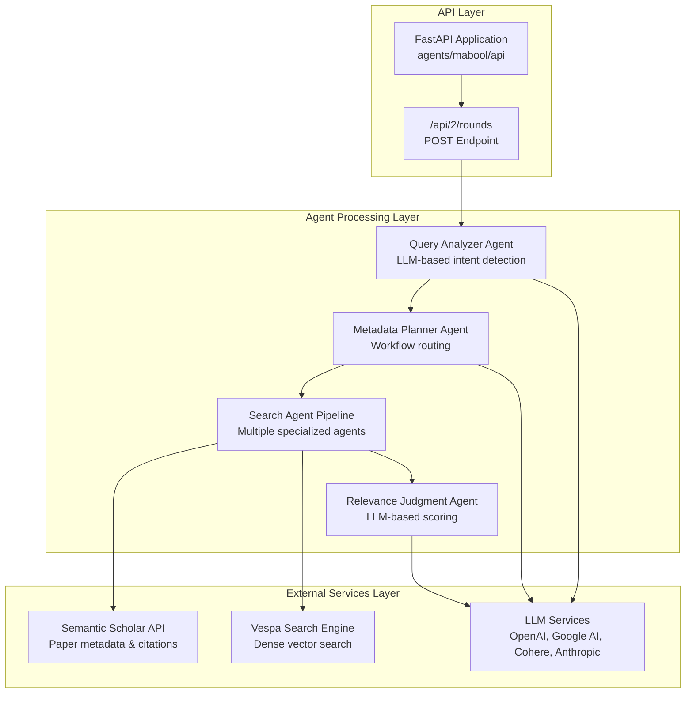
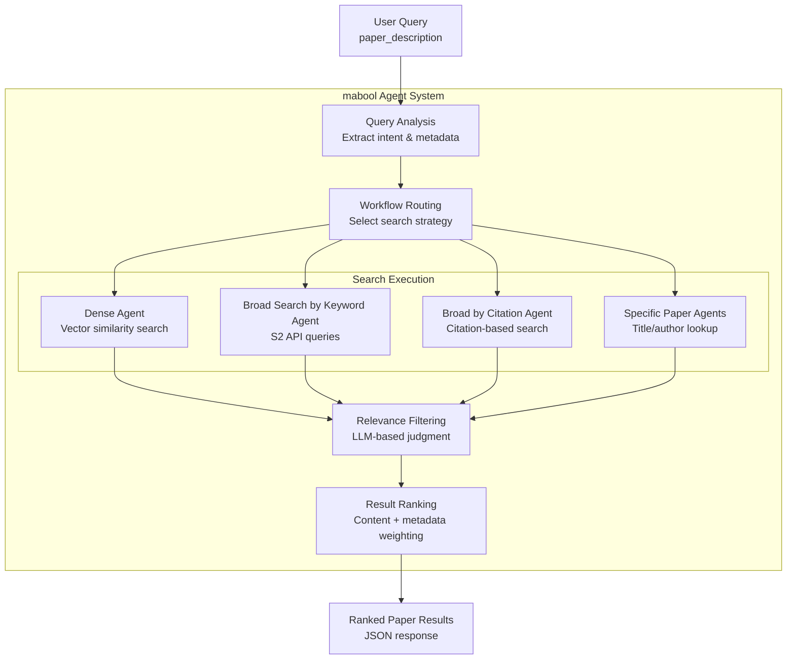

<!-- source: DeepWiki mcp.deepwiki.com · repo allenai/asta-paper-finder · page 1 Overview · fetched 2026-10-26 -->

# Overview

Relevant source files

The following files were used as context for generating this wiki page:

- [CONTRIBUTING.md](CONTRIBUTING.md)
- [LICENSE](LICENSE)
- [README.md](README.md)

## Purpose and Scope

This document provides an overview of the ASTA Paper Finder repository, an academic paper search system that uses large language models and multiple search strategies to locate relevant research papers based on natural language queries. The system is designed as a standalone agent that can understand complex paper-seeking intents and return relevance-ranked results.

For detailed information about specific subsystems, see [System Architecture](#2), [Agent System](#3), [Configuration System](#4), and [API Reference](#5). For development setup and contributing guidelines, see [Development Guide](#6).

## Current Repository Status

**Important: This repository is frozen and archived.** As stated in [CONTRIBUTING.md:3-5](), the codebase is not actively maintained, supported, or monitored, and no contributions are accepted. This represents a snapshot of the PaperFinder agent system at a specific point in time, primarily intended for research reproducibility and local evaluation.

The code differs from the live PaperFinder agent deployed at https://paperfinder.allen.ai/ in several ways: it lacks multi-turn conversation capabilities, user-friendly progress updates, graphical result widgets, and access to certain proprietary datasets. This version focuses specifically on single-turn paper search functionality.

Sources: [CONTRIBUTING.md:1-6](), [README.md:13-17]()

## System Overview

PaperFinder is implemented as a pipeline of manually-coded components that incorporate LLM decisions at key decision points, along with LLM-based relevance judgments of retrieved abstracts and snippets. The system analyzes incoming queries, transforms them into structured objects, and routes them through specialized workflows designed for different paper-seeking intents.

### Core Architecture

The system consists of three main layers:

Sources: [README.md:9-11](), system architecture diagrams

### Request Processing Flow

The following diagram shows how a typical paper search request flows through the system:

Sources: [README.md:9-11](), agent system architecture diagrams

## Key System Components

### Agent System (`agents/mabool/`)

The core of the system is the `mabool` agent implementation, which orchestrates the entire paper search process. Key components include:

| Component | Purpose | Location |
|-----------|---------|----------|
| Query Analyzer Agent | Extracts search intent and metadata from natural language | `agents/mabool/` |
| Search Agents | Specialized agents for different search strategies | `agents/mabool/` |
| Relevance Judgment Agent | LLM-based filtering and scoring | `agents/mabool/` |
| Metadata Planner Agent | Workflow routing and execution planning | `agents/mabool/` |

### Configuration System

The system uses a comprehensive TOML-based configuration system that controls agent behavior, timeouts, model settings, and user-facing content:

- **Main Configuration**: [config.toml]() - Agent parameters, API settings, model configurations
- **Fast Mode Configuration**: [config.extra.fast_mode.toml]() - Optimized settings for faster searches
- **User-Facing Strings**: [user_facing/*.toml]() - UI text and explanation templates

### External Service Integration

The system integrates with multiple external APIs:

- **Semantic Scholar API**: Paper metadata, citations, and search
- **Vespa Search Engine**: Dense vector search capabilities  
- **LLM Services**: OpenAI (GPT-4o, GPT-4 Turbo), Google AI (Gemini 2.0 Flash), Cohere (rerank-english-v3.0), Anthropic (Claude 3.5 Sonnet)

Sources: Configuration system diagrams, external service integration architecture

## Technology Stack

The system is built using:

- **Python 3.12.8** with `uv` package manager
- **FastAPI** for the REST API server
- **TOML** configuration files with automated type generation
- **Makefile-based** build system for development workflows
- **File-based caching** with 600-second TTL for API responses

## Getting Started

To run the system locally:

1. Set up API keys in `agents/mabool/api/conf/.env.secret` for OpenAI, Semantic Scholar, Cohere, and Google AI
2. Install dependencies: `make sync-dev`
3. Start the development server: `cd agents/mabool/api && make start-dev`
4. Send requests to the `/api/2/rounds` POST endpoint

For detailed setup instructions, see [Environment Setup](#6.1). For API usage details, see [API Reference](#5).

Sources: [README.md:19-58]()

---

