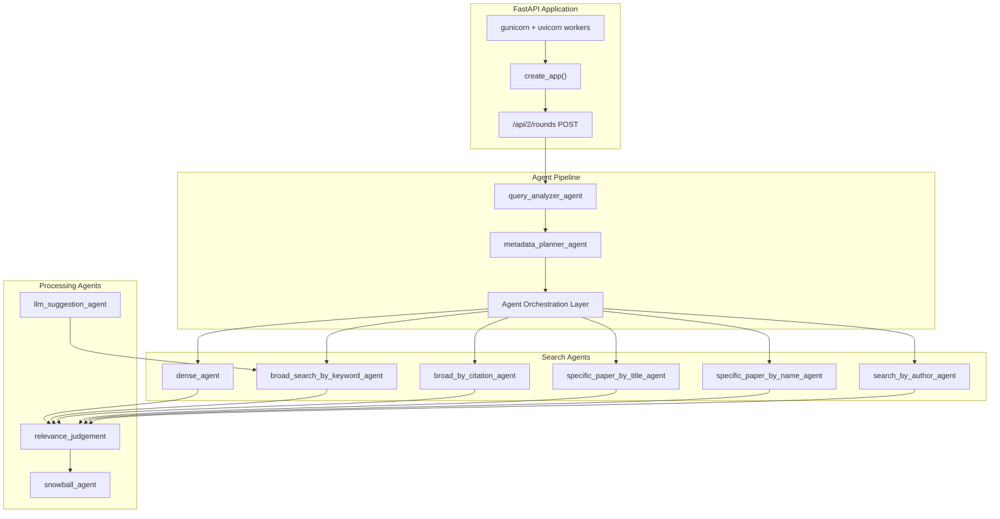
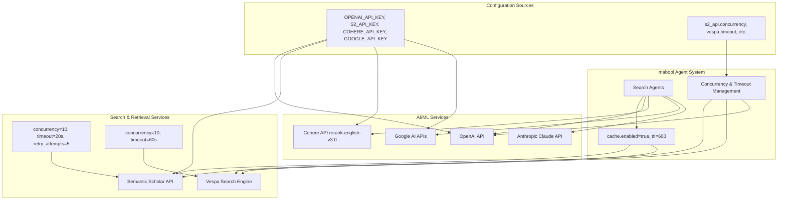
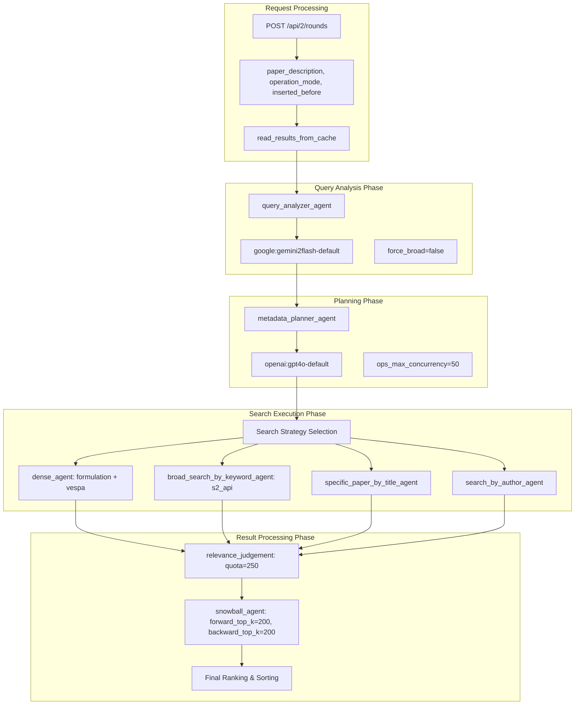

<!-- source: DeepWiki mcp.deepwiki.com · repo allenai/asta-paper-finder · page 2 System Architecture · fetched 2026-10-26 -->

# System Architecture

Relevant source files

The following files were used as context for generating this wiki page:

- [README.md](README.md)
- [agents/mabool/api/conf/config.toml](agents/mabool/api/conf/config.toml)
- [agents/mabool/api/dev.sh](agents/mabool/api/dev.sh)
- [agents/mabool/api/mabool/__init__.py](agents/mabool/api/mabool/__init__.py)

This page provides a high-level overview of the ASTA Paper Finder system architecture, focusing on the mabool agent system that powers paper search operations. It covers the FastAPI application structure, the agent pipeline design, external service integrations, and the configuration management system.

For detailed information about individual agents and their specific behaviors, see [Agent System](#3). For API endpoint specifications, see [API Reference](#5). For external service integration details, see [External Service Integrations](#7).

## System Overview

The ASTA Paper Finder is implemented as a FastAPI application that orchestrates a pipeline of specialized search agents. The system processes natural language queries about academic papers and returns ranked, relevance-judged results through a structured workflow involving query analysis, execution planning, and multi-stage retrieval operations.

## Core Application Architecture

The application runs as a FastAPI server launched through `gunicorn` with `uvicorn` workers, as configured in [agents/mabool/api/dev.sh:2-10](). The main entry point is the `create_app()` function which provides the `/api/2/rounds` POST endpoint for paper search requests.

**Sources:** [agents/mabool/api/dev.sh:2-10](), [README.md:35-58]()

## Configuration-Driven Architecture

```mermaid
graph TB
    subgraph "Configuration Management"
        CONFIG_TOML["config.toml"]
        FAST_MODE["config.extra.fast_mode.toml"]
        ENV_SECRET[".env.secret"]
    end
    
    subgraph "LLM Abstraction Layer"
        LLM_ABSTRACT["llm_abstraction"]
        GPT4O["gpt4o_default_model"]
        GPT4TURBO["gpt4turbo_default_model"] 
        CLAUDE["claude37sonnet_default_model"]
        GEMINI["gemini2flash_default_model"]
    end
    
    subgraph "Agent Configuration Bindings"
        DENSE_CONFIG["default.dense_agent"]
        BROAD_CONFIG["default.broad_search_agent"]
        RELEVANCE_CONFIG["default.relevance_judgement"]
        QUERY_CONFIG["default.query_analyzer_agent"]
        PLANNER_CONFIG["default.metadata_planner_agent"]
    end
    
    subgraph "External Service Config"
        S2_CONFIG["default.s2_api"]
        VESPA_CONFIG["default.vespa"]
        COHERE_CONFIG["default.cohere"]
        CACHE_CONFIG["default.cache"]
    end
    
    CONFIG_TOML --> LLM_ABSTRACT
    CONFIG_TOML --> DENSE_CONFIG
    CONFIG_TOML --> BROAD_CONFIG
    CONFIG_TOML --> RELEVANCE_CONFIG
    CONFIG_TOML --> QUERY_CONFIG
    CONFIG_TOML --> PLANNER_CONFIG
    CONFIG_TOML --> S2_CONFIG
    CONFIG_TOML --> VESPA_CONFIG
    CONFIG_TOML --> COHERE_CONFIG
    CONFIG_TOML --> CACHE_CONFIG
    
    LLM_ABSTRACT --> GPT4O
    LLM_ABSTRACT --> GPT4TURBO
    LLM_ABSTRACT --> CLAUDE
    LLM_ABSTRACT --> GEMINI
    
    ENV_SECRET --> LLM_ABSTRACT
    FAST_MODE --> DENSE_CONFIG
    FAST_MODE --> BROAD_CONFIG
```

The system uses a comprehensive TOML-based configuration system where each agent and external service has dedicated configuration sections. The `llm_abstraction` layer provides model-agnostic access to different LLM providers, with model selection configured per agent.

**Sources:** [agents/mabool/api/conf/config.toml:21-98](), [README.md:21-24]()

## External Service Integration

The system integrates with multiple external services through a centralized configuration approach. Rate limiting and timeout management are configurable per service, with caching enabled by default with a 600-second TTL.

**Sources:** [agents/mabool/api/conf/config.toml:6](), [agents/mabool/api/conf/config.toml:10](), [agents/mabool/api/conf/config.toml:14](), [agents/mabool/api/conf/config.toml:34-36](), [README.md:23-24]()

## Agent Pipeline Flow

The system processes requests through a structured pipeline where each phase is configurable. The `operation_mode` parameter influences search strategy selection, with "fast" and "diligent" modes providing different levels of exhaustiveness.

**Sources:** [README.md:44-57](), [agents/mabool/api/conf/config.toml:66-67](), [agents/mabool/api/conf/config.toml:70-71](), [agents/mabool/api/conf/config.toml:52-63](), [agents/mabool/api/conf/config.toml:5]()

## Dependency Injection and Scoping

The system uses a dependency injection framework with configurable scoping. The `round_scope_timeout` is set to 86400 seconds (24 hours), allowing for long-running search operations while maintaining proper resource management.

| Configuration Key | Value | Purpose |
|---|---|---|
| `di.round_scope_timeout` | 86400 | Maximum duration for a single search round |
| `operative_timeout` | 86400 | Overall operation timeout |
| `cache.ttl` | 600 | Cache time-to-live in seconds |
| `force_deterministic` | false | Enable deterministic behavior for testing |

**Sources:** [agents/mabool/api/conf/config.toml:22](), [agents/mabool/api/conf/config.toml:17](), [agents/mabool/api/conf/config.toml:14](), [agents/mabool/api/conf/config.toml:15]()

---

