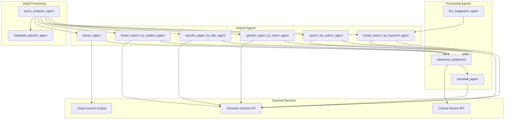
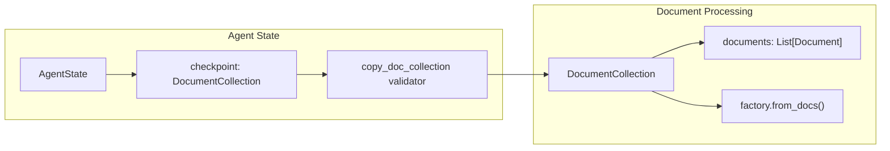
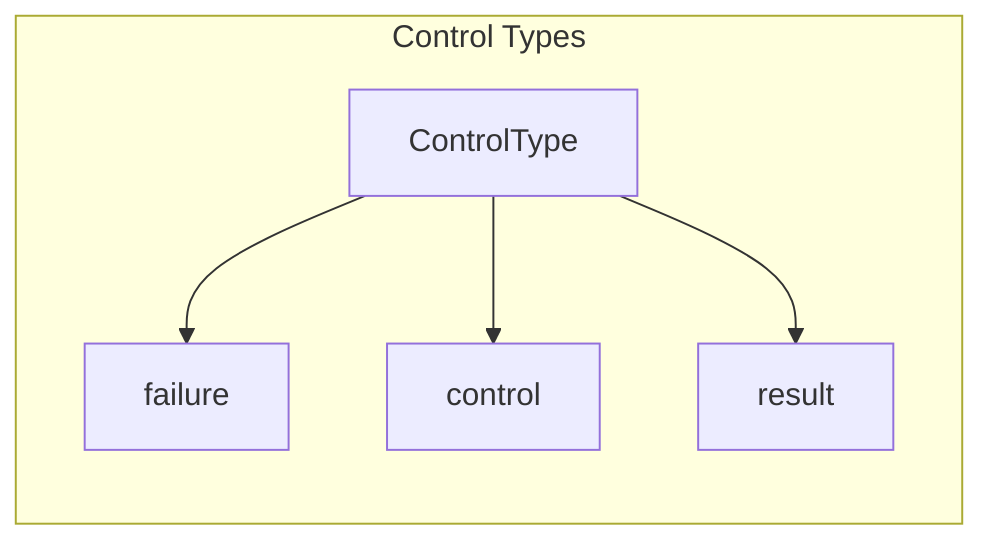
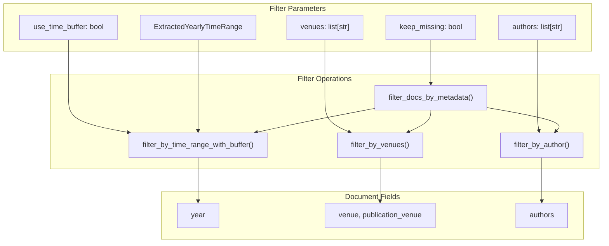
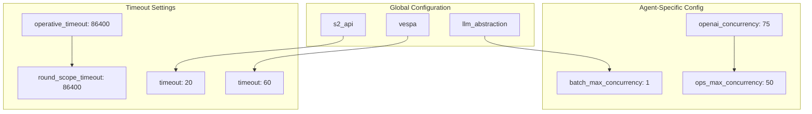
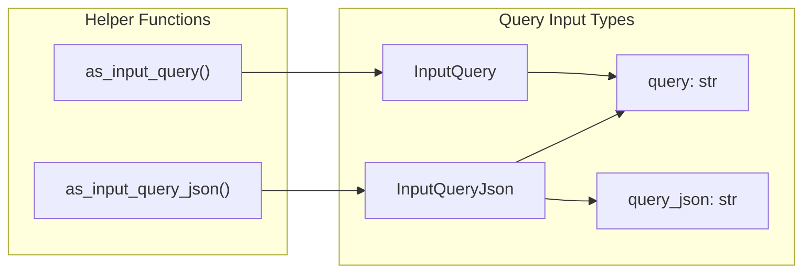

<!-- source: DeepWiki mcp.deepwiki.com · repo allenai/asta-paper-finder · page 3 Agent System · fetched 2026-10-26 -->

# Agent System

Relevant source files

The following files were used as context for generating this wiki page:

- [agents/mabool/api/conf/config.toml](agents/mabool/api/conf/config.toml)
- [agents/mabool/api/mabool/agents/__init__.py](agents/mabool/api/mabool/agents/__init__.py)
- [agents/mabool/api/mabool/agents/common/common.py](agents/mabool/api/mabool/agents/common/common.py)

The Agent System is the core component of the ASTA Paper Finder that orchestrates academic paper search operations through a collection of specialized agents. This system implements a multi-agent architecture where different agents handle specific aspects of paper discovery, from query analysis to result processing.

For detailed information about specific search agent implementations, see [Search Agents](#3.1). For LLM integration and prompt engineering details, see [Agent Prompts and LLM Integration](#3.2). For shared utilities and data structures, see [Common Agent Utilities](#3.3).

## Agent System Architecture

The agent system follows a pipeline-based architecture where agents are orchestrated to handle different phases of the search process. The system is designed around the concept of `DocumentCollection` processing, where each agent transforms or enriches the collection of academic papers.

### Agent Execution Pipeline

Sources: [agents/mabool/api/conf/config.toml:1-98]()

### Agent State Management

The agent system uses a standardized state management approach through the `AgentState` class, which provides checkpoint functionality for maintaining intermediate results.

Sources: [agents/mabool/api/mabool/agents/common/common.py:18-28]()

## Agent Categories

The agent system organizes agents into distinct categories based on their functional responsibilities:

### Analysis and Planning Agents

| Agent | Configuration Key | LLM Model | Purpose |
|-------|------------------|-----------|---------|
| Query Analyzer | `query_analyzer_agent` | `google:gemini2flash-default` | Analyzes user queries and determines search strategy |
| Metadata Planner | `metadata_planner_agent` | `openai:gpt4o-default` | Plans metadata-based filtering operations |

### Search Strategy Agents

| Agent | Configuration Key | LLM Model | Search Type |
|-------|------------------|-----------|-------------|
| Dense Agent | `dense_agent` | `google:gemini2flash-default` | Vector-based semantic search |
| Broad Keyword | `broad_search_by_keyword_agent` | `google:gemini2flash-default` | Keyword-based broad search |
| Broad Citation | `broad_search_by_citation_agent` | N/A | Citation-based discovery |
| Specific Title | `specific_paper_by_title_agent` | `google:gemini2flash-default` | Exact paper title matching |
| Specific Name | `specific_paper_by_name_agent` | N/A | Paper name-based search |
| Author Search | `search_by_author_agent` | `google:gemini2flash-default` | Author-focused paper discovery |

### Post-Processing Agents

| Agent | Configuration Key | LLM Model | Function |
|-------|------------------|-----------|----------|
| Relevance Judgement | `relevance_judgement` | `google:gemini2flash-default` | Assesses paper relevance to query |
| Snowball Agent | `snowball_agent` | N/A | Expands results through citations |
| LLM Suggestion | `llm_suggestion_agent` | `google:gemini2flash-default` | Generates additional search suggestions |

Sources: [agents/mabool/api/conf/config.toml:38-98]()

## Agent Execution Model

### Control Flow Types

The agent system uses a standardized control flow mechanism with three distinct types:

Sources: [agents/mabool/api/mabool/agents/common/common.py:15]()

### Document Filtering Pipeline

Agents utilize a sophisticated document filtering system that supports multiple metadata dimensions:

Sources: [agents/mabool/api/mabool/agents/common/common.py:30-153]()

## Configuration System Integration

### Agent Configuration Structure

Each agent is configured through the TOML configuration system with standardized parameter patterns:

| Configuration Pattern | Purpose | Example Agents |
|----------------------|---------|----------------|
| `llm_model_name` | Specifies LLM provider and model | `query_analyzer_agent`, `metadata_planner_agent` |
| `formulation_model_name` | Model for query reformulation | `dense_agent`, `broad_search_by_keyword_agent` |
| `max_iterations` | Limits iterative processing | `broad_search_agent`, `dense_agent` |
| `concurrency` | Controls parallel execution | `relevance_judgement`, `metadata_planner_agent` |
| `timeout` | Operation time limits | Inherited from `s2_api`, `vespa` |

### Timeout and Concurrency Management

Sources: [agents/mabool/api/conf/config.toml:6,17,21-23,32,53,71,96]()

### Input Query Types

The agent system standardizes query input through typed interfaces:

Sources: [agents/mabool/api/mabool/agents/common/common.py:156-169]()

---

