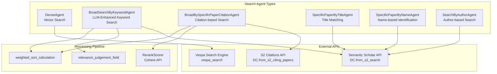
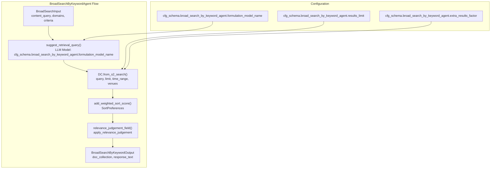
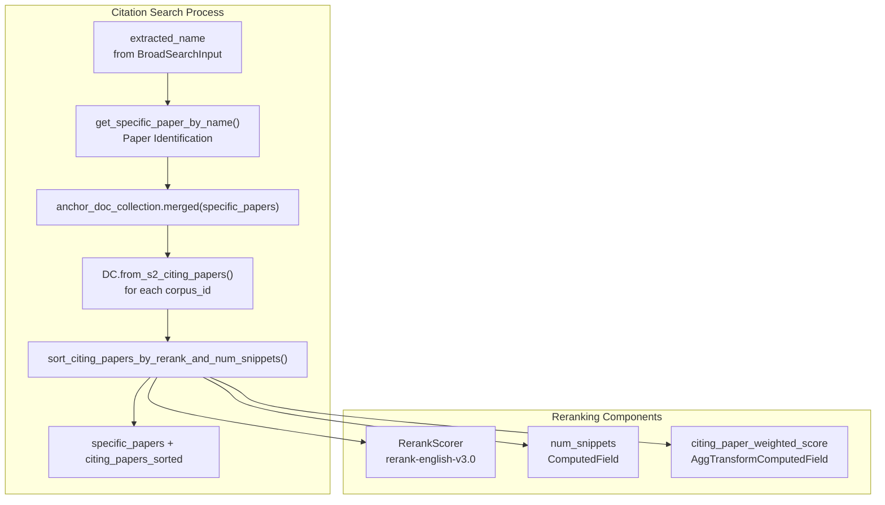

<!-- source: DeepWiki mcp.deepwiki.com · repo allenai/asta-paper-finder · page 3.1 Search Agents · fetched 2026-10-26 -->

# Search Agents

<details>
<summary>Relevant source files</summary>

The following files were used as context for generating this wiki page:

- [agents/mabool/api/mabool/agents/broad_search_by_keyword/__init__.py](agents/mabool/api/mabool/agents/broad_search_by_keyword/__init__.py)
- [agents/mabool/api/mabool/agents/broad_search_by_keyword/broad_search_by_keyword_agent.py](agents/mabool/api/mabool/agents/broad_search_by_keyword/broad_search_by_keyword_agent.py)
- [agents/mabool/api/mabool/agents/by_citing_papers/__init__.py](agents/mabool/api/mabool/agents/by_citing_papers/__init__.py)
- [agents/mabool/api/mabool/agents/by_citing_papers/broad_by_specific_paper_citation_agent.py](agents/mabool/api/mabool/agents/by_citing_papers/broad_by_specific_paper_citation_agent.py)

</details>


This document covers the specialized search agents in the mabool system that perform different types of paper retrieval operations. These agents implement distinct search strategies ranging from keyword-based searches to citation analysis and specific paper identification. For information about agent prompts and LLM integration, see [Agent Prompts and LLM Integration](#3.2). For shared agent utilities and data structures, see [Common Agent Utilities](#3.3).

## Agent Architecture Overview

The search agents form the core retrieval layer of the mabool system, each implementing the `Operative` interface to provide specialized paper search capabilities. All agents follow a common pattern of accepting search inputs, maintaining state across iterations, and returning document collections with optional relevance scoring.



Sources: [agents/mabool/api/mabool/agents/broad_search_by_keyword/broad_search_by_keyword_agent.py:62-120](), [agents/mabool/api/mabool/agents/by_citing_papers/broad_by_specific_paper_citation_agent.py:209-248]()

## Broad Search by Keyword Agent

The `BroadSearchByKeywordAgent` implements LLM-enhanced keyword searching by reformulating user queries into optimized search terms before executing retrieval operations.

### Implementation Details

The agent follows a two-phase approach:

1. **Query Reformulation**: Uses the `suggest_retrieval_query()` function to transform user input via LLM prompts
2. **Search Execution**: Performs retrieval using the Semantic Scholar API with optional sorting and relevance filtering



Sources: [agents/mabool/api/mabool/agents/broad_search_by_keyword/broad_search_by_keyword_agent.py:41-50](), [agents/mabool/api/mabool/agents/broad_search_by_keyword/broad_search_by_keyword_agent.py:121-190]()

### Key Features

| Feature | Implementation | Configuration |
|---------|---------------|---------------|
| Query Enhancement | `suggest_retrieval_query()` with LLM endpoint | `formulation_model_name` |
| Result Limiting | Dynamic limit based on sorting needs | `results_limit * extra_results_factor` |
| Domain Filtering | `get_fields_of_study_filter_from_domains()` | From `DomainsIdentified` input |
| Temporal Filtering | `time_range` parameter in S2 search | `ExtractedYearlyTimeRange` |
| Relevance Scoring | `relevance_judgement_field()` application | `apply_relevance_judgement` flag |

Sources: [agents/mabool/api/mabool/agents/broad_search_by_keyword/broad_search_by_keyword_agent.py:147-149](), [agents/mabool/api/mabool/agents/broad_search_by_keyword/broad_search_by_keyword_agent.py:186-188]()

## Citation-Based Search Agent

The `BroadBySpecificPaperCitationAgent` implements citation analysis by finding papers that cite specific anchor papers, using both paper identification and citation traversal.

### Citation Search Pipeline



Sources: [agents/mabool/api/mabool/agents/by_citing_papers/broad_by_specific_paper_citation_agent.py:112-177](), [agents/mabool/api/mabool/agents/by_citing_papers/broad_by_specific_paper_citation_agent.py:40-109]()

### Reranking Algorithm

The citation agent implements sophisticated reranking using multiple signals:

1. **Cohere Reranking**: Scores documents based on title and snippet relevance to query
2. **Snippet Count**: Weights papers by the number of available text snippets
3. **Weighted Combination**: Combines scores using configurable weights

```python
# Reranking weights used in weighted_sort_calculation_partial
{"citing_paper_rerank_score": 1.0, "num_snippets": 0.25}
```

Sources: [agents/mabool/api/mabool/agents/by_citing_papers/broad_by_specific_paper_citation_agent.py:89-92](), [agents/mabool/api/mabool/agents/by_citing_papers/broad_by_specific_paper_citation_agent.py:68-77]()

## Agent State Management

All search agents implement stateful operation through the `Operative` interface, maintaining search iterations and document checkpoints across multiple calls.

### State Pattern Implementation

| Agent | State Class | Key State Fields | Checkpoint Type |
|-------|-------------|------------------|-----------------|
| `BroadSearchByKeywordAgent` | `BroadSearchByKeywordState` | `search_iteration` | `DocumentCollection` |
| `BroadBySpecificPaperCitationAgent` | `BroadBySpecificPaperCitationState` | `search_iteration` | `DocumentCollection` |

### Response Handling

Agents return `OperativeResponse` objects with three possible outcomes:

- **`CompleteResponse`**: Successful operation with results
- **`PartialResponse`**: Partial success with error details  
- **`VoidResponse`**: Complete failure with error information

Sources: [agents/mabool/api/mabool/agents/broad_search_by_keyword/broad_search_by_keyword_agent.py:87-119](), [agents/mabool/api/mabool/agents/by_citing_papers/broad_by_specific_paper_citation_agent.py:214-248]()

## Common Integration Patterns

### Document Collection Operations

All search agents utilize the `DC` (Document Collection) utility class for consistent data handling:

- **`DC.from_s2_search()`**: Semantic Scholar search integration
- **`DC.from_s2_citing_papers()`**: Citation retrieval
- **`DC.merge()`**: Combining results from multiple sources
- **`DC.empty()`**: Creating empty collections for error states

### Field Requirements

Search agents consistently request specific document fields through the `BASIC_FIELDS` constant and additional computed fields:

- **Basic Fields**: Core document metadata (title, authors, abstract, etc.)
- **Citation Fields**: `citation_count` for sorting operations  
- **Computed Fields**: Relevance scores, snippet counts, weighted scores

Sources: [agents/mabool/api/mabool/agents/broad_search_by_keyword/broad_search_by_keyword_agent.py:152-184](), [agents/mabool/api/mabool/agents/by_citing_papers/broad_by_specific_paper_citation_agent.py:190-202]()

---

