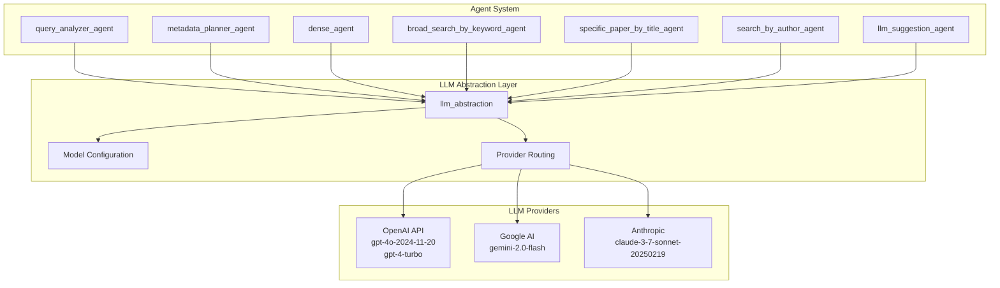
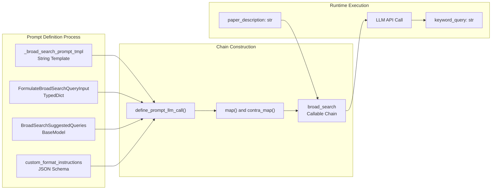
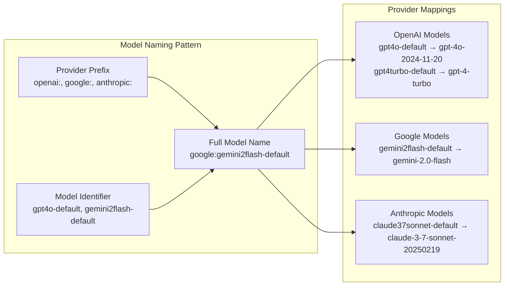

<!-- source: DeepWiki mcp.deepwiki.com · repo allenai/asta-paper-finder · page 3.2 Agent Prompts and LLM Integration · fetched 2026-10-26 -->

# Agent Prompts and LLM Integration

<details>
<summary>Relevant source files</summary>

The following files were used as context for generating this wiki page:

- [agents/mabool/api/conf/config.toml](agents/mabool/api/conf/config.toml)
- [agents/mabool/api/mabool/agents/broad_search_by_keyword/broad_search_by_keyword_prompts.py](agents/mabool/api/mabool/agents/broad_search_by_keyword/broad_search_by_keyword_prompts.py)

</details>


This page documents how the mabool agent system integrates with Large Language Models (LLMs) for query processing, reformulation, and analysis. It covers the prompt template system, LLM abstraction layer, and how different agents are configured to use specific models. For information about the specific search agents that use these LLM capabilities, see [Search Agents](#3.1). For detailed configuration parameters, see [Main Configuration](#4.1).

## LLM Abstraction Layer

The system uses a centralized LLM abstraction layer that supports multiple providers and models. This abstraction allows agents to specify model preferences while maintaining consistent interfaces across different LLM providers.



The LLM abstraction configuration includes default models for each provider and global settings like temperature and concurrency limits:

| Configuration Key | Value | Description |
|-------------------|-------|-------------|
| `gpt4o_default_model` | `"gpt-4o-2024-11-20"` | Default GPT-4o model version |
| `gpt4turbo_default_model` | `"gpt-4-turbo"` | Default GPT-4 Turbo model |
| `claude37sonnet_default_model` | `"claude-3-7-sonnet-20250219"` | Default Claude 3.5 Sonnet model |
| `gemini2flash_default_model` | `"gemini-2.0-flash"` | Default Gemini 2.0 Flash model |
| `temparature` | `1.0` | Temperature setting for all models |
| `batch_max_concurrency` | `1` | Maximum concurrent batch requests |

Sources: [agents/mabool/api/conf/config.toml:24-33]()

## Prompt Template System

The system uses the `ai2i.chain` library to define structured prompt templates with type-safe inputs and outputs. This approach ensures consistency and enables automatic validation of LLM interactions.



### Example: Broad Search Query Reformulation

The broad search agent demonstrates the typical prompt template structure. The prompt guides the LLM to reformulate natural language descriptions into keyword-based search queries suitable for Semantic Scholar:

```python
_broad_search_prompt_tmpl = """
Given a user-provided natural language description of desired scientific papers, \
reformulate the query as an alternative search query for the Semantic Scholar search engine.
Focus on formulating the natural language query into a keyword search query, that is, \
remove unnecessary descriptive words that wont show up in the content itself and keep the keywords to look for.

Use plain text for queries, as Semantic Scholar does not support special syntax.
Semantic Scholar does not support hyphens in queries, so avoid hyphens.

When building the queries, try to use only content-keywords, that is, do emit metadata or non keyword-y wordings!

Input description: ```{paper_description}```
"""
```

The prompt template uses:
- **Input Type**: `FormulateBroadSearchQueryInput` (TypedDict with `paper_description` field)
- **Output Type**: `BroadSearchSuggestedQueries` (BaseModel with `keyword_query` field) 
- **Format Instructions**: Custom JSON schema guidance for structured output
- **Chain Operations**: `map()` to extract the keyword query and `contra_map()` to transform string input

Sources: [agents/mabool/api/mabool/agents/broad_search_by_keyword/broad_search_by_keyword_prompts.py:11-45]()

## Agent-Specific LLM Configuration

Different agents are configured to use specific LLM models based on their processing requirements. The configuration allows fine-tuning of model selection, concurrency, and other parameters per agent.

```mermaid
graph TB
    subgraph "Query Processing Agents"
        QueryAnalyzer["query_analyzer_agent<br/>google:gemini2flash-default"]
        MetadataPlanner["metadata_planner_agent<br/>openai:gpt4o-default"]
    end

    subgraph "Search Formulation Agents"
        DenseAgent["dense_agent<br/>google:gemini2flash-default"]
        BroadKeyword["broad_search_by_keyword_agent<br/>google:gemini2flash-default"]
        SpecificTitle["specific_paper_by_title_agent<br/>google:gemini2flash-default"]
        AuthorSearch["search_by_author_agent<br/>google:gemini2flash-default"]
    end

    subgraph "Analysis Agents"
        RelevanceJudgement["relevance_judgement<br/>google:gemini2flash-default"]
        LLMSuggestion["llm_suggestion_agent<br/>google:gemini2flash-default"]
    end

    subgraph "Model Assignments"
        GeminiDefault["Gemini 2.0 Flash<br/>Most Agents"]
        GPT4oDefault["GPT-4o<br/>Metadata Planning"]
    end

    QueryAnalyzer --> GeminiDefault
    DenseAgent --> GeminiDefault
    BroadKeyword --> GeminiDefault
    SpecificTitle --> GeminiDefault
    AuthorSearch --> GeminiDefault
    RelevanceJudgement --> GeminiDefault
    LLMSuggestion --> GeminiDefault

    MetadataPlanner --> GPT4oDefault
```



### Agent Model Assignments

| Agent | Model Configuration | Purpose |
|-------|-------------------|---------|
| `query_analyzer_agent` | `google:gemini2flash-default` | Analyze user queries and determine search strategy |
| `metadata_planner_agent` | `openai:gpt4o-default` | Plan metadata extraction and processing |
| `dense_agent` | `google:gemini2flash-default` | Formulate dense search queries |
| `broad_search_by_keyword_agent` | `google:gemini2flash-default` | Reformulate natural language to keyword queries |
| `specific_paper_by_title_agent` | `google:gemini2flash-default` | Process specific paper title searches |
| `search_by_author_agent` | `google:gemini2flash-default` | Handle author-based search queries |
| `relevance_judgement` | `google:gemini2flash-default` | Assess paper relevance to queries |
| `llm_suggestion_agent` | `google:gemini2flash-default` | Generate search suggestions |

### Concurrency and Performance Settings

Several agents have specific concurrency and performance configurations for their LLM interactions:

| Agent | Concurrency Setting | Quota/Limits |
|-------|-------------------|--------------|
| `relevance_judgement` | `openai_concurrency = 75` | `quota = 250` |
| `metadata_planner_agent` | `ops_max_concurrency = 50` | N/A |
| `search_by_author_agent` | N/A | `relevance_judgements_quota = 75` |
| `llm_suggestion_agent` | `openai_concurrency = 75` | `fallback_n_suggestions = 10` |

Sources: [agents/mabool/api/conf/config.toml:65-98]()

## Model Provider Integration

The system integrates with multiple LLM providers through a unified naming convention that includes the provider prefix and model identifier.

### Provider Naming Convention



### Default Model Configuration

The system maintains default model versions for each provider, allowing for centralized updates without changing individual agent configurations:

- **OpenAI**: Primary provider for metadata planning with `gpt-4o-2024-11-20` as the default GPT-4o model
- **Google**: Primary provider for most agents with `gemini-2.0-flash` as the default Gemini model  
- **Anthropic**: Alternative provider with `claude-3-7-sonnet-20250219` for specialized use cases

This provider abstraction enables easy model switching and A/B testing without modifying individual agent implementations.

Sources: [agents/mabool/api/conf/config.toml:24-33]()

---

