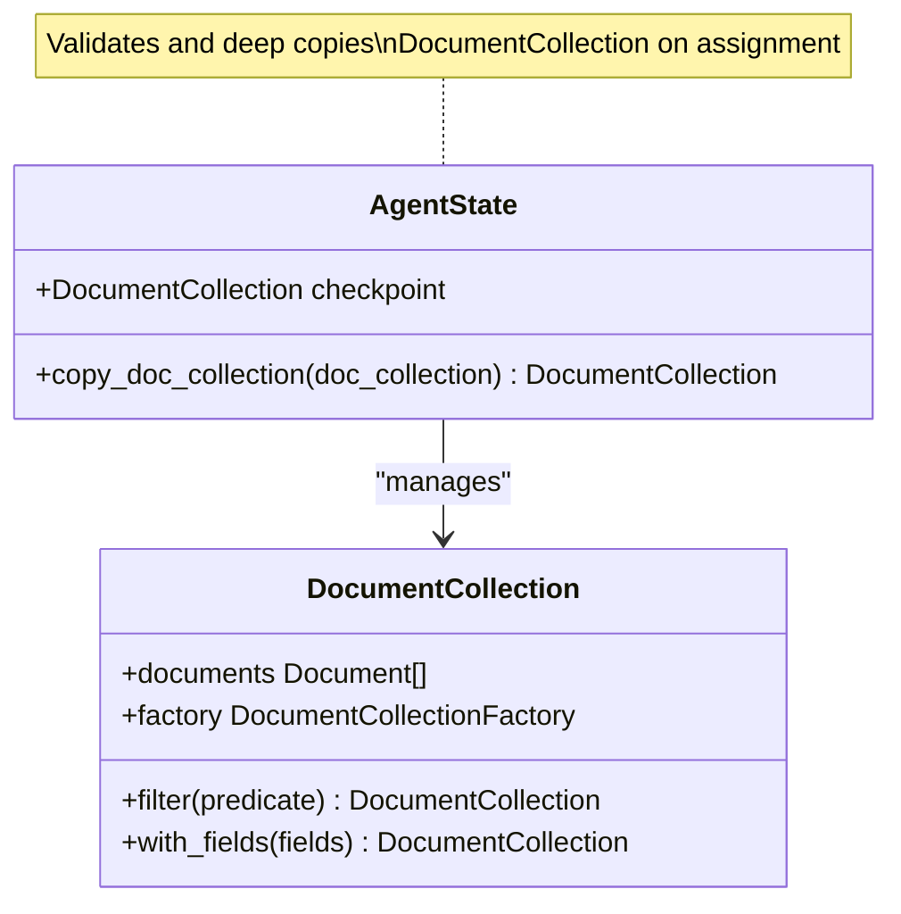
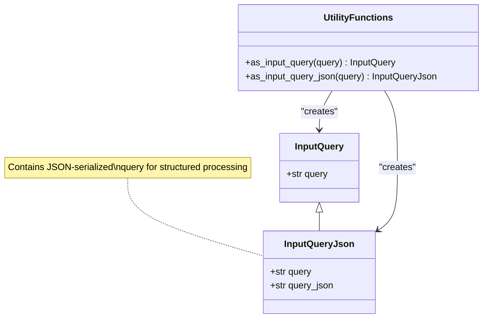

<!-- source: DeepWiki mcp.deepwiki.com · repo allenai/asta-paper-finder · page 3.3 Common Agent Utilities · fetched 2026-10-26 -->

# Common Agent Utilities

<details>
<summary>Relevant source files</summary>

The following files were used as context for generating this wiki page:

- [agents/mabool/api/mabool/agents/common/__init__.py](agents/mabool/api/mabool/agents/common/__init__.py)
- [agents/mabool/api/mabool/agents/common/common.py](agents/mabool/api/mabool/agents/common/common.py)
- [agents/mabool/api/mabool/agents/common/computed_fields/__init__.py](agents/mabool/api/mabool/agents/common/computed_fields/__init__.py)

</details>


This page documents the shared utility functions, data structures, and common types used across all agents in the mabool agent system. These utilities provide foundational capabilities for agent state management, document filtering, and input processing that are leveraged by the various search agents documented in [Search Agents](#3.1).

For information about agent-specific prompt engineering and LLM integration patterns, see [Agent Prompts and LLM Integration](#3.2). For details about individual search agent implementations, see [Search Agents](#3.1).

## Agent State Management

The agent system uses a standardized state management approach through the `AgentState` class, which provides checkpoint functionality for maintaining document collections across agent operations.

### AgentState Class

The [`AgentState`]() class in [agents/mabool/api/mabool/agents/common/common.py:18-28]() serves as the primary state container for agents:



**Sources:** [agents/mabool/api/mabool/agents/common/common.py:18-28]()

### Control Flow Types

The system defines control flow types through `ControlType` for managing agent execution states:

| Control Type | Purpose |
|--------------|---------|
| `"failure"` | Indicates agent operation failed |
| `"control"` | Represents control flow state |
| `"result"` | Indicates successful result state |

**Sources:** [agents/mabool/api/mabool/agents/common/common.py:15]()

## Document Filtering System

The common utilities provide a comprehensive document filtering system that allows agents to refine `DocumentCollection` instances based on metadata criteria including time ranges, venues, and authors.

### Filtering Architecture

```mermaid
graph TB
    filterDocsMetadata["filter_docs_by_metadata()"]
    timeFilter["filter_by_time_range_with_buffer()"]
    venueFilter["filter_by_venues()"]
    authorFilter["filter_by_author()"]
    
    docCollection["DocumentCollection"]
    extractedTimeRange["ExtractedYearlyTimeRange"]
    venuesList["list[str] venues"]
    authorsList["list[str] authors"]
    
    filterDocsMetadata --> timeFilter
    filterDocsMetadata --> venueFilter
    filterDocsMetadata --> authorFilter
    
    docCollection --> filterDocsMetadata
    extractedTimeRange --> timeFilter
    venuesList --> venueFilter
    authorsList --> authorFilter
    
    timeFilter --> filteredDocs["Filtered DocumentCollection"]
    venueFilter --> filteredDocs
    authorFilter --> filteredDocs
    
    note for timeFilter "Supports +/-20% buffer\nfor flexible date ranges"
    note for venueFilter "Matches normalized names\nand alternate venue names"
    note for authorFilter "Matches last names and\ninitials with fuzzy logic"
```

**Sources:** [agents/mabool/api/mabool/agents/common/common.py:115-153]()

### Time Range Filtering

The [`filter_by_time_range_with_buffer()`]() function [agents/mabool/api/mabool/agents/common/common.py:30-61]() provides flexible temporal filtering:

- **Buffer calculation**: Adds ±20% buffer to time ranges when `use_buffer=True`
- **Missing year handling**: Configurable behavior for documents without year information via `keep_missing` parameter
- **Range validation**: Handles both bounded and unbounded time ranges

### Venue Filtering

The [`filter_by_venues()`]() function [agents/mabool/api/mabool/agents/common/common.py:63-83]() matches documents against publication venues:

- **Normalized matching**: Uses `publication_venue.normalized_name` for standardized comparison
- **Alternate names**: Checks `publication_venue.alternate_names` for venue variations
- **Case-insensitive matching**: Converts all venue names to lowercase for comparison

### Author Filtering

The [`filter_by_author()`]() function [agents/mabool/api/mabool/agents/common/common.py:85-113]() implements fuzzy author matching:

- **Name parsing**: Splits author names into components for flexible matching
- **Initial matching**: Compares first and last initials when full names unavailable
- **Last name priority**: Prioritizes last name matching for author identification

## Input Query Types and Utilities

The system defines standardized input query types that provide consistent interfaces for agent operations.

### Query Type Hierarchy



**Sources:** [agents/mabool/api/mabool/agents/common/common.py:156-170]()

### Query Construction Functions

| Function | Return Type | Purpose |
|----------|-------------|---------|
| `as_input_query(query: str)` | `InputQuery` | Creates basic query structure |
| `as_input_query_json(query: str)` | `InputQueryJson` | Creates query with JSON representation |

The [`as_input_query_json()`]() function [agents/mabool/api/mabool/agents/common/common.py:168-170]() automatically serializes the query string into a JSON format for agents that require structured query processing.

## Computed Fields Module

The system includes a computed fields module at [agents/mabool/api/mabool/agents/common/computed_fields/]() that provides extensible computed field functionality for document processing, though the specific implementations are not visible in the provided files.

**Sources:** [agents/mabool/api/mabool/agents/common/computed_fields/__init__.py]()

## Integration with Agent System

These common utilities integrate with the broader agent system architecture through several key patterns:

```mermaid
graph LR
    searchAgents["Search Agents"]
    agentState["AgentState"]
    filterSystem["Document Filtering"]
    queryTypes["Input Query Types"]
    
    searchAgents --> agentState
    searchAgents --> filterSystem
    searchAgents --> queryTypes
    
    agentState --> documentCollection["DocumentCollection checkpoints"]
    filterSystem --> documentCollection
    queryTypes --> structuredInput["Structured agent inputs"]
    
    note for filterSystem "Metadata-based refinement\nof search results"
    note for agentState "State persistence across\nagent execution phases"
```

**Sources:** [agents/mabool/api/mabool/agents/common/common.py:1-170]()

---

