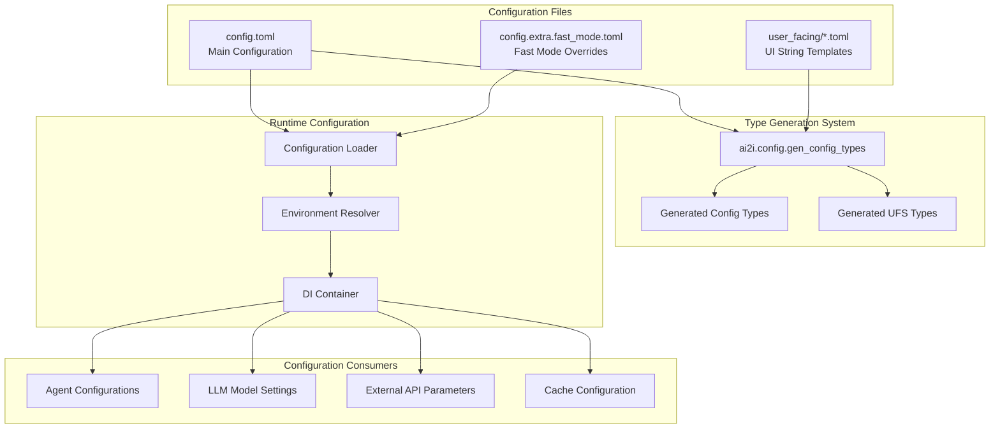
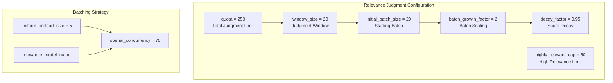
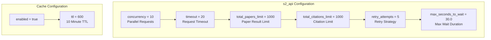

<!-- source: DeepWiki mcp.deepwiki.com · repo allenai/asta-paper-finder · page 4 Configuration System · fetched 2026-10-26 -->

# Configuration System

Relevant source files

The following files were used as context for generating this wiki page:

- [agents/mabool/api/conf/config.extra.fast_mode.toml](agents/mabool/api/conf/config.extra.fast_mode.toml)
- [agents/mabool/api/conf/config.toml](agents/mabool/api/conf/config.toml)

The Configuration System provides centralized TOML-based configuration management for the ASTA Paper Finder application. It controls agent behavior, external service parameters, LLM model settings, timeouts, and user-facing content through a hierarchical configuration structure.

For information about specific agent configurations, see [Agent System](#3). For details on build-time type generation from configuration files, see [Type Generation](#6.4).

## Configuration Architecture

The configuration system uses a multi-layered TOML structure that supports environment-specific overrides and specialized runtime modes. The system generates Python type definitions at build time to ensure type safety and IDE support.

Sources: [agents/mabool/api/conf/config.toml:1-98](), [agents/mabool/api/conf/config.extra.fast_mode.toml:1-12]()

## Configuration File Structure

The configuration system organizes settings into logical sections within TOML files. The main configuration file uses a hierarchical structure with environment-specific sections and component-specific subsections.

### Main Configuration Sections

| Section | Purpose | Key Settings |
|---------|---------|--------------|
| `[default]` | Global application settings | Environment, logging, cache, API limits |
| `[default.di]` | Dependency injection configuration | Timeout settings, scope management |
| `[default.llm_abstraction]` | LLM model defaults | Model names, temperature, concurrency |
| `[default.vespa]` | Vespa search engine settings | Concurrency, timeout values |
| Agent-specific sections | Individual agent parameters | Search limits, model assignments, behavior flags |

```mermaid
graph LR
    subgraph "config.toml Structure"
        DEFAULT["[default]<br/>Global Settings"]
        DI["[default.di]<br/>DI Container"]
        LLM["[default.llm_abstraction]<br/>LLM Models"]
        VESPA["[default.vespa]<br/>Search Engine"]
        
        subgraph "Agent Configurations"
            DENSE["[default.dense_agent]"]
            BROAD["[default.broad_search_agent]"]
            RELEVANCE["[default.relevance_judgement]"]
            QUERY["[default.query_analyzer_agent]"]
            METADATA["[default.metadata_planner_agent]"]
            KEYWORD["[default.broad_search_by_keyword_agent]"]
            TITLE["[default.specific_paper_by_title_agent]"]
            NAME["[default.specific_paper_by_name_agent]"]
            AUTHOR["[default.search_by_author_agent]"]
            LLM_SUGGEST["[default.llm_suggestion_agent]"]
        end
    end
    
    DEFAULT --> DI
    DEFAULT --> LLM
    DEFAULT --> VESPA
    DEFAULT --> DENSE
    DEFAULT --> BROAD
    DEFAULT --> RELEVANCE
    DEFAULT --> QUERY
    DEFAULT --> METADATA
    DEFAULT --> KEYWORD
    DEFAULT --> TITLE
    DEFAULT --> NAME
    DEFAULT --> AUTHOR
    DEFAULT --> LLM_SUGGEST
```

Sources: [agents/mabool/api/conf/config.toml:1-98]()

## Agent Configuration Parameters

Each agent type has dedicated configuration sections that control search behavior, model selection, and performance parameters. The configuration system allows fine-tuning of search strategies and resource utilization.

### Core Agent Settings

The dense search agent configuration demonstrates the typical parameter structure used across agent types:

- **Model Assignment**: `formulation_model_name = "google:gemini2flash-default"` specifies which LLM to use
- **Search Parameters**: `initial_top_k_per_query = 250` controls result set sizes
- **Iteration Limits**: `dense_agent_max_iterations = 2` prevents excessive recursion
- **Query Formulation**: `initial_queries_to_formulate = 5` determines search query generation

### Relevance Judgment Configuration

The relevance judgment system uses sophisticated batching and quotas to optimize LLM usage:

Sources: [agents/mabool/api/conf/config.toml:51-63]()

## LLM Model Configuration

The LLM abstraction layer configuration defines default models and execution parameters for different AI service providers. The system supports multiple model providers with consistent configuration patterns.

### Model Provider Configuration

The `[default.llm_abstraction]` section configures default models for each provider:

| Model Type | Configuration Key | Default Value |
|------------|-------------------|---------------|
| GPT-4o | `gpt4o_default_model` | `"gpt-4o-2024-11-20"` |
| GPT-4 Turbo | `gpt4turbo_default_model` | `"gpt-4-turbo"` |
| Claude 3.5 Sonnet | `claude37sonnet_default_model` | `"claude-3-7-sonnet-20250219"` |
| Gemini 2.0 Flash | `gemini2flash_default_model` | `"gemini-2.0-flash"` |

### LLM Execution Parameters

Global LLM settings control request behavior across all model providers:

- `temparature = 1.0` - Controls response randomness
- `n = 1` - Number of completions per request  
- `batch_max_concurrency = 1` - Concurrent batch processing limit

Sources: [agents/mabool/api/conf/config.toml:24-32]()

## External Service Configuration

The configuration system manages parameters for external APIs including rate limiting, timeouts, and retry behavior. Each service has dedicated configuration sections that optimize performance while respecting API limits.

### Semantic Scholar API Configuration

The `s2_api` configuration controls paper retrieval and citation analysis:

### Vespa Search Configuration

The Vespa search engine configuration optimizes dense vector search performance:

- `concurrency = 10` - Parallel search requests
- `timeout = 60` - Extended timeout for complex queries

Sources: [agents/mabool/api/conf/config.toml:6](), [agents/mabool/api/conf/config.toml:14](), [agents/mabool/api/conf/config.toml:34-36]()

## Configuration Modes and Overrides

The configuration system supports specialized runtime modes that modify default behavior for specific use cases. The fast mode configuration demonstrates how overrides reduce computational complexity for faster execution.

### Fast Mode Configuration

The `config.extra.fast_mode.toml` file provides performance-optimized overrides for development and testing:

| Agent | Default Setting | Fast Mode Override | Performance Impact |
|-------|-----------------|-------------------|-------------------|
| Dense Search | `dense_top_k` not specified | `dense_top_k = 100` | Reduced search depth |
| Snowball | `snowball_snippets_top_k` not specified | `snowball_snippets_top_k = 100` | Fewer citation expansions |
| Relevance | `quota = 250` | `relevance_judgement_quota = 75` | Reduced LLM judgments |

### Environment-Specific Configurations

The configuration system supports environment-specific sections for development, testing, and production deployments. The `[test.fast_broad_search_agent]` section demonstrates minimal settings for testing scenarios.

Sources: [agents/mabool/api/conf/config.extra.fast_mode.toml:1-12]()

---

