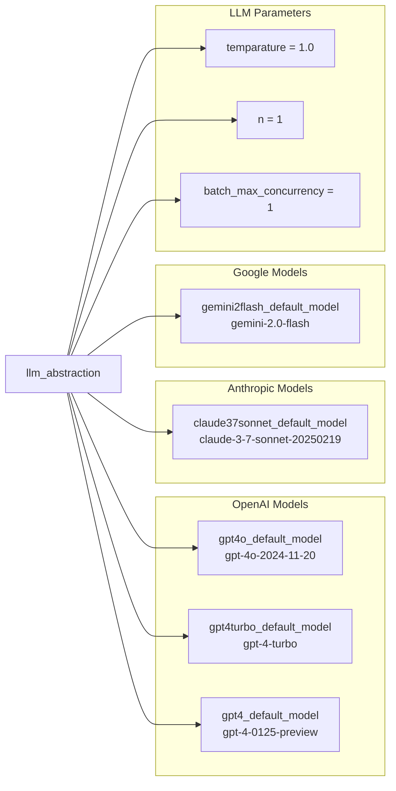
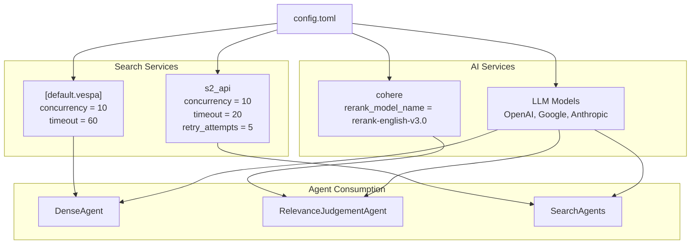

<!-- source: DeepWiki mcp.deepwiki.com · repo allenai/asta-paper-finder · page 4.1 Main Configuration · fetched 2026-10-26 -->

# Main Configuration

Relevant source files

The following files were used as context for generating this wiki page:

- [agents/mabool/api/conf/config.toml](agents/mabool/api/conf/config.toml)

This page documents the main configuration file that controls the behavior of the ASTA Paper Finder system. The configuration is defined in TOML format and covers agent parameters, external API settings, timeout values, and LLM model specifications.

For information about user-facing configuration strings and UI text, see [User-Facing Configuration](#4.2). For specialized configuration modes that override these defaults, see [Runtime Configuration Modes](#4.3).

## Configuration File Structure

The main configuration is located at [agents/mabool/api/conf/config.toml:1-98]() and follows a hierarchical structure with a `[default]` section containing global settings and subsections for specific components.

```mermaid
graph TB
    config_toml["config.toml"]
    
    subgraph "Top-Level Settings"
        env["env"]
        log_format["log_format"] 
        cache["cache"]
        timeouts["operative_timeout<br/>time_to_wait_for_results"]
    end
    
    subgraph "Component Configurations"
        di["[default.di]<br/>Dependency Injection"]
        llm_abs["[default.llm_abstraction]<br/>LLM Models & Settings"]
        vespa["[default.vespa]<br/>Search Engine"]
    end
    
    subgraph "Agent Configurations"
        dense["[default.dense_agent]"]
        broad["[default.broad_search_agent]"]  
        relevance["[default.relevance_judgement]"]
        query_analyzer["[default.query_analyzer_agent]"]
        metadata_planner["[default.metadata_planner_agent]"]
        keyword_agent["[default.broad_search_by_keyword_agent]"]
        title_agent["[default.specific_paper_by_title_agent]"]
        name_agent["[default.specific_paper_by_name_agent]"]
        author_agent["[default.search_by_author_agent]"]
        llm_suggest["[default.llm_suggestion_agent]"]
    end
    
    config_toml --> env
    config_toml --> log_format
    config_toml --> cache
    config_toml --> timeouts
    config_toml --> di
    config_toml --> llm_abs
    config_toml --> vespa
    config_toml --> dense
    config_toml --> broad
    config_toml --> relevance
    config_toml --> query_analyzer
    config_toml --> metadata_planner
    config_toml --> keyword_agent
    config_toml --> title_agent
    config_toml --> name_agent
    config_toml --> author_agent
    config_toml --> llm_suggest
```

Sources: [agents/mabool/api/conf/config.toml:1-98]()

## Core System Settings

The top-level configuration section controls fundamental system behavior including environment settings, caching, and global operational parameters.

| Setting | Value | Purpose |
|---------|-------|---------|
| `env` | `"dev"` | Environment identifier for deployment context |
| `log_format` | `""` | Logging format specification (empty = default) |
| `log_max_length` | `1048576` | Maximum log entry size in bytes |
| `cache.enabled` | `true` | Enable system-wide caching |
| `cache.ttl` | `600` | Cache time-to-live in seconds |
| `operative_timeout` | `86400` | Global operation timeout (24 hours) |
| `show_api_swagger` | `true` | Enable Swagger API documentation |
| `force_deterministic` | `false` | Force deterministic behavior for testing |
| `enable_llm_cache` | `false` | Enable LLM response caching |

The configuration also includes snowball agent settings and Semantic Scholar API parameters:

| Setting | Value | Purpose |
|---------|-------|---------|
| `snowball_agent.forward_top_k` | `200` | Forward citation limit |
| `snowball_agent.backward_top_k` | `200` | Backward citation limit |
| `s2_api.concurrency` | `10` | Concurrent requests to Semantic Scholar |
| `s2_api.timeout` | `20` | Request timeout in seconds |
| `s2_api.retry_attempts` | `5` | Number of retry attempts |
| `s2_api.total_papers_limit` | `1000` | Maximum papers to retrieve |

Sources: [agents/mabool/api/conf/config.toml:1-20]()

## LLM Model Configuration

The `[default.llm_abstraction]` section defines the available language models and their default configurations across different providers.

The model naming follows a pattern where agents reference models using the format `"provider:model-alias"` (e.g., `"google:gemini2flash-default"`, `"openai:gpt4o-default"`).

Sources: [agents/mabool/api/conf/config.toml:24-33]()

## Agent-Specific Configuration

Each agent type has its own configuration section that controls its specific behavior, model selection, and operational parameters.

### Query Processing Agents

| Agent | Model | Key Parameters |
|-------|-------|----------------|
| `query_analyzer_agent` | `google:gemini2flash-default` | `force_broad = false` |
| `metadata_planner_agent` | `openai:gpt4o-default` | `ops_max_concurrency = 50` |

### Search Agents

| Agent | Model | Key Parameters |
|-------|-------|----------------|
| `dense_agent` | `google:gemini2flash-default` | `initial_queries_to_formulate = 5` `dense_agent_max_iterations = 2` |
| `broad_search_by_keyword_agent` | `google:gemini2flash-default` | `results_limit = 50` `extra_results_factor = 4` |
| `search_by_author_agent` | `google:gemini2flash-default` | `relevance_judgements_quota = 75` `disambiguate_authors = false` |

### Processing Agents

The `relevance_judgement` agent has the most complex configuration, controlling the adaptive relevance scoring system:

| Parameter | Value | Purpose |
|-----------|-------|---------|
| `relevance_model_name` | `google:gemini2flash-default` | LLM for relevance scoring |
| `quota` | `250` | Maximum documents to process |
| `highly_relevant_cap` | `50` | Limit for highly relevant papers |
| `window_size` | `20` | Sliding window for batch processing |
| `decay_factor` | `0.95` | Score decay for iterative processing |
| `optimal_solution` | `false` | Use approximate vs optimal algorithm |

Sources: [agents/mabool/api/conf/config.toml:38-98]()

## External Service Integration

The configuration includes settings for external services that the system depends on for search and AI capabilities.

### Service-Specific Settings

**Vespa Search Engine** [agents/mabool/api/conf/config.toml:34-37]():
- `concurrency = 10`: Maximum concurrent requests
- `timeout = 60`: Request timeout in seconds

**Cohere Reranking** [agents/mabool/api/conf/config.toml:10]():
- `rerank_model_name = "rerank-english-v3.0"`: Model for document reranking

**Dependency Injection** [agents/mabool/api/conf/config.toml:21-23]():
- `round_scope_timeout = 86400`: 24-hour timeout for round-scoped operations

Sources: [agents/mabool/api/conf/config.toml:6](), [agents/mabool/api/conf/config.toml:10](), [agents/mabool/api/conf/config.toml:21-23](), [agents/mabool/api/conf/config.toml:34-37]()

---

