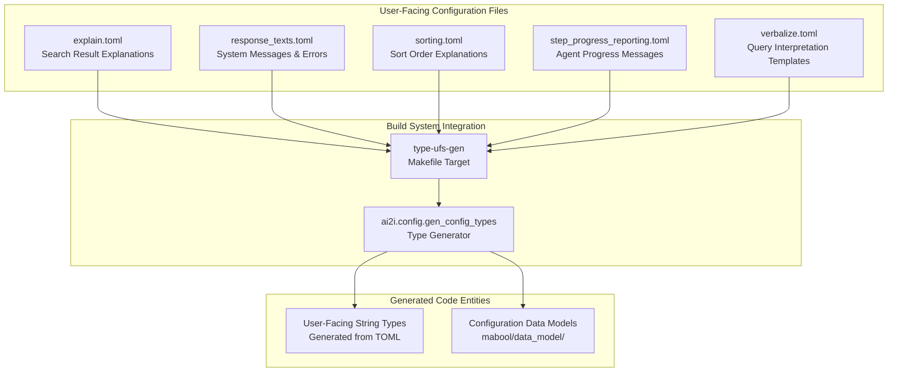
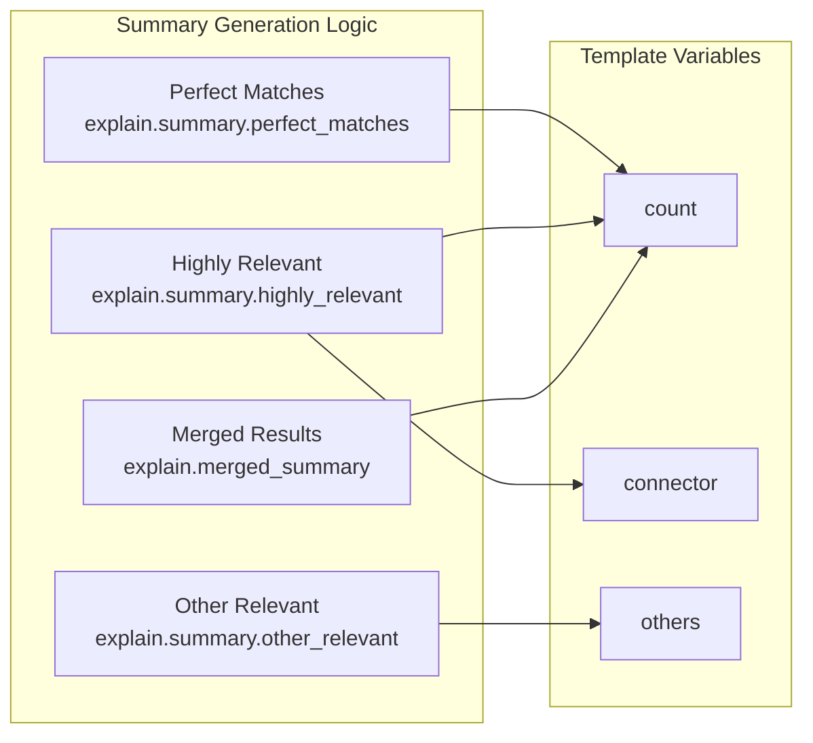
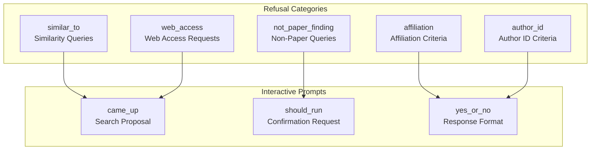
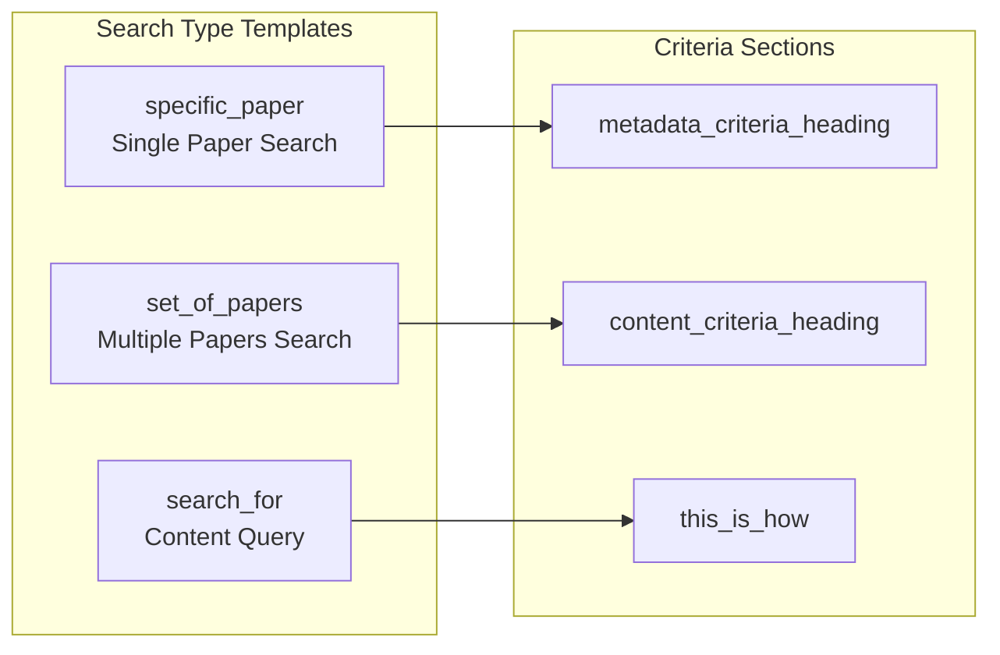

<!-- source: DeepWiki mcp.deepwiki.com · repo allenai/asta-paper-finder · page 4.2 User-Facing Configuration · fetched 2026-10-26 -->

# User-Facing Configuration

<details>
<summary>Relevant source files</summary>

The following files were used as context for generating this wiki page:

- [agents/mabool/api/conf/user_facing/explain.toml](agents/mabool/api/conf/user_facing/explain.toml)
- [agents/mabool/api/conf/user_facing/response_texts.toml](agents/mabool/api/conf/user_facing/response_texts.toml)
- [agents/mabool/api/conf/user_facing/sorting.toml](agents/mabool/api/conf/user_facing/sorting.toml)
- [agents/mabool/api/conf/user_facing/step_progress_reporting.toml](agents/mabool/api/conf/user_facing/step_progress_reporting.toml)
- [agents/mabool/api/conf/user_facing/verbalize.toml](agents/mabool/api/conf/user_facing/verbalize.toml)

</details>


This document covers the user-facing configuration system that manages all human-readable text, explanations, and UI strings displayed to users of the ASTA Paper Finder system. These configurations are separate from the main system configuration and focus specifically on presentation, messaging, and user communication.

For system-level configuration including agent parameters and API settings, see [Main Configuration](#4.1). For specialized configuration modes that modify behavior, see [Runtime Configuration Modes](#4.3).

## Overview

The user-facing configuration system provides templated strings and explanations that are displayed to users throughout the search process. These configurations are stored as TOML files in [agents/mabool/api/conf/user_facing/]() and are used to generate type-safe string templates through the build system's type generation process.

## Configuration File Structure

The user-facing configuration is organized into specialized TOML files, each handling different aspects of user communication:



**Sources:** [agents/mabool/api/conf/user_facing/explain.toml](), [agents/mabool/api/conf/user_facing/response_texts.toml](), [agents/mabool/api/conf/user_facing/sorting.toml](), [agents/mabool/api/conf/user_facing/step_progress_reporting.toml](), [agents/mabool/api/conf/user_facing/verbalize.toml]()

## Search Result Explanations (explain.toml)

The `explain.toml` file contains templates for generating human-readable explanations of search results and metadata. It is structured into several main sections:

### Metadata Explanations

Templates for describing temporal and bibliographic metadata:

| Template | Purpose | Example Usage |
|----------|---------|---------------|
| `time_same_year` | Format for single year | " during {year}" |
| `time_range_start_and_end` | Format for year ranges | " from {start} until {end}" |
| `venue` | Format venue lists | "\t- Venue{s}: {items}" |
| `author` | Format author lists | "\t- Author{s}: {items}" |

### Content Explanations

Templates for describing different types of search operations:

```toml
[explain.content]
specific_paper_by_name = "- A paper with the alias: '{name}'{content_suffix}."
specific_paper_by_title = "- A paper titled: '{title}'."
papers_discussing = "- Papers discussing: *{content}*."
relevance_criteria_header = "- Judged by the following relevance criteria:"
```

### Result Summaries

The system provides sophisticated templates for summarizing search results with different levels of match quality:



**Sources:** [agents/mabool/api/conf/user_facing/explain.toml:33-51](), [agents/mabool/api/conf/user_facing/explain.toml:52-75]()

## System Messages and Error Handling (response_texts.toml)

The `response_texts.toml` file manages all system-generated messages, including error responses, refusals, and interactive prompts:

### Core Response Messages

| Message Type | Configuration Key | Purpose |
|--------------|-------------------|---------|
| Detailed Response | `detailed_response_prefix` | Prefix for detailed search explanations |
| Follow-up Suggestions | `suggest_broad_followup` | Guidance for query refinement |
| Work Harder | `work_harder_text` | Prompt for exhaustive search |
| Generic Refusal | `generic_refusal_message` | Fallback for unsupported queries |

### Agent-Specific Messages

The configuration includes specialized message templates for different agent types:

```toml
[response_texts.metadata_agent]
could_not_find_in_s2 = "I couldn't find any results for this query in the Semantic Scholar index."
try_alternative = " Perhaps try an alternative venue name?"

[response_texts.paper_finder_agent]
anything_else = "Would you like to try anything else?"
soft_rejection = "soft rejection due to '{refusal_type}' type of query"
```

### Refusal Handling

The system provides specific refusal messages for different unsupported query types:



**Sources:** [agents/mabool/api/conf/user_facing/response_texts.toml:35-45]()

## Progress Reporting Configuration (step_progress_reporting.toml)

This file contains templates for real-time progress messages displayed during search operations. The messages are organized by agent type and operation:

### Agent Progress Messages

Each agent type has its own set of progress messages:

| Agent Type | Configuration Section | Key Messages |
|------------|----------------------|--------------|
| Conversation Agent | `step_progress.conversation_agent` | Query type identification |
| Round Executor | `step_progress.round_executor` | High-level operation status |
| Search Agents | `step_progress.broad_search_by_keyword` | Keyword search progress |
| Dense Search | `step_progress.dense` | Similarity search progress |
| Metadata Search | `step_progress.metadata_only` | Metadata query progress |

### Dynamic Progress Templates

The system uses templated strings with variable substitution for dynamic progress reporting:

```toml
[step_progress.search_by_authors]
found_authors = "Found authors:\n{author_names}."
fetching = "Fetching papers from {author_names}."
assessing = "Assessing papers for relevance."
```

**Sources:** [agents/mabool/api/conf/user_facing/step_progress_reporting.toml:33-38](), [agents/mabool/api/conf/user_facing/step_progress_reporting.toml:50-58]()

## Query Verbalization Templates (verbalize.toml)

The `verbalize.toml` file provides templates for converting parsed search criteria back into human-readable descriptions:

### Metadata Verbalization

Templates for describing temporal and venue constraints:

```toml
authored_by = "Authored by {authors}."
published_between = "Published between {start} and {end}."
published_in_venues = "Published in {venues}."
```

### Content Criteria Verbalization

Templates for describing content-based search criteria:

```toml
content_must_satisfy = "To be considered relevant, the paper's content must satisfy:"
criterion_line = "* **{name}**: {description}"
nice_to_have = "It would be nice if the paper's content satisfies:"
```

### Search Type Descriptions



**Sources:** [agents/mabool/api/conf/user_facing/verbalize.toml:9-21]()

## Sorting Explanations (sorting.toml)

The `sorting.toml` file provides user-friendly explanations for different sort orders:

```toml
[sorting.explanation]
most_recent = "most-recent"
earliest = "earliest"  
highly_cited = "highly-cited"
least_cited = "least-cited"
sorting_explanation = "Between relevant papers, {sorting_explanation} papers were prioritized due to explicit request."
```

This configuration allows the system to explain why results are ordered in a particular way when users request specific sorting criteria.

**Sources:** [agents/mabool/api/conf/user_facing/sorting.toml:4-8]()

## Type Generation Integration

The user-facing configuration files are processed by the build system to generate type-safe string templates. This process is handled by the `type-ufs-gen` Makefile target, which invokes the `ai2i.config.gen_config_types` generator to create strongly-typed configuration objects.

The generated types ensure that all template variables are properly validated and that the configuration structure matches the expected schema used throughout the agent system.

---

