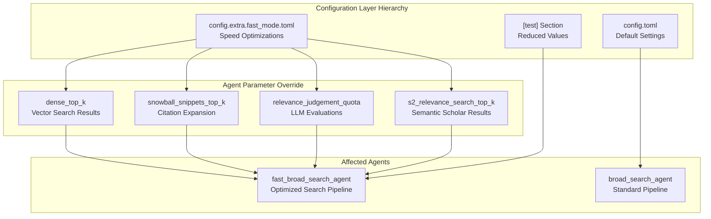
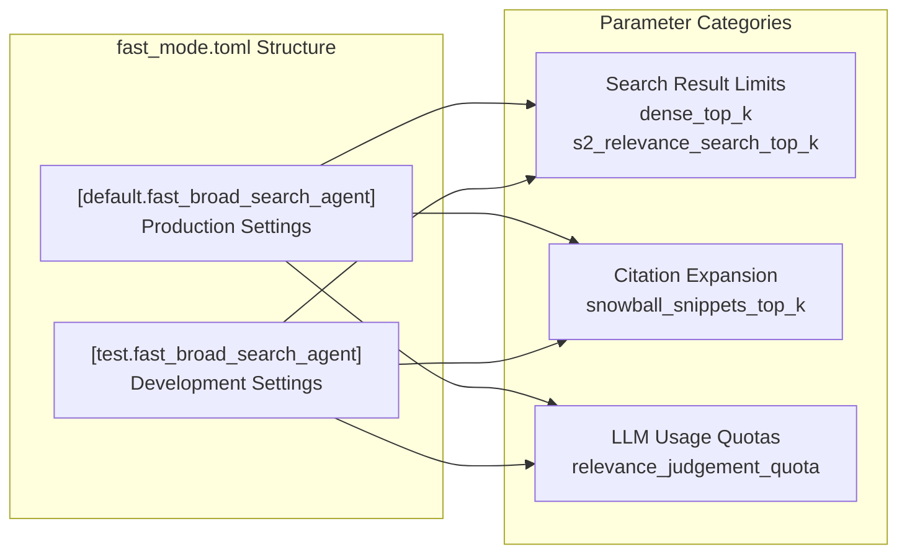
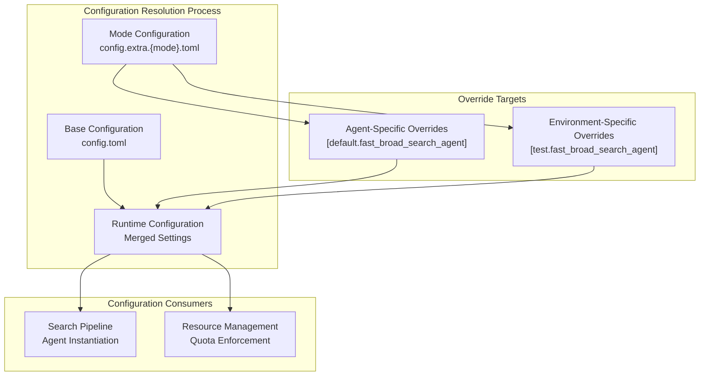
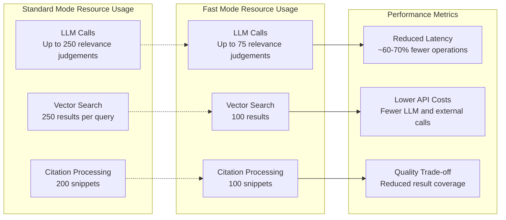

<!-- source: DeepWiki mcp.deepwiki.com · repo allenai/asta-paper-finder · page 4.3 Runtime Configuration Modes · fetched 2026-10-26 -->

# Runtime Configuration Modes

Relevant source files

The following files were used as context for generating this wiki page:

- [agents/mabool/api/conf/config.extra.fast_mode.toml](agents/mabool/api/conf/config.extra.fast_mode.toml)
- [agents/mabool/api/conf/config.toml](agents/mabool/api/conf/config.toml)

## Purpose and Scope

This document covers the specialized runtime configuration modes available in the ASTA Paper Finder system that modify the default agent behavior for specific use cases. These modes allow the system to adapt its search strategy by overriding key parameters in the main configuration.

For information about the main configuration system, see [Main Configuration](#4.1). For user-facing configuration strings and templates, see [User-Facing Configuration](#4.2).

## Configuration Mode Architecture

The ASTA Paper Finder implements a layered configuration system where specialized modes can override default settings to optimize for different performance characteristics.

### Configuration Mode Structure

**Sources:** [agents/mabool/api/conf/config.toml:1-98](), [agents/mabool/api/conf/config.extra.fast_mode.toml:1-12]()

## Fast Mode Configuration

The `fast_mode` configuration optimizes the search pipeline for reduced latency by constraining resource-intensive operations while maintaining search quality.

### Fast Mode Parameter Overrides

| Parameter | Default Environment | Test Environment | Purpose |
|-----------|-------------------|------------------|---------|
| `dense_top_k` | 100 | 2 | Vector search result limit |
| `snowball_snippets_top_k` | 100 | 2 | Citation expansion result limit |
| `s2_relevance_search_top_k` | 50 | 10 | Semantic Scholar search limit |
| `relevance_judgement_quota` | 75 | 30 | LLM relevance evaluation quota |

### Configuration File Structure

**Sources:** [agents/mabool/api/conf/config.extra.fast_mode.toml:1-12]()

## Configuration Override Mechanism

The system applies configuration overrides through a hierarchical merging process where specialized mode configurations supplement the base settings.

### Override Priority and Scope

**Sources:** [agents/mabool/api/conf/config.toml:47-98](), [agents/mabool/api/conf/config.extra.fast_mode.toml:1-12]()

## Impact on Search Behavior

Fast mode configuration significantly reduces computational overhead while attempting to preserve search quality through strategic parameter tuning.

### Performance Trade-offs

| Component | Standard Behavior | Fast Mode Behavior | Impact |
|-----------|------------------|-------------------|---------|
| **Dense Search** | Default `initial_top_k_per_query = 250` | `dense_top_k = 100` | 60% reduction in vector search results |
| **Relevance Judgement** | `quota = 250` | `relevance_judgement_quota = 75` | 70% reduction in LLM evaluations |
| **Citation Expansion** | `snippet_top_k = 200` | `snowball_snippets_top_k = 100` | 50% reduction in citation processing |
| **S2 Search** | No explicit limit | `s2_relevance_search_top_k = 50` | Controlled external API usage |

### Resource Utilization Changes

**Sources:** [agents/mabool/api/conf/config.toml:47-63](), [agents/mabool/api/conf/config.extra.fast_mode.toml:1-12]()

---

