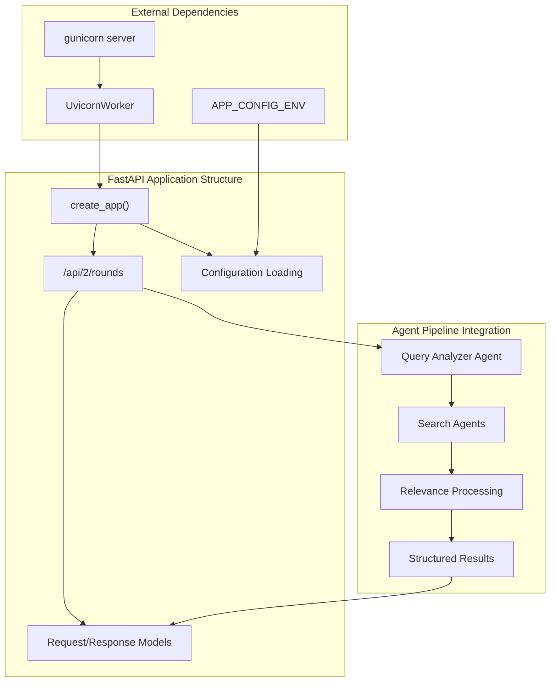
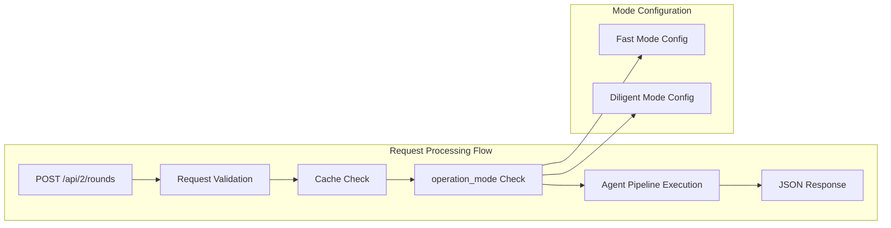
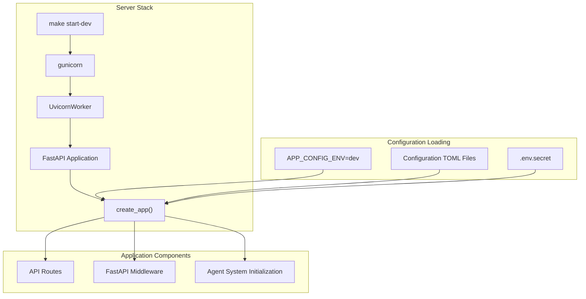
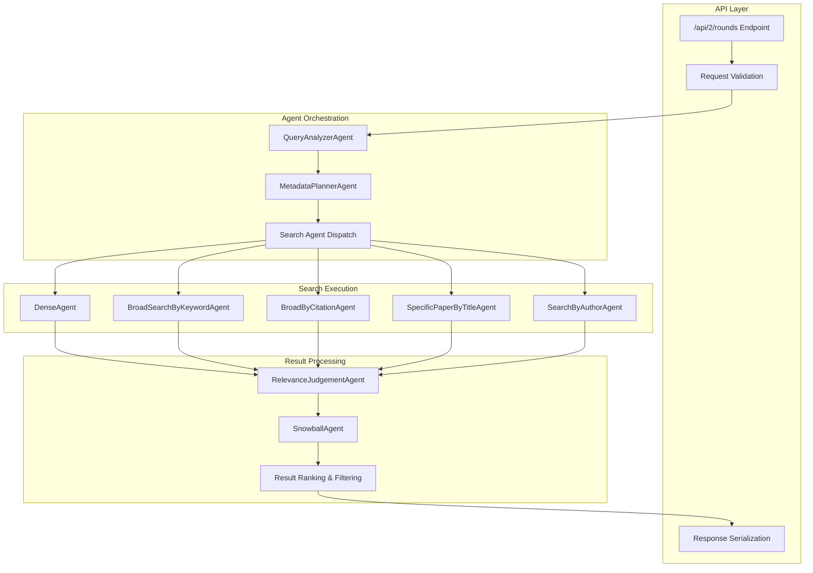

<!-- source: DeepWiki mcp.deepwiki.com · repo allenai/asta-paper-finder · page 5 API Reference · fetched 2026-10-26 -->

# API Reference

<details>
<summary>Relevant source files</summary>

The following files were used as context for generating this wiki page:

- [README.md](README.md)
- [agents/mabool/api/dev.sh](agents/mabool/api/dev.sh)
- [agents/mabool/api/mabool/__init__.py](agents/mabool/api/mabool/__init__.py)

</details>


This document provides comprehensive documentation for the FastAPI application that serves as the primary interface to the ASTA Paper Finder system. It covers the REST API endpoints, request/response models, and server configuration. For information about the underlying agent system that processes requests, see [Agent System](#3). For details about configuring API behavior and external service integration, see [Configuration System](#4).

## FastAPI Application Overview

The ASTA Paper Finder exposes its functionality through a FastAPI web application located in the `agents/mabool/api` directory. The application provides a single main endpoint for processing paper search queries and returns structured results from the agent pipeline.



**Sources:** [agents/mabool/api/dev.sh:1-11](), [README.md:35-40]()

## Main API Endpoint

### POST /api/2/rounds

The primary endpoint for submitting paper search queries to the ASTA Paper Finder system. This endpoint accepts natural language descriptions of paper search requirements and returns ranked, relevant papers through the agent pipeline.

#### Request Model

The endpoint accepts a JSON payload with the following structure:

| Field | Type | Required | Default | Description |
|-------|------|----------|---------|-------------|
| `paper_description` | string | Yes | - | Natural language paper search description |
| `operation_mode` | string | No | "infer" | Search mode: "infer", "fast", or "diligent" |
| `inserted_before` | string | No | None | Upper-bound date filter (YYYY-MM-DD format) |
| `read_results_from_cache` | boolean | No | false | Enable file-based cache retrieval |

#### Operation Modes

- **infer/fast**: Executes a fast search (~30 seconds) with optimized agent configuration
- **diligent**: Performs exhaustive search (~3 minutes) with comprehensive agent pipeline



**Sources:** [README.md:44-57]()

## Server Configuration

### Development Server

The development server is configured using gunicorn with uvicorn workers for asynchronous request handling.

#### Server Launch Configuration

The development server uses the following configuration:

- **Server**: gunicorn with UvicornWorker
- **Workers**: 1 (single worker for development)
- **Bind Address**: 0.0.0.0:8000
- **Timeout**: 0 (unlimited for long-running searches)
- **Reload**: Enabled for development
- **Environment**: APP_CONFIG_ENV=dev

#### Application Factory

The FastAPI application is created through the factory pattern using `mabool.api.app:create_app()`. This function loads configuration, initializes the agent system, and sets up the API routes.



**Sources:** [agents/mabool/api/dev.sh:1-11](), [README.md:37-40]()

## API Authentication and Secrets

The API requires several external service API keys configured in the `.env.secret` file:

| Service | Key Variable | Purpose |
|---------|--------------|---------|
| OpenAI | `OPENAI_API_KEY` | LLM operations for query analysis and planning |
| Semantic Scholar | `S2_API_KEY` | Paper metadata and citation retrieval |
| Cohere | `COHERE_API_KEY` | Document reranking and relevance scoring |
| Google AI | `GOOGLE_API_KEY` | Alternative LLM provider |

**Sources:** [README.md:23-24]()

## Integration with Agent System

The FastAPI application serves as the entry point to the comprehensive agent pipeline. When a request is received, it flows through multiple processing stages:



**Sources:** [README.md:11]()

## Development and Testing

### Local Development Setup

To start the development server:

```bash
cd agents/mabool/api
make start-dev
```

### API Interaction

Once the server is running on `http://localhost:8000`, the API can be accessed through:

- **cURL**: Command-line HTTP requests
- **Swagger UI**: Interactive API documentation at `http://localhost:8000/docs`
- **ReDoc**: Alternative API documentation at `http://localhost:8000/redoc`

**Sources:** [README.md:35-40]()

---

