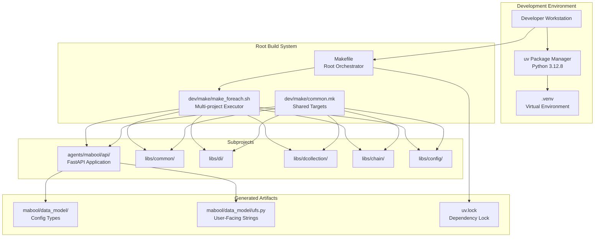
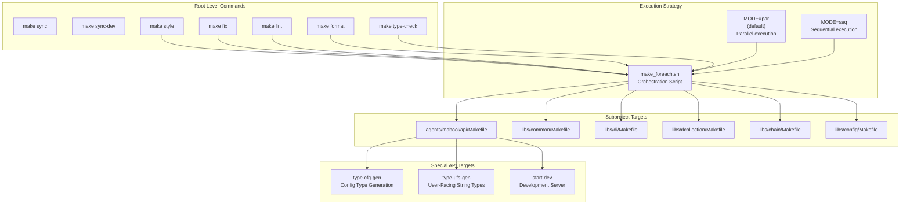
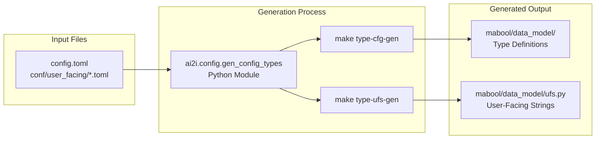

<!-- source: DeepWiki mcp.deepwiki.com · repo allenai/asta-paper-finder · page 6 Development Guide · fetched 2026-10-26 -->

# Development Guide

<details>
<summary>Relevant source files</summary>

The following files were used as context for generating this wiki page:

- [Makefile](Makefile)
- [agents/mabool/api/.python-version](agents/mabool/api/.python-version)
- [agents/mabool/api/Makefile](agents/mabool/api/Makefile)

</details>


This document provides a comprehensive guide for developers working on the ASTA Paper Finder system. It covers environment setup, build system usage, code quality tools, and development workflows specific to this multi-project Python repository.

For information about the overall system architecture, see [System Architecture](#2). For details about configuring the system, see [Configuration System](#4). For API usage and testing, see [API Reference](#5).

## Development Workflow Overview

The ASTA Paper Finder uses a multi-project structure with a centralized build system that orchestrates development tasks across all subprojects.



**Sources**: [Makefile:1-89](), [agents/mabool/api/Makefile:1-32]()

## Environment Setup

### Python Version and Package Management

The system requires Python 3.12.8 and uses `uv` as the package manager for dependency resolution and virtual environment management.

| Component | Version/Tool | Purpose |
|-----------|-------------|---------|
| Python | 3.12.8 | Runtime environment |
| Package Manager | `uv` | Dependency management and virtual environments |
| Lock File | `uv.lock` | Reproducible dependency resolution |
| Constraints | `constraints.txt` | Version constraints (e.g., setuptools<72) |

### Initial Setup Commands

```bash
# Create virtual environment
make venv

# Install dependencies (production only)
make sync

# Install dependencies including development tools
make sync-dev

# Lock dependencies after changes
make lock
```

**Sources**: [Makefile:12-34](), [agents/mabool/api/.python-version:1-2]()

## Build System Architecture

The build system uses a hierarchical Makefile structure that enables both project-wide and individual subproject operations.



### Common Development Commands

| Command | Purpose | Execution Mode |
|---------|---------|----------------|
| `make style` | Run format check, lint, and type-check | Parallel by default |
| `make fix` | Auto-fix formatting and linting issues | Parallel by default |
| `make lint` | Run Ruff linter across all projects | Parallel by default |
| `make format` | Format code with auto-formatting tools | Parallel by default |
| `make type-check` | Run pyright type checker | Parallel by default |

### Execution Modes

The build system supports two execution modes controlled by the `MODE` variable:

- **Parallel Mode** (`MODE=par`, default): Runs tasks across all subprojects simultaneously, capturing output and reporting only failures
- **Sequential Mode** (`MODE=seq`): Runs tasks one subproject at a time with full output visibility

Example usage:
```bash
# Run format check in sequential mode to see detailed output
make format-check MODE=seq
```

**Sources**: [Makefile:35-89](), [agents/mabool/api/Makefile:1-32]()

## Code Quality and Tooling

The system enforces code quality through multiple automated tools integrated into the build system.

### Linting and Formatting

| Tool | Configuration | Purpose |
|------|--------------|---------|
| Ruff | Project-specific config | Code linting and formatting |
| Flake8 | `.flake8` | Additional linting rules |
| pyright | Project-specific config | Type checking |

### Custom Quality Tools

The system includes custom development tools:

- **stable_sort_checker**: Custom Flake8 plugin for enforcing consistent sorting
- **Coverage reporting**: Configured via `.coveragerc`

### Quality Check Workflow

```bash
# Check all quality metrics
make style

# Auto-fix issues where possible
make fix

# Run individual checks
make lint-check
make format-check
make type-check
```

**Sources**: [Makefile:37-63]()

## Type Generation System

The mabool API subproject includes an automated type generation system that creates Python type definitions from TOML configuration files.

### Type Generation Targets

| Target | Input | Output | Purpose |
|--------|-------|--------|---------|
| `type-cfg-gen` | Configuration TOML files | `mabool/data_model/` | Generate config data classes |
| `type-ufs-gen` | `conf/user_facing/*.toml` | `mabool/data_model/ufs.py` | Generate user-facing string types |

### Type Generation Workflow



### Usage

```bash
# Generate configuration types
make type-cfg-gen

# Generate user-facing string types
make type-ufs-gen

# Both are included in the fix target
make fix
```

The type generation system ensures type safety between the TOML configuration files and the Python code that consumes them, automatically creating dataclasses and type annotations.

**Sources**: [agents/mabool/api/Makefile:8-18]()

## Development Server

### Starting the Development Server

The mabool API includes a development server for local testing and development:

```bash
# Start development server
cd agents/mabool/api
make start-dev
```

This runs the `dev.sh` script which sets up the development environment and starts the FastAPI application with development-specific settings.

### Development Server Features

- Hot reloading for code changes
- Development-specific logging and debugging
- Local API endpoint access for testing

**Sources**: [agents/mabool/api/Makefile:20-22]()

## Multi-Project Structure

The repository is organized as multiple independent Python projects that share common development tooling:

| Project Path | Purpose |
|-------------|---------|
| `agents/mabool/api/` | FastAPI application and agent system |
| `libs/common/` | Shared common utilities |
| `libs/di/` | Dependency injection framework |
| `libs/dcollection/` | Data collection utilities |
| `libs/chain/` | Chain processing utilities |
| `libs/config/` | Configuration management |

Each subproject maintains its own `Makefile` that inherits from the common build system while defining project-specific targets and dependencies.

**Sources**: [Makefile:6]()

---

