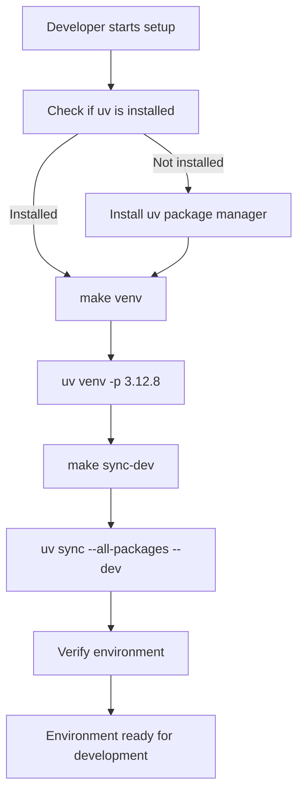
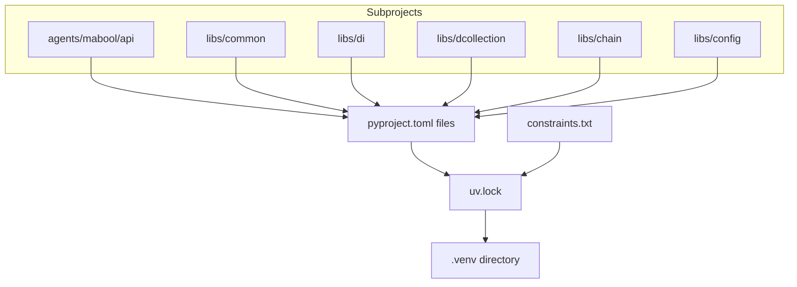

<!-- source: DeepWiki mcp.deepwiki.com · repo allenai/asta-paper-finder · page 6.1 Environment Setup · fetched 2026-10-26 -->

# Environment Setup

<details>
<summary>Relevant source files</summary>

The following files were used as context for generating this wiki page:

- [.gitignore](.gitignore)
- [Makefile](Makefile)
- [agents/mabool/api/.python-version](agents/mabool/api/.python-version)
- [agents/mabool/api/constraints.txt](agents/mabool/api/constraints.txt)

</details>


This document covers setting up the Python development environment for the ASTA Paper Finder repository using the uv package manager. It includes instructions for creating virtual environments, managing dependencies, and preparing for development work.

For information about the build system and development workflows, see [Build System](#6.2). For details about code quality tools and their configuration, see [Code Quality Tools](#6.3).

## Prerequisites

The ASTA Paper Finder project requires specific versions and tools to ensure consistent development environments across all contributors.

### Required Software

| Software | Version | Purpose |
|----------|---------|---------|
| Python | 3.12.8 | Runtime environment |
| uv | Latest | Package and virtual environment manager |
| make | Any recent version | Build system orchestration |

The Python version requirement is enforced by [agents/mabool/api/.python-version:1]() and used by the virtual environment creation process in [Makefile:33]().

### System Dependencies

The project uses uv as the primary package manager, replacing traditional pip-based workflows. The uv tool handles both virtual environment creation and dependency management, providing faster and more reliable package resolution.

**Sources:** [agents/mabool/api/.python-version:1](), [Makefile:33]()

## Environment Setup Process

The environment setup follows a standardized workflow using make targets that wrap uv commands for consistency across the development team.

### Environment Setup Flow



### Step-by-Step Setup

1. **Create Virtual Environment**
   ```bash
   make venv
   ```
   This executes `uv venv -p 3.12.8` as defined in [Makefile:33](), creating a virtual environment with the exact Python version required.

2. **Install Dependencies**
   ```bash
   make sync-dev
   ```
   This runs `uv sync --all-packages --dev` from [Makefile:29](), installing both production and development dependencies from the lock file.

3. **Verify Installation**
   ```bash
   make graph
   ```
   This executes `uv tree` to display the dependency graph and verify all packages are correctly installed.

**Sources:** [Makefile:32-34](), [Makefile:28-29](), [Makefile:20-21]()

## Dependency Management

The project uses a multi-layered dependency management system with constraints and lock files to ensure reproducible builds.

### Dependency Resolution Components



### Constraint Management

The project enforces specific package version constraints through [agents/mabool/api/constraints.txt:1](), which currently restricts setuptools to versions below 72 to avoid compatibility issues.

### Lock File Operations

| Command | Purpose | Makefile Target |
|---------|---------|----------------|
| `make lock` | Update dependency lock file | [Makefile:12-13]() |
| `make sync` | Install production dependencies | [Makefile:24-25]() |
| `make sync-dev` | Install all dependencies including dev tools | [Makefile:28-29]() |

**Sources:** [agents/mabool/api/constraints.txt:1](), [Makefile:12-13](), [Makefile:24-25](), [Makefile:28-29]()

## Virtual Environment Management

The project maintains strict virtual environment isolation to prevent dependency conflicts between different development environments.

### Environment Structure

The virtual environment is created in the `.venv` directory at the repository root and is excluded from version control via [.gitignore:20-21]().

### Multi-Project Workspace

The repository contains multiple Python subprojects that share the same virtual environment:

| Subproject | Purpose |
|------------|---------|
| `agents/mabool/api` | Main FastAPI application |
| `libs/common` | Shared utilities |
| `libs/di` | Dependency injection framework |
| `libs/dcollection` | Data collection utilities |
| `libs/chain` | Processing chain utilities |
| `libs/config` | Configuration management |

All subprojects are listed in [Makefile:6]() and managed collectively through the make_foreach script system.

### Environment Cleanup

To reset the development environment:
```bash
make rm
```
This removes the `.venv` directory as defined in [Makefile:16-17](), allowing for a clean environment recreation.

**Sources:** [.gitignore:20-21](), [Makefile:6](), [Makefile:16-17]()

## Development Environment Verification

After setup, verify the environment is correctly configured by running the development tools that depend on the Python environment.

### Verification Commands

```bash
# Check dependency tree
make graph

# Verify code quality tools work
make style

# Check type checking
make type-check
```

These commands use the parallel execution system defined in [Makefile:35]() and [Makefile:38-39]() to run across all subprojects simultaneously.

### Troubleshooting Common Issues

| Issue | Solution |
|-------|----------|
| Wrong Python version | Ensure Python 3.12.8 is available and uv can find it |
| Package conflicts | Run `make rm` followed by `make venv` and `make sync-dev` |
| Permission errors | Check that the repository directory is writable |
| Network issues | Verify internet connectivity for package downloads |

**Sources:** [Makefile:35](), [Makefile:38-39]()

## Environment Configuration Files

The development environment respects several configuration files that control behavior and exclude certain files from version control.

### Excluded Files and Directories

The [.gitignore]() file defines what should be excluded from version control, including:

- Virtual environment: `.venv/` [.gitignore:20-21]()
- Cache directories: `cache/`, `agents/mabool/api/cache` [.gitignore:1-2]()
- Python artifacts: `__pycache__/`, `*.pyc`, `.mypy_cache` [.gitignore:22-27]()
- IDE configurations: `.idea/`, `.vscode/` [.gitignore:3-11]()
- API keys and secrets: `.env.secret`, `*secret*` [.gitignore:47-52]()

This ensures that sensitive data, generated files, and environment-specific configurations are not committed to the repository.

**Sources:** [.gitignore:1-2](), [.gitignore:20-21](), [.gitignore:22-27](), [.gitignore:3-11](), [.gitignore:47-52]()

---

