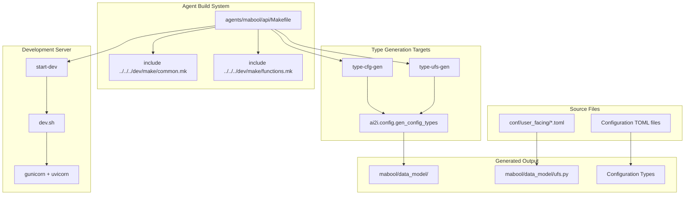
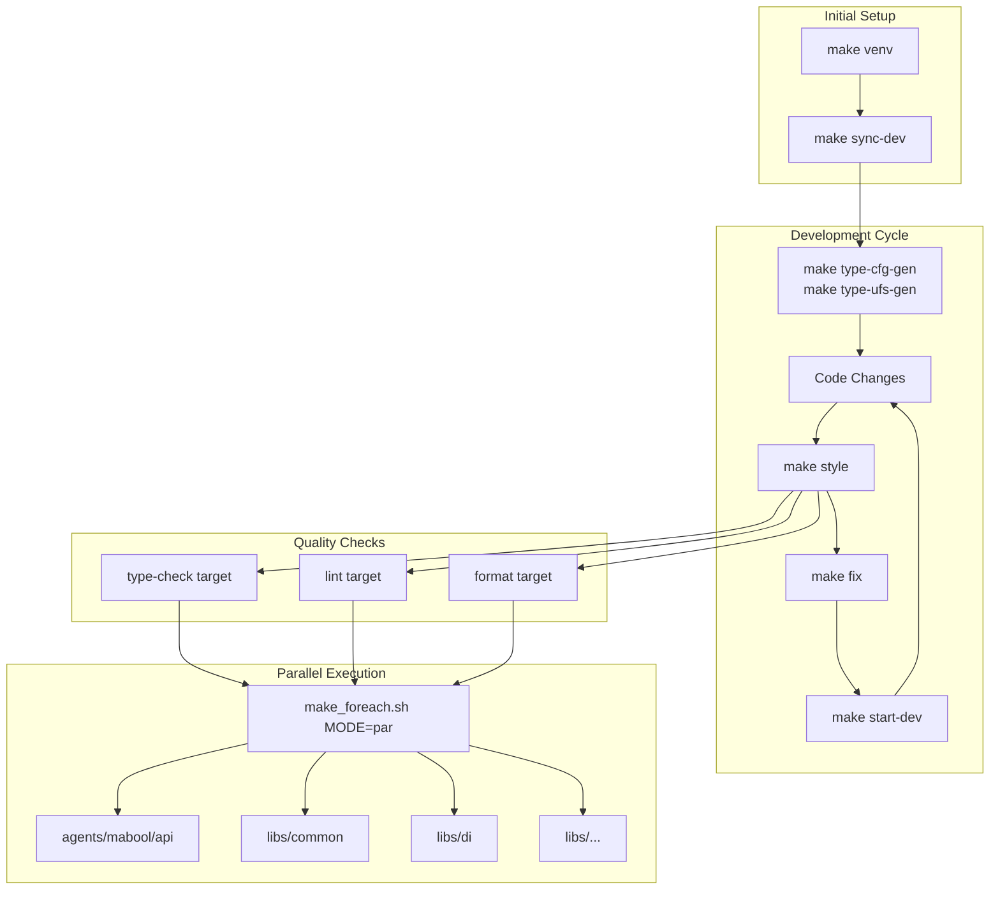

<!-- source: DeepWiki mcp.deepwiki.com · repo allenai/asta-paper-finder · page 6.2 Build System · fetched 2026-10-26 -->

# Build System

<details>
<summary>Relevant source files</summary>

The following files were used as context for generating this wiki page:

- [Makefile](Makefile)
- [agents/mabool/api/Makefile](agents/mabool/api/Makefile)
- [agents/mabool/api/dev.sh](agents/mabool/api/dev.sh)

</details>


## Purpose and Scope

This document covers the Makefile-based build system that orchestrates development tasks, dependency management, code quality checks, and type generation across the ASTA Paper Finder repository. The build system manages multiple subprojects and provides a unified interface for common development operations.

For information about setting up the development environment, see [Environment Setup](#6.1). For details about code quality tools configuration, see [Code Quality Tools](#6.3). For type generation specifics, see [Type Generation](#6.4).

## Build System Architecture

The build system follows a hierarchical structure with a root `Makefile` that orchestrates operations across multiple subprojects using the `uv` package manager.

```mermaid
graph TB
    subgraph "Root Build System"
        ROOT_MAKE["Makefile"]
        MAKE_FOREACH["dev/make/make_foreach.sh"]
        COMMON_MK["dev/make/common.mk"]
        FUNCTIONS_MK["dev/make/functions.mk"]
    end
    
    subgraph "Package Management"
        UV_LOCK["uv.lock"]
        UV_VENV[".venv"]
        UV_SYNC["uv sync"]
        UV_TREE["uv tree"]
    end
    
    subgraph "Subprojects"
        MABOOL_MAKE["agents/mabool/api/Makefile"]
        LIBS_COMMON["libs/common/Makefile"]
        LIBS_DI["libs/di/Makefile"]
        LIBS_DCOLLECTION["libs/dcollection/Makefile"]
        LIBS_CHAIN["libs/chain/Makefile"]
        LIBS_CONFIG["libs/config/Makefile"]
    end
    
    subgraph "Build Targets"
        SYNC_TARGET["sync / sync-dev"]
        LINT_TARGET["lint / lint-check"]
        FORMAT_TARGET["format / format-check"]
        TYPE_CHECK_TARGET["type-check"]
        STYLE_TARGET["style"]
        FIX_TARGET["fix"]
    end
    
    ROOT_MAKE --> MAKE_FOREACH
    ROOT_MAKE --> UV_SYNC
    ROOT_MAKE --> UV_TREE
    
    MAKE_FOREACH --> MABOOL_MAKE
    MAKE_FOREACH --> LIBS_COMMON
    MAKE_FOREACH --> LIBS_DI
    MAKE_FOREACH --> LIBS_DCOLLECTION
    MAKE_FOREACH --> LIBS_CHAIN
    MAKE_FOREACH --> LIBS_CONFIG
    
    MABOOL_MAKE --> COMMON_MK
    MABOOL_MAKE --> FUNCTIONS_MK
    
    ROOT_MAKE --> SYNC_TARGET
    ROOT_MAKE --> LINT_TARGET
    ROOT_MAKE --> FORMAT_TARGET
    ROOT_MAKE --> TYPE_CHECK_TARGET
    ROOT_MAKE --> STYLE_TARGET
    ROOT_MAKE --> FIX_TARGET
    
    UV_SYNC --> UV_VENV
    UV_SYNC --> UV_LOCK
```



**Sources:** [Makefile:1-89](), [agents/mabool/api/Makefile:1-32]()

## Root Makefile Targets

The root `Makefile` provides the following primary targets for development operations:

| Target | Purpose | Command |
|--------|---------|---------|
| `lock` | Lock dependencies to `uv.lock` | `uv lock $(ARGS)` |
| `sync` | Sync virtual environment | `uv sync --all-packages $(ARGS)` |
| `sync-dev` | Sync with dev dependencies | `uv sync --all-packages --dev $(ARGS)` |
| `venv` | Create virtual environment | `uv venv -p 3.12.8` |
| `graph` | Generate dependency graph | `uv tree $(ARGS)` |
| `rm` | Remove virtual environment | `rm -rf .venv` |

### Cross-Project Development Targets

Development quality targets operate across all subprojects defined in `SUBPROJECTS`:

```makefile
SUBPROJECTS = "./agents/mabool/api" "./libs/common" "./libs/di" "./libs/dcollection" "./libs/chain" "./libs/config"
```

| Target | Purpose | Execution Mode |
|--------|---------|----------------|
| `type-check` | Run pyright type checker | Parallel/Sequential |
| `lint` | Run Ruff linter | Parallel/Sequential |
| `lint-check` | Check linting without auto-fix | Parallel/Sequential |
| `format` | Format code with Ruff | Parallel/Sequential |
| `format-check` | Check code formatting | Parallel/Sequential |
| `style` | Combined format check, lint, and type-check | Parallel/Sequential |
| `fix` | Auto-fix style issues | Parallel/Sequential |

The execution mode is controlled by the `MODE` variable, defaulting to parallel (`par`) but can be set to sequential (`seq`) for debugging:

```bash
make format-check MODE=seq
```

**Sources:** [Makefile:6](), [Makefile:35-63](), [Makefile:84-88]()

## Agent-Specific Build System

The `agents/mabool/api/Makefile` extends the common build system with agent-specific targets:



### Type Generation Targets

The agent build system includes specialized targets for generating Python types from configuration files:

- **`type-cfg-gen`**: Generates configuration types from TOML files using `ai2i.config.gen_config_types --output-dir mabool/data_model`
- **`type-ufs-gen`**: Generates user-facing string types with dependency tracking on `conf/user_facing/*.toml` files

The `type-ufs-gen` target includes automatic dependency resolution:

```makefile
./mabool/data_model/ufs.py: ./conf/user_facing/*.toml
	uv run python -m ai2i.config.gen_config_types --user-facing --output-dir mabool/data_model
```

**Sources:** [agents/mabool/api/Makefile:9-18]()

## Development Server

The development server is configured through the `start-dev` target, which executes `dev.sh`:

```bash
gunicorn -k uvicorn.workers.UvicornWorker \
    --workers 1 \
    --timeout 0 \
    --bind 0.0.0.0:8000 \
    --enable-stdio-inheritance \
    --access-logfile - \
    --reload \
    --env 'APP_CONFIG_ENV=dev' \
    'mabool.api.app:create_app()'
```

### Development Server Configuration

| Parameter | Value | Purpose |
|-----------|-------|---------|
| Worker Class | `uvicorn.workers.UvicornWorker` | ASGI server for FastAPI |
| Workers | 1 | Single worker for development |
| Timeout | 0 | Unlimited timeout for debugging |
| Bind | `0.0.0.0:8000` | Accept connections on all interfaces |
| Reload | Enabled | Auto-reload on code changes |
| Environment | `APP_CONFIG_ENV=dev` | Development configuration mode |

**Sources:** [agents/mabool/api/dev.sh:1-11](), [agents/mabool/api/Makefile:21-22]()

## Build Workflow

The following diagram illustrates the typical development workflow using the build system:



### Execution Modes

The build system supports two execution modes for cross-project operations:

- **Parallel Mode (`MODE=par`)**: Default mode that executes tasks across subprojects simultaneously, capturing output and reporting only failures
- **Sequential Mode (`MODE=seq`)**: Executes tasks one subproject at a time, showing full stdout/stderr for debugging

**Sources:** [Makefile:35-39](), [Makefile:84-88]()

---

