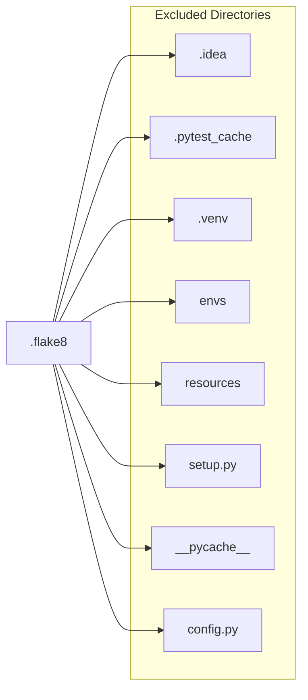
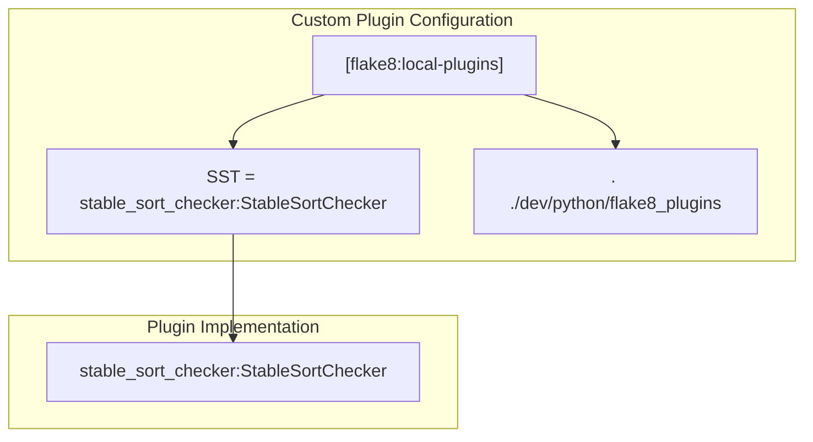
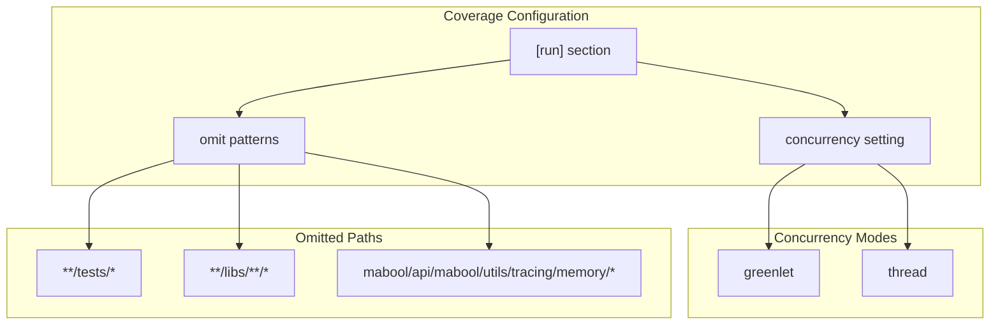
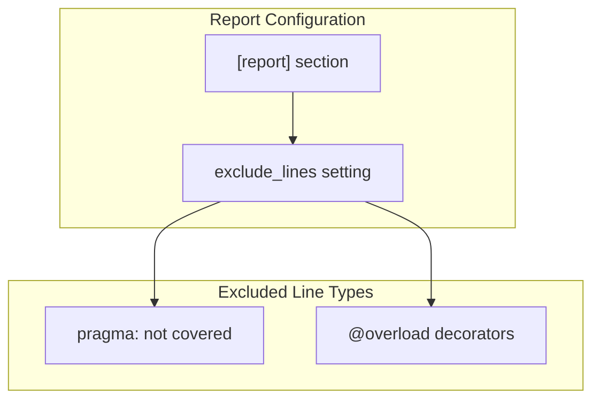
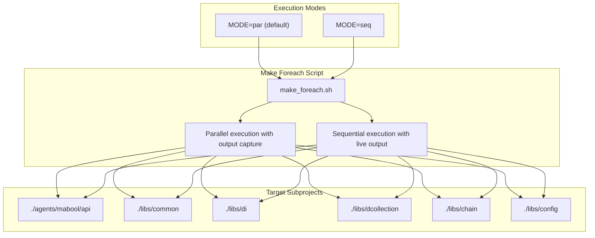

<!-- source: DeepWiki mcp.deepwiki.com · repo allenai/asta-paper-finder · page 6.3 Code Quality Tools · fetched 2026-10-26 -->

# Code Quality Tools

Relevant source files

The following files were used as context for generating this wiki page:

- [.flake8](.flake8)
- [Makefile](Makefile)
- [agents/mabool/api/.coveragerc](agents/mabool/api/.coveragerc)

This document covers the linting, formatting, type checking, and test coverage tools configured for the ASTA Paper Finder repository. These tools ensure code consistency, catch potential issues, and maintain high code quality across all subprojects.

For information about the overall build system that orchestrates these tools, see [Build System](#6.2). For details about setting up the development environment where these tools run, see [Environment Setup](#6.1).

## Code Quality Tool Overview

The repository uses a comprehensive set of code quality tools integrated through the Makefile-based build system. These tools run across multiple subprojects in parallel or sequential mode.

```mermaid
graph TB
    subgraph "Root Build System"
        ROOT_MAKE["Makefile"]
        MAKE_FOREACH["dev/make/make_foreach.sh"]
    end
    
    subgraph "Quality Tool Configuration"
        FLAKE8_CONFIG[".flake8"]
        COVERAGE_CONFIG["agents/mabool/api/.coveragerc"]
    end
    
    subgraph "Quality Check Targets"
        TYPE_CHECK["type-check target"]
        LINT["lint target"]
        FORMAT["format target"]
        FORMAT_CHECK["format-check target"]
        STYLE["style target"]
        FIX["fix target"]
    end
    
    subgraph "Underlying Tools"
        PYRIGHT["pyright"]
        RUFF["Ruff"]
        FLAKE8["flake8"]
        COVERAGE["coverage"]
    end
    
    subgraph "Subprojects"
        MABOOL_API["./agents/mabool/api"]
        LIBS_COMMON["./libs/common"]
        LIBS_DI["./libs/di"]
        LIBS_DCOLLECTION["./libs/dcollection"]
        LIBS_CHAIN["./libs/chain"]
        LIBS_CONFIG["./libs/config"]
    end
    
    ROOT_MAKE --> MAKE_FOREACH
    ROOT_MAKE --> TYPE_CHECK
    ROOT_MAKE --> LINT
    ROOT_MAKE --> FORMAT
    ROOT_MAKE --> FORMAT_CHECK
    ROOT_MAKE --> STYLE
    ROOT_MAKE --> FIX
    
    TYPE_CHECK --> PYRIGHT
    LINT --> RUFF
    FORMAT --> RUFF
    FORMAT_CHECK --> RUFF
    
    FLAKE8_CONFIG --> FLAKE8
    COVERAGE_CONFIG --> COVERAGE
    
    MAKE_FOREACH --> MABOOL_API
    MAKE_FOREACH --> LIBS_COMMON
    MAKE_FOREACH --> LIBS_DI
    MAKE_FOREACH --> LIBS_DCOLLECTION
    MAKE_FOREACH --> LIBS_CHAIN
    MAKE_FOREACH --> LIBS_CONFIG
```

Sources: [Makefile:1-89]()

## Available Quality Check Commands

The root Makefile provides several targets for code quality operations:

| Target | Purpose | Tool Used |
|--------|---------|-----------|
| `type-check` | Run type checking | pyright |
| `lint` | Run linting | Ruff |
| `format` | Format code automatically | Ruff |
| `format-check` | Check code formatting | Ruff |
| `style` | Run all style checks (format, lint, type) | Multiple |
| `fix` | Auto-fix style issues | Multiple |

All commands support parallel execution by default via the `make_foreach.sh` script, with an option to run sequentially using `MODE=seq`.

Sources: [Makefile:37-63](), [Makefile:77-88]()

## Flake8 Configuration

The repository uses flake8 for additional linting with custom configuration and plugins.

### Exclusion Rules

The `.flake8` configuration excludes several directories from linting:

Sources: [.flake8:1-11]()

### Custom Plugins

The configuration includes a custom flake8 plugin for stable sort checking:

The `StableSortChecker` plugin enforces consistent sorting practices in the codebase to prevent merge conflicts and improve code maintainability.

Sources: [.flake8:12-17]()

## Test Coverage Configuration

Test coverage is configured via the `.coveragerc` file in the main API project.

### Coverage Collection Settings

The coverage tool is configured to handle concurrent execution:

Sources: [agents/mabool/api/.coveragerc:1-11]()

### Coverage Reporting

The reporting configuration excludes certain lines from coverage requirements:

The `@overload` exclusion prevents coverage complaints about function overload definitions that are not meant to be executed.

Sources: [agents/mabool/api/.coveragerc:12-17]()

## Build System Integration

The quality tools are integrated into the multi-project build system through the root Makefile and the `make_foreach.sh` script.

### Parallel Execution

Quality checks can run across all subprojects simultaneously:

### Dependency Management

All quality check targets depend on `sync-dev` to ensure development dependencies are installed before running checks.

Sources: [Makefile:35-63](), [Makefile:6]()

## Tool Versions and Dependencies

The code quality tools are managed through the `uv` package manager and specified in the project's dependency files. The tools include:

- **Ruff**: Fast Python linter and formatter
- **pyright**: Microsoft's Python type checker  
- **flake8**: Additional linting with plugin support
- **coverage**: Test coverage measurement

The exact versions are locked in `uv.lock` and can be updated using `make lock`.

Sources: [Makefile:12-13](), [Makefile:24-29]()

---

