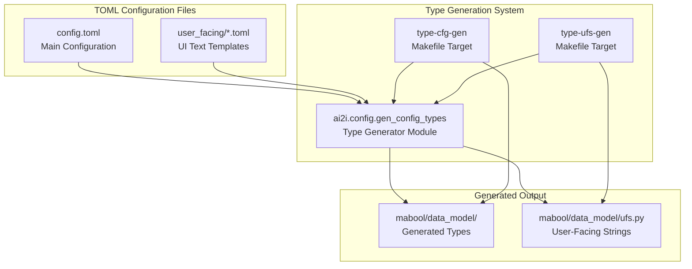
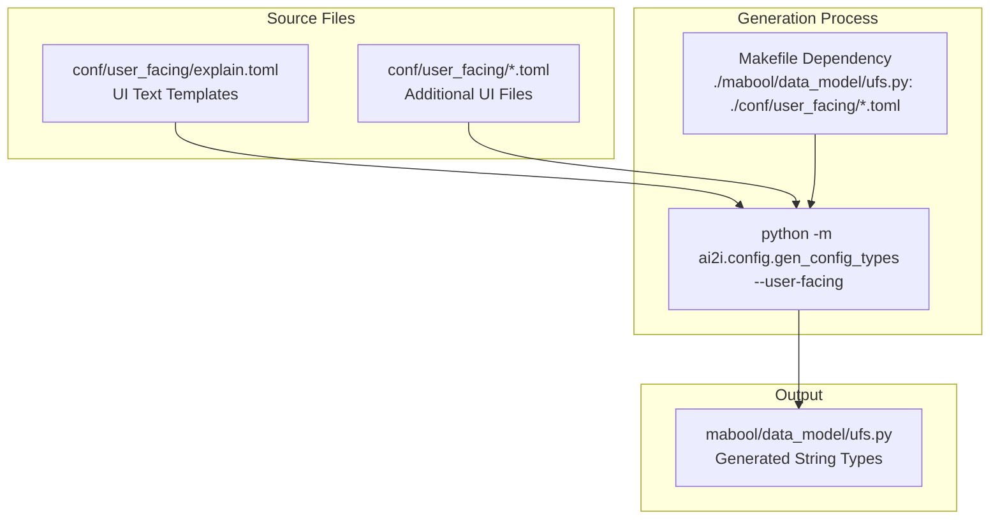
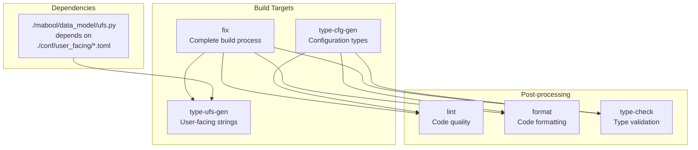
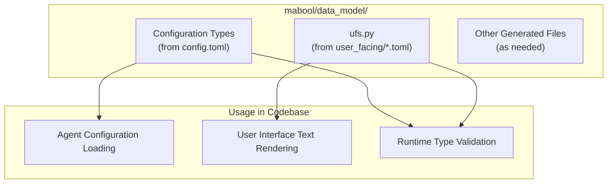

<!-- source: DeepWiki mcp.deepwiki.com · repo allenai/asta-paper-finder · page 6.4 Type Generation · fetched 2026-10-26 -->

# Type Generation

Relevant source files

The following files were used as context for generating this wiki page:

- [agents/mabool/api/Makefile](agents/mabool/api/Makefile)
- [agents/mabool/api/conf/config.toml](agents/mabool/api/conf/config.toml)
- [agents/mabool/api/conf/user_facing/explain.toml](agents/mabool/api/conf/user_facing/explain.toml)

The Type Generation system provides automated generation of Python type definitions from TOML configuration files. This system ensures type safety and consistency between configuration files and the Python codebase that consumes them.

The system generates two categories of types: configuration data model types from the main configuration files, and user-facing string types from UI text templates. For information about the configuration system itself, see [Configuration System](#4). For build system details, see [Build System](#6.2).

## Overview

The type generation system converts TOML configuration files into strongly-typed Python dataclasses, providing compile-time type checking and IDE support for configuration access throughout the codebase.

Sources: [agents/mabool/api/Makefile:9-18]()

## Configuration Type Generation

The `type-cfg-gen` target generates Python dataclass definitions from the main configuration file, providing type-safe access to all configuration parameters.

### Generation Process

The configuration type generation process reads the TOML configuration structure and creates corresponding Python dataclasses with proper type annotations:

The generation command structure:
- **Module**: `ai2i.config.gen_config_types`
- **Output Directory**: `mabool/data_model`
- **Post-processing**: Automatic linting, formatting, and type checking

Sources: [agents/mabool/api/Makefile:9-11]()

### Configuration Structure Mapping

The type generator processes the hierarchical TOML structure into nested dataclasses. Key configuration sections include:

| Configuration Section | Purpose | Generated Types |
|----------------------|---------|-----------------|
| `default` | Base configuration settings | Root configuration dataclass |
| `default.llm_abstraction` | LLM model configurations | LLM settings dataclass |
| `default.vespa` | Vespa search engine settings | Vespa configuration dataclass |
| `default.*_agent` | Individual agent configurations | Agent-specific dataclasses |

Sources: [agents/mabool/api/conf/config.toml:1-98]()

## User-Facing Strings Type Generation

The `type-ufs-gen` target generates Python types for user-facing text templates, enabling type-safe string formatting and internationalization support.

### UFS Generation Pipeline

The generation includes automatic dependency tracking, where the output file `./mabool/data_model/ufs.py` depends on all files matching `./conf/user_facing/*.toml`.

Sources: [agents/mabool/api/Makefile:14-18]()

### String Template Structure

The user-facing strings follow a hierarchical structure for different UI contexts:

| Template Category | Purpose | Example Keys |
|------------------|---------|--------------|
| `explain.metadata` | Search result metadata formatting | `time_range_prefix`, `venue`, `author` |
| `explain.content` | Content description templates | `papers_discussing`, `relevance_criteria_header` |
| `explain.summary` | Result summary messages | `no_results`, `found_papers`, `potential_matches` |
| `explain.domains` | Field of study formatting | `main_field`, `secondary_fields` |

Sources: [agents/mabool/api/conf/user_facing/explain.toml:1-75]()

## Build System Integration

The type generation system integrates with the Makefile build system through specific targets and dependency management.

### Make Targets

### Target Execution Flow

The build system ensures proper ordering and dependency resolution:

1. **`type-cfg-gen`**: Generates configuration types and runs full fix process
2. **`type-ufs-gen`**: Triggered by file dependencies when TOML files change
3. **`fix`**: Includes UFS generation in the complete build process

Sources: [agents/mabool/api/Makefile:4-11]()

## Generated Code Structure

The type generation system outputs Python code to the `mabool/data_model` directory, creating a centralized location for all generated type definitions.

### Output Organization

The generated types provide:
- **Type Safety**: Compile-time checking of configuration access
- **IDE Support**: Autocomplete and navigation for configuration fields
- **Runtime Validation**: Structured data validation during application startup
- **Consistency**: Guaranteed alignment between TOML files and Python code

Sources: [agents/mabool/api/Makefile:10](), [agents/mabool/api/Makefile:15]()

---

