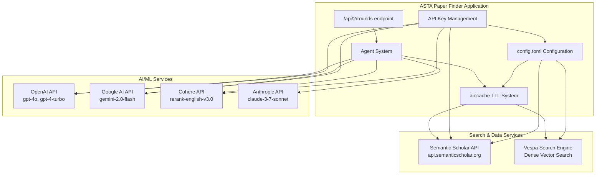
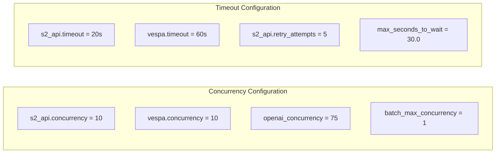
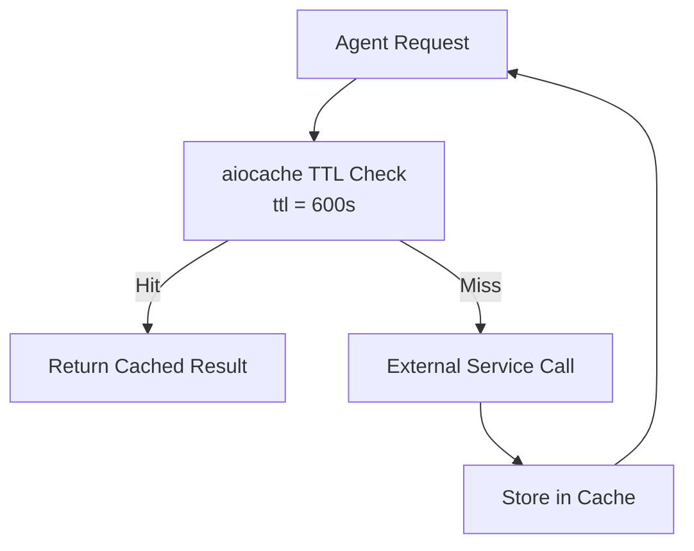

<!-- source: DeepWiki mcp.deepwiki.com · repo allenai/asta-paper-finder · page 7 External Service Integrations · fetched 2026-10-26 -->

# External Service Integrations

Relevant source files

The following files were used as context for generating this wiki page:

- [NOTICES.txt](NOTICES.txt)
- [agents/mabool/api/conf/config.toml](agents/mabool/api/conf/config.toml)

## Purpose and Scope

This document covers how the ASTA Paper Finder system integrates with external APIs and services to provide search functionality and AI-powered capabilities. The system relies on multiple third-party services for paper retrieval, semantic search, language model operations, and document reranking.

For detailed information about specific service categories, see [Search and Data APIs](#7.1) and [AI and ML Service APIs](#7.2). For configuration details, see [Main Configuration](#4.1).

## Integration Architecture

The mabool agent system integrates with external services through a layered architecture that includes authentication management, caching, rate limiting, and error handling.

Sources: [agents/mabool/api/conf/config.toml:1-98]()

## Service Categories

The system integrates with two primary categories of external services:

### Search and Data APIs
- **Semantic Scholar API**: Academic paper retrieval, citation data, and metadata
- **Vespa Search Engine**: Dense vector search and document retrieval

### AI and ML Service APIs  
- **OpenAI API**: GPT-4o and GPT-4 Turbo models for query analysis and planning
- **Google AI API**: Gemini 2.0 Flash as the default model for most agents
- **Cohere API**: Document reranking using rerank-english-v3.0
- **Anthropic API**: Claude 3.7 Sonnet as an alternative language model

Sources: [agents/mabool/api/conf/config.toml:6-98]()

## Configuration Management

External service integrations are configured through the main `config.toml` file with service-specific sections:

| Service | Configuration Section | Key Parameters |
|---------|----------------------|----------------|
| Semantic Scholar | `s2_api` | concurrency, timeout, retry_attempts |
| Vespa | `vespa` | concurrency, timeout |
| Cohere | `cohere` | rerank_model_name |
| LLM Services | `llm_abstraction` | model names, temperature, concurrency |

### Rate Limiting and Concurrency Controls

Sources: [agents/mabool/api/conf/config.toml:6](), [agents/mabool/api/conf/config.toml:35-36](), [agents/mabool/api/conf/config.toml:53](), [agents/mabool/api/conf/config.toml:32]()

## Authentication and Security

API key management for external services is handled through environment variables and secure configuration:

- API keys are stored in `.env.secret` files (not tracked in version control)
- Each service requires specific authentication tokens
- The system supports different authentication methods per service type

Sources: Based on standard API key management patterns referenced in configuration

## Performance and Reliability Features

### Caching Strategy
The system implements a TTL-based caching layer to reduce external API calls:

Sources: [agents/mabool/api/conf/config.toml:14]()

### Error Handling and Retry Logic
- **Retry attempts**: Configurable retry logic for failed requests (5 attempts for S2 API)
- **Timeout handling**: Service-specific timeout values to prevent hanging requests
- **Graceful degradation**: System continues operation when individual services are unavailable

Sources: [agents/mabool/api/conf/config.toml:6]()

### Model Selection and Fallbacks
The system uses a flexible model selection approach with configurable defaults:

| Default Model Assignment | Service | Model |
|--------------------------|---------|-------|
| Primary LLM | Google AI | gemini-2.0-flash |
| Query Analysis | OpenAI | gpt-4o-2024-11-20 |
| Metadata Planning | OpenAI | gpt-4o-default |
| Reranking | Cohere | rerank-english-v3.0 |

Sources: [agents/mabool/api/conf/config.toml:25-29](), [agents/mabool/api/conf/config.toml:39](), [agents/mabool/api/conf/config.toml:66](), [agents/mabool/api/conf/config.toml:70](), [agents/mabool/api/conf/config.toml:10]()

## Integration Monitoring

The system includes configurable monitoring and operational features:

- **Operative timeout**: 24-hour timeout for long-running operations
- **API swagger documentation**: Enabled by default for development
- **Logging**: Configurable log format and maximum length
- **Deterministic mode**: Optional forced deterministic behavior for testing

Sources: [agents/mabool/api/conf/config.toml:17-18](), [agents/mabool/api/conf/config.toml:3-4](), [agents/mabool/api/conf/config.toml:15]()

---

