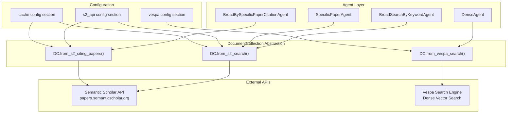
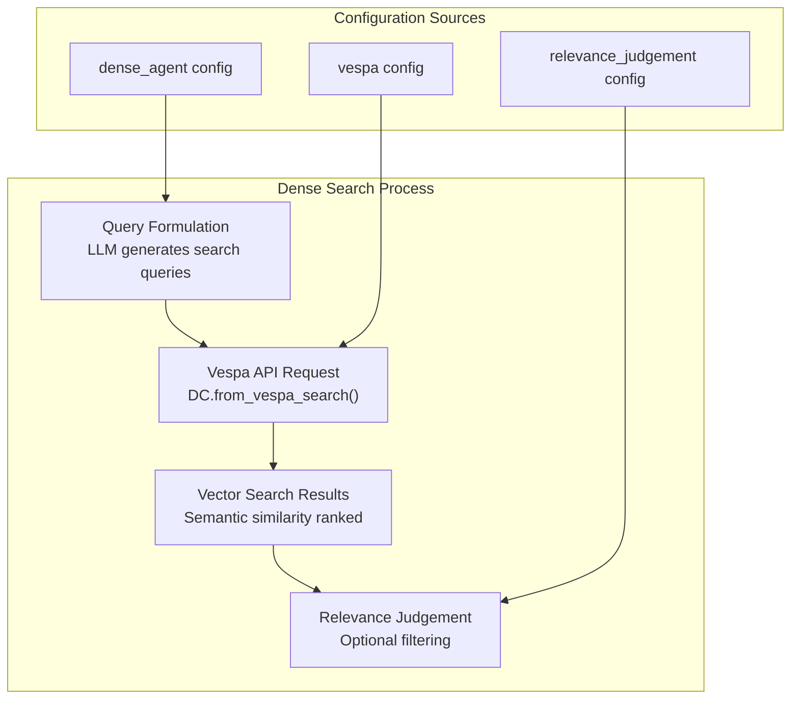
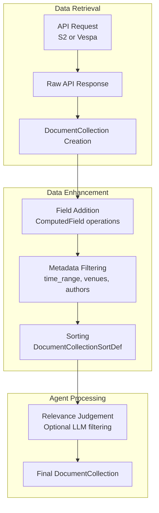

<!-- source: DeepWiki mcp.deepwiki.com · repo allenai/asta-paper-finder · page 7.1 Search and Data APIs · fetched 2026-10-26 -->

# Search and Data APIs

<details>
<summary>Relevant source files</summary>

The following files were used as context for generating this wiki page:

- [agents/mabool/api/conf/config.toml](agents/mabool/api/conf/config.toml)
- [agents/mabool/api/mabool/agents/broad_search_by_keyword/broad_search_by_keyword_agent.py](agents/mabool/api/mabool/agents/broad_search_by_keyword/broad_search_by_keyword_agent.py)
- [agents/mabool/api/mabool/agents/by_citing_papers/broad_by_specific_paper_citation_agent.py](agents/mabool/api/mabool/agents/by_citing_papers/broad_by_specific_paper_citation_agent.py)

</details>


This document covers the integration with external search and data APIs that power the paper retrieval functionality of the ASTA Paper Finder system. The system primarily relies on two external services: the Semantic Scholar API for academic paper data and the Vespa search engine for dense vector search capabilities.

For information about AI and ML service APIs (OpenAI, Cohere, Google AI, Anthropic), see [AI and ML Service APIs](#7.2).

## Overview

The mabool agent system integrates with external search and data APIs to retrieve academic papers, citations, and perform semantic search operations. These integrations are abstracted through the `DocumentCollection` (DC) utility classes and configured through the centralized TOML configuration system.

### API Integration Architecture



Sources: [agents/mabool/api/conf/config.toml:6](), [agents/mabool/api/mabool/agents/broad_search_by_keyword/broad_search_by_keyword_agent.py:152-184](), [agents/mabool/api/mabool/agents/by_citing_papers/broad_by_specific_paper_citation_agent.py:190-193]()

## Semantic Scholar API Integration

The Semantic Scholar API serves as the primary data source for academic papers, providing access to a comprehensive corpus of scholarly publications with rich metadata including citations, authors, abstracts, and bibliographic information.

### API Operations and Methods

```mermaid
graph TB
    subgraph "S2 API Operations"
        SEARCH_OP["Search Papers<br/>DC.from_s2_search()"]
        CITING_OP["Get Citing Papers<br/>DC.from_s2_citing_papers()"]
    end
    
    subgraph "Search Parameters"
        QUERY["query: str"]
        LIMIT["limit: int"]
        TIME_RANGE["time_range: ExtractedYearlyTimeRange"]
        VENUES["venues: list[str]"]
        FIELDS_STUDY["fields_of_study: list[str]"]
        FIELDS["fields: list[str]"]
        ITERATION["search_iteration: int"]
    end
    
    subgraph "Citation Parameters"
        CORPUS_ID["specific_paper_corpus_id: CorpusId"]
        SEARCH_ITER["search_iteration: int"]
    end
    
    subgraph "API Configuration"
        CONCURRENCY["concurrency: 10"]
        TIMEOUT["timeout: 20s"]
        RETRY["retry_attempts: 5"]
        PAPERS_LIMIT["total_papers_limit: 1000"]
        CITATIONS_LIMIT["total_citations_limit: 1000"]
        WAIT_TIME["max_seconds_to_wait: 30.0"]
    end
    
    SEARCH_OP --> QUERY
    SEARCH_OP --> LIMIT
    SEARCH_OP --> TIME_RANGE
    SEARCH_OP --> VENUES
    SEARCH_OP --> FIELDS_STUDY
    SEARCH_OP --> FIELDS
    SEARCH_OP --> ITERATION
    
    CITING_OP --> CORPUS_ID
    CITING_OP --> SEARCH_ITER
    
    SEARCH_OP --> CONCURRENCY
    SEARCH_OP --> TIMEOUT
    SEARCH_OP --> RETRY
    CITING_OP --> CONCURRENCY
    CITING_OP --> TIMEOUT
    CITING_OP --> RETRY
```



Sources: [agents/mabool/api/mabool/agents/broad_search_by_keyword/broad_search_by_keyword_agent.py:152-184](), [agents/mabool/api/mabool/agents/by_citing_papers/broad_by_specific_paper_citation_agent.py:190-193](), [agents/mabool/api/conf/config.toml:6]()

### Paper Search Implementation

The `DC.from_s2_search()` method is used extensively across search agents to retrieve papers based on various criteria:

| Parameter | Type | Purpose | Example Usage |
|-----------|------|---------|---------------|
| `query` | `str` | Search query string | Generated by LLM from user query |
| `limit` | `int` | Maximum papers to retrieve | Configured per agent (50-250) |
| `search_iteration` | `int` | Pagination/iteration tracking | Incremented for subsequent searches |
| `time_range` | `ExtractedYearlyTimeRange` | Publication year filtering | E.g., 2020-2024 |
| `venues` | `list[str]` | Conference/journal filtering | E.g., ["ICLR", "NeurIPS"] |
| `fields_of_study` | `list[str]` | Domain filtering | Derived from `DomainsIdentified` |
| `fields` | `list[str]` | Metadata fields to retrieve | `BASIC_FIELDS` + specific fields |

Sources: [agents/mabool/api/mabool/agents/broad_search_by_keyword/broad_search_by_keyword_agent.py:152-184]()

### Citation Network Access

The `DC.from_s2_citing_papers()` method enables exploration of citation networks:

```python
citing_papers = await DC.from_s2_citing_papers(
    specific_paper_corpus_id,
    search_iteration=search_iteration,
)
```

This method is primarily used by the `BroadBySpecificPaperCitationAgent` to find papers that cite a specific target paper, enabling discovery of related work and influence tracking.

Sources: [agents/mabool/api/mabool/agents/by_citing_papers/broad_by_specific_paper_citation_agent.py:190-193]()

## Vespa Search Engine Integration

Vespa provides dense vector search capabilities for semantic similarity-based paper retrieval. This integration is primarily used by the `DenseAgent` for performing embedding-based searches.

### Vespa Configuration

The Vespa integration is configured with specific performance parameters:

| Setting | Value | Purpose |
|---------|-------|---------|
| `concurrency` | 10 | Maximum concurrent requests |
| `timeout` | 60 | Request timeout in seconds |

Sources: [agents/mabool/api/conf/config.toml:34-36]()

### Dense Search Operation Flow



Sources: [agents/mabool/api/conf/config.toml:34-63]()

## Configuration and Performance Settings

### API Rate Limiting and Concurrency

Both external APIs are configured with specific concurrency and timeout settings to ensure reliable operation:

#### Semantic Scholar API Settings

```toml
[default.s2_api]
concurrency = 10
timeout = 20
total_papers_limit = 1000
total_citations_limit = 1000
retry_attempts = 5
max_seconds_to_wait = 30.0
```

#### Vespa Search Settings

```toml
[default.vespa]
concurrency = 10
timeout = 60
```

Sources: [agents/mabool/api/conf/config.toml:6](), [agents/mabool/api/conf/config.toml:34-36]()

### Caching Configuration

Response caching is implemented to improve performance and reduce API load:

```toml
[default.cache]
enabled = true
ttl = 600
```

The cache system provides:
- **TTL (Time To Live)**: 600 seconds (10 minutes)
- **Automatic invalidation**: Based on TTL expiration
- **Performance optimization**: Reduces redundant API calls

Sources: [agents/mabool/api/conf/config.toml:14]()

## Error Handling and Retry Logic

### Semantic Scholar API Resilience

The S2 API integration includes comprehensive error handling:

- **Retry attempts**: Up to 5 attempts for failed requests
- **Exponential backoff**: Implemented through `max_seconds_to_wait` parameter
- **Graceful degradation**: Empty collections returned on persistent failures
- **Exception logging**: Detailed error reporting for debugging

### Example Error Handling Pattern

```python
try:
    citing_papers_with_snippets = DC.merge(
        await custom_gather(*[
            fetch_citing_papers(...)
            for specific_paper_corpus_id in specific_paper_corpus_ids
        ])
    )
except Exception:
    # Error fetching
    citing_papers_with_snippets = DC.empty()
```

Sources: [agents/mabool/api/mabool/agents/by_citing_papers/broad_by_specific_paper_citation_agent.py:150-169]()

## Data Flow and Processing Pipeline

### Search Result Processing



Sources: [agents/mabool/api/mabool/agents/broad_search_by_keyword/broad_search_by_keyword_agent.py:152-190](), [agents/mabool/api/mabool/agents/by_citing_papers/broad_by_specific_paper_citation_agent.py:194-202]()

### Field Specification and Metadata

The system retrieves specific metadata fields from external APIs:

- **BASIC_FIELDS**: Core paper metadata (title, abstract, authors, etc.)
- **Extended fields**: Citation counts, publication venues, timestamps
- **Computed fields**: Relevance scores, weighted rankings, snippet counts

Sources: [agents/mabool/api/mabool/agents/broad_search_by_keyword/broad_search_by_keyword_agent.py:159](), [agents/mabool/api/mabool/agents/by_citing_papers/broad_by_specific_paper_citation_agent.py:79-87]()

---

