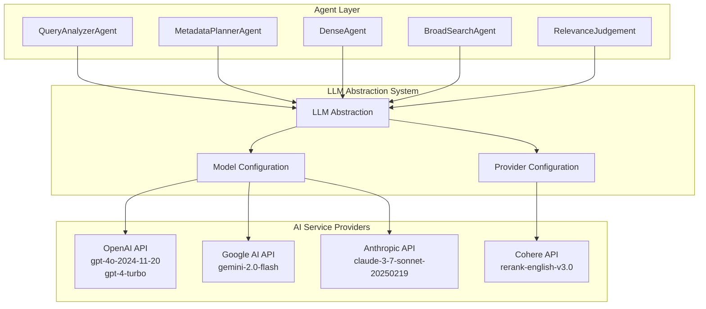
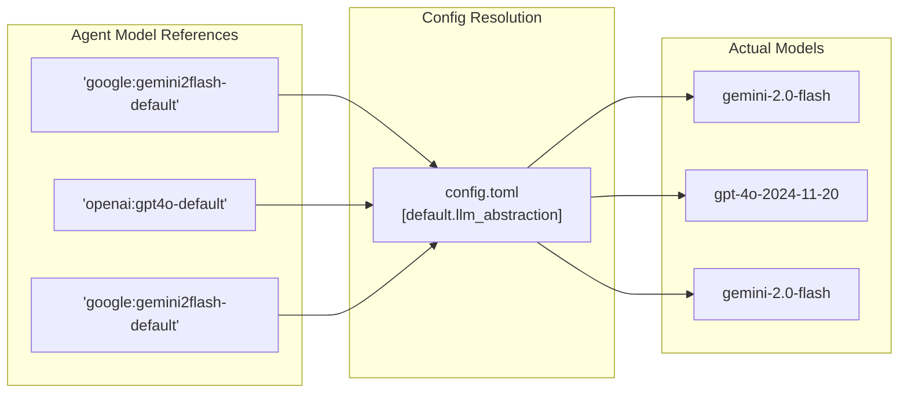
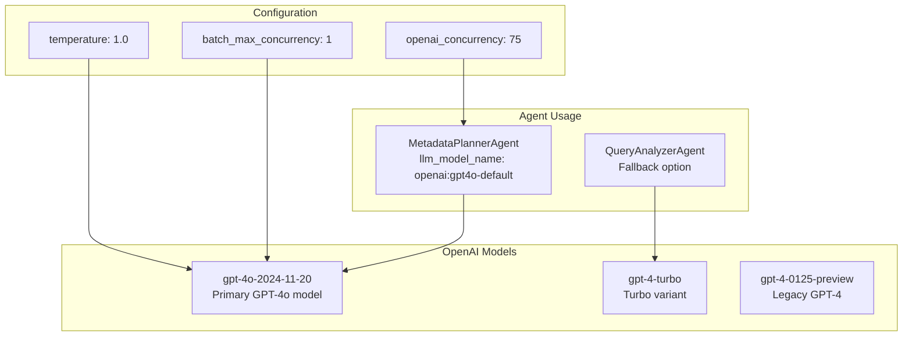
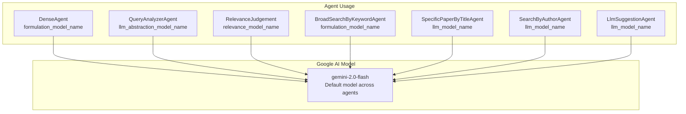
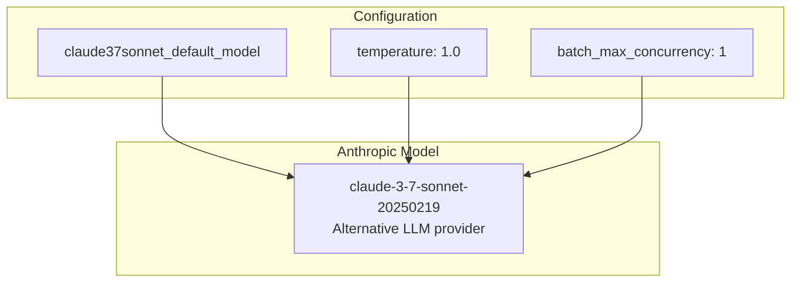
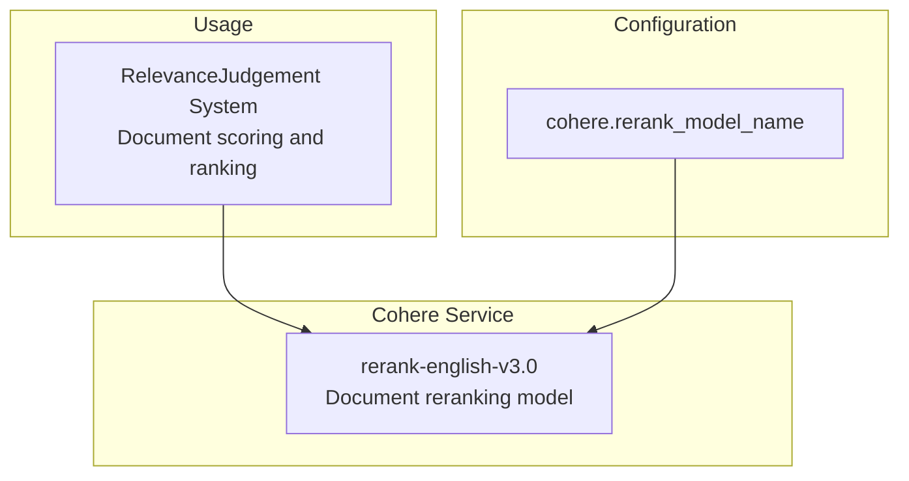
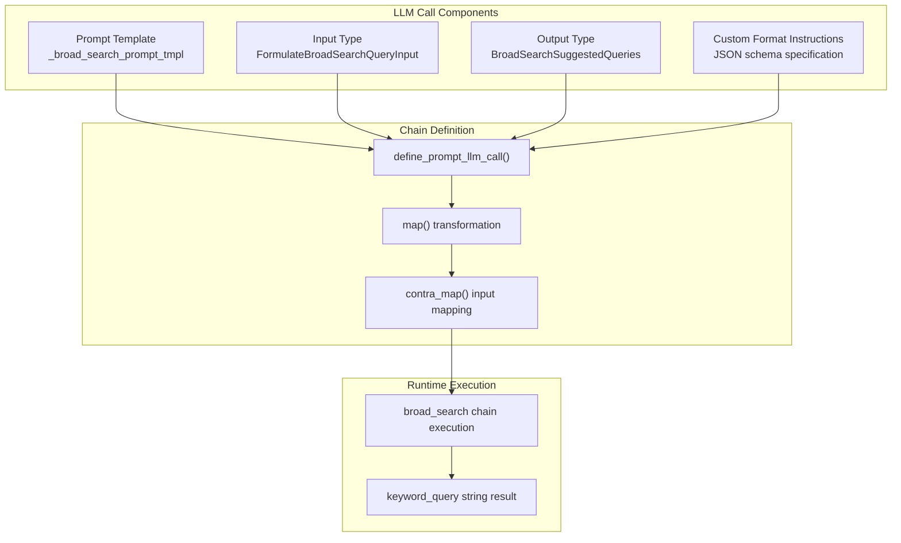
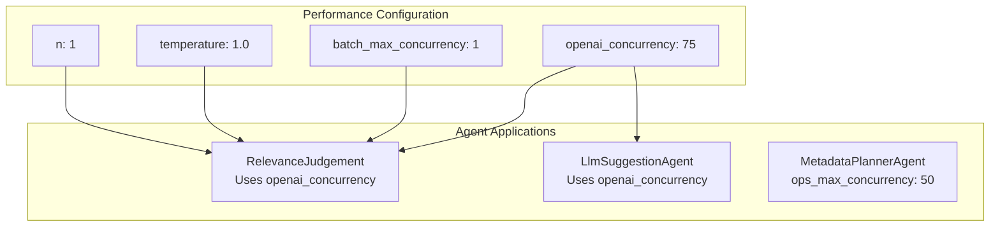
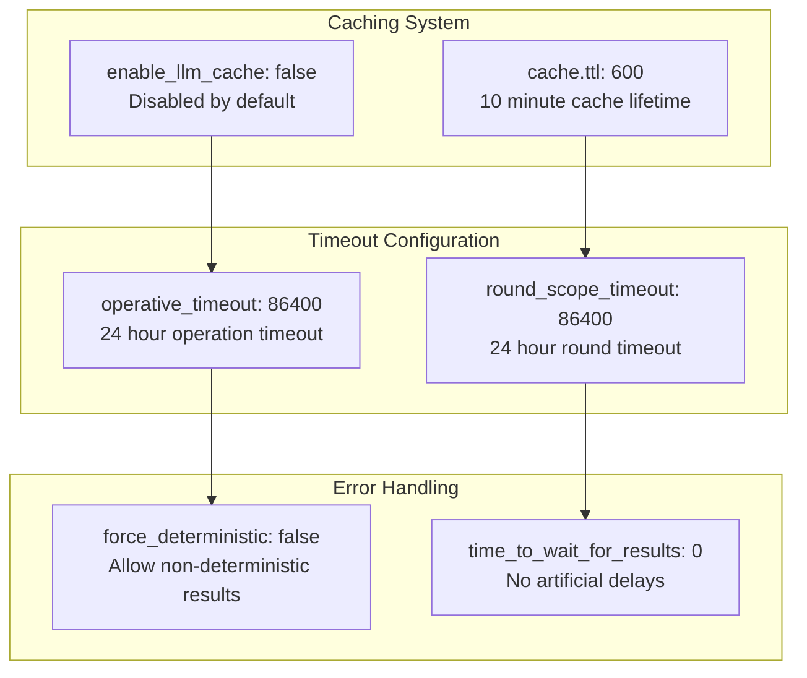

<!-- source: DeepWiki mcp.deepwiki.com · repo allenai/asta-paper-finder · page 7.2 AI and ML Service APIs · fetched 2026-10-26 -->

# AI and ML Service APIs

Relevant source files

The following files were used as context for generating this wiki page:

- [NOTICES.txt](NOTICES.txt)
- [agents/mabool/api/conf/config.toml](agents/mabool/api/conf/config.toml)
- [agents/mabool/api/mabool/agents/broad_search_by_keyword/broad_search_by_keyword_prompts.py](agents/mabool/api/mabool/agents/broad_search_by_keyword/broad_search_by_keyword_prompts.py)

This document covers the integration with external AI and ML service APIs that power the language model operations in the ASTA Paper Finder system. The system integrates with four primary AI service providers: OpenAI, Google AI, Anthropic, and Cohere for various natural language processing tasks including query reformulation, relevance assessment, and document reranking.

For information about search and data retrieval APIs, see [Search and Data APIs](#7.1). For details about the agent system that consumes these AI services, see [Agent System](#3).

## LLM Abstraction Layer

The system implements a unified abstraction layer that normalizes access to different language model providers through a consistent interface. This abstraction enables agents to use different models interchangeably based on configuration.

Sources: [agents/mabool/api/conf/config.toml:24-33]()

## Model Configuration and Mapping

The system maps logical model names to specific provider models through the configuration system. Each provider has default model configurations that can be overridden per agent.

| Configuration Key | Default Model | Provider | Usage |
|------------------|---------------|----------|--------|
| `gpt4o_default_model` | `gpt-4o-2024-11-20` | OpenAI | General purpose, metadata planning |
| `gpt4turbo_default_model` | `gpt-4-turbo` | OpenAI | Alternative OpenAI model |
| `claude37sonnet_default_model` | `claude-3-7-sonnet-20250219` | Anthropic | Alternative LLM provider |
| `gemini2flash_default_model` | `gemini-2.0-flash` | Google AI | Default for most agents |
| `rerank_model_name` | `rerank-english-v3.0` | Cohere | Document reranking |

Sources: [agents/mabool/api/conf/config.toml:25-29](), [agents/mabool/api/conf/config.toml:39](), [agents/mabool/api/conf/config.toml:66](), [agents/mabool/api/conf/config.toml:70]()

## Provider-Specific Integrations

### OpenAI Integration

OpenAI models are primarily used for metadata planning and as an alternative to Google AI models. The system supports both GPT-4o and GPT-4 Turbo variants.

Sources: [agents/mabool/api/conf/config.toml:70](), [agents/mabool/api/conf/config.toml:25-27](), [agents/mabool/api/conf/config.toml:53]()

### Google AI Integration

Google AI's Gemini models serve as the default for most agents in the system, providing the primary language model capabilities for query analysis, dense search formulation, and relevance assessment.

Sources: [agents/mabool/api/conf/config.toml:29](), [agents/mabool/api/conf/config.toml:39](), [agents/mabool/api/conf/config.toml:52](), [agents/mabool/api/conf/config.toml:66](), [agents/mabool/api/conf/config.toml:76](), [agents/mabool/api/conf/config.toml:79](), [agents/mabool/api/conf/config.toml:87](), [agents/mabool/api/conf/config.toml:95]()

### Anthropic Integration

Anthropic's Claude models provide an alternative LLM option, configured as a backup or specialized model for specific use cases.

Sources: [agents/mabool/api/conf/config.toml:28](), [agents/mabool/api/conf/config.toml:30-32]()

### Cohere Integration

Cohere provides specialized reranking capabilities through their rerank model, used specifically for improving search result relevance.

Sources: [agents/mabool/api/conf/config.toml:10]()

## LLM Call Pattern Implementation

The system implements a standardized pattern for LLM calls using a chain-based approach that defines input/output types and prompt templates.

Sources: [agents/mabool/api/mabool/agents/broad_search_by_keyword/broad_search_by_keyword_prompts.py:34-45](), [agents/mabool/api/mabool/agents/broad_search_by_keyword/broad_search_by_keyword_prompts.py:26-32]()

## Concurrency and Performance Configuration

The system configures different concurrency limits and performance parameters for each AI service provider to optimize throughput while respecting rate limits.

| Service | Concurrency Limit | Timeout | Special Parameters |
|---------|-------------------|---------|-------------------|
| OpenAI | `75` | Default | `batch_max_concurrency: 1` |
| Google AI | Default | Default | `temperature: 1.0` |
| Anthropic | Default | Default | `n: 1` |
| Cohere | Default | Default | Model-specific |

Sources: [agents/mabool/api/conf/config.toml:30-32](), [agents/mabool/api/conf/config.toml:53](), [agents/mabool/api/conf/config.toml:71](), [agents/mabool/api/conf/config.toml:96]()

## Error Handling and Caching

The system implements caching and error handling mechanisms for AI service calls to improve reliability and reduce API costs.

Sources: [agents/mabool/api/conf/config.toml:14-19](), [agents/mabool/api/conf/config.toml:22]()

---

