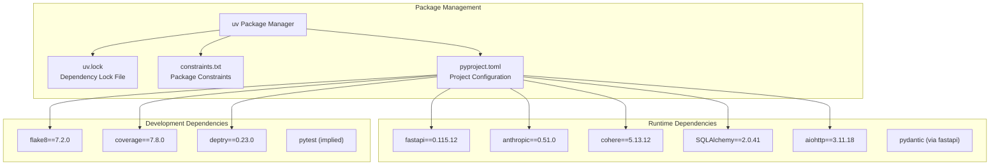
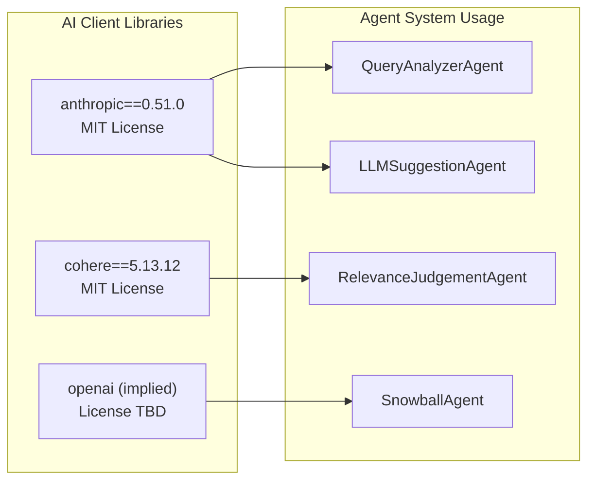
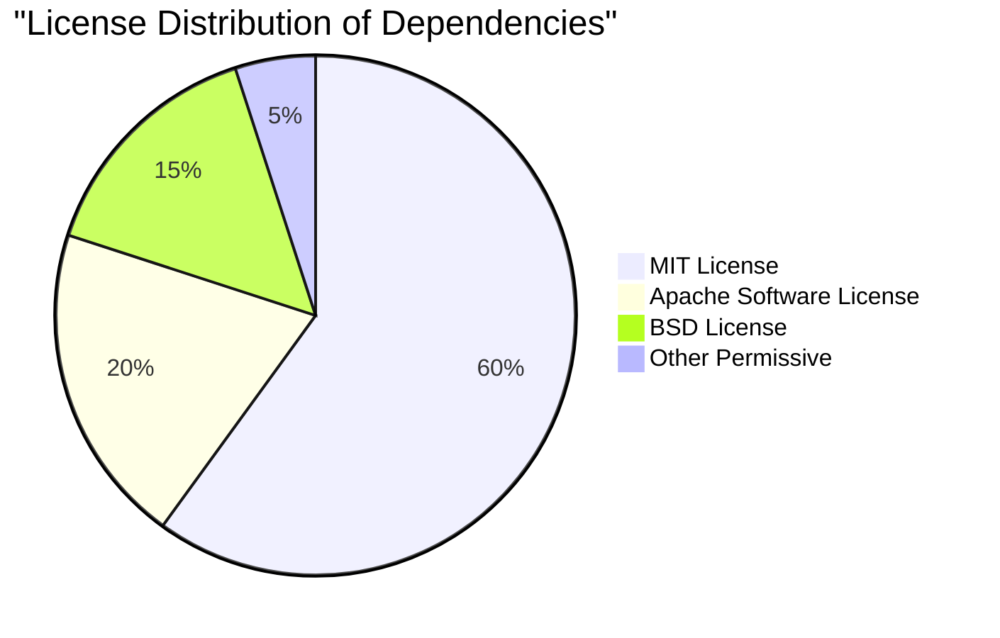

<!-- source: DeepWiki mcp.deepwiki.com · repo allenai/asta-paper-finder · page 8 Dependencies and Third-Party Licenses · fetched 2026-10-26 -->

# Dependencies and Third-Party Licenses

Relevant source files

The following files were used as context for generating this wiki page:

- [.gitignore](.gitignore)
- [NOTICES.txt](NOTICES.txt)
- [agents/mabool/api/constraints.txt](agents/mabool/api/constraints.txt)

This document provides comprehensive information about the third-party dependencies used in the ASTA Paper Finder system and their respective licensing terms. It covers both runtime dependencies required for the mabool agent system and development dependencies used for building, testing, and maintaining the codebase.

For information about external service integrations and API usage, see [External Service Integrations](#7). For details about the build system and development workflow, see [Development Guide](#6).

## Dependency Management Overview

The ASTA Paper Finder uses the `uv` package manager for Python dependency management, which provides fast and reliable package resolution with lock file support.

**Sources:** [agents/mabool/api/constraints.txt:1-2](), [NOTICES.txt:1-2000]()

## Package Constraints and Version Management

The system maintains specific package constraints to ensure compatibility and stability:

| Constraint | Purpose | Source |
|------------|---------|---------|
| `setuptools<72` | Compatibility with uv package manager | [agents/mabool/api/constraints.txt:1]() |

**Sources:** [agents/mabool/api/constraints.txt:1-2]()

## Core Runtime Dependencies and Licenses

### Web Framework and API Dependencies

The system's API layer relies on several core packages for HTTP handling and web service functionality:

| Package | Version | License | Purpose |
|---------|---------|---------|---------|
| `fastapi` | 0.115.12 | MIT | Web framework for API endpoints |
| `aiohttp` | 3.11.18 | Apache Software License | Async HTTP client for external APIs |
| `aiosignal` | 1.3.2 | Apache Software License | Signal handling for aiohttp |
| `anyio` | 4.6.2.post1 | MIT | Async I/O abstraction |
| `asgi-lifespan` | 2.1.0 | MIT | ASGI application lifespan management |

**Sources:** [NOTICES.txt:415-637](), [NOTICES.txt:433-636](), [NOTICES.txt:678-701](), [NOTICES.txt:703-727]()

### AI and Machine Learning Client Libraries

The mabool agent system integrates with multiple AI service providers through their official Python clients:

| Package | Version | License | Purpose |
|---------|---------|---------|---------|
| `anthropic` | 0.51.0 | MIT | Claude 3.5 Sonnet API client |
| `cohere` | 5.13.12 | MIT | Cohere rerank API client |

**Sources:** [NOTICES.txt:665-675](), [NOTICES.txt:864-888]()

### Data Processing and Storage Dependencies

| Package | Version | License | Purpose |
|---------|---------|---------|---------|
| `SQLAlchemy` | 2.0.41 | MIT | Database ORM for caching |
| `aiocache` | 0.12.3 | BSD-3-Clause | Async caching framework |
| `attrs` | 25.3.0 | MIT | Class definition utilities |
| `dataclasses-json` | 0.6.7 | MIT | JSON serialization for dataclasses |
| `PyYAML` | 6.0.2 | MIT | YAML parsing for configuration |

**Sources:** [NOTICES.txt:90-112](), [NOTICES.txt:114-129](), [NOTICES.txt:729-753](), [NOTICES.txt:1136-1160](), [NOTICES.txt:35-58]()

## Development and Build Dependencies

### Code Quality and Testing Tools

The development workflow uses several tools for maintaining code quality and running tests:

| Package | Version | License | Purpose |
|---------|---------|---------|---------|
| `flake8` | 7.2.0 | MIT | Python linting and style checking |
| `coverage` | 7.8.0 | Apache-2.0 | Test coverage measurement |
| `deptry` | 0.23.0 | MIT | Dependency analysis and validation |

**Sources:** [NOTICES.txt:1551-1576](), [NOTICES.txt:923-1103](), [NOTICES.txt:1188-1212]()

### Development Utilities

| Package | Version | License | Purpose |
|---------|---------|---------|---------|
| `click` | 8.2.0 | BSD-3-Clause | Command-line interface utilities |
| `GitPython` | 3.1.45 | BSD-3-Clause | Git repository access |
| `Pygments` | 2.19.1 | BSD | Syntax highlighting |

**Sources:** [NOTICES.txt:831-862](), [NOTICES.txt:1-33](), [NOTICES.txt:60-88]()

## License Categories and Compliance

### License Distribution Analysis

### Permissive License Summary

All dependencies use permissive open-source licenses that allow commercial use, modification, and distribution:

| License Type | Count | Examples | Key Terms |
|--------------|--------|----------|-----------|
| MIT | ~60% | fastapi, anthropic, cohere, anyio | Very permissive, minimal restrictions |
| Apache 2.0 | ~20% | aiohttp, coverage, distro | Patent protection, attribution required |
| BSD (3-Clause) | ~15% | GitPython, click, contourpy | Attribution required, no trademark use |
| Unlicense | <1% | filelock | Public domain dedication |
| Mozilla Public License 2.0 | <1% | certifi | File-based copyleft for modifications |

**Sources:** [NOTICES.txt:1-2000]()

## Full License Notices

The complete license texts for all dependencies are maintained in the project's [NOTICES.txt:1-2000]() file, which includes:

- Full license text for each dependency
- Copyright notices
- Version information
- Attribution requirements

This file is automatically generated and updated as part of the dependency management process to ensure license compliance and proper attribution.

### Critical License Requirements

1. **Attribution**: Most licenses require preserving copyright notices and license text
2. **Distribution**: License notices must be included with any distribution of the software
3. **Modification Notice**: Some licenses require noting modifications to the original code
4. **Patent Grants**: Apache 2.0 licensed dependencies provide explicit patent protection

**Sources:** [NOTICES.txt:1-2000]()

## Dependency Security and Updates

The system uses `uv.lock` to pin exact dependency versions for reproducible builds while allowing controlled updates through the `uv` package manager's update mechanisms.

### Package Constraint Strategy

- **Runtime Stability**: Core dependencies are pinned to specific versions
- **Security Updates**: Regular dependency audits and updates
- **Compatibility**: Version constraints prevent breaking changes
- **Development Flexibility**: Development dependencies allow minor version updates

**Sources:** [agents/mabool/api/constraints.txt:1-2]()