# Page: Overview

# Overview

<details>
<summary>Relevant source files</summary>

The following files were used as context for generating this wiki page:

- [CONTRIBUTING.md](CONTRIBUTING.md)
- [LICENSE](LICENSE)
- [README.md](README.md)

</details>


## Purpose and Scope

This document provides an overview of the ASTA Paper Finder repository, an academic paper search system that uses large language models and multiple search strategies to locate relevant research papers based on natural language queries. The system is designed as a standalone agent that can understand complex paper-seeking intents and return relevance-ranked results.

For detailed information about specific subsystems, see [System Architecture](#2), [Agent System](#3), [Configuration System](#4), and [API Reference](#5). For development setup and contributing guidelines, see [Development Guide](#6).

## Current Repository Status

**Important: This repository is frozen and archived.** As stated in [CONTRIBUTING.md:3-5](), the codebase is not actively maintained, supported, or monitored, and no contributions are accepted. This represents a snapshot of the PaperFinder agent system at a specific point in time, primarily intended for research reproducibility and local evaluation.

The code differs from the live PaperFinder agent deployed at https://paperfinder.allen.ai/ in several ways: it lacks multi-turn conversation capabilities, user-friendly progress updates, graphical result widgets, and access to certain proprietary datasets. This version focuses specifically on single-turn paper search functionality.

Sources: [CONTRIBUTING.md:1-6](), [README.md:13-17]()

## System Overview

PaperFinder is implemented as a pipeline of manually-coded components that incorporate LLM decisions at key decision points, along with LLM-based relevance judgments of retrieved abstracts and snippets. The system analyzes incoming queries, transforms them into structured objects, and routes them through specialized workflows designed for different paper-seeking intents.

### Core Architecture

The system consists of three main layers:

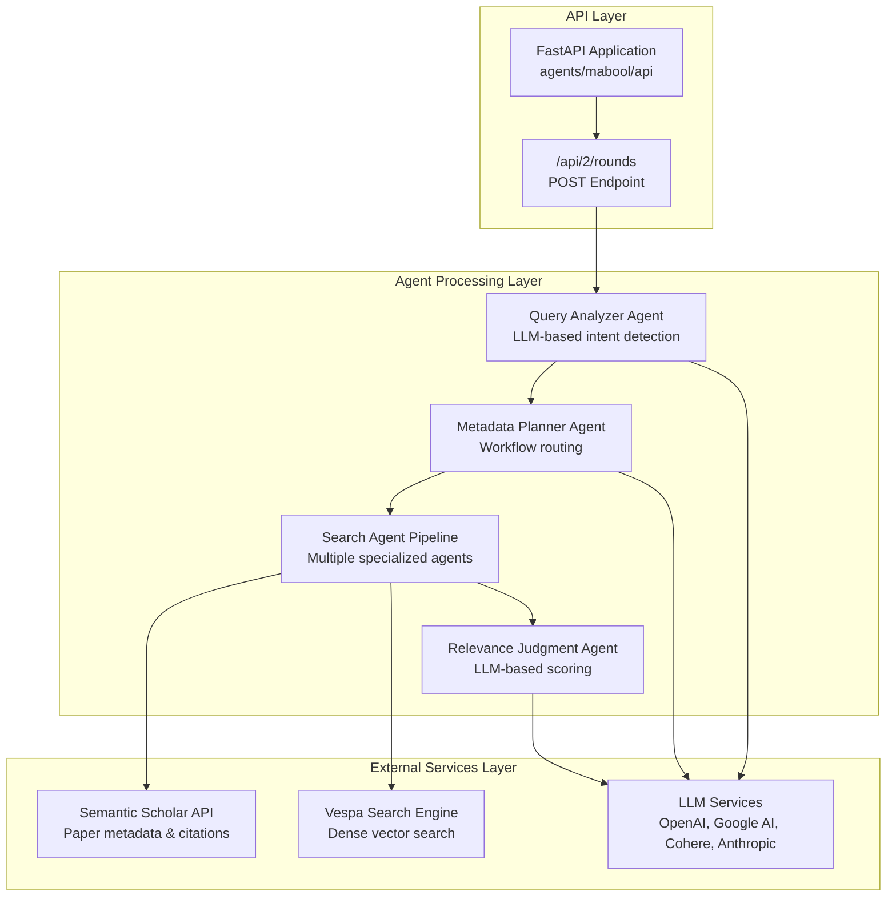

Sources: [README.md:9-11](), system architecture diagrams

### Request Processing Flow

The following diagram shows how a typical paper search request flows through the system:

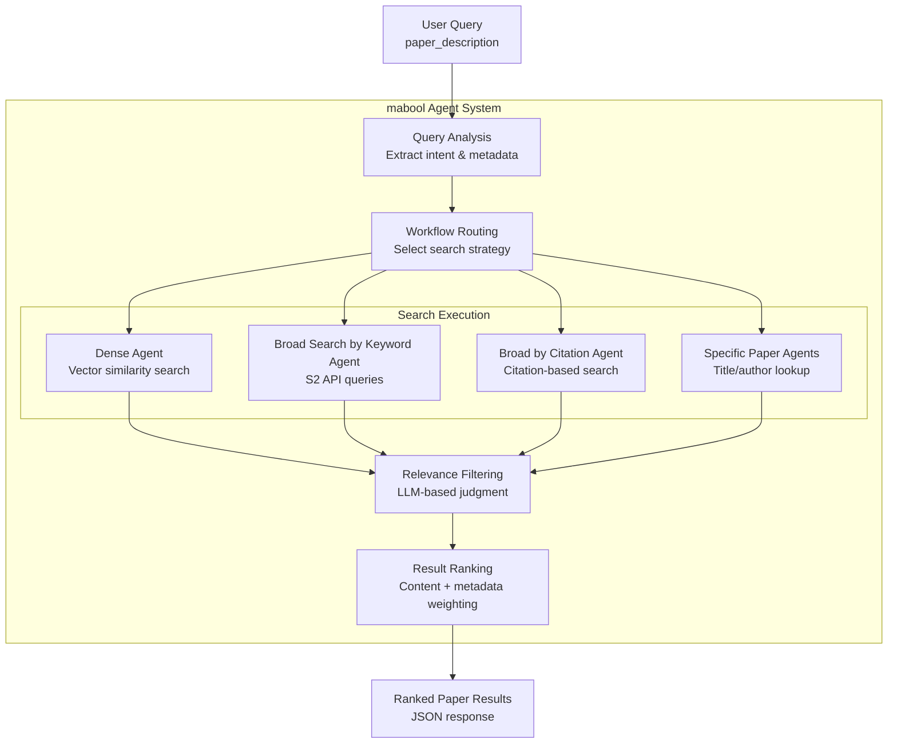

Sources: [README.md:9-11](), agent system architecture diagrams

## Key System Components

### Agent System (`agents/mabool/`)

The core of the system is the `mabool` agent implementation, which orchestrates the entire paper search process. Key components include:

| Component | Purpose | Location |
|-----------|---------|----------|
| Query Analyzer Agent | Extracts search intent and metadata from natural language | `agents/mabool/` |
| Search Agents | Specialized agents for different search strategies | `agents/mabool/` |
| Relevance Judgment Agent | LLM-based filtering and scoring | `agents/mabool/` |
| Metadata Planner Agent | Workflow routing and execution planning | `agents/mabool/` |

### Configuration System

The system uses a comprehensive TOML-based configuration system that controls agent behavior, timeouts, model settings, and user-facing content:

- **Main Configuration**: [config.toml]() - Agent parameters, API settings, model configurations
- **Fast Mode Configuration**: [config.extra.fast_mode.toml]() - Optimized settings for faster searches
- **User-Facing Strings**: [user_facing/*.toml]() - UI text and explanation templates

### External Service Integration

The system integrates with multiple external APIs:

- **Semantic Scholar API**: Paper metadata, citations, and search
- **Vespa Search Engine**: Dense vector search capabilities  
- **LLM Services**: OpenAI (GPT-4o, GPT-4 Turbo), Google AI (Gemini 2.0 Flash), Cohere (rerank-english-v3.0), Anthropic (Claude 3.5 Sonnet)

Sources: Configuration system diagrams, external service integration architecture

## Technology Stack

The system is built using:

- **Python 3.12.8** with `uv` package manager
- **FastAPI** for the REST API server
- **TOML** configuration files with automated type generation
- **Makefile-based** build system for development workflows
- **File-based caching** with 600-second TTL for API responses

## Getting Started

To run the system locally:

1. Set up API keys in `agents/mabool/api/conf/.env.secret` for OpenAI, Semantic Scholar, Cohere, and Google AI
2. Install dependencies: `make sync-dev`
3. Start the development server: `cd agents/mabool/api && make start-dev`
4. Send requests to the `/api/2/rounds` POST endpoint

For detailed setup instructions, see [Environment Setup](#6.1). For API usage details, see [API Reference](#5).

Sources: [README.md:19-58]()

---

# Page: System Architecture

# System Architecture

<details>
<summary>Relevant source files</summary>

The following files were used as context for generating this wiki page:

- [README.md](README.md)
- [agents/mabool/api/conf/config.toml](agents/mabool/api/conf/config.toml)
- [agents/mabool/api/dev.sh](agents/mabool/api/dev.sh)
- [agents/mabool/api/mabool/__init__.py](agents/mabool/api/mabool/__init__.py)

</details>


This page provides a high-level overview of the ASTA Paper Finder system architecture, focusing on the mabool agent system that powers paper search operations. It covers the FastAPI application structure, the agent pipeline design, external service integrations, and the configuration management system.

For detailed information about individual agents and their specific behaviors, see [Agent System](#3). For API endpoint specifications, see [API Reference](#5). For external service integration details, see [External Service Integrations](#7).

## System Overview

The ASTA Paper Finder is implemented as a FastAPI application that orchestrates a pipeline of specialized search agents. The system processes natural language queries about academic papers and returns ranked, relevance-judged results through a structured workflow involving query analysis, execution planning, and multi-stage retrieval operations.

## Core Application Architecture

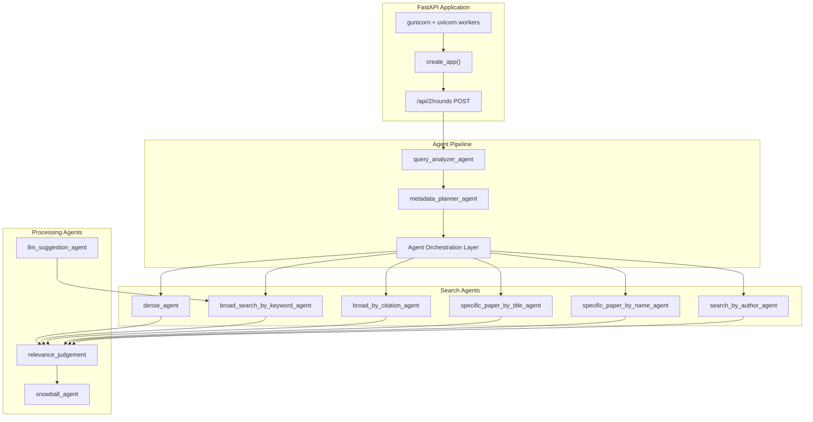

The application runs as a FastAPI server launched through `gunicorn` with `uvicorn` workers, as configured in [agents/mabool/api/dev.sh:2-10](). The main entry point is the `create_app()` function which provides the `/api/2/rounds` POST endpoint for paper search requests.

**Sources:** [agents/mabool/api/dev.sh:2-10](), [README.md:35-58]()

## Configuration-Driven Architecture

```mermaid
graph TB
    subgraph "Configuration Management"
        CONFIG_TOML["config.toml"]
        FAST_MODE["config.extra.fast_mode.toml"]
        ENV_SECRET[".env.secret"]
    end
    
    subgraph "LLM Abstraction Layer"
        LLM_ABSTRACT["llm_abstraction"]
        GPT4O["gpt4o_default_model"]
        GPT4TURBO["gpt4turbo_default_model"] 
        CLAUDE["claude37sonnet_default_model"]
        GEMINI["gemini2flash_default_model"]
    end
    
    subgraph "Agent Configuration Bindings"
        DENSE_CONFIG["default.dense_agent"]
        BROAD_CONFIG["default.broad_search_agent"]
        RELEVANCE_CONFIG["default.relevance_judgement"]
        QUERY_CONFIG["default.query_analyzer_agent"]
        PLANNER_CONFIG["default.metadata_planner_agent"]
    end
    
    subgraph "External Service Config"
        S2_CONFIG["default.s2_api"]
        VESPA_CONFIG["default.vespa"]
        COHERE_CONFIG["default.cohere"]
        CACHE_CONFIG["default.cache"]
    end
    
    CONFIG_TOML --> LLM_ABSTRACT
    CONFIG_TOML --> DENSE_CONFIG
    CONFIG_TOML --> BROAD_CONFIG
    CONFIG_TOML --> RELEVANCE_CONFIG
    CONFIG_TOML --> QUERY_CONFIG
    CONFIG_TOML --> PLANNER_CONFIG
    CONFIG_TOML --> S2_CONFIG
    CONFIG_TOML --> VESPA_CONFIG
    CONFIG_TOML --> COHERE_CONFIG
    CONFIG_TOML --> CACHE_CONFIG
    
    LLM_ABSTRACT --> GPT4O
    LLM_ABSTRACT --> GPT4TURBO
    LLM_ABSTRACT --> CLAUDE
    LLM_ABSTRACT --> GEMINI
    
    ENV_SECRET --> LLM_ABSTRACT
    FAST_MODE --> DENSE_CONFIG
    FAST_MODE --> BROAD_CONFIG
```

The system uses a comprehensive TOML-based configuration system where each agent and external service has dedicated configuration sections. The `llm_abstraction` layer provides model-agnostic access to different LLM providers, with model selection configured per agent.

**Sources:** [agents/mabool/api/conf/config.toml:21-98](), [README.md:21-24]()

## External Service Integration

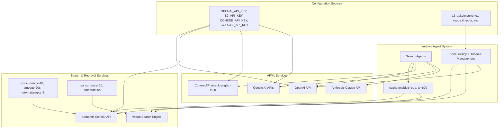

The system integrates with multiple external services through a centralized configuration approach. Rate limiting and timeout management are configurable per service, with caching enabled by default with a 600-second TTL.

**Sources:** [agents/mabool/api/conf/config.toml:6](), [agents/mabool/api/conf/config.toml:10](), [agents/mabool/api/conf/config.toml:14](), [agents/mabool/api/conf/config.toml:34-36](), [README.md:23-24]()

## Agent Pipeline Flow

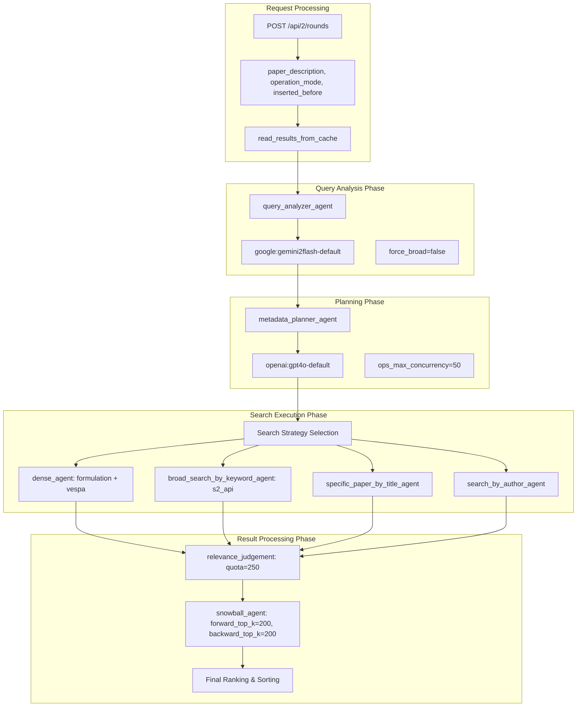

The system processes requests through a structured pipeline where each phase is configurable. The `operation_mode` parameter influences search strategy selection, with "fast" and "diligent" modes providing different levels of exhaustiveness.

**Sources:** [README.md:44-57](), [agents/mabool/api/conf/config.toml:66-67](), [agents/mabool/api/conf/config.toml:70-71](), [agents/mabool/api/conf/config.toml:52-63](), [agents/mabool/api/conf/config.toml:5]()

## Dependency Injection and Scoping

The system uses a dependency injection framework with configurable scoping. The `round_scope_timeout` is set to 86400 seconds (24 hours), allowing for long-running search operations while maintaining proper resource management.

| Configuration Key | Value | Purpose |
|---|---|---|
| `di.round_scope_timeout` | 86400 | Maximum duration for a single search round |
| `operative_timeout` | 86400 | Overall operation timeout |
| `cache.ttl` | 600 | Cache time-to-live in seconds |
| `force_deterministic` | false | Enable deterministic behavior for testing |

**Sources:** [agents/mabool/api/conf/config.toml:22](), [agents/mabool/api/conf/config.toml:17](), [agents/mabool/api/conf/config.toml:14](), [agents/mabool/api/conf/config.toml:15]()

---

# Page: Agent System

# Agent System

<details>
<summary>Relevant source files</summary>

The following files were used as context for generating this wiki page:

- [agents/mabool/api/conf/config.toml](agents/mabool/api/conf/config.toml)
- [agents/mabool/api/mabool/agents/__init__.py](agents/mabool/api/mabool/agents/__init__.py)
- [agents/mabool/api/mabool/agents/common/common.py](agents/mabool/api/mabool/agents/common/common.py)

</details>


The Agent System is the core component of the ASTA Paper Finder that orchestrates academic paper search operations through a collection of specialized agents. This system implements a multi-agent architecture where different agents handle specific aspects of paper discovery, from query analysis to result processing.

For detailed information about specific search agent implementations, see [Search Agents](#3.1). For LLM integration and prompt engineering details, see [Agent Prompts and LLM Integration](#3.2). For shared utilities and data structures, see [Common Agent Utilities](#3.3).

## Agent System Architecture

The agent system follows a pipeline-based architecture where agents are orchestrated to handle different phases of the search process. The system is designed around the concept of `DocumentCollection` processing, where each agent transforms or enriches the collection of academic papers.

### Agent Execution Pipeline

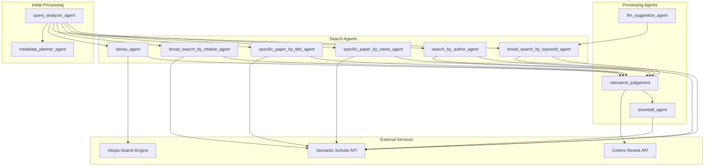

Sources: [agents/mabool/api/conf/config.toml:1-98]()

### Agent State Management

The agent system uses a standardized state management approach through the `AgentState` class, which provides checkpoint functionality for maintaining intermediate results.

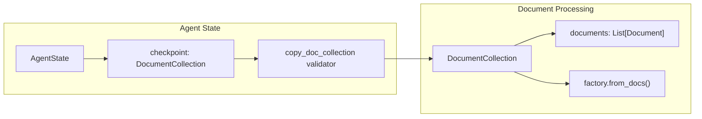

Sources: [agents/mabool/api/mabool/agents/common/common.py:18-28]()

## Agent Categories

The agent system organizes agents into distinct categories based on their functional responsibilities:

### Analysis and Planning Agents

| Agent | Configuration Key | LLM Model | Purpose |
|-------|------------------|-----------|---------|
| Query Analyzer | `query_analyzer_agent` | `google:gemini2flash-default` | Analyzes user queries and determines search strategy |
| Metadata Planner | `metadata_planner_agent` | `openai:gpt4o-default` | Plans metadata-based filtering operations |

### Search Strategy Agents

| Agent | Configuration Key | LLM Model | Search Type |
|-------|------------------|-----------|-------------|
| Dense Agent | `dense_agent` | `google:gemini2flash-default` | Vector-based semantic search |
| Broad Keyword | `broad_search_by_keyword_agent` | `google:gemini2flash-default` | Keyword-based broad search |
| Broad Citation | `broad_search_by_citation_agent` | N/A | Citation-based discovery |
| Specific Title | `specific_paper_by_title_agent` | `google:gemini2flash-default` | Exact paper title matching |
| Specific Name | `specific_paper_by_name_agent` | N/A | Paper name-based search |
| Author Search | `search_by_author_agent` | `google:gemini2flash-default` | Author-focused paper discovery |

### Post-Processing Agents

| Agent | Configuration Key | LLM Model | Function |
|-------|------------------|-----------|----------|
| Relevance Judgement | `relevance_judgement` | `google:gemini2flash-default` | Assesses paper relevance to query |
| Snowball Agent | `snowball_agent` | N/A | Expands results through citations |
| LLM Suggestion | `llm_suggestion_agent` | `google:gemini2flash-default` | Generates additional search suggestions |

Sources: [agents/mabool/api/conf/config.toml:38-98]()

## Agent Execution Model

### Control Flow Types

The agent system uses a standardized control flow mechanism with three distinct types:

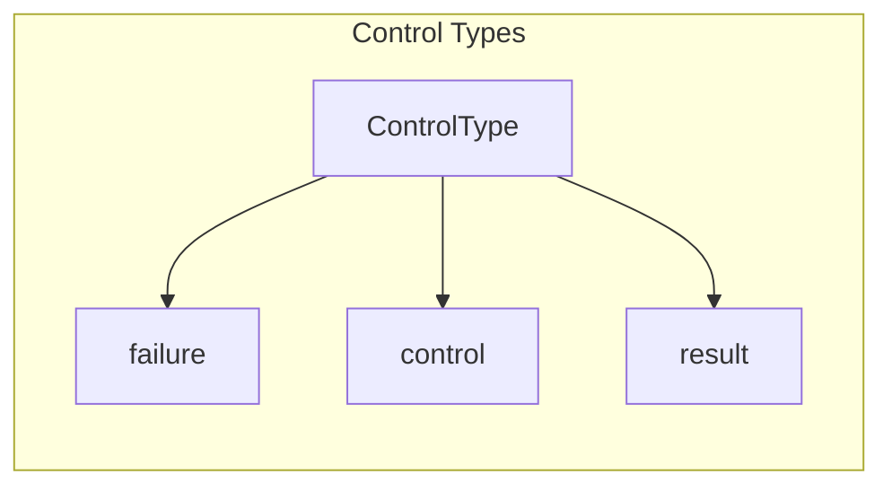

Sources: [agents/mabool/api/mabool/agents/common/common.py:15]()

### Document Filtering Pipeline

Agents utilize a sophisticated document filtering system that supports multiple metadata dimensions:

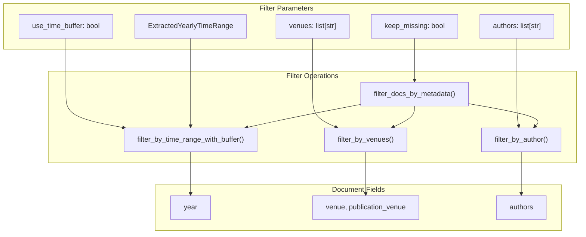

Sources: [agents/mabool/api/mabool/agents/common/common.py:30-153]()

## Configuration System Integration

### Agent Configuration Structure

Each agent is configured through the TOML configuration system with standardized parameter patterns:

| Configuration Pattern | Purpose | Example Agents |
|----------------------|---------|----------------|
| `llm_model_name` | Specifies LLM provider and model | `query_analyzer_agent`, `metadata_planner_agent` |
| `formulation_model_name` | Model for query reformulation | `dense_agent`, `broad_search_by_keyword_agent` |
| `max_iterations` | Limits iterative processing | `broad_search_agent`, `dense_agent` |
| `concurrency` | Controls parallel execution | `relevance_judgement`, `metadata_planner_agent` |
| `timeout` | Operation time limits | Inherited from `s2_api`, `vespa` |

### Timeout and Concurrency Management

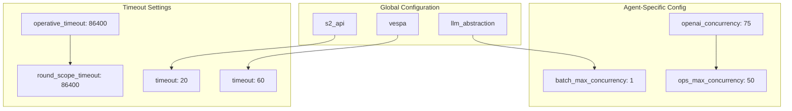

Sources: [agents/mabool/api/conf/config.toml:6,17,21-23,32,53,71,96]()

### Input Query Types

The agent system standardizes query input through typed interfaces:

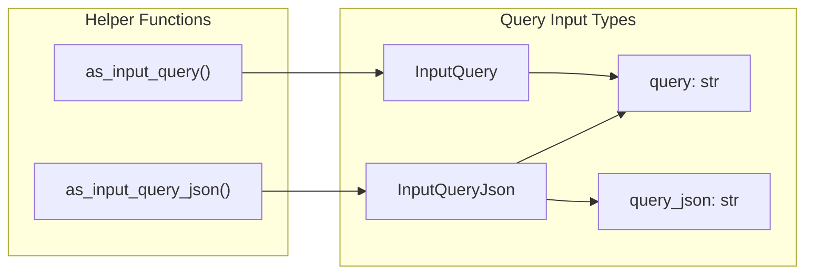

Sources: [agents/mabool/api/mabool/agents/common/common.py:156-169]()

---

# Page: Search Agents

# Search Agents

<details>
<summary>Relevant source files</summary>

The following files were used as context for generating this wiki page:

- [agents/mabool/api/mabool/agents/broad_search_by_keyword/__init__.py](agents/mabool/api/mabool/agents/broad_search_by_keyword/__init__.py)
- [agents/mabool/api/mabool/agents/broad_search_by_keyword/broad_search_by_keyword_agent.py](agents/mabool/api/mabool/agents/broad_search_by_keyword/broad_search_by_keyword_agent.py)
- [agents/mabool/api/mabool/agents/by_citing_papers/__init__.py](agents/mabool/api/mabool/agents/by_citing_papers/__init__.py)
- [agents/mabool/api/mabool/agents/by_citing_papers/broad_by_specific_paper_citation_agent.py](agents/mabool/api/mabool/agents/by_citing_papers/broad_by_specific_paper_citation_agent.py)

</details>


This document covers the specialized search agents in the mabool system that perform different types of paper retrieval operations. These agents implement distinct search strategies ranging from keyword-based searches to citation analysis and specific paper identification. For information about agent prompts and LLM integration, see [Agent Prompts and LLM Integration](#3.2). For shared agent utilities and data structures, see [Common Agent Utilities](#3.3).

## Agent Architecture Overview

The search agents form the core retrieval layer of the mabool system, each implementing the `Operative` interface to provide specialized paper search capabilities. All agents follow a common pattern of accepting search inputs, maintaining state across iterations, and returning document collections with optional relevance scoring.

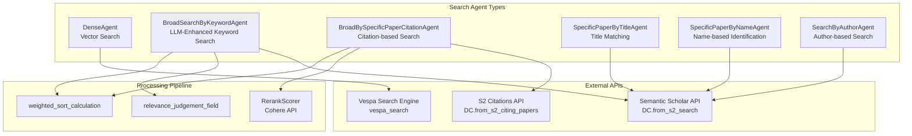

Sources: [agents/mabool/api/mabool/agents/broad_search_by_keyword/broad_search_by_keyword_agent.py:62-120](), [agents/mabool/api/mabool/agents/by_citing_papers/broad_by_specific_paper_citation_agent.py:209-248]()

## Broad Search by Keyword Agent

The `BroadSearchByKeywordAgent` implements LLM-enhanced keyword searching by reformulating user queries into optimized search terms before executing retrieval operations.

### Implementation Details

The agent follows a two-phase approach:

1. **Query Reformulation**: Uses the `suggest_retrieval_query()` function to transform user input via LLM prompts
2. **Search Execution**: Performs retrieval using the Semantic Scholar API with optional sorting and relevance filtering

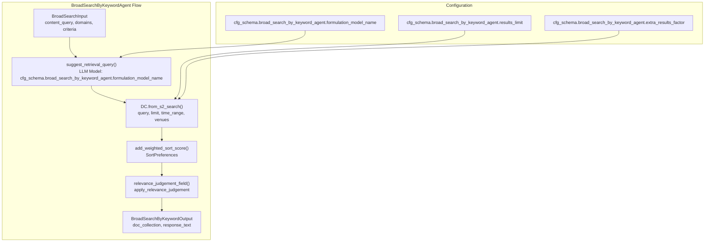

Sources: [agents/mabool/api/mabool/agents/broad_search_by_keyword/broad_search_by_keyword_agent.py:41-50](), [agents/mabool/api/mabool/agents/broad_search_by_keyword/broad_search_by_keyword_agent.py:121-190]()

### Key Features

| Feature | Implementation | Configuration |
|---------|---------------|---------------|
| Query Enhancement | `suggest_retrieval_query()` with LLM endpoint | `formulation_model_name` |
| Result Limiting | Dynamic limit based on sorting needs | `results_limit * extra_results_factor` |
| Domain Filtering | `get_fields_of_study_filter_from_domains()` | From `DomainsIdentified` input |
| Temporal Filtering | `time_range` parameter in S2 search | `ExtractedYearlyTimeRange` |
| Relevance Scoring | `relevance_judgement_field()` application | `apply_relevance_judgement` flag |

Sources: [agents/mabool/api/mabool/agents/broad_search_by_keyword/broad_search_by_keyword_agent.py:147-149](), [agents/mabool/api/mabool/agents/broad_search_by_keyword/broad_search_by_keyword_agent.py:186-188]()

## Citation-Based Search Agent

The `BroadBySpecificPaperCitationAgent` implements citation analysis by finding papers that cite specific anchor papers, using both paper identification and citation traversal.

### Citation Search Pipeline

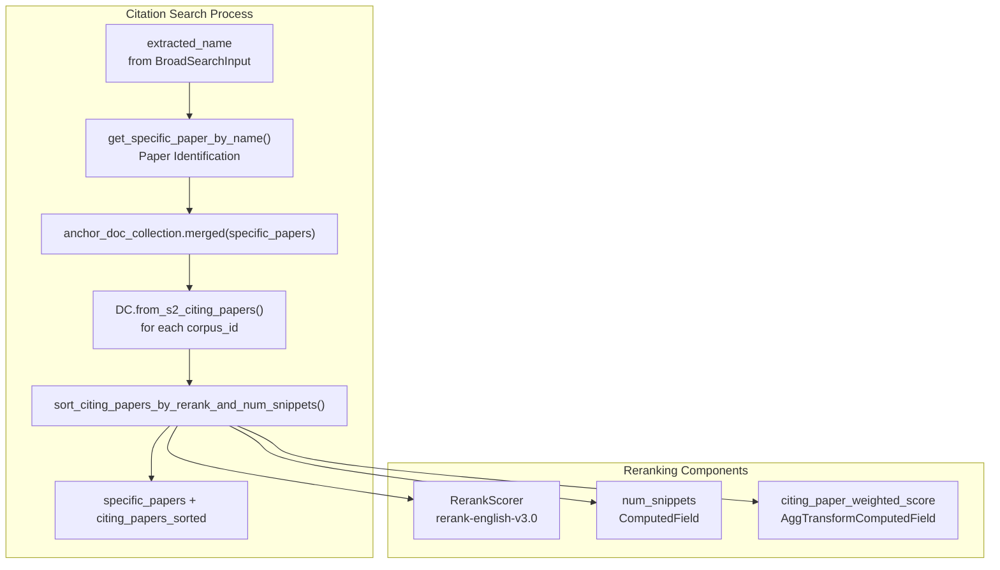

Sources: [agents/mabool/api/mabool/agents/by_citing_papers/broad_by_specific_paper_citation_agent.py:112-177](), [agents/mabool/api/mabool/agents/by_citing_papers/broad_by_specific_paper_citation_agent.py:40-109]()

### Reranking Algorithm

The citation agent implements sophisticated reranking using multiple signals:

1. **Cohere Reranking**: Scores documents based on title and snippet relevance to query
2. **Snippet Count**: Weights papers by the number of available text snippets
3. **Weighted Combination**: Combines scores using configurable weights

```python
# Reranking weights used in weighted_sort_calculation_partial
{"citing_paper_rerank_score": 1.0, "num_snippets": 0.25}
```

Sources: [agents/mabool/api/mabool/agents/by_citing_papers/broad_by_specific_paper_citation_agent.py:89-92](), [agents/mabool/api/mabool/agents/by_citing_papers/broad_by_specific_paper_citation_agent.py:68-77]()

## Agent State Management

All search agents implement stateful operation through the `Operative` interface, maintaining search iterations and document checkpoints across multiple calls.

### State Pattern Implementation

| Agent | State Class | Key State Fields | Checkpoint Type |
|-------|-------------|------------------|-----------------|
| `BroadSearchByKeywordAgent` | `BroadSearchByKeywordState` | `search_iteration` | `DocumentCollection` |
| `BroadBySpecificPaperCitationAgent` | `BroadBySpecificPaperCitationState` | `search_iteration` | `DocumentCollection` |

### Response Handling

Agents return `OperativeResponse` objects with three possible outcomes:

- **`CompleteResponse`**: Successful operation with results
- **`PartialResponse`**: Partial success with error details  
- **`VoidResponse`**: Complete failure with error information

Sources: [agents/mabool/api/mabool/agents/broad_search_by_keyword/broad_search_by_keyword_agent.py:87-119](), [agents/mabool/api/mabool/agents/by_citing_papers/broad_by_specific_paper_citation_agent.py:214-248]()

## Common Integration Patterns

### Document Collection Operations

All search agents utilize the `DC` (Document Collection) utility class for consistent data handling:

- **`DC.from_s2_search()`**: Semantic Scholar search integration
- **`DC.from_s2_citing_papers()`**: Citation retrieval
- **`DC.merge()`**: Combining results from multiple sources
- **`DC.empty()`**: Creating empty collections for error states

### Field Requirements

Search agents consistently request specific document fields through the `BASIC_FIELDS` constant and additional computed fields:

- **Basic Fields**: Core document metadata (title, authors, abstract, etc.)
- **Citation Fields**: `citation_count` for sorting operations  
- **Computed Fields**: Relevance scores, snippet counts, weighted scores

Sources: [agents/mabool/api/mabool/agents/broad_search_by_keyword/broad_search_by_keyword_agent.py:152-184](), [agents/mabool/api/mabool/agents/by_citing_papers/broad_by_specific_paper_citation_agent.py:190-202]()

---

# Page: Agent Prompts and LLM Integration

# Agent Prompts and LLM Integration

<details>
<summary>Relevant source files</summary>

The following files were used as context for generating this wiki page:

- [agents/mabool/api/conf/config.toml](agents/mabool/api/conf/config.toml)
- [agents/mabool/api/mabool/agents/broad_search_by_keyword/broad_search_by_keyword_prompts.py](agents/mabool/api/mabool/agents/broad_search_by_keyword/broad_search_by_keyword_prompts.py)

</details>


This page documents how the mabool agent system integrates with Large Language Models (LLMs) for query processing, reformulation, and analysis. It covers the prompt template system, LLM abstraction layer, and how different agents are configured to use specific models. For information about the specific search agents that use these LLM capabilities, see [Search Agents](#3.1). For detailed configuration parameters, see [Main Configuration](#4.1).

## LLM Abstraction Layer

The system uses a centralized LLM abstraction layer that supports multiple providers and models. This abstraction allows agents to specify model preferences while maintaining consistent interfaces across different LLM providers.

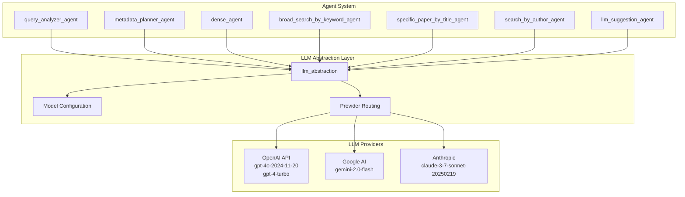

The LLM abstraction configuration includes default models for each provider and global settings like temperature and concurrency limits:

| Configuration Key | Value | Description |
|-------------------|-------|-------------|
| `gpt4o_default_model` | `"gpt-4o-2024-11-20"` | Default GPT-4o model version |
| `gpt4turbo_default_model` | `"gpt-4-turbo"` | Default GPT-4 Turbo model |
| `claude37sonnet_default_model` | `"claude-3-7-sonnet-20250219"` | Default Claude 3.5 Sonnet model |
| `gemini2flash_default_model` | `"gemini-2.0-flash"` | Default Gemini 2.0 Flash model |
| `temparature` | `1.0` | Temperature setting for all models |
| `batch_max_concurrency` | `1` | Maximum concurrent batch requests |

Sources: [agents/mabool/api/conf/config.toml:24-33]()

## Prompt Template System

The system uses the `ai2i.chain` library to define structured prompt templates with type-safe inputs and outputs. This approach ensures consistency and enables automatic validation of LLM interactions.

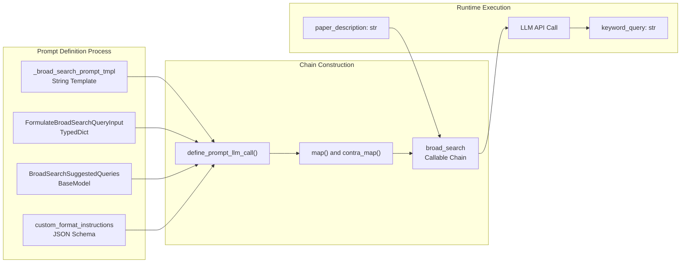

### Example: Broad Search Query Reformulation

The broad search agent demonstrates the typical prompt template structure. The prompt guides the LLM to reformulate natural language descriptions into keyword-based search queries suitable for Semantic Scholar:

```python
_broad_search_prompt_tmpl = """
Given a user-provided natural language description of desired scientific papers, \
reformulate the query as an alternative search query for the Semantic Scholar search engine.
Focus on formulating the natural language query into a keyword search query, that is, \
remove unnecessary descriptive words that wont show up in the content itself and keep the keywords to look for.

Use plain text for queries, as Semantic Scholar does not support special syntax.
Semantic Scholar does not support hyphens in queries, so avoid hyphens.

When building the queries, try to use only content-keywords, that is, do emit metadata or non keyword-y wordings!

Input description: ```{paper_description}```
"""
```

The prompt template uses:
- **Input Type**: `FormulateBroadSearchQueryInput` (TypedDict with `paper_description` field)
- **Output Type**: `BroadSearchSuggestedQueries` (BaseModel with `keyword_query` field) 
- **Format Instructions**: Custom JSON schema guidance for structured output
- **Chain Operations**: `map()` to extract the keyword query and `contra_map()` to transform string input

Sources: [agents/mabool/api/mabool/agents/broad_search_by_keyword/broad_search_by_keyword_prompts.py:11-45]()

## Agent-Specific LLM Configuration

Different agents are configured to use specific LLM models based on their processing requirements. The configuration allows fine-tuning of model selection, concurrency, and other parameters per agent.

```mermaid
graph TB
    subgraph "Query Processing Agents"
        QueryAnalyzer["query_analyzer_agent<br/>google:gemini2flash-default"]
        MetadataPlanner["metadata_planner_agent<br/>openai:gpt4o-default"]
    end

    subgraph "Search Formulation Agents"
        DenseAgent["dense_agent<br/>google:gemini2flash-default"]
        BroadKeyword["broad_search_by_keyword_agent<br/>google:gemini2flash-default"]
        SpecificTitle["specific_paper_by_title_agent<br/>google:gemini2flash-default"]
        AuthorSearch["search_by_author_agent<br/>google:gemini2flash-default"]
    end

    subgraph "Analysis Agents"
        RelevanceJudgement["relevance_judgement<br/>google:gemini2flash-default"]
        LLMSuggestion["llm_suggestion_agent<br/>google:gemini2flash-default"]
    end

    subgraph "Model Assignments"
        GeminiDefault["Gemini 2.0 Flash<br/>Most Agents"]
        GPT4oDefault["GPT-4o<br/>Metadata Planning"]
    end

    QueryAnalyzer --> GeminiDefault
    DenseAgent --> GeminiDefault
    BroadKeyword --> GeminiDefault
    SpecificTitle --> GeminiDefault
    AuthorSearch --> GeminiDefault
    RelevanceJudgement --> GeminiDefault
    LLMSuggestion --> GeminiDefault

    MetadataPlanner --> GPT4oDefault
```

### Agent Model Assignments

| Agent | Model Configuration | Purpose |
|-------|-------------------|---------|
| `query_analyzer_agent` | `google:gemini2flash-default` | Analyze user queries and determine search strategy |
| `metadata_planner_agent` | `openai:gpt4o-default` | Plan metadata extraction and processing |
| `dense_agent` | `google:gemini2flash-default` | Formulate dense search queries |
| `broad_search_by_keyword_agent` | `google:gemini2flash-default` | Reformulate natural language to keyword queries |
| `specific_paper_by_title_agent` | `google:gemini2flash-default` | Process specific paper title searches |
| `search_by_author_agent` | `google:gemini2flash-default` | Handle author-based search queries |
| `relevance_judgement` | `google:gemini2flash-default` | Assess paper relevance to queries |
| `llm_suggestion_agent` | `google:gemini2flash-default` | Generate search suggestions |

### Concurrency and Performance Settings

Several agents have specific concurrency and performance configurations for their LLM interactions:

| Agent | Concurrency Setting | Quota/Limits |
|-------|-------------------|--------------|
| `relevance_judgement` | `openai_concurrency = 75` | `quota = 250` |
| `metadata_planner_agent` | `ops_max_concurrency = 50` | N/A |
| `search_by_author_agent` | N/A | `relevance_judgements_quota = 75` |
| `llm_suggestion_agent` | `openai_concurrency = 75` | `fallback_n_suggestions = 10` |

Sources: [agents/mabool/api/conf/config.toml:65-98]()

## Model Provider Integration

The system integrates with multiple LLM providers through a unified naming convention that includes the provider prefix and model identifier.

### Provider Naming Convention

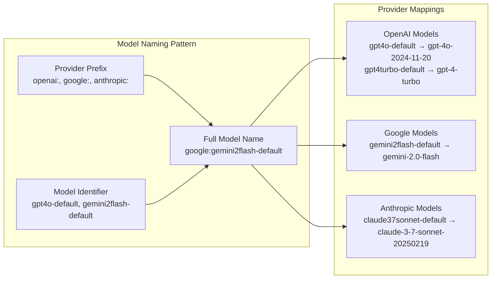

### Default Model Configuration

The system maintains default model versions for each provider, allowing for centralized updates without changing individual agent configurations:

- **OpenAI**: Primary provider for metadata planning with `gpt-4o-2024-11-20` as the default GPT-4o model
- **Google**: Primary provider for most agents with `gemini-2.0-flash` as the default Gemini model  
- **Anthropic**: Alternative provider with `claude-3-7-sonnet-20250219` for specialized use cases

This provider abstraction enables easy model switching and A/B testing without modifying individual agent implementations.

Sources: [agents/mabool/api/conf/config.toml:24-33]()

---

# Page: Common Agent Utilities

# Common Agent Utilities

<details>
<summary>Relevant source files</summary>

The following files were used as context for generating this wiki page:

- [agents/mabool/api/mabool/agents/common/__init__.py](agents/mabool/api/mabool/agents/common/__init__.py)
- [agents/mabool/api/mabool/agents/common/common.py](agents/mabool/api/mabool/agents/common/common.py)
- [agents/mabool/api/mabool/agents/common/computed_fields/__init__.py](agents/mabool/api/mabool/agents/common/computed_fields/__init__.py)

</details>


This page documents the shared utility functions, data structures, and common types used across all agents in the mabool agent system. These utilities provide foundational capabilities for agent state management, document filtering, and input processing that are leveraged by the various search agents documented in [Search Agents](#3.1).

For information about agent-specific prompt engineering and LLM integration patterns, see [Agent Prompts and LLM Integration](#3.2). For details about individual search agent implementations, see [Search Agents](#3.1).

## Agent State Management

The agent system uses a standardized state management approach through the `AgentState` class, which provides checkpoint functionality for maintaining document collections across agent operations.

### AgentState Class

The [`AgentState`]() class in [agents/mabool/api/mabool/agents/common/common.py:18-28]() serves as the primary state container for agents:

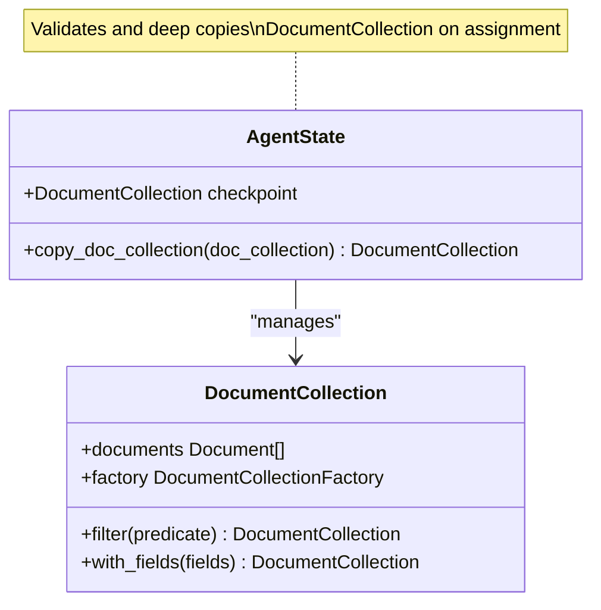

**Sources:** [agents/mabool/api/mabool/agents/common/common.py:18-28]()

### Control Flow Types

The system defines control flow types through `ControlType` for managing agent execution states:

| Control Type | Purpose |
|--------------|---------|
| `"failure"` | Indicates agent operation failed |
| `"control"` | Represents control flow state |
| `"result"` | Indicates successful result state |

**Sources:** [agents/mabool/api/mabool/agents/common/common.py:15]()

## Document Filtering System

The common utilities provide a comprehensive document filtering system that allows agents to refine `DocumentCollection` instances based on metadata criteria including time ranges, venues, and authors.

### Filtering Architecture

```mermaid
graph TB
    filterDocsMetadata["filter_docs_by_metadata()"]
    timeFilter["filter_by_time_range_with_buffer()"]
    venueFilter["filter_by_venues()"]
    authorFilter["filter_by_author()"]
    
    docCollection["DocumentCollection"]
    extractedTimeRange["ExtractedYearlyTimeRange"]
    venuesList["list[str] venues"]
    authorsList["list[str] authors"]
    
    filterDocsMetadata --> timeFilter
    filterDocsMetadata --> venueFilter
    filterDocsMetadata --> authorFilter
    
    docCollection --> filterDocsMetadata
    extractedTimeRange --> timeFilter
    venuesList --> venueFilter
    authorsList --> authorFilter
    
    timeFilter --> filteredDocs["Filtered DocumentCollection"]
    venueFilter --> filteredDocs
    authorFilter --> filteredDocs
    
    note for timeFilter "Supports +/-20% buffer\nfor flexible date ranges"
    note for venueFilter "Matches normalized names\nand alternate venue names"
    note for authorFilter "Matches last names and\ninitials with fuzzy logic"
```

**Sources:** [agents/mabool/api/mabool/agents/common/common.py:115-153]()

### Time Range Filtering

The [`filter_by_time_range_with_buffer()`]() function [agents/mabool/api/mabool/agents/common/common.py:30-61]() provides flexible temporal filtering:

- **Buffer calculation**: Adds ±20% buffer to time ranges when `use_buffer=True`
- **Missing year handling**: Configurable behavior for documents without year information via `keep_missing` parameter
- **Range validation**: Handles both bounded and unbounded time ranges

### Venue Filtering

The [`filter_by_venues()`]() function [agents/mabool/api/mabool/agents/common/common.py:63-83]() matches documents against publication venues:

- **Normalized matching**: Uses `publication_venue.normalized_name` for standardized comparison
- **Alternate names**: Checks `publication_venue.alternate_names` for venue variations
- **Case-insensitive matching**: Converts all venue names to lowercase for comparison

### Author Filtering

The [`filter_by_author()`]() function [agents/mabool/api/mabool/agents/common/common.py:85-113]() implements fuzzy author matching:

- **Name parsing**: Splits author names into components for flexible matching
- **Initial matching**: Compares first and last initials when full names unavailable
- **Last name priority**: Prioritizes last name matching for author identification

## Input Query Types and Utilities

The system defines standardized input query types that provide consistent interfaces for agent operations.

### Query Type Hierarchy

```mermaid
classDiagram
    class InputQuery {
        +str query
    }
    
    class InputQueryJson {
        +str query
        +str query_json
    }
    
    InputQuery <|-- InputQueryJson
    
    class UtilityFunctions {
        +as_input_query(query) InputQuery
        +as_input_query_json(query) InputQueryJson
    }
    
    UtilityFunctions --> InputQuery : "creates"
    UtilityFunctions --> InputQueryJson : "creates"
    
    note for InputQueryJson "Contains JSON-serialized\nquery for structured processing"
```

**Sources:** [agents/mabool/api/mabool/agents/common/common.py:156-170]()

### Query Construction Functions

| Function | Return Type | Purpose |
|----------|-------------|---------|
| `as_input_query(query: str)` | `InputQuery` | Creates basic query structure |
| `as_input_query_json(query: str)` | `InputQueryJson` | Creates query with JSON representation |

The [`as_input_query_json()`]() function [agents/mabool/api/mabool/agents/common/common.py:168-170]() automatically serializes the query string into a JSON format for agents that require structured query processing.

## Computed Fields Module

The system includes a computed fields module at [agents/mabool/api/mabool/agents/common/computed_fields/]() that provides extensible computed field functionality for document processing, though the specific implementations are not visible in the provided files.

**Sources:** [agents/mabool/api/mabool/agents/common/computed_fields/__init__.py]()

## Integration with Agent System

These common utilities integrate with the broader agent system architecture through several key patterns:

```mermaid
graph LR
    searchAgents["Search Agents"]
    agentState["AgentState"]
    filterSystem["Document Filtering"]
    queryTypes["Input Query Types"]
    
    searchAgents --> agentState
    searchAgents --> filterSystem
    searchAgents --> queryTypes
    
    agentState --> documentCollection["DocumentCollection checkpoints"]
    filterSystem --> documentCollection
    queryTypes --> structuredInput["Structured agent inputs"]
    
    note for filterSystem "Metadata-based refinement\nof search results"
    note for agentState "State persistence across\nagent execution phases"
```

**Sources:** [agents/mabool/api/mabool/agents/common/common.py:1-170]()

---

# Page: Configuration System

# Configuration System

<details>
<summary>Relevant source files</summary>

The following files were used as context for generating this wiki page:

- [agents/mabool/api/conf/config.extra.fast_mode.toml](agents/mabool/api/conf/config.extra.fast_mode.toml)
- [agents/mabool/api/conf/config.toml](agents/mabool/api/conf/config.toml)

</details>


The Configuration System provides centralized TOML-based configuration management for the ASTA Paper Finder application. It controls agent behavior, external service parameters, LLM model settings, timeouts, and user-facing content through a hierarchical configuration structure.

For information about specific agent configurations, see [Agent System](#3). For details on build-time type generation from configuration files, see [Type Generation](#6.4).

## Configuration Architecture

The configuration system uses a multi-layered TOML structure that supports environment-specific overrides and specialized runtime modes. The system generates Python type definitions at build time to ensure type safety and IDE support.

```mermaid
graph TB
    subgraph "Configuration Files"
        CONFIG_MAIN["config.toml<br/>Main Configuration"]
        CONFIG_FAST["config.extra.fast_mode.toml<br/>Fast Mode Overrides"]
        CONFIG_UFS["user_facing/*.toml<br/>UI String Templates"]
    end
    
    subgraph "Type Generation System"
        TYPE_GEN["ai2i.config.gen_config_types"]
        CONFIG_TYPES["Generated Config Types"]
        UFS_TYPES["Generated UFS Types"]
    end
    
    subgraph "Runtime Configuration"
        DI_CONTAINER["DI Container"]
        CONFIG_LOADER["Configuration Loader"]
        ENV_RESOLVER["Environment Resolver"]
    end
    
    subgraph "Configuration Consumers"
        AGENT_CONFIGS["Agent Configurations"]
        LLM_SETTINGS["LLM Model Settings"]
        API_PARAMS["External API Parameters"]
        CACHE_CONFIG["Cache Configuration"]
    end
    
    CONFIG_MAIN --> TYPE_GEN
    CONFIG_UFS --> TYPE_GEN
    TYPE_GEN --> CONFIG_TYPES
    TYPE_GEN --> UFS_TYPES
    
    CONFIG_MAIN --> CONFIG_LOADER
    CONFIG_FAST --> CONFIG_LOADER
    CONFIG_LOADER --> ENV_RESOLVER
    ENV_RESOLVER --> DI_CONTAINER
    
    DI_CONTAINER --> AGENT_CONFIGS
    DI_CONTAINER --> LLM_SETTINGS
    DI_CONTAINER --> API_PARAMS
    DI_CONTAINER --> CACHE_CONFIG
```

Sources: [agents/mabool/api/conf/config.toml:1-98](), [agents/mabool/api/conf/config.extra.fast_mode.toml:1-12]()

## Configuration File Structure

The configuration system organizes settings into logical sections within TOML files. The main configuration file uses a hierarchical structure with environment-specific sections and component-specific subsections.

### Main Configuration Sections

| Section | Purpose | Key Settings |
|---------|---------|--------------|
| `[default]` | Global application settings | Environment, logging, cache, API limits |
| `[default.di]` | Dependency injection configuration | Timeout settings, scope management |
| `[default.llm_abstraction]` | LLM model defaults | Model names, temperature, concurrency |
| `[default.vespa]` | Vespa search engine settings | Concurrency, timeout values |
| Agent-specific sections | Individual agent parameters | Search limits, model assignments, behavior flags |

```mermaid
graph LR
    subgraph "config.toml Structure"
        DEFAULT["[default]<br/>Global Settings"]
        DI["[default.di]<br/>DI Container"]
        LLM["[default.llm_abstraction]<br/>LLM Models"]
        VESPA["[default.vespa]<br/>Search Engine"]
        
        subgraph "Agent Configurations"
            DENSE["[default.dense_agent]"]
            BROAD["[default.broad_search_agent]"]
            RELEVANCE["[default.relevance_judgement]"]
            QUERY["[default.query_analyzer_agent]"]
            METADATA["[default.metadata_planner_agent]"]
            KEYWORD["[default.broad_search_by_keyword_agent]"]
            TITLE["[default.specific_paper_by_title_agent]"]
            NAME["[default.specific_paper_by_name_agent]"]
            AUTHOR["[default.search_by_author_agent]"]
            LLM_SUGGEST["[default.llm_suggestion_agent]"]
        end
    end
    
    DEFAULT --> DI
    DEFAULT --> LLM
    DEFAULT --> VESPA
    DEFAULT --> DENSE
    DEFAULT --> BROAD
    DEFAULT --> RELEVANCE
    DEFAULT --> QUERY
    DEFAULT --> METADATA
    DEFAULT --> KEYWORD
    DEFAULT --> TITLE
    DEFAULT --> NAME
    DEFAULT --> AUTHOR
    DEFAULT --> LLM_SUGGEST
```

Sources: [agents/mabool/api/conf/config.toml:1-98]()

## Agent Configuration Parameters

Each agent type has dedicated configuration sections that control search behavior, model selection, and performance parameters. The configuration system allows fine-tuning of search strategies and resource utilization.

### Core Agent Settings

The dense search agent configuration demonstrates the typical parameter structure used across agent types:

- **Model Assignment**: `formulation_model_name = "google:gemini2flash-default"` specifies which LLM to use
- **Search Parameters**: `initial_top_k_per_query = 250` controls result set sizes
- **Iteration Limits**: `dense_agent_max_iterations = 2` prevents excessive recursion
- **Query Formulation**: `initial_queries_to_formulate = 5` determines search query generation

### Relevance Judgment Configuration

The relevance judgment system uses sophisticated batching and quotas to optimize LLM usage:

```mermaid
graph TB
    subgraph "Relevance Judgment Configuration"
        QUOTA["quota = 250<br/>Total Judgment Limit"]
        HIGHLY_REL["highly_relevant_cap = 50<br/>High Relevance Limit"]
        WINDOW["window_size = 20<br/>Judgment Window"]
        BATCH_SIZE["initial_batch_size = 20<br/>Starting Batch"]
        GROWTH["batch_growth_factor = 2<br/>Batch Scaling"]
        DECAY["decay_factor = 0.95<br/>Score Decay"]
    end
    
    subgraph "Batching Strategy"
        UNIFORM["uniform_preload_size = 5"]
        CONCURRENCY["openai_concurrency = 75"]
        MODEL["relevance_model_name"]
    end
    
    QUOTA --> WINDOW
    WINDOW --> BATCH_SIZE
    BATCH_SIZE --> GROWTH
    GROWTH --> DECAY
    UNIFORM --> CONCURRENCY
    MODEL --> CONCURRENCY
```

Sources: [agents/mabool/api/conf/config.toml:51-63]()

## LLM Model Configuration

The LLM abstraction layer configuration defines default models and execution parameters for different AI service providers. The system supports multiple model providers with consistent configuration patterns.

### Model Provider Configuration

The `[default.llm_abstraction]` section configures default models for each provider:

| Model Type | Configuration Key | Default Value |
|------------|-------------------|---------------|
| GPT-4o | `gpt4o_default_model` | `"gpt-4o-2024-11-20"` |
| GPT-4 Turbo | `gpt4turbo_default_model` | `"gpt-4-turbo"` |
| Claude 3.5 Sonnet | `claude37sonnet_default_model` | `"claude-3-7-sonnet-20250219"` |
| Gemini 2.0 Flash | `gemini2flash_default_model` | `"gemini-2.0-flash"` |

### LLM Execution Parameters

Global LLM settings control request behavior across all model providers:

- `temparature = 1.0` - Controls response randomness
- `n = 1` - Number of completions per request  
- `batch_max_concurrency = 1` - Concurrent batch processing limit

Sources: [agents/mabool/api/conf/config.toml:24-32]()

## External Service Configuration

The configuration system manages parameters for external APIs including rate limiting, timeouts, and retry behavior. Each service has dedicated configuration sections that optimize performance while respecting API limits.

### Semantic Scholar API Configuration

The `s2_api` configuration controls paper retrieval and citation analysis:

```mermaid
graph TB
    subgraph "s2_api Configuration"
        CONCURRENCY["concurrency = 10<br/>Parallel Requests"]
        TIMEOUT["timeout = 20<br/>Request Timeout"]
        PAPERS_LIMIT["total_papers_limit = 1000<br/>Paper Result Limit"]
        CITATIONS_LIMIT["total_citations_limit = 1000<br/>Citation Limit"]
        RETRY["retry_attempts = 5<br/>Retry Strategy"]
        WAIT_TIME["max_seconds_to_wait = 30.0<br/>Max Wait Duration"]
    end
    
    subgraph "Cache Configuration"
        CACHE_ENABLED["enabled = true"]
        CACHE_TTL["ttl = 600<br/>10 Minute TTL"]
    end
    
    CONCURRENCY --> TIMEOUT
    TIMEOUT --> PAPERS_LIMIT
    PAPERS_LIMIT --> CITATIONS_LIMIT
    CITATIONS_LIMIT --> RETRY
    RETRY --> WAIT_TIME
    
    CACHE_ENABLED --> CACHE_TTL
```

### Vespa Search Configuration

The Vespa search engine configuration optimizes dense vector search performance:

- `concurrency = 10` - Parallel search requests
- `timeout = 60` - Extended timeout for complex queries

Sources: [agents/mabool/api/conf/config.toml:6](), [agents/mabool/api/conf/config.toml:14](), [agents/mabool/api/conf/config.toml:34-36]()

## Configuration Modes and Overrides

The configuration system supports specialized runtime modes that modify default behavior for specific use cases. The fast mode configuration demonstrates how overrides reduce computational complexity for faster execution.

### Fast Mode Configuration

The `config.extra.fast_mode.toml` file provides performance-optimized overrides for development and testing:

| Agent | Default Setting | Fast Mode Override | Performance Impact |
|-------|-----------------|-------------------|-------------------|
| Dense Search | `dense_top_k` not specified | `dense_top_k = 100` | Reduced search depth |
| Snowball | `snowball_snippets_top_k` not specified | `snowball_snippets_top_k = 100` | Fewer citation expansions |
| Relevance | `quota = 250` | `relevance_judgement_quota = 75` | Reduced LLM judgments |

### Environment-Specific Configurations

The configuration system supports environment-specific sections for development, testing, and production deployments. The `[test.fast_broad_search_agent]` section demonstrates minimal settings for testing scenarios.

Sources: [agents/mabool/api/conf/config.extra.fast_mode.toml:1-12]()

---

# Page: Main Configuration

# Main Configuration

<details>
<summary>Relevant source files</summary>

The following files were used as context for generating this wiki page:

- [agents/mabool/api/conf/config.toml](agents/mabool/api/conf/config.toml)

</details>


This page documents the main configuration file that controls the behavior of the ASTA Paper Finder system. The configuration is defined in TOML format and covers agent parameters, external API settings, timeout values, and LLM model specifications.

For information about user-facing configuration strings and UI text, see [User-Facing Configuration](#4.2). For specialized configuration modes that override these defaults, see [Runtime Configuration Modes](#4.3).

## Configuration File Structure

The main configuration is located at [agents/mabool/api/conf/config.toml:1-98]() and follows a hierarchical structure with a `[default]` section containing global settings and subsections for specific components.

```mermaid
graph TB
    config_toml["config.toml"]
    
    subgraph "Top-Level Settings"
        env["env"]
        log_format["log_format"] 
        cache["cache"]
        timeouts["operative_timeout<br/>time_to_wait_for_results"]
    end
    
    subgraph "Component Configurations"
        di["[default.di]<br/>Dependency Injection"]
        llm_abs["[default.llm_abstraction]<br/>LLM Models & Settings"]
        vespa["[default.vespa]<br/>Search Engine"]
    end
    
    subgraph "Agent Configurations"
        dense["[default.dense_agent]"]
        broad["[default.broad_search_agent]"]  
        relevance["[default.relevance_judgement]"]
        query_analyzer["[default.query_analyzer_agent]"]
        metadata_planner["[default.metadata_planner_agent]"]
        keyword_agent["[default.broad_search_by_keyword_agent]"]
        title_agent["[default.specific_paper_by_title_agent]"]
        name_agent["[default.specific_paper_by_name_agent]"]
        author_agent["[default.search_by_author_agent]"]
        llm_suggest["[default.llm_suggestion_agent]"]
    end
    
    config_toml --> env
    config_toml --> log_format
    config_toml --> cache
    config_toml --> timeouts
    config_toml --> di
    config_toml --> llm_abs
    config_toml --> vespa
    config_toml --> dense
    config_toml --> broad
    config_toml --> relevance
    config_toml --> query_analyzer
    config_toml --> metadata_planner
    config_toml --> keyword_agent
    config_toml --> title_agent
    config_toml --> name_agent
    config_toml --> author_agent
    config_toml --> llm_suggest
```

Sources: [agents/mabool/api/conf/config.toml:1-98]()

## Core System Settings

The top-level configuration section controls fundamental system behavior including environment settings, caching, and global operational parameters.

| Setting | Value | Purpose |
|---------|-------|---------|
| `env` | `"dev"` | Environment identifier for deployment context |
| `log_format` | `""` | Logging format specification (empty = default) |
| `log_max_length` | `1048576` | Maximum log entry size in bytes |
| `cache.enabled` | `true` | Enable system-wide caching |
| `cache.ttl` | `600` | Cache time-to-live in seconds |
| `operative_timeout` | `86400` | Global operation timeout (24 hours) |
| `show_api_swagger` | `true` | Enable Swagger API documentation |
| `force_deterministic` | `false` | Force deterministic behavior for testing |
| `enable_llm_cache` | `false` | Enable LLM response caching |

The configuration also includes snowball agent settings and Semantic Scholar API parameters:

| Setting | Value | Purpose |
|---------|-------|---------|
| `snowball_agent.forward_top_k` | `200` | Forward citation limit |
| `snowball_agent.backward_top_k` | `200` | Backward citation limit |
| `s2_api.concurrency` | `10` | Concurrent requests to Semantic Scholar |
| `s2_api.timeout` | `20` | Request timeout in seconds |
| `s2_api.retry_attempts` | `5` | Number of retry attempts |
| `s2_api.total_papers_limit` | `1000` | Maximum papers to retrieve |

Sources: [agents/mabool/api/conf/config.toml:1-20]()

## LLM Model Configuration

The `[default.llm_abstraction]` section defines the available language models and their default configurations across different providers.

```mermaid
graph LR
    llm_config["llm_abstraction"]
    
    subgraph "OpenAI Models"
        gpt4o["gpt4o_default_model<br/>gpt-4o-2024-11-20"]
        gpt4turbo["gpt4turbo_default_model<br/>gpt-4-turbo"]
        gpt4["gpt4_default_model<br/>gpt-4-0125-preview"]
    end
    
    subgraph "Anthropic Models"
        claude["claude37sonnet_default_model<br/>claude-3-7-sonnet-20250219"]
    end
    
    subgraph "Google Models"
        gemini["gemini2flash_default_model<br/>gemini-2.0-flash"]
    end
    
    subgraph "LLM Parameters"
        temp["temparature = 1.0"]
        n_param["n = 1"]
        concurrency["batch_max_concurrency = 1"]
    end
    
    llm_config --> gpt4o
    llm_config --> gpt4turbo
    llm_config --> gpt4
    llm_config --> claude
    llm_config --> gemini
    llm_config --> temp
    llm_config --> n_param
    llm_config --> concurrency
```

The model naming follows a pattern where agents reference models using the format `"provider:model-alias"` (e.g., `"google:gemini2flash-default"`, `"openai:gpt4o-default"`).

Sources: [agents/mabool/api/conf/config.toml:24-33]()

## Agent-Specific Configuration

Each agent type has its own configuration section that controls its specific behavior, model selection, and operational parameters.

### Query Processing Agents

| Agent | Model | Key Parameters |
|-------|-------|----------------|
| `query_analyzer_agent` | `google:gemini2flash-default` | `force_broad = false` |
| `metadata_planner_agent` | `openai:gpt4o-default` | `ops_max_concurrency = 50` |

### Search Agents

| Agent | Model | Key Parameters |
|-------|-------|----------------|
| `dense_agent` | `google:gemini2flash-default` | `initial_queries_to_formulate = 5`<br/>`dense_agent_max_iterations = 2` |
| `broad_search_by_keyword_agent` | `google:gemini2flash-default` | `results_limit = 50`<br/>`extra_results_factor = 4` |
| `search_by_author_agent` | `google:gemini2flash-default` | `relevance_judgements_quota = 75`<br/>`disambiguate_authors = false` |

### Processing Agents

The `relevance_judgement` agent has the most complex configuration, controlling the adaptive relevance scoring system:

| Parameter | Value | Purpose |
|-----------|-------|---------|
| `relevance_model_name` | `google:gemini2flash-default` | LLM for relevance scoring |
| `quota` | `250` | Maximum documents to process |
| `highly_relevant_cap` | `50` | Limit for highly relevant papers |
| `window_size` | `20` | Sliding window for batch processing |
| `decay_factor` | `0.95` | Score decay for iterative processing |
| `optimal_solution` | `false` | Use approximate vs optimal algorithm |

Sources: [agents/mabool/api/conf/config.toml:38-98]()

## External Service Integration

The configuration includes settings for external services that the system depends on for search and AI capabilities.

```mermaid
graph TB
    config["config.toml"]
    
    subgraph "Search Services"
        vespa_config["[default.vespa]<br/>concurrency = 10<br/>timeout = 60"]
        s2_config["s2_api<br/>concurrency = 10<br/>timeout = 20<br/>retry_attempts = 5"]
    end
    
    subgraph "AI Services"
        cohere_config["cohere<br/>rerank_model_name = rerank-english-v3.0"]
        llm_models["LLM Models<br/>OpenAI, Google, Anthropic"]
    end
    
    subgraph "Agent Consumption"
        dense_agent["DenseAgent"]
        relevance_agent["RelevanceJudgementAgent"] 
        search_agents["SearchAgents"]
    end
    
    config --> vespa_config
    config --> s2_config
    config --> cohere_config
    config --> llm_models
    
    vespa_config --> dense_agent
    s2_config --> search_agents
    cohere_config --> relevance_agent
    llm_models --> dense_agent
    llm_models --> relevance_agent
    llm_models --> search_agents
```

### Service-Specific Settings

**Vespa Search Engine** [agents/mabool/api/conf/config.toml:34-37]():
- `concurrency = 10`: Maximum concurrent requests
- `timeout = 60`: Request timeout in seconds

**Cohere Reranking** [agents/mabool/api/conf/config.toml:10]():
- `rerank_model_name = "rerank-english-v3.0"`: Model for document reranking

**Dependency Injection** [agents/mabool/api/conf/config.toml:21-23]():
- `round_scope_timeout = 86400`: 24-hour timeout for round-scoped operations

Sources: [agents/mabool/api/conf/config.toml:6](), [agents/mabool/api/conf/config.toml:10](), [agents/mabool/api/conf/config.toml:21-23](), [agents/mabool/api/conf/config.toml:34-37]()

---

# Page: User-Facing Configuration

# User-Facing Configuration

<details>
<summary>Relevant source files</summary>

The following files were used as context for generating this wiki page:

- [agents/mabool/api/conf/user_facing/explain.toml](agents/mabool/api/conf/user_facing/explain.toml)
- [agents/mabool/api/conf/user_facing/response_texts.toml](agents/mabool/api/conf/user_facing/response_texts.toml)
- [agents/mabool/api/conf/user_facing/sorting.toml](agents/mabool/api/conf/user_facing/sorting.toml)
- [agents/mabool/api/conf/user_facing/step_progress_reporting.toml](agents/mabool/api/conf/user_facing/step_progress_reporting.toml)
- [agents/mabool/api/conf/user_facing/verbalize.toml](agents/mabool/api/conf/user_facing/verbalize.toml)

</details>


This document covers the user-facing configuration system that manages all human-readable text, explanations, and UI strings displayed to users of the ASTA Paper Finder system. These configurations are separate from the main system configuration and focus specifically on presentation, messaging, and user communication.

For system-level configuration including agent parameters and API settings, see [Main Configuration](#4.1). For specialized configuration modes that modify behavior, see [Runtime Configuration Modes](#4.3).

## Overview

The user-facing configuration system provides templated strings and explanations that are displayed to users throughout the search process. These configurations are stored as TOML files in [agents/mabool/api/conf/user_facing/]() and are used to generate type-safe string templates through the build system's type generation process.

## Configuration File Structure

The user-facing configuration is organized into specialized TOML files, each handling different aspects of user communication:

```mermaid
graph TB
    subgraph "User-Facing Configuration Files"
        EXPLAIN["explain.toml<br/>Search Result Explanations"]
        RESPONSE["response_texts.toml<br/>System Messages & Errors"]
        SORTING["sorting.toml<br/>Sort Order Explanations"]
        PROGRESS["step_progress_reporting.toml<br/>Agent Progress Messages"]
        VERBALIZE["verbalize.toml<br/>Query Interpretation Templates"]
    end
    
    subgraph "Generated Code Entities"
        UFS_TYPES["User-Facing String Types<br/>Generated from TOML"]
        CONFIG_TYPES["Configuration Data Models<br/>mabool/data_model/"]
    end
    
    subgraph "Build System Integration"
        TYPE_UFS_GEN["type-ufs-gen<br/>Makefile Target"]
        CONFIG_GEN["ai2i.config.gen_config_types<br/>Type Generator"]
    end
    
    EXPLAIN --> TYPE_UFS_GEN
    RESPONSE --> TYPE_UFS_GEN
    SORTING --> TYPE_UFS_GEN
    PROGRESS --> TYPE_UFS_GEN
    VERBALIZE --> TYPE_UFS_GEN
    
    TYPE_UFS_GEN --> CONFIG_GEN
    CONFIG_GEN --> UFS_TYPES
    CONFIG_GEN --> CONFIG_TYPES
```

**Sources:** [agents/mabool/api/conf/user_facing/explain.toml](), [agents/mabool/api/conf/user_facing/response_texts.toml](), [agents/mabool/api/conf/user_facing/sorting.toml](), [agents/mabool/api/conf/user_facing/step_progress_reporting.toml](), [agents/mabool/api/conf/user_facing/verbalize.toml]()

## Search Result Explanations (explain.toml)

The `explain.toml` file contains templates for generating human-readable explanations of search results and metadata. It is structured into several main sections:

### Metadata Explanations

Templates for describing temporal and bibliographic metadata:

| Template | Purpose | Example Usage |
|----------|---------|---------------|
| `time_same_year` | Format for single year | " during {year}" |
| `time_range_start_and_end` | Format for year ranges | " from {start} until {end}" |
| `venue` | Format venue lists | "\t- Venue{s}: {items}" |
| `author` | Format author lists | "\t- Author{s}: {items}" |

### Content Explanations

Templates for describing different types of search operations:

```toml
[explain.content]
specific_paper_by_name = "- A paper with the alias: '{name}'{content_suffix}."
specific_paper_by_title = "- A paper titled: '{title}'."
papers_discussing = "- Papers discussing: *{content}*."
relevance_criteria_header = "- Judged by the following relevance criteria:"
```

### Result Summaries

The system provides sophisticated templates for summarizing search results with different levels of match quality:

```mermaid
graph LR
    subgraph "Summary Generation Logic"
        PERFECT["Perfect Matches<br/>explain.summary.perfect_matches"]
        HIGHLY["Highly Relevant<br/>explain.summary.highly_relevant"]
        OTHER["Other Relevant<br/>explain.summary.other_relevant"]
        MERGED["Merged Results<br/>explain.merged_summary"]
    end
    
    subgraph "Template Variables"
        COUNT["count"]
        CONNECTOR["connector"]
        OTHERS["others"]
    end
    
    PERFECT --> COUNT
    HIGHLY --> COUNT
    HIGHLY --> CONNECTOR
    OTHER --> OTHERS
    MERGED --> COUNT
```

**Sources:** [agents/mabool/api/conf/user_facing/explain.toml:33-51](), [agents/mabool/api/conf/user_facing/explain.toml:52-75]()

## System Messages and Error Handling (response_texts.toml)

The `response_texts.toml` file manages all system-generated messages, including error responses, refusals, and interactive prompts:

### Core Response Messages

| Message Type | Configuration Key | Purpose |
|--------------|-------------------|---------|
| Detailed Response | `detailed_response_prefix` | Prefix for detailed search explanations |
| Follow-up Suggestions | `suggest_broad_followup` | Guidance for query refinement |
| Work Harder | `work_harder_text` | Prompt for exhaustive search |
| Generic Refusal | `generic_refusal_message` | Fallback for unsupported queries |

### Agent-Specific Messages

The configuration includes specialized message templates for different agent types:

```toml
[response_texts.metadata_agent]
could_not_find_in_s2 = "I couldn't find any results for this query in the Semantic Scholar index."
try_alternative = " Perhaps try an alternative venue name?"

[response_texts.paper_finder_agent]
anything_else = "Would you like to try anything else?"
soft_rejection = "soft rejection due to '{refusal_type}' type of query"
```

### Refusal Handling

The system provides specific refusal messages for different unsupported query types:

```mermaid
graph TB
    subgraph "Refusal Categories"
        SIMILAR["similar_to<br/>Similarity Queries"]
        WEB["web_access<br/>Web Access Requests"]
        NOT_PAPER["not_paper_finding<br/>Non-Paper Queries"]
        AFFILIATION["affiliation<br/>Affiliation Criteria"]
        AUTHOR_ID["author_id<br/>Author ID Criteria"]
    end
    
    subgraph "Interactive Prompts"
        CAME_UP["came_up<br/>Search Proposal"]
        SHOULD_RUN["should_run<br/>Confirmation Request"]
        YES_NO["yes_or_no<br/>Response Format"]
    end
    
    SIMILAR --> CAME_UP
    WEB --> CAME_UP
    NOT_PAPER --> SHOULD_RUN
    AFFILIATION --> YES_NO
    AUTHOR_ID --> YES_NO
```

**Sources:** [agents/mabool/api/conf/user_facing/response_texts.toml:35-45]()

## Progress Reporting Configuration (step_progress_reporting.toml)

This file contains templates for real-time progress messages displayed during search operations. The messages are organized by agent type and operation:

### Agent Progress Messages

Each agent type has its own set of progress messages:

| Agent Type | Configuration Section | Key Messages |
|------------|----------------------|--------------|
| Conversation Agent | `step_progress.conversation_agent` | Query type identification |
| Round Executor | `step_progress.round_executor` | High-level operation status |
| Search Agents | `step_progress.broad_search_by_keyword` | Keyword search progress |
| Dense Search | `step_progress.dense` | Similarity search progress |
| Metadata Search | `step_progress.metadata_only` | Metadata query progress |

### Dynamic Progress Templates

The system uses templated strings with variable substitution for dynamic progress reporting:

```toml
[step_progress.search_by_authors]
found_authors = "Found authors:\n{author_names}."
fetching = "Fetching papers from {author_names}."
assessing = "Assessing papers for relevance."
```

**Sources:** [agents/mabool/api/conf/user_facing/step_progress_reporting.toml:33-38](), [agents/mabool/api/conf/user_facing/step_progress_reporting.toml:50-58]()

## Query Verbalization Templates (verbalize.toml)

The `verbalize.toml` file provides templates for converting parsed search criteria back into human-readable descriptions:

### Metadata Verbalization

Templates for describing temporal and venue constraints:

```toml
authored_by = "Authored by {authors}."
published_between = "Published between {start} and {end}."
published_in_venues = "Published in {venues}."
```

### Content Criteria Verbalization

Templates for describing content-based search criteria:

```toml
content_must_satisfy = "To be considered relevant, the paper's content must satisfy:"
criterion_line = "* **{name}**: {description}"
nice_to_have = "It would be nice if the paper's content satisfies:"
```

### Search Type Descriptions

```mermaid
graph LR
    subgraph "Search Type Templates"
        SPECIFIC["specific_paper<br/>Single Paper Search"]
        SET["set_of_papers<br/>Multiple Papers Search"]
        SEARCH_FOR["search_for<br/>Content Query"]
    end
    
    subgraph "Criteria Sections"
        METADATA_HEAD["metadata_criteria_heading"]
        CONTENT_HEAD["content_criteria_heading"]
        THIS_IS_HOW["this_is_how"]
    end
    
    SPECIFIC --> METADATA_HEAD
    SET --> CONTENT_HEAD
    SEARCH_FOR --> THIS_IS_HOW
```

**Sources:** [agents/mabool/api/conf/user_facing/verbalize.toml:9-21]()

## Sorting Explanations (sorting.toml)

The `sorting.toml` file provides user-friendly explanations for different sort orders:

```toml
[sorting.explanation]
most_recent = "most-recent"
earliest = "earliest"  
highly_cited = "highly-cited"
least_cited = "least-cited"
sorting_explanation = "Between relevant papers, {sorting_explanation} papers were prioritized due to explicit request."
```

This configuration allows the system to explain why results are ordered in a particular way when users request specific sorting criteria.

**Sources:** [agents/mabool/api/conf/user_facing/sorting.toml:4-8]()

## Type Generation Integration

The user-facing configuration files are processed by the build system to generate type-safe string templates. This process is handled by the `type-ufs-gen` Makefile target, which invokes the `ai2i.config.gen_config_types` generator to create strongly-typed configuration objects.

The generated types ensure that all template variables are properly validated and that the configuration structure matches the expected schema used throughout the agent system.

---

# Page: Runtime Configuration Modes

# Runtime Configuration Modes

<details>
<summary>Relevant source files</summary>

The following files were used as context for generating this wiki page:

- [agents/mabool/api/conf/config.extra.fast_mode.toml](agents/mabool/api/conf/config.extra.fast_mode.toml)
- [agents/mabool/api/conf/config.toml](agents/mabool/api/conf/config.toml)

</details>


## Purpose and Scope

This document covers the specialized runtime configuration modes available in the ASTA Paper Finder system that modify the default agent behavior for specific use cases. These modes allow the system to adapt its search strategy by overriding key parameters in the main configuration.

For information about the main configuration system, see [Main Configuration](#4.1). For user-facing configuration strings and templates, see [User-Facing Configuration](#4.2).

## Configuration Mode Architecture

The ASTA Paper Finder implements a layered configuration system where specialized modes can override default settings to optimize for different performance characteristics.

### Configuration Mode Structure

```mermaid
graph TB
    subgraph "Configuration Layer Hierarchy"
        MAIN_CONFIG["config.toml<br/>Default Settings"]
        FAST_MODE["config.extra.fast_mode.toml<br/>Speed Optimizations"]
        TEST_SETTINGS["[test] Section<br/>Reduced Values"]
    end
    
    subgraph "Agent Parameter Override"
        DENSE_PARAMS["dense_top_k<br/>Vector Search Results"]
        SNOWBALL_PARAMS["snowball_snippets_top_k<br/>Citation Expansion"]
        RELEVANCE_PARAMS["relevance_judgement_quota<br/>LLM Evaluations"]
        S2_PARAMS["s2_relevance_search_top_k<br/>Semantic Scholar Results"]
    end
    
    subgraph "Affected Agents"
        FAST_BROAD_AGENT["fast_broad_search_agent<br/>Optimized Search Pipeline"]
        BROAD_AGENT["broad_search_agent<br/>Standard Pipeline"]
    end
    
    MAIN_CONFIG --> BROAD_AGENT
    FAST_MODE --> DENSE_PARAMS
    FAST_MODE --> SNOWBALL_PARAMS  
    FAST_MODE --> RELEVANCE_PARAMS
    FAST_MODE --> S2_PARAMS
    
    DENSE_PARAMS --> FAST_BROAD_AGENT
    SNOWBALL_PARAMS --> FAST_BROAD_AGENT
    RELEVANCE_PARAMS --> FAST_BROAD_AGENT
    S2_PARAMS --> FAST_BROAD_AGENT
    
    TEST_SETTINGS --> FAST_BROAD_AGENT
```

**Sources:** [agents/mabool/api/conf/config.toml:1-98](), [agents/mabool/api/conf/config.extra.fast_mode.toml:1-12]()

## Fast Mode Configuration

The `fast_mode` configuration optimizes the search pipeline for reduced latency by constraining resource-intensive operations while maintaining search quality.

### Fast Mode Parameter Overrides

| Parameter | Default Environment | Test Environment | Purpose |
|-----------|-------------------|------------------|---------|
| `dense_top_k` | 100 | 2 | Vector search result limit |
| `snowball_snippets_top_k` | 100 | 2 | Citation expansion result limit |
| `s2_relevance_search_top_k` | 50 | 10 | Semantic Scholar search limit |
| `relevance_judgement_quota` | 75 | 30 | LLM relevance evaluation quota |

### Configuration File Structure

```mermaid
graph LR
    subgraph "fast_mode.toml Structure"
        DEFAULT_SECTION["[default.fast_broad_search_agent]<br/>Production Settings"]
        TEST_SECTION["[test.fast_broad_search_agent]<br/>Development Settings"]
    end
    
    subgraph "Parameter Categories"
        SEARCH_LIMITS["Search Result Limits<br/>dense_top_k<br/>s2_relevance_search_top_k"]
        EXPANSION_LIMITS["Citation Expansion<br/>snowball_snippets_top_k"]
        LLM_QUOTAS["LLM Usage Quotas<br/>relevance_judgement_quota"]
    end
    
    DEFAULT_SECTION --> SEARCH_LIMITS
    DEFAULT_SECTION --> EXPANSION_LIMITS
    DEFAULT_SECTION --> LLM_QUOTAS
    
    TEST_SECTION --> SEARCH_LIMITS
    TEST_SECTION --> EXPANSION_LIMITS  
    TEST_SECTION --> LLM_QUOTAS
```

**Sources:** [agents/mabool/api/conf/config.extra.fast_mode.toml:1-12]()

## Configuration Override Mechanism

The system applies configuration overrides through a hierarchical merging process where specialized mode configurations supplement the base settings.

### Override Priority and Scope

```mermaid
graph TB
    subgraph "Configuration Resolution Process"
        BASE_CONFIG["Base Configuration<br/>config.toml"]
        MODE_CONFIG["Mode Configuration<br/>config.extra.{mode}.toml"]
        FINAL_CONFIG["Runtime Configuration<br/>Merged Settings"]
    end
    
    subgraph "Override Targets"
        AGENT_SPECIFIC["Agent-Specific Overrides<br/>[default.fast_broad_search_agent]"]
        ENV_SPECIFIC["Environment-Specific Overrides<br/>[test.fast_broad_search_agent]"]
    end
    
    subgraph "Configuration Consumers"
        SEARCH_PIPELINE["Search Pipeline<br/>Agent Instantiation"]
        RESOURCE_MGMT["Resource Management<br/>Quota Enforcement"]
    end
    
    BASE_CONFIG --> FINAL_CONFIG
    MODE_CONFIG --> AGENT_SPECIFIC
    MODE_CONFIG --> ENV_SPECIFIC
    AGENT_SPECIFIC --> FINAL_CONFIG
    ENV_SPECIFIC --> FINAL_CONFIG
    
    FINAL_CONFIG --> SEARCH_PIPELINE
    FINAL_CONFIG --> RESOURCE_MGMT
```

**Sources:** [agents/mabool/api/conf/config.toml:47-98](), [agents/mabool/api/conf/config.extra.fast_mode.toml:1-12]()

## Impact on Search Behavior

Fast mode configuration significantly reduces computational overhead while attempting to preserve search quality through strategic parameter tuning.

### Performance Trade-offs

| Component | Standard Behavior | Fast Mode Behavior | Impact |
|-----------|------------------|-------------------|---------|
| **Dense Search** | Default `initial_top_k_per_query = 250` | `dense_top_k = 100` | 60% reduction in vector search results |
| **Relevance Judgement** | `quota = 250` | `relevance_judgement_quota = 75` | 70% reduction in LLM evaluations |
| **Citation Expansion** | `snippet_top_k = 200` | `snowball_snippets_top_k = 100` | 50% reduction in citation processing |
| **S2 Search** | No explicit limit | `s2_relevance_search_top_k = 50` | Controlled external API usage |

### Resource Utilization Changes

```mermaid
graph LR
    subgraph "Standard Mode Resource Usage"
        STD_LLM["LLM Calls<br/>Up to 250 relevance judgements"]
        STD_VECTOR["Vector Search<br/>250 results per query"]
        STD_CITATIONS["Citation Processing<br/>200 snippets"]
    end
    
    subgraph "Fast Mode Resource Usage"  
        FAST_LLM["LLM Calls<br/>Up to 75 relevance judgements"]
        FAST_VECTOR["Vector Search<br/>100 results"]
        FAST_CITATIONS["Citation Processing<br/>100 snippets"]
    end
    
    subgraph "Performance Metrics"
        LATENCY_REDUCTION["Reduced Latency<br/>~60-70% fewer operations"]
        COST_REDUCTION["Lower API Costs<br/>Fewer LLM and external calls"]
        QUALITY_IMPACT["Quality Trade-off<br/>Reduced result coverage"]
    end
    
    STD_LLM -.-> FAST_LLM
    STD_VECTOR -.-> FAST_VECTOR
    STD_CITATIONS -.-> FAST_CITATIONS
    
    FAST_LLM --> LATENCY_REDUCTION
    FAST_VECTOR --> COST_REDUCTION
    FAST_CITATIONS --> QUALITY_IMPACT
```

**Sources:** [agents/mabool/api/conf/config.toml:47-63](), [agents/mabool/api/conf/config.extra.fast_mode.toml:1-12]()

---

# Page: API Reference

# API Reference

<details>
<summary>Relevant source files</summary>

The following files were used as context for generating this wiki page:

- [README.md](README.md)
- [agents/mabool/api/dev.sh](agents/mabool/api/dev.sh)
- [agents/mabool/api/mabool/__init__.py](agents/mabool/api/mabool/__init__.py)

</details>


This document provides comprehensive documentation for the FastAPI application that serves as the primary interface to the ASTA Paper Finder system. It covers the REST API endpoints, request/response models, and server configuration. For information about the underlying agent system that processes requests, see [Agent System](#3). For details about configuring API behavior and external service integration, see [Configuration System](#4).

## FastAPI Application Overview

The ASTA Paper Finder exposes its functionality through a FastAPI web application located in the `agents/mabool/api` directory. The application provides a single main endpoint for processing paper search queries and returns structured results from the agent pipeline.

```mermaid
graph TB
    subgraph "FastAPI Application Structure"
        APP["create_app()"]
        ENDPOINT["/api/2/rounds"]
        MODELS["Request/Response Models"]
        CONFIG["Configuration Loading"]
    end
    
    subgraph "Agent Pipeline Integration"
        QUERY_ANALYZER["Query Analyzer Agent"]
        SEARCH_AGENTS["Search Agents"]
        RELEVANCE["Relevance Processing"]
        RESULTS["Structured Results"]
    end
    
    subgraph "External Dependencies"
        GUNICORN["gunicorn server"]
        UVICORN["UvicornWorker"]
        ENV_CONFIG["APP_CONFIG_ENV"]
    end
    
    APP --> CONFIG
    APP --> ENDPOINT
    ENDPOINT --> MODELS
    ENDPOINT --> QUERY_ANALYZER
    QUERY_ANALYZER --> SEARCH_AGENTS
    SEARCH_AGENTS --> RELEVANCE
    RELEVANCE --> RESULTS
    RESULTS --> MODELS
    
    GUNICORN --> UVICORN
    UVICORN --> APP
    ENV_CONFIG --> CONFIG
```

**Sources:** [agents/mabool/api/dev.sh:1-11](), [README.md:35-40]()

## Main API Endpoint

### POST /api/2/rounds

The primary endpoint for submitting paper search queries to the ASTA Paper Finder system. This endpoint accepts natural language descriptions of paper search requirements and returns ranked, relevant papers through the agent pipeline.

#### Request Model

The endpoint accepts a JSON payload with the following structure:

| Field | Type | Required | Default | Description |
|-------|------|----------|---------|-------------|
| `paper_description` | string | Yes | - | Natural language paper search description |
| `operation_mode` | string | No | "infer" | Search mode: "infer", "fast", or "diligent" |
| `inserted_before` | string | No | None | Upper-bound date filter (YYYY-MM-DD format) |
| `read_results_from_cache` | boolean | No | false | Enable file-based cache retrieval |

#### Operation Modes

- **infer/fast**: Executes a fast search (~30 seconds) with optimized agent configuration
- **diligent**: Performs exhaustive search (~3 minutes) with comprehensive agent pipeline

```mermaid
graph LR
    subgraph "Request Processing Flow"
        REQUEST["POST /api/2/rounds"]
        VALIDATION["Request Validation"]
        MODE_CHECK["operation_mode Check"]
        CACHE_CHECK["Cache Check"]
        AGENT_PIPELINE["Agent Pipeline Execution"]
        RESPONSE["JSON Response"]
    end
    
    REQUEST --> VALIDATION
    VALIDATION --> CACHE_CHECK
    CACHE_CHECK --> MODE_CHECK
    MODE_CHECK --> AGENT_PIPELINE
    AGENT_PIPELINE --> RESPONSE
    
    subgraph "Mode Configuration"
        FAST_CONFIG["Fast Mode Config"]
        DILIGENT_CONFIG["Diligent Mode Config"]
    end
    
    MODE_CHECK --> FAST_CONFIG
    MODE_CHECK --> DILIGENT_CONFIG
```

**Sources:** [README.md:44-57]()

## Server Configuration

### Development Server

The development server is configured using gunicorn with uvicorn workers for asynchronous request handling.

#### Server Launch Configuration

The development server uses the following configuration:

- **Server**: gunicorn with UvicornWorker
- **Workers**: 1 (single worker for development)
- **Bind Address**: 0.0.0.0:8000
- **Timeout**: 0 (unlimited for long-running searches)
- **Reload**: Enabled for development
- **Environment**: APP_CONFIG_ENV=dev

#### Application Factory

The FastAPI application is created through the factory pattern using `mabool.api.app:create_app()`. This function loads configuration, initializes the agent system, and sets up the API routes.

```mermaid
graph TB
    subgraph "Server Stack"
        CLI["make start-dev"]
        GUNICORN["gunicorn"]
        UVICORN_WORKER["UvicornWorker"]
        FASTAPI_APP["FastAPI Application"]
        CREATE_APP["create_app()"]
    end
    
    subgraph "Configuration Loading"
        ENV_VAR["APP_CONFIG_ENV=dev"]
        CONFIG_FILES["Configuration TOML Files"]
        SECRETS[".env.secret"]
    end
    
    subgraph "Application Components"
        ROUTES["API Routes"]
        MIDDLEWARE["FastAPI Middleware"]
        AGENT_SYSTEM["Agent System Initialization"]
    end
    
    CLI --> GUNICORN
    GUNICORN --> UVICORN_WORKER
    UVICORN_WORKER --> FASTAPI_APP
    FASTAPI_APP --> CREATE_APP
    
    ENV_VAR --> CREATE_APP
    CONFIG_FILES --> CREATE_APP
    SECRETS --> CREATE_APP
    
    CREATE_APP --> ROUTES
    CREATE_APP --> MIDDLEWARE
    CREATE_APP --> AGENT_SYSTEM
```

**Sources:** [agents/mabool/api/dev.sh:1-11](), [README.md:37-40]()

## API Authentication and Secrets

The API requires several external service API keys configured in the `.env.secret` file:

| Service | Key Variable | Purpose |
|---------|--------------|---------|
| OpenAI | `OPENAI_API_KEY` | LLM operations for query analysis and planning |
| Semantic Scholar | `S2_API_KEY` | Paper metadata and citation retrieval |
| Cohere | `COHERE_API_KEY` | Document reranking and relevance scoring |
| Google AI | `GOOGLE_API_KEY` | Alternative LLM provider |

**Sources:** [README.md:23-24]()

## Integration with Agent System

The FastAPI application serves as the entry point to the comprehensive agent pipeline. When a request is received, it flows through multiple processing stages:

```mermaid
graph TB
    subgraph "API Layer"
        API_ENDPOINT["/api/2/rounds Endpoint"]
        REQUEST_MODEL["Request Validation"]
        RESPONSE_MODEL["Response Serialization"]
    end
    
    subgraph "Agent Orchestration"
        QUERY_ANALYZER["QueryAnalyzerAgent"]
        METADATA_PLANNER["MetadataPlannerAgent"]
        SEARCH_DISPATCH["Search Agent Dispatch"]
    end
    
    subgraph "Search Execution"
        DENSE_AGENT["DenseAgent"]
        KEYWORD_AGENT["BroadSearchByKeywordAgent"]
        CITATION_AGENT["BroadByCitationAgent"]
        TITLE_AGENT["SpecificPaperByTitleAgent"]
        AUTHOR_AGENT["SearchByAuthorAgent"]
    end
    
    subgraph "Result Processing"
        RELEVANCE_JUDGE["RelevanceJudgementAgent"]
        SNOWBALL_AGENT["SnowballAgent"]
        FINAL_RANKING["Result Ranking & Filtering"]
    end
    
    API_ENDPOINT --> REQUEST_MODEL
    REQUEST_MODEL --> QUERY_ANALYZER
    QUERY_ANALYZER --> METADATA_PLANNER
    METADATA_PLANNER --> SEARCH_DISPATCH
    
    SEARCH_DISPATCH --> DENSE_AGENT
    SEARCH_DISPATCH --> KEYWORD_AGENT
    SEARCH_DISPATCH --> CITATION_AGENT
    SEARCH_DISPATCH --> TITLE_AGENT
    SEARCH_DISPATCH --> AUTHOR_AGENT
    
    DENSE_AGENT --> RELEVANCE_JUDGE
    KEYWORD_AGENT --> RELEVANCE_JUDGE
    CITATION_AGENT --> RELEVANCE_JUDGE
    TITLE_AGENT --> RELEVANCE_JUDGE
    AUTHOR_AGENT --> RELEVANCE_JUDGE
    
    RELEVANCE_JUDGE --> SNOWBALL_AGENT
    SNOWBALL_AGENT --> FINAL_RANKING
    FINAL_RANKING --> RESPONSE_MODEL
```

**Sources:** [README.md:11]()

## Development and Testing

### Local Development Setup

To start the development server:

```bash
cd agents/mabool/api
make start-dev
```

### API Interaction

Once the server is running on `http://localhost:8000`, the API can be accessed through:

- **cURL**: Command-line HTTP requests
- **Swagger UI**: Interactive API documentation at `http://localhost:8000/docs`
- **ReDoc**: Alternative API documentation at `http://localhost:8000/redoc`

**Sources:** [README.md:35-40]()

---

# Page: Development Guide

# Development Guide

<details>
<summary>Relevant source files</summary>

The following files were used as context for generating this wiki page:

- [Makefile](Makefile)
- [agents/mabool/api/.python-version](agents/mabool/api/.python-version)
- [agents/mabool/api/Makefile](agents/mabool/api/Makefile)

</details>


This document provides a comprehensive guide for developers working on the ASTA Paper Finder system. It covers environment setup, build system usage, code quality tools, and development workflows specific to this multi-project Python repository.

For information about the overall system architecture, see [System Architecture](#2). For details about configuring the system, see [Configuration System](#4). For API usage and testing, see [API Reference](#5).

## Development Workflow Overview

The ASTA Paper Finder uses a multi-project structure with a centralized build system that orchestrates development tasks across all subprojects.

```mermaid
graph TB
    subgraph "Development Environment"
        DEV["Developer Workstation"]
        UV["uv Package Manager<br/>Python 3.12.8"]
        VENV[".venv<br/>Virtual Environment"]
    end
    
    subgraph "Root Build System"
        ROOT_MAKE["Makefile<br/>Root Orchestrator"]
        FOREACH["dev/make/make_foreach.sh<br/>Multi-project Executor"]
        COMMON_MK["dev/make/common.mk<br/>Shared Targets"]
    end
    
    subgraph "Subprojects"
        MABOOL_API["agents/mabool/api/<br/>FastAPI Application"]
        LIBS_COMMON["libs/common/"]
        LIBS_DI["libs/di/"]
        LIBS_DCOLLECTION["libs/dcollection/"]
        LIBS_CHAIN["libs/chain/"]
        LIBS_CONFIG["libs/config/"]
    end
    
    subgraph "Generated Artifacts"
        TYPE_CFG["mabool/data_model/<br/>Config Types"]
        TYPE_UFS["mabool/data_model/ufs.py<br/>User-Facing Strings"]
        LOCK_FILE["uv.lock<br/>Dependency Lock"]
    end
    
    DEV --> UV
    UV --> VENV
    DEV --> ROOT_MAKE
    ROOT_MAKE --> FOREACH
    
    FOREACH --> MABOOL_API
    FOREACH --> LIBS_COMMON
    FOREACH --> LIBS_DI
    FOREACH --> LIBS_DCOLLECTION
    FOREACH --> LIBS_CHAIN
    FOREACH --> LIBS_CONFIG
    
    MABOOL_API --> TYPE_CFG
    MABOOL_API --> TYPE_UFS
    ROOT_MAKE --> LOCK_FILE
    
    COMMON_MK --> MABOOL_API
    COMMON_MK --> LIBS_COMMON
    COMMON_MK --> LIBS_DI
    COMMON_MK --> LIBS_DCOLLECTION
    COMMON_MK --> LIBS_CHAIN
    COMMON_MK --> LIBS_CONFIG
```

**Sources**: [Makefile:1-89](), [agents/mabool/api/Makefile:1-32]()

## Environment Setup

### Python Version and Package Management

The system requires Python 3.12.8 and uses `uv` as the package manager for dependency resolution and virtual environment management.

| Component | Version/Tool | Purpose |
|-----------|-------------|---------|
| Python | 3.12.8 | Runtime environment |
| Package Manager | `uv` | Dependency management and virtual environments |
| Lock File | `uv.lock` | Reproducible dependency resolution |
| Constraints | `constraints.txt` | Version constraints (e.g., setuptools<72) |

### Initial Setup Commands

```bash
# Create virtual environment
make venv

# Install dependencies (production only)
make sync

# Install dependencies including development tools
make sync-dev

# Lock dependencies after changes
make lock
```

**Sources**: [Makefile:12-34](), [agents/mabool/api/.python-version:1-2]()

## Build System Architecture

The build system uses a hierarchical Makefile structure that enables both project-wide and individual subproject operations.

```mermaid
graph TB
    subgraph "Root Level Commands"
        MAKE_SYNC["make sync"]
        MAKE_SYNC_DEV["make sync-dev"]
        MAKE_STYLE["make style"]
        MAKE_FIX["make fix"]
        MAKE_LINT["make lint"]
        MAKE_FORMAT["make format"]
        MAKE_TYPE_CHECK["make type-check"]
    end
    
    subgraph "Execution Strategy"
        MODE_PAR["MODE=par<br/>(default)<br/>Parallel execution"]
        MODE_SEQ["MODE=seq<br/>Sequential execution"]
        FOREACH_SCRIPT["make_foreach.sh<br/>Orchestration Script"]
    end
    
    subgraph "Subproject Targets"
        API_MAKE["agents/mabool/api/Makefile"]
        COMMON_MAKE["libs/common/Makefile"]
        DI_MAKE["libs/di/Makefile"]
        DCOLL_MAKE["libs/dcollection/Makefile"]
        CHAIN_MAKE["libs/chain/Makefile"]
        CONFIG_MAKE["libs/config/Makefile"]
    end
    
    subgraph "Special API Targets"
        TYPE_CFG_GEN["type-cfg-gen<br/>Config Type Generation"]
        TYPE_UFS_GEN["type-ufs-gen<br/>User-Facing String Types"]
        START_DEV["start-dev<br/>Development Server"]
    end
    
    MAKE_STYLE --> FOREACH_SCRIPT
    MAKE_FIX --> FOREACH_SCRIPT
    MAKE_LINT --> FOREACH_SCRIPT
    MAKE_FORMAT --> FOREACH_SCRIPT
    MAKE_TYPE_CHECK --> FOREACH_SCRIPT
    
    MODE_PAR --> FOREACH_SCRIPT
    MODE_SEQ --> FOREACH_SCRIPT
    
    FOREACH_SCRIPT --> API_MAKE
    FOREACH_SCRIPT --> COMMON_MAKE
    FOREACH_SCRIPT --> DI_MAKE
    FOREACH_SCRIPT --> DCOLL_MAKE
    FOREACH_SCRIPT --> CHAIN_MAKE
    FOREACH_SCRIPT --> CONFIG_MAKE
    
    API_MAKE --> TYPE_CFG_GEN
    API_MAKE --> TYPE_UFS_GEN
    API_MAKE --> START_DEV
```

### Common Development Commands

| Command | Purpose | Execution Mode |
|---------|---------|----------------|
| `make style` | Run format check, lint, and type-check | Parallel by default |
| `make fix` | Auto-fix formatting and linting issues | Parallel by default |
| `make lint` | Run Ruff linter across all projects | Parallel by default |
| `make format` | Format code with auto-formatting tools | Parallel by default |
| `make type-check` | Run pyright type checker | Parallel by default |

### Execution Modes

The build system supports two execution modes controlled by the `MODE` variable:

- **Parallel Mode** (`MODE=par`, default): Runs tasks across all subprojects simultaneously, capturing output and reporting only failures
- **Sequential Mode** (`MODE=seq`): Runs tasks one subproject at a time with full output visibility

Example usage:
```bash
# Run format check in sequential mode to see detailed output
make format-check MODE=seq
```

**Sources**: [Makefile:35-89](), [agents/mabool/api/Makefile:1-32]()

## Code Quality and Tooling

The system enforces code quality through multiple automated tools integrated into the build system.

### Linting and Formatting

| Tool | Configuration | Purpose |
|------|--------------|---------|
| Ruff | Project-specific config | Code linting and formatting |
| Flake8 | `.flake8` | Additional linting rules |
| pyright | Project-specific config | Type checking |

### Custom Quality Tools

The system includes custom development tools:

- **stable_sort_checker**: Custom Flake8 plugin for enforcing consistent sorting
- **Coverage reporting**: Configured via `.coveragerc`

### Quality Check Workflow

```bash
# Check all quality metrics
make style

# Auto-fix issues where possible
make fix

# Run individual checks
make lint-check
make format-check
make type-check
```

**Sources**: [Makefile:37-63]()

## Type Generation System

The mabool API subproject includes an automated type generation system that creates Python type definitions from TOML configuration files.

### Type Generation Targets

| Target | Input | Output | Purpose |
|--------|-------|--------|---------|
| `type-cfg-gen` | Configuration TOML files | `mabool/data_model/` | Generate config data classes |
| `type-ufs-gen` | `conf/user_facing/*.toml` | `mabool/data_model/ufs.py` | Generate user-facing string types |

### Type Generation Workflow

```mermaid
graph LR
    subgraph "Input Files"
        CONFIG_TOML["config.toml<br/>conf/user_facing/*.toml"]
    end
    
    subgraph "Generation Process"
        GEN_SCRIPT["ai2i.config.gen_config_types<br/>Python Module"]
        TYPE_CFG_TARGET["make type-cfg-gen"]
        TYPE_UFS_TARGET["make type-ufs-gen"]
    end
    
    subgraph "Generated Output"
        DATA_MODEL_DIR["mabool/data_model/<br/>Type Definitions"]
        UFS_PY["mabool/data_model/ufs.py<br/>User-Facing Strings"]
    end
    
    CONFIG_TOML --> GEN_SCRIPT
    GEN_SCRIPT --> TYPE_CFG_TARGET
    GEN_SCRIPT --> TYPE_UFS_TARGET
    
    TYPE_CFG_TARGET --> DATA_MODEL_DIR
    TYPE_UFS_TARGET --> UFS_PY
```

### Usage

```bash
# Generate configuration types
make type-cfg-gen

# Generate user-facing string types
make type-ufs-gen

# Both are included in the fix target
make fix
```

The type generation system ensures type safety between the TOML configuration files and the Python code that consumes them, automatically creating dataclasses and type annotations.

**Sources**: [agents/mabool/api/Makefile:8-18]()

## Development Server

### Starting the Development Server

The mabool API includes a development server for local testing and development:

```bash
# Start development server
cd agents/mabool/api
make start-dev
```

This runs the `dev.sh` script which sets up the development environment and starts the FastAPI application with development-specific settings.

### Development Server Features

- Hot reloading for code changes
- Development-specific logging and debugging
- Local API endpoint access for testing

**Sources**: [agents/mabool/api/Makefile:20-22]()

## Multi-Project Structure

The repository is organized as multiple independent Python projects that share common development tooling:

| Project Path | Purpose |
|-------------|---------|
| `agents/mabool/api/` | FastAPI application and agent system |
| `libs/common/` | Shared common utilities |
| `libs/di/` | Dependency injection framework |
| `libs/dcollection/` | Data collection utilities |
| `libs/chain/` | Chain processing utilities |
| `libs/config/` | Configuration management |

Each subproject maintains its own `Makefile` that inherits from the common build system while defining project-specific targets and dependencies.

**Sources**: [Makefile:6]()

---

# Page: Environment Setup

# Environment Setup

<details>
<summary>Relevant source files</summary>

The following files were used as context for generating this wiki page:

- [.gitignore](.gitignore)
- [Makefile](Makefile)
- [agents/mabool/api/.python-version](agents/mabool/api/.python-version)
- [agents/mabool/api/constraints.txt](agents/mabool/api/constraints.txt)

</details>


This document covers setting up the Python development environment for the ASTA Paper Finder repository using the uv package manager. It includes instructions for creating virtual environments, managing dependencies, and preparing for development work.

For information about the build system and development workflows, see [Build System](#6.2). For details about code quality tools and their configuration, see [Code Quality Tools](#6.3).

## Prerequisites

The ASTA Paper Finder project requires specific versions and tools to ensure consistent development environments across all contributors.

### Required Software

| Software | Version | Purpose |
|----------|---------|---------|
| Python | 3.12.8 | Runtime environment |
| uv | Latest | Package and virtual environment manager |
| make | Any recent version | Build system orchestration |

The Python version requirement is enforced by [agents/mabool/api/.python-version:1]() and used by the virtual environment creation process in [Makefile:33]().

### System Dependencies

The project uses uv as the primary package manager, replacing traditional pip-based workflows. The uv tool handles both virtual environment creation and dependency management, providing faster and more reliable package resolution.

**Sources:** [agents/mabool/api/.python-version:1](), [Makefile:33]()

## Environment Setup Process

The environment setup follows a standardized workflow using make targets that wrap uv commands for consistency across the development team.

### Environment Setup Flow

```mermaid
flowchart TD
    START["Developer starts setup"]
    CHECK_UV["Check if uv is installed"]
    INSTALL_UV["Install uv package manager"]
    CREATE_VENV["make venv"]
    UV_VENV["uv venv -p 3.12.8"]
    SYNC_DEPS["make sync-dev"]
    UV_SYNC["uv sync --all-packages --dev"]
    VERIFY["Verify environment"]
    READY["Environment ready for development"]
    
    START --> CHECK_UV
    CHECK_UV -->|"Not installed"| INSTALL_UV
    CHECK_UV -->|"Installed"| CREATE_VENV
    INSTALL_UV --> CREATE_VENV
    CREATE_VENV --> UV_VENV
    UV_VENV --> SYNC_DEPS
    SYNC_DEPS --> UV_SYNC
    UV_SYNC --> VERIFY
    VERIFY --> READY
```

### Step-by-Step Setup

1. **Create Virtual Environment**
   ```bash
   make venv
   ```
   This executes `uv venv -p 3.12.8` as defined in [Makefile:33](), creating a virtual environment with the exact Python version required.

2. **Install Dependencies**
   ```bash
   make sync-dev
   ```
   This runs `uv sync --all-packages --dev` from [Makefile:29](), installing both production and development dependencies from the lock file.

3. **Verify Installation**
   ```bash
   make graph
   ```
   This executes `uv tree` to display the dependency graph and verify all packages are correctly installed.

**Sources:** [Makefile:32-34](), [Makefile:28-29](), [Makefile:20-21]()

## Dependency Management

The project uses a multi-layered dependency management system with constraints and lock files to ensure reproducible builds.

### Dependency Resolution Components

```mermaid
graph TB
    PYPROJECT["pyproject.toml files"]
    CONSTRAINTS["constraints.txt"]
    LOCK_FILE["uv.lock"]
    VENV[".venv directory"]
    
    subgraph "Subprojects"
        API_PROJ["agents/mabool/api"]
        LIB_COMMON["libs/common"]
        LIB_DI["libs/di"]
        LIB_DCOLL["libs/dcollection"]
        LIB_CHAIN["libs/chain"]
        LIB_CONFIG["libs/config"]
    end
    
    PYPROJECT --> LOCK_FILE
    CONSTRAINTS --> LOCK_FILE
    LOCK_FILE --> VENV
    
    API_PROJ --> PYPROJECT
    LIB_COMMON --> PYPROJECT
    LIB_DI --> PYPROJECT
    LIB_DCOLL --> PYPROJECT
    LIB_CHAIN --> PYPROJECT
    LIB_CONFIG --> PYPROJECT
```

### Constraint Management

The project enforces specific package version constraints through [agents/mabool/api/constraints.txt:1](), which currently restricts setuptools to versions below 72 to avoid compatibility issues.

### Lock File Operations

| Command | Purpose | Makefile Target |
|---------|---------|----------------|
| `make lock` | Update dependency lock file | [Makefile:12-13]() |
| `make sync` | Install production dependencies | [Makefile:24-25]() |
| `make sync-dev` | Install all dependencies including dev tools | [Makefile:28-29]() |

**Sources:** [agents/mabool/api/constraints.txt:1](), [Makefile:12-13](), [Makefile:24-25](), [Makefile:28-29]()

## Virtual Environment Management

The project maintains strict virtual environment isolation to prevent dependency conflicts between different development environments.

### Environment Structure

The virtual environment is created in the `.venv` directory at the repository root and is excluded from version control via [.gitignore:20-21]().

### Multi-Project Workspace

The repository contains multiple Python subprojects that share the same virtual environment:

| Subproject | Purpose |
|------------|---------|
| `agents/mabool/api` | Main FastAPI application |
| `libs/common` | Shared utilities |
| `libs/di` | Dependency injection framework |
| `libs/dcollection` | Data collection utilities |
| `libs/chain` | Processing chain utilities |
| `libs/config` | Configuration management |

All subprojects are listed in [Makefile:6]() and managed collectively through the make_foreach script system.

### Environment Cleanup

To reset the development environment:
```bash
make rm
```
This removes the `.venv` directory as defined in [Makefile:16-17](), allowing for a clean environment recreation.

**Sources:** [.gitignore:20-21](), [Makefile:6](), [Makefile:16-17]()

## Development Environment Verification

After setup, verify the environment is correctly configured by running the development tools that depend on the Python environment.

### Verification Commands

```bash
# Check dependency tree
make graph

# Verify code quality tools work
make style

# Check type checking
make type-check
```

These commands use the parallel execution system defined in [Makefile:35]() and [Makefile:38-39]() to run across all subprojects simultaneously.

### Troubleshooting Common Issues

| Issue | Solution |
|-------|----------|
| Wrong Python version | Ensure Python 3.12.8 is available and uv can find it |
| Package conflicts | Run `make rm` followed by `make venv` and `make sync-dev` |
| Permission errors | Check that the repository directory is writable |
| Network issues | Verify internet connectivity for package downloads |

**Sources:** [Makefile:35](), [Makefile:38-39]()

## Environment Configuration Files

The development environment respects several configuration files that control behavior and exclude certain files from version control.

### Excluded Files and Directories

The [.gitignore]() file defines what should be excluded from version control, including:

- Virtual environment: `.venv/` [.gitignore:20-21]()
- Cache directories: `cache/`, `agents/mabool/api/cache` [.gitignore:1-2]()
- Python artifacts: `__pycache__/`, `*.pyc`, `.mypy_cache` [.gitignore:22-27]()
- IDE configurations: `.idea/`, `.vscode/` [.gitignore:3-11]()
- API keys and secrets: `.env.secret`, `*secret*` [.gitignore:47-52]()

This ensures that sensitive data, generated files, and environment-specific configurations are not committed to the repository.

**Sources:** [.gitignore:1-2](), [.gitignore:20-21](), [.gitignore:22-27](), [.gitignore:3-11](), [.gitignore:47-52]()

---

# Page: Build System

# Build System

<details>
<summary>Relevant source files</summary>

The following files were used as context for generating this wiki page:

- [Makefile](Makefile)
- [agents/mabool/api/Makefile](agents/mabool/api/Makefile)
- [agents/mabool/api/dev.sh](agents/mabool/api/dev.sh)

</details>


## Purpose and Scope

This document covers the Makefile-based build system that orchestrates development tasks, dependency management, code quality checks, and type generation across the ASTA Paper Finder repository. The build system manages multiple subprojects and provides a unified interface for common development operations.

For information about setting up the development environment, see [Environment Setup](#6.1). For details about code quality tools configuration, see [Code Quality Tools](#6.3). For type generation specifics, see [Type Generation](#6.4).

## Build System Architecture

The build system follows a hierarchical structure with a root `Makefile` that orchestrates operations across multiple subprojects using the `uv` package manager.

```mermaid
graph TB
    subgraph "Root Build System"
        ROOT_MAKE["Makefile"]
        MAKE_FOREACH["dev/make/make_foreach.sh"]
        COMMON_MK["dev/make/common.mk"]
        FUNCTIONS_MK["dev/make/functions.mk"]
    end
    
    subgraph "Package Management"
        UV_LOCK["uv.lock"]
        UV_VENV[".venv"]
        UV_SYNC["uv sync"]
        UV_TREE["uv tree"]
    end
    
    subgraph "Subprojects"
        MABOOL_MAKE["agents/mabool/api/Makefile"]
        LIBS_COMMON["libs/common/Makefile"]
        LIBS_DI["libs/di/Makefile"]
        LIBS_DCOLLECTION["libs/dcollection/Makefile"]
        LIBS_CHAIN["libs/chain/Makefile"]
        LIBS_CONFIG["libs/config/Makefile"]
    end
    
    subgraph "Build Targets"
        SYNC_TARGET["sync / sync-dev"]
        LINT_TARGET["lint / lint-check"]
        FORMAT_TARGET["format / format-check"]
        TYPE_CHECK_TARGET["type-check"]
        STYLE_TARGET["style"]
        FIX_TARGET["fix"]
    end
    
    ROOT_MAKE --> MAKE_FOREACH
    ROOT_MAKE --> UV_SYNC
    ROOT_MAKE --> UV_TREE
    
    MAKE_FOREACH --> MABOOL_MAKE
    MAKE_FOREACH --> LIBS_COMMON
    MAKE_FOREACH --> LIBS_DI
    MAKE_FOREACH --> LIBS_DCOLLECTION
    MAKE_FOREACH --> LIBS_CHAIN
    MAKE_FOREACH --> LIBS_CONFIG
    
    MABOOL_MAKE --> COMMON_MK
    MABOOL_MAKE --> FUNCTIONS_MK
    
    ROOT_MAKE --> SYNC_TARGET
    ROOT_MAKE --> LINT_TARGET
    ROOT_MAKE --> FORMAT_TARGET
    ROOT_MAKE --> TYPE_CHECK_TARGET
    ROOT_MAKE --> STYLE_TARGET
    ROOT_MAKE --> FIX_TARGET
    
    UV_SYNC --> UV_VENV
    UV_SYNC --> UV_LOCK
```

**Sources:** [Makefile:1-89](), [agents/mabool/api/Makefile:1-32]()

## Root Makefile Targets

The root `Makefile` provides the following primary targets for development operations:

| Target | Purpose | Command |
|--------|---------|---------|
| `lock` | Lock dependencies to `uv.lock` | `uv lock $(ARGS)` |
| `sync` | Sync virtual environment | `uv sync --all-packages $(ARGS)` |
| `sync-dev` | Sync with dev dependencies | `uv sync --all-packages --dev $(ARGS)` |
| `venv` | Create virtual environment | `uv venv -p 3.12.8` |
| `graph` | Generate dependency graph | `uv tree $(ARGS)` |
| `rm` | Remove virtual environment | `rm -rf .venv` |

### Cross-Project Development Targets

Development quality targets operate across all subprojects defined in `SUBPROJECTS`:

```makefile
SUBPROJECTS = "./agents/mabool/api" "./libs/common" "./libs/di" "./libs/dcollection" "./libs/chain" "./libs/config"
```

| Target | Purpose | Execution Mode |
|--------|---------|----------------|
| `type-check` | Run pyright type checker | Parallel/Sequential |
| `lint` | Run Ruff linter | Parallel/Sequential |
| `lint-check` | Check linting without auto-fix | Parallel/Sequential |
| `format` | Format code with Ruff | Parallel/Sequential |
| `format-check` | Check code formatting | Parallel/Sequential |
| `style` | Combined format check, lint, and type-check | Parallel/Sequential |
| `fix` | Auto-fix style issues | Parallel/Sequential |

The execution mode is controlled by the `MODE` variable, defaulting to parallel (`par`) but can be set to sequential (`seq`) for debugging:

```bash
make format-check MODE=seq
```

**Sources:** [Makefile:6](), [Makefile:35-63](), [Makefile:84-88]()

## Agent-Specific Build System

The `agents/mabool/api/Makefile` extends the common build system with agent-specific targets:

```mermaid
graph TB
    subgraph "Agent Build System"
        AGENT_MAKE["agents/mabool/api/Makefile"]
        COMMON_INCLUDE["include ../../../dev/make/common.mk"]
        FUNCTIONS_INCLUDE["include ../../../dev/make/functions.mk"]
    end
    
    subgraph "Type Generation Targets"
        TYPE_CFG_GEN["type-cfg-gen"]
        TYPE_UFS_GEN["type-ufs-gen"]
        GEN_CONFIG_TYPES["ai2i.config.gen_config_types"]
    end
    
    subgraph "Generated Output"
        DATA_MODEL_DIR["mabool/data_model/"]
        UFS_PY["mabool/data_model/ufs.py"]
        CONFIG_TYPES["Configuration Types"]
    end
    
    subgraph "Development Server"
        START_DEV["start-dev"]
        DEV_SH["dev.sh"]
        GUNICORN["gunicorn + uvicorn"]
    end
    
    subgraph "Source Files"
        USER_FACING_TOML["conf/user_facing/*.toml"]
        CONFIG_TOML["Configuration TOML files"]
    end
    
    AGENT_MAKE --> COMMON_INCLUDE
    AGENT_MAKE --> FUNCTIONS_INCLUDE
    AGENT_MAKE --> TYPE_CFG_GEN
    AGENT_MAKE --> TYPE_UFS_GEN
    AGENT_MAKE --> START_DEV
    
    TYPE_CFG_GEN --> GEN_CONFIG_TYPES
    TYPE_UFS_GEN --> GEN_CONFIG_TYPES
    
    GEN_CONFIG_TYPES --> DATA_MODEL_DIR
    USER_FACING_TOML --> UFS_PY
    CONFIG_TOML --> CONFIG_TYPES
    
    START_DEV --> DEV_SH
    DEV_SH --> GUNICORN
```

### Type Generation Targets

The agent build system includes specialized targets for generating Python types from configuration files:

- **`type-cfg-gen`**: Generates configuration types from TOML files using `ai2i.config.gen_config_types --output-dir mabool/data_model`
- **`type-ufs-gen`**: Generates user-facing string types with dependency tracking on `conf/user_facing/*.toml` files

The `type-ufs-gen` target includes automatic dependency resolution:

```makefile
./mabool/data_model/ufs.py: ./conf/user_facing/*.toml
	uv run python -m ai2i.config.gen_config_types --user-facing --output-dir mabool/data_model
```

**Sources:** [agents/mabool/api/Makefile:9-18]()

## Development Server

The development server is configured through the `start-dev` target, which executes `dev.sh`:

```bash
gunicorn -k uvicorn.workers.UvicornWorker \
    --workers 1 \
    --timeout 0 \
    --bind 0.0.0.0:8000 \
    --enable-stdio-inheritance \
    --access-logfile - \
    --reload \
    --env 'APP_CONFIG_ENV=dev' \
    'mabool.api.app:create_app()'
```

### Development Server Configuration

| Parameter | Value | Purpose |
|-----------|-------|---------|
| Worker Class | `uvicorn.workers.UvicornWorker` | ASGI server for FastAPI |
| Workers | 1 | Single worker for development |
| Timeout | 0 | Unlimited timeout for debugging |
| Bind | `0.0.0.0:8000` | Accept connections on all interfaces |
| Reload | Enabled | Auto-reload on code changes |
| Environment | `APP_CONFIG_ENV=dev` | Development configuration mode |

**Sources:** [agents/mabool/api/dev.sh:1-11](), [agents/mabool/api/Makefile:21-22]()

## Build Workflow

The following diagram illustrates the typical development workflow using the build system:

```mermaid
flowchart TD
    subgraph "Initial Setup"
        VENV_CREATE["make venv"]
        SYNC_DEV["make sync-dev"]
    end
    
    subgraph "Development Cycle"
        TYPE_GEN["make type-cfg-gen<br/>make type-ufs-gen"]
        CODE_CHANGE["Code Changes"]
        STYLE_CHECK["make style"]
        FIX_ISSUES["make fix"]
        START_SERVER["make start-dev"]
    end
    
    subgraph "Quality Checks"
        TYPE_CHECK_STEP["type-check target"]
        LINT_STEP["lint target"]
        FORMAT_STEP["format target"]
    end
    
    subgraph "Parallel Execution"
        MAKE_FOREACH_PAR["make_foreach.sh MODE=par"]
        SUBPROJECT_1["agents/mabool/api"]
        SUBPROJECT_2["libs/common"]
        SUBPROJECT_3["libs/di"]
        SUBPROJECT_N["libs/..."]
    end
    
    VENV_CREATE --> SYNC_DEV
    SYNC_DEV --> TYPE_GEN
    TYPE_GEN --> CODE_CHANGE
    CODE_CHANGE --> STYLE_CHECK
    STYLE_CHECK --> TYPE_CHECK_STEP
    STYLE_CHECK --> LINT_STEP
    STYLE_CHECK --> FORMAT_STEP
    
    TYPE_CHECK_STEP --> MAKE_FOREACH_PAR
    LINT_STEP --> MAKE_FOREACH_PAR
    FORMAT_STEP --> MAKE_FOREACH_PAR
    
    MAKE_FOREACH_PAR --> SUBPROJECT_1
    MAKE_FOREACH_PAR --> SUBPROJECT_2
    MAKE_FOREACH_PAR --> SUBPROJECT_3
    MAKE_FOREACH_PAR --> SUBPROJECT_N
    
    STYLE_CHECK --> FIX_ISSUES
    FIX_ISSUES --> START_SERVER
    START_SERVER --> CODE_CHANGE
```

### Execution Modes

The build system supports two execution modes for cross-project operations:

- **Parallel Mode (`MODE=par`)**: Default mode that executes tasks across subprojects simultaneously, capturing output and reporting only failures
- **Sequential Mode (`MODE=seq`)**: Executes tasks one subproject at a time, showing full stdout/stderr for debugging

**Sources:** [Makefile:35-39](), [Makefile:84-88]()

---

# Page: Code Quality Tools

# Code Quality Tools

<details>
<summary>Relevant source files</summary>

The following files were used as context for generating this wiki page:

- [.flake8](.flake8)
- [Makefile](Makefile)
- [agents/mabool/api/.coveragerc](agents/mabool/api/.coveragerc)

</details>


This document covers the linting, formatting, type checking, and test coverage tools configured for the ASTA Paper Finder repository. These tools ensure code consistency, catch potential issues, and maintain high code quality across all subprojects.

For information about the overall build system that orchestrates these tools, see [Build System](#6.2). For details about setting up the development environment where these tools run, see [Environment Setup](#6.1).

## Code Quality Tool Overview

The repository uses a comprehensive set of code quality tools integrated through the Makefile-based build system. These tools run across multiple subprojects in parallel or sequential mode.

```mermaid
graph TB
    subgraph "Root Build System"
        ROOT_MAKE["Makefile"]
        MAKE_FOREACH["dev/make/make_foreach.sh"]
    end
    
    subgraph "Quality Tool Configuration"
        FLAKE8_CONFIG[".flake8"]
        COVERAGE_CONFIG["agents/mabool/api/.coveragerc"]
    end
    
    subgraph "Quality Check Targets"
        TYPE_CHECK["type-check target"]
        LINT["lint target"]
        FORMAT["format target"]
        FORMAT_CHECK["format-check target"]
        STYLE["style target"]
        FIX["fix target"]
    end
    
    subgraph "Underlying Tools"
        PYRIGHT["pyright"]
        RUFF["Ruff"]
        FLAKE8["flake8"]
        COVERAGE["coverage"]
    end
    
    subgraph "Subprojects"
        MABOOL_API["./agents/mabool/api"]
        LIBS_COMMON["./libs/common"]
        LIBS_DI["./libs/di"]
        LIBS_DCOLLECTION["./libs/dcollection"]
        LIBS_CHAIN["./libs/chain"]
        LIBS_CONFIG["./libs/config"]
    end
    
    ROOT_MAKE --> MAKE_FOREACH
    ROOT_MAKE --> TYPE_CHECK
    ROOT_MAKE --> LINT
    ROOT_MAKE --> FORMAT
    ROOT_MAKE --> FORMAT_CHECK
    ROOT_MAKE --> STYLE
    ROOT_MAKE --> FIX
    
    TYPE_CHECK --> PYRIGHT
    LINT --> RUFF
    FORMAT --> RUFF
    FORMAT_CHECK --> RUFF
    
    FLAKE8_CONFIG --> FLAKE8
    COVERAGE_CONFIG --> COVERAGE
    
    MAKE_FOREACH --> MABOOL_API
    MAKE_FOREACH --> LIBS_COMMON
    MAKE_FOREACH --> LIBS_DI
    MAKE_FOREACH --> LIBS_DCOLLECTION
    MAKE_FOREACH --> LIBS_CHAIN
    MAKE_FOREACH --> LIBS_CONFIG
```

Sources: [Makefile:1-89]()

## Available Quality Check Commands

The root Makefile provides several targets for code quality operations:

| Target | Purpose | Tool Used |
|--------|---------|-----------|
| `type-check` | Run type checking | pyright |
| `lint` | Run linting | Ruff |
| `format` | Format code automatically | Ruff |
| `format-check` | Check code formatting | Ruff |
| `style` | Run all style checks (format, lint, type) | Multiple |
| `fix` | Auto-fix style issues | Multiple |

All commands support parallel execution by default via the `make_foreach.sh` script, with an option to run sequentially using `MODE=seq`.

Sources: [Makefile:37-63](), [Makefile:77-88]()

## Flake8 Configuration

The repository uses flake8 for additional linting with custom configuration and plugins.

### Exclusion Rules

The `.flake8` configuration excludes several directories from linting:

```mermaid
graph LR
    subgraph "Excluded Directories"
        IDEA[".idea"]
        PYTEST[".pytest_cache"]
        VENV[".venv"]
        ENVS["envs"]
        RESOURCES["resources"]
        SETUP["setup.py"]
        PYCACHE["__pycache__"]
        CONFIG_PY["config.py"]
    end
    
    FLAKE8_CONFIG[".flake8"] --> IDEA
    FLAKE8_CONFIG --> PYTEST
    FLAKE8_CONFIG --> VENV
    FLAKE8_CONFIG --> ENVS
    FLAKE8_CONFIG --> RESOURCES
    FLAKE8_CONFIG --> SETUP
    FLAKE8_CONFIG --> PYCACHE
    FLAKE8_CONFIG --> CONFIG_PY
```

Sources: [.flake8:1-11]()

### Custom Plugins

The configuration includes a custom flake8 plugin for stable sort checking:

```mermaid
graph TB
    subgraph "Custom Plugin Configuration"
        LOCAL_PLUGINS["[flake8:local-plugins]"]
        SST_EXTENSION["SST = stable_sort_checker:StableSortChecker"]
        PLUGIN_PATHS[". ./dev/python/flake8_plugins"]
    end
    
    LOCAL_PLUGINS --> SST_EXTENSION
    LOCAL_PLUGINS --> PLUGIN_PATHS
    
    subgraph "Plugin Implementation"
        STABLE_SORT_CHECKER["stable_sort_checker:StableSortChecker"]
    end
    
    SST_EXTENSION --> STABLE_SORT_CHECKER
```

The `StableSortChecker` plugin enforces consistent sorting practices in the codebase to prevent merge conflicts and improve code maintainability.

Sources: [.flake8:12-17]()

## Test Coverage Configuration

Test coverage is configured via the `.coveragerc` file in the main API project.

### Coverage Collection Settings

The coverage tool is configured to handle concurrent execution:

```mermaid
graph TB
    subgraph "Coverage Configuration"
        RUN_SECTION["[run] section"]
        CONCURRENCY["concurrency setting"]
        OMIT["omit patterns"]
    end
    
    subgraph "Concurrency Modes"
        GREENLET["greenlet"]
        THREAD["thread"]
    end
    
    subgraph "Omitted Paths"
        TESTS["**/tests/*"]
        LIBS["**/libs/**/*"]
        MEMORY_TRACING["mabool/api/mabool/utils/tracing/memory/*"]
    end
    
    RUN_SECTION --> CONCURRENCY
    RUN_SECTION --> OMIT
    
    CONCURRENCY --> GREENLET
    CONCURRENCY --> THREAD
    
    OMIT --> TESTS
    OMIT --> LIBS
    OMIT --> MEMORY_TRACING
```

Sources: [agents/mabool/api/.coveragerc:1-11]()

### Coverage Reporting

The reporting configuration excludes certain lines from coverage requirements:

```mermaid
graph TB
    subgraph "Report Configuration"
        REPORT_SECTION["[report] section"]
        EXCLUDE_LINES["exclude_lines setting"]
    end
    
    subgraph "Excluded Line Types"
        PRAGMA["pragma: not covered"]
        OVERLOAD["@overload decorators"]
    end
    
    REPORT_SECTION --> EXCLUDE_LINES
    EXCLUDE_LINES --> PRAGMA
    EXCLUDE_LINES --> OVERLOAD
```

The `@overload` exclusion prevents coverage complaints about function overload definitions that are not meant to be executed.

Sources: [agents/mabool/api/.coveragerc:12-17]()

## Build System Integration

The quality tools are integrated into the multi-project build system through the root Makefile and the `make_foreach.sh` script.

### Parallel Execution

Quality checks can run across all subprojects simultaneously:

```mermaid
graph TB
    subgraph "Execution Modes"
        PAR_MODE["MODE=par (default)"]
        SEQ_MODE["MODE=seq"]
    end
    
    subgraph "Make Foreach Script"
        MAKE_FOREACH["make_foreach.sh"]
        PARALLEL_EXEC["Parallel execution with output capture"]
        SEQUENTIAL_EXEC["Sequential execution with live output"]
    end
    
    subgraph "Target Subprojects"
        AGENTS_API["./agents/mabool/api"]
        LIBS_COMMON["./libs/common"]
        LIBS_DI["./libs/di"]
        LIBS_DCOLLECTION["./libs/dcollection"]
        LIBS_CHAIN["./libs/chain"]
        LIBS_CONFIG["./libs/config"]
    end
    
    PAR_MODE --> MAKE_FOREACH
    SEQ_MODE --> MAKE_FOREACH
    
    MAKE_FOREACH --> PARALLEL_EXEC
    MAKE_FOREACH --> SEQUENTIAL_EXEC
    
    PARALLEL_EXEC --> AGENTS_API
    PARALLEL_EXEC --> LIBS_COMMON
    PARALLEL_EXEC --> LIBS_DI
    PARALLEL_EXEC --> LIBS_DCOLLECTION
    PARALLEL_EXEC --> LIBS_CHAIN
    PARALLEL_EXEC --> LIBS_CONFIG
    
    SEQUENTIAL_EXEC --> AGENTS_API
    SEQUENTIAL_EXEC --> LIBS_COMMON
    SEQUENTIAL_EXEC --> LIBS_DI
    SEQUENTIAL_EXEC --> LIBS_DCOLLECTION
    SEQUENTIAL_EXEC --> LIBS_CHAIN
    SEQUENTIAL_EXEC --> LIBS_CONFIG
```

### Dependency Management

All quality check targets depend on `sync-dev` to ensure development dependencies are installed before running checks.

Sources: [Makefile:35-63](), [Makefile:6]()

## Tool Versions and Dependencies

The code quality tools are managed through the `uv` package manager and specified in the project's dependency files. The tools include:

- **Ruff**: Fast Python linter and formatter
- **pyright**: Microsoft's Python type checker  
- **flake8**: Additional linting with plugin support
- **coverage**: Test coverage measurement

The exact versions are locked in `uv.lock` and can be updated using `make lock`.

Sources: [Makefile:12-13](), [Makefile:24-29]()

---

# Page: Type Generation

# Type Generation

<details>
<summary>Relevant source files</summary>

The following files were used as context for generating this wiki page:

- [agents/mabool/api/Makefile](agents/mabool/api/Makefile)
- [agents/mabool/api/conf/config.toml](agents/mabool/api/conf/config.toml)
- [agents/mabool/api/conf/user_facing/explain.toml](agents/mabool/api/conf/user_facing/explain.toml)

</details>


The Type Generation system provides automated generation of Python type definitions from TOML configuration files. This system ensures type safety and consistency between configuration files and the Python codebase that consumes them.

The system generates two categories of types: configuration data model types from the main configuration files, and user-facing string types from UI text templates. For information about the configuration system itself, see [Configuration System](#4). For build system details, see [Build System](#6.2).

## Overview

The type generation system converts TOML configuration files into strongly-typed Python dataclasses, providing compile-time type checking and IDE support for configuration access throughout the codebase.

```mermaid
graph TB
    subgraph "TOML Configuration Files"
        CONFIG["config.toml<br/>Main Configuration"]
        UFS_FILES["user_facing/*.toml<br/>UI Text Templates"]
    end
    
    subgraph "Type Generation System"
        GEN_MODULE["ai2i.config.gen_config_types<br/>Type Generator Module"]
        CFG_TARGET["type-cfg-gen<br/>Makefile Target"]
        UFS_TARGET["type-ufs-gen<br/>Makefile Target"]
    end
    
    subgraph "Generated Output"
        DATA_MODEL["mabool/data_model/<br/>Generated Types"]
        UFS_PY["mabool/data_model/ufs.py<br/>User-Facing Strings"]
    end
    
    CONFIG --> GEN_MODULE
    UFS_FILES --> GEN_MODULE
    
    CFG_TARGET --> GEN_MODULE
    UFS_TARGET --> GEN_MODULE
    
    GEN_MODULE --> DATA_MODEL
    GEN_MODULE --> UFS_PY
    
    CFG_TARGET --> DATA_MODEL
    UFS_TARGET --> UFS_PY
```

Sources: [agents/mabool/api/Makefile:9-18]()

## Configuration Type Generation

The `type-cfg-gen` target generates Python dataclass definitions from the main configuration file, providing type-safe access to all configuration parameters.

### Generation Process

The configuration type generation process reads the TOML configuration structure and creates corresponding Python dataclasses with proper type annotations:

```mermaid
graph LR
    CONFIG_TOML["config.toml"]
    GEN_CMD["python -m ai2i.config.gen_config_types"]
    OUTPUT_DIR["--output-dir mabool/data_model"]
    MAKE_FIX["make fix<br/>(lint, format, type-check)"]
    
    CONFIG_TOML --> GEN_CMD
    GEN_CMD --> OUTPUT_DIR
    OUTPUT_DIR --> MAKE_FIX
```

The generation command structure:
- **Module**: `ai2i.config.gen_config_types`
- **Output Directory**: `mabool/data_model`
- **Post-processing**: Automatic linting, formatting, and type checking

Sources: [agents/mabool/api/Makefile:9-11]()

### Configuration Structure Mapping

The type generator processes the hierarchical TOML structure into nested dataclasses. Key configuration sections include:

| Configuration Section | Purpose | Generated Types |
|----------------------|---------|-----------------|
| `default` | Base configuration settings | Root configuration dataclass |
| `default.llm_abstraction` | LLM model configurations | LLM settings dataclass |
| `default.vespa` | Vespa search engine settings | Vespa configuration dataclass |
| `default.*_agent` | Individual agent configurations | Agent-specific dataclasses |

Sources: [agents/mabool/api/conf/config.toml:1-98]()

## User-Facing Strings Type Generation

The `type-ufs-gen` target generates Python types for user-facing text templates, enabling type-safe string formatting and internationalization support.

### UFS Generation Pipeline

```mermaid
graph TB
    subgraph "Source Files"
        EXPLAIN_TOML["conf/user_facing/explain.toml<br/>UI Text Templates"]
        OTHER_UFS["conf/user_facing/*.toml<br/>Additional UI Files"]
    end
    
    subgraph "Generation Process"
        UFS_CMD["python -m ai2i.config.gen_config_types<br/>--user-facing"]
        DEPENDENCY["Makefile Dependency<br/>./mabool/data_model/ufs.py: ./conf/user_facing/*.toml"]
    end
    
    subgraph "Output"
        UFS_PY["mabool/data_model/ufs.py<br/>Generated String Types"]
    end
    
    EXPLAIN_TOML --> UFS_CMD
    OTHER_UFS --> UFS_CMD
    DEPENDENCY --> UFS_CMD
    UFS_CMD --> UFS_PY
```

The generation includes automatic dependency tracking, where the output file `./mabool/data_model/ufs.py` depends on all files matching `./conf/user_facing/*.toml`.

Sources: [agents/mabool/api/Makefile:14-18]()

### String Template Structure

The user-facing strings follow a hierarchical structure for different UI contexts:

| Template Category | Purpose | Example Keys |
|------------------|---------|--------------|
| `explain.metadata` | Search result metadata formatting | `time_range_prefix`, `venue`, `author` |
| `explain.content` | Content description templates | `papers_discussing`, `relevance_criteria_header` |
| `explain.summary` | Result summary messages | `no_results`, `found_papers`, `potential_matches` |
| `explain.domains` | Field of study formatting | `main_field`, `secondary_fields` |

Sources: [agents/mabool/api/conf/user_facing/explain.toml:1-75]()

## Build System Integration

The type generation system integrates with the Makefile build system through specific targets and dependency management.

### Make Targets

```mermaid
graph TB
    subgraph "Build Targets"
        FIX_TARGET["fix<br/>Complete build process"]
        CFG_GEN["type-cfg-gen<br/>Configuration types"]
        UFS_GEN["type-ufs-gen<br/>User-facing strings"]
    end
    
    subgraph "Dependencies"
        UFS_DEPENDENCY["./mabool/data_model/ufs.py<br/>depends on<br/>./conf/user_facing/*.toml"]
    end
    
    subgraph "Post-processing"
        LINT["lint<br/>Code quality"]
        FORMAT["format<br/>Code formatting"]
        TYPE_CHECK["type-check<br/>Type validation"]
    end
    
    FIX_TARGET --> UFS_GEN
    FIX_TARGET --> LINT
    FIX_TARGET --> FORMAT
    FIX_TARGET --> TYPE_CHECK
    
    CFG_GEN --> LINT
    CFG_GEN --> FORMAT
    CFG_GEN --> TYPE_CHECK
    
    UFS_DEPENDENCY --> UFS_GEN
```

### Target Execution Flow

The build system ensures proper ordering and dependency resolution:

1. **`type-cfg-gen`**: Generates configuration types and runs full fix process
2. **`type-ufs-gen`**: Triggered by file dependencies when TOML files change
3. **`fix`**: Includes UFS generation in the complete build process

Sources: [agents/mabool/api/Makefile:4-11]()

## Generated Code Structure

The type generation system outputs Python code to the `mabool/data_model` directory, creating a centralized location for all generated type definitions.

### Output Organization

```mermaid
graph TB
    subgraph "mabool/data_model/"
        CONFIG_TYPES["Configuration Types<br/>(from config.toml)"]
        UFS_PY["ufs.py<br/>(from user_facing/*.toml)"]
        OTHER_GENERATED["Other Generated Files<br/>(as needed)"]
    end
    
    subgraph "Usage in Codebase"
        AGENT_CONFIG["Agent Configuration Loading"]
        UI_TEXT["User Interface Text Rendering"]
        TYPE_VALIDATION["Runtime Type Validation"]
    end
    
    CONFIG_TYPES --> AGENT_CONFIG
    UFS_PY --> UI_TEXT
    CONFIG_TYPES --> TYPE_VALIDATION
    UFS_PY --> TYPE_VALIDATION
```

The generated types provide:
- **Type Safety**: Compile-time checking of configuration access
- **IDE Support**: Autocomplete and navigation for configuration fields
- **Runtime Validation**: Structured data validation during application startup
- **Consistency**: Guaranteed alignment between TOML files and Python code

Sources: [agents/mabool/api/Makefile:10](), [agents/mabool/api/Makefile:15]()

---

# Page: External Service Integrations

# External Service Integrations

<details>
<summary>Relevant source files</summary>

The following files were used as context for generating this wiki page:

- [NOTICES.txt](NOTICES.txt)
- [agents/mabool/api/conf/config.toml](agents/mabool/api/conf/config.toml)

</details>


## Purpose and Scope

This document covers how the ASTA Paper Finder system integrates with external APIs and services to provide search functionality and AI-powered capabilities. The system relies on multiple third-party services for paper retrieval, semantic search, language model operations, and document reranking.

For detailed information about specific service categories, see [Search and Data APIs](#7.1) and [AI and ML Service APIs](#7.2). For configuration details, see [Main Configuration](#4.1).

## Integration Architecture

The mabool agent system integrates with external services through a layered architecture that includes authentication management, caching, rate limiting, and error handling.

```mermaid
graph TB
    subgraph "ASTA Paper Finder Application"
        API["/api/2/rounds endpoint"]
        AGENTS["Agent System"]
        CACHE["aiocache TTL System"]
        AUTH["API Key Management"]
        CONFIG["config.toml Configuration"]
    end
    
    subgraph "Search & Data Services"
        S2["Semantic Scholar API<br/>api.semanticscholar.org"]
        VESPA["Vespa Search Engine<br/>Dense Vector Search"]
    end
    
    subgraph "AI/ML Services"
        OPENAI["OpenAI API<br/>gpt-4o, gpt-4-turbo"]
        GOOGLE["Google AI API<br/>gemini-2.0-flash"]
        COHERE["Cohere API<br/>rerank-english-v3.0"]
        ANTHROPIC["Anthropic API<br/>claude-3-7-sonnet"]
    end
    
    API --> AGENTS
    AGENTS --> CACHE
    CACHE --> S2
    CACHE --> VESPA
    
    AGENTS --> OPENAI
    AGENTS --> GOOGLE
    AGENTS --> COHERE
    AGENTS --> ANTHROPIC
    
    AUTH --> CONFIG
    AUTH --> OPENAI
    AUTH --> GOOGLE
    AUTH --> COHERE
    AUTH --> S2
    
    CONFIG --> CACHE
    CONFIG --> S2
    CONFIG --> VESPA
```

Sources: [agents/mabool/api/conf/config.toml:1-98]()

## Service Categories

The system integrates with two primary categories of external services:

### Search and Data APIs
- **Semantic Scholar API**: Academic paper retrieval, citation data, and metadata
- **Vespa Search Engine**: Dense vector search and document retrieval

### AI and ML Service APIs  
- **OpenAI API**: GPT-4o and GPT-4 Turbo models for query analysis and planning
- **Google AI API**: Gemini 2.0 Flash as the default model for most agents
- **Cohere API**: Document reranking using rerank-english-v3.0
- **Anthropic API**: Claude 3.7 Sonnet as an alternative language model

Sources: [agents/mabool/api/conf/config.toml:6-98]()

## Configuration Management

External service integrations are configured through the main `config.toml` file with service-specific sections:

| Service | Configuration Section | Key Parameters |
|---------|----------------------|----------------|
| Semantic Scholar | `s2_api` | concurrency, timeout, retry_attempts |
| Vespa | `vespa` | concurrency, timeout |
| Cohere | `cohere` | rerank_model_name |
| LLM Services | `llm_abstraction` | model names, temperature, concurrency |

### Rate Limiting and Concurrency Controls

```mermaid
graph LR
    subgraph "Concurrency Configuration"
        S2_CONC["s2_api.concurrency = 10"]
        VESPA_CONC["vespa.concurrency = 10"] 
        OPENAI_CONC["openai_concurrency = 75"]
        LLM_BATCH["batch_max_concurrency = 1"]
    end
    
    subgraph "Timeout Configuration"
        S2_TIMEOUT["s2_api.timeout = 20s"]
        VESPA_TIMEOUT["vespa.timeout = 60s"]
        RETRY["s2_api.retry_attempts = 5"]
        MAX_WAIT["max_seconds_to_wait = 30.0"]
    end
```

Sources: [agents/mabool/api/conf/config.toml:6](), [agents/mabool/api/conf/config.toml:35-36](), [agents/mabool/api/conf/config.toml:53](), [agents/mabool/api/conf/config.toml:32]()

## Authentication and Security

API key management for external services is handled through environment variables and secure configuration:

- API keys are stored in `.env.secret` files (not tracked in version control)
- Each service requires specific authentication tokens
- The system supports different authentication methods per service type

Sources: Based on standard API key management patterns referenced in configuration

## Performance and Reliability Features

### Caching Strategy
The system implements a TTL-based caching layer to reduce external API calls:

```mermaid
graph TB
    REQUEST["Agent Request"]
    CACHE_CHECK["aiocache TTL Check<br/>ttl = 600s"]
    CACHE_HIT["Return Cached Result"]
    EXTERNAL_API["External Service Call"]
    CACHE_STORE["Store in Cache"]
    
    REQUEST --> CACHE_CHECK
    CACHE_CHECK -->|"Hit"| CACHE_HIT
    CACHE_CHECK -->|"Miss"| EXTERNAL_API
    EXTERNAL_API --> CACHE_STORE
    CACHE_STORE --> REQUEST
```

Sources: [agents/mabool/api/conf/config.toml:14]()

### Error Handling and Retry Logic
- **Retry attempts**: Configurable retry logic for failed requests (5 attempts for S2 API)
- **Timeout handling**: Service-specific timeout values to prevent hanging requests
- **Graceful degradation**: System continues operation when individual services are unavailable

Sources: [agents/mabool/api/conf/config.toml:6]()

### Model Selection and Fallbacks
The system uses a flexible model selection approach with configurable defaults:

| Default Model Assignment | Service | Model |
|--------------------------|---------|-------|
| Primary LLM | Google AI | gemini-2.0-flash |
| Query Analysis | OpenAI | gpt-4o-2024-11-20 |
| Metadata Planning | OpenAI | gpt-4o-default |
| Reranking | Cohere | rerank-english-v3.0 |

Sources: [agents/mabool/api/conf/config.toml:25-29](), [agents/mabool/api/conf/config.toml:39](), [agents/mabool/api/conf/config.toml:66](), [agents/mabool/api/conf/config.toml:70](), [agents/mabool/api/conf/config.toml:10]()

## Integration Monitoring

The system includes configurable monitoring and operational features:

- **Operative timeout**: 24-hour timeout for long-running operations
- **API swagger documentation**: Enabled by default for development
- **Logging**: Configurable log format and maximum length
- **Deterministic mode**: Optional forced deterministic behavior for testing

Sources: [agents/mabool/api/conf/config.toml:17-18](), [agents/mabool/api/conf/config.toml:3-4](), [agents/mabool/api/conf/config.toml:15]()

---

# Page: Search and Data APIs

# Search and Data APIs

<details>
<summary>Relevant source files</summary>

The following files were used as context for generating this wiki page:

- [agents/mabool/api/conf/config.toml](agents/mabool/api/conf/config.toml)
- [agents/mabool/api/mabool/agents/broad_search_by_keyword/broad_search_by_keyword_agent.py](agents/mabool/api/mabool/agents/broad_search_by_keyword/broad_search_by_keyword_agent.py)
- [agents/mabool/api/mabool/agents/by_citing_papers/broad_by_specific_paper_citation_agent.py](agents/mabool/api/mabool/agents/by_citing_papers/broad_by_specific_paper_citation_agent.py)

</details>


This document covers the integration with external search and data APIs that power the paper retrieval functionality of the ASTA Paper Finder system. The system primarily relies on two external services: the Semantic Scholar API for academic paper data and the Vespa search engine for dense vector search capabilities.

For information about AI and ML service APIs (OpenAI, Cohere, Google AI, Anthropic), see [AI and ML Service APIs](#7.2).

## Overview

The mabool agent system integrates with external search and data APIs to retrieve academic papers, citations, and perform semantic search operations. These integrations are abstracted through the `DocumentCollection` (DC) utility classes and configured through the centralized TOML configuration system.

### API Integration Architecture

```mermaid
graph TB
    subgraph "Agent Layer"
        BSK["BroadSearchByKeywordAgent"]
        BSC["BroadBySpecificPaperCitationAgent"] 
        DA["DenseAgent"]
        SPA["SpecificPaperAgent"]
    end
    
    subgraph "DocumentCollection Abstraction"
        DC_S2_SEARCH["DC.from_s2_search()"]
        DC_S2_CITING["DC.from_s2_citing_papers()"]
        DC_VESPA["DC.from_vespa_search()"]
    end
    
    subgraph "External APIs"
        S2_API["Semantic Scholar API<br/>papers.semanticscholar.org"]
        VESPA_API["Vespa Search Engine<br/>Dense Vector Search"]
    end
    
    subgraph "Configuration"
        CONFIG_S2["s2_api config section"]
        CONFIG_VESPA["vespa config section"]
        CONFIG_CACHE["cache config section"]
    end
    
    BSK --> DC_S2_SEARCH
    BSC --> DC_S2_CITING
    DA --> DC_VESPA
    SPA --> DC_S2_SEARCH
    
    DC_S2_SEARCH --> S2_API
    DC_S2_CITING --> S2_API
    DC_VESPA --> VESPA_API
    
    CONFIG_S2 --> DC_S2_SEARCH
    CONFIG_S2 --> DC_S2_CITING
    CONFIG_VESPA --> DC_VESPA
    CONFIG_CACHE --> DC_S2_SEARCH
    CONFIG_CACHE --> DC_S2_CITING
```

Sources: [agents/mabool/api/conf/config.toml:6](), [agents/mabool/api/mabool/agents/broad_search_by_keyword/broad_search_by_keyword_agent.py:152-184](), [agents/mabool/api/mabool/agents/by_citing_papers/broad_by_specific_paper_citation_agent.py:190-193]()

## Semantic Scholar API Integration

The Semantic Scholar API serves as the primary data source for academic papers, providing access to a comprehensive corpus of scholarly publications with rich metadata including citations, authors, abstracts, and bibliographic information.

### API Operations and Methods

```mermaid
graph TB
    subgraph "S2 API Operations"
        SEARCH_OP["Search Papers<br/>DC.from_s2_search()"]
        CITING_OP["Get Citing Papers<br/>DC.from_s2_citing_papers()"]
    end
    
    subgraph "Search Parameters"
        QUERY["query: str"]
        LIMIT["limit: int"]
        TIME_RANGE["time_range: ExtractedYearlyTimeRange"]
        VENUES["venues: list[str]"]
        FIELDS_STUDY["fields_of_study: list[str]"]
        FIELDS["fields: list[str]"]
        ITERATION["search_iteration: int"]
    end
    
    subgraph "Citation Parameters"
        CORPUS_ID["specific_paper_corpus_id: CorpusId"]
        SEARCH_ITER["search_iteration: int"]
    end
    
    subgraph "API Configuration"
        CONCURRENCY["concurrency: 10"]
        TIMEOUT["timeout: 20s"]
        RETRY["retry_attempts: 5"]
        PAPERS_LIMIT["total_papers_limit: 1000"]
        CITATIONS_LIMIT["total_citations_limit: 1000"]
        WAIT_TIME["max_seconds_to_wait: 30.0"]
    end
    
    SEARCH_OP --> QUERY
    SEARCH_OP --> LIMIT
    SEARCH_OP --> TIME_RANGE
    SEARCH_OP --> VENUES
    SEARCH_OP --> FIELDS_STUDY
    SEARCH_OP --> FIELDS
    SEARCH_OP --> ITERATION
    
    CITING_OP --> CORPUS_ID
    CITING_OP --> SEARCH_ITER
    
    SEARCH_OP --> CONCURRENCY
    SEARCH_OP --> TIMEOUT
    SEARCH_OP --> RETRY
    CITING_OP --> CONCURRENCY
    CITING_OP --> TIMEOUT
    CITING_OP --> RETRY
```

Sources: [agents/mabool/api/mabool/agents/broad_search_by_keyword/broad_search_by_keyword_agent.py:152-184](), [agents/mabool/api/mabool/agents/by_citing_papers/broad_by_specific_paper_citation_agent.py:190-193](), [agents/mabool/api/conf/config.toml:6]()

### Paper Search Implementation

The `DC.from_s2_search()` method is used extensively across search agents to retrieve papers based on various criteria:

| Parameter | Type | Purpose | Example Usage |
|-----------|------|---------|---------------|
| `query` | `str` | Search query string | Generated by LLM from user query |
| `limit` | `int` | Maximum papers to retrieve | Configured per agent (50-250) |
| `search_iteration` | `int` | Pagination/iteration tracking | Incremented for subsequent searches |
| `time_range` | `ExtractedYearlyTimeRange` | Publication year filtering | E.g., 2020-2024 |
| `venues` | `list[str]` | Conference/journal filtering | E.g., ["ICLR", "NeurIPS"] |
| `fields_of_study` | `list[str]` | Domain filtering | Derived from `DomainsIdentified` |
| `fields` | `list[str]` | Metadata fields to retrieve | `BASIC_FIELDS` + specific fields |

Sources: [agents/mabool/api/mabool/agents/broad_search_by_keyword/broad_search_by_keyword_agent.py:152-184]()

### Citation Network Access

The `DC.from_s2_citing_papers()` method enables exploration of citation networks:

```python
citing_papers = await DC.from_s2_citing_papers(
    specific_paper_corpus_id,
    search_iteration=search_iteration,
)
```

This method is primarily used by the `BroadBySpecificPaperCitationAgent` to find papers that cite a specific target paper, enabling discovery of related work and influence tracking.

Sources: [agents/mabool/api/mabool/agents/by_citing_papers/broad_by_specific_paper_citation_agent.py:190-193]()

## Vespa Search Engine Integration

Vespa provides dense vector search capabilities for semantic similarity-based paper retrieval. This integration is primarily used by the `DenseAgent` for performing embedding-based searches.

### Vespa Configuration

The Vespa integration is configured with specific performance parameters:

| Setting | Value | Purpose |
|---------|-------|---------|
| `concurrency` | 10 | Maximum concurrent requests |
| `timeout` | 60 | Request timeout in seconds |

Sources: [agents/mabool/api/conf/config.toml:34-36]()

### Dense Search Operation Flow

```mermaid
graph TB
    subgraph "Dense Search Process"
        QUERY_FORM["Query Formulation<br/>LLM generates search queries"]
        VESPA_REQ["Vespa API Request<br/>DC.from_vespa_search()"]
        RESULTS["Vector Search Results<br/>Semantic similarity ranked"]
        RELEVANCE["Relevance Judgement<br/>Optional filtering"]
    end
    
    subgraph "Configuration Sources"
        DENSE_CONFIG["dense_agent config"]
        VESPA_CONFIG["vespa config"]
        RELEVANCE_CONFIG["relevance_judgement config"]
    end
    
    QUERY_FORM --> VESPA_REQ
    VESPA_REQ --> RESULTS
    RESULTS --> RELEVANCE
    
    DENSE_CONFIG --> QUERY_FORM
    VESPA_CONFIG --> VESPA_REQ
    RELEVANCE_CONFIG --> RELEVANCE
```

Sources: [agents/mabool/api/conf/config.toml:34-63]()

## Configuration and Performance Settings

### API Rate Limiting and Concurrency

Both external APIs are configured with specific concurrency and timeout settings to ensure reliable operation:

#### Semantic Scholar API Settings

```toml
[default.s2_api]
concurrency = 10
timeout = 20
total_papers_limit = 1000
total_citations_limit = 1000
retry_attempts = 5
max_seconds_to_wait = 30.0
```

#### Vespa Search Settings

```toml
[default.vespa]
concurrency = 10
timeout = 60
```

Sources: [agents/mabool/api/conf/config.toml:6](), [agents/mabool/api/conf/config.toml:34-36]()

### Caching Configuration

Response caching is implemented to improve performance and reduce API load:

```toml
[default.cache]
enabled = true
ttl = 600
```

The cache system provides:
- **TTL (Time To Live)**: 600 seconds (10 minutes)
- **Automatic invalidation**: Based on TTL expiration
- **Performance optimization**: Reduces redundant API calls

Sources: [agents/mabool/api/conf/config.toml:14]()

## Error Handling and Retry Logic

### Semantic Scholar API Resilience

The S2 API integration includes comprehensive error handling:

- **Retry attempts**: Up to 5 attempts for failed requests
- **Exponential backoff**: Implemented through `max_seconds_to_wait` parameter
- **Graceful degradation**: Empty collections returned on persistent failures
- **Exception logging**: Detailed error reporting for debugging

### Example Error Handling Pattern

```python
try:
    citing_papers_with_snippets = DC.merge(
        await custom_gather(*[
            fetch_citing_papers(...)
            for specific_paper_corpus_id in specific_paper_corpus_ids
        ])
    )
except Exception:
    # Error fetching
    citing_papers_with_snippets = DC.empty()
```

Sources: [agents/mabool/api/mabool/agents/by_citing_papers/broad_by_specific_paper_citation_agent.py:150-169]()

## Data Flow and Processing Pipeline

### Search Result Processing

```mermaid
graph TB
    subgraph "Data Retrieval"
        API_CALL["API Request<br/>S2 or Vespa"]
        RAW_RESULTS["Raw API Response"]
        DC_CREATION["DocumentCollection Creation"]
    end
    
    subgraph "Data Enhancement"
        FIELD_ADDITION["Field Addition<br/>ComputedField operations"]
        FILTERING["Metadata Filtering<br/>time_range, venues, authors"]
        SORTING["Sorting<br/>DocumentCollectionSortDef"]
    end
    
    subgraph "Agent Processing"
        RELEVANCE_JUDGE["Relevance Judgement<br/>Optional LLM filtering"]
        FINAL_RESULTS["Final DocumentCollection"]
    end
    
    API_CALL --> RAW_RESULTS
    RAW_RESULTS --> DC_CREATION
    DC_CREATION --> FIELD_ADDITION
    FIELD_ADDITION --> FILTERING
    FILTERING --> SORTING
    SORTING --> RELEVANCE_JUDGE
    RELEVANCE_JUDGE --> FINAL_RESULTS
```

Sources: [agents/mabool/api/mabool/agents/broad_search_by_keyword/broad_search_by_keyword_agent.py:152-190](), [agents/mabool/api/mabool/agents/by_citing_papers/broad_by_specific_paper_citation_agent.py:194-202]()

### Field Specification and Metadata

The system retrieves specific metadata fields from external APIs:

- **BASIC_FIELDS**: Core paper metadata (title, abstract, authors, etc.)
- **Extended fields**: Citation counts, publication venues, timestamps
- **Computed fields**: Relevance scores, weighted rankings, snippet counts

Sources: [agents/mabool/api/mabool/agents/broad_search_by_keyword/broad_search_by_keyword_agent.py:159](), [agents/mabool/api/mabool/agents/by_citing_papers/broad_by_specific_paper_citation_agent.py:79-87]()

---

# Page: AI and ML Service APIs

# AI and ML Service APIs

<details>
<summary>Relevant source files</summary>

The following files were used as context for generating this wiki page:

- [NOTICES.txt](NOTICES.txt)
- [agents/mabool/api/conf/config.toml](agents/mabool/api/conf/config.toml)
- [agents/mabool/api/mabool/agents/broad_search_by_keyword/broad_search_by_keyword_prompts.py](agents/mabool/api/mabool/agents/broad_search_by_keyword/broad_search_by_keyword_prompts.py)

</details>


This document covers the integration with external AI and ML service APIs that power the language model operations in the ASTA Paper Finder system. The system integrates with four primary AI service providers: OpenAI, Google AI, Anthropic, and Cohere for various natural language processing tasks including query reformulation, relevance assessment, and document reranking.

For information about search and data retrieval APIs, see [Search and Data APIs](#7.1). For details about the agent system that consumes these AI services, see [Agent System](#3).

## LLM Abstraction Layer

The system implements a unified abstraction layer that normalizes access to different language model providers through a consistent interface. This abstraction enables agents to use different models interchangeably based on configuration.

```mermaid
graph TB
    subgraph "Agent Layer"
        QA["QueryAnalyzerAgent"]
        MP["MetadataPlannerAgent"] 
        DA["DenseAgent"]
        BSA["BroadSearchAgent"]
        RJ["RelevanceJudgement"]
    end
    
    subgraph "LLM Abstraction System"
        LA["LLM Abstraction"]
        MC["Model Configuration"]
        PC["Provider Configuration"]
    end
    
    subgraph "AI Service Providers"
        OPENAI["OpenAI API<br/>gpt-4o-2024-11-20<br/>gpt-4-turbo"]
        GOOGLE["Google AI API<br/>gemini-2.0-flash"]
        ANTHROPIC["Anthropic API<br/>claude-3-7-sonnet-20250219"]
        COHERE["Cohere API<br/>rerank-english-v3.0"]
    end
    
    QA --> LA
    MP --> LA
    DA --> LA
    BSA --> LA
    RJ --> LA
    
    LA --> MC
    LA --> PC
    
    MC --> OPENAI
    MC --> GOOGLE
    MC --> ANTHROPIC
    PC --> COHERE
```

Sources: [agents/mabool/api/conf/config.toml:24-33]()

## Model Configuration and Mapping

The system maps logical model names to specific provider models through the configuration system. Each provider has default model configurations that can be overridden per agent.

| Configuration Key | Default Model | Provider | Usage |
|------------------|---------------|----------|--------|
| `gpt4o_default_model` | `gpt-4o-2024-11-20` | OpenAI | General purpose, metadata planning |
| `gpt4turbo_default_model` | `gpt-4-turbo` | OpenAI | Alternative OpenAI model |
| `claude37sonnet_default_model` | `claude-3-7-sonnet-20250219` | Anthropic | Alternative LLM provider |
| `gemini2flash_default_model` | `gemini-2.0-flash` | Google AI | Default for most agents |
| `rerank_model_name` | `rerank-english-v3.0` | Cohere | Document reranking |

```mermaid
graph LR
    subgraph "Agent Model References"
        AMR1["'google:gemini2flash-default'"]
        AMR2["'openai:gpt4o-default'"] 
        AMR3["'google:gemini2flash-default'"]
    end
    
    subgraph "Config Resolution"
        CR["config.toml<br/>[default.llm_abstraction]"]
    end
    
    subgraph "Actual Models"
        GM["gemini-2.0-flash"]
        OM["gpt-4o-2024-11-20"]
        GM2["gemini-2.0-flash"]
    end
    
    AMR1 --> CR
    AMR2 --> CR  
    AMR3 --> CR
    
    CR --> GM
    CR --> OM
    CR --> GM2
```

Sources: [agents/mabool/api/conf/config.toml:25-29](), [agents/mabool/api/conf/config.toml:39](), [agents/mabool/api/conf/config.toml:66](), [agents/mabool/api/conf/config.toml:70]()

## Provider-Specific Integrations

### OpenAI Integration

OpenAI models are primarily used for metadata planning and as an alternative to Google AI models. The system supports both GPT-4o and GPT-4 Turbo variants.

```mermaid
graph TB
    subgraph "OpenAI Models"
        GPT4O["gpt-4o-2024-11-20<br/>Primary GPT-4o model"]
        GPT4T["gpt-4-turbo<br/>Turbo variant"]
        GPT4["gpt-4-0125-preview<br/>Legacy GPT-4"]
    end
    
    subgraph "Agent Usage"
        MPA["MetadataPlannerAgent<br/>llm_model_name: openai:gpt4o-default"]
        QAA["QueryAnalyzerAgent<br/>Fallback option"]
    end
    
    subgraph "Configuration"
        CONC["openai_concurrency: 75"]
        TIMEOUT["batch_max_concurrency: 1"]
        TEMP["temperature: 1.0"]
    end
    
    MPA --> GPT4O
    QAA --> GPT4T
    
    CONC --> MPA
    TIMEOUT --> GPT4O
    TEMP --> GPT4O
```

Sources: [agents/mabool/api/conf/config.toml:70](), [agents/mabool/api/conf/config.toml:25-27](), [agents/mabool/api/conf/config.toml:53]()

### Google AI Integration

Google AI's Gemini models serve as the default for most agents in the system, providing the primary language model capabilities for query analysis, dense search formulation, and relevance assessment.

```mermaid
graph TB
    subgraph "Google AI Model"
        GEMINI["gemini-2.0-flash<br/>Default model across agents"]
    end
    
    subgraph "Agent Usage"
        DA["DenseAgent<br/>formulation_model_name"]
        QAA["QueryAnalyzerAgent<br/>llm_abstraction_model_name"] 
        RJ["RelevanceJudgement<br/>relevance_model_name"]
        BSA["BroadSearchByKeywordAgent<br/>formulation_model_name"]
        SPBTA["SpecificPaperByTitleAgent<br/>llm_model_name"]
        SBA["SearchByAuthorAgent<br/>llm_model_name"]
        LSA["LlmSuggestionAgent<br/>llm_model_name"]
    end
    
    DA --> GEMINI
    QAA --> GEMINI
    RJ --> GEMINI
    BSA --> GEMINI
    SPBTA --> GEMINI
    SBA --> GEMINI
    LSA --> GEMINI
```

Sources: [agents/mabool/api/conf/config.toml:29](), [agents/mabool/api/conf/config.toml:39](), [agents/mabool/api/conf/config.toml:52](), [agents/mabool/api/conf/config.toml:66](), [agents/mabool/api/conf/config.toml:76](), [agents/mabool/api/conf/config.toml:79](), [agents/mabool/api/conf/config.toml:87](), [agents/mabool/api/conf/config.toml:95]()

### Anthropic Integration

Anthropic's Claude models provide an alternative LLM option, configured as a backup or specialized model for specific use cases.

```mermaid
graph TB
    subgraph "Anthropic Model"
        CLAUDE["claude-3-7-sonnet-20250219<br/>Alternative LLM provider"]
    end
    
    subgraph "Configuration"
        DEFAULT["claude37sonnet_default_model"]
        TEMP["temperature: 1.0"]
        CONC["batch_max_concurrency: 1"]
    end
    
    DEFAULT --> CLAUDE
    TEMP --> CLAUDE
    CONC --> CLAUDE
```

Sources: [agents/mabool/api/conf/config.toml:28](), [agents/mabool/api/conf/config.toml:30-32]()

### Cohere Integration

Cohere provides specialized reranking capabilities through their rerank model, used specifically for improving search result relevance.

```mermaid
graph TB
    subgraph "Cohere Service"
        RERANK["rerank-english-v3.0<br/>Document reranking model"]
    end
    
    subgraph "Usage"
        RJ["RelevanceJudgement System<br/>Document scoring and ranking"]
    end
    
    subgraph "Configuration"
        MODEL["cohere.rerank_model_name"]
    end
    
    RJ --> RERANK
    MODEL --> RERANK
```

Sources: [agents/mabool/api/conf/config.toml:10]()

## LLM Call Pattern Implementation

The system implements a standardized pattern for LLM calls using a chain-based approach that defines input/output types and prompt templates.

```mermaid
graph TB
    subgraph "LLM Call Components"
        PROMPT["Prompt Template<br/>_broad_search_prompt_tmpl"]
        INPUT["Input Type<br/>FormulateBroadSearchQueryInput"]
        OUTPUT["Output Type<br/>BroadSearchSuggestedQueries"]
        FORMAT["Custom Format Instructions<br/>JSON schema specification"]
    end
    
    subgraph "Chain Definition"
        DEFINE["define_prompt_llm_call()"]
        MAP["map() transformation"]
        CONTRA["contra_map() input mapping"]
    end
    
    subgraph "Runtime Execution"
        EXEC["broad_search chain execution"]
        RESULT["keyword_query string result"]
    end
    
    PROMPT --> DEFINE
    INPUT --> DEFINE
    OUTPUT --> DEFINE
    FORMAT --> DEFINE
    
    DEFINE --> MAP
    MAP --> CONTRA
    CONTRA --> EXEC
    EXEC --> RESULT
```

Sources: [agents/mabool/api/mabool/agents/broad_search_by_keyword/broad_search_by_keyword_prompts.py:34-45](), [agents/mabool/api/mabool/agents/broad_search_by_keyword/broad_search_by_keyword_prompts.py:26-32]()

## Concurrency and Performance Configuration

The system configures different concurrency limits and performance parameters for each AI service provider to optimize throughput while respecting rate limits.

| Service | Concurrency Limit | Timeout | Special Parameters |
|---------|-------------------|---------|-------------------|
| OpenAI | `75` | Default | `batch_max_concurrency: 1` |
| Google AI | Default | Default | `temperature: 1.0` |
| Anthropic | Default | Default | `n: 1` |
| Cohere | Default | Default | Model-specific |

```mermaid
graph TB
    subgraph "Performance Configuration"
        OAI_CONC["openai_concurrency: 75"]
        BATCH_CONC["batch_max_concurrency: 1"]
        TEMP["temperature: 1.0"]
        N_PARAM["n: 1"]
    end
    
    subgraph "Agent Applications"
        RJ["RelevanceJudgement<br/>Uses openai_concurrency"]
        LSA["LlmSuggestionAgent<br/>Uses openai_concurrency"]
        MPA["MetadataPlannerAgent<br/>ops_max_concurrency: 50"]
    end
    
    OAI_CONC --> RJ
    OAI_CONC --> LSA
    BATCH_CONC --> RJ
    TEMP --> RJ
    N_PARAM --> RJ
```

Sources: [agents/mabool/api/conf/config.toml:30-32](), [agents/mabool/api/conf/config.toml:53](), [agents/mabool/api/conf/config.toml:71](), [agents/mabool/api/conf/config.toml:96]()

## Error Handling and Caching

The system implements caching and error handling mechanisms for AI service calls to improve reliability and reduce API costs.

```mermaid
graph TB
    subgraph "Caching System"
        LLM_CACHE["enable_llm_cache: false<br/>Disabled by default"]
        CACHE_TTL["cache.ttl: 600<br/>10 minute cache lifetime"]
    end
    
    subgraph "Timeout Configuration"
        OP_TIMEOUT["operative_timeout: 86400<br/>24 hour operation timeout"]
        ROUND_TIMEOUT["round_scope_timeout: 86400<br/>24 hour round timeout"]
    end
    
    subgraph "Error Handling"
        DETERMINISTIC["force_deterministic: false<br/>Allow non-deterministic results"]
        WAIT_TIME["time_to_wait_for_results: 0<br/>No artificial delays"]
    end
    
    LLM_CACHE --> OP_TIMEOUT
    CACHE_TTL --> ROUND_TIMEOUT
    OP_TIMEOUT --> DETERMINISTIC
    ROUND_TIMEOUT --> WAIT_TIME
```

Sources: [agents/mabool/api/conf/config.toml:14-19](), [agents/mabool/api/conf/config.toml:22]()

---

# Page: Dependencies and Third-Party Licenses

# Dependencies and Third-Party Licenses

<details>
<summary>Relevant source files</summary>

The following files were used as context for generating this wiki page:

- [.gitignore](.gitignore)
- [NOTICES.txt](NOTICES.txt)
- [agents/mabool/api/constraints.txt](agents/mabool/api/constraints.txt)

</details>


This document provides comprehensive information about the third-party dependencies used in the ASTA Paper Finder system and their respective licensing terms. It covers both runtime dependencies required for the mabool agent system and development dependencies used for building, testing, and maintaining the codebase.

For information about external service integrations and API usage, see [External Service Integrations](#7). For details about the build system and development workflow, see [Development Guide](#6).

## Dependency Management Overview

The ASTA Paper Finder uses the `uv` package manager for Python dependency management, which provides fast and reliable package resolution with lock file support.

```mermaid
graph TB
    subgraph "Package Management"
        UV["uv Package Manager"]
        LOCK["uv.lock<br/>Dependency Lock File"]
        CONSTRAINTS["constraints.txt<br/>Package Constraints"]
        PYPROJECT["pyproject.toml<br/>Project Configuration"]
    end
    
    subgraph "Runtime Dependencies"
        FASTAPI["fastapi==0.115.12"]
        ANTHROPIC["anthropic==0.51.0"]
        COHERE["cohere==5.13.12"]
        SQLALCHEMY["SQLAlchemy==2.0.41"]
        AIOHTTP["aiohttp==3.11.18"]
        PYDANTIC["pydantic (via fastapi)"]
    end
    
    subgraph "Development Dependencies"
        FLAKE8["flake8==7.2.0"]
        COVERAGE["coverage==7.8.0"]
        DEPTRY["deptry==0.23.0"]
        PYTEST["pytest (implied)"]
    end
    
    UV --> LOCK
    UV --> CONSTRAINTS
    UV --> PYPROJECT
    PYPROJECT --> FASTAPI
    PYPROJECT --> ANTHROPIC
    PYPROJECT --> COHERE
    PYPROJECT --> SQLALCHEMY
    PYPROJECT --> AIOHTTP
    PYPROJECT --> FLAKE8
    PYPROJECT --> COVERAGE
    PYPROJECT --> DEPTRY
```

**Sources:** [agents/mabool/api/constraints.txt:1-2](), [NOTICES.txt:1-2000]()

## Package Constraints and Version Management

The system maintains specific package constraints to ensure compatibility and stability:

| Constraint | Purpose | Source |
|------------|---------|---------|
| `setuptools<72` | Compatibility with uv package manager | [agents/mabool/api/constraints.txt:1]() |

**Sources:** [agents/mabool/api/constraints.txt:1-2]()

## Core Runtime Dependencies and Licenses

### Web Framework and API Dependencies

The system's API layer relies on several core packages for HTTP handling and web service functionality:

| Package | Version | License | Purpose |
|---------|---------|---------|---------|
| `fastapi` | 0.115.12 | MIT | Web framework for API endpoints |
| `aiohttp` | 3.11.18 | Apache Software License | Async HTTP client for external APIs |
| `aiosignal` | 1.3.2 | Apache Software License | Signal handling for aiohttp |
| `anyio` | 4.6.2.post1 | MIT | Async I/O abstraction |
| `asgi-lifespan` | 2.1.0 | MIT | ASGI application lifespan management |

**Sources:** [NOTICES.txt:415-637](), [NOTICES.txt:433-636](), [NOTICES.txt:678-701](), [NOTICES.txt:703-727]()

### AI and Machine Learning Client Libraries

The mabool agent system integrates with multiple AI service providers through their official Python clients:

```mermaid
graph LR
    subgraph "AI Client Libraries"
        ANTHROPIC_LIB["anthropic==0.51.0<br/>MIT License"]
        COHERE_LIB["cohere==5.13.12<br/>MIT License"]
        OPENAI_LIB["openai (implied)<br/>License TBD"]
    end
    
    subgraph "Agent System Usage"
        QUERY_ANALYZER["QueryAnalyzerAgent"]
        RELEVANCE_JUDGE["RelevanceJudgementAgent"]
        SNOWBALL_AGENT["SnowballAgent"]
        LLM_SUGGEST["LLMSuggestionAgent"]
    end
    
    ANTHROPIC_LIB --> QUERY_ANALYZER
    COHERE_LIB --> RELEVANCE_JUDGE
    OPENAI_LIB --> SNOWBALL_AGENT
    ANTHROPIC_LIB --> LLM_SUGGEST
```

| Package | Version | License | Purpose |
|---------|---------|---------|---------|
| `anthropic` | 0.51.0 | MIT | Claude 3.5 Sonnet API client |
| `cohere` | 5.13.12 | MIT | Cohere rerank API client |

**Sources:** [NOTICES.txt:665-675](), [NOTICES.txt:864-888]()

### Data Processing and Storage Dependencies

| Package | Version | License | Purpose |
|---------|---------|---------|---------|
| `SQLAlchemy` | 2.0.41 | MIT | Database ORM for caching |
| `aiocache` | 0.12.3 | BSD-3-Clause | Async caching framework |
| `attrs` | 25.3.0 | MIT | Class definition utilities |
| `dataclasses-json` | 0.6.7 | MIT | JSON serialization for dataclasses |
| `PyYAML` | 6.0.2 | MIT | YAML parsing for configuration |

**Sources:** [NOTICES.txt:90-112](), [NOTICES.txt:114-129](), [NOTICES.txt:729-753](), [NOTICES.txt:1136-1160](), [NOTICES.txt:35-58]()

## Development and Build Dependencies

### Code Quality and Testing Tools

The development workflow uses several tools for maintaining code quality and running tests:

| Package | Version | License | Purpose |
|---------|---------|---------|---------|
| `flake8` | 7.2.0 | MIT | Python linting and style checking |
| `coverage` | 7.8.0 | Apache-2.0 | Test coverage measurement |
| `deptry` | 0.23.0 | MIT | Dependency analysis and validation |

**Sources:** [NOTICES.txt:1551-1576](), [NOTICES.txt:923-1103](), [NOTICES.txt:1188-1212]()

### Development Utilities

| Package | Version | License | Purpose |
|---------|---------|---------|---------|
| `click` | 8.2.0 | BSD-3-Clause | Command-line interface utilities |
| `GitPython` | 3.1.45 | BSD-3-Clause | Git repository access |
| `Pygments` | 2.19.1 | BSD | Syntax highlighting |

**Sources:** [NOTICES.txt:831-862](), [NOTICES.txt:1-33](), [NOTICES.txt:60-88]()

## License Categories and Compliance

### License Distribution Analysis

```mermaid
pie title "License Distribution of Dependencies"
    "MIT License" : 60
    "Apache Software License" : 20
    "BSD License" : 15
    "Other Permissive" : 5
```

### Permissive License Summary

All dependencies use permissive open-source licenses that allow commercial use, modification, and distribution:

| License Type | Count | Examples | Key Terms |
|--------------|--------|----------|-----------|
| MIT | ~60% | fastapi, anthropic, cohere, anyio | Very permissive, minimal restrictions |
| Apache 2.0 | ~20% | aiohttp, coverage, distro | Patent protection, attribution required |
| BSD (3-Clause) | ~15% | GitPython, click, contourpy | Attribution required, no trademark use |
| Unlicense | <1% | filelock | Public domain dedication |
| Mozilla Public License 2.0 | <1% | certifi | File-based copyleft for modifications |

**Sources:** [NOTICES.txt:1-2000]()

## Full License Notices

The complete license texts for all dependencies are maintained in the project's [NOTICES.txt:1-2000]() file, which includes:

- Full license text for each dependency
- Copyright notices
- Version information
- Attribution requirements

This file is automatically generated and updated as part of the dependency management process to ensure license compliance and proper attribution.

### Critical License Requirements

1. **Attribution**: Most licenses require preserving copyright notices and license text
2. **Distribution**: License notices must be included with any distribution of the software
3. **Modification Notice**: Some licenses require noting modifications to the original code
4. **Patent Grants**: Apache 2.0 licensed dependencies provide explicit patent protection

**Sources:** [NOTICES.txt:1-2000]()

## Dependency Security and Updates

The system uses `uv.lock` to pin exact dependency versions for reproducible builds while allowing controlled updates through the `uv` package manager's update mechanisms.

### Package Constraint Strategy

- **Runtime Stability**: Core dependencies are pinned to specific versions
- **Security Updates**: Regular dependency audits and updates
- **Compatibility**: Version constraints prevent breaking changes
- **Development Flexibility**: Development dependencies allow minor version updates

**Sources:** [agents/mabool/api/constraints.txt:1-2]()